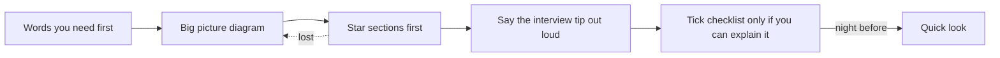
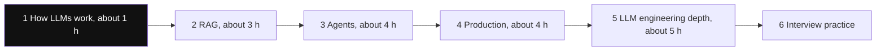

# Start Here

This section prepares you for LLM engineer and AI engineer interviews. It has 22 concept pages, 10 RAG pages and hands-on labs. Read them in the order below. Each page builds on the ones before it, so skipping ahead is the main reason pages feel hard.

**After this page you know:**

- What order to read the AI pages in, and why.
- Which page answers each kind of interview question.
- How to study one page so it sticks.

## How to read a page

Every page has the same shape. Use it like this:

1. **Words you need first.** Read this table before anything else. If a word in it is still unclear, open [How LLMs Work](14-how-llms-work.md).
2. **Big picture.** One diagram of the whole page. Come back to it when you get lost.
3. **⭐ sections first.** Interviewers ask about these most. On a first pass, skim the sections without a star.
4. **Interview tip and Common mistake.** Say the tip out loud once. That is how you remember it in the interview.
5. **Checklist.** Tick an item only if you can explain it without looking. The site tracks your progress from these ticks.
6. **Quick look.** A one-minute summary of the page. Read it the night before the interview.

*Diagram:* One pass through a page; when a section feels hard, the dotted arrow sends you back to the Big picture before you read on.

## The reading order

*Diagram:* Start at the highlighted stage 1; every later stage uses its words. About 17 hours of reading before interview practice.

### Stage 1: how a model works (about 1 hour)

| Page | Why first |
|---|---|
| [How LLMs Work](14-how-llms-work.md) | Tokens, attention, sampling, context window. Every other page uses these words. |

### Stage 2: giving the model knowledge, RAG (about 3 hours)

| Page | What you get |
|---|---|
| [What is RAG](../09-rag/01-what-is-rag.md) | Why models need retrieval, and RAG vs fine-tuning vs long context |
| [Semantic Search](../09-rag/02-semantic-search.md), [Chunking](../09-rag/03-chunking.md) | Embeddings and how documents are cut up |
| [Hybrid Search](../09-rag/04-hybrid-search.md), [Reranking](../09-rag/05-reranking.md) | How good retrieval systems really rank results |
| [Advanced Retrieval](../09-rag/07-advanced-retrieval.md), [RAG Evaluation](../09-rag/08-rag-evaluation.md) | Query rewriting, lost-in-the-middle, recall@k, faithfulness |
| [Vector Databases](../05-db/11-vector.md) | HNSW, IVF, pgvector, Qdrant, Pinecone |

### Stage 3: agents (about 4 hours)

| Page | What you get |
|---|---|
| [Agent Foundations](01-agent-foundations.md) | The agent loop, tool calling, workflow vs agent |
| [Workflow Patterns](03-workflow-patterns.md) | Chaining, routing, parallel, orchestrator-worker |
| [Agent & Multi-agent Patterns](04-agent-patterns.md) | ReAct, plan-and-execute, reflection, multi-agent |
| [Tools, MCP & A2A](07-tools-mcp-a2a.md) | Tool design, MCP servers and clients, sandboxing |
| [Memory & Context](05-memory-context.md) | Context engineering, short and long-term memory |
| [Data & Retrieval for Agents](06-agentic-data-rag.md) | Agentic RAG, GraphRAG, text-to-SQL |
| [LangGraph Core](02-langgraph-core.md) | One framework in depth: state, checkpoints, human-in-the-loop |

### Stage 4: making it production-grade (about 4 hours)

| Page | What you get |
|---|---|
| [Evals for Agents](09-agent-evals.md) | LLM-as-judge, trajectory evals, datasets |
| [AI Observability](10-agent-observability.md) | Traces, spans, OpenTelemetry GenAI |
| [Guardrails & Safety](08-guardrails.md) | Prompt injection, output checks, OWASP Top 10 for LLMs |
| [LLM Security and Governance](20-llm-security-governance.md) | Red teaming, permissions, secrets, EU AI Act, bias |
| [Cost & Latency](11-cost-latency.md) | Token economics, caching, routing |
| [LLMOps](21-llmops.md) | Prompt CI, A/B tests, canaries, provider fallbacks |
| [Agents in Production](12-agents-in-production.md) | Serving agents, durable execution, case studies |

### Stage 5: LLM engineering depth (about 5 hours)

| Page | What you get |
|---|---|
| [Inference and Serving](15-inference-serving.md) | KV cache, vLLM, batching, quantization, GPU sizing |
| [Fine-tuning and Post-training](16-fine-tuning.md) | SFT, LoRA, QLoRA, RLHF, DPO, GRPO, distillation |
| [Structured Outputs and Prompt Optimization](17-structured-outputs-prompting.md) | JSON schema, constrained decoding, DSPy |
| [Multimodal and Voice Agents](18-multimodal-voice.md) | Vision-language models, voice pipelines, turn detection |
| [Agent Frameworks and Tooling](19-agent-frameworks.md) | LangGraph, Claude Agent SDK, OpenAI Agents SDK, Pydantic AI, CrewAI, LlamaIndex |

### Stage 6: interview practice

| Page | What you get |
|---|---|
| [Agentic AI Interview Prep](13-agentic-interview-qa.md) | Agent rapid-fire and agent system designs |
| [LLM Engineer Interview Prep](22-llm-engineer-interview.md) | Fundamentals, serving and training rapid-fire, four design rounds, coding round |
| [RAG Interview Q&A](../09-rag/10-rag-interview-qa.md) | RAG chatbot design and rapid-fire |

Also run the **Labs** in the sidebar. Interviewers can tell when you have built something yourself.

## Where each interview topic lives

| Interview area | Pages |
|---|---|
| LLM fundamentals: transformer, attention, RoPE, BPE, MoE, sampling, reasoning models | [How LLMs Work](14-how-llms-work.md) |
| RAG, chunking, hybrid search, reranking, retrieval evals | [RAG pages](../09-rag/01-what-is-rag.md), [Data & Retrieval for Agents](06-agentic-data-rag.md) |
| Vector databases and index types | [Vector Databases](../05-db/11-vector.md) |
| Context engineering, lost in the middle, compaction | [Memory & Context](05-memory-context.md) |
| Tool calling, MCP, A2A | [Agent Foundations](01-agent-foundations.md), [Tools, MCP & A2A](07-tools-mcp-a2a.md) |
| Structured outputs, constrained decoding, DSPy | [Structured Outputs and Prompt Optimization](17-structured-outputs-prompting.md) |
| Serving: vLLM, KV cache, batching, speculative decoding, quantization, multi-LoRA | [Inference and Serving](15-inference-serving.md) |
| Model routing and cascades | [Cost & Latency](11-cost-latency.md), [Inference and Serving](15-inference-serving.md) |
| SFT, LoRA, RLHF, DPO, GRPO, distillation, synthetic data | [Fine-tuning and Post-training](16-fine-tuning.md) |
| ReAct, plan-and-execute, reflection, human-in-the-loop | [Agent & Multi-agent Patterns](04-agent-patterns.md), [LangGraph Core](02-langgraph-core.md) |
| Durable execution, sandboxing, computer-use agents | [Agents in Production](12-agents-in-production.md), [Tools, MCP & A2A](07-tools-mcp-a2a.md) |
| Prompt injection, jailbreaks, red teaming, least privilege, PII | [Guardrails & Safety](08-guardrails.md), [LLM Security and Governance](20-llm-security-governance.md) |
| Prompt CI, A/B tests, retries, fallbacks, cost per task, streaming | [LLMOps](21-llmops.md), [Cost & Latency](11-cost-latency.md) |
| Evals and observability tools | [Evals for Agents](09-agent-evals.md), [AI Observability](10-agent-observability.md) |
| Vision-language models, voice agents | [Multimodal and Voice Agents](18-multimodal-voice.md) |
| Agent frameworks | [Agent Frameworks and Tooling](19-agent-frameworks.md) |
| Responsible AI, EU AI Act, audit logging | [LLM Security and Governance](20-llm-security-governance.md) |

## Checklist

- [ ] I know the six stages and which pages belong to each.
- [ ] I have read How LLMs Work before the agent pages.
- [ ] I read the "Words you need first" table before each page.
- [ ] I can find the page for any interview topic using the table above.
- [ ] I have run at least one lab end to end.
- [ ] I read the Quick look of every page the day before my interview.
