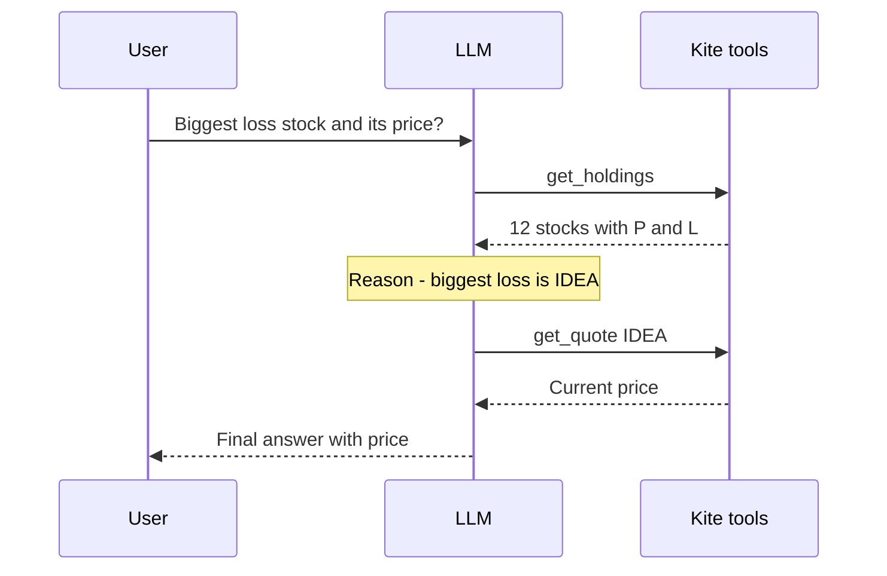
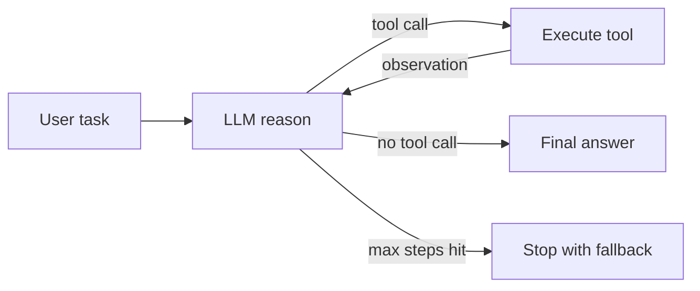
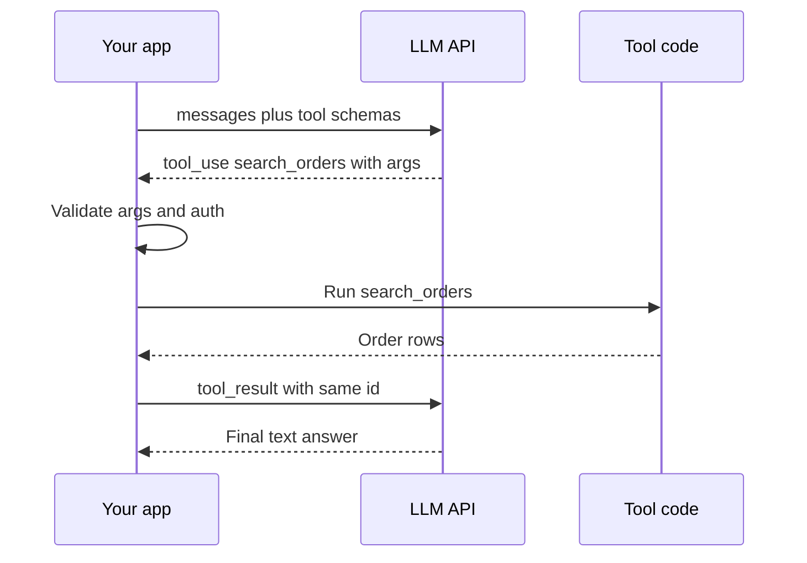
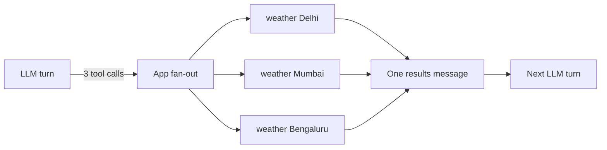
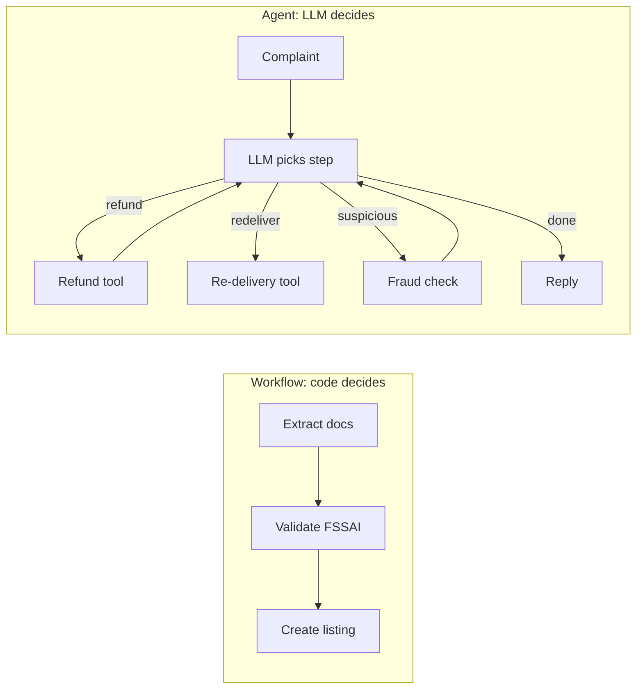

# Agent Foundations

What an agent is, how the agent loop (ReAct) runs, the exact message shape of tool calling, and when you should not build an agent at all. This is the first 15 minutes of most Agentic AI interviews: "agent vs workflow", "write the loop yourself", "what if a tool fails". Get this wrong and the rest of the round looks weak too.

## What is an agent

**In one line:** agent = **LLM + tools + memory + loop**, where the LLM itself decides the next step and when to stop.

> **Example:** Swiggy support bot. "My order is late, refund me." A chatbot only writes a reply. A workflow runs fixed steps (fetch order → check policy → reply). An agent decides on its own: first `get_order_status`, then, seeing a 40 min delay, `check_refund_policy`, then `issue_refund` or escalate to a human.

- **LLM (brain):** reasons and chooses the next action.
- **Tools (hands):** APIs, DB queries, search, code execution. The LLM only *requests* a call; your code *executes* it.
- **Memory:** short-term = conversation/messages in context; long-term = store/vector DB across sessions (details: [Memory & Context](05-memory-context.md)).
- **Loop:** LLM → tool → result back to LLM → ... until a final answer or a stop condition.

| | Chatbot | Workflow | Agent |
|---|---|---|---|
| Who decides control flow | nobody, one call | your code (fixed path) | the LLM (dynamic) |
| Tools | no | yes, fixed order | yes, LLM chooses |
| Steps | 1 | fixed N | unknown, loop |
| Predictability | high | high | low |
| Cost/latency | low | predictable | variable, higher |

- **Anthropic's framing ("Building effective agents"):** both are "agentic systems".
  - **Workflows:** LLMs and tools are orchestrated through **predefined code paths**.
  - **Agents:** the LLM **dynamically directs its own process and tool usage**.
  - Advice: start with the simplest solution; add complexity only when it brings a measurable gain.

**Interview tip:** "The defining property of an agent is autonomy over control flow. If my code decides the next step, it is a workflow, even if it contains an LLM."

**Common mistake:** calling every LLM + tool system an "agent". A fixed chain with one tool call is a workflow.

## ⭐ The agent loop and ReAct

**In one line:** ReAct = **Re**ason + **Act**: the model thinks, calls a tool, looks at the result (observation), then thinks again, until the task is done.

> **Example:** Zerodha Kite assistant: "Which stock in my portfolio has the biggest loss, and what is its price today?" Step 1: `get_holdings()`. Observe: 12 stocks with P&L. Reason: the biggest loss is IDEA. Step 2: `get_quote("IDEA")`. Observe: the price. Step 3: final answer.



The Zerodha example as a trace: every tool result goes back to the LLM as an observation, and the LLM picks the next step itself.

- **Perceive:** user input + previous observations in context.
- **Reason:** the model decides: is a tool needed, or is the answer ready.
- **Act:** emit a tool call (name + JSON args).
- **Observe:** the tool result goes back into context as a message.
- The original ReAct paper (Yao et al., 2022) used a text format: `Thought: ... Action: ... Observation: ...`. Today we use **native tool calling**; the "thought" happens inside the model (or in reasoning tokens), and the action is structured JSON.
- **Stop conditions:** the model replies without a tool call (`stop_reason="end_turn"` / `finish_reason="stop"`), `max_steps` is hit, a budget/time limit, or a guardrail trigger.



A from-scratch loop (Anthropic Messages API shape). Without a framework, this is all there is:

```python
import json
import anthropic

client = anthropic.Anthropic()
TOOLS = [{
    "name": "get_order_status",
    "description": "Returns the order's current status and delay in minutes.",
    "input_schema": {"type": "object",
                     "properties": {"order_id": {"type": "string"}},
                     "required": ["order_id"]},
}]
REGISTRY = {"get_order_status": lambda order_id: {"status": "out_for_delivery", "delay_min": 40}}

def run_agent(user_msg: str, max_steps: int = 8) -> str:
    messages = [{"role": "user", "content": user_msg}]
    for _ in range(max_steps):
        resp = client.messages.create(model="claude-sonnet-4-5", max_tokens=1024,
                                      system="You are a Swiggy support agent.",
                                      tools=TOOLS, messages=messages)
        messages.append({"role": "assistant", "content": resp.content})
        if resp.stop_reason != "tool_use":          # no tool call = final answer
            return "".join(b.text for b in resp.content if b.type == "text")
        results = []
        for block in resp.content:
            if block.type != "tool_use":
                continue
            try:
                out = REGISTRY[block.name](**block.input)
                results.append({"type": "tool_result", "tool_use_id": block.id,
                                "content": json.dumps(out)})
            except Exception as e:                    # an error is an observation too
                results.append({"type": "tool_result", "tool_use_id": block.id,
                                "content": f"Error: {e}", "is_error": True})
        messages.append({"role": "user", "content": results})  # all results in one message
    return "Step limit reached, escalating to a human."
```

- The same thing in the OpenAI shape: `resp.choices[0].message.tool_calls`, each result as `{"role": "tool", "tool_call_id": ..., "content": ...}`, and `finish_reason == "tool_calls"`.
- A framework (LangGraph) gives you this loop + persistence, streaming, HITL. Details: [LangGraph Core](02-langgraph-core.md).

**Interview tip:** be able to write this loop on a whiteboard in 2 minutes: messages list, model call, `stop_reason` check, execute tools, append results, `max_steps`. The interviewer wants to see that you understand the loop more than any framework.

**Common mistake:** not matching `tool_use_id`/`tool_call_id`, or forgetting to append the assistant's tool-call message to history. Both make the API return a 400 error.

## LLM basics that matter for agents

**In one line:** tokens, context window, temperature, stop reasons and structured output: these five decide an agent's cost, reliability and parsing.

> **Example:** a Razorpay dispute agent reads a 300 KB settlement report through a tool. Putting the raw JSON in context costs 80k tokens, billed again on every loop step. When the tool returned a summary + top 20 rows, it was 3k tokens.

- **Tokens:** ~4 characters ≈ 1 token (English). Hinglish/Hindi uses more tokens. Cost = input + output tokens; in an agent, **the whole history is sent again as input** on every step, so cost grows roughly quadratically with steps.
- **Context window:** how much the model can see in one call (128k–1M). A big window ≠ good recall: content in the middle gets missed ("lost in the middle"). Plan a context budget.
- **Temperature:** keep it low (0–0.3) for an agent's tool selection; higher for creative writing. Reasoning models often fix or ignore temperature.
- **Max tokens:** the output limit. If hit, the answer or tool JSON gets cut off midway.

| Stop reason (Anthropic) | OpenAI `finish_reason` | What to do in the agent loop |
|---|---|---|
| `end_turn` | `stop` | final answer, end the loop |
| `tool_use` | `tool_calls` | run tools, send results back |
| `max_tokens` | `length` | truncated: retry with a higher limit or "continue" |
| `stop_sequence` | `stop` | a custom stop string was hit |
| `refusal` | `content_filter` | safe fallback / human |

- **Structured output:** parsing free text is fragile. Options: JSON mode (valid JSON, no schema guarantee), **JSON schema / strict mode** (schema guaranteed), or the tool-calling trick (make the schema a tool).

```python
from pydantic import BaseModel, Field
from langchain.chat_models import init_chat_model

class RefundDecision(BaseModel):
    eligible: bool
    amount_inr: int = Field(ge=0, description="Refund amount in rupees")
    reason: str

llm = init_chat_model("openai:gpt-4.1-mini", temperature=0)
judge = llm.with_structured_output(RefundDecision)   # uses tool calling / JSON schema under the hood
d = judge.invoke("Order 40 min late, value 450 INR, policy: >30 min late = full refund")
print(d.eligible, d.amount_inr)                       # typed Pydantic object
```

**Interview tip:** "Think about agent cost per **trajectory**, not per step: every step resends the whole context. That is why I trim tool outputs and use prompt caching."

**Common mistake:** setting a small `max_tokens` and then trying to parse truncated tool-call JSON; not checking `stop_reason` at all.

## ⭐ Tool / function calling

**In one line:** you give the model each tool's **name + description + JSON schema**; the model returns a structured call; your code runs it and sends the result back.

> **Example:** tools for a Flipkart seller assistant: `search_orders(status, date_from)`, `get_inventory(sku)`, `update_price(sku, new_price)`. "Show yesterday's cancelled orders" → the model emits `search_orders(status="cancelled", date_from="2026-11-01")`.

- **The model does not execute anything.** It only gives intent + args. Auth, validation and rate limits live in your code.



The model only returns a `tool_use` block; validating args, running the tool and sending back a `tool_result` with the same id is your app's job.

- **The description is a prompt.** The model picks tools based on it. Write when to use it, when not, the arg format, examples.
- **Keep the schema tight:** `enum`, `required`, formats. Fewer, clearer params are better.

| Setting | OpenAI | Anthropic | When |
|---|---|---|---|
| Model decides | `tool_choice="auto"` | `{"type": "auto"}` | default |
| Must use some tool | `"required"` | `{"type": "any"}` | extraction, forced action |
| Specific tool | `{"type": "function", "function": {"name": "x"}}` | `{"type": "tool", "name": "x"}` | structured output |
| No tools | `"none"` | `{"type": "none"}` | final summary step |
| Parallel off | `parallel_tool_calls=False` | `disable_parallel_tool_use: true` | order-dependent tools |

- **Parallel tool calls:** multiple calls in one turn (e.g. weather for 3 cities). If independent, run them concurrently (`asyncio.gather`) and send all results in **one** next message.



Run independent calls from one turn concurrently, and send all results back in a single next message.

- **Tool errors = observations:** do not crash on exceptions. Return a clear error message ("order_id must be in the format ORD-XXXX") so the model can self-correct. Limit the retry count.

```python
from langchain_core.tools import tool
from langchain.chat_models import init_chat_model

@tool
def get_inventory(sku: str) -> dict:
    """Returns live stock for one SKU. SKU format: 'FK-' + 6 digits. Do not use for prices."""
    if not sku.startswith("FK-"):
        raise ValueError("SKU must start with 'FK-', e.g. FK-102938")
    return {"sku": sku, "stock": 42, "warehouse": "BLR-2"}

llm = init_chat_model("anthropic:claude-sonnet-4-5", temperature=0)
llm_with_tools = llm.bind_tools([get_inventory], tool_choice="auto", parallel_tool_calls=True)
msg = llm_with_tools.invoke("Give me stock for FK-102938 and FK-554411")
for call in msg.tool_calls:          # [{'name': 'get_inventory', 'args': {...}, 'id': ...}, ...]
    print(call["name"], call["args"])
```

**Interview tip:** "I write tool descriptions like prompts and return tool errors as structured observations. I catch hallucinated args with schema validation and tell the model the correct format."

**Common mistake:** giving 30–50 tools at once. Selection accuracy drops. Group tools, give a subset through a router, or load tools dynamically.

## Prompt engineering for agents

**In one line:** an agent's system prompt is a **job description + operating manual**: role, goal, when to use which tools, constraints, and when to stop or escalate.

> **Example:** the PhonePe KYC agent's prompt says: "Never print full PAN or Aadhaar numbers, show only the last 4 digits. After 2 failed verifications, call `escalate_to_human`."

- **System prompt anatomy:**
  1. Role + goal ("You are a PhonePe KYC support agent...")
  2. Context (user tier, date, locale), injected dynamically
  3. Tool usage guidelines (when to use which, order, what not to do)
  4. Constraints/policies (PII, refund limits, tone)
  5. Output format (JSON schema or markdown rules)
  6. Stop/escalation rules
- **Few-shot:** 2–5 examples of good trajectories (not only final answers). Keep them diverse, or the model copies one pattern.
- **CoT / reasoning models:** on a non-reasoning model, "think step by step" helps. Reasoning models (o-series, Claude extended thinking) think on their own; do not micro-manage them, give goals and constraints. Thinking tokens are billed too.
- **Templates:** `ChatPromptTemplate` / f-strings with variables; static part first, dynamic part last (keep the prefix stable for prompt caching).
- **Versioning:** a prompt is code. Version it in git or a prompt registry (LangSmith/Langfuse), gate every change with the eval suite. Log the prompt version in traces. Details: [Evals for Agents](09-agent-evals.md).

**Interview tip:** "I treat a prompt change like a deploy: version, eval run, then rollout. Any trace should tell me which prompt version ran."

**Common mistake:** everything in one giant prompt with contradictory rules; and editing prompts in production without evals.

## ⭐ Workflows vs agents

**In one line:** when the steps are known up front, use a **workflow** (deterministic, cheap, testable); when the path depends on the input and cannot be enumerated in advance, use an **agent**.

> **Example:** Zomato restaurant onboarding: extract documents → validate FSSAI → create listing. Fixed steps, a workflow. Versus "resolve the customer's complaint": sometimes a refund, sometimes re-delivery, sometimes a fraud check. Unknown path, an agent.



In a workflow the path is fixed in code; in an agent the LLM picks the next tool at every step and loops on the result.

| Question | Yes → | No → |
|---|---|---|
| Can you write the steps up front? | Workflow | Consider an agent |
| Is a wrong action costly / irreversible? | Workflow + HITL | Agent ok |
| Strict latency/cost SLA? | Workflow | Agent ok |
| Very high input variety, open-ended? | Agent | Workflow |
| Need auditable, repeatable output? | Workflow | Agent |
| Unknown number of steps (research, debugging)? | Agent | Workflow |

- **Hybrid is most common:** a workflow skeleton with a small agent inside one or two nodes (e.g. an "investigate" step).
- Workflow patterns (chaining, routing, parallelization, orchestrator-workers, evaluator-optimizer): [Workflows](03-workflow-patterns.md).

**Interview tip:** "I start with a workflow by default and build an agent only when evals show a fixed path is not enough. An agent trades cost, latency and predictability for flexibility."

**Common mistake:** building a ReAct agent for a fixed 3-step process; then getting random tool order and 5x cost.

## Levels of autonomy

**In one line:** autonomy is a spectrum, from a single LLM call to a fully autonomous agent; each level gives less control and more capability.

> **Example:** Paytm support's evolution: L0 FAQ answer (single call) → L1 intent router → L2 tool agent (order lookup, refund) → L3 multi-agent (payments + KYC + disputes specialists) → L4 background agent that monitors fraud patterns itself and opens tickets.

| Level | What | Who decides | Example | Risk |
|---|---|---|---|---|
| L0 Single call | prompt → answer | nobody | summarize ticket | low |
| L1 Router | LLM picks a category, code runs it | LLM picks one branch | intent → team | low |
| L2 Tool agent | loop with tools | LLM picks steps + tools | refund agent | medium |
| L3 Multi-agent | supervisor + specialists | LLMs coordinate | research + writer | high |
| L4 Autonomous | long-running, self-triggered goals | agent end-to-end | coding agent opens a PR | highest |

- As you raise the level, also raise: guardrails, HITL, observability, evals. Details: [Agent Patterns](04-agent-patterns.md), [Guardrails](08-guardrails.md).

**Interview tip:** "Solve the problem at the lowest level that works. Go to L3/L4 only when a single agent cannot handle the tool list or the context."

**Common mistake:** treating multi-agent as the default. Every extra agent = extra tokens, handoff errors, debugging pain.

## Common failure modes

**In one line:** agents mostly fail in four ways: getting stuck in loops, the wrong tool, hallucinated args, and context overflow; each has a specific fix.

> **Example:** a Swiggy agent calls `get_order_status` 9 times with the same args because the tool returns "pending" and the prompt says "keep checking until the status is final".

| Failure | Symptom | Fix |
|---|---|---|
| Infinite / repetitive loop | same tool + same args again and again | `max_steps`/recursion limit, repeat detection, "no progress" check |
| Tool misuse | wrong tool chosen, or a call when none is needed | better descriptions, fewer tools, few-shot trajectories |
| Hallucinated args | non-existent IDs, wrong format | schema + enum, validation error as observation, IDs only from tool output |
| Context overflow | forgets earlier steps, 400 error | trim tool output, summarization, sub-agent with fresh context |
| Premature stop | does half the work and says "done" | completion criteria in the prompt, evaluator step |
| Prompt injection via tool output | a web page gives the agent instructions | treat tool output as data, guardrails |
| Error swallowing | tool fails, agent confidently gives a wrong answer | `is_error` flag, explicit "tool failed" handling |

- Measure it: trajectory evals (right tool, right order, step count). Details: [Evals](09-agent-evals.md), [Observability](10-agent-observability.md).

**Interview tip:** "Every agent has three hard limits: max steps, max tokens/cost, and a wall-clock timeout. When a limit is hit, fall back gracefully, do not crash."

**Common mistake:** checking only the final answer. An agent can reach the right answer by the wrong path (10 extra calls); look at the trajectory.

## Read next

- [LangGraph Core Concepts](02-langgraph-core.md): the same loop with graph + state + checkpointing.
- [Agentic Patterns: Workflows](03-workflow-patterns.md) and [Agents & Multi-agent](04-agent-patterns.md).
- [Tools, MCP & A2A](07-tools-mcp-a2a.md): exposing tools in a standard way.
- [ReAct lab](/viewinter/agents/lab/react): run a ReAct loop step by step in the browser.

## Checklist

- [ ] I can explain the difference between an agent, a workflow and a chatbot based on control flow
- [ ] I can explain the ReAct loop (reason, act, observe) and its stop conditions
- [ ] I can write a tool-calling agent loop in plain Python without a framework
- [ ] I can explain stop reasons and how to use structured output (`with_structured_output`)
- [ ] I can explain tool schemas, `tool_choice`, parallel tool calls and tool error handling
- [ ] I can explain the anatomy of an agent system prompt and prompt versioning
- [ ] I can justify workflow vs agent with a decision table
- [ ] I can explain autonomy levels L0–L4 and the risk at each level
- [ ] I can list common failure modes and their fixes
