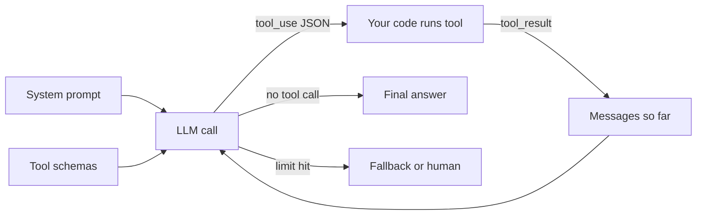
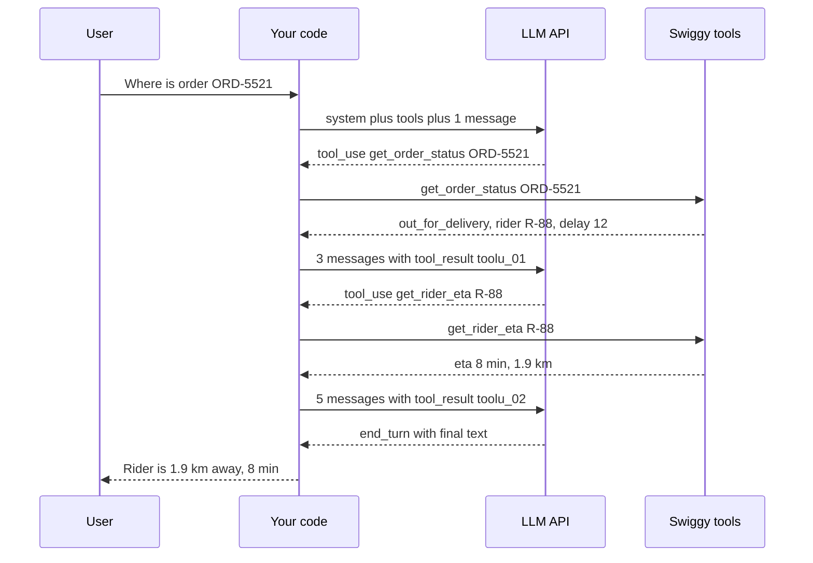
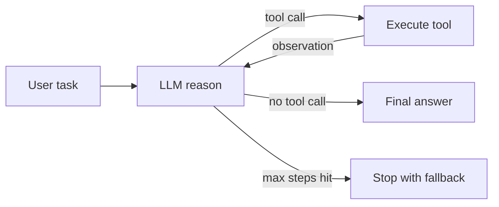
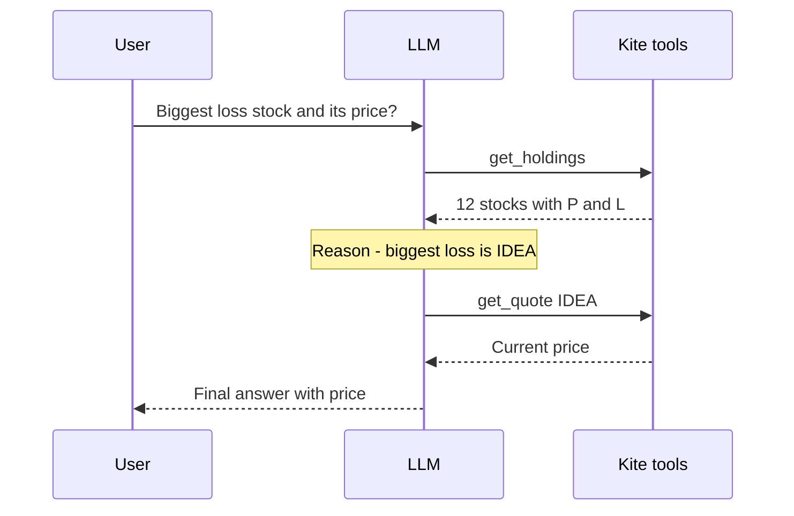
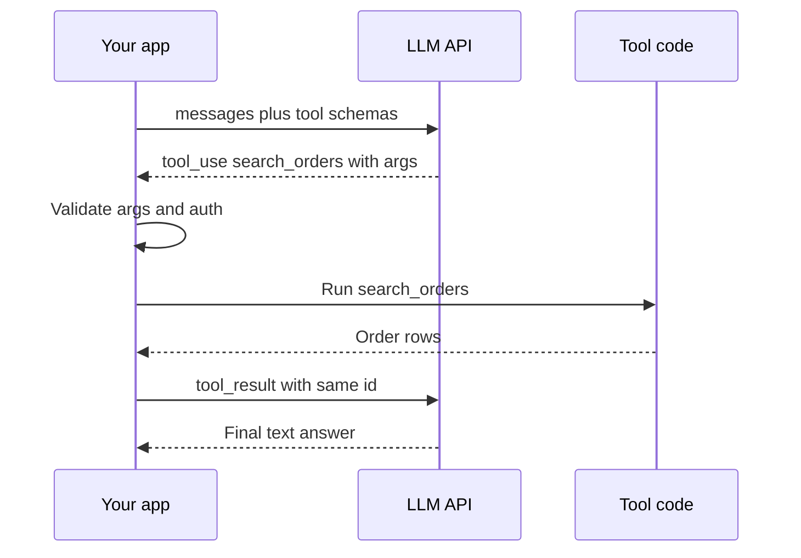
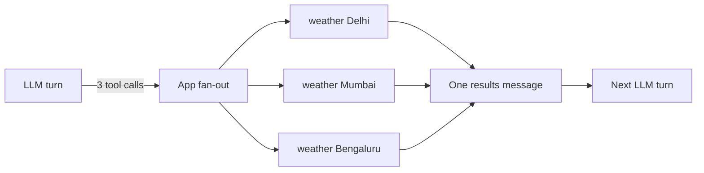
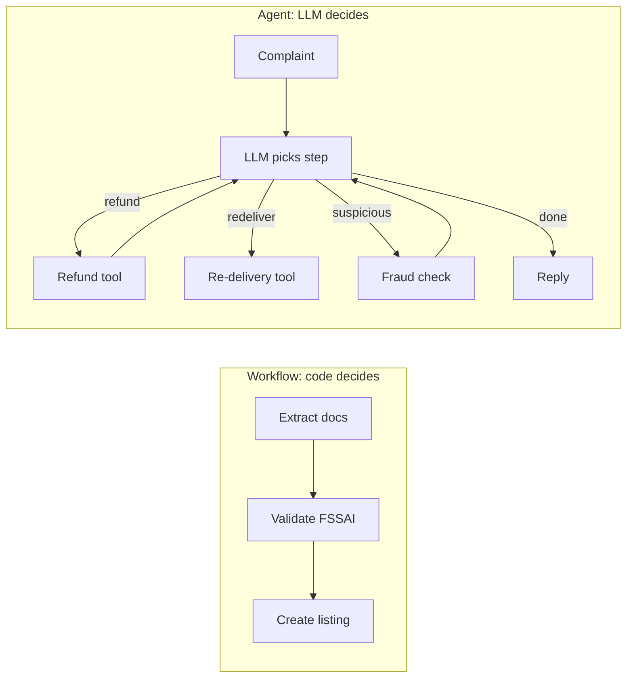

# Agent Foundations

The first 15 minutes of most Agentic AI interviews live on this page: "agent vs workflow", "write the loop yourself", "what if a tool fails". Here we follow one real request from start to end, so you can see how data moves inside an agent.

**After this page you can explain:**

- The full journey of one request inside an agent: the system prompt and tools go out, the LLM returns `tool_use` JSON, your code runs the function, the result goes back, and the final answer comes out.
- How the messages list grows every turn, and why that makes agents expensive.
- Tokens, context window and temperature, with small numbers.
- How to do the same task as a workflow and as an agent, and when to pick which.
- Where agents fail and the fix for each failure.

## Big picture: what happens inside an agent

An agent is not magic. It is a `for` loop. In the loop you send the LLM three things: instructions (the system prompt), the list of tools, and the conversation so far (messages). The LLM either gives a final answer, or says "run this tool with these arguments". Your code runs the tool, not the LLM. The result is added to the messages and the loop runs again. Every section on this page explains one part of this loop.



The full loop is in "The agent loop and ReAct", `tool_use`/`tool_result` in "Tool calling", the cost of messages and tokens in "LLM basics", the system prompt in "Prompt engineering", whether you need a loop at all in "Workflows vs agents" and "Levels", and limit hits / wrong tools in "Failure modes".

## What is an agent

**Why do we need it?** A normal chatbot only writes text. Ask "where is my Swiggy order?" and it cannot see the order at all. It will either say "check the app" or make something up. To do real work it has to read data and take actions. That is what an agent does.

**Analogy: a new support executive at a Swiggy call center.** Their brain = the LLM. The order panel and refund panel open on their screen = tools. The notepad with the customer's words = memory. Checking again and again until the issue is solved = the loop. The manager's rulebook = the system prompt. The executive never touches the database directly. They type the order id into a panel, and the panel shows the result. In the same way, the LLM only *requests* a tool, and your code *executes* it.

**One example, step by step:** the user says "My order is late, give me a refund."

1. The agent asks for `get_order_status`. Result: 40 min delay.
2. 40 > 30, so it asks for `check_refund_policy`. Policy: full refund.
3. It asks for `issue_refund`, then writes the reply: "Refund done."

Which step comes first, which comes next, when to stop: the LLM decided all of it. That is what makes it an agent.

**Now the terms:**

- **LLM (brain):** thinks and picks the next action.
- **Tools (hands):** APIs, DB queries, search, code execution. The LLM only asks; your code runs them.
- **Memory:** short-term = the messages of this conversation; long-term = a store or vector DB across sessions (detail: [Memory & Context](05-memory-context.md)).
- **Loop:** LLM → tool → result back to LLM → ... until a final answer or a stop condition.

| | Chatbot | Workflow | Agent |
|---|---|---|---|
| Who decides control flow | nobody, one call | your code (fixed path) | the LLM (dynamic) |
| Tools | no | yes, fixed order | yes, the LLM chooses |
| Steps | 1 | fixed N | unknown, loop |
| Predictability | high | high | low |
| Cost/latency | low | predictable | variable, higher |

- **Anthropic framing ("Building effective agents"):** both are "agentic systems".
  - **Workflows:** LLMs and tools are orchestrated through **predefined code paths**.
  - **Agents:** the LLM **dynamically directs its own process and tool usage**.
  - Advice: start with the simplest solution; add complexity only when it gives a measurable gain.

**In one line:** agent = **LLM + tools + memory + loop**, where the LLM itself decides the next step and when to stop.

**Interview tip:** "The defining property of an agent is autonomy over control flow. If my code decides the next step, it is a workflow, even if it contains an LLM."

**Common mistake:** calling every LLM + tool system an "agent". A fixed chain with one tool call is a workflow.

## ⭐ The agent loop and ReAct

**Why do we need it?** In one LLM call the model can speak only once. But for "where is my order?" you first have to look up the order, then the rider's location. The second step depends on the result of the first. So you must call the LLM again and again, each time with the new result. That is the loop.

**Analogy: the IRCTC enquiry counter.** You ask "where is 12951?". The clerk types the train number into the computer (act). The screen says "crossed Kota" (observation). The clerk thinks "I need the Kota to Delhi time" (reason). Then checks the computer again. Only when the full answer is ready does the clerk tell you. Clerk = LLM, computer = tool, the screen's result = observation.

### One full run, turn by turn

User: **"Where is my order ORD-5521? It has been 40 min."**

We have two tools: `get_order_status(order_id)` and `get_rider_eta(rider_id)`.

**Step 1: your code sends the first API call.** Three things go in:

```json
{
  "system": "You are a Swiggy support agent. Check the data first, then answer.",
  "tools": [
    {"name": "get_order_status", "description": "Returns order status, rider_id and delay.",
     "input_schema": {"type": "object", "properties": {"order_id": {"type": "string"}}}},
    {"name": "get_rider_eta", "...": "same shape"}
  ],
  "messages": [
    {"role": "user", "content": "Where is my order ORD-5521? It has been 40 min."}
  ]
}
```

**Step 2: the LLM does not answer, it asks for a tool.** The response has `stop_reason` = `"tool_use"` and a `tool_use` block in the content:

```json
{
  "stop_reason": "tool_use",
  "content": [
    {"type": "text", "text": "Let me check the order status."},
    {"type": "tool_use", "id": "toolu_01", "name": "get_order_status", "input": {"order_id": "ORD-5521"}}
  ]
}
```

**Step 3: your code runs the function.** `get_order_status("ORD-5521")` returns `{"status": "out_for_delivery", "rider_id": "R-88", "delay_min": 12}`.

**Step 4: two messages are appended.** First the LLM's own reply (assistant), then the tool result (in the user role, with the same id `toolu_01`):

```json
[
  {"role": "user", "content": "Where is my order ORD-5521? It has been 40 min."},
  {"role": "assistant", "content": [{"type": "tool_use", "id": "toolu_01", "name": "get_order_status", "input": {"order_id": "ORD-5521"}}]},
  {"role": "user", "content": [{"type": "tool_result", "tool_use_id": "toolu_01",
    "content": "{\"status\": \"out_for_delivery\", \"rider_id\": \"R-88\", \"delay_min\": 12}"}]}
]
```

**Step 5: second API call, with the whole list.** The LLM can now see `rider_id: R-88`. It asks for a tool again: `get_rider_eta` with `{"rider_id": "R-88"}`, id `toolu_02`. Notice: the LLM did not invent `R-88`; it took it from the previous tool result.

**Step 6: your code runs it, and the result comes back** `{"eta_min": 8, "distance_km": 1.9}`. Two more messages are appended.

**Step 7: third API call.** Now the LLM has everything. `stop_reason` = `"end_turn"`, no `tool_use`. Text: "Your order is with the rider, 1.9 km away, about 8 min out. Sorry for the 12 min delay." The loop ends.

How the messages list grew each turn:

| API call | Messages sent | What the LLM returned | Messages after |
|---|---|---|---|
| 1 | 1 (user) | `tool_use` get_order_status | 3 |
| 2 | 3 | `tool_use` get_rider_eta | 5 |
| 3 | 5 | final text (`end_turn`) | 6 |

Every call sends **the whole list again**. The LLM has no memory of its own; whatever is in the list is its memory.



### Now the terms

ReAct = **Re**ason + **Act**. In the run above, these four things happened again and again:

- **Perceive:** user input + earlier observations in the context (the messages list).
- **Reason:** the model decides: is a tool needed, or is the answer ready?
- **Act:** it emits a tool call (name + JSON args).
- **Observe:** the tool result goes back into the context as a message.
- The original ReAct paper (Yao et al., 2022) used a text format: `Thought: ... Action: ... Observation: ...`. Today we use **native tool calling**; the "thought" happens inside the model (or in reasoning tokens), and the action is structured JSON.
- **Stop conditions:** the model replies without a tool call (`stop_reason="end_turn"` / `finish_reason="stop"`), `max_steps` is hit, a budget/time limit runs out, or a guardrail triggers.



One more example, same pattern. Zerodha Kite assistant: "Which stock in my portfolio has the biggest loss, and what is its price today?"



Here too the second tool call (`get_quote IDEA`) depends on the first result. Fixed code cannot write this in advance, so you need a loop.

### Code: the loop without a framework

The code below runs the Swiggy example above with the Anthropic Messages API. Without a framework, this is all an agent is.

```python
import json
import anthropic

client = anthropic.Anthropic()

# The tool "menu" the LLM will see: name, job, and args schema
TOOLS = [
    {"name": "get_order_status",
     "description": "Returns order status, rider_id and delay minutes.",
     "input_schema": {"type": "object",
                      "properties": {"order_id": {"type": "string"}},
                      "required": ["order_id"]}},
    {"name": "get_rider_eta",
     "description": "How far the rider is and in how many minutes they arrive.",
     "input_schema": {"type": "object",
                      "properties": {"rider_id": {"type": "string"}},
                      "required": ["rider_id"]}},
]

# The real Python functions. The LLM never runs these itself.
REGISTRY = {
    "get_order_status": lambda order_id: {"status": "out_for_delivery", "rider_id": "R-88", "delay_min": 12},
    "get_rider_eta": lambda rider_id: {"eta_min": 8, "distance_km": 1.9},
}

def run_agent(user_msg: str, max_steps: int = 8) -> str:
    messages = [{"role": "user", "content": user_msg}]          # memory = this list
    for _ in range(max_steps):                                   # hard limit
        resp = client.messages.create(
            model="claude-sonnet-5-5", max_tokens=1024,
            system="You are a Swiggy support agent. Check the data first, then answer.",
            tools=TOOLS, messages=messages)
        messages.append({"role": "assistant", "content": resp.content})  # save the LLM's turn
        if resp.stop_reason != "tool_use":                       # no tool call = final answer
            return "".join(b.text for b in resp.content if b.type == "text")

        results = []
        for block in resp.content:
            if block.type != "tool_use":
                continue
            try:
                out = REGISTRY[block.name](**block.input)        # your code runs it
                results.append({"type": "tool_result", "tool_use_id": block.id,
                                "content": json.dumps(out)})
            except Exception as e:                               # an error is an observation too
                results.append({"type": "tool_result", "tool_use_id": block.id,
                                "content": f"Error: {e}", "is_error": True})
        messages.append({"role": "user", "content": results})    # all results in one message
    return "Step limit reached, escalating to a human."
```

**What the code does:**

- The `messages` list is the agent's memory. Every turn adds the assistant reply and the tool results to it.
- `stop_reason != "tool_use"` means the LLM asked for no tool, so that reply is the final answer.
- `REGISTRY[block.name](**block.input)` runs the real function. The LLM only gave the name and args.
- Every result carries the same `tool_use_id`, so the LLM knows which result belongs to which call.
- `max_steps` stops the loop from running forever; at the limit we escalate to a human.

- The same thing in the OpenAI shape: `resp.choices[0].message.tool_calls`, each call's result is `{"role": "tool", "tool_call_id": ..., "content": ...}`, and `finish_reason == "tool_calls"`.
- A framework (LangGraph) gives you this same loop + persistence, streaming, HITL. Detail: [LangGraph Core](02-langgraph-core.md).

**In one line:** ReAct = the model thinks, calls a tool, looks at the result (observation), then thinks again, until the task is done.

**Interview tip:** be able to write this loop on a whiteboard in 2 minutes: messages list, model call, `stop_reason` check, execute tools, append results, `max_steps`. The interviewer wants to see that you understand the loop more than any framework.

**Common mistake:** not matching `tool_use_id`/`tool_call_id`, or forgetting to append the assistant's tool-call message to history. Both make the API return a 400 error.

## ⭐ Tool / function calling

**Why do we need it?** An LLM can only produce text. Tell it "get the order from the DB" and it will write SQL but not run it. And if you parse its free text to take actions ("sure, I will refund you"), the format is different every time. Tool calling gives a fixed contract: the model says in structured JSON "this function, these args".

**Analogy: a restaurant.** The menu card (dish name + description) = tool name + description. The order slip format (dish, quantity) = JSON schema. The customer's filled slip "Paneer Tikka, 2 plates" = the `tool_use` block. The kitchen = your function. The plate that arrives with the table number = the `tool_result` with the same id.

The customer never walks into the kitchen. In the same way, **the model does not execute anything.** It only gives intent + args. Auth, validation and rate limits live in your code.

**One example, step by step:** a Flipkart seller assistant. Tools: `search_orders(status, date_from)`, `get_inventory(sku)`, `update_price(sku, new_price)`. The seller says "Show yesterday's cancelled orders" (today is 2 Nov 2026).

1. The app sends messages + the schemas of all three tools. The model reads the descriptions and returns: `{"name": "search_orders", "input": {"status": "cancelled", "date_from": "2026-11-01"}, "id": "toolu_7"}`.
2. The app checks: is `status` in the enum? Is the date valid? Is the seller logged in? Then it runs the function and gets 4 order rows.
3. The app sends a `tool_result` (`tool_use_id: "toolu_7"`). The model reads the rows and writes a text answer.



**Now the terms:**

- **Tool schema:** name + description + JSON schema of the args. This is the "menu" the model sees.
- **Description = prompt.** The model chooses tools from it. Write when to use it, when not to, the args format, and examples.
- **Keep the schema tight:** `enum`, `required`, formats. Fewer, clearer params are better.
- **`tool_choice`:** how much freedom the model has to use tools.

| Setting | OpenAI | Anthropic | When |
|---|---|---|---|
| Model decides | `tool_choice="auto"` | `{"type": "auto"}` | default |
| Must use some tool | `"required"` | `{"type": "any"}` | extraction, forced action |
| Specific tool | `{"type": "function", "function": {"name": "x"}}` | `{"type": "tool", "name": "x"}` | structured output |
| No tools | `"none"` | `{"type": "none"}` | final summary step |
| Parallel off | `parallel_tool_calls=False` | `disable_parallel_tool_use: true` | order-dependent tools |

### Parallel tool calls

**Why do we need it?** The user asks "weather in Delhi, Mumbai and Bengaluru?". One call per turn would cost 3 LLM round trips. The model can return three `tool_use` blocks in a single turn.

1. The model returns 3 blocks in one response: `get_weather("Delhi")` id `t1`, `Mumbai` id `t2`, `Bengaluru` id `t3`.
2. All three are independent, so the app runs them together (`asyncio.gather`): `t1 → 31°C`, `t2 → 29°C`, `t3 → 24°C`.
3. The app sends **one** user message with three `tool_result` blocks, each with its own id. The model combines them in the next turn.



### Tool errors are observations too

When a tool fails, do not crash the program. Send back a clear error message so the model can fix itself.

1. The model sends `get_inventory("102938")`. The tool returns `Error: SKU must start with 'FK-', e.g. FK-102938` with `is_error: true`.
2. The model reads this and sends `get_inventory("FK-102938")`. Done. Limit the retry count (2–3).

Below is the same tool in LangChain. The `@tool` decorator turns the docstring into the description and the type hints into the schema.

```python
from langchain_core.tools import tool
from langchain.chat_models import init_chat_model

@tool
def get_inventory(sku: str) -> dict:
    """Returns live stock for one SKU. SKU format: 'FK-' + 6 digits. Do not use for price."""
    if not sku.startswith("FK-"):                       # clear error on a wrong format
        raise ValueError("SKU must start with 'FK-', e.g. FK-102938")
    return {"sku": sku, "stock": 42, "warehouse": "BLR-2"}

llm = init_chat_model("anthropic:claude-sonnet-5-5", temperature=0)
llm_with_tools = llm.bind_tools([get_inventory], tool_choice="auto", parallel_tool_calls=True)
msg = llm_with_tools.invoke("Tell me the stock for FK-102938 and FK-554411")
for call in msg.tool_calls:          # [{'name': 'get_inventory', 'args': {...}, 'id': ...}, ...]
    print(call["name"], call["args"])
```

**What the code does:**

- `@tool` turns the function into a tool schema. The docstring is the description the model reads.
- `bind_tools` makes every LLM call send this schema.
- We asked for two SKUs, so `msg.tool_calls` holds two calls (parallel), each with its own `id`.
- This code did not run the tool; it only printed the model's request. Running it is the next step (a loop or `ToolNode`).

**In one line:** you give the model each tool's **name + description + JSON schema**; the model returns a structured call; your code runs it and sends the result back.

**Interview tip:** "I write tool descriptions like prompts and return tool errors as structured observations. I catch hallucinated args with schema validation and tell the model the correct format."

**Common mistake:** giving 30–50 tools at once. Selection accuracy drops. Group tools, give a subset through a router, or load tools dynamically.

## LLM basics that matter for agents

**Why do we need it?** We saw that the whole messages list is sent again every turn. So the agent's bill, its speed, and when it starts "forgetting" all depend on tokens and the context window. If you skip this, the agent works in the demo and gets shut down in production when the bill arrives.

**Analogy: an STD booth meter.** Every token costs money, and every turn you "say" the whole old conversation again. The longer the talk, the longer the meter runs.

### Tokens, with small numbers

- **Token** = a small piece of text. In English ~4 characters ≈ 1 token. "Where is my order?" ≈ 5 tokens. Hinglish/Hindi usually takes more tokens.
- **Cost = input tokens + output tokens** (output costs more).

The math for the Swiggy run (assume system prompt + tool schemas = 800 tokens):

| API call | Input tokens | Why |
|---|---|---|
| 1 | 830 | 800 setup + 30 user message |
| 2 | 940 | + 60 assistant tool_use + 50 tool_result |
| 3 | 1,030 | + 50 tool_use + 40 tool_result |
| **Total** | **2,800** | a single call would be only 830 |

In 3 turns the input became 3.4x. In a 20-step agent every step resends all earlier history, so cost grows roughly **quadratically** with steps.

### Context window

- **Context window** = the maximum tokens a model can see in one call (128k–1M today).
- Example: a Razorpay dispute agent reads a 300 KB settlement report through a tool. 300 KB / 4 ≈ **75k tokens**. In a 200k window, after 2 such reports the third will not fit, and the API returns a 400 error. Fix: the tool returns a summary + top 20 rows (≈ 3k tokens), not the raw JSON.
- A big window ≠ good recall. Content in the middle is often missed ("lost in the middle"). Plan a context budget.

### Temperature

The LLM picks each next token from probabilities. Say the agent must pick the next tool: `get_order_status` 0.90, `issue_refund` 0.07, `get_menu` 0.03.

- **Temperature 0:** almost always the top option (`get_order_status`). Predictable.
- **Temperature 1:** samples from the distribution. About 7 times in 100 it picks `issue_refund` without checking the status. Money gone.
- So keep it low (0–0.3) for agent tool selection; higher for creative writing. Reasoning models often fix or ignore temperature.

### Max tokens and stop reasons

- **Max tokens:** the output limit. Say `max_tokens=50` and the model needed 80 tokens of tool JSON. The JSON gets cut in the middle, `stop_reason="max_tokens"` comes back, and parsing fails.
- **Stop reason** tells you why the model stopped. The loop picks its next action from it:

| Stop reason (Anthropic) | OpenAI `finish_reason` | What to do in the agent loop |
|---|---|---|
| `end_turn` | `stop` | final answer, loop ends |
| `tool_use` | `tool_calls` | run the tools, send results back |
| `max_tokens` | `length` | truncated: retry with a higher limit or "continue" |
| `stop_sequence` | `stop` | a custom stop string was hit |
| `refusal` | `content_filter` | safe fallback / human |

### Structured output

**Problem:** you want the LLM to make a refund decision, and your code to run `if eligible:`. In free text the model writes "Yes" one time, "it is eligible" another, "Sure, absolutely" a third. Parsing it is fragile.

Options: **JSON mode** (valid JSON, but no schema guarantee), **JSON schema / strict mode** (schema guaranteed), or the **tool-calling trick** (make the schema a tool and force that tool).

The code below gives a Pydantic class; LangChain sends the schema under the hood and turns the reply into a typed object.

```python
from pydantic import BaseModel, Field
from langchain.chat_models import init_chat_model

class RefundDecision(BaseModel):            # the exact shape of the answer
    eligible: bool
    amount_inr: int = Field(ge=0, description="Refund amount in rupees")
    reason: str

llm = init_chat_model("openai:gpt-4.1-mini", temperature=0)
judge = llm.with_structured_output(RefundDecision)   # uses tool calling / JSON schema inside
d = judge.invoke("Order 40 min late, value 450 INR, policy: >30 min late = full refund")
print(d.eligible, d.amount_inr)                       # True 450  (typed Pydantic object)
```

**What the code does:**

- `RefundDecision` says the answer needs three fields, with their types.
- `with_structured_output` sends the schema to the model and validates the output.
- `d` is a Python object, not a string. `d.eligible` is directly `True`/`False`.
- `Field(ge=0)` rejects a negative amount.

**In one line:** tokens, context window, temperature, stop reasons and structured output: these five decide an agent's cost, reliability and parsing.

**Interview tip:** "Think about agent cost per **trajectory**, not per step: every step resends the whole context. That is why I trim tool outputs and use prompt caching."

**Common mistake:** setting a small `max_tokens` and then trying to parse truncated tool-call JSON; not checking `stop_reason` at all.

## Prompt engineering for agents

**Why do we need it?** The agent has tools and a loop, but how does it know when to refund, whether to show a PAN number, when to call a human? The system prompt tells it all of this. A weak prompt means the agent misuses its tools.

**Analogy: a new joinee's onboarding document.** On day one HR gives you: your role, the team's goal, which software to use when, what never to do, and whom to call when stuck. An agent's system prompt is exactly this.

**One example:** a PhonePe KYC agent. Below is a realistic system prompt, with its sections.

```text
[1. Role + goal]   You are a PhonePe KYC support agent. Goal: get the user's KYC verified.
[2. Context]       User tier: gold | Date: 2026-11-03 | Language: Hinglish   (injected per request)
[3. Tool usage]    Call get_kyc_status first. Use verify_pan only when the user gave a PAN.
[4. Constraints]   Never write the full PAN or Aadhaar, only the last 4 digits.
[5. Output]        No more than 3 lines. Last line = the next step.
[6. Escalation]    After 2 failed verifications, call escalate_to_human and stop.
```

Section 3 fixes the order of tools, section 4 is a policy that must never break, and section 6 says when to stop. Without it, the agent keeps wandering in the loop.

**Now the terms:**

- **System prompt anatomy:** the 6 sections above.
- **Few-shot:** 2–5 examples of good trajectories (not just final answers). Keep them diverse, or the model copies one pattern.
- **CoT / reasoning models:** on a non-reasoning model, "think step by step" helps. Reasoning models (o-series, Claude extended thinking) think on their own; do not micro-manage them, give goals and constraints. Thinking tokens are billed too.
- **Templates:** `ChatPromptTemplate` / f-strings with variables; static part first, dynamic part last (keep the prefix stable for prompt caching).
- **Versioning:** prompt = code. Version it in Git or a prompt registry (LangSmith/Langfuse), gate every change with an eval suite. Log the prompt version in the trace. Detail: [Evals for Agents](09-agent-evals.md).

**In one line:** an agent's system prompt is a **job description + operating manual**: role, goal, when to use which tools, constraints, and when to stop or escalate.

**Interview tip:** "I treat a prompt change like a deploy: version, eval run, then rollout. Any trace should tell me which prompt version ran."

**Common mistake:** everything in one giant prompt with contradictory rules; and editing prompts in production without evals.

## ⭐ Workflows vs agents

**Why do we need it?** An agent is flexible but expensive, slow and sometimes unpredictable. Many tasks people call "agents" are really fixed steps. Build them as agents and you get 5x cost and random behaviour.

**Analogy: Rajdhani vs Ola.** The Rajdhani route is fixed: stations known in advance, a timetable, the same every time. An Ola driver picks a route on every ride, based on traffic. Rajdhani = workflow (code decides), Ola driver = agent (LLM decides). When the route is known, the Rajdhani is cheaper and more reliable.

### The same task, both ways

Task: **"The order is late, give a refund."** Policy: more than 30 min late = full refund.

**Workflow version.** The steps are written in your code. The LLM only writes the wording of the reply at the end.

```python
def handle_late_order(order_id: str) -> str:
    order = get_order_status(order_id)             # step 1: always runs
    if order["delay_min"] > 30:                    # step 2: decision in code
        issue_refund(order_id, order["value_inr"])
        situation = "order was late, full refund given"
    else:
        situation = "order is a little late, not covered by refund policy"
    return llm_write_reply(situation)              # step 3: the LLM only writes a polite reply
```

**What the code does:**

- Every request runs exactly these 3 steps, in this order. Only 1 LLM call, so the cost is fixed.
- The refund decision sits in an `if`, not in the LLM's hands. Unit tests are easy.
- A new case ("the food was cold") means changing code.

**Agent version.** The same loop as above. The LLM gets tools: `get_order_status`, `check_refund_policy`, `issue_refund`, `escalate_to_human`. One run might take 2 steps, another 5.

For this task a workflow is enough. You need an agent when complaints are open-ended: sometimes refund, sometimes re-delivery, sometimes a fraud check.



Zomato restaurant onboarding (documents → FSSAI check → listing) has a fixed path, so it is a workflow. A customer complaint takes a different path each time, so the agent loops and picks the next tool.

**Decision table:**

| Question | Yes → | No → |
|---|---|---|
| Can you write the steps in advance? | Workflow | Consider an agent |
| Is a wrong action costly / irreversible? | Workflow + HITL | Agent ok |
| Strict latency/cost SLA? | Workflow | Agent ok |
| Very varied, open-ended input? | Agent | Workflow |
| Need auditable, repeatable output? | Workflow | Agent |
| Unknown number of steps (research, debugging)? | Agent | Workflow |

- **Hybrid is most common:** a workflow skeleton with a small agent inside one or two nodes (e.g. an "investigate" step).
- Workflow patterns (chaining, routing, parallelization, orchestrator-workers, evaluator-optimizer): [Workflows](03-workflow-patterns.md).

**In one line:** when the steps are known up front, use a **workflow** (deterministic, cheap, testable); when the path depends on the input and cannot be enumerated in advance, use an **agent**.

**Interview tip:** "I start with a workflow by default and build an agent only when evals show a fixed path is not enough. An agent trades cost, latency and predictability for flexibility."

**Common mistake:** building a ReAct agent for a fixed 3-step process; then getting random tool order and 5x cost.

## Levels of autonomy

**Why do we need it?** "Agent" is not an on/off switch. There are several levels in between. Once you know the levels, you can say in an interview how much freedom a problem needs and how many guardrails it needs.

**Analogy: driving a car.** A manual car (you do everything) → cruise control (the car handles speed) → lane assist → highway autopilot → full self-driving. At each level the car does more, and a mistake costs more.

**One example:** Paytm support evolution: L0 FAQ answer (single call) → L1 intent router → L2 tool agent (order lookup, refund) → L3 multi-agent (payments + KYC + disputes specialists) → L4 a background agent that monitors fraud patterns by itself and opens tickets.

| Level | What | Who decides | Example | Risk |
|---|---|---|---|---|
| L0 Single call | prompt → answer | nobody | summarize ticket | low |
| L1 Router | LLM picks a category, code runs it | LLM picks one branch | intent → team | low |
| L2 Tool agent | loop with tools | LLM steps + tools | refund agent | medium |
| L3 Multi-agent | supervisor + specialists | LLMs coordinate | research + writer | high |
| L4 Autonomous | long-running, self-triggered goals | agent end-to-end | coding agent opens a PR | highest |

- As the level goes up, add more of: guardrails, HITL, observability, evals. Detail: [Agent Patterns](04-agent-patterns.md), [Guardrails](08-guardrails.md).

**In one line:** autonomy is a spectrum, from a single LLM call to a fully autonomous agent; each level gives less control and more capability.

**Interview tip:** "Solve the problem at the lowest level that works. Go to L3/L4 only when a single agent cannot handle the tool list or the context."

**Common mistake:** treating multi-agent as the default. Every extra agent = extra tokens, handoff errors, debugging pain.

## Common failure modes

**Why do we need it?** In the demo the agent works 10 out of 10 times. In production 10,000 requests come in and in 3% the agent does something strange: gets stuck in a loop, runs the wrong tool, or invents an ID. If you know the failure patterns, you can put fixes in place early.

**Analogy: a new delivery boy.** Cannot find the address, so keeps circling the lane (loop); delivers to the wrong building (wrong tool); makes up a phone number (hallucinated args).

**One example, step by step: stuck in a loop.** The Swiggy agent's prompt says "keep checking until the status is final".

1. `get_order_status("ORD-9")` → `"pending"`. Model: "not final yet", the same call again → `"pending"`.
2. 9 times the same call, the same result. A bill for 9 LLM calls, no answer for the user.
3. **Fix:** `max_steps=6` (fallback reply), repeat detection (same name + args + result → observation "status did not change, tell the user the current status"), and the prompt: "if pending, give the ETA, do not check again".

| Failure | Symptom | Fix |
|---|---|---|
| Infinite / repetitive loop | same tool + same args again and again | `max_steps`/recursion limit, repeat detection, "no progress" check |
| Tool misuse | wrong tool chosen, or called when not needed | better descriptions, fewer tools, few-shot trajectories |
| Hallucinated args | non-existent IDs, wrong format | schema + enum, validation error as observation, IDs only from tool output |
| Context overflow | forgets earlier steps, 400 error | trim tool output, summarization, sub-agent with fresh context |
| Premature stop | does half the work and says "done" | completion criteria in the prompt, evaluator step |
| Prompt injection via tool output | a web page gives the agent instructions | treat tool output as data, guardrails |
| Error swallowing | tool fails, agent confidently gives a wrong answer | `is_error` flag, explicit "tool failed" handling |

- Measure it: trajectory evals (right tool, right order, step count). Detail: [Evals](09-agent-evals.md), [Observability](10-agent-observability.md).

**In one line:** agents mostly fail in four ways: getting stuck in loops, the wrong tool, hallucinated args, and context overflow; each has a specific fix.

**Interview tip:** "Every agent has three hard limits: max steps, max tokens/cost, and a wall-clock timeout. When a limit is hit, fall back gracefully, do not crash."

**Common mistake:** checking only the final answer. An agent can reach the right answer by the wrong path (10 extra calls); look at the trajectory.

## Read next

- [LangGraph Core Concepts](02-langgraph-core.md): the same loop with graph + state + checkpointing.
- [Agentic Patterns: Workflows](03-workflow-patterns.md) and [Agents & Multi-agent](04-agent-patterns.md).
- [Tools, MCP & A2A](07-tools-mcp-a2a.md): exposing tools in a standard way.
- [ReAct lab](/viewinter/agents/lab/react): run a ReAct loop step by step in the browser.

## Checklist

- [ ] I can explain the difference between an agent, a workflow and a chatbot based on control flow
- [ ] I can trace one agent run turn by turn (tool_use, tool_result, the messages growing) and explain the ReAct stop conditions
- [ ] I can write a tool-calling agent loop in plain Python without a framework
- [ ] I can explain tokens, context window, temperature, stop reasons and structured output (`with_structured_output`) with numbers
- [ ] I can explain tool schemas, `tool_choice`, parallel tool calls and tool error handling
- [ ] I can explain the anatomy of an agent system prompt and prompt versioning
- [ ] I can show the same task as a workflow and as an agent and justify the choice with a decision table
- [ ] I can explain autonomy levels L0–L4 and the risk at each level
- [ ] I can list common failure modes and their fixes
