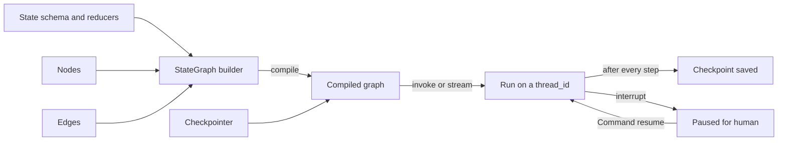
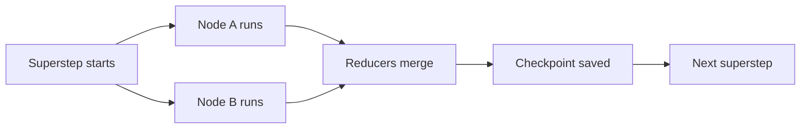
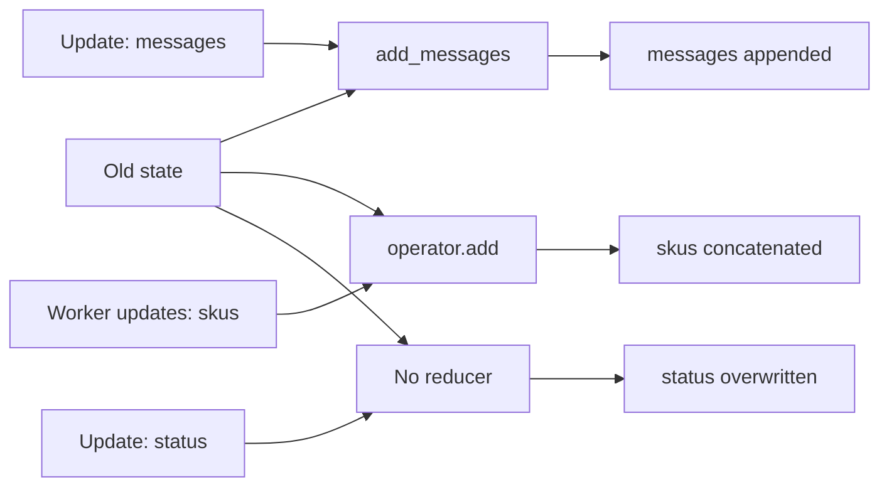
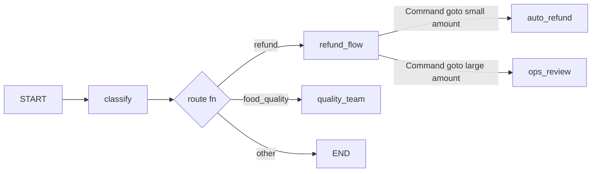
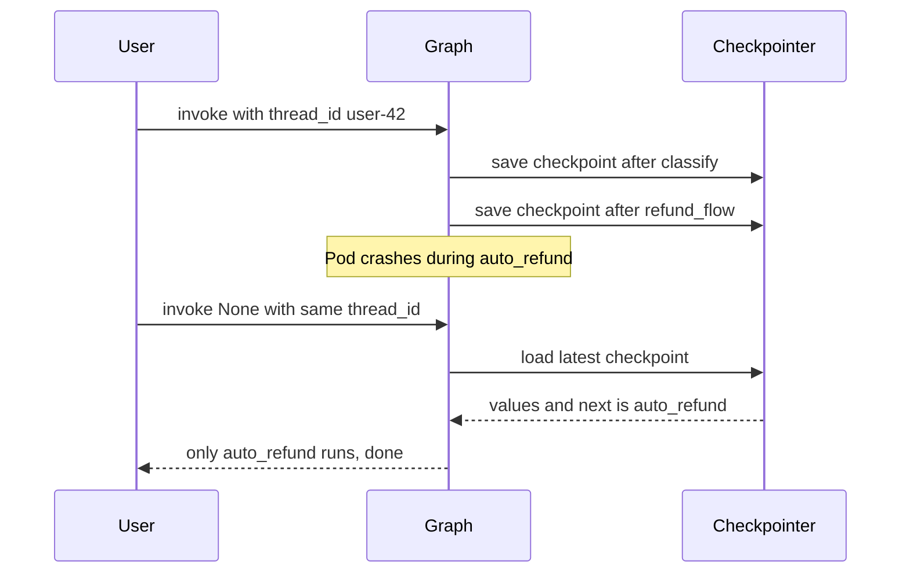
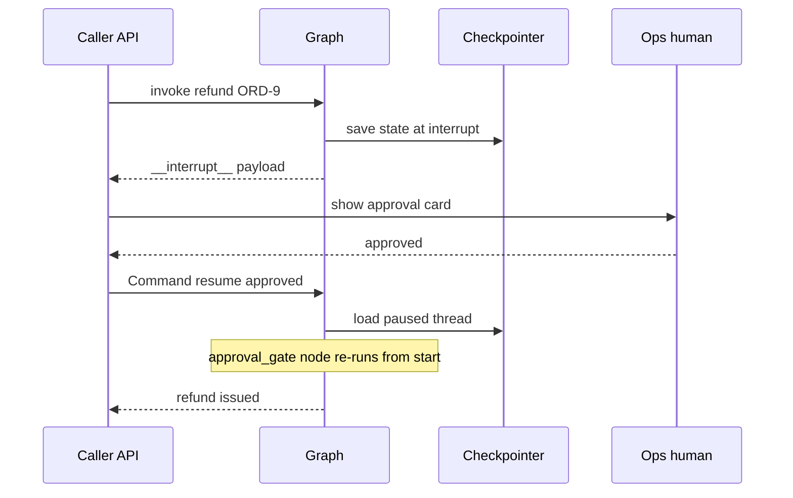
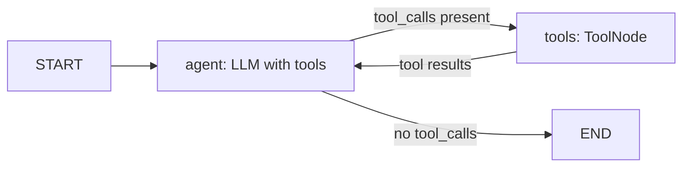

# LangGraph Core

In [Agent Foundations](01-agent-foundations.md) we wrote an agent as a plain `for` loop. LangGraph writes the same loop as a **graph**: boxes of work (nodes), paths between them (edges), one shared data dict (state), and an auto-save after every step (checkpoint). One Swiggy refund example runs through this whole page, and we print the state after every node.

**After this page you can explain:**

- Why you need a graph at all, when a plain `while` loop can also run an agent.
- State, nodes, edges and reducers: how the state dict changes after every node.
- Checkpointing as a "save game": what is saved, and how resume works after a crash.
- The exact `interrupt()` timeline: pause → human → resume, and why the node runs again.
- How to build a tool-calling agent graph by hand, with `ToolNode` and `tools_condition`.

## Big picture: how the LangGraph pieces fit together

First you write a **state schema**: which keys exist and how each key merges. Then you add **nodes** (each node is a Python function that reads the state and returns a small update). Then **edges** say which node runs after which. `compile()` turns all of this into a runnable graph, and this is where the **checkpointer** is attached, which saves the state after every step. Then you `invoke` or `stream` the graph. In the middle, `interrupt()` can pause the graph, and it resumes with the same `thread_id`.



## Why LangGraph

**Why do we need it?** The `for` loop from page 1 works in a demo. In production you hit these problems:

1. The pod restarts at step 4. The messages list was in RAM, so it is all gone. The user has to start over.
2. A ₹10,000 refund needs ops approval, which comes 3 hours later. The loop cannot sit in memory for 3 hours.
3. You need a new step, like a guardrail before tools. The loop turns into a jungle of `if-else`.
4. The UI must show "which step is running now". A loop has no standard way to do this.

**Analogy: the Indian Railways network.** Stations where work happens = nodes. Tracks = normal edges. The junction signal that picks the track = conditional edges. The train's chart that travels with it and is updated at every station = state. Each station's register entry = checkpoint. A train standing at the platform on a red signal = `interrupt()`. If the train stops, the register tells you where it was and what it carried. It can continue from there.

**Plain loop vs graph:**

| | Plain `while` loop | LangGraph |
|---|---|---|
| After a crash | everything lost | resume from the last checkpoint |
| Pause for hours | process blocked | state in DB, process free |
| Adding a step | if-else inside the loop | new node + edge |
| Showing progress | print it yourself | `stream` built in |
| Parallel steps | your own threads | multiple edges from one node |

**LangChain chain vs LangGraph:**

| | LangChain chain (LCEL) | LangGraph |
|---|---|---|
| Shape | DAG, linear/branch | graph with cycles |
| State | inputs are passed along | typed shared state + reducers |
| Persistence | no | checkpointer per step |
| Pause / resume | no | `interrupt()` + `Command(resume=...)` |
| Debugging | logs | state history, time-travel |
| Use | simple pipelines | agents, long-running workflows |

### How a graph runs inside: supersteps

LangGraph runs a graph in **supersteps** (Pregel style). In one superstep:

1. The nodes active in this round run together (in parallel). Say `fetch_price` and `fetch_stock`.
2. Both return their updates: `{"skus": ["FK-1"]}` and `{"skus": ["FK-2"]}`.
3. Reducers merge both updates into the state: `skus = ["FK-1", "FK-2"]`.
4. A checkpoint is saved. Then the next superstep.



- **Levels:** low-level `StateGraph` (full control) vs high-level `create_agent` (`langchain.agents`, LangChain 1.0), which is LangGraph inside. The old `langgraph.prebuilt.create_react_agent` is now a deprecated path; use `create_agent`.

**In one line:** plain LangChain chains are a DAG (input → output, no loop, no saved state); in LangGraph, **cycles, explicit state, checkpointing and human-in-the-loop** are first-class.

**Interview tip:** "LangGraph is an orchestration runtime, not an LLM wrapper. I choose it for durable execution, HITL and cycles; the LLM calls can come from any SDK."

**Common mistake:** thinking LangGraph requires LangChain models. A node is just a Python function; call anything inside it.

## ⭐ State

**Why do we need it?** Nodes need to share data: the classify node finds the `order_id`, and the refund node needs it. Use global variables and two parallel nodes overwrite each other's data, and nothing is saved on a crash. So there is one typed dict that travels with the graph.

**Analogy: a hospital patient file.** The file goes with the patient to every department. Each department writes only its own part, never rewrites the whole file. And there are rules: in "doctor notes" you **add** a new line (do not erase old ones), but "current ward" you **overwrite**. These rules are the reducers.

### One example: the state after every node

A Flipkart catalog graph. Two workers add SKUs in parallel, then a `summarize` node.

**At the start:**

```python
{"messages": [HumanMessage("List FK-1 and FK-2")], "skus": [], "retries": 0, "status": "new"}
```

**Superstep 1: `worker_a` and `worker_b` run together.**

- `worker_a` returns `{"skus": ["FK-1"], "retries": 1}`
- `worker_b` returns `{"skus": ["FK-2"], "retries": 2}`
- The reducer for `skus` is `operator.add` → `[] + ["FK-1"] + ["FK-2"]` = `["FK-1", "FK-2"]`
- The reducer for `retries` is `keep_max` → `max(0, 1, 2)` = `2`

```python
{"messages": [HumanMessage(...)], "skus": ["FK-1", "FK-2"], "retries": 2, "status": "new"}
```

**Superstep 2: `summarize` runs** and returns `{"messages": [AIMessage("2 SKUs listed")], "status": "done"}`.

- The reducer for `messages` is `add_messages` → the new message is **appended**.
- `status` has no reducer → **overwrite**: `"new"` → `"done"`.

```python
{"messages": [HumanMessage(...), AIMessage("2 SKUs listed")],
 "skus": ["FK-1", "FK-2"], "retries": 2, "status": "done"}
```



**A special trick of `add_messages`:** if a new message has the same `id` as an old one, it is **replaced**, not appended. Say the state has `AIMessage("draft", id="m2")`, and a node returns `AIMessage("final", id="m2")`. Result: the list holds only `"final"`, no duplicate.

**Now the terms:**

- **State schema:** `TypedDict` (fast, common), `dataclass` (defaults), or Pydantic `BaseModel` (runtime validation, a bit slower).
- **Partial update:** a node **does not return the whole state**, only the keys that changed: `return {"status": "done"}`.
- **Reducer:** a function `(old, new) -> merged`. It is attached to a key with `Annotated[type, reducer]`.
- **No reducer:** the new value overwrites.
- **`operator.add`:** concatenates lists. Needed for parallel branches (fan-out).
- **`add_messages`:** appends messages, **replaces a message with the same `id`**, deletes with `RemoveMessage(id=...)`, and converts dicts/tuples into Message objects.
- **`MessagesState`:** a ready-made `{"messages": Annotated[list[AnyMessage], add_messages]}`. Extend it to add keys.

The code below defines both schemas: the catalog state above, and the Swiggy support state used through the rest of this page.

```python
import operator
from typing import Annotated, TypedDict
from langchain_core.messages import AnyMessage
from langgraph.graph import MessagesState
from langgraph.graph.message import add_messages

def keep_max(old: int, new: int) -> int:        # custom reducer: keep the bigger one
    return max(old, new)

class CatalogState(TypedDict):
    messages: Annotated[list[AnyMessage], add_messages]   # append / replace by id
    skus: Annotated[list[str], operator.add]               # parallel writes get concatenated
    retries: Annotated[int, keep_max]
    status: str                                            # no reducer: overwrite

class SupportState(MessagesState):                         # already has messages
    order_id: str | None
    refund_approved: bool
```

**What the code does:**

- `Annotated[list[str], operator.add]` means updates to this key merge by list concat.
- `keep_max` is a normal function that works as a reducer.
- `status: str` has no reducer, so the last update wins.
- `SupportState` takes the `messages` key from `MessagesState` and adds `order_id` and `refund_approved`.

- Advanced: separate `input_schema` / `output_schema` (keep the public API small), and private state keys shared only between some nodes.

**In one line:** state is a typed dict that every node reads and returns a partial update to; a **reducer** decides how an update merges into the old value.

**Interview tip:** "If two parallel nodes write the same key with no reducer, LangGraph raises `InvalidUpdateError`. I always put a reducer on fan-out keys."

**Common mistake:** mutating state in a node with `state["messages"].append(x)`. Always return a new partial dict and let the reducer merge.

## ⭐ Nodes and edges

**Why do we need it?** Every request takes a different path. A "I want a refund" request should go to the refund flow, "the food was bad" to the quality team, and the rest should just end. That decision has to live somewhere. Edges are that place.

**Analogy: a railway junction.** Work happens at a station (node). A straight track (normal edge) always goes to the next station. At a junction, the signal (conditional edge) reads the train's chart and picks the track. And sometimes the station master both writes in the register and tells the driver "go to platform 3" (`Command`: update + goto together).

### One example: the Swiggy refund graph, state after every node

User: **"I want a refund for ORD-1"**. Graph: `classify` → (route) → `refund_flow` → (Command) → `auto_refund` → END.

1. **Input:** `{"messages": [HumanMessage("I want a refund for ORD-1")]}`
2. **`classify` runs.** The text contains "refund", so it returns `{"order_id": "ORD-1"}`. State now: `{"messages": [Human], "order_id": "ORD-1"}`
3. **The conditional edge `route` runs.** `order_id` is set, so it returns `"refund_flow"`.
4. **`refund_flow` runs.** The amount is 450, 450 ≤ 500, so it returns `Command(update={"refund_approved": True}, goto="auto_refund")`. State now: `{..., "order_id": "ORD-1", "refund_approved": True}`
5. **`auto_refund` runs.** It returns `{"messages": [("ai", "Refund done")]}`. `add_messages` appends it. State now: `{"messages": [Human, AI("Refund done")], "order_id": "ORD-1", "refund_approved": True}`
6. **Normal edge `auto_refund → END`.** The run ends.

If the amount were 7200, step 4 would `goto="ops_review"`. If the message had no "refund", `route` would return `END` at step 3.



**Now the terms:**

- **Node:** a Python function `state -> partial update`.
- `START` and `END` are special nodes. `add_edge(START, "classify")` is the entry point.
- **Normal edge:** `add_edge("a", "b")`, b always runs after a.
- **Conditional edge:** `add_conditional_edges("a", router_fn, path_map)`. The router reads the state and returns a node name (or a list, or `Send`).
- **`Command(goto=..., update=...)`:** routing logic inside the node, no separate edge function. Write the return type as `Command[Literal[...]]` so the graph can render/validate. `Command(graph=Command.PARENT)` hands off from a subgraph to the parent (multi-agent).
- Multiple outgoing normal edges from one node = parallel fan-out; `Send("worker", payload)` for dynamic map-reduce (detail: [Workflows](03-workflow-patterns.md)).

The code below builds the graph above.

```python
from typing import Literal
from langgraph.graph import StateGraph, START, END
from langgraph.types import Command

def classify(state: SupportState) -> dict:
    text = state["messages"][-1].content.lower()
    return {"order_id": "ORD-1"} if "refund" in text else {"order_id": None}

def route(state: SupportState) -> str:                       # conditional edge
    return "refund_flow" if state["order_id"] else END

def refund_flow(state: SupportState) -> Command[Literal["auto_refund", "ops_review"]]:
    amount = 450                                             # would come from a tool
    nxt = "auto_refund" if amount <= 500 else "ops_review"
    return Command(update={"refund_approved": amount <= 500}, goto=nxt)  # update + goto together

builder = StateGraph(SupportState)
builder.add_node("classify", classify)
builder.add_node("refund_flow", refund_flow)
builder.add_node("auto_refund", lambda s: {"messages": [("ai", "Refund done")]})
builder.add_node("ops_review", lambda s: {"messages": [("ai", "Sent to ops review")]})
builder.add_edge(START, "classify")
builder.add_conditional_edges("classify", route, ["refund_flow", END])
builder.add_edge("auto_refund", END)
builder.add_edge("ops_review", END)
graph = builder.compile()
```

**What the code does:**

- `classify` returns only the `order_id` key; the rest of the state stays as it is.
- `route` updates nothing, it only returns the next node's name. That is why it is an edge, not a node.
- `refund_flow` returns a `Command`, so there is no `add_edge` for it. `Literal[...]` says where it can go.
- `auto_refund` and `ops_review` have normal edges to `END`.

**In one line:** nodes = work (functions), edges = who runs next; **conditional edges** pick the route at runtime, and **`Command`** does both update + goto from inside a node.

**Interview tip:** "A conditional edge when routing is a pure function of state; `Command` when the node also needs to update state while deciding, like a multi-agent handoff."

**Common mistake:** adding a static edge from a node that returns `Command`. Both run and you get double routing.

## Compile, invoke, stream, ainvoke

**Why do we need it?** The builder is only a plan. It has to be made runnable, and then you need several ways to run it: one answer for an API, live progress for a chat UI.

**Analogy: a house plan and the house.** The `StateGraph` builder = the plan. `compile()` = the house is built, and power and water (checkpointer, store) are connected here. `invoke` = checking the final score of the match. `stream` = ball-by-ball commentary.

**One example:** the refund graph above, with `stream_mode="updates"`. After every node, that node's update is printed:

```python
for chunk in graph.stream({"messages": [("user", "I want a refund for ORD-1")]},
                          stream_mode="updates"):
    print(chunk)
# {'classify': {'order_id': 'ORD-1'}}
# {'refund_flow': {'refund_approved': True}}
# {'auto_refund': {'messages': [AIMessage('Refund done')]}}
```

**What the code does:**

- Each `chunk` is a dict: `{node_name: that node's update}`.
- Three chunks = three nodes ran, in the order the state changed.
- With `stream_mode="values"` you get the **whole** state after every step, not just the diff.
- `graph.invoke(...)` runs all of this but returns only the final state.

| Method | What it does |
|---|---|
| `compile(checkpointer=, store=, interrupt_before=, interrupt_after=)` | validates the structure and builds a `CompiledStateGraph` |
| `invoke(input, config)` | runs to the end, returns the final state |
| `ainvoke` | async version, for servers like FastAPI |
| `stream` / `astream` | yields chunks at every step |
| `batch` / `abatch` | multiple inputs at once |
| `get_graph().draw_mermaid()` | a diagram of the graph |

- `config = {"configurable": {"thread_id": "u42"}, "recursion_limit": 30}`: config is the second positional arg.
- With async nodes (`async def`), use only `ainvoke`/`astream`.
- An API endpoint like a Zerodha research bot uses `await graph.ainvoke(...)`; the chat UI shows tokens with `astream(..., stream_mode="messages")`.

**In one line:** `compile()` turns the builder into a runnable graph (the checkpointer, store and interrupts are attached here); then run it with `invoke`/`stream` and their async versions.

**Interview tip:** "In a production API I use `astream`: the user sees progress and time-to-first-token feels lower."

**Common mistake:** adding nodes to the builder after compiling and expecting the compiled graph to change. You have to compile again.

## ⭐ Checkpointing and persistence

**Why do we need it?** The user talked 2 hours ago and is back now: "and my ORD-2?". The agent should remember the earlier conversation. Or the pod crashes in the middle of a refund: the work should continue from there, not restart. Both need the state saved somewhere.

**Analogy: a save game in a video game.** In GTA the game auto-saves at every mission checkpoint. If the power goes, the game opens from there, not from the start. Each player has their own save slot. In LangGraph:

| Game | LangGraph |
|---|---|
| Save slot (per player) | `thread_id` |
| Auto-save at every checkpoint | a checkpoint after every superstep |
| What the save file holds (health, location, next mission) | `values`, `next` |
| The "Continue" button | `invoke(None, cfg)` |
| Load an old save and make a different choice | time-travel (replay / fork) |

### One example: what is saved after each step

The refund graph with a checkpointer, `thread_id = "user-42"`. Simplified view:

| Checkpoint | When | What is in `values` | `next` |
|---|---|---|---|
| 1 | input arrived | messages: [Human] | `("classify",)` |
| 2 | after classify | + order_id: ORD-1 | `("refund_flow",)` |
| 3 | after refund_flow | + refund_approved: True | `("auto_refund",)` |
| 4 | after auto_refund | + AI "Refund done" | `()` (finished) |

**Crash and resume, step by step:**

1. Checkpoint 3 is saved. `auto_refund` is running when the pod crashes.
2. A new pod comes up. You call `graph.invoke(None, {"configurable": {"thread_id": "user-42"}})`. `None` means: no new input, just continue.
3. The checkpointer loads the latest checkpoint (3). `next = ("auto_refund",)`.
4. Only `auto_refund` runs. `classify` and `refund_flow` do not run again.

**The next message, same thread:** 2 hours later the user writes "and ORD-2?". You call `invoke({"messages": [("user", "and ORD-2?")]}, cfg)`. The checkpointer loads the old messages, `add_messages` appends the new one, and the graph runs with the full history.



**Now the terms:**

- **Thread:** the id of one conversation/run (`thread_id`). Each thread has its own checkpoint history.
- **Checkpoint = `StateSnapshot`:** `values`, `next` (who runs next), `config` (with `checkpoint_id`), `metadata`, `parent_config`, `tasks`, `interrupts`.
- **Backends:**

| Saver | Package | When |
|---|---|---|
| `InMemorySaver` | `langgraph.checkpoint.memory` | tests, demos (process restart = all gone) |
| `SqliteSaver` / `AsyncSqliteSaver` | `langgraph-checkpoint-sqlite` | local, single machine |
| `PostgresSaver` / `AsyncPostgresSaver` | `langgraph-checkpoint-postgres` | production, multiple workers |

- On Postgres, run `checkpointer.setup()` the first time (it creates the tables).
- **Time-travel:** take an old checkpoint from `get_state_history`, and `invoke(None, config)` with its config = **replay** (execute again from that point). `update_state(old_config, values)` creates a new checkpoint (a branch) = **fork**. Example: go to checkpoint 2, change `order_id` to `ORD-2`, and run from there; the old history stays safe.

The code below attaches a checkpointer, runs the graph, reads the latest state, then replays and forks.

```python
from langchain_core.messages import HumanMessage
from langgraph.checkpoint.memory import InMemorySaver
# from langgraph.checkpoint.postgres import PostgresSaver
# with PostgresSaver.from_conn_string(DB_URI) as cp: cp.setup(); graph = builder.compile(checkpointer=cp)

graph = builder.compile(checkpointer=InMemorySaver())     # save game ON
cfg = {"configurable": {"thread_id": "user-42"}}          # save slot
graph.invoke({"messages": [HumanMessage("I want a refund for order ORD-1")]}, cfg)

snap = graph.get_state(cfg)
print(snap.values["refund_approved"], snap.next)         # True ()  -> latest state, next node

history = list(graph.get_state_history(cfg))             # newest first
before_refund = next(s for s in history if s.next == ("refund_flow",))
graph.invoke(None, before_refund.config)                 # replay from that point

forked = graph.update_state(before_refund.config, {"order_id": "ORD-2"})
graph.invoke(None, forked)                               # new branch, old history safe
```

**What the code does:**

- After `compile(checkpointer=...)`, every superstep is auto-saved.
- `get_state(cfg)` reads the latest save; `next == ()` means the run is finished.
- `get_state_history` returns all saves, newest first. We picked the save where the next node was `refund_flow` (checkpoint 2).
- `invoke(None, old_config)` runs again from that save. `update_state` first changes the state and creates a new branch.

**In one line:** a checkpointer saves a snapshot of state against a **thread** after every superstep; this gives you memory across turns, pause/resume, fault tolerance and time-travel.

**Interview tip:** "The checkpointer is short-term (thread-scoped) memory. For cross-thread memory, like user preferences, you use the Store. Interviewers always ask about this distinction."

**Common mistake:** `InMemorySaver` in production, or creating a new random `thread_id` on every request. Either way the conversation memory disappears.

## ⭐ Human-in-the-loop

**Why do we need it?** Some actions are irreversible: sending money, deleting an account, emailing a customer. You cannot leave them to the LLM. You need a human "yes". But the human answers 3 hours later, and the server process cannot wait that long.

**Analogy: a big cheque at the bank.** The clerk does not pass a cheque above ₹5 lakh alone. They clip a slip "manager signature needed" to the file and put it in the pending tray. The clerk moves on to other customers. Next day the manager signs. The clerk picks up the file and redoes that counter's work **from the start**, this time with the signature. Clerk = graph, pending tray = checkpointer, slip = interrupt payload, manager's signature = resume value.

### One example: the exact timeline

A PhonePe refund agent. A ₹7,200 refund, limit ₹5,000, so it needs ops approval. `thread_id = "refund-ORD-9"`.

| Time | What happened | State |
|---|---|---|
| 10:00:00 | `invoke("Refund ORD-9")` | thread starts |
| 10:00:01 | the `approval_gate` node runs and pauses at `interrupt({...amount 7200})` | checkpoint saved, `next = ("approval_gate",)` |
| 10:00:01 | `invoke` returns `{"__interrupt__": [Interrupt(value={...})]}` | API request ends, process free |
| 10:00:02 | your app sends an approval card to ops on Slack | the graph is doing nothing |
| 13:15:00 | ops clicks "Approve" | |
| 13:15:01 | `invoke(Command(resume={"approved": True, ...}), cfg)` | checkpoint loaded |
| 13:15:01 | `approval_gate` runs **from the start**; this time `interrupt()` immediately returns `{"approved": True, ...}` | |
| 13:15:02 | the node returns `Command(goto="issue_refund")`, the refund goes out | final checkpoint |

**The re-run gotcha:** say `approval_gate` has `send_sms("approval pending")` **before** `interrupt()`. At 10:00 the SMS was sent. At 13:15 the node ran from the start, so the SMS was sent **again**. So keep the code before an interrupt idempotent, or put the interrupt at the start of the node.



**Now the terms:**

- **`interrupt(payload)`:** inside a node, pauses the graph and hands the payload to the caller.
- **`Command(resume=value)`:** moves the paused thread forward; on the node's re-run, `interrupt()` now returns `value`.
- **A checkpointer is required** (the state must be saved), and so is a `thread_id`.
- On an interrupt, the `invoke` result has an `__interrupt__` key with the payload.
- **On resume the node re-runs from the start**, not from the `interrupt()` line.
- Multiple `interrupt()` calls in one node are matched by order (index); do not skip/reorder them conditionally.
- **Static breakpoints:** `compile(interrupt_before=["tools"])`, for debugging or "stop before every tool".
- **State edit:** `graph.update_state(cfg, {...}, as_node="agent")`: a human fixes wrong tool args, then `invoke(None, cfg)`.

The code below is the approval gate above, with two calls: the first pauses, the second resumes.

```python
from typing import Literal
from langgraph.types import Command, interrupt

def approval_gate(state: SupportState) -> Command[Literal["issue_refund", "reject"]]:
    decision = interrupt({                         # first time: the graph pauses here
        "question": "Approve the refund?",         # on resume: this line returns the value
        "order_id": state["order_id"], "amount_inr": 7200,
    })
    if decision["approved"]:
        return Command(goto="issue_refund", update={"refund_approved": True})
    return Command(goto="reject", update={"refund_approved": False})

cfg = {"configurable": {"thread_id": "refund-ORD-9"}}
out = graph.invoke({"messages": [("user", "Refund ORD-9")]}, cfg)
print(out["__interrupt__"][0].value)               # show this payload in the ops UI

# ... hours later, ops approved:
graph.invoke(Command(resume={"approved": True, "by": "ops@phonepe"}), cfg)
```

**What the code does:**

- In the first `invoke`, `interrupt(...)` stops the graph; `out["__interrupt__"]` holds the payload.
- The process is now free. The state sits in the checkpointer under the `refund-ORD-9` thread.
- The second `invoke` sends `Command(resume=...)`. `approval_gate` runs from the start and `decision` = `{"approved": True, ...}`.
- Then `Command(goto="issue_refund")` moves to the refund node.

**In one line:** `interrupt(payload)` inside a node pauses the graph and hands the payload to the caller; with `Command(resume=value)` the same node runs again and `interrupt()` now returns `value`.

**Interview tip:** "For irreversible actions (money, deletes, sending email) I put the approval gate right before the tool call, and make the resume path idempotent because the node re-runs."

**Common mistake:** wrapping `interrupt()` in `try/except Exception`. Interrupt raises a special exception internally; if you catch it, the graph never pauses.

## Streaming modes

**Why do we need it?** An agent can take 20 seconds. Show the user a blank screen for 20 seconds and they close the app. They should see typing, or "comparing 3 sellers...". And backend logs need different data.

**Analogy: a cricket broadcast.** `values` = the full scorecard after every over. `updates` = only what happened this over. `messages` = the commentator's words, one by one. `custom` = your own graphic on screen ("required run rate 9.2"). `debug` = the third umpire's technical log.

**One example:** a Flipkart shopping assistant. The same run, the first chunk in each mode:

- `updates`: `{"compare_sellers": {"messages": [AIMessage("Seller B is cheapest")]}}`
- `values`: `{"messages": [Human(...), AIMessage("Seller B is cheapest")]}` (the whole state)
- `messages`: `(AIMessageChunk("Seller"), {"langgraph_node": "compare_sellers", ...})`, then `" B"`, then `" is"`...
- `custom`: `{"progress": "comparing 3 sellers"}`

| Mode | Each chunk holds | Use |
|---|---|---|
| `values` | the full state after every step | simple UIs, debugging |
| `updates` | only the node's diff `{node: update}` | logs, progress |
| `messages` | `(token_chunk, metadata)` LLM tokens | chat UI typing effect |
| `custom` | data sent with `get_stream_writer()` | tool progress |
| `debug` | detailed task/checkpoint events | deep debugging |

The code below sends progress from inside a node and shows both tokens and progress in the UI.

```python
from langgraph.config import get_stream_writer

def compare_sellers(state):
    writer = get_stream_writer()
    writer({"progress": "comparing 3 sellers"})              # custom chunk
    return {"messages": [("ai", "Seller B is cheapest")]}

for mode, chunk in graph.stream(inputs, cfg, stream_mode=["messages", "custom"]):
    if mode == "messages":
        token, meta = chunk
        if meta["langgraph_node"] == "agent":      # only the agent node's tokens
            print(token.content, end="")
    else:
        print("\n[progress]", chunk["progress"])
```

**What the code does:**

- `get_stream_writer()` lets a node send any dict in `custom` mode.
- Two modes were passed as a list, so each chunk is a `(mode, data)` tuple.
- `meta["langgraph_node"]` tells which node a token came from; only the `agent` tokens are shown to the user.

- `subgraphs=True` also gives you events from inside subgraphs (with a namespace).

**In one line:** `stream_mode` decides what each chunk contains: the full state, only the diff, LLM tokens, your custom data, or debug events.

**Interview tip:** "You can pass multiple modes as a list; then each chunk is a `(mode, data)` tuple."

**Common mistake:** in `messages` mode, showing tokens from every node in the UI, including an internal classifier's. Filter with the `langgraph_node` metadata.

## Subgraphs and composition

**Why do we need it?** In the Paytm onboarding graph, the KYC part (PAN verify, Aadhaar OTP, face match) is maintained by a separate team, with its own state schema. Cram everything into one graph and two teams fight over one file.

**Analogy: company departments.** The sales team needs a customer's KYC. It gives the KYC department only the PAN and phone, not the whole customer file. The KYC department does its own work inside and returns only "verified: yes". Department = subgraph, the form passed between them = wrapper node.

**One example, step by step (different schema):**

1. Parent state: `{"pan": "ABCDE1234F", "phone": "98xxxxxx10", "kyc_verified": None, ...}`
2. The wrapper node `run_kyc` takes only two keys and gives them to the subgraph: `{"pan": "ABCDE1234F", "phone": "98xxxxxx10"}`
3. The subgraph runs its own nodes inside (PAN verify → OTP → face match) and returns `{"verified": True, ...}`
4. The wrapper maps it to the parent's key: `{"kyc_verified": True}`. Only this one key changed in the parent state.

**Now the terms:**

- **Shared keys** (e.g. `messages` in both): `builder.add_node("kyc", kyc_graph)`, use the compiled graph directly as a node.
- **Different schema:** a wrapper function, like below:

```python
def run_kyc(state: OnboardingState) -> dict:
    out = kyc_graph.invoke({"pan": state["pan"], "phone": state["phone"]})  # only the needed keys go in
    return {"kyc_verified": out["verified"]}           # map into the parent's keys

builder.add_node("kyc", run_kyc)
```

**What the code does:**

- `run_kyc` is a normal node that `invoke`s another graph inside.
- The subgraph gets only `pan` and `phone`; the parent's private keys do not go in.
- The subgraph's `verified` output becomes the parent's `kyc_verified` key.

- A subgraph inherits the parent's checkpointer; `interrupt()` works inside a subgraph too.
- Use: team ownership, reuse, multi-agent (each agent a subgraph). Detail: [Agent Patterns](04-agent-patterns.md).

**In one line:** a compiled graph can be a node in another graph; if state keys are shared, add it directly; if they differ, transform in a wrapper node.

**Interview tip:** "A subgraph boundary is a contract. With a wrapper node I decide explicitly which data goes in, so private keys do not leak."

**Common mistake:** giving the subgraph its own separate checkpointer without need; state ends up scattered in two places.

## Error handling

**Why do we need it?** The Zerodha quote API sometimes returns 503. The LLM provider can be down for 2 minutes. And the agent can get stuck in a loop. Without handling, the user gets a stack trace, or the bill keeps growing.

**Analogy: a delivery boy at the doorbell.** Ring once, no answer. Wait a bit, ring again. Wait a bit longer, ring a third time. If all three fail, call customer care (fallback). And never more than 15 trips in a day (recursion limit).

**One example: the retry timeline.** `RetryPolicy(max_attempts=3, initial_interval=0.5, backoff_factor=2.0)`:

1. Attempt 1: `fetch_quote` → 503. Wait 0.5s.
2. Attempt 2: → 503. Wait 0.5 × 2 = 1.0s.
3. Attempt 3: → 200 OK. The node's update goes into the state, the graph moves on.
4. If attempt 3 also failed, the error would come out of the graph.

**One example: the recursion limit.** `recursion_limit=15`. One ReAct round = 2 supersteps (agent + tools). So after about 7 rounds you get `GraphRecursionError`. You catch it and tell the user "could not finish right now, I have opened a ticket".

**Now the terms:**

- **`recursion_limit`:** max supersteps per run (in the config). The default depends on the version (25 in older versions), so set it explicitly. When hit, you get `GraphRecursionError`. Note: one ReAct round = 2 supersteps (agent + tools).
- **`RemainingSteps`** (`langgraph.managed`) in the state lets a node give a graceful answer before the limit is hit.
- **`RetryPolicy`** (`langgraph.types`): `max_attempts`, `initial_interval`, `backoff_factor`, `jitter`, `retry_on`. In langgraph 1.x it is `add_node(..., retry_policy=...)` (old name `retry=`).
- **Fallbacks:** `llm.with_fallbacks([backup_llm])`, or `Command(goto="fallback_node")`.
- **Timeouts:** `timeout=` on the model client, `asyncio.wait_for` in an async node, a server-level deadline for the whole run.

The code below puts a retry on one node and a recursion limit on the run.

```python
import httpx
from langgraph.errors import GraphRecursionError
from langgraph.types import RetryPolicy

builder.add_node(
    "fetch_quote", fetch_quote,
    retry_policy=RetryPolicy(max_attempts=3, initial_interval=0.5,
                             backoff_factor=2.0, retry_on=httpx.HTTPError),  # only on network errors
)
graph = builder.compile(checkpointer=InMemorySaver())

try:
    graph.invoke(inputs, {"configurable": {"thread_id": "t1"}, "recursion_limit": 15})
except GraphRecursionError:                          # loop limit crossed
    reply = "Could not get an answer right now, a support ticket has been created."
```

**What the code does:**

- `retry_policy` is set only on the `fetch_quote` node; not on the other nodes.
- `retry_on=httpx.HTTPError`: only HTTP/network errors are retried, not bugs in your code.
- `recursion_limit` is given in the config, per run.
- We catch `GraphRecursionError` and give the user a clear message, no crash.

**In one line:** stop loops with `recursion_limit`, retry flaky calls with `RetryPolicy`, and give a fallback or graceful exit when a model/tool fails.

**Interview tip:** "Retry only on transient errors (timeouts, 5xx, 429). Retrying does not fix validation errors; turn them into an observation and send them back to the LLM."

**Common mistake:** raising `recursion_limit` to 1000 so the error goes away. The root cause is the loop; the limit is only a safety net.

## Store for long-term memory

**Why do we need it?** A Swiggy user said on Monday "I am vegetarian". On Friday a new chat opens, with a new `thread_id`. The checkpointer only gives that thread's data, so the agent forgot and suggested chicken biryani.

**Analogy: WhatsApp chats vs contact info.** Each chat has its own history (checkpointer, per thread). But the contact's name and notes show up in every chat (Store, across all threads).

**One example, step by step:**

1. Monday, `thread_id = "chat-mon"`: the user says "I am vegetarian". A node writes `store.put(("users", "u42", "prefs"), "diet", {"value": "veg"})`.
2. Friday, `thread_id = "chat-fri"`: the messages are empty, a new chat.
3. A node reads `store.get(("users", "u42", "prefs"), "diet")` → `{"value": "veg"}`.
4. The agent suggests only veg restaurants.

**Now the terms:**

- **Namespace:** a tuple like `("users", "u42", "prefs")`, like a folder path.
- **Key:** a name inside the namespace, like `"diet"`. The value is a dict.

```python
from langgraph.store.memory import InMemoryStore   # prod: PostgresStore

store = InMemoryStore()
graph = builder.compile(checkpointer=InMemorySaver(), store=store)   # both together
store.put(("users", "u42", "prefs"), "diet", {"value": "veg"})       # write
print(store.get(("users", "u42", "prefs"), "diet").value)            # {'value': 'veg'}
# inside a node: runtime.store.search(("users", "u42", "prefs"), query="food", limit=3)
```

**What the code does:**

- `compile` gets both a checkpointer (thread memory) and a store (user memory).
- `put(namespace, key, value)` writes, `get(namespace, key)` reads.
- Inside a node you get the store from `runtime.store`; you query it with `search`.

- With embeddings, passing `index={"embed": ..., "dims": ...}` makes `search(query=...)` semantic.
- What to remember, when to write, how to forget: [Memory & Context](05-memory-context.md).

**In one line:** the Store is cross-thread key-value (+ optional semantic search) memory, organized by `namespace` tuples; the checkpointer works inside one thread, the Store across all threads.

**Interview tip:** "Thread memory = checkpointer, user memory = Store. They have different lifetimes and different privacy rules."

**Common mistake:** leaving user preferences only in the messages history; in a new thread everything is forgotten.

## ⭐ Worked example: tool-calling agent by hand

**Why do we need it?** Now we write page 1's `for` loop as a graph. This shows all the pieces in one place: `MessagesState`, the LLM node, `ToolNode`, `tools_condition`, and the checkpointer.

**Analogy:** an office with two counters. At counter A (agent), the officer reads the form and decides "send this for verification" or "work done". At counter B (tools), the clerk does the verification and hands the file back to A. The file (messages) gets thicker every time.

### One example: messages after every node

User: **"ORD-77 is late, will I get a refund? Value 380"**. Tools: `get_order_status`, `issue_refund`.

| Step | Node | What is added to `messages` | Total |
|---|---|---|---|
| 0 | input | Human "ORD-77 is late..." | 1 |
| 1 | agent | AI with `tool_calls`: get_order_status(ORD-77) | 2 |
| 2 | tools | ToolMessage `{"status": "out_for_delivery", "delay_min": 42}` | 3 |
| 3 | agent | AI with `tool_calls`: issue_refund(ORD-77, 380) | 4 |
| 4 | tools | ToolMessage "Refund of Rs 380 issued for ORD-77" | 5 |
| 5 | agent | AI "It was 42 min late, Rs 380 has been refunded" (no tool_calls) | 6 |

After step 5, `tools_condition` sees that the last AI message has no `tool_calls`, so `END`. 6 supersteps in total, within `recursion_limit=12`.



**Now the terms:**

- **`ToolNode(tools)`:** runs all `tool_calls` of the last AI message (in parallel too), and puts each result into the state as a `ToolMessage`. It turns tool errors into a `ToolMessage` too.
- **`tools_condition`:** a ready-made router. If there are `tool_calls`, `"tools"`; otherwise `END`.

Below is the full agent that runs the table above.

```python
from langchain_core.messages import SystemMessage
from langchain_core.tools import tool
from langchain.chat_models import init_chat_model
from langgraph.graph import StateGraph, START, MessagesState
from langgraph.prebuilt import ToolNode, tools_condition
from langgraph.checkpoint.memory import InMemorySaver

@tool
def get_order_status(order_id: str) -> dict:
    """Order status and delay minutes."""
    return {"order_id": order_id, "status": "out_for_delivery", "delay_min": 42}

@tool
def issue_refund(order_id: str, amount_inr: int) -> str:
    """Issues a refund. Only when the delay is more than 30 min."""
    return f"Refund of Rs {amount_inr} issued for {order_id}"

tools = [get_order_status, issue_refund]
llm = init_chat_model("openai:gpt-4.1-mini", temperature=0).bind_tools(tools)
SYSTEM = SystemMessage("You are a Swiggy support agent. Check the status before any refund.")

def agent(state: MessagesState) -> dict:                  # counter A
    return {"messages": [llm.invoke([SYSTEM] + state["messages"])]}

builder = StateGraph(MessagesState)
builder.add_node("agent", agent)
builder.add_node("tools", ToolNode(tools))      # counter B: runs parallel calls, turns errors into ToolMessages
builder.add_edge(START, "agent")
builder.add_conditional_edges("agent", tools_condition)   # "tools" or END
builder.add_edge("tools", "agent")                        # loop-back: result goes back to the LLM
graph = builder.compile(checkpointer=InMemorySaver())

cfg = {"configurable": {"thread_id": "u42"}, "recursion_limit": 12}
out = graph.invoke({"messages": [("user", "ORD-77 is late, will I get a refund? Value 380")]}, cfg)
print(out["messages"][-1].content)
```

**What the code does:**

- The `agent` node gives the LLM the system prompt + the full history and appends the reply to `messages`.
- After every `agent` run, `tools_condition` decides: tools or END.
- `add_edge("tools", "agent")` makes the loop; without it, the tool result never reaches the LLM.
- Because of the checkpointer, the next question on the same `thread_id` runs with the full history.

- The same thing as a one-liner: `create_agent(model="openai:gpt-4.1-mini", tools=tools, system_prompt="...", checkpointer=InMemorySaver())` (`from langchain.agents import create_agent`). In older code you will see `create_react_agent(model, tools)`.
- If you need approval before `refund`, use `compile(interrupt_before=["tools"])` or `interrupt()` inside `issue_refund`.

**In one line:** `MessagesState` + LLM node + `ToolNode` + `tools_condition` + checkpointer = the same ReAct loop `create_agent` gives you, but with every piece under your control.

**Interview tip:** "I write the hand-built version when I need custom nodes: a guardrail node, an approval gate, a summarization node. Otherwise `create_agent` + middleware is enough."

**Common mistake:** forgetting the edge from the `tools` node back to `agent`; the tool result never reaches the LLM and the graph ends after the tool.

## Read next

- [AI Agents: Foundations](01-agent-foundations.md): the agent loop without a framework.
- [Agentic Patterns: Workflows](03-workflow-patterns.md): routing, parallelization, `Send` map-reduce.
- [Memory & Context Engineering](05-memory-context.md): Store, summarization, context trimming.
- [Agents in Production](12-agents-in-production.md): Postgres checkpointer, scaling, deploys.
- [ReAct lab](/viewinter/agents/lab/react) and [Multi-agent lab](/viewinter/agents/labs/multi).

## Checklist

- [ ] I can explain why LangGraph is better than a plain loop and chains (cycles, state, persistence, HITL)
- [ ] I can explain state schemas, reducers, and the difference between `add_messages` and `operator.add` with before/after state
- [ ] I can tell when to use a normal edge, a conditional edge and `Command(goto, update)`
- [ ] I can explain the checkpointer, `thread_id`, resume after a crash, `get_state_history`, replay and fork
- [ ] I can write an approval gate with `interrupt()` + `Command(resume=...)` and explain the pause → resume timeline and the re-run behaviour
- [ ] I can explain the use of each streaming mode (`values`, `updates`, `messages`, `custom`, `debug`)
- [ ] I can explain composing subgraphs with shared vs different state
- [ ] I can explain error handling with `recursion_limit`, `RetryPolicy`, fallbacks and timeouts
- [ ] I can build a tool-calling agent by hand with `ToolNode` + `tools_condition` + a checkpointer
