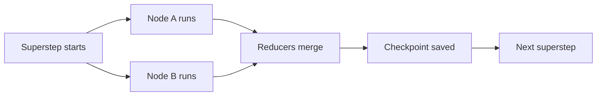
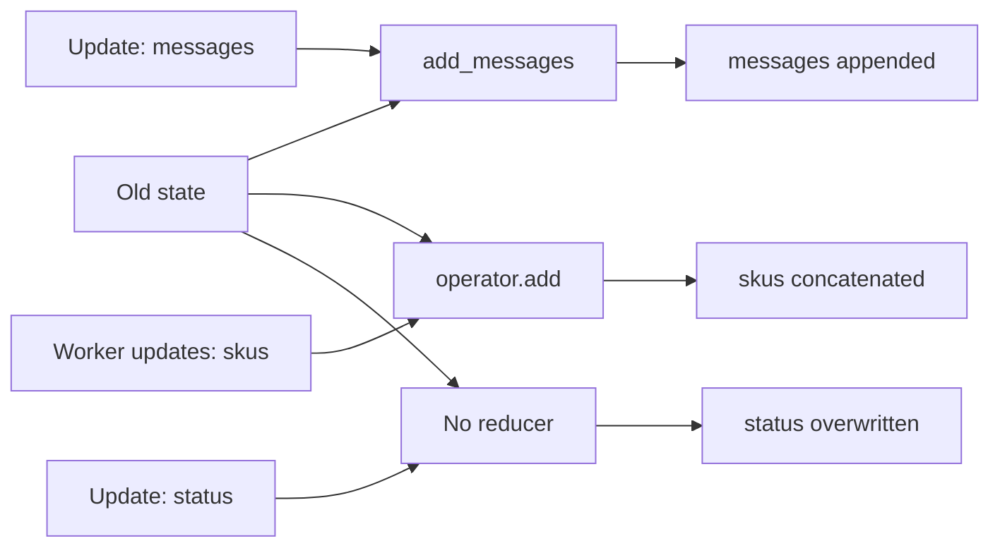
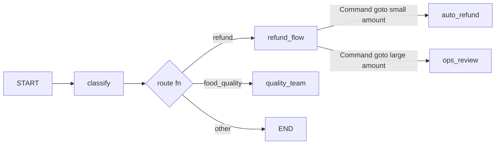
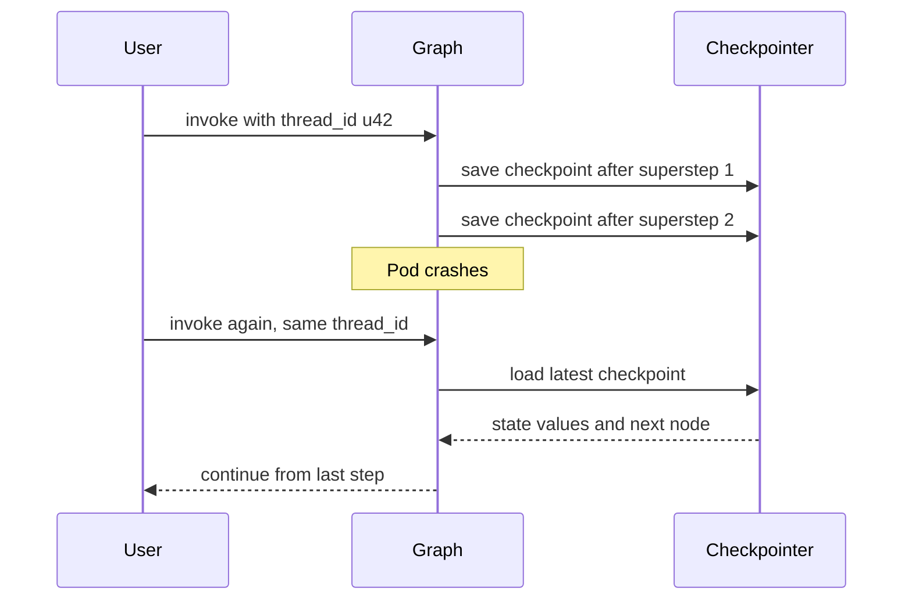
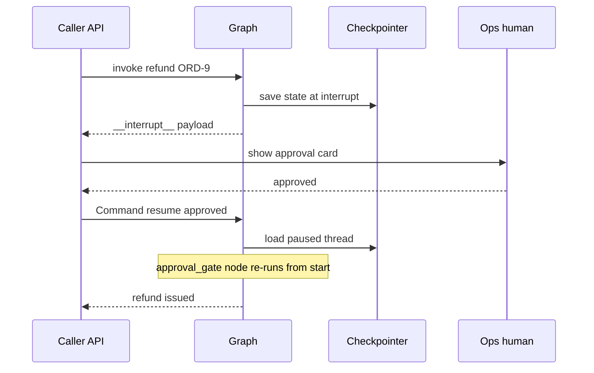
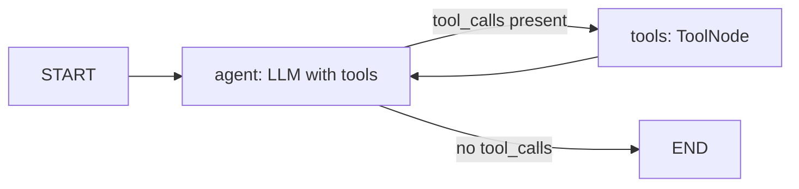

# LangGraph Core

LangGraph builds agents as a **graph + shared state + cycles + persistence**. Interviewers ask here: what is a reducer, why a checkpointer, what happens to `interrupt()` on resume, and what happens when `recursion_limit` is hit. After this page you can explain and write a hand-built tool-calling agent.

## Why LangGraph

**In one line:** plain LangChain chains are a DAG (input → output, no loop, no saved state); in LangGraph, **cycles, explicit state, checkpointing and human-in-the-loop** are first-class.

> **Example:** a Razorpay dispute agent: fetch evidence → LLM decides → if more evidence is needed, fetch again (cycle) → refunds above ₹10k need ops approval (pause, resume tomorrow) → even if the server restarts, continue from the same point. A chain cannot do this.

| | LangChain chain (LCEL) | LangGraph |
|---|---|---|
| Shape | DAG, linear/branch | graph with cycles |
| State | inputs passed forward | typed shared state + reducers |
| Persistence | no | checkpointer per step |
| Pause / resume | no | `interrupt()` + `Command(resume=...)` |
| Debugging | logs | state history, time-travel |
| Use | simple pipelines | agents, long-running workflows |

- **Execution model (Pregel style):** the graph runs in **supersteps**. Nodes active in one superstep run in parallel, their updates are merged by reducers, then a checkpoint is saved.



One superstep: active nodes run in parallel, reducers merge their updates, then a checkpoint is saved.

- **Levels:** low-level `StateGraph` (full control) vs high-level `create_agent` (`langchain.agents`, LangChain 1.0), which is LangGraph underneath. The old `langgraph.prebuilt.create_react_agent` is now the deprecated path; use `create_agent`.

**Interview tip:** "LangGraph is an orchestration runtime, not an LLM wrapper. I choose it for durable execution, HITL and cycles; the LLM calls can come from any SDK."

**Common mistake:** thinking LangGraph requires LangChain models. A node is just a Python function; call anything inside it.

## ⭐ State

**In one line:** state is a typed dict that every node reads and returns a partial update to; a **reducer** decides how an update merges into the old value.

> **Example:** a Flipkart catalog agent: chat is appended to `messages`, results from parallel workers accumulate in `skus`, `status` is overwritten every time.

- Schema: `TypedDict` (fast, common), `dataclass` (defaults), or Pydantic `BaseModel` (runtime validation, a bit slower).
- A node **does not return the whole state**, only the keys that changed: `return {"status": "done"}`.
- **No reducer:** the new value overwrites.
- **`operator.add`:** concatenates lists. Required for parallel branches (fan-out).
- **`add_messages`:** appends messages, **replaces a message with the same `id`**, deletes with `RemoveMessage(id=...)`, and converts dicts/tuples to Message objects.



Each key's reducer decides the merge: `messages` appends, `skus` concatenates, and `status`, with no reducer, is overwritten.

- **`MessagesState`:** ready-made `{"messages": Annotated[list[AnyMessage], add_messages]}`. Extend it to add keys.

```python
import operator
from typing import Annotated, TypedDict
from langchain_core.messages import AnyMessage
from langgraph.graph import MessagesState
from langgraph.graph.message import add_messages

def keep_max(old: int, new: int) -> int:        # custom reducer
    return max(old, new)

class CatalogState(TypedDict):
    messages: Annotated[list[AnyMessage], add_messages]   # append / replace by id
    skus: Annotated[list[str], operator.add]               # parallel writes accumulate
    retries: Annotated[int, keep_max]
    status: str                                            # no reducer: overwrite

class SupportState(MessagesState):                         # messages already included
    order_id: str | None
    refund_approved: bool
```

- Advanced: separate `input_schema` / `output_schema` (keep the public API small), private state keys shared only between some nodes.

**Interview tip:** "If two parallel nodes write the same key with no reducer, LangGraph raises `InvalidUpdateError`. I always put a reducer on fan-out keys."

**Common mistake:** mutating state in a node with `state["messages"].append(x)`. Always return a new partial dict and let the reducer merge.

## ⭐ Nodes and edges

**In one line:** nodes = work (functions), edges = who runs next; **conditional edges** pick the route at runtime, and **`Command`** does both update + goto from inside a node.

> **Example:** Zomato complaint triage: after the `classify` node, "refund" goes to `refund_flow`, "food_quality" to `quality_team`, otherwise `END`.

- `START` and `END` are special nodes. `add_edge(START, "classify")` is the entry point.
- **Normal edge:** `add_edge("a", "b")`, b always runs after a.
- **Conditional edge:** `add_conditional_edges("a", router_fn, path_map)`. The router reads state and returns a node name (or a list, or `Send`).
- **`Command(goto=..., update=...)`:** routing logic inside the node, no separate edge function. Annotate the return type as `Command[Literal[...]]` so the graph can be rendered/validated. `Command(graph=Command.PARENT)` hands off from a subgraph to the parent (multi-agent).



The conditional edge picks the route with a pure function; the `refund_flow` node returns a `Command` and does the state update + goto itself.

- Multiple outgoing normal edges from one node = parallel fan-out; `Send("worker", payload)` for dynamic map-reduce (details: [Workflows](03-workflow-patterns.md)).

```python
from typing import Literal
from langgraph.graph import StateGraph, START, END
from langgraph.types import Command

def classify(state: SupportState) -> dict:
    text = state["messages"][-1].content.lower()
    return {"order_id": "ORD-1"} if "refund" in text else {"order_id": None}

def route(state: SupportState) -> str:                       # conditional edge
    return "refund_flow" if state["order_id"] else END

def refund_flow(state: SupportState) -> Command[Literal["auto_refund", "ops_review"]]:
    amount = 450                                             # would come from a tool
    nxt = "auto_refund" if amount <= 500 else "ops_review"
    return Command(update={"refund_approved": amount <= 500}, goto=nxt)

builder = StateGraph(SupportState)
builder.add_node("classify", classify)
builder.add_node("refund_flow", refund_flow)
builder.add_node("auto_refund", lambda s: {"messages": [("ai", "Refund done")]})
builder.add_node("ops_review", lambda s: {"messages": [("ai", "Sent for ops review")]})
builder.add_edge(START, "classify")
builder.add_conditional_edges("classify", route, ["refund_flow", END])
builder.add_edge("auto_refund", END)
builder.add_edge("ops_review", END)
graph = builder.compile()
```

**Interview tip:** "A conditional edge when routing is a pure function of state; `Command` when the node also needs to update state while deciding, like a multi-agent handoff."

**Common mistake:** adding a static edge from a node that returns `Command`. Both run and you get double routing.

## Compile, invoke, stream, ainvoke

**In one line:** `compile()` turns the builder into a runnable graph (the checkpointer, store and interrupts are attached here); then run it with `invoke`/`stream` and their async versions.

> **Example:** a Zerodha research bot: the API endpoint uses `await graph.ainvoke(...)`, and the chat UI shows tokens with `astream(..., stream_mode="messages")`.

| Method | What it does |
|---|---|
| `compile(checkpointer=, store=, interrupt_before=, interrupt_after=)` | validates the structure and builds a `CompiledStateGraph` |
| `invoke(input, config)` | runs to the end, returns the final state |
| `ainvoke` | async version, for servers like FastAPI |
| `stream` / `astream` | yields chunks at each step |
| `batch` / `abatch` | multiple inputs at once |
| `get_graph().draw_mermaid()` | diagram of the graph |

- `config = {"configurable": {"thread_id": "u42"}, "recursion_limit": 30}`: config is the second positional arg.
- With async nodes (`async def`), use `ainvoke`/`astream`.

**Interview tip:** "In a production API I use `astream`: the user sees progress and time-to-first-token feels lower."

**Common mistake:** adding nodes to the builder after compiling and expecting the compiled graph to change. You have to compile again.

## ⭐ Checkpointing and persistence

**In one line:** a checkpointer saves a snapshot of state against a **thread** after every superstep; this gives you memory across turns, pause/resume, fault tolerance and time-travel.

> **Example:** Swiggy support chat: the user comes back 2 hours later, and with the same `thread_id` the whole conversation and `order_id` are in state. If the pod crashed, it resumes from the last successful checkpoint.

- **Thread:** the id of one conversation/run (`thread_id`). Each thread has its own checkpoint history.
- **Checkpoint = `StateSnapshot`:** `values`, `next` (who runs next), `config` (with `checkpoint_id`), `metadata`, `parent_config`, `tasks`, `interrupts`.



A checkpoint is saved after every superstep; invoke again with the same `thread_id` and the graph continues from the last checkpoint.

- **Backends:**

| Saver | Package | When |
|---|---|---|
| `InMemorySaver` | `langgraph.checkpoint.memory` | tests, demos (process restart = everything lost) |
| `SqliteSaver` / `AsyncSqliteSaver` | `langgraph-checkpoint-sqlite` | local, single machine |
| `PostgresSaver` / `AsyncPostgresSaver` | `langgraph-checkpoint-postgres` | production, multiple workers |

- On Postgres, run `checkpointer.setup()` the first time (it creates the tables).
- **Time-travel:** take an old checkpoint from `get_state_history`; `invoke(None, config)` with its config = **replay** (re-execute after that point). `update_state(old_config, values)` creates a new checkpoint (branch) = **fork**.

```python
from langchain_core.messages import HumanMessage
from langgraph.checkpoint.memory import InMemorySaver
# from langgraph.checkpoint.postgres import PostgresSaver
# with PostgresSaver.from_conn_string(DB_URI) as cp: cp.setup(); graph = builder.compile(checkpointer=cp)

graph = builder.compile(checkpointer=InMemorySaver())
cfg = {"configurable": {"thread_id": "user-42"}}
graph.invoke({"messages": [HumanMessage("I want a refund for order ORD-1")]}, cfg)

snap = graph.get_state(cfg)
print(snap.values["refund_approved"], snap.next)         # latest state, next node

history = list(graph.get_state_history(cfg))             # newest first
before_refund = next(s for s in history if s.next == ("refund_flow",))
graph.invoke(None, before_refund.config)                 # replay from that point

forked = graph.update_state(before_refund.config, {"order_id": "ORD-2"})
graph.invoke(None, forked)                               # new branch, old history kept
```

**Interview tip:** "The checkpointer is short-term (thread-scoped) memory. For cross-thread memory, like user preferences, you use the Store. Interviewers always ask about this distinction."

**Common mistake:** `InMemorySaver` in production, or creating a new random `thread_id` on every request. Either way the conversation memory disappears.

## ⭐ Human-in-the-loop

**In one line:** `interrupt(payload)` inside a node pauses the graph and hands the payload to the caller; with `Command(resume=value)` the same node runs again and `interrupt()` now returns `value`.

> **Example:** a PhonePe refund agent: refunds above ₹5,000 send an approval card to ops on Slack. Until approve/reject arrives, the thread stays paused in the checkpoint (minutes or days).

- A **checkpointer is required** (state must be saved), and so is a `thread_id`.
- On interrupt, the `invoke` result contains an `__interrupt__` key with the payload.
- **On resume the node re-runs from the start**, not from the `interrupt()` line. So keep side effects **before** the interrupt idempotent, or put the interrupt at the start of the node.



On interrupt the state is parked in the checkpoint; when `Command(resume=...)` arrives, the same node runs again from the start.

- Multiple `interrupt()` calls in one node are matched by order (index); do not skip/reorder them conditionally.
- **Static breakpoints:** `compile(interrupt_before=["tools"])`, for debugging or "stop before every tool".
- **Editing state:** `graph.update_state(cfg, {...}, as_node="agent")`: a human fixes wrong tool args, then `invoke(None, cfg)`.

```python
from typing import Literal
from langgraph.types import Command, interrupt

def approval_gate(state: SupportState) -> Command[Literal["issue_refund", "reject"]]:
    decision = interrupt({                         # the graph pauses here
        "question": "Approve the refund?",
        "order_id": state["order_id"], "amount_inr": 7200,
    })
    if decision["approved"]:
        return Command(goto="issue_refund", update={"refund_approved": True})
    return Command(goto="reject", update={"refund_approved": False})

cfg = {"configurable": {"thread_id": "refund-ORD-9"}}
out = graph.invoke({"messages": [("user", "Refund ORD-9 please")]}, cfg)
print(out["__interrupt__"][0].value)               # show this payload in the ops UI

# ... hours later, ops approved:
graph.invoke(Command(resume={"approved": True, "by": "ops@phonepe"}), cfg)
```

**Interview tip:** "For irreversible actions (money, deletes, sending email) I put the approval gate right before the tool call, and make the resume path idempotent because the node re-runs."

**Common mistake:** wrapping `interrupt()` in `try/except Exception`. Interrupt raises a special exception internally; if you catch it, the graph never pauses.

## Streaming modes

**In one line:** `stream_mode` decides what each chunk contains: the full state, only the diff, LLM tokens, your custom data, or debug events.

> **Example:** a Flipkart shopping assistant UI: `messages` shows tokens being typed, `custom` drives a "comparing 3 sellers..." progress bar, `updates` feeds backend logs.

| Mode | Each chunk contains | Use |
|---|---|---|
| `values` | the full state after each step | simple UIs, debugging |
| `updates` | only the node's diff `{node: update}` | logs, progress |
| `messages` | `(token_chunk, metadata)` LLM tokens | chat UI typing effect |
| `custom` | data sent via `get_stream_writer()` | tool progress |
| `debug` | detailed task/checkpoint events | deep debugging |

```python
from langgraph.config import get_stream_writer

def compare_sellers(state):
    writer = get_stream_writer()
    writer({"progress": "Comparing 3 sellers"})
    return {"messages": [("ai", "Seller B is the cheapest")]}

for mode, chunk in graph.stream(inputs, cfg, stream_mode=["messages", "custom"]):
    if mode == "messages":
        token, meta = chunk
        if meta["langgraph_node"] == "agent":      # only tokens from the agent node
            print(token.content, end="")
    else:
        print("\n[progress]", chunk["progress"])
```

- `subgraphs=True` also gives you events from inside subgraphs (with a namespace).

**Interview tip:** "You can pass multiple modes as a list; then each chunk is a `(mode, data)` tuple."

**Common mistake:** in `messages` mode, showing tokens from every node in the UI, including an internal classifier's. Filter with the `langgraph_node` metadata.

## Subgraphs and composition

**In one line:** a compiled graph can be a node in another graph; if state keys are shared, add it directly; if they differ, transform in a wrapper node.

> **Example:** in the Paytm onboarding graph, the `kyc` subgraph (PAN verify, Aadhaar OTP, face match) is maintained by a separate team with its own state schema.

- **Shared keys** (e.g. `messages` in both): `builder.add_node("kyc", kyc_graph)`.
- **Different schema:** a wrapper function:

```python
def run_kyc(state: OnboardingState) -> dict:
    out = kyc_graph.invoke({"pan": state["pan"], "phone": state["phone"]})
    return {"kyc_verified": out["verified"]}           # map to the parent's keys

builder.add_node("kyc", run_kyc)
```

- A subgraph inherits the parent's checkpointer; `interrupt()` also works inside a subgraph.
- Use: team ownership, reuse, multi-agent (each agent is a subgraph). Details: [Agent Patterns](04-agent-patterns.md).

**Interview tip:** "A subgraph boundary is a contract. With a wrapper node I decide explicitly which data goes in, so private keys do not leak."

**Common mistake:** giving the subgraph its own separate checkpointer without need; state ends up scattered in two places.

## Error handling

**In one line:** stop loops with `recursion_limit`, retry flaky calls with `RetryPolicy`, and give a fallback or graceful exit when a model/tool fails.

> **Example:** the Zerodha quote tool sometimes returns 503: 3 retries with backoff; if the LLM provider is down, a backup model; if the agent has no answer within 15 steps, "couldn't do it right now, I've opened a ticket".

- **`recursion_limit`:** max supersteps per run (in config). The default depends on the version (25 in older versions), so set it explicitly. When hit: `GraphRecursionError`. Note: one ReAct round = 2 supersteps (agent + tools).
- **`RemainingSteps`** (`langgraph.managed`) in state lets a node give a graceful answer before the limit.
- **`RetryPolicy`** (`langgraph.types`): `max_attempts`, `initial_interval`, `backoff_factor`, `jitter`, `retry_on`. In langgraph 1.x: `add_node(..., retry_policy=...)` (old name `retry=`).
- **Fallbacks:** `llm.with_fallbacks([backup_llm])`, or `Command(goto="fallback_node")`.
- **Timeouts:** `timeout=` on the model client, `asyncio.wait_for` in an async node, a server-level deadline for the whole run.

```python
import httpx
from langgraph.errors import GraphRecursionError
from langgraph.types import RetryPolicy

builder.add_node(
    "fetch_quote", fetch_quote,
    retry_policy=RetryPolicy(max_attempts=3, initial_interval=0.5,
                             backoff_factor=2.0, retry_on=httpx.HTTPError),
)
graph = builder.compile(checkpointer=InMemorySaver())

try:
    graph.invoke(inputs, {"configurable": {"thread_id": "t1"}, "recursion_limit": 15})
except GraphRecursionError:
    reply = "Couldn't find an answer right now, I've opened a support ticket."
```

**Interview tip:** "Retry only on transient errors (timeouts, 5xx, 429). Retrying does not fix validation errors; turn them into an observation and send them back to the LLM."

**Common mistake:** raising `recursion_limit` to 1000 so the error goes away. The root cause is the loop; the limit is only a safety net.

## Store for long-term memory

**In one line:** the Store is cross-thread key-value (+ optional semantic search) memory, organized by `namespace` tuples; the checkpointer works inside one thread, the Store across all threads.

> **Example:** Swiggy: the user once said "I'm vegetarian". In every new chat (new thread) the agent reads this from `("users", "u42", "prefs")`.

```python
from langgraph.store.memory import InMemoryStore   # prod: PostgresStore

store = InMemoryStore()
graph = builder.compile(checkpointer=InMemorySaver(), store=store)
store.put(("users", "u42", "prefs"), "diet", {"value": "veg"})
print(store.get(("users", "u42", "prefs"), "diet").value)
# inside a node: runtime.store.search(("users", "u42", "prefs"), query="food", limit=3)
```

- With embeddings, passing `index={"embed": ..., "dims": ...}` makes `search(query=...)` semantic.
- What to remember, when to write, how to forget: [Memory & Context](05-memory-context.md).

**Interview tip:** "Thread memory = checkpointer, user memory = Store. Different lifetimes and different privacy rules."

**Common mistake:** leaving user preferences only in message history; in a new thread everything is forgotten.

## ⭐ Worked example: tool-calling agent by hand

**In one line:** `MessagesState` + LLM node + `ToolNode` + `tools_condition` + checkpointer = the same ReAct loop `create_agent` gives you, but with every piece under your control.

> **Example:** a Swiggy order support agent: check the order status, and if the delay is > 30 min, issue a refund.



```python
from langchain_core.messages import SystemMessage
from langchain_core.tools import tool
from langchain.chat_models import init_chat_model
from langgraph.graph import StateGraph, START, MessagesState
from langgraph.prebuilt import ToolNode, tools_condition
from langgraph.checkpoint.memory import InMemorySaver

@tool
def get_order_status(order_id: str) -> dict:
    """Order status and delay in minutes."""
    return {"order_id": order_id, "status": "out_for_delivery", "delay_min": 42}

@tool
def issue_refund(order_id: str, amount_inr: int) -> str:
    """Issues a refund. Only when the delay is more than 30 min."""
    return f"Refund of Rs {amount_inr} issued for {order_id}"

tools = [get_order_status, issue_refund]
llm = init_chat_model("openai:gpt-4.1-mini", temperature=0).bind_tools(tools)
SYSTEM = SystemMessage("You are a Swiggy support agent. Check the status before any refund.")

def agent(state: MessagesState) -> dict:
    return {"messages": [llm.invoke([SYSTEM] + state["messages"])]}

builder = StateGraph(MessagesState)
builder.add_node("agent", agent)
builder.add_node("tools", ToolNode(tools))      # runs parallel calls, turns errors into ToolMessages
builder.add_edge(START, "agent")
builder.add_conditional_edges("agent", tools_condition)   # "tools" or END
builder.add_edge("tools", "agent")
graph = builder.compile(checkpointer=InMemorySaver())

cfg = {"configurable": {"thread_id": "u42"}, "recursion_limit": 12}
out = graph.invoke({"messages": [("user", "ORD-77 is late, can I get a refund? Value 380")]}, cfg)
print(out["messages"][-1].content)
```

- The same thing as a one-liner: `create_agent(model="openai:gpt-4.1-mini", tools=tools, system_prompt="...", checkpointer=InMemorySaver())` (`from langchain.agents import create_agent`). Older code uses `create_react_agent(model, tools)`.
- If a refund needs approval first: `compile(interrupt_before=["tools"])` or an `interrupt()` inside `issue_refund`.

**Interview tip:** "I write the hand-built version when I need custom nodes: a guardrail node, an approval gate, a summarization node. Otherwise `create_agent` + middleware is enough."

**Common mistake:** forgetting the edge from `tools` back to `agent`; the tool result never reaches the LLM and the graph ends after the tool.

## Read next

- [AI Agents: Foundations](01-agent-foundations.md): the agent loop without a framework.
- [Agentic Patterns: Workflows](03-workflow-patterns.md): routing, parallelization, `Send` map-reduce.
- [Memory & Context Engineering](05-memory-context.md): Store, summarization, context trimming.
- [Agents in Production](12-agents-in-production.md): Postgres checkpointer, scaling, deploys.
- [ReAct lab](/viewinter/agents/lab/react) and [Multi-agent lab](/viewinter/agents/labs/multi).

## Checklist

- [ ] I can explain why LangGraph beats plain chains (cycles, state, persistence, HITL)
- [ ] I can explain state schemas, reducers, and the difference between `add_messages` and `operator.add`
- [ ] I can tell when to use a normal edge, a conditional edge and `Command(goto, update)`
- [ ] I can explain the checkpointer, `thread_id`, `get_state_history`, replay and fork
- [ ] I can write an approval gate with `interrupt()` + `Command(resume=...)` and explain the re-run behaviour
- [ ] I can explain the use of each streaming mode (`values`, `updates`, `messages`, `custom`, `debug`)
- [ ] I can explain composing subgraphs with shared vs different state
- [ ] I can explain error handling with `recursion_limit`, `RetryPolicy`, fallbacks and timeouts
- [ ] I can hand-build a tool-calling agent with `ToolNode` + `tools_condition` + a checkpointer
