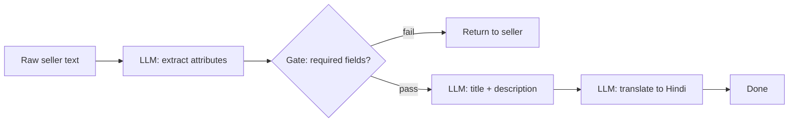
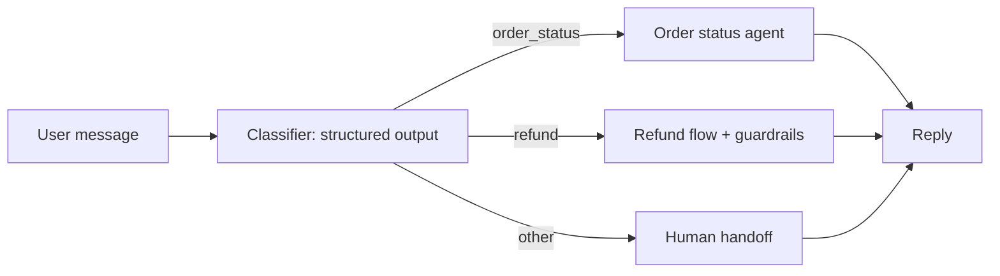
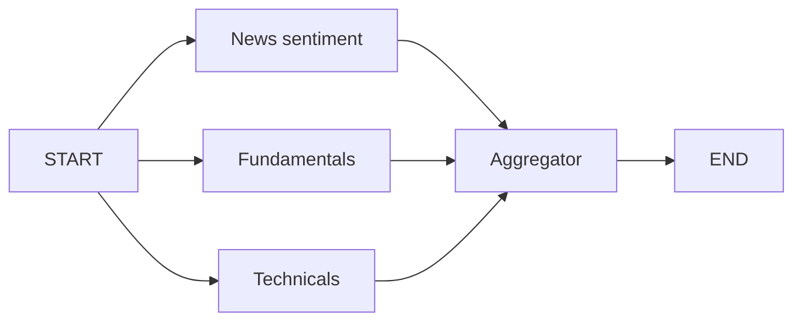
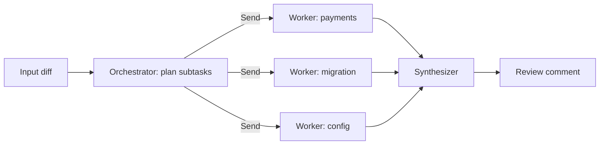
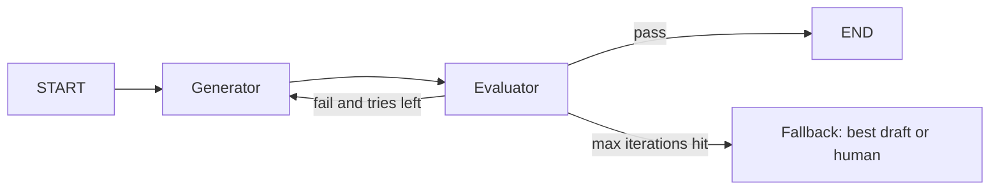

# Workflow Patterns

A workflow means **the code path is fixed in advance**; the LLM only does the work inside each step. This page covers the 5 patterns from Anthropic's "Building effective agents" taxonomy: prompt chaining, routing, parallelization, orchestrator-worker, evaluator-optimizer. Interviewers ask because the mark of a senior engineer is "don't build a full agent when a workflow is enough", and you should be able to implement each pattern in LangGraph.

For state, reducers, conditional edges and checkpointing basics, read [LangGraph Core Concepts](02-langgraph-core.md). This page covers only the patterns.

## ⭐ Workflow vs agent, and a pattern picker

**In one line:** in a workflow the developer decides the control flow; in an agent the LLM decides the next step. Try the simplest thing first, and add autonomy only when evals show you need it.

- **Workflow:** predictable, testable, cheap, bounded latency. Use it when the task's steps are known up front.
- **Agent:** open-ended, the number of steps is unknown, tool choice is dynamic. Higher cost and a bigger failure surface.
- Ladder: single LLM call (+ retrieval, tools) → workflow → agent → multi-agent. Every step up should be justified by an eval number, not by "it looks cool".

| Shape of the problem | Pattern | Who has control |
|---|---|---|
| Fixed sequence, each step depends on the previous one | Prompt chaining | Code |
| Different input types need different handling | Routing | LLM classifies, code dispatches |
| Independent subtasks or multiple opinions | Parallelization | Code |
| Subtasks not known up front, depend on input | Orchestrator-worker | LLM plans, code executes |
| Clear quality criteria, iteration improves output | Evaluator-optimizer | Code loop, LLM judge |
| The order of steps and tools is itself unknown | Agent (next page) | LLM |

**Interview tip:** "My first question is: are the steps known up front? If yes, a workflow. Workflows are much easier to debug, eval and cost-cap."

**Common mistake:** putting a ReAct agent on every problem, then debugging non-deterministic bugs and a 10x token bill.

## ⭐ Prompt chaining

**In one line:** split the task into fixed sequential steps where each LLM call takes the previous output, with a **programmatic gate** in between that decides whether to continue.

> **Example:** Flipkart seller onboarding. Step 1: extract structured attributes from the seller's raw product text. **Gate:** are the required fields (brand, category, MRP) present? If not, send it back to the seller. Step 2: generate an SEO title + description. Step 3: translate to Hindi.

- Each step is small and focused → accuracy goes up, latency goes up. Accept that trade-off.
- The **gate** should be deterministic (schema validation, regex, length check) or a cheap LLM check. Gate fails = early exit or retry, so a wrong output does not propagate.
- **Use when:** steps are fixed and each step's output can be verified. **Don't use when:** steps are independent (parallelize) or the order depends on the input (routing/agent).



```python
from typing import TypedDict
from pydantic import BaseModel
from langgraph.graph import StateGraph, START, END
from langchain.chat_models import init_chat_model

llm = init_chat_model("openai:gpt-4.1-mini")

class Attrs(BaseModel):
    brand: str | None
    category: str | None
    mrp: float | None

class S(TypedDict):
    raw: str
    attrs: dict
    copy: str
    hindi: str

def extract(s: S):
    a = llm.with_structured_output(Attrs).invoke(f"Extract attributes:\n{s['raw']}")
    return {"attrs": a.model_dump()}

def gate(s: S):  # deterministic check, not an LLM
    ok = all(s["attrs"].get(k) for k in ("brand", "category", "mrp"))
    return "write" if ok else END

def write(s: S):
    return {"copy": llm.invoke(f"SEO title + description for {s['attrs']}").content}

def translate(s: S):
    return {"hindi": llm.invoke(f"Translate to Hindi:\n{s['copy']}").content}

g = StateGraph(S)
g.add_node(extract); g.add_node(write); g.add_node(translate)
g.add_edge(START, "extract")
g.add_conditional_edges("extract", gate, ["write", END])
g.add_edge("write", "translate"); g.add_edge("translate", END)
app = g.compile()
```

- **Failure modes:** error compounding (a 5% error in step 1 multiplies downstream), a gate that is too loose, losing intermediate state (passing only the last output, not the original input).

**Interview tip:** "I put a cheap deterministic gate between steps; it catches failures early and lets me eval each step separately."

**Common mistake:** doing 5 jobs in one giant prompt, then not knowing which sub-task failed.

## ⭐ Routing

**In one line:** a classifier (LLM structured output or a small ML model) assigns the input a category, and the graph sends it to a **specialized branch** with its own prompt, model and tools.

> **Example:** Swiggy support. "My order is late" → order-status branch (tracking tool). "I want a refund" → refund branch (stricter guardrails, payment tool). "Complaint about the restaurant" → escalation. Simple FAQs go to a cheap model, refunds to a bigger one.

- **Separation of concerns:** it is hard to optimize one prompt for every case; improving one case breaks another. Routing separates them.
- **Cost routing:** easy queries to a small model, hard ones to a big model. That is routing too.
- Give the classifier **structured output** (a `Literal` enum), not free text. Low confidence or `other` → fallback/human.
- Two ways in LangGraph: `add_conditional_edges` (a router function on the edge) or returning `Command(goto=...)` from a node (routing + state update together).
- **Don't use when:** categories overlap or one query has multiple intents (then use parallel or orchestrator).



```python
from typing import Literal
from pydantic import BaseModel, Field
from langgraph.graph import StateGraph, START, END, MessagesState
from langgraph.types import Command

class Route(BaseModel):
    intent: Literal["order_status", "refund", "other"]
    confidence: float = Field(ge=0, le=1)

router_llm = llm.with_structured_output(Route)

def classify(state: MessagesState) -> Command[Literal["order_status", "refund", "human"]]:
    r = router_llm.invoke([("system", "Classify the support query.")] + state["messages"])
    target = r.intent if r.confidence >= 0.7 and r.intent != "other" else "human"
    return Command(goto=target)  # you can also update state here: update={...}

def order_status(state: MessagesState): ...
def refund(state: MessagesState): ...
def human(state: MessagesState): ...

g = StateGraph(MessagesState)
g.add_node(classify); g.add_node(order_status); g.add_node(refund); g.add_node(human)
g.add_edge(START, "classify")
for n in ("order_status", "refund", "human"):
    g.add_edge(n, END)
app = g.compile()
```

- The `Command[Literal[...]]` return annotation is required so graph rendering and validation know the possible destinations.
- **Failure modes:** misroutes (confidently picking the wrong branch), class imbalance, new intents that fit no bucket, multi-intent messages.
- Fix: a separate eval set for the router (confusion matrix), a confidence threshold, an `other` bucket, and mining new intents from logs.

**Interview tip:** "A router is a classifier, so I eval it like one: per-class precision/recall and a confusion matrix, separate from the end-to-end eval."

**Common mistake:** taking free-text output from the router and doing a string `in` check. Use structured output + an enum.

## ⭐ Parallelization: sectioning and voting

**In one line:** run independent work at the same time (**sectioning**), or run the same work N times and aggregate (**voting**), then join the results with a reducer at **fan-in**.

> **Example (sectioning):** a Zerodha stock summary: news sentiment, fundamentals and technicals as three parallel branches, then an aggregator writes one report. **Example (voting):** fraud check in Razorpay merchant onboarding: 3 different prompts ask "is this website suspicious?", 2/3 yes means manual review.

- **Sectioning:** cuts latency (sequential 3×2s = 6s → parallel ≈ 2s), and each branch stays focused. Guardrails in one branch and the answer in another is also sectioning.
- **Voting:** raises confidence, costs N times more. Tune the threshold (any-yes for safety, majority for balance).
- **Static fan-out** in LangGraph: multiple edges out of one node = parallel in the same superstep. **Fan-in:** `add_edge(["a","b","c"], "join")` waits for all of them.
- If parallel nodes write the same key you need a **reducer** (`Annotated[list, operator.add]`), otherwise you get `InvalidUpdateError`.



```python
import operator
from typing import Annotated, TypedDict

class S(TypedDict):
    ticker: str
    sections: Annotated[list[str], operator.add]  # parallel writes get merged
    report: str

def ask(kind: str, ticker: str) -> list[str]:
    return [f"{kind}: " + llm.invoke(f"{kind} analysis for {ticker}").content]

def news(s): return {"sections": ask("News sentiment", s["ticker"])}
def fundamentals(s): return {"sections": ask("Fundamentals", s["ticker"])}
def technicals(s): return {"sections": ask("Technicals", s["ticker"])}

def aggregate(s):
    return {"report": llm.invoke("Combine into one report:\n" + "\n".join(s["sections"])).content}

g = StateGraph(S)
for fn in (news, fundamentals, technicals, aggregate):
    g.add_node(fn)
for n in ("news", "fundamentals", "technicals"):
    g.add_edge(START, n)
g.add_edge(["news", "fundamentals", "technicals"], "aggregate")  # fan-in: wait for all
g.add_edge("aggregate", END)
app = g.compile()
```

### Map-reduce with `Send`

- Use static edges when the number of branches is fixed. When N is only known at runtime (e.g. 7 PDFs, 40 reviews), use **`Send`**.
- A conditional edge returns a list of `Send` objects; each `Send(node, payload)` runs that node with **its own private input**. A reducer collects the results.

```python
from langgraph.types import Send

class MR(TypedDict):
    reviews: list[str]
    summaries: Annotated[list[str], operator.add]
    final: str

def fan_out(s: MR):
    return [Send("summarize", {"review": r}) for r in s["reviews"]]  # map

def summarize(p: dict):  # input is only the payload, not the full state
    return {"summaries": [llm.invoke(f"One line summary: {p['review']}").content]}

def reduce_(s: MR):
    return {"final": llm.invoke("Top 3 themes:\n" + "\n".join(s["summaries"])).content}

g = StateGraph(MR)
g.add_node("summarize", summarize); g.add_node("reduce", reduce_)
g.add_conditional_edges(START, fan_out, ["summarize"])
g.add_edge("summarize", "reduce")
g.add_edge("reduce", END)
```

- **Failure modes:** forgetting the reducer, one slow/failed branch stalls the whole superstep (timeouts + `RetryPolicy`), hitting rate limits (cap with `max_concurrency` in the config), correlated errors in voting (same prompt N times = same mistake; vary prompts or models).

**Interview tip:** "Sectioning for latency, voting for confidence. If N is dynamic, map-reduce with `Send`, and an `operator.add` reducer on the shared key."

**Common mistake:** relying on order. Don't assume result order in a parallel reducer; if you need it, send an id along and sort.

## ⭐ Orchestrator-worker

**In one line:** an orchestrator LLM looks at the input and **plans subtasks at runtime**, sends them to workers with `Send`, and a synthesizer joins the results.

> **Example:** Razorpay's "PR review bot": the orchestrator looks at the diff and decides which files/areas need review (payments module, migration, config), a worker runs on each, and a synthesizer writes one review comment. How many workers depends on the diff.

- Difference from parallelization: there the **developer** defines the subtasks; here the **LLM** defines them.
- Difference from an agent: the plan is made once, no loop; workers can still be mini-agents with tools.
- **Use when:** subtasks depend on the input, but one plan + execute is enough. **Don't use when:** the plan must change midway (then use plan-and-execute with a replanner, [next page](04-agent-patterns.md)).



```python
class Task(BaseModel):
    area: str
    instructions: str

class Plan(BaseModel):
    tasks: list[Task] = Field(max_length=6)  # fan-out cap

class OS(TypedDict):
    diff: str
    plan: list[Task]
    findings: Annotated[list[str], operator.add]
    review: str

def orchestrator(s: OS):
    p = llm.with_structured_output(Plan).invoke(f"Split review of this diff:\n{s['diff']}")
    return {"plan": p.tasks}

def assign(s: OS):
    return [Send("worker", {"task": t, "diff": s["diff"]}) for t in s["plan"]]

def worker(p: dict):
    t = p["task"]
    out = llm.invoke(f"Review {t.area}: {t.instructions}\n{p['diff']}").content
    return {"findings": [f"[{t.area}] {out}"]}

def synthesize(s: OS):
    return {"review": llm.invoke("Merge findings:\n" + "\n".join(s["findings"])).content}

g = StateGraph(OS)
g.add_node(orchestrator); g.add_node(worker); g.add_node(synthesize)
g.add_edge(START, "orchestrator")
g.add_conditional_edges("orchestrator", assign, ["worker"])
g.add_edge("worker", "synthesize"); g.add_edge("synthesize", END)
```

- **Failure modes:** over-decomposition (20 tasks for a 5-line diff), overlapping tasks (duplicate findings), giving workers too little context, overflowing the synthesizer's context.
- Fix: a `max_length` cap on the plan, clear boundaries in task descriptions, short structured output from workers, dedupe before the synthesizer.

**Interview tip:** "The orchestrator's plan is structured output with a capped size; each worker gets only its own slice. That is a cheap form of context isolation."

**Common mistake:** sending the full state/history to every worker. Token cost goes up N times and focus is lost.

## ⭐ Evaluator-optimizer (reflection loop)

**In one line:** a generator produces output, an evaluator grades it against criteria and gives feedback, on failure the generator retries with that feedback; a **max-iterations guard** is mandatory.

> **Example:** Zomato push notification copy. The generator writes 40-char Hinglish copy; the evaluator checks: length ≤ 40, brand tone, no false claims ("free" only if the offer is free). Fail → rewrite with feedback, max 3 rounds.

- **Use when:** criteria are clear and articulable, and feedback measurably improves the output (copywriting, code that must pass tests, translation nuance). **Don't use when:** criteria are vague, or the first draft is already good enough (you only add latency/cost).
- The best evaluator is **deterministic** where possible (tests, linters, schema, length). Use an LLM judge only for subjective parts, with structured output (`pass: bool`, `feedback: str`).
- Self-grading bias: the same model with the same prompt passes its own output too often. Use a different prompt/model or a rubric.



```python
class Grade(BaseModel):
    passed: bool
    feedback: str

class RS(TypedDict):
    brief: str
    draft: str
    grade: dict
    tries: int

MAX_TRIES = 3
judge_llm = init_chat_model("anthropic:claude-sonnet-4-5")  # different model = less self-bias

def generate(s: RS):
    fb = s.get("grade", {}).get("feedback", "")
    d = llm.invoke(f"Push copy, max 40 chars, Hinglish.\nBrief: {s['brief']}\nFix: {fb}").content
    return {"draft": d, "tries": s.get("tries", 0) + 1}

def evaluate(s: RS):
    if len(s["draft"]) > 40:  # deterministic check first
        return {"grade": {"passed": False, "feedback": "Over 40 chars, shorten."}}
    g = judge_llm.with_structured_output(Grade).invoke(f"Rubric: tone, no false claims.\n{s['draft']}")
    return {"grade": g.model_dump()}

def next_step(s: RS):
    if s["grade"]["passed"]:
        return END
    return "generate" if s["tries"] < MAX_TRIES else "fallback"

g = StateGraph(RS)
g.add_node(generate); g.add_node(evaluate); g.add_node("fallback", lambda s: {})
g.add_edge(START, "generate"); g.add_edge("generate", "evaluate")
g.add_conditional_edges("evaluate", next_step, ["generate", "fallback", END])
g.add_edge("fallback", END)
```

- **Failure modes:** infinite loop (no guard), oscillation (fixing A breaks B), judge leniency/strictness drift, every round adds cost + latency.
- Safety net: both your own counter and LangGraph's `recursion_limit` (default 25 supersteps). Hitting the limit raises `GraphRecursionError`; catch it and fall back gracefully.

**Interview tip:** "Three things in the loop: deterministic checks first, an LLM judge with structured output, and after an explicit max-iterations a best-so-far or human fallback."

**Common mistake:** relying only on `recursion_limit`. It crashes; it does not give you a graceful exit.

## Combining patterns

**In one line:** in real systems patterns nest: a chain inside one router branch, a parallel step inside a chain, an evaluator loop at the end.

> **Example:** Flipkart customer support: **routing** (intent) → **prompt chaining** in the refund branch (verify order → check policy → draft reply) → **evaluator** on the draft (policy compliance) → human on low confidence. The product-compare branch uses **parallelization** (specs, reviews, price at once).

- Make each sub-pattern a **subgraph** (a compiled graph as a node). Separate tests, separate evals, separate owners.
- Rule: combine only when each layer's eval number justifies it. Every layer adds latency and cost.
- Debugging: every node's input/output should be visible in the LangSmith/Langfuse trace; see [AI Observability](10-agent-observability.md).

**Interview tip:** "I explain a design by pattern names: 'routing on top, the refund branch is chained with a gate, an evaluator at the end.' The interviewer gets the structure immediately."

**Common mistake:** 25 nodes in one flat graph; without subgraphs, testing and reuse are hard.

## ⭐ Which pattern for which problem

| Problem | Pattern | Why |
|---|---|---|
| Meesho seller catalog: extract → enrich → translate | Prompt chaining + gate | Fixed steps, each step verifiable |
| Swiggy support: order, refund, complaint | Routing | Separate prompts/tools/guardrails per intent |
| Zerodha stock brief: news, fundamentals, technicals | Parallelization (sectioning) | Independent, cut latency |
| Razorpay fraud check on merchant website | Parallelization (voting) | Confidence, false negatives are expensive |
| Summarize 50 app reviews | Map-reduce with `Send` | N known only at runtime |
| PR review bot, multi-file diff | Orchestrator-worker | Subtasks depend on input |
| Zomato push copy with tone and length rules | Evaluator-optimizer | Clear criteria, iteration helps |
| CRED "analyse my spend and make a plan", steps unknown | Agent / plan-and-execute | Path not known up front |

**Interview tip:** "Two questions pick the pattern: are the steps known up front? and how will I check the output? Those two settle 80% of the decision."

**Common mistake:** remembering the pattern names but not being able to state their failure modes and cost impact.

## Read next

- [LangGraph Core Concepts](02-langgraph-core.md): state, reducers, `Command`, checkpointing.
- [Agentic Patterns: Agents & Multi-agent](04-agent-patterns.md): when a workflow is not enough.
- [Evals for Agents](09-agent-evals.md): how to measure the router and the evaluator.
- [Cost & Latency](11-cost-latency.md): the cost angle of parallelization and model routing.
- [Multi-agent lab](/viewinter/agents/labs/multi): run the patterns in the browser.

## Checklist

- [ ] I can explain workflow vs agent and the "simplest first" ladder
- [ ] I can explain why prompt chaining needs a gate and what it looks like, with LangGraph code
- [ ] I can implement routing with structured output + a conditional edge or `Command`
- [ ] I can explain sectioning vs voting and why fan-in needs a reducer
- [ ] I can write map-reduce with the `Send` API and explain payload vs state
- [ ] I can explain how orchestrator-worker differs from parallelization and from an agent
- [ ] I can design an evaluator-optimizer loop with a max-iterations guard and a fallback
- [ ] I can tell the failure modes and fixes for each pattern
- [ ] I can justify the right pattern (or combination) for a product problem
