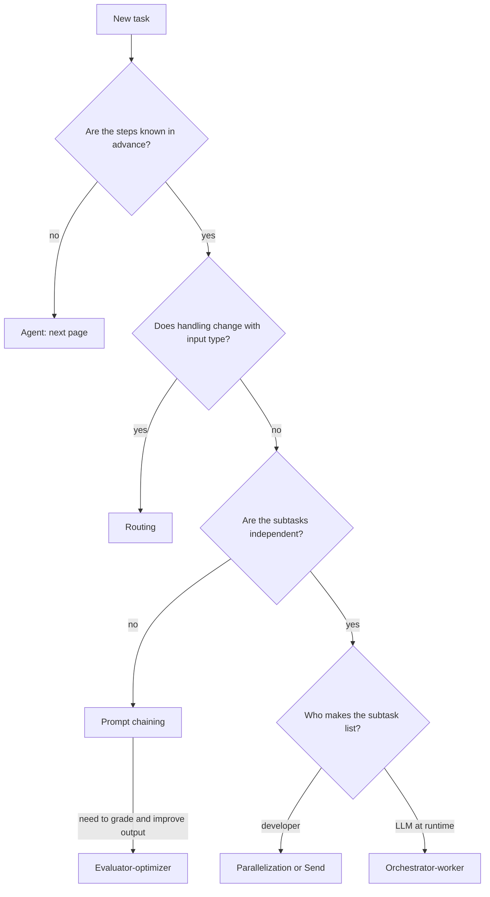
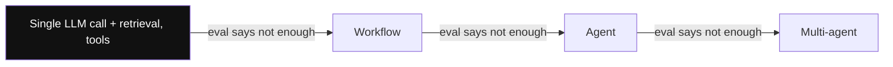
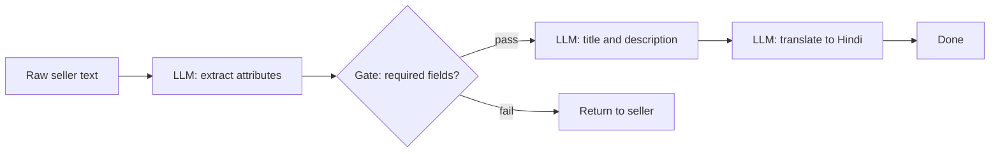
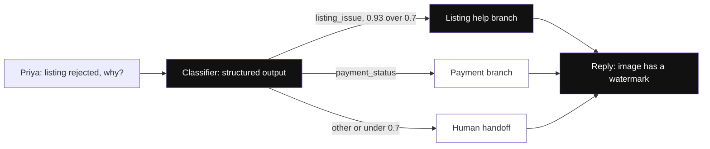
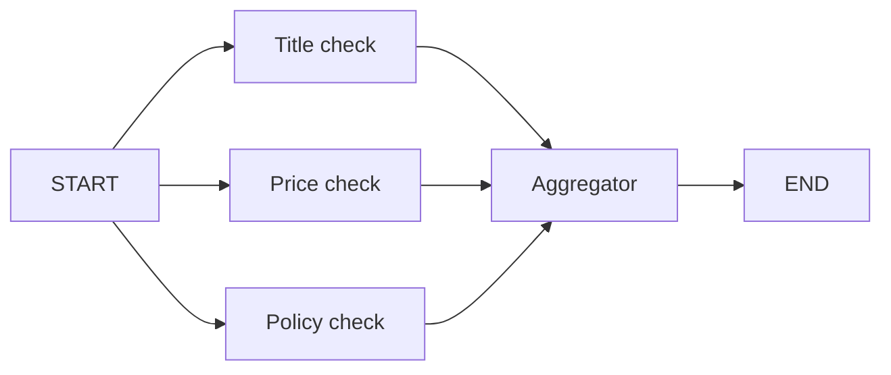
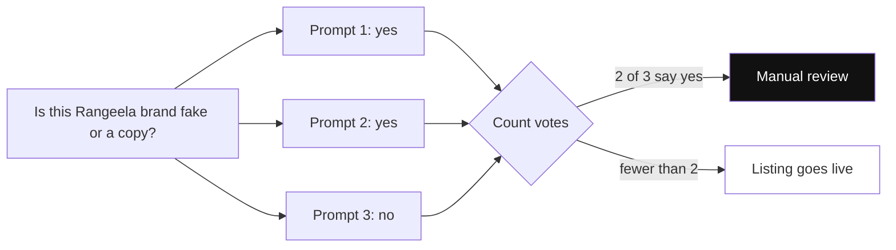
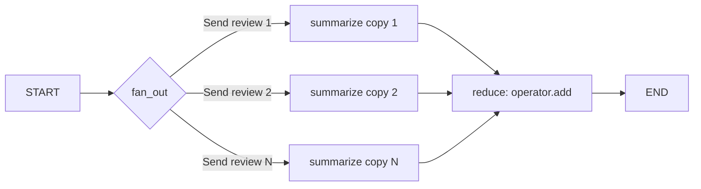
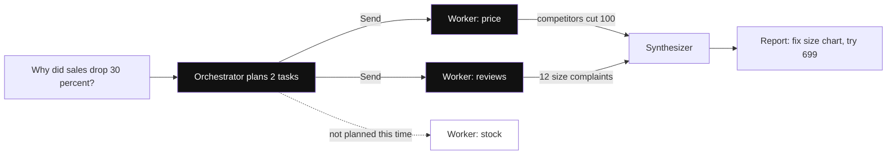
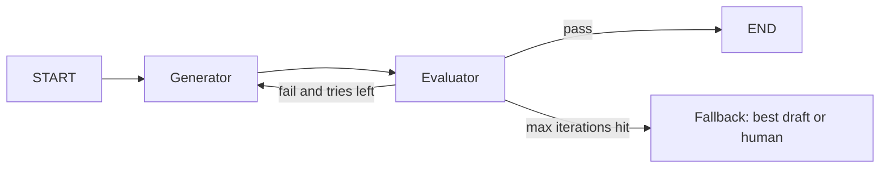
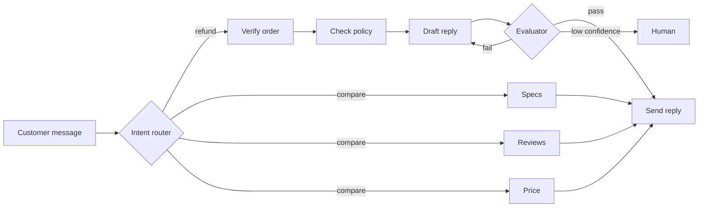

# Workflow Patterns

A workflow means **the code path is fixed in advance**. The LLM only does the work inside each step; the developer has already written which step comes next.

This page covers the 5 patterns from Anthropic's "Building effective agents": prompt chaining, routing, parallelization, orchestrator-worker, evaluator-optimizer. Interviewers ask because the mark of a senior engineer is: "don't build a full agent when a workflow is enough".

For the basics of state, reducers, conditional edges and checkpointing, read [LangGraph Core Concepts](02-langgraph-core.md) first. This page covers only the patterns.

**After this page you can explain:**
- The difference between a workflow and an agent, and when to pick which.
- All five patterns, and how the data moves through each one step by step.
- What `Send` and reducers do (fan-out and fan-in).
- How cost and latency change when you build the same task with different patterns.
- How to justify the right pattern for any product problem.

## Words you need first

New to LLMs? Read [How LLMs Work](14-how-llms-work.md) first. It explains tokens, context windows and how a model generates text.

| Word | Plain meaning |
|---|---|
| Reducer | A rule for merging several updates to the same shared data field, e.g. join lists instead of overwriting. |
| Conditional edge | A function that reads the graph's shared data and returns the name of the next step to run. |
| `Send` | A LangGraph object meaning "run this step once with this input". A list of them runs many copies. |
| Fan-out / fan-in | Fan-out splits work into many branches at once; fan-in waits for all of them and collects the results. |
| ReAct agent | An agent that loops: the model thinks, calls a tool, reads the result, and repeats until done. |
| Retrieval | Fetching relevant documents from your own data and adding them to the prompt before the model answers. |
| Eval | An automated test suite for LLM output that scores answers on a fixed set of examples. |
| LLM judge | A second model call that grades an output against written criteria and returns pass or fail. |
| Structured output | Making the model reply in a fixed JSON shape your code can parse safely. |
| `Command` | An object a step returns to say which step runs next, optionally with changes to the shared data. |
| Confusion matrix | A table of predicted vs actual categories that shows which categories a classifier mixes up. |
| Superstep | One round of the graph. All ready steps run together, then their updates merge. |
| Guardrail | A check around the model that blocks unsafe or rule-breaking input or output. |
| Trace | A recorded log of one run, showing each step's input, output and time taken. |

## Big picture: one map for five patterns

One product runs through the whole page: **SellerSaathi**, an AI assistant for Flipkart sellers. Our seller is **Priya**, who sells cotton kurtas from Jaipur. For each pattern we take one of Priya's jobs and watch how the data moves.

All five patterns share one idea: **the code decides the path**. They differ only in the shape of the path. Chaining is a straight line. Routing is a fork where only one path is taken. In parallelization all paths run at once. In orchestrator-worker the LLM says at runtime how many paths there are. Evaluator-optimizer is a loop that keeps going until quality passes.

| Pattern | Shape of the path | Job in SellerSaathi |
|---|---|---|
| Prompt chaining | Straight line | Create a new listing |
| Routing | Fork, pick one path | Send a seller's question to the right team |
| Parallelization | All paths at once | 3 quality checks on a listing |
| Map-reduce with `Send` | N copies, N known at runtime | Summarize 40 reviews |
| Orchestrator-worker | LLM decides how many paths | Investigate "why did sales drop?" |
| Evaluator-optimizer | Loop | Push notification copy |

The diagram below shows which pattern to pick for a new task. The sections of this page follow the same order.



## ⭐ Workflow vs agent, and a pattern picker

**Why do we need this?** Say you built a ReAct agent to create Priya's listing. Sometimes it translates first, sometimes it forgets the title, sometimes it makes 9 tool calls. The bug does not reproduce and the bill is 10x. When the steps are known in advance, there was no need to let the LLM choose the path.

**Analogy:** a workflow = **the fixed process at an IRCTC counter**: take the form, check the ID, look up a seat, print the ticket. The clerk thinks inside each step, but the order of steps is fixed. An agent = **a wedding planner**: you say "get the wedding done", and they decide whether to book the venue first, or the caterer, or the priest.

| | Workflow | Agent |
|---|---|---|
| Who decides the next step | The developer's code | The LLM |
| Predictable | Yes, same input = same path | No, the path can change |
| Testing and debugging | Easy, test each node alone | Hard |
| Cost and latency | Bounded, known in advance | Goes up and down |
| When | Steps are known in advance | Number and order of steps unknown |

**Simplest-first ladder:** single LLM call (+ retrieval, tools) → workflow → agent → multi-agent. Each step up must be justified by an eval number, not by "it looks cool".



*Diagram:* Start at the highlighted left end and move one step right only when an eval number shows the current step fails; cost and unpredictability grow with each step.

| Shape of the problem | Pattern | Who has control |
|---|---|---|
| Fixed sequence, each step depends on the previous one | Prompt chaining | Code |
| Different input types need different handling | Routing | LLM classifies, code dispatches |
| Independent subtasks or multiple opinions | Parallelization | Code |
| Subtasks not known in advance, depend on input | Orchestrator-worker | LLM plans, code executes |
| Clear quality criteria, iteration improves output | Evaluator-optimizer | Code loop, LLM judge |
| The order of steps and tools itself is unknown | Agent (next page) | LLM |

**Interview tip:** "I first ask: are the steps known in advance? If yes, a workflow. A workflow is much easier to debug, eval and cost-cap."

**Common mistake:** putting a ReAct agent on every problem, then debugging non-deterministic bugs and a 10x token bill.

## ⭐ Prompt chaining

**Why do we need this?** Priya pastes one line and wants a full listing from it: attributes, SEO title, Hindi version. If you do all of this in one giant prompt, the MRP may vanish from the output and you can't tell which part failed.

**Analogy:** **the line in a restaurant kitchen**. The first cook chops vegetables, the second does the tadka, the third plates the dish. In between, the head chef checks that the vegetables are cut right; if not, he stops it there. Each cook = one LLM call. The head chef's check = the **gate**.

**In one line:** break the task into fixed sequential steps, each LLM call takes the previous output, and a **programmatic gate** in between checks whether to continue.

> **Example:** Priya's new listing. Input: `"Rangeela cotton kurta, Jaipur print, sizes M L XL, MRP 799"`.

**Step by step (how the state changes):**
1. **START:** state = `{raw: "Rangeela cotton kurta, Jaipur print, sizes M L XL, MRP 799"}`.
2. **extract (LLM):** returns structured output. The state gets `attrs = {brand: "Rangeela", category: "Kurta", mrp: 799}`.
3. **gate (Python, not an LLM):** are brand, category and mrp all present? Yes, so it returns `"write"`. If Priya had not written the MRP, `mrp = None`, the gate would return `END` and Priya would get a message "add the MRP".
4. **write (LLM):** `copy = "Rangeela Jaipur Print Cotton Kurta for Women, Sizes M-XL"` + a 2 line description.
5. **translate (LLM):** `hindi = "रंगीला जयपुरी प्रिंट कॉटन कुर्ता..."`.
6. **END:** the final state has all four: `raw`, `attrs`, `copy`, `hindi`. The original `raw` is still there for any step that needs it.



**Now the terms:**
- **Chain:** a fixed line of LLM calls, the output of one is the input of the next.
- **Gate:** a cheap check between two steps (schema, regex, length, or a small LLM). Fail = early exit or retry.
- **Error compounding:** a 5% error in step 1 multiplies through every later step. The gate stops this.

**Use when:** the steps are fixed and each step's output can be verified. **Don't use when:** the steps are independent (parallelize) or the order depends on the input (routing or an agent). Trade-off: small focused steps raise accuracy, but also raise latency.

The code below builds the same flow in LangGraph: 3 LLM nodes and one Python gate.

```python
from typing import TypedDict
from pydantic import BaseModel
from langgraph.graph import StateGraph, START, END
from langchain.chat_models import init_chat_model

llm = init_chat_model("openai:gpt-4.1-mini")

class Attrs(BaseModel):            # the LLM must answer in exactly this shape
    brand: str | None
    category: str | None
    mrp: float | None

class S(TypedDict):                # shared state, every node writes into it
    raw: str
    attrs: dict
    copy: str
    hindi: str

def extract(s: S):                 # Step 1: raw text to structured attrs
    a = llm.with_structured_output(Attrs).invoke(f"Extract attributes:\n{s['raw']}")
    return {"attrs": a.model_dump()}   # only the "attrs" key is updated

def gate(s: S):                    # deterministic check, not an LLM
    ok = all(s["attrs"].get(k) for k in ("brand", "category", "mrp"))
    return "write" if ok else END      # fail = stop right here

def write(s: S):                   # Step 2
    return {"copy": llm.invoke(f"SEO title + description for {s['attrs']}").content}

def translate(s: S):               # Step 3
    return {"hindi": llm.invoke(f"Translate to Hindi:\n{s['copy']}").content}

g = StateGraph(S)
g.add_node(extract)
g.add_node(write)
g.add_node(translate)
g.add_edge(START, "extract")
g.add_conditional_edges("extract", gate, ["write", END])   # the gate picks the next node
g.add_edge("write", "translate")
g.add_edge("translate", END)
app = g.compile()
out = app.invoke({"raw": "Rangeela cotton kurta, Jaipur print, sizes M L XL, MRP 799"})
```

**What the code does:**
- The `Attrs` Pydantic model forces the LLM to answer in JSON, so the gate can check `attrs["mrp"]` directly.
- Each node reads the full state but returns only its own key; LangGraph merges it into the state.
- `gate` is a plain Python function on a conditional edge. It returns `"write"` or `END`.
- The destination list in `add_conditional_edges(..., ["write", END])` tells the graph where the gate can send things.

**Failure modes:** error compounding, a gate that is too loose, losing state in the middle (passing only the last output, not the original input).

**Interview tip:** "I put a cheap deterministic gate between steps; it catches failures early and lets me eval each step on its own."

**Common mistake:** asking one giant prompt to do 5 jobs at once, then not knowing which sub-task failed.

## ⭐ Routing

**Why do we need this?** SellerSaathi gets thousands of questions a day: "why was my listing rejected", "when will my payment come", "the courier broke my parcel". If one prompt handles everything, fixing the payment case breaks the listing case. Each type needs its own prompt, tools and model.

**Analogy:** **a hospital reception**. The receptionist does not treat anyone. They only listen and send: "broken bone, go to ortho", "fever, see the general physician". If they can't tell, they call a senior. Receptionist = **classifier**, departments = **branches**, senior = **human fallback**.

**In one line:** a classifier (LLM structured output or a small ML model) gives the input a category, and the graph sends it to a **specialized branch** with its own prompt, model and tools.

> **Example:** Priya writes: "Meri kurta listing 2 din se 'rejected' dikha rahi hai, kyun?" (My kurta listing has shown 'rejected' for 2 days, why?)

**Step by step:**
1. **START:** `messages = [Human: "Meri kurta listing 2 din se 'rejected' dikha rahi hai, kyun?"]`.
2. **classify (LLM, structured output):** returns `{intent: "listing_issue", confidence: 0.93}`.
3. **Decision (code):** confidence 0.93 ≥ 0.7 and the intent is not `other`, so `Command(goto="listing_issue")`.
4. **listing_issue branch:** it has the listing API tool. It finds the reason, "the image has a watermark", and writes a reply.
5. **END:** Priya gets the answer. The payment branch never ran; its prompt and tools were never touched.
6. **Another case:** "Bhai kuch samajh nahi aa raha" (I don't understand anything) → `{intent: "other", confidence: 0.41}` → `human` branch, a ticket is created.



*Diagram:* For Priya's question only the highlighted branch runs; the payment branch's prompt and tools are never touched.

**Now the terms:**
- **Classifier / router:** the step that only names the category; it does not do the work.
- **Structured output:** an answer from the LLM in a fixed format (`Literal` enum + confidence), not free text.
- **`Command(goto=...)`:** a node says which node runs next; it can also change state with `update={...}`. Routing + state update together.
- **Cost routing:** easy queries go to a small model, hard ones to a big model. That is also routing.

LangGraph has two ways to route: `add_conditional_edges` (a router function on the edge), or returning `Command(goto=...)` from a node. The code below uses `Command`.

```python
from typing import Literal
from pydantic import BaseModel, Field
from langgraph.graph import StateGraph, START, END, MessagesState
from langgraph.types import Command

class Route(BaseModel):                       # the router's fixed answer format
    intent: Literal["listing_issue", "payment_status", "other"]
    confidence: float = Field(ge=0, le=1)

router_llm = llm.with_structured_output(Route)

def classify(state: MessagesState) -> Command[Literal["listing_issue", "payment_status", "human"]]:
    r = router_llm.invoke([("system", "Classify the seller query.")] + state["messages"])
    sure = r.confidence >= 0.7 and r.intent != "other"
    return Command(goto=r.intent if sure else "human")   # you can also pass update={...}

def listing_issue(state: MessagesState): ...   # branch with listing API tools
def payment_status(state: MessagesState): ...  # branch with the payment API
def human(state: MessagesState): ...           # create a ticket for a human

g = StateGraph(MessagesState)
for fn in (classify, listing_issue, payment_status, human):
    g.add_node(fn)
g.add_edge(START, "classify")
for n in ("listing_issue", "payment_status", "human"):
    g.add_edge(n, END)
app = g.compile()
```

**What the code does:**
- `Route` uses `Literal[...]`, so the LLM can only return one of these three words. No string matching needed.
- `classify` decides `goto` itself; that is why there is no `add_edge` out of `classify`.
- The return type `Command[Literal[...]]` is required so graph rendering and validation know the possible destinations.
- Low confidence or `other` goes to `human`. This fallback is the safety net for misroutes.

**Don't use when:** categories overlap, or one message has two intents ("when will my payment come and why was my listing rejected"). Then think parallel or orchestrator.

**Failure modes:** misroutes (confidently the wrong branch), class imbalance (one category is far more common than the others), new intents that fit no bucket, multi-intent messages. Fix: a separate eval set for the router (confusion matrix), a confidence threshold, an `other` bucket, and mining new intents from logs.

**Interview tip:** "A router is a classifier, so I eval it like one: per-class precision/recall and a confusion matrix, separate from the end-to-end eval."

**Common mistake:** taking free-text output from the router and doing a string `in` check. Use structured output + an enum.

## ⭐ Parallelization: sectioning and voting

**Why do we need this?** Before a listing goes live it needs three checks: is the title fine, is the price competitive, is there any policy violation. None of the three depends on another. Run them one after another and it is 3 × 2s = 6s. Run them together and it is ≈ 2s.

**Analogy:** **fielding in a cricket team**. The captain places fielders at slip, point and long-on at the same time; each works in their spot at once. At the end of the over the captain gets a report from everyone. Fielders = **parallel branches**, the captain collecting reports = **fan-in**.

**In one line:** run independent work at the same time (**sectioning**), or run the same job N times and aggregate (**voting**), then join the results with a reducer at **fan-in**.

> **Example (sectioning):** QC for Priya's listing: title check, price check, policy check at the same time. **Example (voting):** ask "Is this 'Rangeela' brand fake or a copy?" with three different prompts; if 2 out of 3 say "yes", send it to manual review.

**Step by step (sectioning):**
1. **START:** `{listing: "Rangeela Jaipur Print Cotton Kurta, ₹799", findings: []}`.
2. **Fan-out:** START has three edges, so `title_check`, `price_check` and `policy_check` run together in the **same superstep**.
3. All three write their result to the `findings` key:
   - title_check → `["Title: OK, length is fine"]`
   - price_check → `["Price: similar kurtas are ₹649-₹899, fine"]`
   - policy_check → `["Policy: remove the 'best quality guaranteed' claim"]`
4. The **reducer** (`operator.add`) joins the three lists: `findings` now has 3 items. Without a reducer LangGraph would raise `InvalidUpdateError`, because three nodes wrote the same key at once.
5. **Fan-in:** the `aggregate` node runs only after all three finish. It writes one report.
6. **END:** `report = "1 fix needed: remove the policy claim. Rest is OK."`





*Diagram:* Voting: the same question asked three different ways at the same time; a 2-of-3 majority sends the listing to manual review.

**Now the terms:**
- **Sectioning:** different jobs at the same time. Benefit: lower latency, each branch stays focused. Running a guardrail in one branch and the answer in another is also sectioning.
- **Voting:** the same job N times, then majority or any-yes. Benefit: confidence. Cost is N times. Any-yes for safety, majority for balance.
- **Superstep:** one "tick" of the graph. Nodes that are ready in the same tick run together.
- **Fan-out:** several edges out of one node. **Fan-in:** `add_edge(["a","b","c"], "join")`, which waits for all of them.
- **Reducer:** the rule for how to combine several updates to one key. `Annotated[list, operator.add]` = join the lists.

This code runs the three checks above in parallel and builds one report.

```python
import operator
from typing import Annotated, TypedDict

class QC(TypedDict):
    listing: str
    findings: Annotated[list[str], operator.add]  # reducer: parallel writes get joined
    report: str

def check(kind: str, listing: str) -> list[str]:
    return [f"{kind}: " + llm.invoke(f"{kind} check for this listing:\n{listing}").content]

def title_check(s): return {"findings": check("Title", s["listing"])}
def price_check(s): return {"findings": check("Price", s["listing"])}
def policy_check(s): return {"findings": check("Policy", s["listing"])}

def aggregate(s):
    return {"report": llm.invoke("Make one QC report:\n" + "\n".join(s["findings"])).content}

g = StateGraph(QC)
for fn in (title_check, price_check, policy_check, aggregate):
    g.add_node(fn)
for n in ("title_check", "price_check", "policy_check"):
    g.add_edge(START, n)                       # fan-out: all three in one superstep
g.add_edge(["title_check", "price_check", "policy_check"], "aggregate")  # fan-in: wait for all
g.add_edge("aggregate", END)
app = g.compile()
```

**What the code does:**
- `findings` has an `operator.add` reducer, so the three nodes' lists are joined, not overwritten.
- Three `add_edge(START, n)` calls = a static fan-out. The number of branches is fixed in code (3).
- `add_edge([...], "aggregate")` takes a list, which means aggregate waits for all three.
- Each branch sees only its own small prompt, so it stays focused.

**Failure modes:** forgetting the reducer, one slow or failing branch blocking the whole superstep (timeouts + `RetryPolicy`), hitting rate limits (cap with `max_concurrency` in config, which limits how many branches run at once), correlated errors in voting (the same prompt N times = the same mistake; vary prompts or models).

**Interview tip:** "Sectioning for latency, voting for confidence. An `operator.add` reducer on the shared key, otherwise parallel writes clash."

**Common mistake:** relying on order. Don't assume the order of results in a parallel reducer; if you need it, send an id along and sort.

## ⭐ Map-reduce with `Send`: fan-out and fan-in

**Why do we need this?** Priya's kurta has 40 reviews today and will have 70 tomorrow. In the code above the number of branches was fixed (3 edges). Here the number is known only at runtime. You can't hand-write 70 edges.

**Analogy:** **the dabbawala system**. A pile of tiffins arrives at the station. Each dabbawala gets **one tiffin and one address** and delivers only that. In the evening all the empty tiffins come back to one place. One tiffin + address = **the `Send` payload**. A dabbawala = **a copy of the worker node**. Coming back together = **the reducer**.

**In plain words:**
- **Fan-out = sending N copies of one job to N workers**, each copy with its own data.
- **Fan-in = collecting all the workers' answers into one list.**

**Step by step (with 3 reviews so it is easy to see):**
1. **START:** `{reviews: ["Kapda soft hai", "Size chhota nikla", "Colour photo jaisa nahi"], summaries: []}` (fabric is soft, size runs small, colour not like the photo).
2. **fan_out** returns 3 `Send` objects:
   - `Send("summarize", {"review": "Kapda soft hai"})`
   - `Send("summarize", {"review": "Size chhota nikla"})`
   - `Send("summarize", {"review": "Colour photo jaisa nahi"})`
3. LangGraph runs **3 copies** of the `summarize` node at the same time. Each copy gets only its own payload, not the full state.
4. Each copy returns a one-item list: `["Fabric: positive"]`, `["Size: runs small"]`, `["Colour: mismatch"]`.
5. The **reducer** (`operator.add`) joins all three: `summaries = ["Fabric: positive", "Size: runs small", "Colour: mismatch"]`. The order may differ.
6. The **reduce** node runs once: `final = "Top themes: size runs small, colour mismatch, good fabric"`.
7. If 70 reviews come in, step 2 creates 70 `Send`s. Not one line of code changes.



**Now the terms:**
- **`Send(node, payload)`:** "run this node once with this private input". Return a list of `Send`s from a conditional edge = that many copies.
- **Payload vs state:** the payload is only that copy's data (one review). The state is the whole graph's shared data. The worker reads the payload, and whatever it returns is merged into the state through the reducer.
- **Map:** the same job on every item. **Reduce:** combine all results into one answer.

This code creates one `Send` per review, then pulls the top themes out of all the summaries.

```python
from langgraph.types import Send

class MR(TypedDict):
    reviews: list[str]
    summaries: Annotated[list[str], operator.add]   # fan-in: everything is joined here
    final: str

def fan_out(s: MR):                     # map: one copy per review
    return [Send("summarize", {"review": r}) for r in s["reviews"]]

def summarize(p: dict):                 # input = only the payload, not the full state
    return {"summaries": [llm.invoke(f"One line summary: {p['review']}").content]}

def reduce_(s: MR):                     # reduce: all summaries together
    return {"final": llm.invoke("Top 3 themes:\n" + "\n".join(s["summaries"])).content}

g = StateGraph(MR)
g.add_node("summarize", summarize)
g.add_node("reduce", reduce_)
g.add_conditional_edges(START, fan_out, ["summarize"])  # list of Send = N copies
g.add_edge("summarize", "reduce")
g.add_edge("reduce", END)
app = g.compile()
```

**What the code does:**
- `fan_out` is like a normal routing function, but instead of a node name it returns a list of `Send` objects.
- The argument of `summarize(p)` is the payload dict, not the state. That is why it reads `p["review"]`.
- Each copy returns `{"summaries": [one_item]}`; the reducer turns them all into one list.
- `reduce` runs after all copies have finished.

**Failure modes:** forgetting the reducer, rate limits from 500 parallel calls on 500 reviews (cap with `max_concurrency`), one failed copy blocking the superstep (`RetryPolicy`).

**Interview tip:** "With a dynamic N, map-reduce with `Send`. The worker gets only the payload, and results are joined on a shared key with an `operator.add` reducer."

**Common mistake:** trying to read `s["reviews"]` inside the worker. The worker does not get the full state, only the payload.

## ⭐ Orchestrator-worker

**Why do we need this?** Priya asks: "Why did my sales drop 30% this month?" What to check is not known in advance. Sometimes it is price, sometimes reviews, sometimes stock. A developer can't write fixed branches for every case.

**Analogy:** **a wedding planner (orchestrator) and vendors (workers)**. The planner looks at the wedding and decides: "this time we need a caterer, a decorator and a DJ, no mehendi artist". Each vendor gets only their job and the details they need. At the end the planner puts it all together into one event (synthesizer).

**In one line:** an orchestrator LLM looks at the input and **plans subtasks at runtime**, sends them to workers with `Send`, and a synthesizer joins the results.

> **Example:** question = "Why did sales drop 30%?", seller_data = a summary of the last 2 months of orders, price, reviews and stock.

**Step by step:**
1. **START:** `{question: "Why did sales drop 30%?", seller_data: "...", findings: []}`.
2. **orchestrator (LLM, structured output)** makes a plan. In this case only 2 tasks:
   - `{area: "price", instructions: "Compare with competitor prices"}`
   - `{area: "reviews", instructions: "Look at negative reviews from the last 30 days"}`
   Stock was fine, so the LLM did not create a stock task at all.
3. **assign** creates one `Send("worker", {task, data})` per task: 2 copies.
4. The **worker copies** run at the same time:
   - price → `"[price] Competitors cut ₹100, you are at ₹799"`
   - reviews → `"[reviews] 12 reviews complain 'size runs small'"`
5. The **reducer** joins both into `findings`.
6. **synthesize:** `report = "Two reasons: price is ₹100 higher, and size complaints. Update the size chart, try ₹699."`
7. For another seller the orchestrator might create 4 tasks. The number of workers depends on the input.



*Diagram:* The orchestrator decided at runtime that only 2 workers are needed; the stock worker (dimmed) was never sent, and another seller could get 4.

**Now the terms and the differences:**

| | Parallelization | Orchestrator-worker | Agent |
|---|---|---|---|
| Who defines the subtasks | Developer (in code) | LLM, at runtime | LLM, at every step |
| How often a plan is made | No plan | Once | After every step |
| Loop | No | No | Yes |

- **Orchestrator:** the LLM that only makes the plan; it does no work itself.
- **Worker:** the node that does one task. It can also be a mini-agent with tools.
- **Synthesizer:** the node that joins all findings into one answer.
- Another classic example: a **PR review bot**. The orchestrator looks at the diff and decides which files to review (payments module, migration, config), with one worker per area.

**Use when:** the subtasks depend on the input, but one plan + execute is enough. **Don't use when:** the plan has to change midway. Then use plan-and-execute with a replanner (the LLM makes a plan, runs a step, then revises the plan using the result), [next page](04-agent-patterns.md).

This code has the orchestrator make a capped plan, hands each task to a worker with `Send`, and joins the findings.

```python
class Task(BaseModel):
    area: str              # e.g. "price", "reviews"
    instructions: str

class Plan(BaseModel):
    tasks: list[Task] = Field(max_length=6)   # fan-out cap: no more than 6 tasks

class OS(TypedDict):
    question: str
    seller_data: str
    plan: list[Task]
    findings: Annotated[list[str], operator.add]
    report: str

def orchestrator(s: OS):           # the LLM decides what to check
    p = llm.with_structured_output(Plan).invoke(
        f"Question: {s['question']}\nData: {s['seller_data']}\nWhich areas to investigate?")
    return {"plan": p.tasks}

def assign(s: OS):                 # one copy per task to the worker
    return [Send("worker", {"task": t, "data": s["seller_data"]}) for t in s["plan"]]

def worker(p: dict):               # the worker gets only its task + data
    t = p["task"]
    out = llm.invoke(f"Investigate {t.area}: {t.instructions}\n{p['data']}").content
    return {"findings": [f"[{t.area}] {out}"]}

def synthesize(s: OS):
    return {"report": llm.invoke("Write one report:\n" + "\n".join(s["findings"])).content}

g = StateGraph(OS)
g.add_node(orchestrator)
g.add_node(worker)
g.add_node(synthesize)
g.add_edge(START, "orchestrator")
g.add_conditional_edges("orchestrator", assign, ["worker"])
g.add_edge("worker", "synthesize")
g.add_edge("synthesize", END)
app = g.compile()
```

**What the code does:**
- `Plan` has `max_length=6`: the LLM can't create 20 tasks and blow up the bill.
- `assign` is the same `Send` trick as in map-reduce. The only difference is that the LLM made the list, not the developer.
- The worker gets `{task, data}`, not the full history. This is a cheap form of context isolation (each worker sees only the data it needs, not everything).
- Each worker writes with an `[area]` tag, so the synthesizer knows where each finding came from.

**Failure modes:** over-decomposition (20 tasks for a 5-line diff), overlapping tasks (duplicate findings), giving workers too little context, synthesizer context overflow. Fix: a `max_length` cap on the plan, clear boundaries in task descriptions, short structured output from workers, dedupe before the synthesizer.

**Interview tip:** "The orchestrator's plan is structured output with a capped size; each worker gets only its own slice. That is a cheap form of context isolation."

**Common mistake:** sending the full state/history to workers. Token cost goes up N times and focus is lost.

## ⭐ Evaluator-optimizer (reflection loop)

**Why do we need this?** For the Diwali sale Priya needs a push notification for her kurta: max 40 characters, brand tone, and no false claims. The LLM's first draft is often 55 chars, or says "100% free delivery" when delivery is not free. If you write it once and ship it, a wrong notification reaches lakhs of people.

**Analogy:** **a student and a teacher in an exam**. The student writes an answer, the teacher gives marks and a comment in red pen: "conclusion missing". The student reads that comment and writes again. The teacher won't check more than three times; after that the best one is submitted. Student = **generator**, teacher = **evaluator**, the three-times rule = **max iterations guard**.

**In one line:** the generator makes output, the evaluator gives a grade + feedback against criteria, and on fail the generator runs again with the feedback; a **max iterations guard** is required.

> **Example:** brief = "Rangeela kurta, Diwali sale, 20% off".

**Step by step:**
1. **START:** `{brief: "Rangeela kurta, Diwali sale, 20% off", tries: 0}`.
2. **generate (try 1):** `draft = "Diwali dhamaka! Rangeela kurte pe 20% off, abhi kharido"` (55 chars), `tries = 1`.
3. **evaluate:** first the Python length check: 55 > 40, fail. `grade = {passed: false, feedback: "Over 40 chars, shorten."}`. The LLM judge was not called at all, money saved.
4. **next_step:** fail and `tries (1) < 3`, so back to `generate`.
5. **generate (try 2):** the feedback goes into the prompt. `draft = "Rangeela kurta pe 20% off, Diwali special"` (41 chars), `tries = 2`. Length fails again.
6. **generate (try 3):** `draft = "Diwali pe Rangeela kurta 20% off"` (32 chars), `tries = 3`.
7. **evaluate:** length passes. Now the LLM judge checks tone and claims: `{passed: true, feedback: ""}`.
8. **END** with the final draft. If try 3 had also failed, `fallback` would run because `tries = 3` (best draft or a human).



**Now the terms:**
- **Generator:** the node that writes the draft.
- **Evaluator / judge:** checks the draft against criteria. **Deterministic** wherever possible (tests, linter, schema, length); an LLM judge only for subjective parts, with structured output (`passed: bool`, `feedback: str`).
- **Self-grading bias:** the same model with the same prompt passes its own output too easily. Use a different prompt, a different model or a rubric.
- **Max iterations guard:** your own counter (`tries`) that stops the loop.

**Use when:** criteria are clear and feedback makes the output measurably better (copywriting, code that must pass tests, translation nuance). **Don't use when:** criteria are vague, or the first draft is already good enough (you only add latency and cost).

This code builds the loop above: length check first, then the LLM judge, and a fallback after 3 tries.

```python
class Grade(BaseModel):
    passed: bool
    feedback: str

class RS(TypedDict):
    brief: str
    draft: str
    grade: dict
    tries: int

MAX_TRIES = 3
judge_llm = init_chat_model("anthropic:claude-sonnet-5-5")  # different model = less self-bias

def generate(s: RS):
    fb = s.get("grade", {}).get("feedback", "")             # last feedback, empty the first time
    d = llm.invoke(f"Push copy, max 40 chars, Hinglish.\nBrief: {s['brief']}\nFix: {fb}").content
    return {"draft": d, "tries": s.get("tries", 0) + 1}

def evaluate(s: RS):
    if len(s["draft"]) > 40:                                 # cheap deterministic check first
        return {"grade": {"passed": False, "feedback": "Over 40 chars, shorten."}}
    g = judge_llm.with_structured_output(Grade).invoke(f"Rubric: tone, no false claims.\n{s['draft']}")
    return {"grade": g.model_dump()}

def next_step(s: RS):
    if s["grade"]["passed"]:
        return END
    return "generate" if s["tries"] < MAX_TRIES else "fallback"   # guard

g = StateGraph(RS)
g.add_node(generate)
g.add_node(evaluate)
g.add_node("fallback", lambda s: {})        # pick the best draft here or send to a human
g.add_edge(START, "generate")
g.add_edge("generate", "evaluate")
g.add_conditional_edges("evaluate", next_step, ["generate", "fallback", END])
g.add_edge("fallback", END)
app = g.compile()
```

**What the code does:**
- `generate` puts the last `feedback` into the prompt every time, so each draft tries to improve on the previous one.
- `evaluate` runs the length check first. If the cheap check fails, the expensive LLM judge never runs.
- The `tries` counter in `next_step` stops the loop at 3.
- The judge is a different model, so the generator can't blindly pass its own work.

**Failure modes:** infinite loops (no guard), oscillation (fixing A breaks B), judge leniency or strictness drift, cost + latency added every round. Safety net: your own counter + LangGraph's `recursion_limit` (default 25 supersteps), both. Hitting the limit raises `GraphRecursionError`; catch it and give a graceful fallback.

**Interview tip:** "Three things in the loop: deterministic checks first, an LLM judge with structured output, and after explicit max-iterations a best-so-far or human fallback."

**Common mistake:** relying only on `recursion_limit`. It crashes; it does not give a graceful exit.

## Same task, different pattern: where the difference is

**Why do we need this?** In an interview, knowing pattern names is not enough. The interviewer asks "why chaining here, why not parallel?" So build one task with all five patterns and compare.

**Task:** "Make Priya's kurta listing better." Assume one LLM call ≈ 2 seconds.

| Pattern | How it runs | LLM calls | Latency (approx) | When it is right |
|---|---|---|---|---|
| Prompt chaining | Extract attributes → write title → Hindi, one after another | 3 | ~6s | Each step depends on the previous output |
| Routing | First classify: is the problem the title, the photo or the price? Then only that specialist | 2 | ~4s | A listing has only one problem |
| Parallelization | Title, price, policy all at once, then merge | 4 | ~4s (3 parallel + 1) | All checks are always needed and independent |
| Orchestrator-worker | LLM decides which checks this listing needs (say 2), workers, synthesize | 4 | ~6s | Each listing needs different checks |
| Evaluator-optimizer | Write a new title, grade it, rewrite on fail | 2 to 6 | 4s to 12s | The quality bar is clear (length, tone) |

What we saw:
- **Chaining** is the simplest but the slowest; every step waits.
- **Routing** is cheap, but assumes there is only one problem.
- **Parallelization** is fast, but runs every check every time, needed or not.
- **Orchestrator-worker** runs only the checks that are needed, but planning costs one extra LLM call.
- **Evaluator-optimizer** has no fixed cost; the iteration cap is the budget.

**Interview tip:** "I compare 2 patterns on the same task: how many calls, how much latency, and what is being assumed. It shows the choice was thought through."

**Common mistake:** picking the fanciest pattern (orchestrator) when 3 fixed checks in parallel were enough.

## Combining patterns

**Why do we need this?** A real product rarely needs just one pattern. Think of SellerSaathi's support flow: first find the type of question, then refunds have fixed steps, then the draft needs a check.

**Analogy:** **a railway network**. At a junction the train switches track (routing), on one track stations come one after another (chaining), and at a big station trains run on many platforms at once (parallel). The whole network is a combination of these.

**In one line:** in real systems patterns nest: a chain inside one router branch, a parallel step inside the chain, an evaluator loop at the end.

> **Example:** Flipkart customer support: **routing** (intent) → in the refund branch, **prompt chaining** (verify order → check policy → draft reply) → an **evaluator** on the draft (policy compliance) → a human on low confidence. In the product-compare branch, **parallelization** (specs, reviews, price at once).

**Step by step (a refund message):**
1. Customer: "The kurta size is small, I want a refund." Router → `refund`.
2. **Verify order:** order #A17 found, 5 days old, return window 7 days.
3. **Check policy:** refund allowed for size issues.
4. **Draft reply:** "Your refund is approved, pickup tomorrow."
5. **Evaluator:** policy compliance check. Pass → send the reply. Fail → redraft. Low confidence → human.



Routing on top, a chain + evaluator loop in the refund branch, a parallel fan-out in the compare branch.

**Now the terms:**
- **Subgraph:** a compiled graph used as a node inside another graph. Make each sub-pattern a subgraph: separate tests, separate evals, separate owners.
- Rule: combine only when each layer's eval number justifies it. Every layer adds latency and cost.
- Debugging: a LangSmith or Langfuse trace (both are hosted tools that record and show LLM app runs) should show every node's input/output; see [AI Observability](10-agent-observability.md).

**Interview tip:** "I explain the design by pattern names: 'routing on top, the refund branch is chained with a gate, an evaluator at the end.' The interviewer gets the structure right away."

**Common mistake:** 25 nodes in one flat graph; without subgraphs, testing and reuse are hard.

## ⭐ Which pattern for which problem

Two questions are enough to pick a pattern: (1) are the steps known in advance? (2) how will I check the output? The table below applies this to real Indian products.

| Problem | Pattern | Why |
|---|---|---|
| Meesho seller catalog: extract → enrich → translate | Prompt chaining + gate | Fixed steps, each step verifiable |
| Swiggy support: order, refund, complaint | Routing | Different prompts/tools/guardrails per intent |
| Zerodha stock brief: news, fundamentals, technicals | Parallelization (sectioning) | Independent, cut latency |
| Razorpay fraud check on merchant website | Parallelization (voting) | Confidence, false negatives are costly |
| Summarize 50 app reviews | Map-reduce with `Send` | N known only at runtime |
| PR review bot, multi-file diff | Orchestrator-worker | Subtasks depend on the input |
| Zomato push copy with tone and length rules | Evaluator-optimizer | Clear criteria, iteration helps |
| CRED "analyse my spend and make a plan", steps unknown | Agent / plan-and-execute | The path is not known in advance |

**Interview tip:** "Two questions to choose a pattern: are the steps known in advance? and how will I check the output? These two make 80% of the decision."

**Common mistake:** remembering the pattern name but not being able to state its failure modes and cost impact.

## Read next

- [LangGraph Core Concepts](02-langgraph-core.md): state, reducers, `Command`, checkpointing.
- [Agentic Patterns: Agents & Multi-agent](04-agent-patterns.md): when a workflow is not enough.
- [Evals for Agents](09-agent-evals.md): how to measure routers and evaluators.
- [Cost & Latency](11-cost-latency.md): the cost angle of parallelization and model routing.
- [Multi-agent lab](/viewinter/agents/labs/multi): run the patterns in the browser.

## Checklist

- [ ] I can explain workflow vs agent and the "simplest first" ladder
- [ ] I can explain why prompt chaining needs a gate and what it looks like, with LangGraph code
- [ ] I can implement routing with structured output + a conditional edge or `Command`
- [ ] I can explain sectioning vs voting and why fan-in needs a reducer
- [ ] I can write map-reduce with the `Send` API and explain payload vs state
- [ ] I can explain how orchestrator-worker differs from parallelization and from an agent
- [ ] I can design an evaluator-optimizer loop with a max-iterations guard and a fallback
- [ ] I can tell the failure modes and fixes for each pattern
- [ ] I can justify the right pattern (or combination) for a product problem
