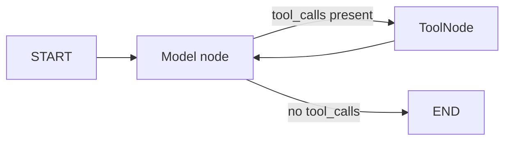
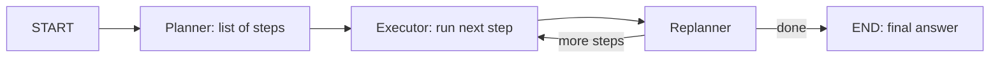
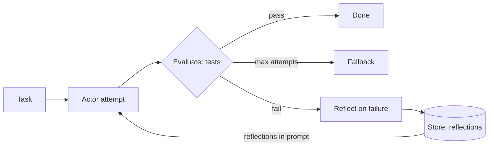
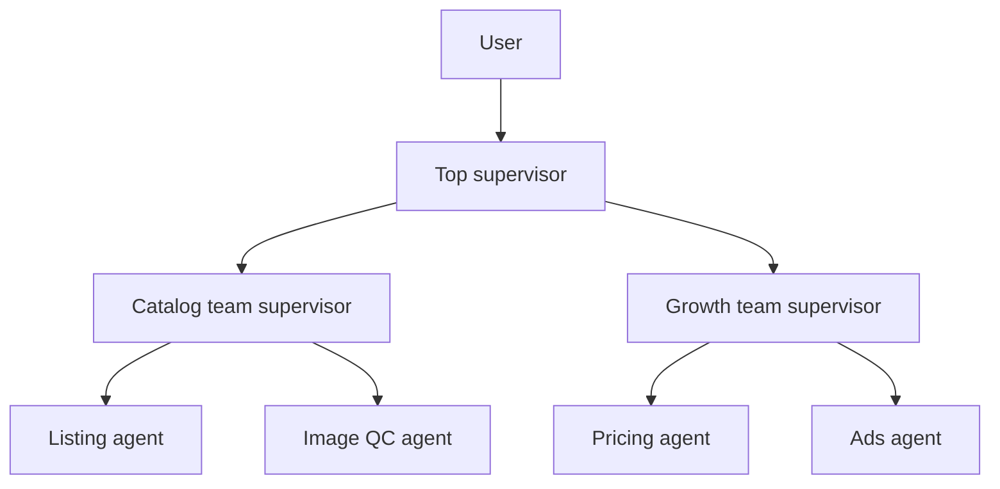
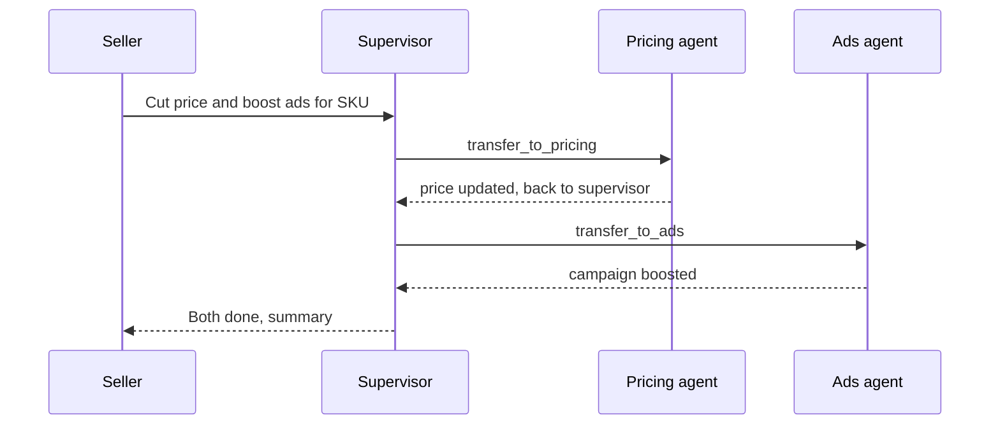
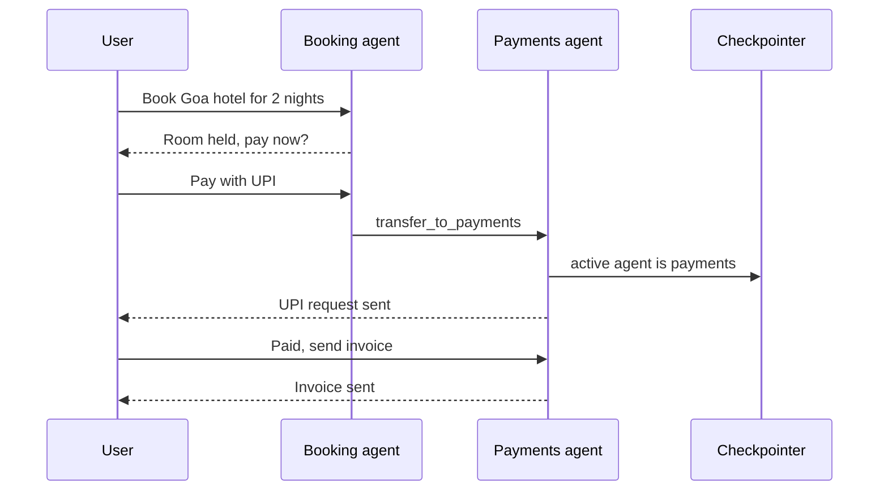

# Agent & Multi-agent Patterns

When the steps are not known in advance, you have to hand control flow to the LLM: ReAct, plan-and-execute, ReWOO, Reflexion, and then multi-agent (supervisor, hierarchical, swarm, network). Interviewers check two things here: can you build these architectures in LangGraph, and can you say **when multi-agent is a waste**.

For fixed-path patterns see [Agentic Patterns: Workflows](03-workflow-patterns.md), and for `Command`, subgraphs and checkpointing see [LangGraph Core Concepts](02-langgraph-core.md).

## ⭐ ReAct / tool-calling agent

**In one line:** the LLM runs in a loop: think → call a tool → look at the result (observation) → think again, until it gives a final answer or hits the step limit.

> **Example:** a Zerodha Kite support agent. "Why was my order rejected yesterday?" → `get_orders(date)` → reason "insufficient margin" → `get_margin()` → answer with numbers. You don't know in advance how many tool calls it will take.

- Modern ReAct = native **tool calling** (the model returns `tool_calls`), not the text-parsing "Thought/Action" format.
- Loop: `model` node → any `tool_calls`? → `tools` node → back to `model`. No tool call = END.
- **Use when:** open-ended tasks, 3–15 tools, the path depends on input. **Don't use when:** steps are fixed (a workflow is cheaper), or 30+ tools (tool selection accuracy drops; consider routing or multi-agent).
- Prebuilt: in LangChain 1.0, `langchain.agents.create_agent` (middleware support, recommended). The older `langgraph.prebuilt.create_react_agent` still works but is deprecated.



```python
from langchain.agents import create_agent
from langchain_core.tools import tool

@tool
def get_orders(date: str) -> list[dict]:
    """Return the user's orders for a date (YYYY-MM-DD)."""
    return [{"id": "A1", "status": "REJECTED", "reason": "insufficient margin"}]

@tool
def get_margin() -> dict:
    """Return available and used margin in INR."""
    return {"available": 1200.0, "used": 48800.0}

agent = create_agent(
    model="openai:gpt-4.1",
    tools=[get_orders, get_margin],
    system_prompt="You are Kite support. Use tools, never guess numbers.",
)
out = agent.invoke({"messages": [{"role": "user", "content": "Kal ka order reject kyun hua?"}]},
                   {"recursion_limit": 12})  # step cap
# Older way: from langgraph.prebuilt import create_react_agent
# agent = create_react_agent(model, tools, prompt="...")
```

- **Hand-built equivalent** (when you need custom state, extra nodes or an approval step):

```python
from langgraph.graph import StateGraph, START, MessagesState
from langgraph.prebuilt import ToolNode, tools_condition
from langchain.chat_models import init_chat_model

tools = [get_orders, get_margin]
llm = init_chat_model("openai:gpt-4.1").bind_tools(tools)

def call_model(state: MessagesState):
    return {"messages": [llm.invoke(state["messages"])]}

g = StateGraph(MessagesState)
g.add_node("model", call_model)
g.add_node("tools", ToolNode(tools))
g.add_edge(START, "model")
g.add_conditional_edges("model", tools_condition)  # "tools" or END
g.add_edge("tools", "model")
app = g.compile()
```

- **Failure modes:** tool loops (the same call again and again), wrong tool args, a hallucinated final answer without calling a tool, context bloat (large tool outputs carried into every turn).
- Fix: `recursion_limit`, clear "when to use" in tool descriptions, truncate/summarize tool output, Pydantic validation on args, and return tool errors as a `ToolMessage` so the model can self-correct.

**Interview tip:** "ReAct's cost is resending the full context on every step. So I keep tool outputs short and set a step limit."

**Common mistake:** calling `create_react_agent` the current API. In 1.0 it is `create_agent`, with middleware (summarization, HITL, model fallback).

## ⭐ Plan-and-execute

**In one line:** a planner first writes a full multi-step plan, an executor runs one step at a time (often a ReAct sub-agent), and a replanner decides after each step: update the plan or give the final answer.

> **Example:** CRED: "Analyse my credit card spend for the last 3 months and give me a plan to save ₹10k." Plan: 1) fetch statements, 2) categorize, 3) top categories, 4) recommendations. After step 2 it turns out one card is missing → the replanner adds a step.

- Difference from ReAct: you get **upfront thinking** (less drift on long tasks), and the planner can be a big model while the executor is a small one (cost savings).
- Without the replanner it looks like orchestrator-worker; the replanner is what makes it adaptive.
- **Use when:** long-horizon tasks with 5+ steps, research, data analysis. **Don't use when:** the task is 1–3 tool calls (overhead), or highly interactive chat.



```python
import operator
from typing import Annotated, TypedDict
from pydantic import BaseModel
from langgraph.graph import StateGraph, START, END

class PlanState(TypedDict):
    input: str
    plan: list[str]
    past_steps: Annotated[list[tuple[str, str]], operator.add]  # (step, result)
    response: str

class Plan(BaseModel):
    steps: list[str]

class Act(BaseModel):
    response: str | None = None      # set = finish
    new_plan: list[str] | None = None

def plan_step(s: PlanState):
    return {"plan": big_llm.with_structured_output(Plan).invoke(s["input"]).steps}

def execute_step(s: PlanState):
    step = s["plan"][0]
    res = executor_agent.invoke({"messages": [("user", f"Do: {step}")]})  # ReAct sub-agent
    return {"past_steps": [(step, res["messages"][-1].content)]}

def replan_step(s: PlanState):
    a = big_llm.with_structured_output(Act).invoke(
        f"Goal: {s['input']}\nDone: {s['past_steps']}\nRemaining: {s['plan'][1:]}")
    if a.response:
        return {"response": a.response}
    return {"plan": a.new_plan or s["plan"][1:]}

def should_end(s: PlanState):
    return END if s.get("response") or not s["plan"] else "execute"

g = StateGraph(PlanState)
g.add_node("planner", plan_step); g.add_node("execute", execute_step); g.add_node("replan", replan_step)
g.add_edge(START, "planner"); g.add_edge("planner", "execute"); g.add_edge("execute", "replan")
g.add_conditional_edges("replan", should_end, ["execute", END])
```

- **Failure modes:** over-planning (20 steps), plans that are too abstract ("analyse the data"), a replanner that never says "done", context growing through past_steps.
- Fix: cap plan length, keep steps concrete at tool level, max-iterations on the replanner, summarize past results.

**Interview tip:** "For plan-and-execute, state the state shape: `input`, `plan`, `past_steps` with an append reducer, `response`. The replanner is what separates it from orchestrator-worker."

**Common mistake:** skipping the replanner; then a mistake in the first step ruins the whole plan.

## ReWOO and LLMCompiler, briefly

**In one line:** both are speed/cost-optimized variants of plan-and-execute: **ReWOO** uses variables in the plan instead of observations, **LLMCompiler** builds a DAG of tasks and runs them in parallel.

- **ReWOO (Reasoning WithOut Observation):** the planner writes the plan once with placeholders: `#E1 = search("Nifty PE")`, `#E2 = calc("#E1 * 1.1")`. The worker substitutes variables and runs the tools, the solver writes the final answer. No LLM call after every tool → fewer tokens. Downside: no replanning midway.
- **LLMCompiler:** the planner streams tasks with dependencies as a **DAG**; the task fetching unit runs tasks in parallel as soon as their dependencies are ready; a joiner decides between answer and replan. The paper reported a large latency speedup over ReAct.

| | ReAct | Plan-and-execute | ReWOO | LLMCompiler |
|---|---|---|---|---|
| LLM calls | every step | plan + replan every step | ~2 (plan, solve) | plan + join |
| Adaptivity | high | high | low | medium |
| Parallel tools | limited | no (by default) | yes | yes, DAG |
| Best for | interactive, short | long tasks | predictable tool chains | many independent lookups |

**Interview tip:** "ReWOO saves tokens, LLMCompiler saves latency. The trade-off for both is adaptivity."

**Common mistake:** using ReWOO when intermediate results change the later steps.

## Reflexion / self-critique agents

**In one line:** the agent makes an attempt, writes a **verbal self-reflection** based on an external signal (tests, eval, error), keeps that reflection in memory, and tries again.

> **Example:** an internal coding agent fixing a bug in the Razorpay SDK: patch → unit tests fail → reflection "I did not reuse the idempotency key on retry" → saved to memory → next attempt passes.

- Difference from evaluator-optimizer (workflow): here the actor is an **agent**, and reflections go into memory **across episodes**.
- It works only if the signal is grounded (tests, compiler, retrieval check). Plain "think about what went wrong" = the model re-confirms its own mistake.
- Graph shape: `actor` → `evaluate` → on fail `reflect` → `actor`, with a max-attempts guard. Reflections go in the `Store` (long-term memory, see [Memory & Context Engineering](05-memory-context.md)).



When the grounded signal (tests) fails, the reflection goes into the Store and comes back in the next attempt's prompt.

- **Failure modes:** ungrounded critique, reflection loops that change nothing, old irrelevant reflections filling the context.

**Interview tip:** "Reflection adds value only when feedback is external and verifiable. For code agents, test results are the best signal."

**Common mistake:** treating self-critique as a free accuracy boost; without a grounded signal the gain is often zero or negative.

## ⭐ Multi-agent architectures

**In one line:** split the work across several specialized agents (each with its own prompt, tools, context), and define how control transfers: a central supervisor, a hierarchy, swarm handoffs, or a network.

> **Example:** a Flipkart seller assistant: a catalog agent (listing tools), a pricing agent (competitor price tools), an ads agent (campaign APIs). Giving each one 8–10 tools beats giving one agent 40 tools.

| Architecture | Control | When |
|---|---|---|
| Supervisor | a central LLM chooses agents | 3–6 specialists, clear routing |
| Hierarchical | supervisor of supervisors (subgraphs) | many agents, grouped by team |
| Swarm / handoffs | the active agent hands off itself | conversational, user talks to one specialist |
| Network (peer-to-peer) | any agent to any agent | rare; hard to debug |



### Supervisor with handoff tools

- The supervisor is an agent whose tools are `transfer_to_<agent>`. The tool returns `Command(goto=..., graph=Command.PARENT)`, which moves to that agent's node in the parent graph.
- Workers do their job and come **back to the supervisor** (edge `worker → supervisor`). Prebuilt: `create_supervisor` from `langgraph-supervisor`.



The supervisor delegates through `transfer_to_<agent>` tools; each worker does its job and hands control back to the supervisor.

```python
from typing import Annotated
from langchain_core.messages import ToolMessage
from langchain_core.tools import tool, InjectedToolCallId
from langgraph.prebuilt import InjectedState
from langgraph.types import Command

def make_handoff(agent_name: str):
    @tool(f"transfer_to_{agent_name}", description=f"Hand the task to {agent_name}.")
    def handoff(state: Annotated[dict, InjectedState],
                tool_call_id: Annotated[str, InjectedToolCallId]) -> Command:
        msg = ToolMessage(f"Transferred to {agent_name}", tool_call_id=tool_call_id)
        return Command(goto=agent_name, graph=Command.PARENT,
                       update={"messages": state["messages"] + [msg]})
    return handoff

supervisor = create_agent("openai:gpt-4.1", name="supervisor",
    tools=[make_handoff("pricing_agent"), make_handoff("ads_agent")],
    system_prompt="Route work to one specialist at a time. Do no work yourself.")

g = StateGraph(MessagesState)
g.add_node(supervisor, destinations=("pricing_agent", "ads_agent", END))
g.add_node(pricing_agent); g.add_node(ads_agent)   # create_agent(..., name=...)
g.add_edge(START, "supervisor")
g.add_edge("pricing_agent", "supervisor"); g.add_edge("ads_agent", "supervisor")
app = g.compile()
# Prebuilt: from langgraph_supervisor import create_supervisor
# app = create_supervisor([pricing_agent, ads_agent], model=llm, prompt="...").compile()
```

### Hierarchical teams

- Each team = one compiled supervisor graph; the top supervisor calls those teams as **subgraph nodes**. Keep 3–6 agents per level.
- Benefit: each supervisor's routing decision stays small. Cost: every level adds an extra LLM hop (latency + tokens).

### Swarm / handoffs

- No central router. The active agent itself calls `transfer_to_X`; the checkpointer remembers **which agent is active**, so the user's next message goes straight to it.



A swarm has no central router; the checkpointer remembers the active agent, so the user's next message goes straight to the payments agent.

```python
from langgraph_swarm import create_handoff_tool, create_swarm
from langgraph.checkpoint.memory import InMemorySaver

booking = create_agent("openai:gpt-4.1", name="booking",
    tools=[search_flights, create_handoff_tool(agent_name="payments",
           description="Transfer when user is ready to pay")])
payments = create_agent("openai:gpt-4.1", name="payments",
    tools=[create_upi_intent, create_handoff_tool(agent_name="booking")])

app = create_swarm([booking, payments], default_active_agent="booking").compile(
    checkpointer=InMemorySaver())
```

### Network (peer-to-peer)

- Any agent can `Command(goto=...)` any other agent. Flexible, but ping-pong and debugging are a nightmare. Rare in production; usually collapse it into a supervisor or a swarm.

**Interview tip:** "My default is a supervisor because control flow is observable in one place. Swarm when the user has a long conversation with one specialist and the supervisor hop wastes latency."

**Common mistake:** forgetting `graph=Command.PARENT` in the handoff; then `goto` looks for the node inside the subgraph and fails.

## ⭐ When multi-agent is worth it and when not

**In one line:** multi-agent gives **context isolation and parallelism**, but multiplies tokens and coordination failures; take it only when the task is breadth-heavy and the value justifies the cost.

- **Data point:** Anthropic's multi-agent research system beat a single agent by ~90% on their internal research eval, but used roughly **~15x tokens** compared with chat (a single agent ~4x). In their analysis, token usage itself explained most of the performance variance. So the gain is often "spending more tokens".
- **Counterpoint (Cognition, "Don't build multi-agents"):** parallel subagents don't see each other's decisions → conflicting assumptions. For write-heavy tasks (coding), a single-threaded agent with good context engineering does better.
- **Pro:** each agent has a small context and few tools → better tool selection; parallel search on breadth tasks; different teams can own different agents.
- **Con:** an LLM call per hop (latency), duplicated context (cost), information loss at handoff, harder eval and debugging.

| Situation | Choice |
|---|---|
| < 10–15 tools, one domain | Single agent |
| Breadth research, independent sub-questions | Orchestrator + parallel subagents |
| 30+ tools across distinct domains | Supervisor + specialists |
| Tightly coupled edits on one file/codebase | Single agent, not multi-agent |
| Long chat where the specialist changes (booking → payment) | Swarm handoffs |
| Low-value, high-volume query (FAQ) | Single agent or workflow; 15x cost not justified |

**Interview tip:** "I start the multi-agent case from the token budget: if a single agent's context overflows from tools and history, or I need parallel breadth, I split. Otherwise I don't."

**Common mistake:** turning the org chart into an agent chart ("PM agent, dev agent, QA agent") without showing that a single agent was failing.

## Agent handoff state design

**In one line:** decide whether agents see **one shared message history** or keep a **private scratchpad** and share only the final result.

| | Shared history | Private scratchpad |
|---|---|---|
| How | all agents write to the same `messages` | each agent's subgraph has its own state; parent gets only a summary |
| Pro | full context, nothing lost at handoff | small, focused, cheap context |
| Con | context grows, other agents' tool calls confuse | information loss, depends on summary quality |
| When | 2–3 agents, short tasks, swarm chat | research subagents, large tool outputs |

- A hybrid is common: shared `messages` hold only user-facing turns + each agent's **final answer**; tool calls and intermediate reasoning stay private.
- Subgraph with a different state schema: a parent wrapper node transforms the input and writes back only the `summary` from the output.
- Make the handoff payload explicit: `task`, `constraints`, `what is done`, `expected output format`. A vague "take a look at this" handoff = lost context.

**Interview tip:** "I design a handoff like an API contract: a structured task brief in, a structured result back from the subagent."

**Common mistake:** merging a subagent's full 30k-token transcript into the parent history.

## Common multi-agent failure modes and fixes

| Failure | Symptom | Fix |
|---|---|---|
| Infinite ping-pong | A → B → A → B, no progress | `recursion_limit`, handoff counter in state, supervisor prompt "don't repeat the same agent twice" |
| Role confusion | pricing agent creating ads | tight system prompts, each agent gets only its own tools, clear handoff tool descriptions |
| Lost context | specialist forgets the user's constraint | structured handoff brief, key constraints in state fields (not in messages) |
| Conflicting outputs | parallel subagents assume different things | shared plan/spec upfront, synthesizer resolves conflicts |
| Supervisor does the work | supervisor answers by itself | don't give the supervisor domain tools |
| Cost blow-up | every hop resends full history | private scratchpads, summaries, small models for workers |
| Silent failure | worker fails, supervisor says "done" | structured status from workers (`ok/failed/reason`), per-agent evals |

- Observability: tag each agent's span separately so the handoff chain shows in the trace; see [AI Observability](10-agent-observability.md).
- Eval: alongside end-to-end, eval **per agent** and **routing accuracy**; see [Evals for Agents](09-agent-evals.md).

**Interview tip:** "Most multi-agent bugs are coordination bugs, not model bugs. I catch them with a handoff counter, structured briefs and per-agent traces."

**Common mistake:** evaluating only the final answer; you never learn which agent or which handoff failed.

## Read next

- [Agentic Patterns: Workflows](03-workflow-patterns.md): try a workflow before an agent.
- [Memory & Context Engineering](05-memory-context.md): scratchpads, summaries, long-term memory.
- [Tools, MCP & A2A](07-tools-mcp-a2a.md): tool design and the agent-to-agent protocol.
- [Cost & Latency](11-cost-latency.md): token multiplication in multi-agent systems.
- [ReAct lab](/viewinter/agents/lab/react) and [Multi-agent lab](/viewinter/agents/labs/multi): run them in the browser.

## Checklist

- [ ] I can build the ReAct loop with both `create_agent` and a hand-built `ToolNode` + `tools_condition`
- [ ] I can explain the plan-and-execute state shape and the replanner's role
- [ ] I can tell the trade-off of ReWOO and LLMCompiler versus ReAct
- [ ] I can explain how Reflexion differs from evaluator-optimizer, and why it needs a grounded signal
- [ ] I can compare supervisor, hierarchical, swarm and network architectures
- [ ] I can write a handoff tool with `Command(graph=Command.PARENT)`
- [ ] I can justify when multi-agent is worth it, with token cost data
- [ ] I can choose between shared history and private scratchpad handoff designs
- [ ] I can tell failures like ping-pong, role confusion and lost context, and their fixes
