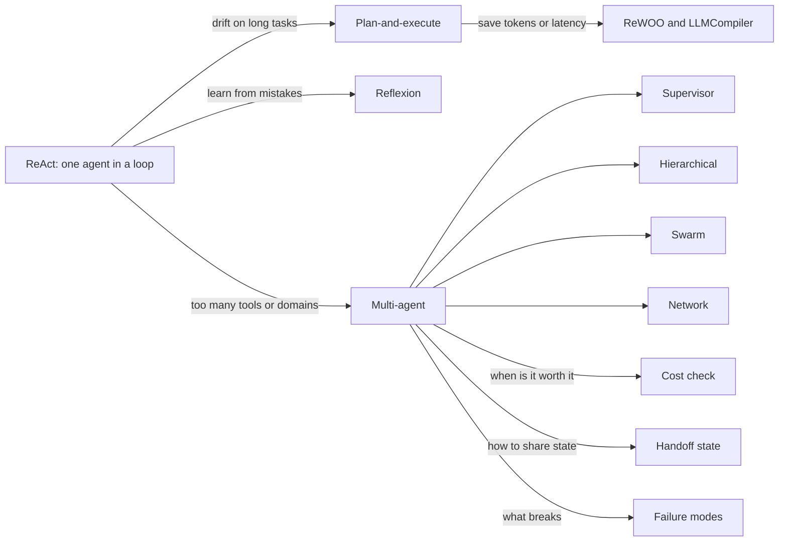
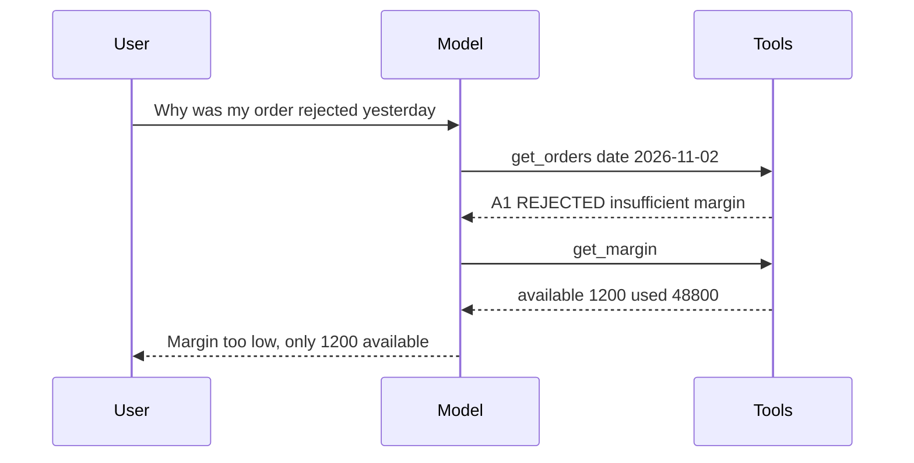
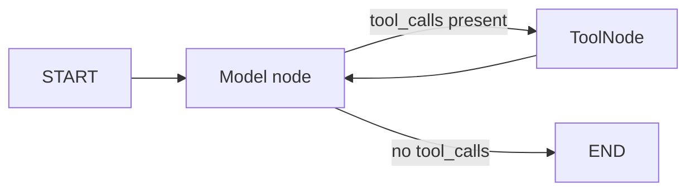
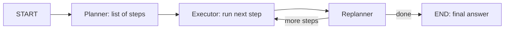
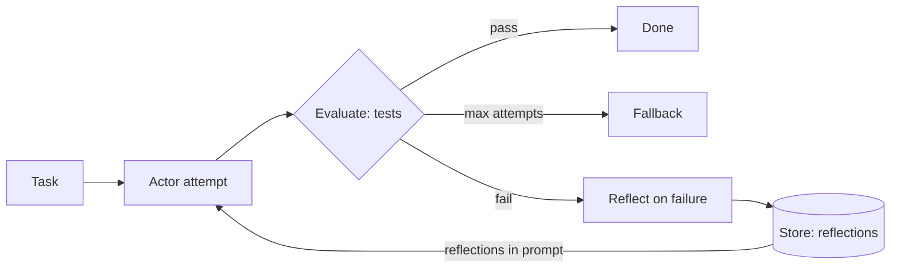
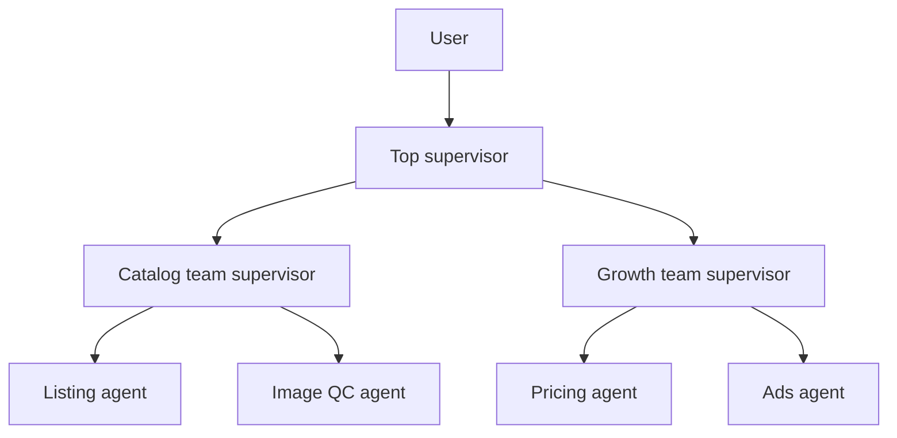
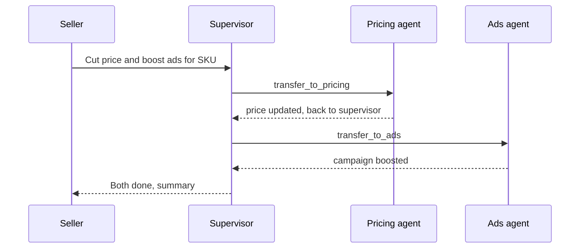
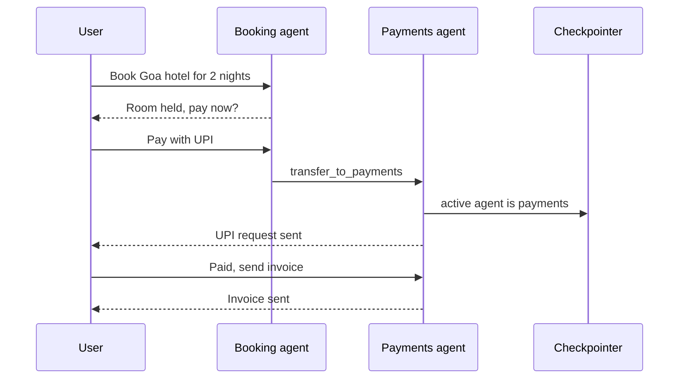

# Agent & Multi-agent Patterns

On the previous page the code decided the path. On this page **the LLM decides the path**, because the steps are not known in advance. The patterns are: ReAct, plan-and-execute, ReWOO, Reflexion, and then multi-agent (supervisor, hierarchical, swarm, network).

Interviewers check two things here: can you build these architectures in LangGraph, and can you say **when multi-agent is a waste**.

For fixed-path patterns see [Agentic Patterns: Workflows](03-workflow-patterns.md), and for `Command`, subgraphs and checkpointing see [LangGraph Core Concepts](02-langgraph-core.md).

**After this page you can explain:**
- How thought → action → observation runs in a ReAct loop, with real messages.
- How a plan list gets executed and replanned in plan-and-execute.
- Who has control at each step in supervisor, hierarchical, swarm and network.
- When multi-agent is worth it, with token and rupee numbers.
- How agents should share state, and what breaks.

## Words you need first

New to LLMs? Read [How LLMs Work](14-how-llms-work.md) first. It explains tokens, context windows and how a model generates text.

| Word | Plain meaning |
|---|---|
| LangGraph | A Python library for building LLM apps as a graph: functions are nodes, arrows decide which runs next. |
| `Command` | A LangGraph return value that updates data and says which node should run next, in one go. |
| Subgraph | A whole compiled graph used as a single node inside a bigger graph. |
| Checkpointer | Saves the graph's data after each step to memory or a database, so a conversation can resume later. |
| `messages` | The list of chat messages (user, model, tool results) sent to the model on every call. |
| `tool_calls` | A field in the model's reply naming a function to run and its arguments; your code runs it. |
| `ToolMessage` | The message that carries a tool's result back into `messages`, linked to the call that asked for it. |
| Superstep | One tick of the graph: all nodes scheduled for that tick run, then their updates are applied. |
| Middleware | Hooks that run around each model or tool call, for example to summarize history or ask a human. |
| State | The shared dict of data that every node in the graph reads from and writes updates to. |
| Hallucination | The model confidently stating something false or made up, such as numbers it never looked up. |
| Reducer | A rule for merging a node's update into a state field, for example append to the list instead of overwrite. |
| Structured output | Forcing the model to reply in a fixed shape, such as a Pydantic class, instead of free text. |
| Span | One timed record of a single operation (a model call, a tool run) inside a trace of a request. |

## Big picture: the ladder of agent patterns

An agent means: the LLM decides in a loop what to do next. On this page we climb a ladder. At the bottom, one agent runs tools in a loop (**ReAct**). On long tasks it loses its way, so we have it plan first (**plan-and-execute**). To make planning cheaper or faster there are **ReWOO** and **LLMCompiler**. For an agent to learn from its mistakes there is **Reflexion**. And when one agent has too many tools or domains, we split the work across several agents (**multi-agent**).

After multi-agent, three questions remain: when is it worth it, how do agents share state, and what breaks. Those are the last three sections of the page.



## ⭐ ReAct / tool-calling agent

**Why do we need this?** A Zerodha Kite user asks: "Why was my order rejected yesterday?" Sometimes the answer takes one tool call, sometimes you also need the margin after the order, sometimes the holdings too. A workflow would need fixed steps; here you don't know in advance how many steps it will take.

**Analogy:** **a doctor's diagnosis**. The doctor thinks "fever, maybe an infection" (thought), orders a blood test (action), looks at the report (observation). Based on the report they think again: another test, or write a prescription (final answer). The number of tests is not fixed in advance.

**In one line:** the LLM runs in a loop: think → call a tool → look at the result (observation) → think again, until it gives a final answer or hits the step limit.

> **Example:** user: "Kal ka order reject kyun hua?" (Why was my order rejected yesterday?) The agent has two tools: `get_orders(date)` and `get_margin()`.

**Step by step (real messages):**

| Turn | Who | What happened | Items in `messages` |
|---|---|---|---|
| 1 | User | "Kal ka order reject kyun hua?" | 1 |
| 2 | Model (thought + action) | Thinks: "I need to look at the order first". `tool_calls = [get_orders(date="2026-11-02")]` | 2 |
| 3 | Tool (observation) | `[{"id": "A1", "status": "REJECTED", "reason": "insufficient margin"}]` | 3 |
| 4 | Model (thought + action) | Thinks: "I need the margin numbers". `tool_calls = [get_margin()]` | 4 |
| 5 | Tool (observation) | `{"available": 1200.0, "used": 48800.0}` | 5 |
| 6 | Model (final) | "Order A1 was rejected because margin was too low. Only ₹1,200 was available; ₹48,800 was already used." No `tool_calls` | 6 |

At turn 6 the model made no tool call, so the loop ends. Note: on every model call **the full `messages` list is sent again**. At turn 2 the model read 1 message, at turn 4 it read 3, at turn 6 it read 5. That is why ReAct's cost grows with the number of steps.



As a graph, the same loop looks like this:



**Now the terms:**
- **Thought:** the model's reasoning about what to do next. In modern models it is often hidden or a short text.
- **Action:** the `tool_calls` field, with the tool name and args. This is native **tool calling**, not the old text-parsing "Thought/Action" format.
- **Observation:** the tool's result, added to `messages` as a `ToolMessage`.
- **Loop rule:** `model` node → any `tool_calls`? → `tools` node → back to `model`. No tool call = END.
- **`recursion_limit`:** after how many supersteps the graph stops. The safety net for infinite loops.

**Use when:** open-ended tasks, 3–15 tools, the path depends on input. **Don't use when:** steps are fixed (a workflow is cheaper), or 30+ tools (tool selection accuracy drops; consider routing or multi-agent).

The prebuilt way: LangChain 1.0's `langchain.agents.create_agent` (middleware support, recommended). The older `langgraph.prebuilt.create_react_agent` still works but is deprecated. The code below builds the whole trace above in about 10 lines.

```python
from langchain.agents import create_agent
from langchain_core.tools import tool

@tool
def get_orders(date: str) -> list[dict]:
    """Return the user's orders for a date (YYYY-MM-DD)."""   # docstring = tool description for the model
    return [{"id": "A1", "status": "REJECTED", "reason": "insufficient margin"}]

@tool
def get_margin() -> dict:
    """Return available and used margin in INR."""
    return {"available": 1200.0, "used": 48800.0}

agent = create_agent(
    model="openai:gpt-4.1",
    tools=[get_orders, get_margin],
    system_prompt="You are Kite support. Use tools, never guess numbers.",
)
out = agent.invoke({"messages": [{"role": "user", "content": "Kal ka order reject kyun hua?"}]},
                   {"recursion_limit": 12})  # step cap: more steps than this = error
# Older way: from langgraph.prebuilt import create_react_agent
# agent = create_react_agent(model, tools, prompt="...")
```

**What the code does:**
- `@tool` turns a function into a tool; the docstring and type hints tell the model when and how to use it.
- `create_agent` builds the same model ↔ tools loop as in the diagram.
- `out["messages"]` holds the 6 messages from the table above; the last one is the final answer.
- `recursion_limit: 12` stops the agent after 12 supersteps, even if it is stuck in a loop.

When you need custom state, extra nodes or an approval step, build the same loop by hand:

```python
from langgraph.graph import StateGraph, START, MessagesState
from langgraph.prebuilt import ToolNode, tools_condition
from langchain.chat_models import init_chat_model

tools = [get_orders, get_margin]
llm = init_chat_model("openai:gpt-4.1").bind_tools(tools)   # show the model the list of tools

def call_model(state: MessagesState):
    return {"messages": [llm.invoke(state["messages"])]}     # the full history goes every time

g = StateGraph(MessagesState)
g.add_node("model", call_model)
g.add_node("tools", ToolNode(tools))                         # runs tool_calls, makes ToolMessages
g.add_edge(START, "model")
g.add_conditional_edges("model", tools_condition)  # "tools" or END
g.add_edge("tools", "model")                                 # back to the model after the observation
app = g.compile()
```

**What the code does:**
- `bind_tools` gives the model the tool schemas, so it can return `tool_calls`.
- `ToolNode` reads the `tool_calls` on the last AI message, runs the tools, and adds `ToolMessage`s.
- `tools_condition` checks: if the last message has `tool_calls`, go to `"tools"`, otherwise END.
- The `tools → model` edge is the loop. For an approval step, put a new node before `tools`.

**Failure modes:** tool loops (the same call again and again), wrong tool args, a hallucinated final answer without calling a tool, context bloat (large tool outputs carried into every turn). Fix: `recursion_limit`, clear "when to use" in tool descriptions, truncate/summarize tool output, Pydantic (a Python data-validation library) validation on args, and return tool errors as a `ToolMessage` so the model can self-correct.

**Interview tip:** "ReAct's cost is resending the full context on every step. So I keep tool outputs short and set a step limit."

**Common mistake:** calling `create_react_agent` the current API. In 1.0 it is `create_agent`, with middleware (summarization, HITL = human-in-the-loop approval, model fallback).

## ⭐ Plan-and-execute

**Why do we need this?** A CRED user says: "Analyse my credit card spend for the last 3 months and give me a plan to save ₹10k." This has 6–8 steps. By step 6 a ReAct agent forgets the goal or fetches the same data again and again, because it has no "list".

**Analogy:** **a family planning a Goa trip**. First a list is made: tickets, hotel, cab, sightseeing. Then the jobs are done one by one. After each job they look at the list: if the hotel is full, "find another hotel" gets added. The one who makes the list = **planner**, the one who does the job = **executor**, the one who updates the list after each job = **replanner**.

**In one line:** a planner first writes a full multi-step plan, an executor runs one step at a time (often a ReAct sub-agent), and a replanner decides after each step: update the plan or give the final answer.

> **Example:** input = "Analyse my credit card spend for the last 3 months and give me a plan to save ₹10k."

**Step by step (how the plan list changes):**

| Round | Step the executor ran | Result | `plan` after the replanner |
|---|---|---|---|
| 0 (planner) | – | – | 1) fetch HDFC card statements, 2) categorize, 3) top 3 categories, 4) savings plan |
| 1 | fetch HDFC statements | "3 statements, ₹1.42 lakh spend" | 2) categorize, 3) top 3, 4) savings plan |
| 2 | categorize | "Shopping ₹52k, Food ₹38k... the profile also has an ICICI card, no data for it" | **fetch ICICI statements**, categorize ICICI, top 3, savings plan |
| 3 | fetch ICICI statements | "₹46k spend" | categorize ICICI, top 3, savings plan |
| 4 | categorize ICICI | "Food ₹12k, Travel ₹28k..." | top 3, savings plan |
| 5 | top 3 categories | "Shopping ₹70k, Food ₹50k, Travel ₹28k" | savings plan |
| 6 | savings plan | "Cut food delivery by ₹4k/month, ..." | empty, and `response` is set |

In round 2 the replanner **added** a new step. This is what separates it from orchestrator-worker: there the plan is made once and never changes. `past_steps` grows by one (step, result) pair each round, so by round 6 it has 6 pairs.



**Now the terms:**
- **Planner:** runs once and returns the list of steps. Often a big model.
- **Executor:** runs the first step of the list. Often a small model or a ReAct sub-agent (cost savings).
- **Replanner:** looks at the goal, the finished steps and the remaining list, and returns either a new plan or the final `response`.
- **`past_steps`:** a list of (step, result) pairs, with an append reducer.
- Difference from ReAct: you get **upfront thinking**, so less drift on long tasks.

**Use when:** long-horizon tasks with 5+ steps, research, data analysis. **Don't use when:** the task is 1–3 tool calls (overhead), or highly interactive chat.

This code builds the loop above with three nodes (planner, execute, replan) and one decision function.

```python
import operator
from typing import Annotated, TypedDict
from pydantic import BaseModel
from langgraph.graph import StateGraph, START, END

class PlanState(TypedDict):
    input: str                                                   # the user's goal
    plan: list[str]                                              # remaining steps
    past_steps: Annotated[list[tuple[str, str]], operator.add]  # (step, result), appended
    response: str                                                # set = work is done

class Plan(BaseModel):
    steps: list[str]

class Act(BaseModel):
    response: str | None = None      # set = finish
    new_plan: list[str] | None = None

def plan_step(s: PlanState):
    return {"plan": big_llm.with_structured_output(Plan).invoke(s["input"]).steps}

def execute_step(s: PlanState):
    step = s["plan"][0]                                          # only the first step
    res = executor_agent.invoke({"messages": [("user", f"Do: {step}")]})  # ReAct sub-agent
    return {"past_steps": [(step, res["messages"][-1].content)]}

def replan_step(s: PlanState):
    a = big_llm.with_structured_output(Act).invoke(
        f"Goal: {s['input']}\nDone: {s['past_steps']}\nRemaining: {s['plan'][1:]}")
    if a.response:
        return {"response": a.response}
    return {"plan": a.new_plan or s["plan"][1:]}                 # new plan, or just drop the first step

def should_end(s: PlanState):
    return END if s.get("response") or not s["plan"] else "execute"

g = StateGraph(PlanState)
g.add_node("planner", plan_step)
g.add_node("execute", execute_step)
g.add_node("replan", replan_step)
g.add_edge(START, "planner")
g.add_edge("planner", "execute")
g.add_edge("execute", "replan")
g.add_conditional_edges("replan", should_end, ["execute", END])
app = g.compile()
```

**What the code does:**
- `plan_step` runs once and puts the round-0 list from the table into `plan`.
- `execute_step` runs only `plan[0]` and appends `(step, result)` to `past_steps`.
- `replan_step` sees three things: the goal, what is done, what remains. It returns either `response` or `new_plan` (like round 2).
- `should_end` stops the loop when `response` is set or the plan is empty.

**Failure modes:** over-planning (20 steps), plans that are too abstract ("analyse the data"), a replanner that never says "done", context growing through `past_steps`. Fix: cap plan length, keep steps concrete at tool level, max-iterations on the replanner, summarize old results.

**Interview tip:** "For plan-and-execute, state the state shape: `input`, `plan`, `past_steps` with an append reducer, `response`. The replanner is what separates it from orchestrator-worker."

**Common mistake:** skipping the replanner; then a mistake in the first step ruins the whole plan.

## ReWOO and LLMCompiler, briefly

**Why do we need this?** In plan-and-execute there is a replanner LLM call after every step. 6 steps = 1 plan + 6 replans + executor calls. If the steps are predictable, these extra calls only eat tokens and time.

**Analogy:** **ReWOO = mom's shopping list with placeholders**: "buy milk, and buy paneer worth double whatever the milk costs". The list is made once; no need to call home again from the shop. **LLMCompiler = many stoves in one kitchen**: rice and dal don't depend on each other, so both cook together; the raita waits for the curd.

**In one line:** both are speed/cost-optimized variants of plan-and-execute: **ReWOO** uses variables in the plan instead of observations, **LLMCompiler** builds a DAG of tasks and runs them in parallel.

**ReWOO step by step** (question: "What will the Nifty PE be if it rises 10%?"):
1. **Planner (LLM call 1)** writes the whole plan once: `#E1 = search("Nifty PE")`, `#E2 = calc("#E1 * 1.1")`.
2. **Worker (no LLM):** runs `#E1` → `22.4`. Then puts 22.4 in place of `#E1` in `#E2` → `24.64`.
3. **Solver (LLM call 2):** "The PE is 22.4 now; a 10% rise makes it 24.64."
4. In ReAct the same job would take 3 LLM calls, each carrying the full history.

**LLMCompiler:** the planner streams tasks with dependencies as a **DAG**. The task fetching unit runs tasks in parallel as soon as their dependencies are ready. A joiner decides: answer or replan. The paper reported a large latency speedup over ReAct.

| | ReAct | Plan-and-execute | ReWOO | LLMCompiler |
|---|---|---|---|---|
| LLM calls | every step | plan + replan every step | ~2 (plan, solve) | plan + join |
| Adaptivity | high | high | low | medium |
| Parallel tools | limited | no (by default) | yes | yes, DAG |
| Best for | interactive, short | long tasks | predictable tool chains | many independent lookups |

**Now the terms:**
- **Placeholder / variable (`#E1`):** a name for a tool's future result, written into the plan in advance.
- **DAG:** a graph of tasks where arrows show dependencies and there are no loops.
- **Joiner:** LLMCompiler's last step, which looks at results and chooses answer or replan.

**Interview tip:** "ReWOO saves tokens, LLMCompiler saves latency. The trade-off for both is adaptivity."

**Common mistake:** using ReWOO when intermediate results change the later steps.

## Reflexion / self-critique agents

**Why do we need this?** A coding agent wrote a patch and the tests failed. If it just "tries again", it often repeats the same mistake. It needs to remember **what** went wrong.

**Analogy:** **a cricketer's video review**. After getting out, he watches the video and writes in a diary: "leave the ball outside off stump". Before the next match he reads the diary. Video = **external signal**, diary note = **reflection**, diary = **memory**.

**In one line:** the agent makes an attempt, writes a **verbal self-reflection** based on an external signal (tests, eval, error), keeps that reflection in memory, and tries again.

> **Example:** an internal coding agent fixing a bug in the Razorpay SDK.

**Step by step:**
1. **Attempt 1:** the agent writes a patch in the retry logic.
2. **Evaluate (tests):** `test_retry_is_idempotent` fails: "2 payments were created".
3. **Reflect:** the agent writes: "I created a new idempotency key on retry. I should reuse the old key on retry."
4. **Store:** this reflection is saved to memory.
5. **Attempt 2:** the reflection goes into the prompt. The agent reuses the key. Tests pass → Done.
6. If it still fails after 3 attempts, fallback (a PR for a human).



When the grounded signal (tests) fails, the reflection goes into the Store and comes back in the next attempt's prompt.

**Now the terms:**
- **Grounded signal:** truth from outside (test result, compiler error, retrieval check). Plain "think about what went wrong" = the model re-confirms its own mistake.
- **Episode:** one full attempt. In Reflexion, reflections are remembered **across episodes**.
- Difference from evaluator-optimizer (workflow): here the actor is an **agent**, and reflections go into long-term memory (`Store`); see [Memory & Context Engineering](05-memory-context.md).
- Graph shape: `actor` → `evaluate` → on fail `reflect` → `actor`, with a max-attempts guard.

**Failure modes:** ungrounded critique, reflection loops that change nothing, old irrelevant reflections filling the context.

**Interview tip:** "Reflection adds value only when feedback is external and verifiable. For code agents, test results are the best signal."

**Common mistake:** treating self-critique as a free accuracy boost; without a grounded signal the gain is often zero or negative.

## ⭐ Multi-agent architectures

**Why do we need this?** A Flipkart seller assistant has to handle listings, pricing and ads. Give one agent 40 tools and it picks the wrong tool, and the system prompt grows to 5 pages. Give each specialist 8–10 tools and a short prompt, and each one does better work.

**Analogy: a cricket team.** This one analogy covers all four architectures:

| Architecture | In cricket | Who has control |
|---|---|---|
| Supervisor | The captain picks the bowler for each over; after the over the ball goes back to the captain | Always the captain (central LLM) |
| Hierarchical | Head coach → batting coach, bowling coach → players | Each level's supervisor, for its own team |
| Swarm / handoffs | Relay race: whoever holds the baton is running, and they pass it to the next | Whichever agent is active now |
| Network | Gully cricket: anyone shouts and throws the ball to anyone | No one fixed |

**In one line:** split the work across several specialized agents (each with its own prompt, tools, context), and define how control transfers: a central supervisor, a hierarchy, swarm handoffs, or a network.

| Architecture | Control | When |
|---|---|---|
| Supervisor | a central LLM chooses agents | 3–6 specialists, clear routing |
| Hierarchical | supervisor of supervisors (subgraphs) | many agents, grouped by team |
| Swarm / handoffs | the active agent hands off itself | conversational, user talks to one specialist |
| Network (peer-to-peer) | any agent to any agent | rare; hard to debug |



### Supervisor with handoff tools

The seller says: "Cut the price of SKU (product code) K-101 by ₹50 and boost ads." Watch who has control at each step:

| Step | What happened | Who has control |
|---|---|---|
| 1 | The seller's message goes to the supervisor | Supervisor |
| 2 | The supervisor calls the `transfer_to_pricing_agent` tool | Supervisor → Pricing |
| 3 | The pricing agent changes the price from ₹799 to ₹749 and writes a reply | Pricing |
| 4 | Edge `pricing_agent → supervisor`, control comes back | Supervisor |
| 5 | The supervisor sees ads are pending, `transfer_to_ads_agent` | Supervisor → Ads |
| 6 | The ads agent raises the campaign budget | Ads |
| 7 | Control comes back, the supervisor sees both are done and gives a summary | Supervisor → END |



The supervisor delegates through `transfer_to_<agent>` tools; each worker does its job and hands control back to the supervisor.

**Now the terms:**
- **Handoff tool:** a tool whose only job is to transfer control, like `transfer_to_pricing_agent`.
- **`Command(goto=..., graph=Command.PARENT)`:** "go to this node in the parent graph". The agent is itself a subgraph, so you have to say `PARENT`.
- Prebuilt: `create_supervisor` from the `langgraph-supervisor` package.

This code makes one handoff tool per specialist and wires up the supervisor graph.

```python
from typing import Annotated
from langchain_core.messages import ToolMessage
from langchain_core.tools import tool, InjectedToolCallId
from langgraph.prebuilt import InjectedState
from langgraph.types import Command

def make_handoff(agent_name: str):
    @tool(f"transfer_to_{agent_name}", description=f"Hand the task to {agent_name}.")
    def handoff(state: Annotated[dict, InjectedState],               # graph state, not filled by the model
                tool_call_id: Annotated[str, InjectedToolCallId]) -> Command:
        msg = ToolMessage(f"Transferred to {agent_name}", tool_call_id=tool_call_id)
        return Command(goto=agent_name, graph=Command.PARENT,        # jump in the parent graph
                       update={"messages": state["messages"] + [msg]})
    return handoff

supervisor = create_agent("openai:gpt-4.1", name="supervisor",
    tools=[make_handoff("pricing_agent"), make_handoff("ads_agent")],  # only handoff tools
    system_prompt="Route work to one specialist at a time. Do no work yourself.")

g = StateGraph(MessagesState)
g.add_node(supervisor, destinations=("pricing_agent", "ads_agent", END))
g.add_node(pricing_agent); g.add_node(ads_agent)   # create_agent(..., name=...)
g.add_edge(START, "supervisor")
g.add_edge("pricing_agent", "supervisor"); g.add_edge("ads_agent", "supervisor")  # back after the work
app = g.compile()
# Prebuilt: from langgraph_supervisor import create_supervisor
# app = create_supervisor([pricing_agent, ads_agent], model=llm, prompt="...").compile()
```

**What the code does:**
- `make_handoff` is a factory: it makes a `transfer_to_<name>` tool for each agent.
- The tool adds a `ToolMessage` (every tool call needs a reply) and jumps to that agent in the parent graph with `Command`.
- The supervisor has only handoff tools, no domain tools. So it can't do the work itself.
- The `pricing_agent → supervisor` and `ads_agent → supervisor` edges are steps 4 and 7 in the table: control always comes back.

### Hierarchical teams

- Each team = one compiled supervisor graph. The top supervisor calls those teams as **subgraph nodes**. Keep 3–6 agents per level.
- Trace: seller → top supervisor → Growth team supervisor → Pricing agent → back to the Growth supervisor → back to the top supervisor. Control moves up and down 2 levels.
- Benefit: each supervisor's routing decision stays small. Cost: every level adds an extra LLM hop (latency + tokens).

### Swarm / handoffs

No central router. The active agent itself calls `transfer_to_X`, and the checkpointer remembers **which agent is active**, so the user's next message goes straight to it.

| Step | Message | Active agent (control) |
|---|---|---|
| 1 | User: "Book a Goa hotel for 2 nights" | Booking (default) |
| 2 | Booking: "Room held, pay now?" | Booking |
| 3 | User: "Pay with UPI" | Booking |
| 4 | Booking calls `transfer_to_payments` | Booking → Payments |
| 5 | Saved in the checkpointer: active = payments | Payments |
| 6 | Payments: "UPI request sent" | Payments |
| 7 | User: "Paid, send the invoice" (straight to payments, booking is not asked) | Payments |
| 8 | Payments: "Invoice sent" | Payments |



A swarm has no central router; the checkpointer remembers the active agent, so the user's next message goes straight to the payments agent.

This code makes two agents that have tools to hand off to each other.

```python
from langgraph_swarm import create_handoff_tool, create_swarm
from langgraph.checkpoint.memory import InMemorySaver

booking = create_agent("openai:gpt-4.1", name="booking",
    tools=[search_hotels, create_handoff_tool(agent_name="payments",
           description="Transfer when user is ready to pay")])      # booking → payments
payments = create_agent("openai:gpt-4.1", name="payments",
    tools=[create_upi_intent, create_handoff_tool(agent_name="booking")])  # can also go back

app = create_swarm([booking, payments], default_active_agent="booking").compile(
    checkpointer=InMemorySaver())   # required to remember the active agent
```

**What the code does:**
- Each agent's tools include a `create_handoff_tool`; this is the baton pass of the relay race.
- `default_active_agent="booking"`: the first message goes to booking (step 1 in the table).
- Without a checkpointer the swarm forgets the active agent on every message and starts from booking.
- There is no supervisor node, so each turn has one fewer LLM hop.

### Network (peer-to-peer)

- Any agent can `Command(goto=...)` any other agent. Flexible, but ping-pong and debugging are a nightmare. Rare in production; usually collapse it into a supervisor or a swarm.

**Interview tip:** "My default is a supervisor because control flow is observable in one place. Swarm when the user has a long conversation with one specialist and the supervisor hop wastes latency."

**Common mistake:** forgetting `graph=Command.PARENT` in the handoff; then `goto` looks for the node inside the subgraph and fails.

## ⭐ When multi-agent is worth it and when not

**Why do we need this?** Multi-agent looks great in a demo, but every agent brings its own context, its own LLM calls and its own tokens. Both the bill and the latency go up. So look at the numbers first.

**Analogy:** **wedding food**. One good cook is enough for 20 guests. For 2,000 guests you need a full caterer team: head cook, tandoor person, sweets person. But pay for that team to feed 20 people and the money is wasted.

**In one line:** multi-agent gives **context isolation and parallelism**, but multiplies tokens and coordination failures; take it only when the task is breadth-heavy and the value justifies the cost.

**Step by step: one task, the math for two designs.** Task: "Research 5 competitor brands of Priya's kurta." Assumptions: input ≈ $2 per 1M tokens, output ≈ $8 per 1M tokens, $1 ≈ ₹84. The numbers are illustrative, to understand the structure.

| | Single agent | Supervisor + 5 subagents |
|---|---|---|
| LLM calls | 8 (one loop) | Supervisor 3 + each subagent 5 (×5) + synthesis 1 = 29 |
| Input tokens | ~48k (context grows on every call) | ~164k (each subagent has its own context, the supervisor too) |
| Output tokens | ~3k | ~10k |
| Cost per query | ~$0.12 (≈ ₹10) | ~$0.41 (≈ ₹34) |
| 10,000 queries/day | ~$1,200/day | ~$4,100/day |
| Result | Shallow research on each brand | Deep research on each brand, in parallel |

So about 3.4x the cost. It is worth it when deep research makes the seller's big decision (pricing) better. Not for FAQ-style questions: if a workflow answers an FAQ for ₹0.35 and multi-agent takes 15x tokens, then at 1 lakh queries/day the spend goes from ~₹35k/day to ~₹5 lakh/day, for an answer that is just as good.

**Real data points:**
- **Anthropic:** their multi-agent research system beat a single agent by ~90% on their internal research eval (a fixed test set that scores answers), but used roughly **~15x tokens** compared with chat (a single agent ~4x). In their analysis, token usage itself explained most of the performance variance. So the gain is often "spending more tokens".
- **Counterpoint (Cognition, "Don't build multi-agents"):** parallel subagents don't see each other's decisions → conflicting assumptions. For write-heavy tasks (coding), a single-threaded agent with good context engineering does better.

**Pro:** each agent has a small context and few tools → better tool selection; parallel search on breadth tasks; different teams can own different agents.
**Con:** an LLM call per hop (latency), duplicated context (cost), information loss at handoff, harder eval and debugging.

| Situation | Choice |
|---|---|
| < 10–15 tools, one domain | Single agent |
| Breadth research, independent sub-questions | Orchestrator + parallel subagents |
| 30+ tools across distinct domains | Supervisor + specialists |
| Tightly coupled edits on one file/codebase | Single agent, not multi-agent |
| Long chat where the specialist changes (booking → payment) | Swarm handoffs |
| Low-value, high-volume query (FAQ) | Single agent or workflow; 15x cost not justified |

**Interview tip:** "I start the multi-agent case from the token budget: if a single agent's context overflows from tools and history, or I need parallel breadth, I split. Otherwise I don't."

**Common mistake:** turning the org chart into an agent chart ("PM agent, dev agent, QA agent") without showing that a single agent was failing.

## Agent handoff state design

**Why do we need this?** A research subagent did 30k tokens of work: 12 web searches, 40 pages. If that whole transcript goes into the supervisor's history, the supervisor's context fills up and every later call gets expensive. But if it only sends "done", the important information is lost.

**Analogy:** **a shift change in a hospital**. The night nurse does not tell the morning nurse the whole story of the night, and does not just say "all fine" either. She hands over a sheet: patient, medicines, what was done, what to watch. That sheet = a **structured handoff brief**.

**In one line:** decide whether agents see **one shared message history** or keep a **private scratchpad** and share only the final result.

**Step by step (private scratchpad):**
1. The supervisor sends the research subagent a brief (JSON below).
2. The subagent does 12 searches in its private state: ~30k tokens, not visible to the parent.
3. The subagent returns a ~300-token structured result.
4. Only these 300 tokens are added to the parent's `messages`. The next supervisor call reads 300 extra tokens instead of 30k.

A handoff brief looks like this:

```json
{
  "task": "Find current prices of 5 competitor cotton kurta brands",
  "constraints": ["Only Flipkart and Myntra", "Sizes M to XL", "Last 7 days"],
  "done_so_far": "Priya's price is 799 INR, brand Rangeela",
  "expected_output": {"brand": "str", "price_inr": "int", "source_url": "str"}
}
```

| | Shared history | Private scratchpad |
|---|---|---|
| How | all agents write to the same `messages` | each agent's subgraph has its own state; parent gets only a summary |
| Pro | full context, nothing lost at handoff | small, focused, cheap context |
| Con | context grows, other agents' tool calls confuse | information loss, depends on summary quality |
| When | 2–3 agents, short tasks, swarm chat | research subagents, large tool outputs |

**Now the terms:**
- A **hybrid** is common: shared `messages` hold only user-facing turns + each agent's **final answer**; tool calls and intermediate reasoning stay private.
- **Subgraph with a different state schema:** a parent wrapper node transforms the input and writes back only the `summary` from the output.
- Make the **handoff payload** explicit: `task`, `constraints`, `what is done`, `expected output format`. A vague "take a look at this" handoff = lost context.

**Interview tip:** "I design a handoff like an API contract: a structured task brief in, a structured result back from the subagent."

**Common mistake:** merging a subagent's full 30k-token transcript into the parent history.

## Common multi-agent failure modes and fixes

**Why do we need this?** In multi-agent systems most bugs are not model mistakes, they are coordination mistakes. An example: the seller says "handle price and ads". Supervisor → pricing → supervisor → pricing → supervisor... each time pricing says "ads are not my job" and the supervisor sends it to pricing again. After 25 steps, `GraphRecursionError` (the error LangGraph raises when `recursion_limit` is hit), and the seller gets nothing.

**Trace of the fix:** keep a `handoff_count` in state. +1 on every handoff. If the same agent is sent twice in a row, or the count goes above 4, force the supervisor to give a summary or send it to a human.

| Failure | Symptom | Fix |
|---|---|---|
| Infinite ping-pong | A → B → A → B, no progress | `recursion_limit`, handoff counter in state, supervisor prompt "don't repeat the same agent twice" |
| Role confusion | pricing agent creating ads | tight system prompts, each agent gets only its own tools, clear handoff tool descriptions |
| Lost context | specialist forgets the user's constraint | structured handoff brief, key constraints in state fields (not in messages) |
| Conflicting outputs | parallel subagents assume different things | shared plan/spec upfront, synthesizer resolves conflicts |
| Supervisor does the work | supervisor answers by itself | don't give the supervisor domain tools |
| Cost blow-up | every hop resends full history | private scratchpads, summaries, small models for workers |
| Silent failure | worker fails, supervisor says "done" | structured status from workers (`ok/failed/reason`), per-agent evals |

- **Observability:** tag each agent's span separately so the handoff chain shows in the trace; see [AI Observability](10-agent-observability.md).
- **Eval:** alongside end-to-end, eval **per agent** and **routing accuracy**; see [Evals for Agents](09-agent-evals.md).

**Interview tip:** "Most multi-agent bugs are coordination bugs, not model bugs. I catch them with a handoff counter, structured briefs and per-agent traces."

**Common mistake:** evaluating only the final answer; you never learn which agent or which handoff failed.

## Read next

- [Agentic Patterns: Workflows](03-workflow-patterns.md): try a workflow before an agent.
- [Memory & Context Engineering](05-memory-context.md): scratchpads, summaries, long-term memory.
- [Tools, MCP & A2A](07-tools-mcp-a2a.md): tool design and the agent-to-agent protocol.
- [Cost & Latency](11-cost-latency.md): token multiplication in multi-agent systems.
- [ReAct lab](/viewinter/agents/lab/react) and [Multi-agent lab](/viewinter/agents/labs/multi): run them in the browser.

## Checklist

- [ ] I can build the ReAct loop with both `create_agent` and a hand-built `ToolNode` + `tools_condition`
- [ ] I can explain the plan-and-execute state shape and the replanner's role
- [ ] I can tell the trade-off of ReWOO and LLMCompiler versus ReAct
- [ ] I can explain how Reflexion differs from evaluator-optimizer, and why it needs a grounded signal
- [ ] I can compare supervisor, hierarchical, swarm and network architectures
- [ ] I can write a handoff tool with `Command(graph=Command.PARENT)`
- [ ] I can justify when multi-agent is worth it, with token cost data
- [ ] I can choose between shared history and private scratchpad handoff designs
- [ ] I can tell failures like ping-pong, role confusion and lost context, and their fixes
