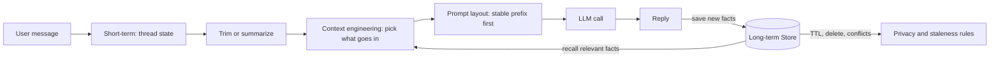
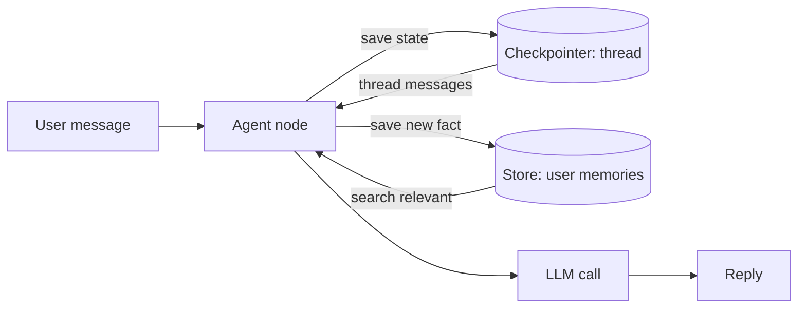
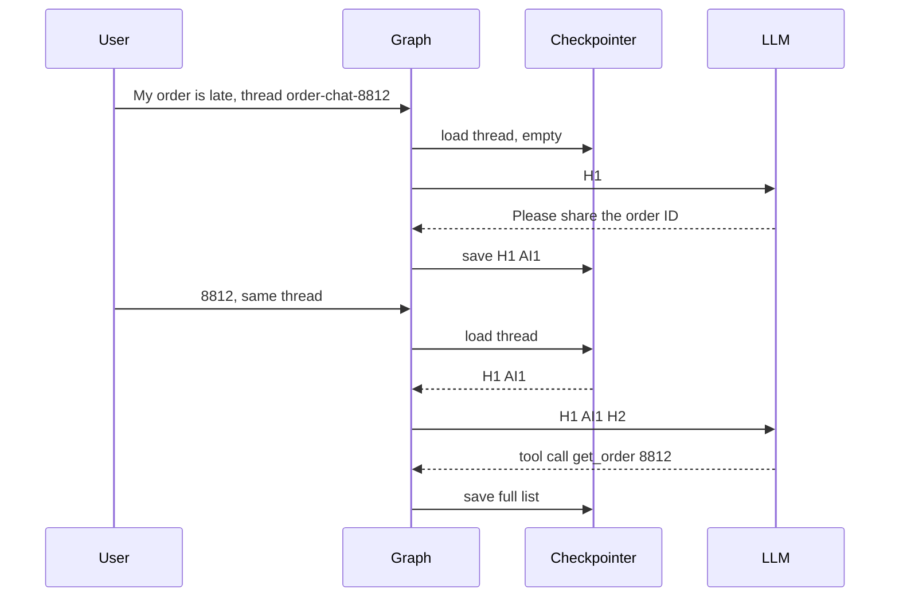
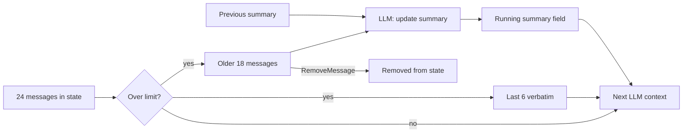
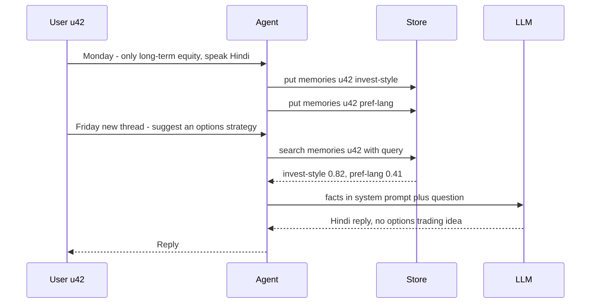
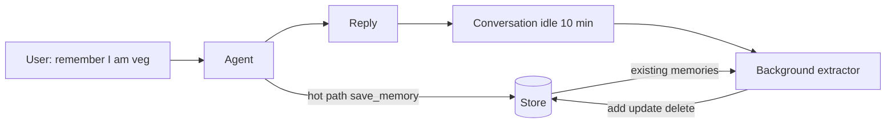
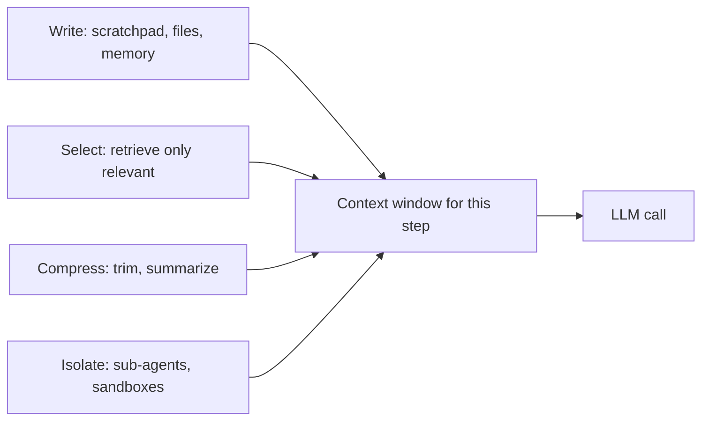
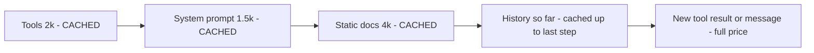
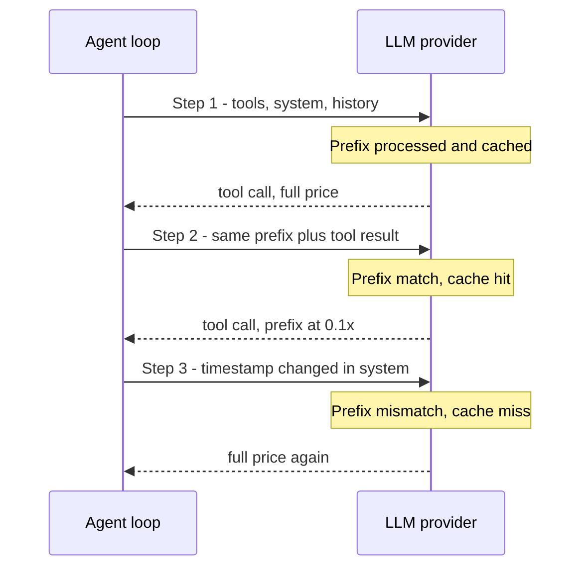
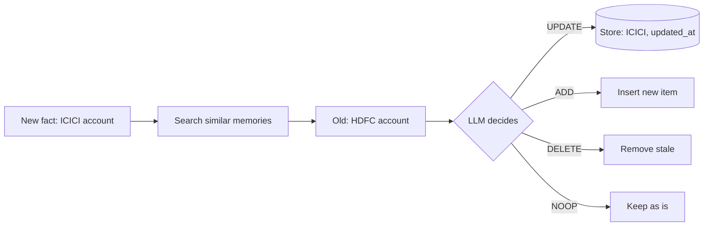

# Memory & Context

This page covers how an agent "remembers" things: inside one conversation (**short-term memory**), across sessions (**long-term memory**), and what goes into the window on every LLM call (**context engineering**). Production agents rarely fail because of the model. They fail because the **context is wrong or overfull**.

**After this page you can explain:**
- Why the LLM itself remembers nothing, and which code is really the "memory".
- How the context window fills up in a long chat, and how trimming or a summary keeps it in check.
- How something a user said comes back in a new session next week (LangGraph Store).
- What to put into the window at each step and what to keep out.
- How the prompt-caching prefix is preserved, and how to handle old or wrong memories.

## Words you need first

New to LLMs? Read [How LLMs Work](14-how-llms-work.md) first. It explains tokens, context windows and how a model generates text.

| Word | Plain meaning |
|---|---|
| Store | LangGraph's long-term key-value storage that lives across conversations, usually one area per user. |
| Prompt caching | The model provider reuses work on an unchanged prompt start, so repeat calls are cheaper and faster. |
| Thread | One conversation, identified by a `thread_id`. Its messages and data are saved together. |
| Checkpointer | Saves a thread's data after each graph step to memory or a database, so the next request can load it. |
| TTL | Time to live: how long a saved item is kept before it expires automatically. |
| Namespace | A folder-like label, such as `("memories", user_id)`, that groups saved items and keeps users apart. |
| `tool_call` | A part of the model's reply asking your code to run a named function with given arguments. |
| Reducer | A rule for merging a node's returned update into a state field, for example append instead of overwrite. |
| Few-shot examples | A handful of worked examples placed in the prompt so the model copies their style or steps. |
| LangMem | A LangChain library with ready-made tools and jobs to extract, save and search agent memories. |
| Embedding | A list of numbers representing a text's meaning; texts with similar meaning get nearby numbers. |
| Semantic search | Finding items by meaning, by comparing embeddings, instead of matching exact words. |
| Hallucination | The model confidently stating something false or made up. |
| PII | Personally identifiable information: data that identifies a person, such as phone, card or Aadhaar number. |

## Big picture: the LLM forgets, the code reminds it

An LLM is an API call, and every call is new. The model knows nothing about the previous call. So "memory" = **our code**, which puts the right things together into the prompt before each call. The conversation lives in thread state (short-term), which gets trimmed or summarized as it grows. Stable facts go into the Store (long-term) and come back in the next session. Context engineering decides what goes into the window, caching makes its stable part cheap, and privacy rules keep old or sensitive memories under control.



Each box is one section of this page. Below we walk through them one by one with a real request.

## ⭐ Types of memory: a map

**Why do we need it?** A bot with no memory, two turns:

1. User: "My name is Riya, my order 8812 is late." Bot: "Sorry Riya, let me check."
2. User (next call): "What was my order number?" Bot: "I don't know."

The bot is not lying. On the second call the LLM only got `["What was my order number?"]`. It never saw the first message.

**Analogy: a doctor's clinic.** Today's visit notes go on a slip (**short-term**; when the visit ends, it is done). The old file sits in the cabinet: allergies, past illnesses (**long-term**; pulled out on every visit). The doctor's brain = the LLM. Without the slip and the file, every visit is the first visit.

**Same example, with memory.** On turn 2 the LLM receives this list:

| # | Message | Where it came from |
|---|---|---|
| 1 | System: "You are the Swiggy support bot." | code |
| 2 | System: "User facts: prefers Hindi" | long-term Store |
| 3 | Human: "My name is Riya, my order 8812 is late." | thread state (checkpointer) |
| 4 | AI: "Sorry Riya, let me check." | thread state |
| 5 | Human: "What was my order number?" | new message |

Now the LLM can answer "8812". The LLM did not change; only its input did.

**Which memory fixes which failure:**

| Failure | Fix |
|---|---|
| Forgot an earlier message in the same chat | short-term: checkpointer + `thread_id` |
| Chat so long the window is full or the bill is big | trimming / summarization |
| Forgot a preference in a new session next week | long-term: Store |
| Window full of junk, answers get worse | context engineering |
| An old memory leads to a wrong answer | TTL, conflict resolution |

| | Short-term | Long-term |
|---|---|---|
| Scope | one thread / session | across threads, user or org level |
| In LangGraph | state + **checkpointer** | **Store** (namespaced key-value + search) |
| Holds | messages, tool results, scratch fields | preferences, facts, past episodes, instructions |
| Lifetime | irrelevant once the thread ends | until TTL or delete |
| Problem | context window fills up | stale, conflicting, privacy |



**Now the terms:**
- **Stateless:** the model keeps nothing from one call to the next.
- **Thread:** one conversation, identified by `thread_id`. The **checkpointer** saves its state to a DB.
- **Store:** memory that lives across threads, keyed to a user or org.
- The real question of memory: **what to save, when to save it, when to bring it back, when to forget it.**

## ⭐ Short-term memory: checkpointer and thread state

**Why do we need it?** On a server every request arrives separately, sometimes on a different pod. If earlier messages are not saved anywhere, the bot will ask "what is your order ID?" every time.

**Analogy: a kirana shop's khata.** Each customer has one page (`thread_id`). The customer comes in, the page opens, new items are written, the page closes. Lose the page (pod restart + `InMemorySaver`) and the account is gone.

**Walk-through: Swiggy bot, `thread_id = "order-chat-8812"`.**
1. Turn 1. User: "My order is late." AI: "Please share the order ID". Checkpoint saved: `[H1, AI1]`.
2. Turn 2. "8812" arrives with the same `thread_id`. The checkpointer loads `[H1, AI1]` and adds `H2`. The AI calls `get_order(8812)`. Saved: `[H1, AI1, H2, AI2(tool_call), Tool2, AI2b]`.
3. Turn 3. "Will I get a refund?" All 6 messages + `H3` are loaded. The order ID is in the list, so it is remembered. Even after a pod restart, `PostgresSaver` brings it back.



**Now the terms:**
- **Super-step:** one tick of the graph. A checkpoint is saved after each super-step.
- **`InMemorySaver`** is only for dev/test. In production use **`PostgresSaver` / `RedisSaver`** (durable, multi-instance).
- Checkpoint bonuses: **resume after crash**, **human-in-the-loop** (`interrupt` pauses the graph until a person approves or edits), **time travel** (fork from an older checkpoint).

This code builds a small chat graph and attaches a checkpointer, so each `thread_id`'s history is saved and loaded automatically.

```python
from langchain.chat_models import init_chat_model
from langgraph.graph import StateGraph, START, END, MessagesState
from langgraph.checkpoint.memory import InMemorySaver

llm = init_chat_model("openai:gpt-4.1-mini")

def chat(state: MessagesState):
    # state["messages"] already holds this thread's full history
    return {"messages": [llm.invoke(state["messages"])]}

builder = StateGraph(MessagesState)
builder.add_node("chat", chat)
builder.add_edge(START, "chat")
builder.add_edge("chat", END)
graph = builder.compile(checkpointer=InMemorySaver())  # PostgresSaver in prod

cfg = {"configurable": {"thread_id": "order-chat-8812"}}  # the khata page number
graph.invoke({"messages": [("user", "My order is late")]}, cfg)
graph.invoke({"messages": [("user", "8812")]}, cfg)  # earlier message is added automatically
```

**What the code does:**
- `MessagesState` has a `messages` list. New messages are appended, not replaced.
- `thread_id` says which page to open. A new `thread_id` = a new conversation.
- In the second `invoke` we only sent "8812", but the `chat` node received all three messages.

**Interview tip:** "Short-term memory = checkpointer + thread_id. I keep the full history in state, but send the LLM a token-budgeted window."

**Common mistake:** shipping `InMemorySaver` to production. Every conversation is gone on a pod restart.

## ⭐ Context window budget and trimming

**Why do we need it?** Thread state only grows. After 20 turns, thousands of old tokens go into every call: the bill, the latency, and one day the window limit is crossed.

**Analogy: an exam cheat-sheet.** You get one page. Not the whole book, only what the current question needs.

**Token budget: turn 1 vs turn 20** (Swiggy bot, approx tokens):

| What is in the window | Turn 1 | Turn 20 |
|---|---|---|
| System prompt | 800 | 800 |
| Tool definitions (6 tools) | 1,200 | 1,200 |
| User memories (from Store) | 150 | 150 |
| Older conversation | 0 | 22,000 |
| Older tool results (order JSON, policy) | 0 | 9,000 |
| Latest user message | 30 | 40 |
| **Total** | **~2,200** | **~33,200** |

The fixed part stays the same; only history and tool results grow. With a budget of 8,000, we must cut 25k tokens on turn 20.

**Walk-through: before and after `trim_messages`.** The state has 12 messages:

| # | Message | Kept in window? |
|---|---|---|
| 1 | System: "You are the Swiggy support bot" | yes (`include_system`) |
| 2–3 | Human: "My order is late" → AI: "Please share the order ID" | no |
| 4 | Human: "8812" | no |
| 5–6 | AI: tool_call `get_order(8812)` → Tool: `{"status": "picked_up", "eta": 25}` | no |
| 7 | AI: "It has been picked up, arriving in 25 min" | no |
| 8 | Human: "Will I get a refund?" | yes |
| 9 | AI: tool_call `refund_policy()` | yes |
| 10 | Tool: "Rs 50 coupon if 30+ min late" | yes |
| 11 | AI: "If it is 45 min late you get a Rs 50 coupon" | yes |
| 12 | Human: "Okay, give me the coupon" | yes |

1. `strategy="last"`: walk back from the end and take messages until the budget is used. Say 8 to 12 fit.
2. `start_on="human"`: the window must start on a human message. If the budget had cut at 9, then 9, 10 and 11 would go too and only `[12]` would remain. Here 8 is human, so all is fine.
3. System message 1 is added in front (`include_system=True`). The LLM gets `[1, 8, 9, 10, 11, 12]`. The state still has all 12.

Notice the problem: the order ID "8812" (message 4) fell out of the window. If the user asks "what was my order number?", the bot cannot say. That is what the next section, summarization, is for.

**Now the terms:**
- **Context window:** how many tokens the model can read in one call. **Token budget:** how much of it we choose to use.
- **Trimming:** removing old messages from the LLM's view. The information is simply lost.
- **Tool-call pair:** an AI `tool_call` + its `ToolMessage`. If one goes without the other, the provider API (OpenAI, Anthropic, etc.) returns an error.

This is a trimmed version of the `chat` node. It does not change the state; it only shortens the list sent to the LLM.

```python
from langchain_core.messages import trim_messages
from langchain_core.messages.utils import count_tokens_approximately

def chat(state: MessagesState):
    window = trim_messages(
        state["messages"],
        strategy="last",                 # take messages walking back from the end
        token_counter=count_tokens_approximately,
        max_tokens=3000,                 # our budget
        start_on="human",                # window must start on a human message
        end_on=("human", "tool"),        # never leave a dangling AI tool_call
        include_system=True,             # always keep the system prompt
    )
    return {"messages": [llm.invoke(window)]}  # full history stays safe in state
```

**What the code does:**
- `trim_messages` returns a new list. `state["messages"]` stays as it was, for audit.
- `max_tokens=3000` is the budget; `count_tokens_approximately` is a cheap estimate.
- `start_on` / `end_on` make sure no `AIMessage(tool_calls)` is left without its matching `ToolMessage`.

**Interview tip:** "I build a budget table: fixed part (system, tools) vs variable part (history, tool results). I cap the variable part with trimming or a summary, and I never split tool_call / tool_result pairs."

**Common mistake:** trimming by message count ("last 10 messages"). One tool result can be 20k tokens. Trim by tokens.

## ⭐ Summarization node

**Why do we need it?** Trimming dropped the order ID. We need the old content, but in a short form.

**Analogy: the "case summary" in a doctor's file.** Nobody reads every old slip. At the top there is one paragraph: "Diabetic, on metformin since 2024, penicillin allergy." New notes get folded into it.

**Walk-through: a 24-message thread.**
1. 24 messages, limit 20, so the summarize node runs.
2. Split: the older 18 (`old`), the latest 6 (`keep`). If `keep` starts with a `ToolMessage`, the split moves one step back so the tool pair does not break.
3. The LLM gets: the old summary (empty for now) + 18 messages + "keep IDs, amounts, decisions".
4. New summary: "User Riya. Order 8812 late, picked up, ETA 25 min. Policy: Rs 50 coupon if 30+ min late. User accepted the coupon."
5. The node returns `summary` + 18 `RemoveMessage`s. The reducer removes those 18 from state.
6. Next call: `System("Conversation summary: ...")` + the latest 6. ~2,500 tokens instead of ~14,000, and the order ID is back.



**Now the terms:**
- **Running summary:** a state field updated each time from the old summary + new messages.
- **`RemoveMessage(id=...)`:** the `add_messages` reducer sees it and removes the message with that ID from state.
- **Summary drift:** some detail drops in every round. After 10 rounds the summary may be vague.

Code: a `summarize` node runs after `chat`, and `chat` uses the summary as a system message.

```python
from langchain_core.messages import RemoveMessage, SystemMessage, ToolMessage

class State(MessagesState):
    summary: str

def summarize(state: State):
    msgs = state["messages"]
    if len(msgs) <= 20:
        return {}                                   # not needed yet
    cut = len(msgs) - 6
    while cut > 0 and isinstance(msgs[cut], ToolMessage):
        cut -= 1                                    # never split a tool pair
    old = msgs[:cut]
    prompt = (f"Old summary: {state.get('summary', '')}\n"
              "Update the summary by adding the messages below. "
              "Always keep order IDs, amounts and the user's decisions.")
    new_summary = llm.invoke(old + [("user", prompt)]).content
    return {"summary": new_summary,
            "messages": [RemoveMessage(id=m.id) for m in old]}  # the reducer removes these

def chat(state: State):
    sys = SystemMessage(f"Conversation summary: {state.get('summary', '')}")
    return {"messages": [llm.invoke([sys] + state["messages"])]}

builder = StateGraph(State)
builder.add_node("chat", chat)
builder.add_node("summarize", summarize)
builder.add_edge(START, "chat")
builder.add_edge("chat", "summarize")   # summarize after the reply, user gets the answer first
builder.add_edge("summarize", END)
```

**What the code does:**
- The `while` loop makes sure the kept messages do not start with a `ToolMessage`.
- The old summary goes into the prompt, so the summary is "running", not rebuilt from scratch.
- `chat` puts the summary into a **system message**, not a human message.

- Trimming is free but the information is simply lost. Summarization costs one extra LLM call but compresses the information (risk: drift).
- Tell the summary prompt what must **never** be dropped: IDs, amounts, commitments, explicit preferences.
- Summarize in the background (after the response streams) so latency does not grow.

**Common mistake:** rebuilding the summary from scratch every time (not passing the old summary in), or putting the summary into `messages` as a human message.

## ⭐ Long-term memory: semantic, episodic, procedural

**Why do we need it?** The checkpointer is for one thread. Next week there is a new chat, a new `thread_id`, and the bot asks again "what kind of investor are you?"

**Analogy: three parts of a patient file.** "Penicillin allergy" = a **fact**. "Last time this medicine worked in 3 days" = an **experience**. "Explain things to this patient in Hindi" = a **rule**.

**In one line:** following the CoALA paper (Cognitive Architectures for Language Agents), there are three kinds of long-term memory: **facts** (semantic), **experiences** (episodic), **how-to rules** (procedural).

| Type | What it stores | Example (Zerodha assistant) | How it is used |
|---|---|---|---|
| Semantic | facts about the user/world | "User does not trade F&O, only long-term equity" | profile or collection, searched into the prompt |
| Episodic | past interactions, successful runs | "Last time these 3 steps worked for the tax P&L report" | as few-shot examples |
| Procedural | the agent's rules/instructions | "Always reply to this user in Hindi" | part of the system prompt, the agent can update it |

**Walk-through:** the user says "I don't trade F&O. I want last time's tax-report method. Speak in Hindi." One message, three writes: a semantic fact is saved, the 3 steps of the last successful run enter the prompt as an example, and "Always reply in Hindi" is added to the system prompt.

**Now the terms:**
- **Semantic** comes in two shapes:
  - **Profile:** one JSON document that keeps getting updated (`{"language": "hi", "risk": "low"}`). Simple, but concurrent updates conflict.
  - **Collection:** many small items, fetched by search. Better recall, but you must manage duplicates and contradictions.
- **Episodic:** select successful trajectories (the recorded steps of a past run) dynamically as few-shot examples.
- **Procedural:** from feedback the agent can refine its own system prompt (LangMem's prompt optimizer). Risky; do not ship to prod without review.

**Interview tip:** "First I decide which memory is needed. 80% of B2C assistants only need a semantic profile. Episodic when the task repeats, procedural when behaviour must be customized per user."

## ⭐ LangGraph Store: namespaces, put, search

**Why do we need it?** Long-term memory needs a home that survives across threads and keeps each user's data separate.

**Analogy: bank lockers.** Each customer has a locker number (namespace) with separate envelopes inside (keys). Only your own locker opens, and inside you can find things by name or by a rough guess ("something about investments").

**Walk-through: save on Monday, recall on Friday.**
1. **Monday, thread `t-mon`.** User u42: "I only invest in long-term equity. Talk to me in Hindi." The code saves two items:

| Namespace | Key | Value |
|---|---|---|
| `("memories", "u42")` | `invest-style` | `{"text": "User only does long-term equity, no F&O"}` |
| `("memories", "u42")` | `pref-lang` | `{"text": "User prefers to talk in Hindi"}` |

2. The Store also keeps an embedding of the `text` field.
3. **Friday, new thread `t-fri`.** User: "Suggest a good options strategy." The thread history is empty.
4. `search(("memories", "u42"), query="Suggest a good options strategy", limit=3)` → `invest-style` (0.82), `pref-lang` (0.41).
5. Both facts go into the system prompt. The answer comes in Hindi: "Since you don't trade F&O, instead of options look at these long-term choices..." Monday is remembered without opening Monday's thread.



**Now the terms:**
- **Namespace:** a tuple like `("memories", user_id)`. It works like a folder, and it is the **access boundary**.
- **`put(namespace, key, value)`** is an upsert (the same key overwrites). **`get`** fetches an exact key, **`search`** does filter + semantic query.

This code creates a Store with semantic search on the `text` field, and the `chat` node puts the user's memories into the system prompt on every call.

```python
from dataclasses import dataclass
from langchain.embeddings import init_embeddings
from langgraph.store.memory import InMemoryStore
from langgraph.runtime import Runtime

store = InMemoryStore(index={
    "embed": init_embeddings("openai:text-embedding-3-small"),
    "dims": 1536,
    "fields": ["text"],      # only this field is embedded
})

@dataclass
class Ctx:
    user_id: str             # comes from the trusted login session

def chat(state: MessagesState, runtime: Runtime[Ctx]):
    ns = ("memories", runtime.context.user_id)   # per-user isolation
    query = state["messages"][-1].content
    hits = runtime.store.search(ns, query=query, limit=3)  # only inside this user's locker
    facts = "\n".join(h.value["text"] for h in hits)
    sys = f"Known facts about the user:\n{facts}"
    return {"messages": [llm.invoke([("system", sys)] + state["messages"])]}

builder = StateGraph(MessagesState, context_schema=Ctx)
builder.add_node("chat", chat)
builder.add_edge(START, "chat")
graph = builder.compile(checkpointer=InMemorySaver(), store=store)

# Monday: save a memory
store.put(("memories", "u42"), "pref-lang", {"text": "User prefers to talk in Hindi"})
# Friday: new thread, but the memory is found
graph.invoke({"messages": [("user", "Give me my portfolio summary")]},
             {"configurable": {"thread_id": "t-fri"}}, context=Ctx(user_id="u42"))
```

**What the code does:**
- With `index`, `search(query=...)` becomes semantic. Without it the Store is only key-value.
- `user_id` comes from `runtime.context`, which our server sets. The LLM cannot change it.
- Thread `t-fri` is new, yet the facts arrive because the Store is not tied to a thread.

- Production: `PostgresStore` (pgvector, the Postgres extension for embedding search) or `RedisStore`. `InMemoryStore` is empty after a restart.

**Common mistake:** putting all users' memories in one namespace and filtering only by query. One bug and one user's data lands in another user's prompt.

## ⭐ Writing memory: hot path vs background

**Why do we need it?** Who writes to the Store, and when? Asking "should I save this?" on every message slows replies. Doing it later means the memory is not there on the next turn.

**Analogy: waiter vs manager.** "I have a peanut allergy": the waiter writes it on the slip right away (**hot path**). At night the manager goes through the day's orders and updates the regulars' diary (**background**).

**Walk-through: a Zomato assistant.**
1. User: "Remember, I am vegetarian." It is explicit, so the agent calls the `save_memory` tool. Store: `diet = "User is vegetarian"`.
2. Later: "Send it to my Indiranagar home." An implicit fact; not saved now.
3. The conversation is idle for 10 min. The background extractor gets the full conversation + the existing `[diet: vegetarian]`.
4. Output: `ADD {"text": "User's home is in Indiranagar, Bengaluru"}`, `NOOP diet`. Both are available in the next session.

| | Hot path | Background |
|---|---|---|
| How | the agent has a `save_memory` tool | an extractor job when the conversation goes idle |
| Freshness | available immediately | a little later |
| Latency | slower response, extra tokens | zero impact on the user |
| Quality | agent's attention is split, saves too little/too much | sees the whole conversation, better dedupe |
| Transparency | can show the user "remembered that" | hidden |



**Now the terms:**
- **Debounce:** extract only when the conversation has been idle 5–10 min, not on every message.
- **Consolidation:** give the extractor the existing memories too, so it decides insert/update/delete instead of only appending.
- **LangMem in brief:** `create_manage_memory_tool` / `create_search_memory_tool` (hot-path tools that use the Store), `create_memory_store_manager` (background extraction + consolidation), and a prompt optimizer (procedural memory). Managed options such as Mem0 and Zep also exist.

**Interview tip:** "Default to background extraction, debounced, because both latency and quality are better. Hot path only when the user asks explicitly or the memory is needed on the very next turn."

**Common mistake:** running the extractor on every message. Double the cost, and the same fact saved 10 times.

## ⭐ Context engineering: write, select, compress, isolate

**Why do we need it?** Even with correct memory, junk in the window makes the agent go wrong: big tool outputs, a list of 100 tools, old results.

**Analogy: a kitchen counter.** The counter (window) is small. Groceries stay in the fridge (**write**). Take out only what today's dish needs (**select**). Cut big things into small pieces (**compress**). Grind the masala in a separate mixer; only the finished masala reaches the counter (**isolate**).

> **Example:** a Flipkart seller-ops agent analyzes a CSV with 40,000 rows, calls 6 tools, and runs for 30 steps.

**Walk-through: the same task with the four strategies.**
1. **Step 3, `load_csv` (write).** The 40,000 rows (~120k tokens) do not go into messages. They are saved to `/data/orders.csv`; the LLM only gets `{"path": "/data/orders.csv", "rows": 40000, "columns": ["sku", "category", "return_reason"], "preview": 5 rows}`, ~300 tokens. The agent reads more with a grep/slice tool when needed.
2. **Step 7 (select).** Out of 80 tools, only the 6 relevant definitions for this query. 1k tokens instead of 12k.
3. **Step 15 (compress).** Old tool outputs from steps 3–10 are replaced with "[result cleared, see /data/step5.json]".
4. **Step 20 (isolate).** A sub-agent explores 50k tokens in its own fresh window and returns only a 1.5k summary to the parent.

| Window at step 12 | Without engineering | With |
|---|---|---|
| CSV data | 120,000 | 300 |
| Tool definitions | 12,000 | 1,000 |
| Old tool outputs | 18,000 | 2,000 |
| Rest (system, history) | 4,000 | 4,000 |
| **Total** | **~154,000** | **~7,300** |



**Now the terms:** **scratchpad** = plan, todo, findings in a state field or file (write). **Tool-result pruning** = replacing old results with a placeholder (compress). Isolate also covers heavy fields in the state schema that never go to the LLM.

**Context rot and lost-in-the-middle:**
- **Lost in the middle** (Liu et al. 2023): models use information at the **start and end** of the context better and miss what is in the middle.
- **Context rot:** as input tokens grow, accuracy drops, even with a 1M window. A big window ≠ good recall.
- Other failure modes: **context poisoning** (a hallucination saved in state and reused again and again), **distraction**, **confusion** (irrelevant tools), **clash** (contradicting information).
- So: important instructions at the start, the current task/question at the end, minimum in the middle.

**Interview tip:** "For me context is a budget. Every tool output has a token cap, big outputs are offloaded to files, and deep research goes to sub-agents that return only a summary."

**Common mistake:** "We have a 1M context window, put everything in". Cost, latency and accuracy all get worse.

## Prompt caching

**Why do we need it?** In an agent loop, the same long prefix goes out on every step: tools, system prompt, static docs. 30 steps = paying for the same 8k tokens 30 times.

**Analogy: the "usual order" at a chai stall.** The owner already knows "less sugar, ginger". The customer only says what is new: "a biscuit too today". But if the very first word changes ("coffee today"), the whole order starts from scratch.

**Walk-through: which part is reused.** The provider caches the processed state of the **same prefix** of a prompt. On the next call that prefix is cheaper (down to roughly 10% of the price) and faster, but only when it is **byte-for-byte identical**.



1. **Step 1:** the 7.5k prefix is processed for the first time, a cache **write** (~1.25x on Anthropic).
2. **Step 2:** the same 7.5k + 600 new tokens. Cache **read** at ~0.1x. Cost units: without cache `8,100`, with cache `7,500 × 0.1 + 600 = 1,350`, about 83% cheaper.
3. **Step 3:** `Time: 14:32:07` appeared in the system prompt. The tools (2k) match, then a mismatch, and everything after is full price.

| | Anthropic | OpenAI |
|---|---|---|
| How it is enabled | explicit `cache_control` breakpoints (max 4) | automatic, prompts ≥ 1024 tokens |
| TTL | 5 min default (refreshed on every hit), 1h option | a few minutes when idle, extended retention option |
| Pricing | cache write ~1.25x, read ~0.1x | discount on cached input, no extra charge for writes |
| Order | tools → system → messages | prefix match, `prompt_cache_key` helps routing |

- Exact numbers change by model. In the interview state the concept and call the numbers "approx".
- **Cache-friendly layout:** stable first, changing later: (1) tool definitions (fixed order, deterministic JSON), (2) system prompt, (3) static docs / few-shot, (4) history (append-only), (5) latest message + dynamic bits.
- **Bugs that break the cache:** a timestamp in the system prompt, tools in random order, a per-request user name at the very top, editing history in the middle (trimming also changes the prefix).
- Track **cache hit rate** (how many input tokens came from the cache) as a metric.



**Interview tip:** "I put dynamic things (date, user memory) at the end of the system prompt or in the latest message, so the tools + static instructions prefix stays cached. I track cache hit rate as a metric."

**Common mistake:** changing the prefix every turn through summarization/trimming, then wondering why caching does not work. Summarize occasionally (say every 20 messages), not every turn.

## Memory privacy and staleness

**Why do we need it?** Long-term memory is the user's personal data, and it goes stale. A wrong memory = a wrong answer. A leaked memory = a legal problem.

**Analogy: your phone's contact list.** A friend changes their number and you don't update it, so the call goes to the wrong person. And if your list shows up on someone else's phone, that is a big problem.

**In one line:** treat long-term memory like a DB: isolation, TTL, deletion, audit, and conflict resolution.

**Walk-through: a Razorpay merchant assistant.**
1. **Jan 10:** the Store has `{"text": "Settlement account HDFC ...1234", "updated_at": "2026-01-10", "source": "user said"}`.
2. **Mar 12:** merchant: "I changed my settlement account to ICICI ...9876." The extractor searches for similar memories and finds the HDFC one (score 0.91).
3. The LLM sees both and decides `UPDATE`. The Store now has ICICI with `updated_at: 2026-03-12`.
4. **Mar 20:** "Which account will my settlement go to?" The agent does not trust memory; it calls the `get_settlement_account` API. Transactional facts come from the API; memory is only a hint.



**Now the terms and rules:**
- **Privacy:**
  - Per-user namespace, a trusted `user_id`, and a test for cross-tenant search.
  - **Never save** PII (card, Aadhaar, OTP, passwords) into memory. Block it with both the extractor prompt and a regex filter.
  - Give the user a "show / delete my memories" control. For DPDP (India's data protection law) / GDPR (the EU's) "right to erasure", the memory store, vector index, backups and summaries must all be covered.
- **Staleness:**
  - **TTL (time to live):** short for volatile facts (current city, open ticket), long for stable preferences. LangGraph store backends support TTL (default TTL in config, refreshed on read).
  - Keep `created_at`, `updated_at`, `source` on every memory. Show them in the prompt with an "as of" date.
- **Conflicts:** consolidate at write time (`UPDATE / DELETE / NOOP / ADD`). At read time latest wins, and an explicit user statement > an inferred fact. Critical data (bank account, address) comes from the **source-of-truth API**.

**Interview tip:** "Memory is a cache, not the source of truth. Transactional facts always come from the API; memory is only for personalization."

**Common mistake:** only appending. Six months later one user has 300 memories, half of which contradict each other.

## Read next

- [LangGraph Core Concepts](02-langgraph-core.md): state, reducers and checkpointer in detail.
- [Agentic Patterns: Agents & Multi-agent](04-agent-patterns.md): sub-agent context isolation.
- [Data & Retrieval for Agents](06-agentic-data-rag.md): the retrieval behind memory search.
- [Cost & Latency](11-cost-latency.md): the cost side of caching and token budgets.
- [Vector databases](../05-db/11-vector.md): what sits under a semantic memory index.
- [Multi-agent lab](/viewinter/agents/labs/multi): run sub-agents in the browser.

## Checklist

- [ ] I can explain short-term vs long-term memory and the role of the checkpointer vs the Store in LangGraph, with an example
- [ ] I can build a token budget table and explain `trim_messages` and a summarization node, and why tool_call pairs must not be split
- [ ] I can explain semantic, episodic and procedural memory with examples
- [ ] I can explain Store namespaces, `put`/`search` and per-user isolation, showing a save in one session and a recall in the next
- [ ] I can explain the trade-off of hot path vs background memory writing
- [ ] I can explain the write, select, compress, isolate strategies of context engineering with examples
- [ ] I can explain context rot and lost-in-the-middle and their mitigations
- [ ] I can design a cache-friendly prompt layout and list the bugs that break the cache
- [ ] I can describe a TTL, deletion and conflict-resolution plan for memory
