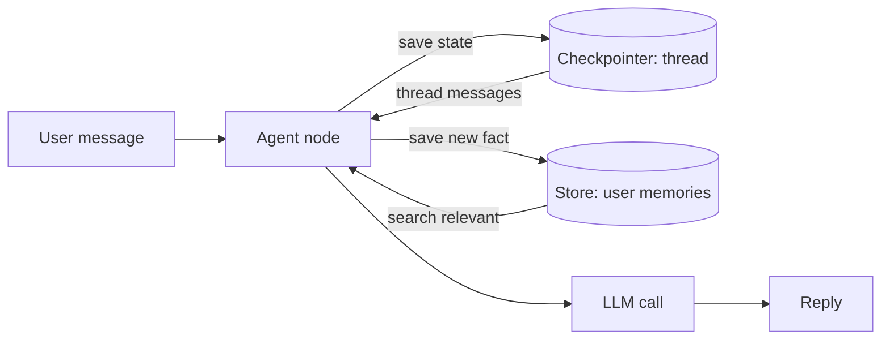
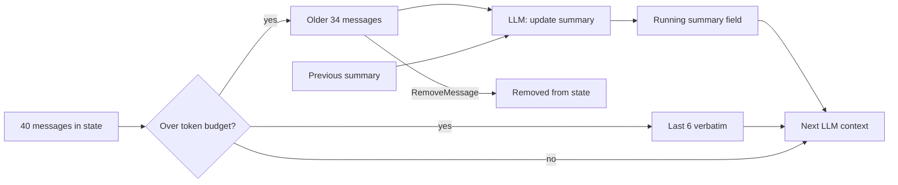
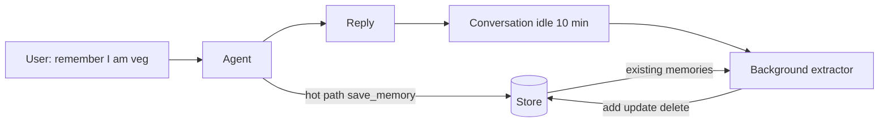
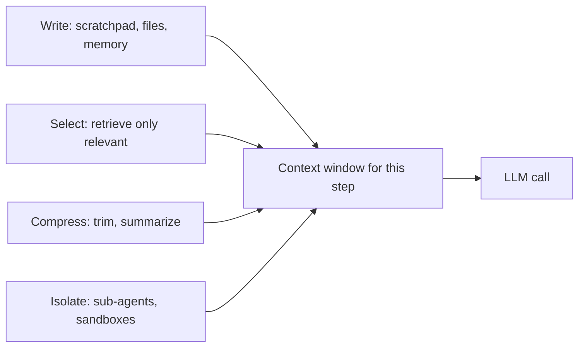
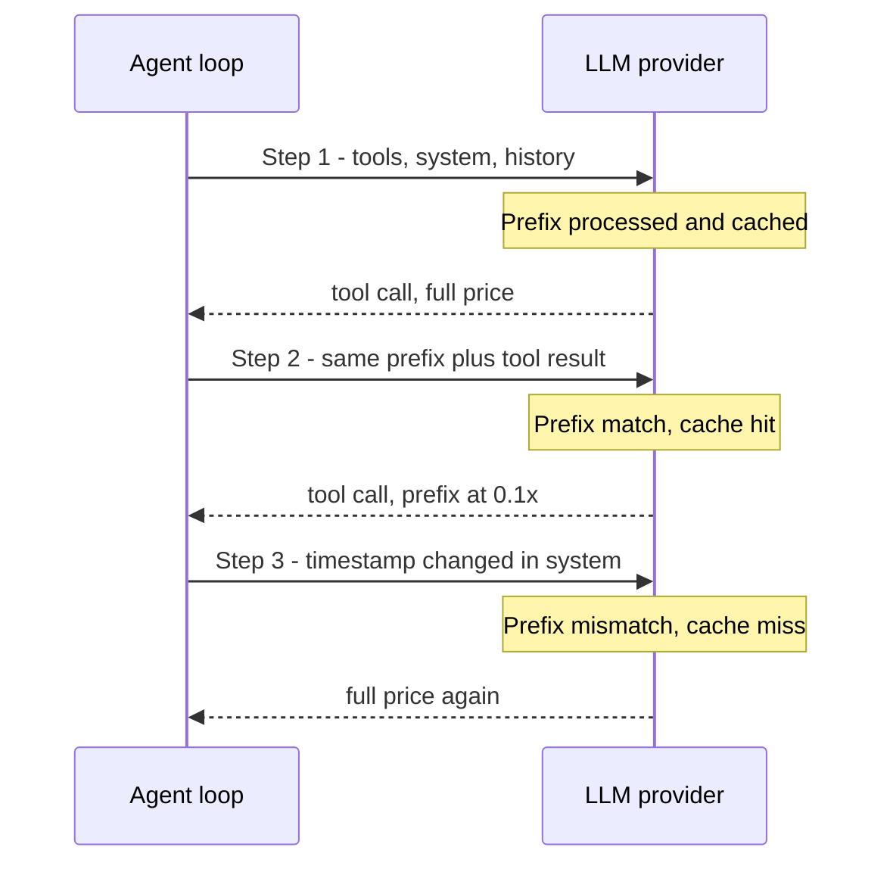
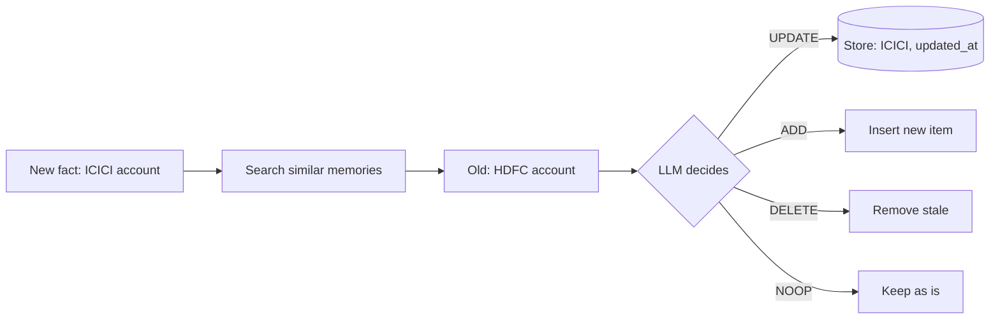

# Memory & Context

This page covers an agent's **short-term memory** (inside one thread), **long-term memory** (across threads and sessions), and **context engineering**, meaning what goes into the context window on each LLM call and what stays out. Interviewers ask because the most common failure of production agents is not the model but **wrong or bloated context**: long conversations, huge tool outputs, stale memories and a growing bill.

## ⭐ Types of memory: a map

**In one line:** short-term = the state of one conversation (thread); long-term = facts, experiences and rules about a user or org that survive across sessions.

| | Short-term | Long-term |
|---|---|---|
| Scope | one thread / session | across threads, user or org level |
| In LangGraph | state + **checkpointer** | **Store** (namespaced key-value + search) |
| What it holds | messages, tool results, scratch fields | preferences, facts, past episodes, instructions |
| Lifetime | irrelevant once the thread ends | until TTL or delete |
| Problem | context window fills up | stale, conflicting, privacy |

- The LLM itself is **stateless**. "Memory" is always our code putting the right things into the context on each call.
- The real memory questions: **what to save, when to save it, when to bring it back, when to forget it.**



On every call our code fills the context from thread state (checkpointer) and user memories (Store); the LLM itself remembers nothing.

## ⭐ Short-term memory: checkpointer and thread state

**In one line:** the checkpointer saves graph state against a `thread_id` after every super-step, so the next message continues the same thread.

> **Example:** a Swiggy support bot. User: "My order is late." The agent asks for the order ID, the user gives it, the agent checks the refund policy. By the third message the agent must remember the first two. That comes from the checkpoint for `thread_id = "order-chat-8812"`.

- `InMemorySaver` is only for dev/test. In production use `PostgresSaver` / `RedisSaver` (durable, multi-instance).
- Checkpoint bonuses: **resume after crash**, **human-in-the-loop** (`interrupt`), **time travel** (fork from an old checkpoint).
- Thread state = the full `messages` list + custom fields. It **keeps growing**, so trimming/summarization is required.

```python
from langchain.chat_models import init_chat_model
from langchain_core.messages import trim_messages
from langchain_core.messages.utils import count_tokens_approximately
from langgraph.graph import StateGraph, START, END, MessagesState
from langgraph.checkpoint.memory import InMemorySaver

llm = init_chat_model("openai:gpt-4.1-mini")

def chat(state: MessagesState):
    # State keeps the full history; send the LLM only the last ~3k tokens
    window = trim_messages(
        state["messages"],
        strategy="last",
        token_counter=count_tokens_approximately,
        max_tokens=3000,
        start_on="human",          # window starts on a human message
        end_on=("human", "tool"),  # no dangling AI tool_call left behind
        include_system=True,
    )
    return {"messages": [llm.invoke(window)]}

builder = StateGraph(MessagesState)
builder.add_node("chat", chat)
builder.add_edge(START, "chat")
builder.add_edge("chat", END)
graph = builder.compile(checkpointer=InMemorySaver())

cfg = {"configurable": {"thread_id": "order-chat-8812"}}
graph.invoke({"messages": [("user", "My order is late")]}, cfg)
```

- `trim_messages` **does not change state**; it only shrinks the view sent to the LLM. The full history stays safe for audit.
- `start_on="human"` and `end_on` make sure trimming never leaves an `AIMessage(tool_calls)` without its matching `ToolMessage`, otherwise the provider API returns an error.

**Interview tip:** "Short-term memory = checkpointer + thread_id. I keep the full history in state but send the LLM a token-budgeted window, and I never split a tool_call / tool_result pair."

**Common mistake:** shipping `InMemorySaver` to production; every conversation disappears on a pod restart.

## ⭐ Summarization node

**In one line:** when history gets long, build a running summary of the old messages and remove them from state; keep the latest few turns verbatim.



Old messages are folded into the running summary together with the previous summary, and the latest turns stay verbatim.

```python
from langchain_core.messages import RemoveMessage, SystemMessage

class State(MessagesState):
    summary: str

def summarize(state: State):
    msgs = state["messages"]
    if len(msgs) <= 20:
        return {}
    old, keep = msgs[:-6], msgs[-6:]
    prompt = (f"Previous summary: {state.get('summary', '')}\n"
              "Update the summary with the messages below. "
              "Always keep order IDs, amounts and user decisions.")
    new_summary = llm.invoke(old + [("user", prompt)]).content
    # The add_messages reducer sees RemoveMessage and drops those IDs from state
    return {"summary": new_summary,
            "messages": [RemoveMessage(id=m.id) for m in old]}

def chat(state: State):
    sys = SystemMessage(f"Conversation summary: {state.get('summary', '')}")
    return {"messages": [llm.invoke([sys] + state["messages"])]}
```

- Trimming vs summarization: trimming is cheap but loses info outright; summarization compresses info but costs an extra LLM call and suffers **summary drift** (each round drops a bit of detail).
- Tell the summary prompt what it must **never** drop: IDs, amounts, commitments, the user's explicit preferences.
- Watch the split point: the first message in `keep` must not be a `ToolMessage`.
- Summarize in the background (after the response) so user latency does not grow.

**Common mistake:** rebuilding the summary from scratch every time (not passing the old summary in), or putting the summary into `messages` as a human message.

## ⭐ Long-term memory: semantic, episodic, procedural

**In one line:** following the CoALA paper (Cognitive Architectures for Language Agents), there are three kinds of long-term memory: **facts** (semantic), **experiences** (episodic) and **how-to rules** (procedural).

| Type | What it stores | Example (Zerodha assistant) | How it is used |
|---|---|---|---|
| Semantic | facts about the user/world | "User doesn't trade F&O, only long-term equity" | profile or collection, searched into the prompt |
| Episodic | past interactions, successful runs | "Last time these 3 steps worked for the tax P&L report" | as few-shot examples |
| Procedural | the agent's rules/instructions | "Always answer this user in Hindi" | part of the system prompt, the agent can update it |

- **Semantic** has two shapes:
  - **Profile:** one JSON document that keeps getting updated (`{"language": "hi", "risk": "low"}`). Simple, but concurrent updates conflict.
  - **Collection:** many small memory items, fetched by search. Better recall, but you must manage duplicates and contradictions.
- **Episodic** = "what happened last time and what worked". Select successful trajectories dynamically as few-shot examples.
- **Procedural** = the prompt itself. The agent can refine its own system prompt from feedback (LangMem's prompt optimizer). Risky: don't push it to prod without review.

**Interview tip:** "I first decide which memory is needed. 80% of B2C assistants need only a semantic profile. Episodic when the task is repeatable, procedural when behaviour must be customized per user."

## ⭐ LangGraph Store: namespaces, put, search

**In one line:** the Store is a cross-thread key-value store with an optional semantic index; data is organized by a `namespace` tuple (like `("memories", user_id)`) and a `key`.

```python
from dataclasses import dataclass
from langchain.embeddings import init_embeddings
from langgraph.store.memory import InMemoryStore
from langgraph.runtime import Runtime

store = InMemoryStore(index={
    "embed": init_embeddings("openai:text-embedding-3-small"),
    "dims": 1536,
    "fields": ["text"],      # only this field is embedded
})

@dataclass
class Ctx:
    user_id: str

def chat(state: MessagesState, runtime: Runtime[Ctx]):
    ns = ("memories", runtime.context.user_id)   # per-user isolation
    query = state["messages"][-1].content
    hits = runtime.store.search(ns, query=query, limit=3)
    facts = "\n".join(h.value["text"] for h in hits)
    sys = f"Known facts about the user:\n{facts}"
    return {"messages": [llm.invoke([("system", sys)] + state["messages"])]}

builder = StateGraph(MessagesState, context_schema=Ctx)
builder.add_node("chat", chat)
builder.add_edge(START, "chat")
graph = builder.compile(checkpointer=InMemorySaver(), store=store)

store.put(("memories", "u42"), "pref-lang", {"text": "User prefers to talk in Hindi"})
graph.invoke({"messages": [("user", "Give me my portfolio summary")]},
             {"configurable": {"thread_id": "t1"}}, context=Ctx(user_id="u42"))
```

- `put(namespace, key, value)` is an upsert; the same key overwrites. `get` is an exact key lookup, `search` is filter + semantic query.
- **The namespace is the access boundary.** Always take `user_id` from trusted runtime context, never from LLM output.
- Production: `PostgresStore` (pgvector) or `RedisStore`. `InMemoryStore` is empty after a restart.

**Common mistake:** putting every user's memories in one namespace and filtering only by query; one bug and one user's data lands in another user's prompt.

## ⭐ Writing memory: hot path vs background

**In one line:** memory is either written by the agent **during** the conversation via a tool call (hot path), or extracted by a separate process **after** the conversation (background).

| | Hot path | Background |
|---|---|---|
| How | the agent has a `save_memory` tool | an extractor job when the conversation goes idle |
| Freshness | available immediately | available a bit later |
| Latency | slower response, extra tokens | zero impact on the user |
| Quality | the agent's attention is split, saves too little/too much | sees the whole conversation, better dedupe |
| Transparency | can show the user "I'll remember that" | hidden |

- Debounce background extraction: extract when the conversation is idle for 5–10 min, not on every message.
- Give the extractor the **existing memories** too, so it decides insert/update/delete instead of only appending.
- Common hybrid: explicit "remember this" requests on the hot path, other implicit facts in the background.



An explicit "remember this" is saved right away on the hot path; other facts are consolidated by the background extractor after the chat goes idle, looking at existing memories.

**LangMem in brief:** a LangChain library that provides this: `create_manage_memory_tool` / `create_search_memory_tool` (hot-path tools backed by the Store), `create_memory_store_manager` (background extraction + consolidation), and a prompt optimizer (procedural memory). Managed options like Mem0 and Zep also exist.

**Interview tip:** "Default to debounced background extraction, because both latency and quality are better. Hot path only when the user explicitly asks or the memory is needed on the very next turn."

## ⭐ Context engineering: write, select, compress, isolate

**In one line:** context engineering = keeping **only necessary, correct and fresh tokens** in the window at every step. Four strategies: write, select, compress, isolate.

> **Example:** a Flipkart seller-ops agent analyzes a CSV with 40,000 rows, calls 6 tools and runs 30 steps. If every tool output goes straight into messages, it is at 150k tokens by step 12, cost goes up and reasoning gets worse.



- **Write (save outside the context):**
  - **Scratchpad:** plan, todo list, intermediate findings in a state field or a file. The agent reads it later; it is not always in the window.
  - **Offloading big tool outputs:** write a 2 MB JSON to a file/state/object store and give the LLM only `{"path": "...", "rows": 40000, "preview": first 5 rows}`. The agent reads more with a grep/slice tool when needed.
- **Select (bring back the right thing):** memories, tools (the relevant 5–10 out of 100+), docs, few-shot examples, all via retrieval.
- **Compress:** trimming, summarization, pruning tool outputs (replace old tool results with a placeholder like "[result cleared, see file X]").
- **Isolate:** give a **sub-agent** its own fresh window; it explores 50k tokens and returns only a 1–2k condensed result to the parent. Keep heavy fields in the state schema that are never sent to the LLM.

**Context rot and lost-in-the-middle:**
- **Lost in the middle** (Liu et al. 2023): models use info at the **start and end** of the context better and miss what is in the middle.
- **Context rot:** as input tokens grow, accuracy drops, even with a 1M window. A big window ≠ good recall.
- Other failure modes: **context poisoning** (a hallucination saved into state and reused again and again), **distraction**, **confusion** (irrelevant tools), **clash** (contradicting info).
- So: important instructions at the start, the current task/question at the end, minimum in the middle.

**Interview tip:** "To me context is a budget. I return every tool output with a token cap, offload big outputs to files, and give deep research to sub-agents that return only a summary."

**Common mistake:** "We have a 1M context window, put everything in." Cost, latency and accuracy all get worse.

## Prompt caching

**In one line:** the provider caches the processed state of the **same prompt prefix**; on the next call that prefix is cheaper (down to roughly 10% of the price) and faster, but only if the prefix is **byte-for-byte identical**.

| | Anthropic | OpenAI |
|---|---|---|
| How it is on | explicit `cache_control` breakpoints (max 4) | automatic, prompts ≥ 1024 tokens |
| TTL | 5 min default (refreshed on every hit), 1h option | a few minutes when idle, extended retention option |
| Pricing | cache write ~1.25x, read ~0.1x | discount on cached input, no extra write charge |
| Order | tools → system → messages | prefix match, `prompt_cache_key` helps routing |

- Exact numbers change per model; in the interview state the concept and call the numbers "approx".
- **Cache-friendly layout:** stable things first, changing things later:
  1. Tool definitions (fixed order, deterministic JSON)
  2. System prompt (static instructions)
  3. Static docs / few-shot examples
  4. Conversation history (append-only)
  5. Latest user message + dynamic bits
- **Bugs that break the cache:** a timestamp in the system prompt (`It is 14:32:07 now`), tools in random order, per-request user name at the very top, editing history in the middle (trimming also changes the prefix).
- Caching pays off most in agent loops: the same long prefix on every step + a little new.



Every agent-loop step sends the same prefix, so the cache hits; change one timestamp in the system prompt and the whole prefix misses.

**Interview tip:** "I put dynamic things (date, user memory) at the end of the system prompt or in the latest message, so the tools + static instructions prefix stays cached. I track cache hit rate as a metric."

**Common mistake:** changing the prefix every turn through summarization/trimming, then wondering why caching doesn't work.

## Memory privacy and staleness

**In one line:** long-term memory = the user's personal data, so treat it like a DB: isolation, TTL, deletion, audit and conflict resolution.

> **Example:** a Razorpay merchant assistant remembered "settlement account is HDFC". Two months later the merchant switched to ICICI. Because of the old memory the agent keeps quoting the wrong account.

- **Privacy:**
  - Per-user namespace, trusted `user_id`, test cross-tenant search.
  - **Never save** PII (card, Aadhaar, OTP, passwords) to memory; block it with both the extractor prompt and a regex filter.
  - Give the user "show / delete my memories" control. DPDP/GDPR "right to erasure" must cover the memory store, the vector index, backups and summaries.
- **Staleness:**
  - **TTL:** short TTL for volatile facts (current city, open ticket); long for stable preferences. LangGraph store backends support TTL (default TTL in config, refresh on read).
  - Keep `created_at`, `updated_at`, `source` on every memory; show it in the prompt with an "as of" date.
- **Conflicting memories:**
  - Consolidate at write time: when a new fact arrives, find similar old memories and let the LLM decide `UPDATE / DELETE / NOOP / ADD`.
  - At read time: latest wins, and an explicit user statement > an inferred fact.
  - Take critical data (bank account, address) from the **source-of-truth API**, not memory. Memory is only a hint.



At write time the new fact is compared with similar old memories, and the LLM decides ADD / UPDATE / DELETE / NOOP.

**Interview tip:** "Memory is a cache, not a source of truth. Transactional facts always come from the API; memory is only for personalization."

**Common mistake:** append-only memory; after 6 months one user has 300 memories, half of which contradict each other.

## Read next

- [LangGraph Core Concepts](02-langgraph-core.md): state, reducers and the checkpointer in detail.
- [Agentic Patterns: Agents & Multi-agent](04-agent-patterns.md): sub-agent context isolation.
- [Data & Retrieval for Agents](06-agentic-data-rag.md): the retrieval behind memory search.
- [Cost & Latency](11-cost-latency.md): the cost side of caching and token budgets.
- [Vector databases](../05-db/11-vector.md): what sits under a semantic memory index.
- [Multi-agent lab](/viewinter/agents/labs/multi): run sub-agents in the browser.

## Checklist

- [ ] I can explain short-term vs long-term memory and the role of the checkpointer vs the Store in LangGraph
- [ ] I can write `trim_messages` and a summarization node, and explain why tool_call pairs must not be split
- [ ] I can explain semantic, episodic and procedural memory with examples
- [ ] I can explain Store namespaces, `put`/`search` and per-user isolation
- [ ] I can explain the hot path vs background memory-writing trade-off
- [ ] I can explain the write, select, compress and isolate strategies of context engineering with examples
- [ ] I can explain context rot and lost-in-the-middle and their mitigations
- [ ] I can design a cache-friendly prompt layout and list the bugs that break the cache
- [ ] I can explain a TTL, deletion and conflict-resolution plan for memory
