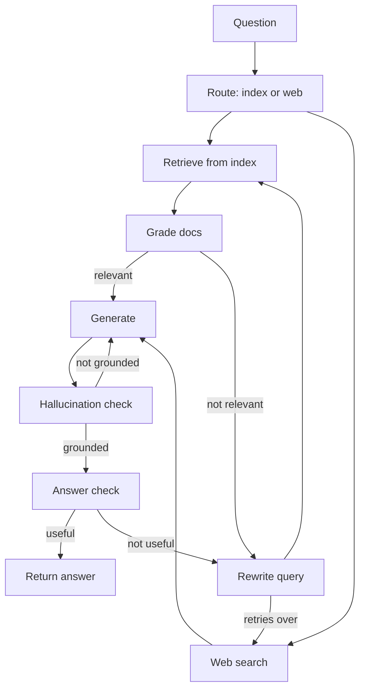
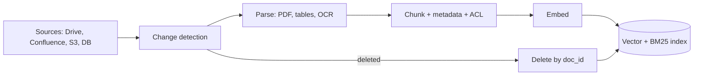

# Data & Retrieval for Agents

This page covers what happens when retrieval is no longer a fixed pipeline but an agent's **decision**: agentic RAG, corrective/self/adaptive RAG graphs, GraphRAG, text-to-SQL agents, ingestion pipelines, ACLs and PII, and synthetic data for evals. Interviewers ask because real agent data is scattered across PDFs, SQL tables and APIs, and "the wrong or unauthorized data was retrieved" is the most expensive bug.

## Recap: RAG basics (details in 09-rag)

| Topic | In one line | Details |
|---|---|---|
| What RAG is | retrieve → augment prompt → generate | [What is RAG](../09-rag/01-what-is-rag.md) |
| Embeddings, semantic search | meaning as a vector, nearest via ANN | [Semantic search](../09-rag/02-semantic-search.md) |
| Chunking | structure-aware chunks, overlap, parent-child | [Chunking](../09-rag/03-chunking.md) |
| Hybrid search | BM25 + dense + RRF | [Hybrid search](../09-rag/04-hybrid-search.md) |
| Reranking | top-k precision with a cross-encoder | [Reranking](../09-rag/05-reranking.md) |
| Advanced retrieval | HyDE, multi-query, query decomposition | [Advanced retrieval](../09-rag/07-advanced-retrieval.md) |
| RAG eval | context precision/recall, faithfulness | [RAG evaluation](../09-rag/08-rag-evaluation.md) |

- Focus here: **when, what and how** the agent retrieves, and the production problems on the data side.

## ⭐ Agentic RAG: retrieval as a tool

**In one line:** classic RAG retrieves once for every query; in agentic RAG the retriever is a **tool** and the LLM decides whether to retrieve, with which query, from which source, and how many times.

> **Example:** a Zerodha support agent. "Hi" needs no retrieval. "What is my DP charge and how much was deducted last month?" needs two sources: pricing docs (vector search) and the user's ledger (API tool). The agent splits the query into two parts, calls both tools, then combines them.

| | Classic (2-step) RAG | Agentic RAG |
|---|---|---|
| When it retrieves | always, once | when needed, 0 to N times |
| Query | the user's raw text | the agent rewrites / decomposes |
| Sources | one index | multiple tools (vector, SQL, API, web) |
| Latency/cost | predictable, low | variable, higher |
| Multi-hop | no | yes |

- **Query rewriting:** "what's its fee?" → resolved from the conversation into "Zerodha Coin direct mutual fund fee". Without rewriting, pronouns and follow-ups make retrieval fail.
- **Decomposition / multi-hop:** "What is the expense ratio of the AMC whose fund is largest in my portfolio?" → hop 1: portfolio API, hop 2: search that fund's factsheet.
- **Source routing:** from tool descriptions the agent chooses `search_policy_docs` vs `query_orders_db` vs `web_search`.
- **Guard rails:** max retrieval calls (e.g. 4), every result token-capped, and make "nothing found" an explicit result so the agent doesn't hallucinate.

```python
from langchain_core.tools import tool
from langgraph.prebuilt import ToolNode, tools_condition

@tool
def search_policy_docs(query: str, k: int = 4) -> str:
    """Search Zerodha pricing and policy docs. Use for charges, fees, rules.
    Pass a specific self-contained query, not pronouns."""
    docs = retriever.invoke(query)[:k]
    if not docs:
        return "NO_RESULTS: try a different query or ask the user to clarify."
    return "\n\n".join(f"[{d.metadata['source']}] {d.page_content[:800]}" for d in docs)

llm_t = llm.bind_tools([search_policy_docs, get_ledger])

def agent(state: MessagesState):
    return {"messages": [llm_t.invoke(state["messages"])]}

b = StateGraph(MessagesState)
b.add_node("agent", agent)
b.add_node("tools", ToolNode([search_policy_docs, get_ledger]))
b.add_edge(START, "agent")
b.add_conditional_edges("agent", tools_condition)  # "tools" if there are tool_calls, else END
b.add_edge("tools", "agent")
graph = b.compile()
```

**Interview tip:** "For a simple FAQ bot classic RAG is cheaper and predictable. Agentic RAG when queries are multi-source or multi-hop, and even then I cap the tool calls."

**Common mistake:** making every query agentic; 3x latency and cost, no gain on simple questions.

## ⭐ Corrective, Self and Adaptive RAG as graphs

**In one line:** don't retrieve and then generate blindly; **grade** whether the docs are relevant, otherwise rewrite the query or search the web, and also grade the answer for being grounded and useful.

- **CRAG (Corrective RAG):** a retrieval evaluator grades docs as correct / ambiguous / incorrect. On incorrect it uses a **web search fallback**, on ambiguous both. It refines docs into "knowledge strips" and drops the irrelevant parts.
- **Self-RAG:** the model reflects on itself: should I retrieve? (Retrieve), is the doc relevant? (IsRel), is the answer supported by the doc? (IsSup), is the answer useful? (IsUse). In the paper these are trained reflection tokens; in LangGraph we implement them as LLM grader nodes.
- **Adaptive RAG:** first **classify/route** the query: no retrieval (simple), single-shot retrieval, or multi-step/web. Saves cost on simple queries.



```python
from typing import TypedDict
from pydantic import BaseModel

class S(TypedDict):
    question: str
    docs: list
    answer: str
    tries: int

class Grade(BaseModel):
    relevant: bool

grader = llm.with_structured_output(Grade)

def retrieve(s: S):
    return {"docs": retriever.invoke(s["question"])}

def grade_docs(s: S):
    keep = [d for d in s["docs"] if grader.invoke(
        f"Question: {s['question']}\nDoc: {d.page_content}\nIs this relevant?").relevant]
    return {"docs": keep}

def decide(s: S):
    if s["docs"]:
        return "generate"
    return "web_search" if s.get("tries", 0) >= 2 else "rewrite"

def rewrite(s: S):
    q = llm.invoke(f"Rewrite this question to work better for search: {s['question']}").content
    return {"question": q, "tries": s.get("tries", 0) + 1}

def web_search(s: S):
    return {"docs": web_tool.invoke(s["question"])}

def generate(s: S):
    ctx = "\n\n".join(d.page_content for d in s["docs"])
    return {"answer": llm.invoke(f"Answer only from the context.\n{ctx}\n\nQ: {s['question']}").content}

g = StateGraph(S)
for name, fn in [("retrieve", retrieve), ("grade", grade_docs), ("rewrite", rewrite),
                 ("web_search", web_search), ("generate", generate)]:
    g.add_node(name, fn)
g.add_edge(START, "retrieve")
g.add_edge("retrieve", "grade")
g.add_conditional_edges("grade", decide, ["generate", "rewrite", "web_search"])
g.add_edge("rewrite", "retrieve")
g.add_edge("web_search", "generate")
g.add_edge("generate", END)   # you can add hallucination/answer grader nodes here
app = g.compile()
```

- A **retry counter** on every loop is required; otherwise rewrite ↔ retrieve loops forever.
- Run graders on a cheap model (mini/haiku class) with structured output (`bool`); batch or parallelize per-doc grading.
- Cost: every grader is an LLM call. 5 docs + 2 answer checks = 7 extra calls. That's why adaptive routing comes first.

**Interview tip:** "CRAG fixes retrieval quality, Self-RAG fixes generation quality, Adaptive RAG fixes cost. In production I build a mix of all three in one LangGraph graph, with bounded retries."

**Common mistake:** a web search fallback without an allow-list or sanitization; untrusted web content goes straight into the prompt = prompt injection risk.

## GraphRAG and knowledge graphs

**In one line:** extract **entities and relations** from documents into a graph, cluster the graph into communities and summarize them; then answer entity-centric (local) or corpus-wide (global) questions.

- **Microsoft GraphRAG pipeline:**
  1. An LLM extracts entities + relationships + claims from chunks.
  2. **Leiden** community detection on the graph, at hierarchical levels.
  3. An LLM summary for every community.
- **Local search:** find the query's entities in the graph and put their neighbours, relations and linked chunks into context. "Which Razorpay partners used feature X?"
- **Global search:** map-reduce over community summaries. "What are the main themes across this year's incident reports?" Vector RAG fails here because the answer is not in any single chunk.
- **When it's worth it:** multi-hop relational questions, "summarize the whole corpus" questions, connected data (contracts, org charts, fraud rings).
- **When it isn't:** simple factual lookups, a fast-changing corpus. Indexing is **very expensive** (LLM calls on every chunk) and incremental updates are hard. Cheaper options: LazyGraphRAG, or text-to-Cypher over an existing graph DB (Neo4j).

| | Vector RAG | GraphRAG |
|---|---|---|
| Best for | specific facts | relations, multi-hop, themes |
| Index cost | embeddings, cheap | LLM extraction, expensive |
| Update | easy, per chunk | hard, re-cluster |

**Common mistake:** making GraphRAG the default without an eval showing where vector + reranking fails. Graph DB basics: [Graph databases](../05-db/10-graph.md).

## ⭐ Structured data: text-to-SQL agents and API tools

**In one line:** structured data needs a **query**, not embeddings; the agent writes SQL, but making that safe is an engineering job.

> **Example:** a Swiggy ops analyst asks "Last week in Bengaluru, what % of orders were more than 45 min late, by restaurant category?" That comes from a GROUP BY over `orders` and `restaurants`, not from vector search.

- **Schema retrieval:** you can't put the DDL of 400 tables in the prompt. Index table/column descriptions and fetch the top 5–10 tables + sample rows + column meanings for the query.
- **Read-only role:** the DB user has only `SELECT`, only on allowed schemas/views; **row-level security** for tenant isolation. Writing "don't DELETE" in the prompt is not security.
- **Query validation:** parse the SQL (sqlglot), allow exactly one `SELECT` statement, block denied tables, inject `LIMIT`, check cost with `EXPLAIN`, set a statement timeout.
- **Self-correction:** on an error, return the error message to the agent (max 2–3 tries).
- **Result summarization:** don't give 10,000 rows to the LLM. Aggregates, top-N, or offload to a file + preview.
- **Semantic layer:** if metrics (`late_order_pct`) are predefined, the agent should use them; more accurate and consistent than raw SQL.
- **API tools:** where an API exists, don't use SQL. The API already enforces business rules, auth and rate limits. Give the tool typed args and a concise response.

```python
import sqlglot
from sqlglot import exp

ALLOWED = {"orders", "restaurants", "cities"}

def validate_sql(sql: str, max_rows: int = 200) -> str:
    tree = sqlglot.parse(sql, read="postgres")
    if len(tree) != 1 or not isinstance(tree[0], exp.Select):
        raise ValueError("Only a single SELECT is allowed")
    q = tree[0]
    tables = {t.name for t in q.find_all(exp.Table)}
    if not tables <= ALLOWED:
        raise ValueError(f"Not allowed: {tables - ALLOWED}")
    if not q.args.get("limit"):
        q = q.limit(max_rows)
    return q.sql(dialect="postgres")

@tool
def run_sql(sql: str) -> str:
    """Run a read-only SELECT on the analytics replica. Returns max 200 rows."""
    try:
        safe = validate_sql(sql)
        rows = ro_conn.execute(safe).fetchall()   # read-only role, 10s statement_timeout
        return f"{len(rows)} rows. First 20: {rows[:20]}"
    except Exception as e:
        return f"ERROR: {e}. Check the schema and fix the query."
```

**Interview tip:** "For text-to-SQL, defense in depth: read-only replica + RLS, parser-based validation, LIMIT and timeout, and only a summarized result goes to the LLM."

**Common mistake:** giving the agent a connection to the primary DB; one bad JOIN slows production.

## Data ingestion pipelines

**In one line:** retrieval is only as good as ingestion; parsing, metadata, incremental re-indexing and deletes are decided here.



- **Parsing:** PDFs have tables, multi-column layouts, headers/footers, scanned pages. Tools: Unstructured, Docling, LlamaParse, or a vision LLM. Keep tables as markdown/HTML; don't split them row by row.
- **Metadata:** `doc_id`, `source`, `section`, `updated_at`, `version`, `tenant_id`, `acl_groups`, `language`. Filtering and citations depend on it.
- **Incremental re-index:** a content hash per doc/chunk; re-embed only changed chunks. Full re-index only when the embedding model changes (and then a blue-green index).
- **Freshness:** near-real-time via CDC/webhooks; define an SLA ("a policy change is searchable within 15 min"). Show `updated_at` in the prompt.
- **Deletes:** the most forgotten part. Deleted at source = deleted from the index (vector + BM25 + cache). Otherwise deleted/confidential docs keep showing up in answers.
- **Idempotent pipeline:** chunk ID = `hash(doc_id + chunk_index + version)`, so retries are safe.

**Common mistake:** only adding new docs and ignoring updates and deletes; the index ends up with 3 versions of the same policy.

## ⭐ Data quality, access control and PII

**In one line:** the agent should see only the data the **user** can see, and that filter must apply at retrieval **time**, not after generation.

- **Per-user ACL at retrieval time:**
  - `acl_groups` / `tenant_id` metadata on every chunk, set at ingestion.
  - At query time, **pre-filter** by the authenticated user's groups (vector DB metadata filter). Post-filtering after top-k hurts recall and risks leakage.
  - User identity comes from the trusted session, not from LLM tool args.
  - An ACL change (an employee leaves a team) should also trigger re-indexing.
- **PII handling:**
  - Detect + redact/mask at ingestion (e.g. Presidio). Aadhaar, PAN, card numbers, phone.
  - Where PII is needed (a KYC agent), use tokenization and strict ACLs; mask it in logs/traces.
  - Check what goes to third-party LLM/embedding APIs, and data residency.
- **Data quality:** duplicate docs (near-dup dedupe), outdated versions, boilerplate (nav, footers), OCR garbage. In retrieval these produce "wrong but confident" answers.

**Interview tip:** "Authorization is not the LLM's job. The retrieval layer pre-filters by the user's ACL; the LLM never even receives a chunk the user can't see."

**Common mistake:** one shared index without a tenant filter, plus "don't reveal other customers' data" in the system prompt.

## Synthetic data: for evals and fine-tuning

**In one line:** when real labeled data is scarce, use an LLM to create question-answer-context triples over the corpus, then **filter and human-review** them into an eval set or training data.

- **Eval set generation:** sample chunk(s) → LLM writes a question + reference answer → mix simple, multi-hop, comparison and "unanswerable". Ragas testset generator, or custom.
- **Agent evals:** synthetic user personas + tasks + expected tool calls/final state (e.g. "refund for order X" → `get_order`, `create_refund`).
- **Quality filters:** check with a critique LLM (answerable from context? ambiguous?), dedupe, balance difficulty. 10–20% human review is a must.
- **Fine-tuning data:** trajectories from a strong model (distillation) → keep only successful runs → SFT a smaller model. Best for narrow tasks like query rewriter, grader, router.
- **Risks:** synthetic questions are "cleaner" than real users; mix in real queries from production logs. If generator and judge are the same model, there is bias.

**Interview tip:** "I make 50–100 real production queries the gold set and use synthetic data to widen coverage, especially edge cases and unanswerable questions."

## Read next

- [Memory & Context Engineering](05-memory-context.md): keeping retrieved context within budget.
- [Tools, MCP & A2A](07-tools-mcp-a2a.md): designing retrieval and SQL tools.
- [Guardrails & Safety](08-guardrails.md): prompt injection from web content.
- [Evals for Agents](09-agent-evals.md): using synthetic sets in evals.
- [Production RAG API](../09-rag/09-production-rag-api.md) and [Vector databases](../05-db/11-vector.md).
- [RAG lab](/viewinter/agents/labs/rag) and [Web agent lab](/viewinter/agents/labs/web).

## Checklist

- [ ] I can explain the difference between classic RAG and agentic RAG and when to use each
- [ ] I can explain query rewriting, decomposition and multi-hop retrieval with an example
- [ ] I can explain the difference between CRAG, Self-RAG and Adaptive RAG and build their LangGraph graph
- [ ] I can explain GraphRAG local vs global search and when it is worth it
- [ ] I can design a safe text-to-SQL agent: schema retrieval, read-only role, validation, LIMIT
- [ ] I can explain handling incremental re-indexing, freshness and deletes in an ingestion pipeline
- [ ] I can explain per-user ACL filtering at retrieval time and PII handling
- [ ] I can explain generating and filtering synthetic data for evals and fine-tuning
