# Data & Retrieval for Agents

This page covers what happens when retrieval stops being a fixed pipeline and becomes the agent's **decision**: agentic RAG, corrective/self/adaptive RAG, GraphRAG, text-to-SQL, ingestion, ACL and PII, and synthetic data for evals. Real agents have data scattered across PDFs, SQL tables and APIs, and "retrieved the wrong or unauthorized data" is the most expensive bug.

**After this page you can explain:**
- How classic RAG and agentic RAG handle the same question differently, with traces.
- How CRAG grades retrieved docs, and what the fallback is when nothing useful comes back.
- The full path of a text-to-SQL agent: question → schema → SQL → validation failure → fix → answer.
- How GraphRAG solves a multi-hop question on a small entity graph.
- Why ingestion, ACL, PII and synthetic eval data matter in production.

## Words you need first

New to LLMs? Read [How LLMs Work](14-how-llms-work.md) first. It explains tokens, context windows and how a model generates text.

| Word | Plain meaning |
|---|---|
| RAG | Retrieval-augmented generation: fetch relevant documents first, paste them into the prompt, then let the model answer. |
| ACL | Access control list: which users or groups are allowed to see a piece of data. |
| PII | Personally identifiable information: data that identifies a person, such as name, phone, PAN or card number. |
| Eval | A repeatable test: a fixed set of questions with expected answers, used to score the system. |
| Grounded | Every claim in the answer is backed by the retrieved text, not invented by the model. |
| Vector search | Finding stored texts closest in meaning to the question, by comparing their embeddings (see next rows). |
| Chunk | A small piece of a document, a few paragraphs long, stored and searched as one unit. |
| Embedding | A list of numbers representing a text's meaning; texts with similar meaning get nearby numbers. |
| BM25 | A classic keyword-ranking formula, like a search engine's: scores documents by matching words. |
| Reranking | A second, more careful model re-scores the top search results and reorders them. |
| Hallucination | The model confidently stating something false or made up, such as a number not in the documents. |
| Structured output | Forcing the model to reply in a fixed shape, such as `{"relevant": true}`, instead of free text. |
| Prompt injection | Hidden instructions inside fetched content (a web page, a doc) that try to hijack the model. |
| Fine-tuning | Training an existing model further on your own examples so it gets better at one task. |

## Big picture: from question to grounded answer

A user question arrives. The agent first decides whether it needs retrieval, and from where. For text docs, vector/hybrid search, then grading the docs to drop junk (CRAG). For numbers and tables, SQL. For relations and corpus-wide themes, GraphRAG. All these sources are filled by an ingestion pipeline that puts ACL and PII rules on every chunk. And the whole system is tested with a synthetic + real eval set.

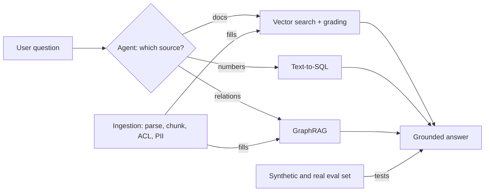

## Recap: RAG basics (details in 09-rag)

| Topic | One line | Details |
|---|---|---|
| What RAG is | retrieve → augment prompt → generate | [What is RAG](../09-rag/01-what-is-rag.md) |
| Embeddings, semantic search | meaning as a vector, nearest via ANN (approximate nearest neighbour search) | [Semantic search](../09-rag/02-semantic-search.md) |
| Chunking | structure-aware chunks, overlap, parent-child | [Chunking](../09-rag/03-chunking.md) |
| Hybrid search | BM25 + dense + RRF | [Hybrid search](../09-rag/04-hybrid-search.md) |
| Reranking | top-k precision with a cross-encoder | [Reranking](../09-rag/05-reranking.md) |
| Advanced retrieval | HyDE, multi-query, query decomposition | [Advanced retrieval](../09-rag/07-advanced-retrieval.md) |
| RAG eval | context precision/recall, faithfulness | [RAG evaluation](../09-rag/08-rag-evaluation.md) |

- Focus here: **when, what and how** the agent retrieves, and the production problems on the data side.

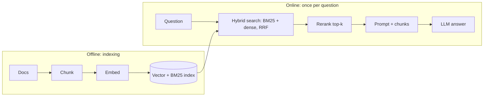

*Diagram:* The fixed two-step pipeline from the RAG pages; the rest of this page makes the online half agentic by deciding when, where and how often to run it.

## ⭐ Agentic RAG: retrieval as a tool

**Why do we need it?** Classic RAG searches once per question, in one index, using the user's raw text. It fetches 4 docs even for "Hi". For a question that needs two sources, one source gets missed.

**Analogy: two kinds of librarian.** The first hands every visitor 4 books from the same shelf, whatever they asked. The second asks "what do you need?", checks two shelves and the accounts register if needed, and goes back again if it is not enough. The second one is agentic RAG.

**Walk-through: the same question, two traces.** Zerodha support. User: "What is my DP charge and how much was deducted last month?"

*Classic RAG:*
1. Embed the raw question, take the top-4 chunks from the policy index.
2. Got: "DP charge Rs 15.34 per scrip per day when sold" (correct), plus 3 irrelevant chunks.
3. The ledger was never checked. LLM answer: "The DP charge is Rs 15.34. I don't have last month's data." Half an answer. (Numbers are only an example.)

*Agentic RAG:*
1. The agent thinks: two parts, two sources.
2. Tool call 1: `search_policy_docs("Zerodha DP charge per scrip")` → the pricing chunk.
3. Tool call 2: `get_ledger(month="2026-10", type="DP")` → `[{"date": "10-07", "amt": 15.34}, {"date": "10-21", "amt": 15.34}]`.
4. The agent combines both: "The DP charge is Rs 15.34 per scrip per sell day. Last month it was deducted twice, Rs 30.68 in total."

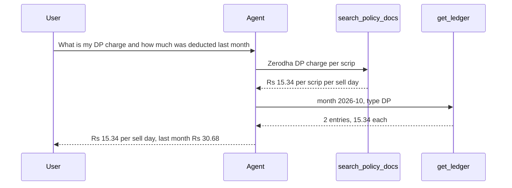

| | Classic (2-step) RAG | Agentic RAG |
|---|---|---|
| When to retrieve | always, once | when needed, 0 to N times |
| Query | user's raw text | agent rewrites / decomposes |
| Sources | one index | multiple tools (vector, SQL, API, web) |
| Latency/cost | predictable, low | variable, higher |
| Multi-hop | no | yes |

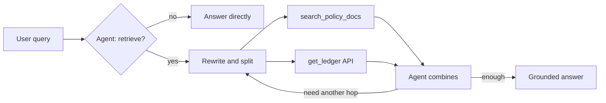

**Now the terms:**
- **Query rewriting:** "what is its fee?" → resolved from the conversation into "Zerodha Coin direct mutual fund fee". A query with pronouns makes retrieval fail.
- **Decomposition / multi-hop:** "What is the expense ratio of the AMC whose fund is the biggest in my portfolio?" → hop 1: portfolio API, hop 2: search that fund's factsheet. The hop 2 query depends on the hop 1 result.
- **Source routing:** the agent reads tool descriptions and picks `search_policy_docs` vs `query_orders_db` vs `web_search`.
- **Guard rails:** a max number of retrieval calls (say 4), every result token-capped, and "nothing found" as an explicit result so the agent does not hallucinate.

Code: turn the retriever into a tool, give the LLM the tools, and run a loop that keeps calling tools until the LLM stops on its own.

```python
from langchain_core.tools import tool
from langgraph.prebuilt import ToolNode, tools_condition

@tool
def search_policy_docs(query: str, k: int = 4) -> str:
    """Search Zerodha pricing and policy docs. Use for charges, fees, rules.
    Give a specific self-contained query, no pronouns."""
    docs = retriever.invoke(query)[:k]
    if not docs:   # make an empty result explicit
        return "NO_RESULTS: try a different query or ask the user to clarify."
    return "\n\n".join(f"[{d.metadata['source']}] {d.page_content[:800]}" for d in docs)  # every chunk capped

@tool
def get_ledger(month: str, type: str) -> str:
    """Entries of the given type for one month (YYYY-MM) from the user's ledger."""
    return str(ledger_api.fetch(user_id=CURRENT_USER, month=month, type=type))  # user_id from the session

llm_t = llm.bind_tools([search_policy_docs, get_ledger])   # show the tools to the LLM

def agent(state: MessagesState):
    return {"messages": [llm_t.invoke(state["messages"])]}

b = StateGraph(MessagesState)
b.add_node("agent", agent)
b.add_node("tools", ToolNode([search_policy_docs, get_ledger]))
b.add_edge(START, "agent")
b.add_conditional_edges("agent", tools_condition)  # tool_calls present → "tools", else END
b.add_edge("tools", "agent")                       # with the result, the agent thinks again
graph = b.compile()
```

**What the code does:**
- The docstring is the tool description. The LLM uses it to decide which tool to call when. `NO_RESULTS` says clearly that nothing was found.
- In `get_ledger`, `user_id` comes from the server session, not from the LLM's args.
- `tools_condition` checks whether the AI message has a tool call. If yes, the `tools` node; if not, END. That makes 0 to N retrievals possible.

**Interview tip:** "For a simple FAQ bot, classic RAG is cheap and predictable. Agentic RAG is for queries that are multi-source or multi-hop, and even then I cap the tool calls."

**Common mistake:** making every query agentic. 3x latency and cost, with no gain on simple questions.

## ⭐ Corrective RAG (CRAG): grade the docs

**Why do we need it?** The retriever always returns something, even when it is useless. The LLM then writes a confident answer from those irrelevant docs.

**Analogy: a teacher checking answer sheets.** Each sheet (doc) gets a tick or a cross. If all are crossed, the student is told to reread the question (rewrite). If it still does not work, open the guide book (web).

**In one line:** do not retrieve and generate blindly. **Grade** every doc. If no useful docs come back, rewrite the query; if still none, search the web.

**Walk-through 1: docs found.** Question: "What is the MTF interest rate on Zerodha?"

| Doc | Content (short) | Grader |
|---|---|---|
| D1 | "MTF interest: 0.04% per day on funded amount" | relevant ✓ |
| D2 | "Intraday brokerage: 0.03% or Rs 20, whichever is lower" | irrelevant ✗ |
| D3 | "Account opening charges ..." | irrelevant ✗ |
| D4 | "List of stocks eligible for MTF" | relevant ✓ |

1. `retrieve` fetched 4 docs.
2. `grade` dropped D2 and D3. `docs = [D1, D4]`.
3. `decide`: docs is not empty, so `generate`.
4. The answer comes only from D1, D4: "MTF charges 0.04% interest per day." (Numbers are only an example.)

**Walk-through 2: the fallback path.** Question: "Did Zerodha announce a new MTF rate yesterday?" The index is old.
1. `retrieve` → 4 docs, all old pricing. `grade` → all ✗. `tries = 0`, so `rewrite`.
2. Rewrite: "Zerodha MTF interest rate change announcement November 2026". `tries = 1`.
3. `retrieve` → all ✗ again. `tries = 1 < 2`, so `rewrite` again. `tries = 2`.
4. `retrieve` → all ✗. Now `tries = 2`, so `web_search`.
5. 3 results from the web; `generate` answers from them (web content is untrusted, so sanitize it).

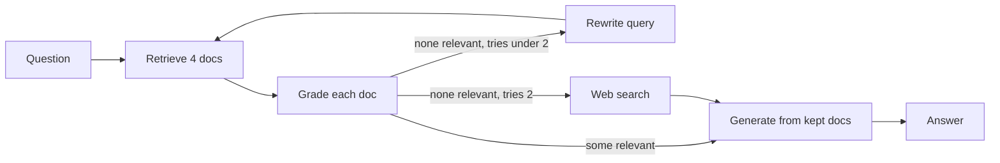

**Now the terms:**
- **Retrieval evaluator / grader:** a cheap LLM call that says yes/no for each doc.
- **CRAG paper:** the evaluator grades docs as correct / ambiguous / incorrect. Incorrect → **web search fallback**, ambiguous → both. It splits docs into "knowledge strips" and drops the irrelevant parts. In LangGraph we do it with a simple binary grade.
- **Retry counter (`tries`):** stops an infinite rewrite ↔ retrieve loop.

Code: each step is a node. After grading, `decide` says where to go next.

```python
from typing import TypedDict
from pydantic import BaseModel

class S(TypedDict):
    question: str
    docs: list
    answer: str
    tries: int

class Grade(BaseModel):
    relevant: bool

grader = llm.with_structured_output(Grade)   # output is always {"relevant": true/false}

def retrieve(s: S):
    return {"docs": retriever.invoke(s["question"])}

def grade_docs(s: S):
    keep = [d for d in s["docs"] if grader.invoke(
        f"Question: {s['question']}\nDoc: {d.page_content}\nIs this relevant?").relevant]
    return {"docs": keep}                    # only the ✓ docs remain

def decide(s: S):
    if s["docs"]:
        return "generate"
    return "web_search" if s.get("tries", 0) >= 2 else "rewrite"

def rewrite(s: S):
    q = llm.invoke(f"Rewrite this question to be better for search: {s['question']}").content
    return {"question": q, "tries": s.get("tries", 0) + 1}

def web_search(s: S):
    return {"docs": web_tool.invoke(s["question"])}

def generate(s: S):
    ctx = "\n\n".join(d.page_content for d in s["docs"])
    return {"answer": llm.invoke(f"Answer only from the context.\n{ctx}\n\nQ: {s['question']}").content}

g = StateGraph(S)
for name, fn in [("retrieve", retrieve), ("grade", grade_docs), ("rewrite", rewrite),
                 ("web_search", web_search), ("generate", generate)]:
    g.add_node(name, fn)
g.add_edge(START, "retrieve")
g.add_edge("retrieve", "grade")
g.add_conditional_edges("grade", decide, ["generate", "rewrite", "web_search"])
g.add_edge("rewrite", "retrieve")
g.add_edge("web_search", "generate")
g.add_edge("generate", END)   # the next section adds an answer grader here
app = g.compile()
```

**What the code does:**
- `with_structured_output(Grade)` forces the grader to return only a `bool`, which is easy to use.
- `grade_docs` removes irrelevant docs from state, so `generate` never sees them.
- `decide` has three paths: docs left → generate; none left and tries < 2 → rewrite; otherwise web.
- `rewrite` increments `tries`, so the loop runs at most 2 times.

- Run graders on a cheap model (mini/haiku class), batched or in parallel. Every grade is an LLM call: 5 docs = 5 extra calls.

**Common mistake:** a web search fallback without an allow-list/sanitization. Untrusted web content straight into the prompt = prompt injection risk.

## ⭐ Self-RAG and Adaptive RAG: answer checks and routing

**Why do we need it?** CRAG checks the docs, not the answer. Even with correct docs, the LLM can write a wrong number. And running the full graph on every question is expensive, even for "Hi".

**Analogy: hospital triage + a senior doctor.** At the gate a nurse decides: small problem, medicine right away; normal, OPD; serious, specialist (**adaptive routing**). A senior checks the junior's prescription: does it match the report? is it useful? (**Self-RAG checks**).

**Walk-through: adaptive routing, three questions.**

| Question | Router decision | Path |
|---|---|---|
| "Hi" | direct | no retrieval, answer directly |
| "What is the DP charge?" | index | retrieve once + grade |
| "What new rule did SEBI announce yesterday?" | web | straight to web search |

**Walk-through: the hallucination check.**
1. The docs say "MTF interest 0.04% per day".
2. `generate` writes: "MTF interest is 0.05% per day."
3. Hallucination grader: "Is every claim supported by the context?" → `grounded: false`.
4. The graph goes back to `generate`. New answer "0.04% per day" → `grounded: true`.
5. Answer grader: "Does it answer the question?" → useful → return.

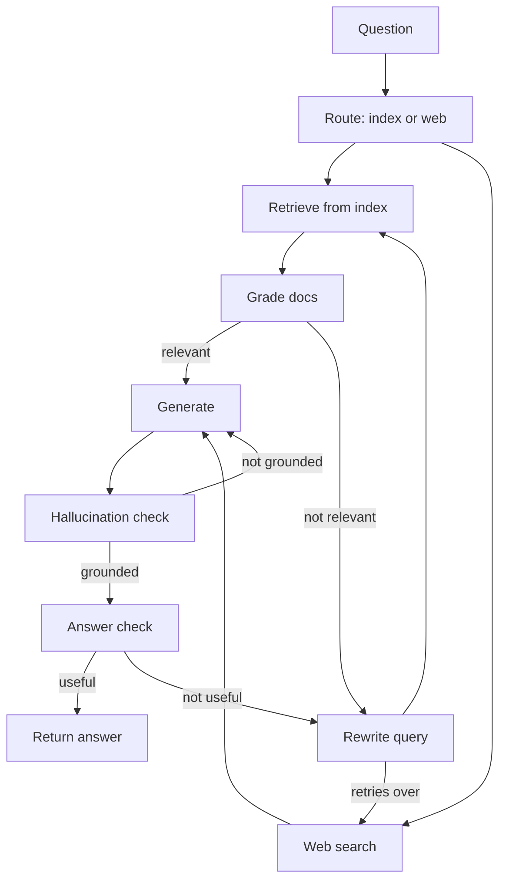

**Now the terms:**
- **Self-RAG:** the model reflects on its own work: should I retrieve? (Retrieve), is the doc relevant? (IsRel), is the answer supported by the doc? (IsSup), is the answer useful? (IsUse). In the paper these are trained reflection tokens. In LangGraph we build them as LLM grader nodes.
- **Adaptive RAG:** first **classify/route** the query: no retrieval, single-shot retrieval, or multi-step/web. Saves cost on simple queries.
- **Grounded:** every claim in the answer is present in the retrieved context.

Code: in the CRAG graph, put this check in place of `generate → END`.

```python
class Grounded(BaseModel):
    grounded: bool

checker = llm.with_structured_output(Grounded)

def check_answer(s: S):
    ctx = "\n\n".join(d.page_content for d in s["docs"])
    v = checker.invoke(f"Context:\n{ctx}\n\nAnswer: {s['answer']}\n"
                       "Is every claim in the answer supported by the context?")
    return "done" if v.grounded else "retry"   # in real code also cap the retry count

g.add_conditional_edges("generate", check_answer, {"done": END, "retry": "generate"})
```

**What the code does:**
- If `grounded` is false the graph goes back to `generate`; if true, to END.
- This replaces `add_edge("generate", END)`. Keep both and the graph will follow two paths.

**Interview tip:** "CRAG fixes retrieval quality, Self-RAG fixes generation quality, Adaptive RAG fixes cost. In production I build a mix of all three in one LangGraph graph, with bounded retries."

**Common mistake:** no cap on grader loops. One stubborn question causes 20 LLM calls and a timeout.

## GraphRAG and knowledge graphs

**Why do we need it?** Some answers are not in any single chunk. They come from **connecting** two or three chunks. Vector search only brings similar chunks, not connections.

**Analogy: the family tree at a wedding.** "Where are Pinky's aunt's son's in-laws from?" No single person knows the whole answer. You walk the tree line by line. And for "which families came to this wedding?", a short summary of each family (community) helps.

**Walk-through: a small entity graph.** Internal docs of a fintech (example data, fictional names):
- C1: "QuickMart integrated UPI Autopay in March."
- C2: "UPI Autopay is owned by the Payments Infra team."
- C3: "INC-42: UPI Autopay mandate failures, 2 hours, fixed by Payments Infra."
- C4: "UPI Autopay is live in TripKaro's checkout."

Question: "Which merchants could have been affected by INC-42?"
1. **Vector RAG:** the query "INC-42 merchants affected" finds C3. C1 and C4 never mention "INC-42", so they are not found. Answer: "I don't know."
2. **GraphRAG indexing:** the LLM extracted entities and relations from the chunks (graph below).
3. **Local search:** the query contains the entity "INC-42". Walk the graph: INC-42 → affected → UPI Autopay → used by → QuickMart, TripKaro.
4. The linked chunks of those nodes (C1, C3, C4) go into the context. Answer: "QuickMart and TripKaro, because both use UPI Autopay."

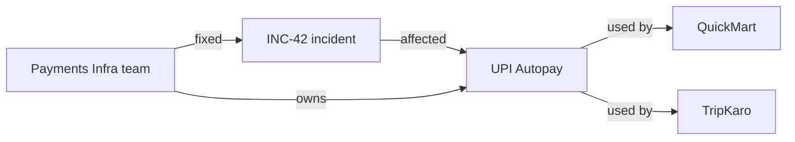

**A global question:** "What are the main themes of all incidents this year?" The graph is split into communities (Payments cluster, Logistics cluster). Each community already has a summary. **Map:** a partial answer from each summary. **Reduce:** combine them into one final list. Vector RAG fails here because the answer is not in any single chunk.

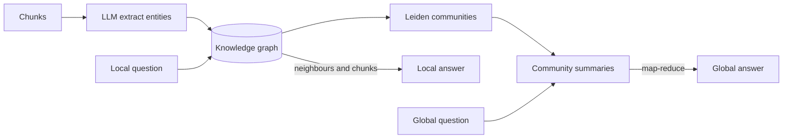

The first half is indexing (expensive, done once). A local query is answered from graph neighbours, a global query by map-reduce over community summaries.

**Now the terms:**
- **Entity / relation:** the graph's nodes (INC-42, UPI Autopay) and edges (affected, used by).
- **Microsoft GraphRAG pipeline:** (1) the LLM extracts entities + relationships + claims from chunks, (2) **Leiden** community detection on the graph (an algorithm that groups tightly connected nodes), with hierarchical levels, (3) an LLM summary for each community.
- **Local search** = entities + neighbours + linked chunks. **Global search** = map-reduce over community summaries.

| | Vector RAG | GraphRAG |
|---|---|---|
| Best for | specific facts | relations, multi-hop, themes |
| Index cost | embeddings, cheap | LLM extraction, expensive |
| Update | easy, per chunk | hard, re-cluster |

- **When it is worth it:** multi-hop relational questions, "summarize the whole corpus" questions, connected data (contracts, org charts, fraud rings).
- **When not:** simple factual lookup, a fast-changing corpus. Indexing is **very expensive** (LLM calls per chunk) and incremental updates are hard. Cheaper options: LazyGraphRAG, or text-to-Cypher on an existing graph DB (Neo4j).

**Common mistake:** making GraphRAG the default without an eval showing where vector + reranking fails. Graph DB basics: [Graph databases](../05-db/10-graph.md).

## ⭐ Structured data: text-to-SQL agents and API tools

**Why do we need it?** The answer to "what % of orders were late last week?" is not written in any document. It comes from a GROUP BY on the `orders` table. Embeddings are useless here; you need a **query**.

**Analogy: a bank clerk and the ledger room.** You give the clerk a question, and the clerk goes to the ledger room and works it out. But the clerk can only **read**, never erase. And on every request a manager (validator) checks that the right register is being opened.

> **Example:** a Swiggy ops analyst: "Category-wise % of orders in Bengaluru last week that were more than 45 min late?"

**Walk-through: from question to answer.**
1. **Schema retrieval:** out of 400 tables, the index of table descriptions returns the top 3: `orders`, `restaurants`, `cities`.
2. **The LLM writes SQL v1.** By mistake it joins the `customers` table to get the city.
3. **Validator:** `customers` is not on the allowed list → `ERROR: Not allowed: {'customers'}`.
4. **The agent reads the error and writes SQL v2**, joining `cities` through `orders.city_id`.
5. **The validator passes** and adds `LIMIT 200` itself. It runs on the read-only replica.
6. **Result:** 3 rows. The agent summarizes them.

```sql
-- 1. Schema snippet the LLM received
-- orders(id, restaurant_id, city_id, placed_at, delivered_at)
-- restaurants(id, name, category)
-- cities(id, name)

-- 2. SQL v1: blocked by the validator (customers not allowed)
SELECT r.category, COUNT(*) FROM orders o
JOIN restaurants r ON r.id = o.restaurant_id
JOIN customers c ON c.id = o.customer_id
WHERE c.city = 'Bengaluru' GROUP BY r.category;

-- 3. SQL v2: after the fix, the validator added LIMIT
SELECT r.category,
       ROUND(100.0 * AVG(CASE WHEN o.delivered_at - o.placed_at > INTERVAL '45 minutes'
                              THEN 1 ELSE 0 END), 1) AS late_pct
FROM orders o
JOIN restaurants r ON r.id = o.restaurant_id
JOIN cities ci ON ci.id = o.city_id
WHERE ci.name = 'Bengaluru' AND o.placed_at >= now() - INTERVAL '7 days'
GROUP BY r.category
ORDER BY late_pct DESC
LIMIT 200;

-- 4. Result: ('Biryani', 18.4), ('Pizza', 11.2), ('South Indian', 6.9)
```

Final answer: "In the last 7 days in Bengaluru, 18.4% of Biryani orders were more than 45 min late, 11.2% of Pizza and 6.9% of South Indian."

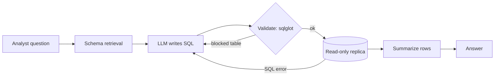

**Now the terms:**
- **Schema retrieval:** not the whole DDL (all the `CREATE TABLE` statements) in the prompt. An index of table/column descriptions, and per query the top 5–10 tables + sample rows + column meanings.
- **Read-only role:** the DB user has only `SELECT`, only on allowed schemas/views. **Row-level security (RLS)** for tenant isolation. Writing "do not DELETE" in the prompt is not security.
- **Query validation:** parse (sqlglot), a single `SELECT` only, block denied tables, inject `LIMIT`, check cost with `EXPLAIN`, statement timeout. **Self-correction:** send the error back to the agent, max 2–3 tries.
- **Result summarization:** do not give 10,000 rows to the LLM. Aggregates, top-N, or offload to a file + preview.
- **Semantic layer:** if metrics (`late_order_pct`) are already defined, the agent should use them. More accurate and consistent than raw SQL.
- **API tools:** where an API exists, do not use SQL. The API already enforces business rules, auth and rate limits.

Code: `validate_sql` parses the SQL and checks it, and the `run_sql` tool returns errors as text the agent can read.

```python
import sqlglot
from sqlglot import exp

ALLOWED = {"orders", "restaurants", "cities"}

def validate_sql(sql: str, max_rows: int = 200) -> str:
    tree = sqlglot.parse(sql, read="postgres")             # text → syntax tree
    if len(tree) != 1 or not isinstance(tree[0], exp.Select):
        raise ValueError("Only a single SELECT is allowed")  # blocks DELETE, two queries via ';', all of it
    q = tree[0]
    tables = {t.name for t in q.find_all(exp.Table)}        # every table in the query
    if not tables <= ALLOWED:
        raise ValueError(f"Not allowed: {tables - ALLOWED}")
    if not q.args.get("limit"):
        q = q.limit(max_rows)                               # add LIMIT ourselves
    return q.sql(dialect="postgres")

@tool
def run_sql(sql: str) -> str:
    """Run a read-only SELECT on the analytics replica. Returns at most 200 rows."""
    try:
        safe = validate_sql(sql)
        rows = ro_conn.execute(safe).fetchall()   # read-only role, 10s statement_timeout
        return f"{len(rows)} rows. First 20: {rows[:20]}"
    except Exception as e:
        return f"ERROR: {e}. Check the schema and fix the query."   # the agent fixes it from this
```

**What the code does:**
- `sqlglot.parse` turns the string into a tree. A regex check on SQL is easy to bypass; a tree check is not.
- More than one statement, or a non-SELECT, fails right away.
- Every `Table` node in the tree is compared with the allow-list. The walk-through's `customers` was caught here.
- The error is not `raise`d out of the tool; it becomes text for the agent so it can fix the SQL. The real safety is on the DB side (read-only role, timeout).

**Interview tip:** "Text-to-SQL needs defense in depth: read-only replica + RLS, parser-based validation, LIMIT and timeout, and only a summarized result goes to the LLM."

**Common mistake:** giving the agent a connection to the primary DB. One bad JOIN slows down production.

## Data ingestion pipelines

**Why do we need it?** Retrieval is only as good as the index. If a policy was updated but the index has the old version, or a deleted doc is still in the index, the agent gives a wrong or confidential answer.

**Analogy: a new edition at the library.** When a new edition arrives, put it on the shelf **and** remove the old one. When a book leaves the library, tear up its catalogue card too. Otherwise people keep asking for old or missing books.

**Walk-through: one policy update and one delete.**
1. `refund-policy` v3 is published on Confluence. A webhook triggers change detection.
2. The doc's content hash changed. Parse → 12 chunks. Compare chunk hashes: only 2 chunks changed.
3. Only those 2 are re-embedded and upserted under IDs built from `doc_id + chunk_index + version`.
4. Another page, "old-escalation-matrix", is deleted from Confluence.
5. The pipeline removes every chunk with `doc_id = conf-881` from the vector index, the BM25 index and the cache.

A chunk record looks like this:

```json
{
  "chunk_id": "hash(conf-552 + 4 + v3)",
  "doc_id": "conf-552",
  "source": "confluence/refund-policy",
  "section": "Refund timelines",
  "version": 3,
  "updated_at": "2026-11-02T10:15:00Z",
  "tenant_id": "swiggy",
  "acl_groups": ["support", "ops"],
  "language": "en",
  "text": "Refunds reach the source account in 5-7 working days..."
}
```

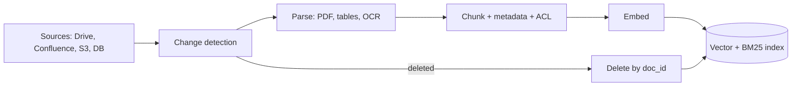

**Now the terms:**
- **Parsing:** PDFs with tables, multi-column layouts, headers/footers, scanned pages. Tools: Unstructured, Docling, LlamaParse, or a vision LLM. Keep tables as markdown/HTML; do not split them row by row.
- **Metadata:** fields like the record above. Filtering and citations depend on them.
- **Incremental re-index:** a content hash per doc/chunk; re-embed only changed chunks. Full re-index only when the embedding model changes (and then with a blue-green index).
- **Freshness:** near-real-time through CDC (change data capture: a stream of inserts, updates and deletes from the source) or webhooks. Define an SLA ("a policy change is searchable within 15 min"). Show `updated_at` in the prompt.
- **Deletes:** the most forgotten part. Deleted at the source = deleted from the index (vector + BM25 + cache).
- **Idempotent pipeline:** chunk ID = `hash(doc_id + chunk_index + version)`, so retries are safe.

**Common mistake:** only adding new docs and ignoring updates and deletes. The index ends up with 3 versions of the same policy.

## ⭐ Data quality, access control and PII

**Why do we need it?** One shared index holds HR salary docs and engineering docs together. Without a filter, any employee can ask about the "appraisal budget" and pull HR data.

**Analogy: a bank's locker room.** The guard checks your key **before** you go in. Not "open every locker and then say don't look at other people's".

**In one line:** the agent should see only the data the **user** can see, and that filter must apply **at retrieval time**, not after generation.

**Walk-through: the same question, two users.** Question: "What is this year's appraisal budget?"
1. **Riya (groups: hr, all).** From the session, `acl_groups = ["hr", "all"]`. The vector DB query has the filter `acl_groups in [hr, all]`. The HR budget chunk is found. She gets the answer.
2. **Aman (groups: eng, all).** Filter `acl_groups in [eng, all]`. The HR chunk never appears in the search. Answer: "You don't have access to this information."
3. **See the post-filter mistake:** had we fetched the top-4 without a filter and filtered afterwards, all top-4 for Aman would have been HR chunks. After filtering, 0 remain. Recall drops, and one bug means a leak.

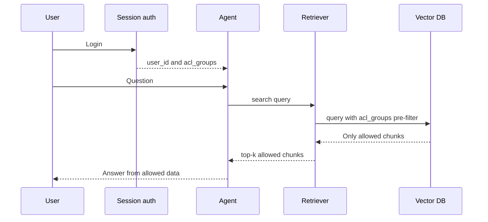

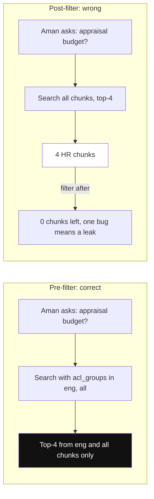

*Diagram:* With a pre-filter HR chunks never enter the search; with a post-filter all four slots go to HR chunks, recall drops to zero and one missed check leaks them.

**Now the terms:**
- **ACL (access control list):** `acl_groups` / `tenant_id` metadata on every chunk, set at ingestion time.
- **Pre-filter:** the filter runs inside the search (vector DB metadata filter). **Post-filter:** filtering after top-k; recall drops and there is a leakage risk.
- User identity comes from the trusted session, not from LLM tool args. An ACL change (an employee leaves a team) must also trigger a re-index.
- **PII handling:** detect + redact/mask at ingestion (something like Presidio). For example: "Customer Rahul, PAN ABCDE1234F, phone 98xxxxxx12" → "Customer `<PERSON>`, PAN `<PAN>`, phone `<PHONE>`". Where PII is needed (a KYC agent), use tokenization and strict ACL. Mask it in logs/traces. Check what goes to third-party LLM/embedding APIs, and data residency.
- **Data quality:** duplicate docs (near-dup dedupe), outdated versions, boilerplate (nav, footers), OCR garbage. These create "wrong but confident" answers.

**Interview tip:** "Authorization is not the LLM's job. The retrieval layer pre-filters by the user's ACL. The LLM never receives a chunk the user cannot see."

**Common mistake:** one shared index without a tenant filter, plus "do not reveal other customers' data" in the system prompt.

## Synthetic data: for evals and fine-tuning

**Why do we need it?** You built a new RAG agent, but you have no labeled question-answer pairs to test it. Without an eval you cannot tell whether CRAG or the reranker helped.

**Analogy: a teacher's question paper.** The teacher reads the chapter, writes questions and an answer key, and has a senior check that the questions are clear. A few "trick" questions whose answer is not in the chapter go in too.

**In one line:** when real labeled data is scarce, use an LLM to generate question-answer-context triples over the corpus, then **filter and human-review** them into an eval set or training data.

**Walk-through: one chunk to an eval item.**
1. Chunk: "Refunds reach the source account in 5-7 working days."
2. Generator LLM: Q "How many days does a refund take?", A "5-7 working days", context = this chunk.
3. Critique LLM: "Answerable from the context? Not ambiguous?" → pass.
4. Also one unanswerable item: Q "Can I get the refund in crypto?", expected "The docs have no information on this."
5. After dedupe, a human checks 10–20% of items. Mixed with 50 real production queries, the eval set is ready.

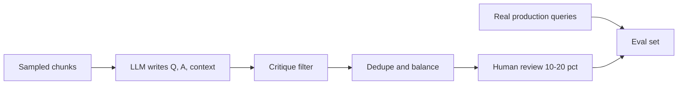

**Now the terms:**
- **Eval set generation:** a mix of simple, multi-hop, comparison and "unanswerable". Ragas testset generator, or custom.
- **Agent evals:** synthetic user personas + tasks + expected tool calls/final state (e.g. "refund for order X" → `get_order`, `create_refund`).
- **Quality filters:** a critique LLM check, dedupe, difficulty balance. 10–20% human review is a must.
- **Fine-tuning data:** trajectories from a strong model (distillation) → only successful runs → SFT (supervised fine-tuning on those input-output examples) a smaller model. Best for narrow tasks like a query rewriter, grader or router.
- **Risks:** synthetic questions are "cleaner" than real users' questions, so mix in real queries from production logs. If the generator and the judge are the same model, there is bias.

**Interview tip:** "I make 50–100 real production queries the gold set and use synthetic data to widen coverage, especially edge cases and unanswerable questions."

## Read next

- [Memory & Context Engineering](05-memory-context.md): how to keep retrieved context within budget.
- [Tools, MCP & A2A](07-tools-mcp-a2a.md): designing retrieval and SQL tools.
- [Guardrails & Safety](08-guardrails.md): prompt injection from web content.
- [Evals for Agents](09-agent-evals.md): how to use synthetic sets in evals.
- [Production RAG API](../09-rag/09-production-rag-api.md) and [Vector databases](../05-db/11-vector.md).
- [RAG lab](/viewinter/agents/labs/rag) and [Web agent lab](/viewinter/agents/labs/web).

## Checklist

- [ ] I can explain classic RAG vs agentic RAG with a trace of the same question, and when to use which
- [ ] I can explain query rewriting, decomposition and multi-hop retrieval with an example
- [ ] I can explain CRAG's grading and fallback path, the difference between Self-RAG and Adaptive RAG, and build their LangGraph graph
- [ ] I can explain GraphRAG's local vs global search on an entity graph, and when it is worth it
- [ ] I can design a safe text-to-SQL agent: schema retrieval, read-only role, validation, LIMIT, self-correction
- [ ] I can explain handling incremental re-index, freshness and deletes in an ingestion pipeline
- [ ] I can explain per-user ACL filtering at retrieval time and PII handling
- [ ] I can explain generating and filtering synthetic data for evals and fine-tuning
