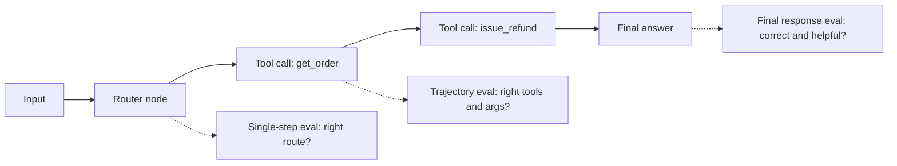
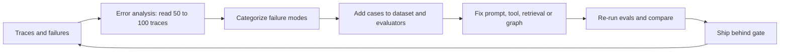

# Evals for Agents

Evals mean **measuring agent quality with numbers**, so that when you change a prompt, model or tool you know whether things got better or broke. In Agentic AI interviews this topic is almost guaranteed: "how will you evaluate the agent", "what is a trajectory eval", "how do you trust an LLM judge", "how do you put evals in CI".

## ⭐ Why agent evals are hard

**In one line:** an agent is non-deterministic, multi-step, and has many valid paths to the same goal, so a simple "expected == actual" test does not work.

> **Example:** a Swiggy support agent gets "my order is late, give me a refund". In one run it does `get_order` → `check_delay` → `issue_refund`, in another `get_order` → `issue_refund`. Both may be right. The words of the final message differ every time too.

- **Non-determinism:** same input, different output (sampling, model updates, tool latency). Do not judge from one run; run each case 3–5 times and look at the pass rate (pass@k or pass^k).
- **Multi-step compounding:** if each step is 95% right, after 10 steps you are at ≈ 60% (0.95^10). You need to find where the error happened.
- **Many valid paths:** exact trajectory match is too strict; hence subset/superset or LLM-judged trajectory.
- **Open-ended outputs:** there is no string match for "a good answer"; you need rubrics and judges.
- **Side effects:** the agent acts on DBs/email/payments; evals need a sandbox or mocked tools.
- **Cost:** every eval run makes real LLM + tool calls; budget for dataset size and frequency.

**Interview tip:** "An agent eval asks three questions: is the final answer right? was the path sound? and at what cost/latency? I measure all three separately."

**Common mistake:** checking 5 examples by hand and saying "it works". Vibe evals do not scale.

## ⭐ Eval levels: final response, single step, trajectory

**In one line:** test the agent at three granularities: the end-to-end final answer, a unit test of one node/step, and the full path (trajectory).



| Level | What it checks | When useful | Limitation |
|---|---|---|---|
| Final response | answer correct, complete, grounded, tone | user-facing quality, black-box | does not tell you where it went wrong |
| Single step / per-node | did the router pick the right intent? are tool args right? | fast, cheap, debug friendly | the node needs isolated input |
| Trajectory | sequence of tool calls and args | process matters: cost, safety, efficiency | can penalize valid alternate paths |

- **Single-step:** run one graph node with a fixed state, e.g. give the router 200 labeled queries and check accuracy. Like a unit test.
- **Final response:** a correctness judge with a reference answer, or a rubric judge without one.
- All three together: final response pass + trajectory fail = "right answer, wrong/expensive path".

**Interview tip:** "I add per-node evals first because they are cheap and stable; end-to-end evals catch regressions."

**Common mistake:** checking only the final answer while the agent makes 12 unnecessary tool calls and spends ₹2.

## ⭐ Trajectory evals

**In one line:** compare which tools the agent called, in what order and with which arguments, against a reference trajectory, or grade it with an LLM judge.

> **Example:** Zerodha's "portfolio summary" agent. Reference: `get_holdings` → `get_prices`. If the agent called `place_order`, it fails no matter how good the answer is.

| Match mode | Rule | When to use |
|---|---|---|
| Strict / exact | same tools, same order | compliance flows (fixed order of KYC steps) |
| Unordered | same tools, any order | parallel lookups |
| Subset | agent's calls ⊆ reference | "no unexpected/dangerous tool" |
| Superset | agent's calls ⊇ reference | "required tools were called, extras are fine" |
| LLM-judged | a judge reads the full trajectory and grades it | many valid paths, no single reference |

- **Check argument accuracy separately:** right tool, wrong `order_id` = fail. Args match: exact, ignore, or a custom matcher (case-insensitive city).
- Extract tool calls from messages (OpenAI format or LangChain messages); `agentevals` accepts both.

```python
import json
from agentevals.trajectory.match import create_trajectory_match_evaluator
from agentevals.trajectory.llm import (create_trajectory_llm_as_judge,
                                       TRAJECTORY_ACCURACY_PROMPT)

def call(name, **args):
    return {"function": {"name": name, "arguments": json.dumps(args)}}

reference = [
    {"role": "user", "content": "Order ORD1 is late, refund it"},
    {"role": "assistant", "content": "", "tool_calls": [call("get_order", order_id="ORD1")]},
    {"role": "tool", "content": "{'status': 'delayed', 'amount': 450}"},
    {"role": "assistant", "content": "", "tool_calls": [call("issue_refund", order_id="ORD1")]},
    {"role": "tool", "content": "refund_ok"},
    {"role": "assistant", "content": "Your Rs 450 refund is done."},
]

# "Were the required tools called?" -> superset; extra lookups allowed
must_call = create_trajectory_match_evaluator(trajectory_match_mode="superset",
                                              tool_args_match_mode="exact")
judge = create_trajectory_llm_as_judge(prompt=TRAJECTORY_ACCURACY_PROMPT,
                                       model="openai:o3-mini")

agent_msgs = run_agent("Order ORD1 is late, refund it")   # your agent
print(must_call(outputs=agent_msgs, reference_outputs=reference))
print(judge(outputs=agent_msgs))   # {'key': 'trajectory_accuracy', 'score': True, ...}
```

**Interview tip:** "Subset mode for safety (no forbidden tool), superset mode for completeness, and LLM-judged trajectory for flexible tasks."

**Common mistake:** using strict mode everywhere; then every prompt change turns tests red and the team starts ignoring evals.

## Metrics table

**In one line:** track quality, process and efficiency metrics; a single "accuracy" number is not enough.

| Metric | What it measures | How to get it |
|---|---|---|
| Task success / completion | was the user's goal achieved? | rubric judge or programmatic check (is the refund in the DB?) |
| Correctness | answer facts are right | judge with reference or exact match |
| Faithfulness / groundedness | claims supported by context/tool output | NLI or LLM judge |
| Relevance | answer relates to the question | LLM judge |
| Tool-call accuracy | the right tool was selected | trajectory match |
| Argument accuracy | tool args are right and valid | exact/custom matcher, schema |
| Steps / turns | how many LLM calls, loops | count from the trace |
| Cost per task | tokens × price + tool cost | trace metadata |
| Latency | p50/p95, TTFT | trace timings |
| Safety | policy violations, PII leaks | guard classifiers, red-team set |

- **Programmatic checks** where possible (state check: "was a refund row created?") are more reliable and cheaper than a judge.
- **Slice** the metrics: by intent, language (Hindi/English), user tier. Regressions hide inside averages.

**Interview tip:** "I keep one north-star metric (task success) plus guardrail metrics (cost, latency, safety) that must not get worse."

**Common mistake:** looking only at the average score; behind a 2% overall drop one intent may have fallen 30%.

## ⭐ LLM-as-judge

**In one line:** give an LLM a rubric and have it grade another LLM's output; scalable but biased, so calibrate it against human labels.

> **Example:** Flipkart's product-QA agent. Having humans grade 10,000 answers is impossible. Judge rubric: "is the answer supported by the product spec and does it answer the question directly? PASS/FAIL + reason."

- **Make the rubric specific:** "is it helpful?" is vague. "Mentions the order ID, refund amount is right, states the next step" is concrete.
- **Pass/fail > 1–10 scale:** binary judgements are more consistent and actionable; 6 vs 7 on a 1–10 scale means nothing. If needed, use 3 levels (pass/partial/fail).
- **Reasoning first, verdict after** (chain-of-thought), with structured output.
- **Types:**
  - **Reference-free:** only input + output + rubric (tone, safety).
  - **Reference-guided:** compare with a golden answer (correctness).
  - **Pairwise:** which of A vs B is better; best for comparing models/prompts.
- **Biases:**

| Bias | Meaning | Fix |
|---|---|---|
| Position | favours the first/second option in pairwise | run both orders, swap and average |
| Verbosity | longer answers look better | add "concise" criteria to the rubric, control length |
| Self-preference | judge favours output from its own model family | use a judge from a different family |
| Leniency | everything is PASS | few-shot FAIL examples, strict rubric |

- **Calibration:** have humans (domain experts) label 100–200 examples, run the judge, and measure **agreement**: accuracy, Cohen's kappa, or TPR/TNR. Aim for ~85–90%+ agreement, otherwise fix the rubric/prompt.
- Version the judge too (model + prompt); if the judge changes, re-run the baseline.

```python
from openevals.llm import create_llm_as_judge

RUBRIC = """You are grading Swiggy support answers.
PASS only if: (1) the order status is stated correctly, (2) the refund amount matches the tool output,
(3) the next step is clear. Otherwise FAIL. Reasoning first, then the verdict.
<question>{inputs}</question>
<answer>{outputs}</answer>
<tool_data>{reference_outputs}</tool_data>"""

judge = create_llm_as_judge(prompt=RUBRIC, feedback_key="support_quality",
                            model="openai:o3-mini")   # binary score by default

def agreement(examples, human_labels):
    preds = [judge(inputs=e["q"], outputs=e["a"], reference_outputs=e["tools"])["score"]
             for e in examples]
    return sum(p == h for p, h in zip(preds, human_labels)) / len(human_labels)
```

**Interview tip:** "An LLM judge is also a model that needs evaluating. I first measure its agreement on a human-labeled set, and only then make decisions on its numbers."

**Common mistake:** using the same model as both generator and judge, and reporting the average of a 1–10 score.

## RAG evals, briefly

**In one line:** if the agent retrieves, evaluate retrieval and generation separately.

- **Retrieval:** context precision, context recall, MRR, nDCG, hit@k.
- **Generation:** faithfulness (no hallucination), answer relevance, correctness.
- Extra in agentic RAG: **when** the agent retrieved, whether the query rewrite was good, how many times it retrieved.
- Details: [RAG Evaluation](../09-rag/08-rag-evaluation.md).

**Interview tip:** "When an answer is wrong, I first check whether the right chunk was retrieved; that tells me whether the fix is in the retriever or the prompt."

**Common mistake:** scoring only the final answer and treating a retrieval failure as a generation problem, tweaking the prompt forever.

## ⭐ Building datasets

**In one line:** an eval is only as good as its dataset: real prod traces, edge cases, adversarial cases, some synthetic, all versioned.

> **Example:** golden set for a Razorpay merchant agent: 150 real queries (from traces), 40 edge cases (partial refund, multiple currencies), 30 adversarial (injection, another merchant's data), 80 synthetic paraphrases in Hindi/Hinglish.

- **Golden set from prod traces:** real distribution, real phrasing. Thumbs-down and escalated conversations are the most valuable.
- **Edge cases:** empty results, tool timeout, ambiguous query, multi-intent, long conversation.
- **Adversarial:** prompt injection, jailbreak, PII fishing, out-of-scope. This is how you eval guardrails.
- **Synthetic generation:** generate variations with an LLM (personas, paraphrases, languages); human review is a must, or you get easy, repetitive examples.
- **Size:** start with 20–50, then grow to 200–500; good coverage before a big dataset.
- **Versioning:** dataset v1, v2 (LangSmith/Langfuse datasets or JSONL in git). Always compare experiment results against a dataset version.
- Each example: `inputs`, `reference_outputs` (answer and/or expected trajectory), `metadata` (intent, difficulty, source).
- **Avoid contamination:** do not put eval examples into the prompt's few-shots.

**Interview tip:** "My best eval data comes from production failures. Every incident becomes a new test case."

**Common mistake:** shipping after a 95% score on synthetic happy-path data only.

## Offline vs online evals

**In one line:** offline = on a fixed dataset before release; online = on live traffic in production; you need both.

| | Offline | Online |
|---|---|---|
| Data | curated golden set | real user traffic (sampled) |
| When | dev, PR, before release | continuously in prod |
| Reference | yes, mostly | no, reference-free judges |
| Catches | regressions | drift, new failure types |

- **A/B tests:** send prompt/model v2 to 5–10% of traffic and compare business metrics: resolution rate, escalation rate, CSAT, cost per conversation. Mind statistical significance.
- **User feedback signals:** explicit (thumbs, rating) is sparse; implicit is richer: rephrasing, "let me talk to an agent", abandonment, copy action, retry.
- Run an online evaluator (reference-free judge) on sampled traces; low-score traces → review queue → dataset. Details: [AI Observability](10-agent-observability.md).

**Interview tip:** "Offline evals are the gate to ship; online evals answer 'is it actually working in prod'."

**Common mistake:** depending only on thumbs-down; only 1–2% of users give feedback.

## Evals in CI/CD as regression gates

**In one line:** run the eval suite on every PR (prompt, model, tool change) and block the merge if it falls below the threshold.

```python
# tests/test_agent_evals.py  -> in CI: pytest -m evals
import pytest
from langsmith import Client
from langchain_core.messages import convert_to_openai_messages
from agentevals.trajectory.match import create_trajectory_match_evaluator

client = Client()
no_bad_tools = create_trajectory_match_evaluator(trajectory_match_mode="subset")

def target(inputs: dict) -> dict:
    result = agent.invoke({"messages": [("user", inputs["question"])]})
    return {"messages": convert_to_openai_messages(result["messages"])}

def task_success(outputs: dict, reference_outputs: dict) -> bool:
    return reference_outputs["must_contain"] in outputs["messages"][-1]["content"]

def trajectory_ok(outputs: dict, reference_outputs: dict):
    return no_bad_tools(outputs=outputs["messages"],
                        reference_outputs=reference_outputs["trajectory"])

@pytest.mark.evals
def test_agent_regression():
    results = client.evaluate(target, data="swiggy-support-golden-v3",
                              evaluators=[task_success, trajectory_ok],
                              experiment_prefix="pr-check", num_repetitions=2,
                              max_concurrency=8)
    df = results.to_pandas()
    assert df["feedback.task_success"].mean() >= 0.90
    assert df["feedback.trajectory_subset_match"].mean() >= 0.98
```

- Keep thresholds **relative to the baseline** (e.g. no more than a 2% drop from main) or as absolute floors.
- A fast suite (50 examples, per-node) on every PR; the full suite (500, multi-turn) nightly or before release.
- Use repetitions against noise, and tag flaky cases separately.
- LangSmith also has a pytest plugin (`@pytest.mark.langsmith`); Promptfoo offers YAML-based CI checks.

**Interview tip:** "A prompt is code too. Merging a prompt change without an eval gate is like merging code without tests."

**Common mistake:** running 1,000 examples with a full LLM judge on every PR in CI; 40 minutes and thousands of rupees, so the team starts bypassing it.

## Simulation-based evals for multi-turn agents

**In one line:** an LLM "simulated user" with a persona and goal holds a full conversation with your agent, then a judge grades the whole conversation.

> **Example:** a MakeMyTrip booking agent. Persona: "confused senior citizen, Delhi to Goa on 15 Dec, budget ₹8,000, gives the wrong date first". 50 personas × 3 runs; the judge checks whether the booking was made correctly.

- Single-turn datasets miss multi-turn bugs: forgetting context, not asking a clarifying question, loops.
- Give the simulator a **goal + persona + hidden info** (which the user reveals only when asked).
- Stop conditions: goal done, max turns (e.g. 10), or the user is frustrated.
- Mock/sandbox the tools; τ-bench is a public benchmark in this style (user simulator + tools + DB state check).
- The final check is ideally **state-based**: was the right booking created in the DB?

```python
def simulate(agent, persona: str, goal: str, max_turns: int = 8):
    history, user_msg = [], simulated_user(persona, goal, history)
    for _ in range(max_turns):
        reply = agent.invoke({"messages": history + [("user", user_msg)]})
        history = reply["messages"]
        user_msg = simulated_user(persona, goal, history)   # LLM plays the user
        if user_msg.strip() == "DONE":
            break
    return history

convo = simulate(agent, "Hindi-speaking first-time user", "Cancel order ORD9 and get refund")
score = conversation_judge(outputs=convo)   # goal achieved? polite? no repeats?
```

**Interview tip:** "For a multi-turn agent I use a user simulator + state check, because the real bugs show up at turn 4–5."

**Common mistake:** making the simulator so smart and cooperative that it fixes the agent's mistakes itself.

## Tools table

| Tool | Type | Strength |
|---|---|---|
| LangSmith | hosted platform | datasets, experiments, LangGraph tracing, online evaluators, annotation queues |
| Langfuse | open source, self-host | tracing + datasets + LLM judge evaluators, prompt management |
| DeepEval | open source library | pytest-style, many ready metrics (G-Eval, task completion, tool correctness) |
| RAGAS | open source library | RAG metrics (faithfulness, context precision/recall), synthetic testsets |
| Promptfoo | open source CLI | YAML test configs, model comparison, red-teaming, CI friendly |
| Braintrust | hosted platform | experiments, scorers, playground, CI diffs |
| Arize Phoenix | open source | OTel-based tracing + evals, self-host |
| Inspect (UK AISI) | open source framework | agentic/safety evals, sandboxed tool tasks |
| agentevals / openevals | open source library | trajectory match, LLM-as-judge helpers |

**Interview tip:** "The loop matters more than the tool: dataset, evaluators, comparing experiments. That can live in any tool."

**Common mistake:** spending a week choosing a tool and still not having a first eval set.

## ⭐ Eval-driven development loop

**In one line:** look at failures → categorize → fix → re-run evals; this loop is what makes an agent production-ready.



- **Error analysis first, metrics later:** read traces and write open notes ("date parsed wrong", "refund tool called twice"), then group them into categories (axial coding). Fix the most frequent category first.
- A targeted evaluator per category (code check or small judge); more useful than a generic "helpfulness" score.
- After a fix, run the **full suite**: one fix can break something elsewhere.
- Compare experiments side by side: look at per-example diffs, not just aggregates.

**Interview tip:** "I do not start with generic metrics. I first read 100 traces, find the failure modes, then write evals for them."

**Common mistake:** wiring off-the-shelf metrics (BLEU, generic helpfulness) into a dashboard that does not correlate with real failures.

## Read next

- [AI Observability](10-agent-observability.md): datasets and online evals from traces.
- [Guardrails & Safety](08-guardrails.md): adversarial cases and guard evals.
- [RAG Evaluation](../09-rag/08-rag-evaluation.md): retrieval and faithfulness metrics in detail.
- [Agents in Production](12-agents-in-production.md): rollout and A/B.

## Checklist

- [ ] I can explain why agent evals are hard (non-determinism, multi-step, many paths)
- [ ] I can explain the difference between final response, single-step and trajectory evals
- [ ] I can explain trajectory match modes (strict, unordered, subset, superset) and when to use each
- [ ] I can explain LLM-as-judge rubrics, pass/fail, pairwise and the biases
- [ ] I can calibrate a judge against human labels and measure agreement
- [ ] I can build a golden dataset from prod traces, edge cases, adversarial and synthetic data
- [ ] I can explain offline vs online evals, A/B tests and implicit feedback signals
- [ ] I can write a regression gate in CI with LangSmith evaluate or pytest
- [ ] I can design a user-simulator eval for a multi-turn agent
- [ ] I can explain the eval-driven development loop that starts with error analysis
