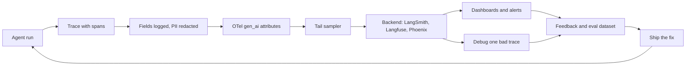
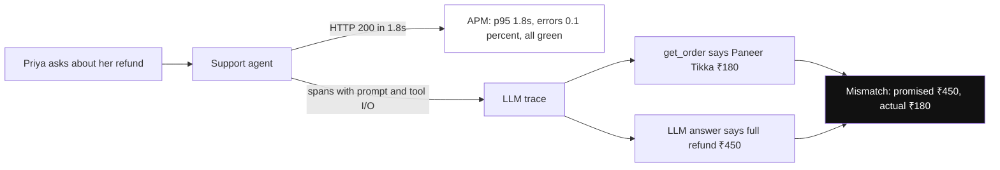
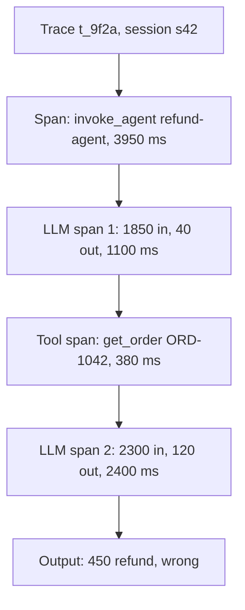
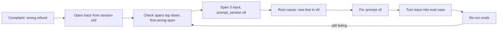
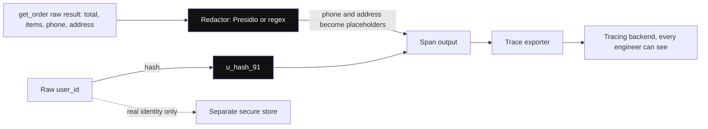
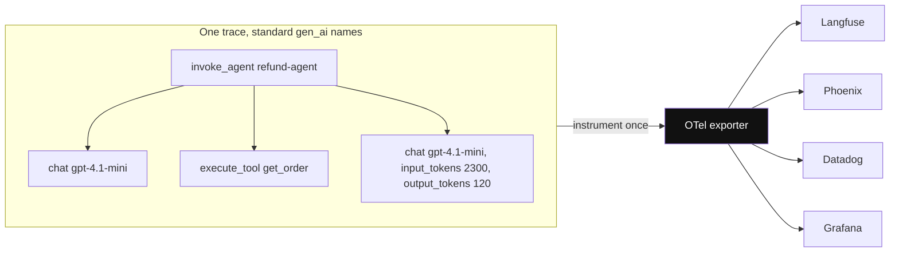
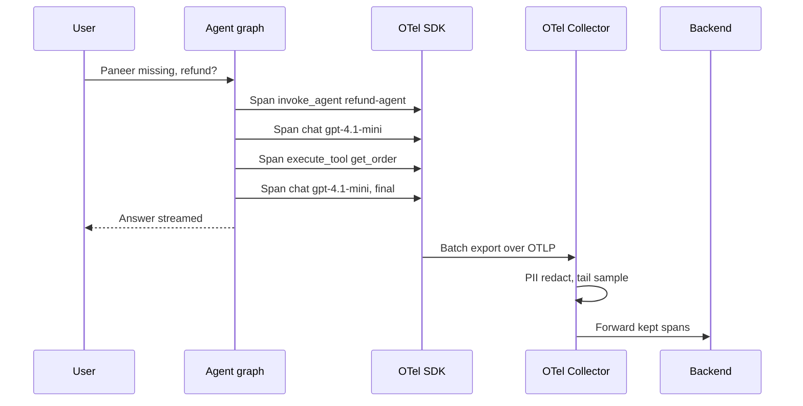
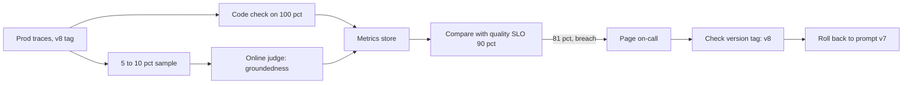
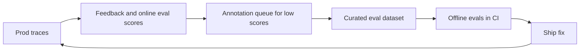
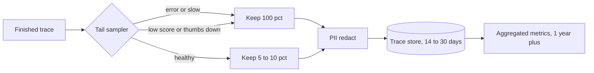

# AI Observability

AI observability means recording every LLM call and tool call inside an agent, so that later you can tell **what happened, why, how much it cost and how long it took**. When an agent gives a wrong answer, there is no 500 error. A wrong refund hides inside an HTTP 200. Interviewers ask: "how will you debug an agent", "what will you log", "what are the OpenTelemetry GenAI conventions", "how will you monitor quality in prod".

**After this page you can explain:**

- How to start from one user complaint ("the bot gave the wrong refund"), open the trace and reach the root cause.
- What traces, spans and runs are, on a real trace tree.
- What to log and what to redact on each span, and what the OTel `gen_ai.*` attributes are.
- The tracing code for LangSmith, Langfuse and plain OpenTelemetry.
- How to design prod dashboards, alerts, the feedback loop and a sampling policy.

## Words you need first

New to LLMs? Read [How LLMs Work](14-how-llms-work.md) first. It explains tokens, context windows and how a model generates text.

| Word | Plain meaning |
|---|---|
| tool call | The model asking your code to run a function, like `get_order`, with arguments it picked. |
| OpenTelemetry (OTel) | An open standard and set of libraries for recording traces, metrics and logs from any service. |
| Trace | The full record of one agent run, from user message to final answer, with every step inside. |
| Span | One timed step inside a trace, like one LLM call or one tool call. |
| PII | Personally Identifiable Information: phone, email, address, ID numbers, anything that points to a real person. |
| Eval dataset | Saved inputs with expected answers, re-run after every change to catch things that broke. |
| APM | Application Performance Monitoring: tools like Datadog that track a service's speed, errors and uptime. |
| Hallucination | The model confidently states something false or made up, like an order ID that never existed. |
| LLM judge | A second model call that grades an answer, for example checking it follows the refund policy. |
| System prompt | Fixed instructions your app sends to the model before every user message, like the refund policy. |
| Prompt version | A label like `refund-v8` saying which edit of the system prompt was live for a request. |
| Retriever | The step that searches a document store and adds matching text to the prompt (this is RAG). |
| MCP / A2A | Protocols that let an agent call outside tools (MCP) or hand work to other agents (A2A). |
| TTFT | Time To First Token: how long until the first word of the answer reaches the user. |

## Big picture: the whole page at a glance

Think of the agent as a flight. A flight's **black box** records every second: speed, altitude, the pilots' voices. After a crash, the investigator opens the black box and goes second by second to find where things went wrong. For an agent, that black box is the **trace**. Every agent run creates one trace. Inside it, every LLM call and tool call is a **span**. We log the useful fields on each span (with PII removed), use standard names (`gen_ai.*`), and send everything to a backend (LangSmith, Langfuse, Phoenix). From there we do two things: debug one bad run, and watch all traffic on dashboards. Bad runs go into an eval dataset, a fix ships, and the loop runs again.



Each section below is one box in this chain. One example runs through the whole page: a Swiggy refund agent that quoted the wrong refund.

## ⭐ Why LLM/agent observability differs from APM

**Why do we need this?** Look at the Swiggy support agent's Datadog APM dashboard: p95 1.8s, error rate 0.1%, all green. Still, a customer, Priya, complains: "the bot said I'd get ₹450, I only got ₹180". APM never saw this mistake, because the request returned HTTP 200. In 6% of conversations the agent is quoting the wrong refund.

**Analogy:** a restaurant's kitchen screen. It tells you every order went out in 12 minutes (APM: the system runs and is fast). It does not tell you whether the plate had the right dish. For that you need the order slip and a photo of the plate at every station (LLM observability: was the answer correct).

| Kitchen | Agent |
|---|---|
| order went out in 12 min | latency, status code (APM) |
| wrong dish on the plate | wrong answer, with HTTP 200 |
| slip and photo at every station | prompt, tool input, output on every span |



*Diagram:* The same request seen two ways: APM (dimmed) only sees a fast HTTP 200, while the trace shows the tool said ₹180 and the model promised ₹450.

**In one line:** APM tells you the service is up and fast; LLM observability tells you **whether the answer was right**, because failures are silent, semantic and non-deterministic.

| | Traditional APM | LLM/agent observability |
|---|---|---|
| Failure type | exception, 5xx, timeout | wrong answer, hallucination, wrong tool, loop (all HTTP 200) |
| Key data | latency, errors, CPU | prompt, completion, tokens, cost, tool I/O, eval scores |
| Determinism | same input → same path | same input → different path and output |
| Cost | infra cost mostly fixed | variable ₹ per request (tokens) |
| How you know it is "correct" | status code | evals, user feedback, judges |
| Payload size | small spans | big prompts (10k+ tokens), PII risk |

- The agent's **control flow is decided by the LLM at runtime**. You cannot learn the path by reading the code. The trace is the source of truth.
- Observability does four jobs: debugging, cost tracking, quality monitoring, and feeding eval datasets.

**Interview tip:** "APM tells me 'is the system running', LLM observability tells me 'is the system doing the right thing'. I need both, and I link them with the trace ID."

**Common mistake:** building only latency and error-rate dashboards and assuming the agent is healthy.

## ⭐ Traces, spans and runs

**Why do we need this?** Priya's complaint has arrived. Now you need to see, for that one request, what the agent thought, which tool it called, what the tool returned, and where the final answer went wrong. If each step is a separate log line scattered around, joining them is hard. A trace joins all steps into one tree.

**Analogy:** courier tracking (Delhivery, Blue Dart). One parcel has one **AWB number**. That number shows the full timeline: picked up, Delhi hub, Mumbai hub, out for delivery. Each event has a time.

| Courier | Agent tracing |
|---|---|
| AWB number | `trace_id` |
| full timeline | trace |
| each hub scan (with time) | span |
| sorting, loading inside a hub | child spans |
| all parcels of one customer | session / thread |

**Example step by step:** the real trace of Priya's request. The agent made 2 LLM calls and 1 tool call.

1. The agent run starts. The root span is created: `invoke_agent refund-agent`.
2. **LLM call 1:** the model gets the system prompt + Priya's message (1,850 tokens). The model decides it needs the order and returns a `get_order` tool call (40 tokens). Time 1,100 ms.
3. **Tool call:** `get_order("ORD-1042")` runs. Result: order total ₹450, Paneer Tikka ₹180 "missing". Time 380 ms.
4. **LLM call 2:** the model gets the system prompt + history + tool result (2,300 tokens). The model writes the final answer (120 tokens): "you will get a full refund of ₹450". Time 2,400 ms.
5. The run ends. Total 3,950 ms. Status OK.

In the tracing UI, the same tree looks like this:

```text
TRACE t_9f2a   session s42   user u_hash_91   prompt_version refund-v8
status OK   total 3,950 ms   tokens 4,150 in / 160 out   cost ~$0.002 (illustrative)

invoke_agent refund-agent                                   3,950 ms
├── [1] chat gpt-4.1-mini                1,100 ms   in 1,850   out 40
│       input : system prompt (refund-v8) + "Paneer Tikka was missing, refund?"
│       output: tool_call get_order(order_id="ORD-1042")
├── [2] execute_tool get_order              380 ms
│       input : {"order_id": "ORD-1042"}
│       output: {"total": 450, "items": [{"name": "Paneer Tikka",
│                "price": 180, "status": "missing"}, ...]}
└── [3] chat gpt-4.1-mini                2,400 ms   in 2,300   out 120
        input : system prompt (refund-v8) + history + get_order result
        output: "You will get a full refund of ₹450."     <-- wrong
```

Each line is a span. Indentation shows what sits inside what. Spans 1, 2 and 3 are all children of the root span.



The diagram shows things in the order they happened: the run, then LLM call 1, then the tool, then LLM call 2, then the answer.

**Now the terms:**

- **Trace:** the full record of one user request, identified by a `trace_id`. Above, `t_9f2a`.
- **Span:** one step inside a trace, with a start time, end time and parent. Above, three child spans.
- **Run:** LangSmith calls a span a "run". Langfuse calls it an "observation". Same idea.
- **Session / thread:** a group of traces from one chat. Above, `s42`. In multi-turn chat, link traces with this id.
- **Span types:** LLM/generation, tool, retriever, embedding, chain/agent node, guardrail, evaluator.
- **Every span has:** start/end time, parent id, input, output, status, attributes (model, tokens).
- **Distributed context:** when the agent calls another service (MCP server, A2A agent), pass the W3C `traceparent` header along (a standard HTTP header that carries the trace id). Then that service's spans join the same trace.

**Interview tip:** "In a trace tree I look at three things: the longest span, the most expensive span, and the first span where the output went wrong."

**Common mistake:** making every LLM call its own trace. Then you cannot piece together the flow of a full agent run.

## ⭐ Debugging agent failures from traces

**Why do we need this?** Without traces, people see a wrong answer and change the prompt straight away. Often the mistake is somewhere else: a tool returned bad data, or the retriever fetched an old doc. With a trace you do not guess, you look.

**Analogy:** a doctor's diagnosis. A doctor does not prescribe medicine just from a fever. They read the blood test and X-ray one by one, and the first report that looks wrong is where the illness is. The spans of a trace are those reports.

**Example step by step:** from Priya's complaint to the root cause.

1. **Find the trace.** The complaint ticket has the chat's `session_id = s42`. Open that session's trace in the tracing UI: `t_9f2a`. (This is why logging the session id matters.)
2. **Look at the top level.** Status OK, 3,950 ms, no error. So this is a "silent" failure. APM would never catch it.
3. **Check span 1.** Output: `get_order(order_id="ORD-1042")`. That was Priya's order. Correct.
4. **Check span 2.** Tool output: Paneer Tikka ₹180, status missing, total ₹450. The data is correct.
5. **Check span 3.** Output: "full refund of ₹450". Policy says refund only the missing item, so ₹180. **This is the first wrong span.**
6. **Read span 3's input.** The tool result arrived correctly. So the mistake must be in the prompt. The trace is tagged `prompt_version = refund-v8`. v8 replaced v7 yesterday.
7. **Diff v7 and v8.** v8 added a new line: "If an item is missing, refund the whole order to keep the customer happy." That is the root cause.
8. **Confirm.** Filter traces by `prompt_version = refund-v8` on the dashboard. The average refund amount went up 2.3x after yesterday's deploy. Confirmed.
9. **Fix and lock it in.** Remove the line (v9). "Add to dataset" trace `t_9f2a` with the expected answer ₹180. Run evals, ship if they pass.

The key lesson: the spans above (1 and 2) were correct, so the bug had to be in span 3. Without the prompt version tag, finding the root cause would have taken days.



Debugging starts at the first span whose output was wrong. Every fixed trace becomes an eval case, so the same bug does not come back.

**Trace signals of common failures:** every failure has a telltale signal in the trace. Spot the signal, find the root cause, apply a targeted fix.

> **Example:** a Flipkart returns agent sometimes takes 40 seconds. The trace shows `search_orders` called 14 times with the same args. That is a loop: the tool returns "no results" and the agent keeps retrying.

| Symptom | Trace signal | Fix |
|---|---|---|
| Infinite loop / very slow | same tool + same args repeat, high step count | max steps / recursion limit, better tool error message, loop detector |
| Wrong tool | wrong tool choice in router/LLM span, similar tool descriptions | clearer tool descriptions, fewer tools, few-shot |
| Hallucinated args | tool args contain an ID that never appeared in any earlier output | validate args schema, take IDs only from state, enums/constraints |
| Context overflow | input tokens near the limit, `finish_reason=length`, old info forgotten | summarization, trim history, truncate tool output |
| Slow step | one span's latency far above the rest | cache, parallel tool calls, smaller model, timeout |
| Wrong answer, right tools | irrelevant docs in the retriever span | fix retrieval, reranker, query rewrite |
| Random failures | tool span errors, retries, 429 | backoff, fallback model, circuit breaker |
| Cost spike | input tokens per trace went up | prompt diff (version tag), history growth, cache hit rate |

**Now the terms:**

- **Silent failure:** a failure with no error or exception, only a wrong answer.
- **Eval case:** a saved input + expected output that is re-tested on every change. In LangSmith/Langfuse, "add to dataset" from a trace.
- **Replay / time-travel:** re-running a failed state from a LangGraph checkpoint (a saved snapshot of the agent's state after each step), changing the prompt and comparing.

**Interview tip:** "My first debugging question: which was the first span where the output went wrong? Everything above it was fine, so the bug is there."

**Common mistake:** changing the prompt after looking only at the final answer, without checking the trace to see that the mistake was in retrieval or a tool.

## What to log, what to redact

**Why do we need this?** The debugging above only worked because the spans logged the input, output and `prompt_version`. But the full `get_order` result also holds Priya's phone number and home address. If that goes into the tracing tool, every engineer can see it. So: log what you need, and remove private data first.

**Analogy:** handing a hospital case file to a research team. The illness, medicines and test results all go (needed for the work). The name, phone and Aadhaar are blacked out with a marker.

**Example step by step:** span 2 (`get_order`) output before it reaches the trace.

1. Raw tool result: `{"order_id": "ORD-1042", "total": 450, "phone": "98xxxxxx21", "address": "Flat 302, Andheri", "items": [...]}`.
2. A redaction step (Presidio, Microsoft's open-source PII detector, or regex) runs before the exporter. It catches the phone and address.
3. What reaches the trace: `{"order_id": "ORD-1042", "total": 450, "phone": "<PHONE>", "address": "<ADDRESS>", "items": [...]}`.
4. Everything needed for debugging (total, items, price, status) is still there. The private data never left.
5. The `user_id` was not sent raw either, only a hash: `u_hash_91`. The real identity lives in a separate secure store.



*Diagram:* Redaction and hashing (highlighted) sit before the exporter, so only placeholders and a hashed user id ever reach the tracing backend; the real identity lives in a separate store.

**What to log:**

| Field | Why |
|---|---|
| Prompt (system + messages) and completion | debugging, eval dataset |
| Model name and params (temperature, max_tokens) | reproducing the call |
| Prompt version / template id | which change caused a regression (the v8 bug above) |
| Token usage: input, output, cached, reasoning | cost and context overflow |
| Cost (₹/$) | per-user, per-feature budgets |
| Latency: total, TTFT, per span | finding the slow step |
| Tool name, args, result, error | wrong tool or hallucinated args |
| Retrieved doc ids and scores | RAG failures |
| Errors, retries, finish_reason | truncation (`length`), content filter |
| User feedback, session id, user id (hashed) | quality and grouping |
| App version, git sha, environment | comparing rollouts |

**What to redact:**

- Phone, email, PAN/Aadhaar, card, addresses, API keys, auth tokens, passwords.
- Put Presidio or regex **before the trace exporter**, not after.
- LangSmith has `hide_inputs`/`hide_outputs` hooks and Langfuse has a masking function: they clean the data before the trace is sent.
- Hash the user id. Keep the raw identity in a separate secure store.

**Now the terms:**

- **Redaction:** replacing a sensitive value with a placeholder (`<PHONE>`).
- **PII:** Personally Identifiable Information, data that can identify a person.
- **Exporter:** the part of the SDK that sends spans to the backend.

**Interview tip:** "Prompt version and model version are tagged on every trace, otherwise you never find the root cause of 'quality dropped since yesterday'."

**Common mistake:** sending the full customer record (address, phone) from tool results to the tracing tool as-is.

## ⭐ OpenTelemetry GenAI semantic conventions and OpenInference

**Why do we need this?** Team A calls the token count `tokens_in`, Team B `input_tokens`, Team C `prompt_tok`. Now try to build one dashboard that adds up all three teams' cost. Impossible. And if you move from Langfuse to Datadog tomorrow, you rewrite all the instrumentation.

**Analogy:** a GST invoice. Every shop's bill looks different, but every bill has the same fields: GSTIN, HSN code, taxable amount, tax. That is why any accounting software (Tally, Zoho) can read any bill.

| GST | OTel GenAI |
|---|---|
| fixed field names (GSTIN, HSN) | fixed attribute names (`gen_ai.*`) |
| any shop | any framework (LangGraph, plain SDK) |
| any accounting software | any backend (Langfuse, Phoenix, Datadog, Grafana) |

**Example step by step:** span 3 (LLM call 2) of Priya's trace, with OTel GenAI attributes.

1. The span name follows the convention: `chat gpt-4.1-mini` (operation + model).
2. These attributes are set on the span:

| Attribute | Value on span 3 | Meaning |
|---|---|---|
| `gen_ai.operation.name` | `chat` | what kind of call |
| `gen_ai.provider.name` | `openai` | which provider |
| `gen_ai.request.model` | `gpt-4.1-mini` | model asked for |
| `gen_ai.response.model` | `gpt-4.1-mini-2025-04-14` | model that actually ran |
| `gen_ai.request.temperature` | `0.2` | randomness |
| `gen_ai.request.max_tokens` | `1024` | output limit |
| `gen_ai.usage.input_tokens` | `2300` | input tokens |
| `gen_ai.usage.output_tokens` | `120` | output tokens |
| `gen_ai.response.finish_reasons` | `["stop"]` | ended normally, not truncated |
| `gen_ai.agent.name` | `refund-agent` | which agent |
| `gen_ai.conversation.id` | `s42` | which chat |

3. Any backend, whether Langfuse, Phoenix or Datadog, understands these names. Cost and token dashboards build themselves.
4. Span 2 (the tool) gets `gen_ai.operation.name = execute_tool`, `gen_ai.tool.name = get_order`, `gen_ai.tool.call.id = call_abc`. The root span gets `invoke_agent`.



*Diagram:* Spans are named by the convention (invoke_agent, chat, execute_tool), so moving from Langfuse to Datadog is only a change at the exporter (highlighted).

**In one line:** the OTel GenAI conventions define standard attribute names (`gen_ai.*`) for LLM/agent spans, so any backend understands the same data. OpenInference is Arize's similar convention.

**Other key points:**

- **Why:** less vendor lock-in. Instrument once with OTel, export to Langfuse, Phoenix, Datadog, Grafana or anywhere.
- Values of `gen_ai.operation.name`: `chat`, `embeddings`, `execute_tool`, `invoke_agent`.
- `gen_ai.provider.name` used to be `gen_ai.system`. Values: `openai`, `anthropic`, `aws.bedrock`.
- `finish_reasons = ["length"]` means the output was cut off (max_tokens ran out).
- Span naming: `chat gpt-4.1-mini`, `execute_tool get_order`, `invoke_agent refund-agent`.
- Metrics are defined too: `gen_ai.client.token.usage`, `gen_ai.client.operation.duration`.
- **Message content is not captured by default** (privacy). You opt in with `OTEL_INSTRUMENTATION_GENAI_CAPTURE_MESSAGE_CONTENT=true`.
- The conventions are still in "development" status. Attribute names can change, so pin instrumentation library versions.
- **OpenInference:** `openinference.span.kind` = LLM, CHAIN, TOOL, RETRIEVER, AGENT, EMBEDDING, RERANKER, GUARDRAIL. Attributes like `llm.model_name`, `llm.token_count.prompt`, `input.value`. Phoenix uses it natively. Auto-instrumentors exist for LangChain, LlamaIndex and OpenAI.

**Now the terms:**

- **Semantic convention:** agreed attribute names and their meaning, shared by everyone.
- **Attribute:** a key-value pair on a span, like `gen_ai.usage.input_tokens = 2300`.
- **Instrumentation:** the code that creates spans (automatic or manual).

**Interview tip:** "I instrument on the OTel GenAI conventions so that changing the backend is only an exporter config change."

**Common mistake:** every team using its own custom attribute names (`model`, `tokens_in`). Then a cross-service dashboard is impossible.

## Instrumentation code

**Why do we need this?** The trace above does not appear by itself. Some code has to open and close a span around every LLM call and tool call. The good news: framework callbacks do most of this for free.

**Analogy:** installing CCTV. The builder already put cameras at the main gate and lobby (framework auto-tracing). In your own storeroom, you install the camera yourself (a manual span on a custom tool).

**Example step by step:** how Priya's trace was created.

1. Tracing env vars were set at app start. LangGraph's `graph.invoke` creates the root span (`invoke_agent`) and the LLM spans (spans 1 and 3) by itself.
2. `get_order` is our custom function. It had `@traceable` (or an OTel span) on it, so span 2 was created.
3. The `invoke` config passed user id, session id and tags. They became metadata on the trace.
4. The SDK buffered spans in memory and sent them to the backend in background batches. Priya did not wait for any of it.

**1. LangSmith: env vars + `@traceable`.** The env vars trace the whole LangGraph run. `@traceable` makes our custom function a child in that trace.

```python
# export LANGSMITH_TRACING=true                 # turn tracing on
# export LANGSMITH_API_KEY=lsv2_...
# export LANGSMITH_PROJECT=swiggy-support-prod   # traces go to this project
from langsmith import traceable

# run_type sets the span type: "llm", "tool", "retriever", "chain"
@traceable(run_type="tool", name="get_order",
           metadata={"prompt_version": "refund-v8"})   # version tag on every trace
def get_order(order_id: str) -> dict:
    return orders_db.fetch(order_id)                   # this becomes span 2

# graph.invoke is traced automatically via env vars (root + LLM spans).
# get_order becomes a child run inside that trace.
result = graph.invoke(
    {"messages": [("user", "Paneer Tikka was missing, refund?")]},
    config={"metadata": {"user_id": "u_hash_91", "session_id": "s42"},
            "tags": ["prod", "v2.3.1"]},               # for filtering
)
```

**What the code does:**

- Three env vars turn tracing on. No change to the LangGraph code.
- `@traceable(run_type="tool")` records the function's input and output as a tool span.
- `metadata` carries `prompt_version`, which is why v8 showed up in debugging step 6.
- `config.metadata` and `tags` are attached to the trace. You use them in the UI to filter by "session s42" or "prod".

**2. Langfuse: LangGraph callback handler.** Langfuse watches every node, LLM call and tool call through a LangChain callback.

```python
# env: LANGFUSE_PUBLIC_KEY, LANGFUSE_SECRET_KEY, LANGFUSE_BASE_URL
from langfuse import propagate_attributes
from langfuse.langchain import CallbackHandler

handler = CallbackHandler()          # listens to LangGraph events, creates spans

# every span created inside this block gets the user, session and tags
with propagate_attributes(user_id="u_hash_91", session_id="s42",
                          tags=["refund-agent", "prod"]):
    graph.invoke(
        {"messages": [("user", "Paneer Tikka was missing, refund?")]},
        config={"callbacks": [handler],      # attach the handler to this run
                "run_name": "refund-turn"},  # name of the trace
    )
```

**What the code does:**

- `CallbackHandler` catches an event at every LangGraph step (node start/end, LLM call, tool call).
- `config={"callbacks": [handler]}` attaches the handler to this run.
- Inside the `propagate_attributes` block, every span gets the user, session and tags automatically.
- `run_name` makes the trace easy to spot in the UI.

**3. Plain OpenTelemetry span around a tool.** When there is no framework, or you want to set the OTel GenAI attributes yourself, open the span by hand.

```python
from opentelemetry import trace
from opentelemetry.trace import Status, StatusCode

tracer = trace.get_tracer("refund-agent")

def get_order(order_id: str) -> dict:
    # the "with" block is the span's life: block start = start time, end = end time
    with tracer.start_as_current_span("execute_tool get_order") as span:
        span.set_attribute("gen_ai.operation.name", "execute_tool")  # standard name
        span.set_attribute("gen_ai.tool.name", "get_order")
        span.set_attribute("app.order_id", order_id)        # your own business field
        try:
            order = orders_api.fetch(order_id)                # real call
            span.set_attribute("app.item_count", len(order["items"]))
            return order
        except Exception as e:
            span.record_exception(e)                          # error shows in the trace
            span.set_status(Status(StatusCode.ERROR, str(e)))
            raise
```

**What the code does:**

- `get_tracer` gives a tracer. `start_as_current_span` opens a span and makes it "current", so spans created inside become its children.
- `gen_ai.*` attributes are the standard names. `app.*` is for your own business fields.
- On success, a useful attribute like the item count is set.
- On error, `record_exception` and an `ERROR` status. This span shows up red in the trace UI.

**Two setup points:**

- Configure the exporter (OTLP) and `TracerProvider` (the object that creates tracers and knows where to send spans) at app startup. Langfuse and Phoenix both accept an OTLP endpoint.
- In short-lived jobs (Lambda, scripts), **flush** at the end, or spans get lost.



While the request runs, every node and tool emits a span. The SDK exports them in background batches, so the user never waits for tracing.

**Now the terms:**

- **Auto-instrumentation:** a framework callback that creates spans without code changes.
- **Manual span:** one you wrote yourself with `with tracer.start_as_current_span(...)`.
- **OTLP:** OpenTelemetry's wire protocol for sending spans.
- **Collector:** a middle service that receives spans, redacts/samples them and forwards them.
- **Flush:** sending buffered spans right away.

**Interview tip:** "Framework callbacks give 80% coverage for free. For the rest, custom tools and business steps, I add manual spans."

**Common mistake:** running tracing in synchronous blocking mode. If the tracing backend is slow, the agent is slow too. SDKs batch in the background; use that.

## Tools table

**Why do we need this?** Interviews ask "which tool would you use and why". Each tool has a different strength. A wrong choice breaks either data residency or the team's workflow.

**Analogy:** choosing a CCTV vendor. Some record to the cloud, some to your own server. Some are just a gate camera (proxy), some cover every room (full tracing).

| Tool | Type | Strength | Watch out |
|---|---|---|---|
| LangSmith | hosted (self-host for enterprise) | LangGraph native, datasets, evals, annotation queues, online evaluators | centred on the LangChain ecosystem |
| Langfuse | open source, self-host or cloud | OTel based, tracing + prompt mgmt + evals + cost | self-host ops (ClickHouse, Postgres) |
| Arize Phoenix | open source | OpenInference/OTel, evals, runs locally in notebooks | Arize AX for prod scale |
| Helicone | proxy/gateway based | one-line integration, caching, cost tracking | proxy = extra hop, less visibility into agent internals |
| Datadog LLM Observability | hosted APM add-on | APM + infra + LLM traces in one place | expensive, limited eval features |
| W&B Weave | hosted | `@weave.op` tracing, evals, experiments | W&B ecosystem |

**How to choose, in one line each:**

- Data must stay in India, need self-host → Langfuse or Phoenix.
- Team is LangGraph-heavy → LangSmith.
- Company already runs on Datadog → Datadog LLM Obs + an eval tool.
- Only want cost, no code changes → a proxy like Helicone.

**Interview tip:** "For self-hosting and data residency, Langfuse or Phoenix. For a LangGraph-heavy team, LangSmith. In an existing Datadog shop, Datadog LLM Obs + an eval tool."

**Common mistake:** running two or three tools in parallel and none of them having a complete trace.

## Production monitoring

**Why do we need this?** We caught the bug from Priya's complaint. But by then v8 had been live for a day and had quoted wrong refunds to thousands of people. Monitoring's job is to catch the bug **before the complaint**.

**Analogy:** the warning lights on a car dashboard. You do not open the engine every second. You stop when the engine-temperature or oil light comes on. Dashboards and alerts are the agent's warning lights.

**Example step by step:** how monitoring would have caught the v8 bug.

1. At 14:00, prompt `refund-v8` was deployed. Every trace got this version tag.
2. A cheap code check ran on every trace: "refund amount <= total of missing items?" After v8, 6% of traces fail.
3. An online LLM judge ran on 5–10% of traces: "is the answer grounded in the policy?" The pass rate fell from 93% to 81%.
4. Both numbers went to the metrics store. The quality SLO is 90%. Breach at 15:00.
5. On-call got paged. The alert itself said: the drop is on `prompt_version = refund-v8`.
6. On-call rolled back to v7. The pass rate went back to 93%. The bug lasted 1 hour, not a day.



Cheap code checks run on every trace, the expensive judge only on a sample. Both feed one metric. On a breach, on-call is paged, reads the version tag and rolls back.

**What to put on dashboards:**

- Cost and tokens: per day, per feature, per user tier, per model.
- Latency: p50/p95/p99, TTFT, per node.
- Error rate, tool failure rate, retry rate, guardrail block rate.
- Steps per run, escalation-to-human rate, feedback rate.

> **Example:** a Razorpay merchant agent's dashboard: cost per conversation ₹1.8, p95 6s, tool failure rate 0.7%, online groundedness pass 93%.

**Online evaluators:** a reference-free judge (groundedness, policy, task success) on 5–10% of sampled traces. Cheap code checks on 100% of traces.

**Drift and degradation alerts:**

- Input drift: new intents, language mix, query length (from embedding clusters, i.e. grouping queries by meaning).
- Quality drop: judge pass rate, thumbs-down rate, escalation rate crossing a threshold.
- Provider side: model version change, latency spikes, 429s.
- Link alerts to **versions** (drop after prompt v8 deploy) so the rollback decision is fast.

**Now the terms:**

- **Online evaluator:** an eval that runs on prod traffic, without an expected answer (reference-free).
- **Quality SLO:** a target for quality, like "groundedness pass rate above 90%".
- **Drift:** the pattern of inputs or outputs changing over time.

**Interview tip:** "I treat quality like an SLO: if the groundedness pass rate drops below 90%, page someone, just like latency."

**Common mistake:** running an LLM judge on 100% of traffic. The eval cost ends up higher than the agent cost.

## Feedback collection and closing the loop

**Why do we need this?** Priya pressed thumbs-down. If that click is not linked to a trace, it is just a number: "120 thumbs-down today". On which answer, and why, you do not know. Link feedback to the trace and it becomes raw material for improvement.

**Analogy:** a restaurant feedback card stapled to the bill number. Using the bill number, the manager can see which dish, which chef, what time. Without the bill number, the card only says "the food was not good".

**Example step by step:**

1. Priya pressed thumbs-down on the answer. The app sent the feedback with `trace_id = t_9f2a` (LangSmith `create_feedback`, Langfuse score).
2. Low-score traces went into the **annotation queue** automatically.
3. An expert from the support team looked at the trace and labelled it: "wrong refund amount, expected ₹180".
4. This trace + label became a new example in the **eval dataset**.
5. Now this dataset runs in CI on every prompt PR. If a future v10 says ₹450 again, the PR fails.
6. The fix ships. New prod traces arrive. The loop keeps running.



**Types of feedback:**

- **Explicit feedback:** thumbs up/down, rating, comment. Store it with the trace/run id.
- **Implicit signals:** the user rephrased, asked for "a human", left the chat, copied the answer, or complained later.
- **Annotation queues:** domain experts label low-score traces. These labels also help calibrate the LLM judge.
- Every reviewed failure → dataset example → CI eval. Details: [Evals for Agents](09-agent-evals.md).

**Now the terms:**

- **Annotation queue:** a list of traces for humans to review and label.
- **Calibration:** checking how well the LLM judge's scores match human labels.

**Interview tip:** "The real ROI of observability comes when traces become eval datasets. Otherwise they are just expensive logs."

**Common mistake:** collecting feedback but not linking it to the trace id. Then you never know which response got the thumbs-down.

## Sampling and data-retention / PII policy

**Why do we need this?** Swiggy has 1 lakh refund chats a day. Each trace has a 4k+ token prompt. Keep everything and the storage bill is huge, and that much PII in one place is a compliance risk. Throw everything away and you lose traces like Priya's too.

**Analogy:** airport security. Every flagged bag (alarm went off) is always opened. Some of the other bags are checked at random. **Head sampling** = tossing a coin at the gate, without looking at the bag. **Tail sampling** = deciding after the X-ray, when you know what is inside.

**Example step by step:** a tail sampler on one day's 1,00,000 traces.

1. After each trace finishes, the sampler looks at its result.
2. 500 traces had an error → keep all (500).
3. 1,200 traces were slow (above p99) → keep all (1,200).
4. 800 traces had thumbs-down or a low judge score (Priya's too) → keep all (800).
5. The remaining 97,500 healthy traces → keep 5% (4,875).
6. Total kept: 7,375, about 7.4%. Storage is ~13x smaller, yet every interesting trace survived.
7. PII redaction runs on all of them before storage. Full traces are deleted after 30 days, aggregated metrics kept for 1 year.



The sampler decides after the trace finishes. So every interesting trace survives, healthy traffic is thinned out, and everything is redacted before storage.

**Now the terms and the policy:**

- **Head sampling:** decide at request start (e.g. 10%). Simple, but rare errors get missed.
- **Tail sampling:** decide after the request finishes. Keep 100% of errors, high latency, low eval scores, thumbs-down; keep 5–10% of the rest. The OTel Collector's tail sampling processor does this.
- **SDK settings:** LangSmith `LANGSMITH_TRACING_SAMPLING_RATE`, Langfuse `LANGFUSE_SAMPLE_RATE` (or `sample_rate`).
- **Retention:** full-payload traces 14–30 days, aggregated metrics 1 year+, eval datasets (redacted) long-term.
- **PII policy:** redaction before export, data residency (data in India for DPDP/RBI), access control on the trace UI, support for deletion requests, encryption.
- In sensitive flows (payments, health), do not log prompt content at all, only metadata and hashes.

**Interview tip:** "I keep 100% of errors and bad scores, and sample healthy traffic. That keeps cost under control and still gives me debugging data."

**Common mistake:** keeping 100% of traces with full prompts in prod and no retention policy. You get both a big storage bill and compliance risk.

## Read next

- [Evals for Agents](09-agent-evals.md): datasets and CI gates from traces.
- [Cost & Latency](11-cost-latency.md): how to bring the dashboard numbers down.
- [Agents in Production](12-agents-in-production.md): rollouts, alerts, incidents.
- [Reliability & Observability (HLD)](../01-topics/20-reliability-observability.md): general logs, metrics, traces basics.
- [Production agent lab](/viewinter/agents/labs/prod)

## Checklist

- [ ] I can explain why LLM observability differs from traditional APM, with a table
- [ ] I can draw the trace and span tree of one agent run (LLM call, tool call, LLM call)
- [ ] I can explain what to log on each span and what to redact
- [ ] I can explain the OTel GenAI `gen_ai.*` attributes using one span as an example, and OpenInference
- [ ] I can write code for LangSmith `@traceable`, the Langfuse callback and a plain OTel span
- [ ] I can debug a wrong answer, loops, wrong tools, hallucinated args and context overflow from trace signals
- [ ] I can design production dashboards, online evaluators and drift alerts
- [ ] I can explain the loop from feedback to datasets and the sampling/retention/PII policy
