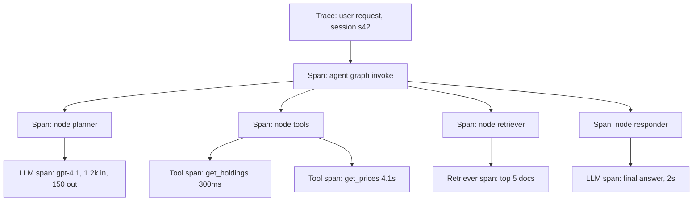
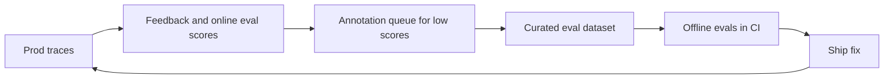

# AI Observability

AI observability means tracing every LLM call, tool call and retrieval inside an agent, so you know **what happened, why, what it cost and how long it took**. When an agent gives a wrong answer in prod there is no 500 error; a wrong refund hides inside an HTTP 200. Interviewers ask: "how will you debug the agent", "what will you log", "what are the OpenTelemetry GenAI conventions", "how do you monitor quality in prod".

## ⭐ Why LLM/agent observability differs from APM

**In one line:** APM tells you the service is up and fast; LLM observability tells you **whether the answer was right**, because failures are silent, semantic and non-deterministic.

> **Example:** a Swiggy support agent. Datadog APM: p95 1.8s, error rate 0.1%, all green. But in 6% of conversations the agent suggests a refund for the wrong order. You can only catch this by looking at the trace's prompt, tool args and output.

| | Traditional APM | LLM/agent observability |
|---|---|---|
| Failure type | exception, 5xx, timeout | wrong answer, hallucination, wrong tool, loop (all HTTP 200) |
| Key data | latency, errors, CPU | prompt, completion, tokens, cost, tool I/O, eval scores |
| Determinism | same input → same path | same input → different path and output |
| Cost | infra cost mostly fixed | variable ₹ per request (tokens) |
| How you know it is "correct" | status code | evals, user feedback, judges |
| Payload size | small spans | large prompts (10k+ tokens), PII risk |

- The agent's **control flow is decided by the LLM at runtime**, so you cannot know the path by reading code; the trace is the source of truth.
- Observability = debugging + cost tracking + quality monitoring + the source of eval datasets.

**Interview tip:** "APM tells me 'is the system running', LLM observability tells me 'is the system working correctly'. I need both, and I join them by trace ID."

**Common mistake:** building only a latency and error-rate dashboard and assuming the agent is healthy.

## ⭐ Traces, spans and runs

**In one line:** one user request = one **trace**; inside it every step (agent node, LLM call, tool call, retriever) is a nested **span** (a "run" in LangSmith, an "observation" in Langfuse).

> **Example:** Zerodha's "why did my portfolio P&L drop?" agent. The trace tree shows: planner LLM 1.2s, `get_holdings` 300ms, `get_prices` 4.1s (slow!), final LLM 2s.



- **Trace:** the whole request, identified by trace_id. In multi-turn chat, group traces by **session/thread id**.
- **Span types:** LLM/generation, tool, retriever, embedding, chain/agent node, guardrail, evaluator.
- Each span: start/end time, parent id, input, output, status, attributes (model, tokens).
- **Distributed context:** when the agent calls another service (MCP server, A2A agent), propagate the W3C `traceparent` header so it stays one trace.

**Interview tip:** "In a trace tree I look for three things: the longest span, the most expensive span, and the first span where the output went wrong."

**Common mistake:** making every LLM call its own trace; then you can never stitch together the flow of a full agent run.

## What to log, what to redact

**In one line:** log enough context on every span for debugging and cost, but strip PII and secrets before they are logged.

| Field | Why |
|---|---|
| Prompt (system + messages) and completion | debugging, eval dataset |
| Model name and params (temperature, max_tokens) | reproducing |
| Prompt version / template id | which change caused a regression |
| Token usage: input, output, cached, reasoning | cost and context overflow |
| Cost (₹/$) | per-user, per-feature budgets |
| Latency: total, TTFT, per span | finding the slow step |
| Tool name, args, result, error | wrong tool or hallucinated args |
| Retrieved doc ids and scores | RAG failures |
| Errors, retries, finish_reason | truncation (`length`), content filter |
| User feedback, session id, user id (hashed) | quality and grouping |
| App version, git sha, environment | comparing rollouts |

- **Redact:** phone, email, PAN/Aadhaar, card, addresses, API keys, auth tokens, passwords. Apply Presidio or regex before the trace exporter.
- LangSmith has `hide_inputs`/`hide_outputs` hooks and Langfuse has a masking function: clean data before the trace is sent.
- Hash the user id; keep the raw identity in a separate secure store.

**Interview tip:** "Prompt version and model version are tagged on every trace, otherwise you never find the root cause of 'quality dropped since yesterday'."

**Common mistake:** sending the full customer record (address, phone) from tool results to the trace tool as-is.

## ⭐ OpenTelemetry GenAI semantic conventions and OpenInference

**In one line:** the OTel GenAI conventions define standard attribute names (`gen_ai.*`) for LLM/agent spans so any backend understands the same data; OpenInference is Arize's similar convention.

- **Why:** less vendor lock-in. Instrument once with OTel, export anywhere: Langfuse, Phoenix, Datadog, Grafana.
- **Important `gen_ai.*` attributes:**

| Attribute | Example |
|---|---|
| `gen_ai.operation.name` | `chat`, `embeddings`, `execute_tool`, `invoke_agent` |
| `gen_ai.provider.name` (formerly `gen_ai.system`) | `openai`, `anthropic`, `aws.bedrock` |
| `gen_ai.request.model` / `gen_ai.response.model` | `gpt-4.1-mini` |
| `gen_ai.request.temperature`, `gen_ai.request.max_tokens` | `0.2`, `1024` |
| `gen_ai.usage.input_tokens` / `gen_ai.usage.output_tokens` | `1200`, `150` |
| `gen_ai.response.finish_reasons` | `["stop"]`, `["length"]` |
| `gen_ai.agent.name`, `gen_ai.conversation.id` | `refund-agent`, `s42` |
| `gen_ai.tool.name`, `gen_ai.tool.call.id` | `issue_refund`, `call_abc` |

- Span naming: `chat gpt-4.1-mini`, `execute_tool issue_refund`, `invoke_agent refund-agent`.
- Metrics are defined too: `gen_ai.client.token.usage`, `gen_ai.client.operation.duration`.
- **Message content is not captured by default** (privacy); it is opt-in (`OTEL_INSTRUMENTATION_GENAI_CAPTURE_MESSAGE_CONTENT=true`).
- The conventions are still in "development" status; attribute names can change, so pin your instrumentation library versions.
- **OpenInference:** `openinference.span.kind` = LLM, CHAIN, TOOL, RETRIEVER, AGENT, EMBEDDING, RERANKER, GUARDRAIL; attributes like `llm.model_name`, `llm.token_count.prompt`, `input.value`. Phoenix uses it natively; auto-instrumentors exist for LangChain, LlamaIndex, OpenAI.

**Interview tip:** "I instrument on the OTel GenAI conventions so switching backends is only an exporter config change."

**Common mistake:** every team using its own custom attribute names (`model`, `tokens_in`); then a cross-service dashboard is impossible.

## Instrumentation code

**In one line:** for LangGraph, auto-trace with LangSmith env vars and use `@traceable` on custom functions; for Langfuse, a callback handler; for non-LangChain code, a plain OTel span.

**LangSmith: env vars + `@traceable`**

```python
# export LANGSMITH_TRACING=true
# export LANGSMITH_API_KEY=lsv2_...
# export LANGSMITH_PROJECT=swiggy-support-prod
from langsmith import traceable

@traceable(run_type="retriever", name="fetch_order_docs")
def fetch_order_docs(order_id: str) -> list[dict]:
    return [{"page_content": f"Order {order_id} policy...", "type": "Document"}]

@traceable(run_type="tool", metadata={"prompt_version": "refund-v7"})
def issue_refund(order_id: str, amount: float) -> str:
    return "refund_ok"

# LangGraph graph.invoke(...) is traced automatically via the env vars;
# these functions become child runs inside that trace.
result = graph.invoke({"messages": [("user", "Refund ORD1")]},
                      config={"metadata": {"user_id": "u_hash_91"},
                              "tags": ["prod", "v2.3.1"]})
```

**Langfuse: LangGraph callback handler**

```python
# env: LANGFUSE_PUBLIC_KEY, LANGFUSE_SECRET_KEY, LANGFUSE_BASE_URL
from langfuse import propagate_attributes
from langfuse.langchain import CallbackHandler

handler = CallbackHandler()

with propagate_attributes(user_id="u_hash_91", session_id="s42",
                          tags=["refund-agent", "prod"]):
    graph.invoke({"messages": [("user", "My order is late, refund it")]},
                 config={"callbacks": [handler], "run_name": "refund-turn"})
```

**Plain OpenTelemetry span around a tool**

```python
from opentelemetry import trace
from opentelemetry.trace import Status, StatusCode

tracer = trace.get_tracer("refund-agent")

def get_prices(symbols: list[str]) -> dict:
    with tracer.start_as_current_span("execute_tool get_prices") as span:
        span.set_attribute("gen_ai.operation.name", "execute_tool")
        span.set_attribute("gen_ai.tool.name", "get_prices")
        span.set_attribute("app.symbol_count", len(symbols))
        try:
            prices = price_api.fetch(symbols)          # real call
            span.set_attribute("app.result_count", len(prices))
            return prices
        except Exception as e:
            span.record_exception(e)
            span.set_status(Status(StatusCode.ERROR, str(e)))
            raise
```

- Configure the exporter (OTLP) and `TracerProvider` at app startup; Langfuse and Phoenix both accept an OTLP endpoint.
- In short-lived jobs (Lambda, scripts), **flush** at the end or spans are lost.

**Interview tip:** "Framework callbacks give 80% coverage for free; I add manual spans on custom tools and business steps."

**Common mistake:** running tracing in synchronous blocking mode; if the tracing backend is slow, the agent is slow too. SDKs batch in the background; use that.

## Tools table

| Tool | Type | Strength | Watch out |
|---|---|---|---|
| LangSmith | hosted (self-host for enterprise) | LangGraph native, datasets, evals, annotation queues, online evaluators | centred on the LangChain ecosystem |
| Langfuse | open source, self-host or cloud | OTel based, tracing + prompt mgmt + evals + cost | self-host ops (ClickHouse, Postgres) |
| Arize Phoenix | open source | OpenInference/OTel, evals, runs locally in notebooks | Arize AX for prod scale |
| Helicone | proxy/gateway based | one-line integration, caching, cost tracking | proxy = extra hop, less agent-internal detail |
| Datadog LLM Observability | hosted APM add-on | APM + infra + LLM traces in one place | expensive, limited eval features |
| W&B Weave | hosted | `@weave.op` tracing, evals, experiments | W&B ecosystem |

**Interview tip:** "If you need self-hosting and data residency, Langfuse or Phoenix; for a LangGraph-heavy team, LangSmith; in an existing Datadog shop, Datadog LLM Obs + an eval tool."

**Common mistake:** running two or three tools in parallel and none of them having a complete trace.

## ⭐ Debugging agent failures from traces

**In one line:** every common agent failure has a recognizable signal in the trace; read the signal, find the root cause, apply a targeted fix.

> **Example:** a Flipkart returns agent sometimes takes 40 seconds. The trace shows `search_orders` called 14 times with the same args. A loop: the tool returns "no results" and the agent keeps retrying.

| Symptom | Trace signal | Fix |
|---|---|---|
| Infinite loop / very slow | same tool + same args repeated, high step count | max steps / recursion limit, better tool error message, loop detector |
| Wrong tool | wrong tool choice in the router/LLM span, similar tool descriptions | clearer tool descriptions, fewer tools, few-shot |
| Hallucinated args | a tool arg has an ID that never appeared in any earlier output | validate the args schema, take IDs only from state, enums/constraints |
| Context overflow | input tokens near the limit, `finish_reason=length`, old info forgotten | summarization, trim history, truncate tool output |
| Slow step | one span's latency far above the rest | cache, parallel tool calls, smaller model, timeout |
| Wrong answer, right tools | irrelevant docs in the retriever span | fix retrieval, reranker, query rewrite |
| Random failures | tool span errors, retries, 429 | backoff, fallback model, circuit breaker |
| Cost spike | input tokens per trace went up | prompt diff (version tag), history growth, cache hit rate |

- Convert the trace into an **eval case** ("add to dataset" in LangSmith/Langfuse); after the fix, the same case becomes a regression test.
- In LangGraph, **replay/time-travel** from a checkpoint: re-run from the failed state, change the prompt and compare.

**Interview tip:** "The first debugging question: which was the first span where the output went wrong? Everything above it was fine, so that is where the bug is."

**Common mistake:** changing the prompt after looking at the final answer, without checking the trace to see the mistake was in retrieval.

## Production monitoring

**In one line:** dashboards for cost, tokens, latency, errors and quality + online evaluators on sampled traffic + drift alerts.

> **Example:** dashboard for a Razorpay merchant agent: cost per conversation ₹1.8, p95 6s, tool failure rate 0.7%, online groundedness pass 93%. After a prompt deploy, groundedness goes to 81% → alert → rollback.

- **Dashboards:**
  - Cost and tokens: per day, per feature, per user tier, per model.
  - Latency: p50/p95/p99, TTFT, per node.
  - Error rate, tool failure rate, retry rate, guardrail block rate.
  - Steps per run, escalation-to-human rate, feedback rate.
- **Online evaluators:** a reference-free judge (groundedness, policy, task success) on 5–10% of sampled traces; cheap code checks on 100%.
- **Drift and degradation alerts:**
  - Input drift: new intents, language mix, query length (via embedding clusters).
  - Quality drop: judge pass rate, thumbs-down rate, escalation rate crossing a threshold.
  - Provider side: model version change, latency spikes, 429s.
- Tie alerts to **versions** (drop after prompt v8 deploy) so the rollback decision is fast.

**Interview tip:** "I treat quality like an SLO: if the groundedness pass rate drops below 90%, it pages, just like latency."

**Common mistake:** running an LLM judge on 100% of traffic; the eval cost ends up higher than the agent cost.

## Feedback collection and closing the loop

**In one line:** attach user feedback and online eval scores to traces, send bad traces to a review queue, and build eval datasets from them.



- **Explicit feedback:** thumbs up/down, rating, comment; store it with the trace/run id (LangSmith `create_feedback`, Langfuse scores).
- **Implicit signals:** rephrasing, "talk to a human", abandonment, copy, follow-up complaint.
- **Annotation queues:** domain experts label low-score traces; these labels also calibrate the judge.
- Every reviewed failure → dataset example → CI eval. Details: [Evals for Agents](09-agent-evals.md).

**Interview tip:** "The real ROI of observability is when traces become eval datasets. Otherwise they are just expensive logs."

**Common mistake:** collecting feedback but not linking it to the trace id; then you never know which response got the thumbs-down.

## Sampling and data-retention / PII policy

**In one line:** at high traffic, storing every trace is expensive and risky; use smart sampling, short retention and a strict PII policy.

- **Head sampling:** decide at request start (e.g. 10%). Simple, but misses rare errors.
- **Tail sampling:** decide after the request ends: keep 100% of errors, high latency, low eval scores and thumbs-down, and 5–10% of the rest. The OTel Collector's tail sampling processor does this.
- SDK settings: LangSmith `LANGSMITH_TRACING_SAMPLING_RATE`, Langfuse `LANGFUSE_SAMPLE_RATE` (or `sample_rate`).
- **Retention:** full-payload traces 14–30 days, aggregated metrics 1 year+, eval datasets (redacted) long-term.
- **PII policy:** redaction before export, data residency (data in India for DPDP/RBI), access control on the trace UI, support for deletion requests, encryption.
- In sensitive flows (payments, health), do not log prompt content at all, only metadata and hashes.

**Interview tip:** "I keep 100% of errors and bad scores and sample healthy traffic. That keeps cost under control and still gives me debugging data."

**Common mistake:** 100% of traces with full prompts in prod and no retention policy; both a storage bill and a compliance risk.

## Read next

- [Evals for Agents](09-agent-evals.md): datasets and CI gates from traces.
- [Cost & Latency](11-cost-latency.md): how to bring the dashboard numbers down.
- [Agents in Production](12-agents-in-production.md): rollouts, alerts, incidents.
- [Reliability & Observability (HLD)](../01-topics/20-reliability-observability.md): general logs, metrics, traces basics.
- [Production agent lab](/viewinter/agents/labs/prod)

## Checklist

- [ ] I can explain why LLM observability differs from traditional APM, with a table
- [ ] I can draw the trace, spans and runs tree of an agent
- [ ] I can explain what to log on each span and what to redact
- [ ] I can explain the OTel GenAI `gen_ai.*` attributes and OpenInference
- [ ] I can write code for LangSmith `@traceable`, the Langfuse callback and a plain OTel span
- [ ] I can debug loops, wrong tools, hallucinated args and context overflow from trace signals
- [ ] I can design production dashboards, online evaluators and drift alerts
- [ ] I can explain the loop from feedback to datasets and the sampling/retention/PII policy
