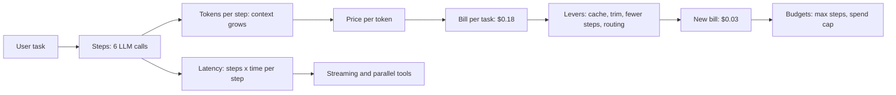
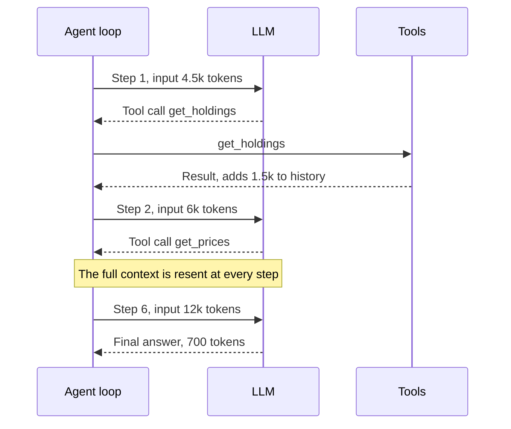
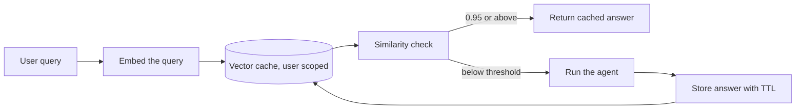
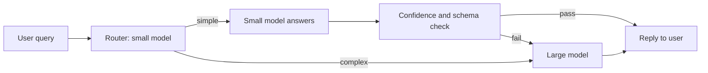
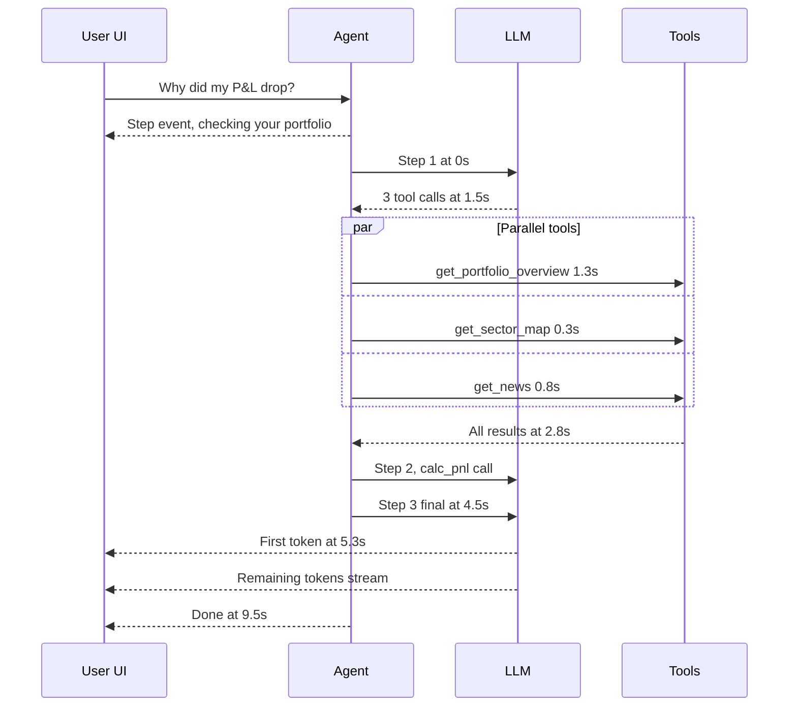
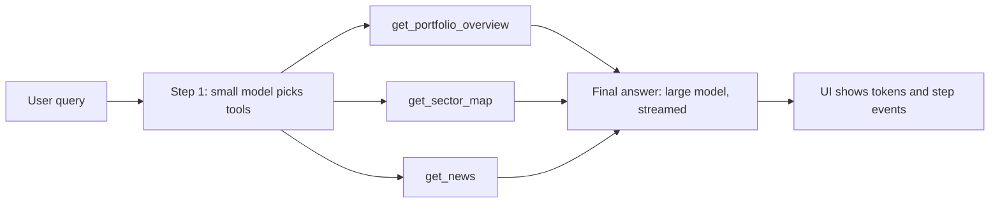
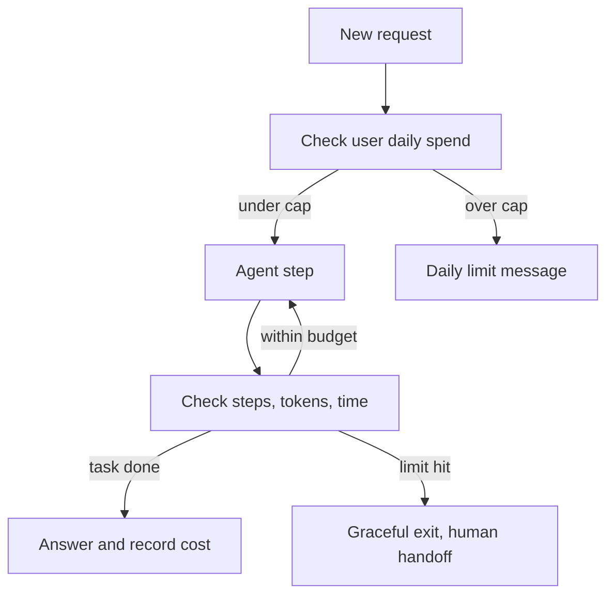

# Cost & Latency

This page teaches you how to control an agent's bill and speed. In a demo the agent works. In production one task takes 6–8 LLM calls, 50k tokens and 15–30 seconds, and at 1 lakh tasks/day the bill is thousands of dollars a day. Interviewers expect you to state each lever's saving and trade-off **with numbers**.

**After this page you can explain:**

- How to build a 6-step agent's bill line by line, and why step 6 costs more than step 1.
- How to apply caching, trimming, fewer steps and routing one at a time to that same bill, and the new total ($0.18 → $0.03).
- The timeline of the same run: TTFT, tool waits, and sequential vs parallel.
- Budgets (max steps, spend cap, timeout), batch APIs, and when to fine-tune.

## Words you need first

New to LLMs? Read [How LLMs Work](14-how-llms-work.md) first. It explains tokens, context windows and how a model generates text.

| Word | Plain meaning |
|---|---|
| Step | One turn of the agent loop: one LLM call, plus any tool it asks for. |
| Model routing | Sending each request to a cheap or a strong model, based on how hard it is. |
| TTFT | Time To First Token: how long until the first word of the answer appears. |
| Streaming | Sending the answer to the user piece by piece as it is generated, not all at the end. |
| Stateless | The model remembers nothing between calls, so every call must resend everything. |
| System prompt | Fixed instructions sent at the start of every call: role, rules, output format. |
| Tool schema | A tool's name, description and argument format, sent to the model so it knows how to call it. |
| Reasoning tokens | Hidden step-by-step thinking some models write before answering; billed like output. |
| Prompt caching | The provider reuses work on a prompt start it saw recently and bills those tokens much cheaper. |
| Semantic cache | Returns a stored answer when a new question means nearly the same as an old one. |
| Embedding | A list of numbers that captures a text's meaning; similar texts get nearby numbers. |
| LangGraph | A Python library that builds an agent as a graph of steps (nodes) sharing one state object. |
| Superstep | One round where LangGraph runs every node that is ready, in parallel, before moving on. |
| Prompt injection | Text hidden in input or tool data that tricks the model into ignoring its instructions. |

## Big picture: the whole page at a glance

Think of your electricity bill: **units × rate**. An agent's bill works the same way: **steps × tokens per step × price per token**. Every lever shrinks one of these three. Caching and routing lower the **price**. Trimming lowers **tokens per step**. Better tools and workflows lower the number of **steps**. Latency is tied to steps too: each step = one LLM call's wait + one tool's wait. Streaming and parallel tools make that wait shorter, or feel less bad. Budgets act like a fuse: if something goes wrong, the bill does not reach a thousand dollars.



One example runs through the whole page: Zerodha's "why did my portfolio P&L drop?" agent. First we build its bill, then each section applies one lever and shrinks it.

## ⭐ Token economics

**Why do we need this?** The team thought: "one LLM call costs ~$0.02, so the agent will cost about the same". After launch the bill was 7–8x higher. The reason: the agent makes 6 calls, not one, and each call is bigger than the last. Until you understand this maths, you will not put any lever in the right place.

**Analogy:** imagine a strange auto-rickshaw. At every stop, the meter charges the **whole route again from the start**. At stop 1 you pay for 2 km. At stop 2, for 2 + 1 = 3 km. At stop 6, for 7 km. Every stop costs more than the last, and the total grows very fast.

| Auto | Agent |
|---|---|
| each stop | each agent step (LLM call) |
| charging the whole route again | resending the whole context (prompt + history) |
| a new stretch added at each stop | each tool result added to the history after each step |
| meter rate | price per token |

The LLM is stateless. It does not remember the previous call. So every step must resend the system prompt, tool schemas, full history and all tool results.

**Example step by step:** the Zerodha agent, one question from one user. Prices are illustrative: **$3 / 1M input tokens, $15 / 1M output tokens, cached input $0.30 / 1M**. Real provider prices differ.

1. **Fixed part:** system prompt + tool schemas = 4,000 tokens. User question = 500 tokens. So step 1's input = 4,500.
2. **After each step:** the model's tool-call message + the tool's result are added to the history, ~1,500 tokens.
3. **Output:** each tool-call step writes ~300 tokens. The final answer is 700 tokens.
4. The agent calls 5 tools (holdings, prices, sector map, news, P&L) and gives the final answer on step 6.

Now the bill, line by line:

| Step | What happened | Input tokens | Input cost | Output tokens | Output cost | Step total |
|---|---|---|---|---|---|---|
| 1 | `get_holdings` call | 4,500 | $0.0135 | 300 | $0.0045 | $0.0180 |
| 2 | `get_prices` call | 6,000 | $0.0180 | 300 | $0.0045 | $0.0225 |
| 3 | `get_sector_map` call | 7,500 | $0.0225 | 300 | $0.0045 | $0.0270 |
| 4 | `get_news` call | 9,000 | $0.0270 | 300 | $0.0045 | $0.0315 |
| 5 | `calc_pnl` call | 10,500 | $0.0315 | 300 | $0.0045 | $0.0360 |
| 6 | final answer | 12,000 | $0.0360 | 700 | $0.0105 | $0.0465 |
| **Total** | | **49,500** | **$0.1485** | **2,200** | **$0.0330** | **$0.1815** |

One line worked out: step 2 input = 6,000 × $3 / 1,000,000 = $0.018.

**Why is step 6 2.6x more expensive than step 1?** Step 1 sent 4,500 tokens. Step 6 sent 12,000, because the tool calls and results of the previous 5 steps went along too. Its output was also bigger (the final answer). Same agent, same model, but the context kept growing.

**Comparison:** a single LLM call (4,500 in, 700 out) ≈ $0.024. The agent ≈ $0.18. That is **~7.5x**. At 1 lakh tasks/day, that is $18,150 a day. This is our **starting bill**. Every lever below is applied to this bill.



The LLM is stateless, so every step resends the prefix and the whole growing history. That is how 6 steps reach 49.5k input tokens.

**Now the terms:**

| Token type | What it is | Price (relative) |
|---|---|---|
| Input | system prompt + tool schemas + history + tool results | base (cheap) |
| Output | what the model generates | often ~3–5x input |
| Cached input | the same prefix as an earlier request, read from the provider cache | ~10–50% of input (depends on the provider) |
| Reasoning / thinking | hidden chain of thought, billed at the output rate | output price, and you do not even see it |

- **Output tokens** are both expensive and **slow** (generated one by one). Most of the latency comes from them.
- **Reasoning models** can burn thousands of thinking tokens even for a short answer. Set `reasoning_effort` / a thinking budget.
- **Tool schemas** go into the input on every call. 30 tools × ~150 tokens = ~4.5k tokens per step, whether a tool is used or not.
- **Why agents multiply cost:** the full context is resent at every step (total input ≈ O(steps²) when each step grows the history). Retries, self-reflection, critic agents, multi-agent handoffs: each is a new LLM call. Big tool results (raw JSON, whole web pages) sit in the context.

**Code:** the function below computes the bill above. With it you can check each lever's effect in one line.

```python
def task_cost(steps, prefix=4000, query=500, per_step=1500, out_step=300,
              out_final=700, p_in=3.0, p_out=15.0, p_cache=0.30, cache=True):
    # illustrative prices per 1M tokens, real provider prices differ
    cost = 0.0
    for i in range(steps):
        ctx = prefix + query + i * per_step               # context grows every step
        cached = prefix if (cache and i > 0) else 0       # from step 2, prefix from cache
        cost += (ctx - cached) * p_in / 1e6               # new tokens, full price
        cost += cached * p_cache / 1e6                    # cached tokens, cheap
        out = out_final if i == steps - 1 else out_step   # last step = final answer
        cost += out * p_out / 1e6
    return round(cost, 4)

print(task_cost(6, cache=False))          # 0.1815  starting bill
print(task_cost(6))                       # 0.1275  + prompt caching
print(task_cost(6, per_step=600))         # 0.087   + tool result trimming
print(task_cost(3, per_step=600))         # 0.0438  + fewer steps
```

**What the code does:**

- The loop runs once per step.
- `ctx` = fixed prefix + query + the history added so far. That is why each step's input grows.
- `cached` treats the 4,000 prefix tokens as cheap from step 2 onward (when cache=True).
- Output is added separately. The last step has the big final answer.
- The 4 prints at the bottom are the same numbers the next sections reach, one lever at a time.

**Interview tip:** state cost "per task" (per resolved ticket, per report), not per call. Write the formula, then name 3 levers: fewer steps, fewer tokens per step, cheaper tokens (cache/small model).

**Common mistake:** looking only at the output price. In agents, input tokens are 10–20x the output volume. Above too: 49.5k input vs 2.2k output. Most of the bill comes from input.

## ⭐ Caching

**Why do we need this?** In the bill above, the same 4,000-token system prompt + tool schemas went at full price on every step. They never change. And many users ask the same question every day ("iPhone 16 return policy?"). Paying again and again for the same work is waste.

**Analogy:** three kinds of memory.

| Everyday example | Cache layer | What it saves |
|---|---|---|
| teacher's board: the intro is already written, only the new part is added | **provider prompt caching** | cost and time of the same prefix |
| railway enquiry FAQ board: "Rajdhani on platform 3" | **semantic cache** | a whole LLM call, for a similar question |
| the kirana owner remembers today's mandi rate instead of phoning for every customer | **tool-result cache** | the same tool call, until the TTL |

**Example step by step (lever 1: apply prompt caching to the bill):**

1. **Step 1:** the cache is empty. 4,500 tokens at full price: $0.0135. The provider stores the prefix in its cache.
2. **Step 2:** input 6,000 = 4,000 prefix (cache hit) + 2,000 new. Cost = 4,000 × $0.30/1M + 2,000 × $3/1M = $0.0012 + $0.0060 = **$0.0072** input (it was $0.018).
3. **Steps 3–6:** the same 4,000 tokens come from the cache each time. Only the new part is full price.
4. **Saving:** 5 steps × 4,000 = 20,000 cached tokens. Each saves $3 − $0.30 = $2.70/1M. 20,000 × $2.70/1M = **$0.054**.
5. **New bill:** $0.1815 − $0.054 = **$0.1275 per task**. At 1 lakh tasks/day, $18,150 → $12,750 a day.

(Some providers charge a little extra for cache writes. We ignore that here to keep it simple.)

**1. Provider prompt caching:**

- The provider keeps a KV cache of the request's **exact prefix**. If the next request starts with the same prefix, those tokens are cheaper + faster (TTFT drops too).
- Some providers do it automatically (prefix ≥ ~1k tokens), others need an explicit marker (`cache_control`). The cache TTL is short (minutes), and cache writes can cost a bit more.
- **Stable prefix rule:** static things first (system prompt, tool schemas, few-shot), dynamic things later (user data, timestamp, history). Put `datetime.now()` at the start of the prompt and the cache breaks every time.
- Keep the tool order deterministic. Adding/removing tools dynamically breaks the prefix.

**2. Semantic cache, step by step:**

1. A user asks: "What is the return policy for iPhone 16?"
2. The query is embedded, and the vector cache finds the nearest old query: "iPhone 16 return policy?" Similarity 0.97.
3. 0.97 ≥ threshold 0.95, so it is a **hit**. The old answer comes back instantly. No LLM call, only a small embedding cost.
4. Now the danger: "status of order 123" and "status of order 124" have similarity 0.98. If that is a hit, the user sees **someone else's order**.
5. So do not put a semantic cache on personalised or time-sensitive data, or include `user_id`/`tenant` in the cache key.



A hit saves the whole LLM call. A miss runs the agent and stores the new answer with a TTL. So the threshold and the scope key decide both the saving and the risk.

- Low threshold = more hits but wrong answers. High = fewer hits. Tune it on an eval set, and keep a TTL + invalidation (flush on policy change).
- In agents, caching a **plan or a sub-step** instead of the whole answer is often safer.

**3. Tool-result caching:**

- Cache read-only, deterministic tools (product info, FX rate, docs search) under the key `(tool, normalized_args)` with a TTL.
- Never cache write tools (payment, cancel order). They need [idempotency](../01-topics/10-idempotency-retries.md), not a cache.

**Code:** caching one node's result in LangGraph. For the same SKU, the API is not called again for 10 minutes.

```python
import hashlib, json
from langgraph.types import CachePolicy
from langgraph.cache.memory import InMemoryCache

def fetch_product(state):
    # expensive API call, result stays the same for 10 min
    return {"product": catalog_api.get(state["sku"])}

def key_by_sku(state) -> str:
    # build the cache key only from the sku, not from the rest of the state
    return hashlib.sha256(json.dumps({"sku": state["sku"]}).encode()).hexdigest()

builder.add_node("fetch_product", fetch_product,
                 cache_policy=CachePolicy(key_func=key_by_sku, ttl=600))  # 600s TTL
graph = builder.compile(cache=InMemoryCache())  # Redis-backed cache in prod
```

**What the code does:**

- `fetch_product` is a normal node that calls the catalog API.
- `key_by_sku` builds the key only from the SKU. Same SKU = same key = cache hit.
- `CachePolicy(..., ttl=600)` says the result is valid for 10 minutes.
- `compile(cache=...)` provides the cache store. Memory in tests, Redis in prod.

**Now the terms:**

- **Prefix:** the start of the prompt that is the same in every request.
- **KV cache:** the model's internal computed state, which the provider keeps for a prefix.
- **Cache hit / miss:** hit = the old result was found, miss = the work had to be done again.
- **TTL:** time to live, how long a cached item stays valid.

**Interview tip:** name all three layers separately, and raise the semantic cache risk yourself (personalised data leak, stale answers). That is a senior signal. Basics: [Caching](../01-topics/05-caching.md).

**Common mistake:** putting per-request dynamic data (date, user name) at the start of the prompt, which drops the provider cache hit rate to zero, and then thinking "caching doesn't work".

## Context size control

**Why do we need this?** In the bill, each step added ~1,500 tokens. Why? `get_holdings` returned raw JSON with 40 fields, of which the agent needed only 4 (symbol, qty, avg price, sector). Those extra tokens were resent in every later step and kept costing money.

**Analogy:** when you visit a doctor, you do not carry the full 200-page medical file. You carry the last 3 reports + one summary page. The doctor understands faster, and nothing important is lost.

**Example step by step (lever 2: trim tool results):**

1. The raw `get_holdings` result is 1,500 tokens. Keep only `symbol, qty, avg_price, sector`. Now it is ~600 tokens.
2. Each step now adds 600 tokens to the history instead of 1,500.
3. Step inputs: 4.5k, 5.1k, 5.7k, 6.3k, 6.9k, 7.5k = **36,000** (was 49,500).
4. Prompt caching is still on. Bill: 16,000 new tokens × $3/1M = $0.048, 20,000 cached × $0.30/1M = $0.006, output $0.033.
5. **New bill: $0.087 per task** (was $0.1275). Step 6 now sends 7.5k tokens instead of 12k, so TTFT drops too.

> **Example:** an HDFC 40-turn support chat. Send the full history every turn and turn 40 has 30k input tokens = ~$0.09 per turn. The last 8 messages + a running summary fit in 4k tokens = ~$0.012 per turn.

**Techniques:**

- **Trimming:** last N messages or last T tokens (`trim_messages`). Never split a tool call from its tool result, or the API errors.
- **Summarizing:** turn old history into a summary with a small model (LangChain `SummarizationMiddleware`, triggered e.g. at 4k tokens). Trade-off: details (order ID, amount) can be lost, so keep important facts in structured fields in state.
- **Tool result compaction:** only the needed fields instead of 20 KB of JSON. Keep big results in a store and put only a reference ID in the context.
- **Retrieval vs long context:** a 1M-token window does not mean you should fill it. Long context = cost on every call + slow TTFT + "lost in the middle". Retrieval = only the relevant 2–5k tokens. For a small, stable corpus + cache, long context is fine. Details: [Memory & Context Engineering](05-memory-context.md).

**Now the terms:**

- **Context window:** how many tokens the model can take in one call.
- **Lost in the middle:** models often miss information in the middle of a long context.
- **Compaction:** turning big data into a small, useful form.

**Interview tip:** "Context is a budget: system + tools + memory + retrieved + history. I set a cap for each bucket."

**Common mistake:** while trimming, keeping the AI tool_call message (the model's request to run a tool) but dropping its ToolMessage, which holds that tool's result (or the reverse). The provider rejects the request.

## Reducing steps

**Why do we need this?** The agent still makes 6 LLM calls. Each call = money + a 1.5-second wait + one more chance to go wrong. The cheapest LLM call is the one that never happens.

**Analogy:** the vegetable market. One trip for potatoes, another for tomatoes, a third for coriander: 3 trips. Or write one list and get everything in one trip. The list = a coarse tool, one trip = one step.

**Example step by step (lever 3: steps 6 → 3):**

1. The traces show `get_prices` always comes right after `get_holdings`. Merge them into one tool: `get_portfolio_overview(user_id)`.
2. `get_sector_map` and `get_news` do not depend on each other. The model can call both in one turn (**parallel tool calls**).
3. New flow: step 1 → `get_portfolio_overview` + `get_sector_map` + `get_news` together. Step 2 → `calc_pnl`. Step 3 → final answer.
4. Input: 4.5k, 5.1k, 5.7k (cache and trimming on). Output: 300 + 300 + 700.
5. **New bill: $0.0438 per task** (was $0.087). And 3 fewer LLM waits, so lower latency too (see the timeline in the Latency section).

> **Example:** a Razorpay merchant-support agent used to take 3 loop iterations for 3 separate calls: `get_merchant`, `get_settlements`, `get_disputes`. One `get_merchant_overview(merchant_id)` tool made it a single step.

**Techniques:**

- **Better tool design:** coarse-grained, task-shaped tools (`get_order_summary`), not thin CRUD wrappers. Keep tool results small and relevant (only needed fields, not raw JSON).
- **Parallel tool calls:** the model can return several independent tool calls in one turn. The executor runs them in parallel (LangGraph `ToolNode` does this). 3 sequential steps → 1 step.
- **Fewer loop iterations:** a clear system prompt ("stop once you have the answer"), good tool error messages (so the model does not get stuck retrying), a max-iteration cap.
- **Workflows instead of agents:** when the steps are known up front (fetch → classify → reply), build a fixed workflow graph. Use the LLM only where judgment is needed. This is the [Workflow patterns](03-workflow-patterns.md) argument.
- **Plan once, execute many:** in plan-and-execute, the big model plans once, and a small model or plain code runs the steps.

**Now the terms:**

- **Coarse-grained tool:** one tool that does a whole small job, not just one table row.
- **Parallel tool calls:** several tool calls in one LLM response, run together.
- **Workflow:** a graph with fixed steps, where the LLM does not choose the path.

**Interview tip:** "First I check in traces how many steps a run takes on average and which ones are redundant. Merging 2–3 tools or building a workflow often cuts 40% of steps."

**Common mistake:** making everything an autonomous agent. Where the flow is fixed, an agent only adds extra calls and unpredictability.

## ⭐ Model routing and cascading

**Why do we need this?** All three steps still run on the big, expensive model. But steps 1 and 2 only decide "which tool to call". That does not need a big model. The big model is only needed for the final explanation.

**Analogy:** a hospital. A GP sees you first. Fever and cough get handled right there. Only hard cases are referred to a specialist. If every patient went straight to the specialist, the fees would be higher and the queue longer.

| Hospital | Agent |
|---|---|
| GP | small, cheap model |
| specialist | big, expensive model |
| referral | escalation |
| the GP saying "this is beyond me" | low confidence or failed check |

**Example step by step (lever 4: per-step routing):**

Illustrative small-model price: $0.30/1M input, $1.20/1M output, cached $0.03/1M.

1. **Step 1 (small model):** 4,500 × $0.30/1M + 300 × $1.20/1M = $0.00135 + $0.00036 = **$0.00171**.
2. **Step 2 (small model):** 1,100 new × $0.30/1M + 4,000 cached × $0.03/1M + 300 out × $1.20/1M = **$0.00081**.
3. **Step 3 (big model, final answer):** the big model's cache is cold in this run (each model has its own cache). 5,700 × $3/1M + 700 × $15/1M = $0.0171 + $0.0105 = **$0.0276**.
4. **New bill: ~$0.030 per task** (was $0.0438).
5. In prod, the same prefix stays warm from other users' requests, so the real bill is even lower. Here we only count the cache within this run.

**The same idea at traffic level:**

> **Example:** a Swiggy support bot. 70% of queries are simple, like "where is my order" or "refund status". A small model is enough. Multi-issue cases like "wrong item came, got half a refund, and the coupon was also deducted" go to the big model.

- **Routing (upfront):** a classifier (small LLM, or embedding + logistic regression (a simple, cheap classic classifier), or rules) decides the request's difficulty/intent, then picks the right model or subgraph.
- **Cascading (try-then-escalate):** the small model answers, then a check runs: structured confidence, verifier, schema validation, or tool error. Fail → big model.
- **Per-step routing:** inside the agent too: big model for planning and final synthesis, small model for extraction/summarize/classify (the example above).
- Typical saving is 40–70% when most traffic is simple. Trade-off: router mistakes (a hard query on the small model) lower quality, and escalation in a cascade doubles latency.



Simple queries stop at the small model. Only failed checks or queries routed as complex pay for the large model. That is where the 40–70% saving comes from.

**Code:** a router node in LangGraph. The small model labels the query "simple" or "complex", and the graph picks the model accordingly.

```python
from typing import Literal, TypedDict
from pydantic import BaseModel
from langchain.chat_models import init_chat_model
from langgraph.graph import StateGraph, START, END

small = init_chat_model("openai:gpt-5-mini")             # cheap, fast
large = init_chat_model("anthropic:claude-sonnet-5-5")   # expensive, strong

class Route(BaseModel):          # the router's structured output
    tier: Literal["simple", "complex"]
    confidence: float            # 0..1

class S(TypedDict):              # graph state
    question: str
    tier: str
    answer: str

def router(s: S):
    r = small.with_structured_output(Route).invoke(
        f"Classify difficulty of this support query: {s['question']}")
    # low confidence: play safe, treat as complex
    tier = r.tier if r.confidence >= 0.7 else "complex"
    return {"tier": tier}

def answer_small(s: S):
    return {"answer": small.invoke(s["question"]).content}

def answer_large(s: S):
    return {"answer": large.invoke(s["question"]).content}

g = StateGraph(S)
g.add_node("router", router)
g.add_node("small", answer_small)
g.add_node("large", answer_large)
g.add_edge(START, "router")
g.add_conditional_edges("router", lambda s: s["tier"],      # read tier, pick the path
                        {"simple": "small", "complex": "large"})
g.add_edge("small", END)
g.add_edge("large", END)
app = g.compile()
```

**What the code does:**

- Two models are created: `small` (cheap) and `large` (expensive).
- The `router` node gets structured output from the small model: tier + confidence.
- If confidence is below 0.7, the tier is forced to "complex". When in doubt, pick quality.
- `add_conditional_edges` reads `tier` from state and sends the run to the `small` or `large` node.
- The router itself is a small model, so routing cost does not eat the saving.

**Now the terms:**

- **Routing:** deciding the model up front.
- **Cascading:** try the small model first, go to the big one if it fails.
- **Escalation:** sending from the small model to the big model.

**Interview tip:** "I evaluate the router too, with a confusion matrix, a table of predicted vs correct labels (simple sent to complex = wasted money, complex sent to simple = quality loss). The second mistake costs more, so I bias the threshold that way."

**Common mistake:** using a big model as the router, which wipes out the saving. Or not defining any escalation signal.

## ⭐ Latency

**Why do we need this?** A Zerodha user asked "why did my P&L drop?" and the screen stayed blank for 11 seconds. The user closed the app. The answer was right, but nobody saw it. In agents, latency = every sequential LLM call + every tool wait, all added up.

**Analogy:** a wedding dinner. One waiter brings one dish at a time and goes back to the kitchen after each: very slow (sequential). Several cooks cook together and everything arrives at once: fast (parallel). And if the starter arrives early, guests are not bored even if the main course is late (TTFT + streaming).

| Wedding | Agent |
|---|---|
| how fast the starter came | TTFT (first token) |
| when the whole meal ended | total latency |
| one waiter, one dish at a time | sequential tool calls |
| several cooks at once | parallel tool calls |
| "paneer is on its way" announcement | streaming step events |

**Example step by step:** the timeline of the same Zerodha run. Each tool-call LLM step = TTFT 0.6s + output 0.9s = 1.5s. Final step: TTFT 0.8s + 700 tokens streamed in ~4.2s.

```text
A) Before: 6 steps, all sequential, only the final answer streamed
   time (s)      what is happening                        what the user sees
   0.0 - 1.5     LLM step 1 (TTFT 0.6 + 0.9)              blank screen
   1.5 - 1.9     tool get_holdings       wait 0.4
   1.9 - 3.4     LLM step 2
   3.4 - 4.6     tool get_prices         wait 1.2
   4.6 - 6.1     LLM step 3
   6.1 - 6.4     tool get_sector_map     wait 0.3
   6.4 - 7.9     LLM step 4
   7.9 - 8.7     tool get_news           wait 0.8
   8.7 - 10.2    LLM step 5
  10.2 - 10.4    tool calc_pnl           wait 0.2
  10.4 - 11.2    LLM step 6 final, TTFT 0.8               first token at 11.2s
  11.2 - 15.4    final answer streams                     done at 15.4s

B) After: 3 steps, parallel tools, step events streamed
   0.0           step event "checking your portfolio"     progress right away
   0.0 - 1.5     LLM step 1, 3 tool calls at once
   1.5 - 2.8     get_portfolio_overview  1.3  ┐
                 get_sector_map          0.3  ├ parallel, wait = max = 1.3
                 get_news                0.8  ┘
   2.8 - 4.3     LLM step 2
   4.3 - 4.5     tool calc_pnl           wait 0.2
   4.5 - 5.3     LLM step 3 final, TTFT 0.8               first token at 5.3s
   5.3 - 9.5     final answer streams                     done at 9.5s
```

What the timeline teaches:

1. **LLM waits are the biggest.** In A, 5 × 1.5s = 7.5s go just to deciding tools. Fewer steps = the biggest latency win.
2. **Tool waits add up** when they are sequential: 0.4 + 1.2 + 0.3 + 0.8 + 0.2 = 2.9s. In parallel, the wait = the longest tool (1.3s), not the sum.
3. **TTFT decides how the wait feels.** In A the first word comes at 11.2s. In B at 5.3s, with step events from 0s.
4. **Total:** 15.4s → 9.5s. And the user sees progress from the first second.



The three tools ran together, so the wait was only 1.3s. The user saw progress in the first second and text at 5.3s.

**Now the terms:**

| Metric | What it is | What controls it |
|---|---|---|
| TTFT | request to first token | prompt size, prompt cache, model size, queueing |
| TPOT (time per output token) / tokens per sec | time per token | model size, provider load |
| Total latency | the whole task | steps × (TTFT + output tokens × TPOT) + tool time |

**Levers:**

- **Stream tokens** of the final answer, and **intermediate steps** too (tool start/end, "searching..."). In LangGraph, `stream_mode=["messages", "updates", "custom"]`.
- **Async + parallel nodes:** run independent branches (portfolio API + news API + sector map) together. In LangGraph, fan-out edges run in parallel in the same superstep.
- **Speculative / optimistic execution:** start the likely next step early (e.g. fetch the portfolio as soon as the intent is classified, because 80% of queries are about it). If wrong, throw the result away. Only for read-only work.
- **Small/fast models for sub-steps:** small model for classification, extraction, summarization. Big model for the final synthesis.
- **Produce less output:** output tokens are the slowest. Concise format, structured output, "max 3 lines".
- **Prompt caching** also lowers TTFT (a lot, on long prefixes).



**Code:** streaming the graph, so the UI gets both step events and tokens.

```python
async def stream_run(graph, question: str, thread_id: str):
    cfg = {"configurable": {"thread_id": thread_id}}
    async for mode, chunk in graph.astream(
        {"messages": [("user", question)]}, cfg,
        stream_mode=["updates", "messages"],    # we want two kinds of events
    ):
        if mode == "updates":            # a node finished, send a step event
            for node in chunk:
                yield {"type": "step", "node": node}
        elif mode == "messages":         # one LLM token arrived
            msg, meta = chunk
            if msg.content:
                yield {"type": "token", "text": msg.content}
```

**What the code does:**

- `astream` runs the graph and emits events along the way, without waiting for the end.
- `stream_mode=["updates", "messages"]` asks for two streams: node updates and LLM tokens.
- On `updates`, the UI gets a "step" event ("checking your portfolio").
- On `messages`, each token goes to the UI, so the answer appears as it is typed.

**Interview tip:** give a latency budget breakdown: "p95 target 6s: classify 300ms, parallel tools 1.2s, synthesis TTFT 800ms, then streaming." Saying it with numbers sounds senior.

**Common mistake:** watching only average latency. Agents have very long p95/p99 (one extra loop iteration = +1.5–3s), so monitor both percentiles and step count.

## Batch APIs for offline jobs

**Why do we need this?** Some work does not need an answer right now: nightly evals, bulk tagging, summaries of old tickets. Running them on the real-time API means paying for "express" when "normal" would do.

**Analogy:** speed post vs normal post. Same letter, same address. If it only needs to arrive tomorrow, normal post is cheaper.

**Example step by step:** Meesho runs category + attribute extraction on 5 lakh new product listings every day.

1. Each listing: 800 input + 100 output tokens, on a small model ($0.30 / $1.20 per 1M, illustrative).
2. Online cost: 5,00,000 × (800 × 0.30 + 100 × 1.20) / 1M = 5,00,000 × $0.00036 = **$180 per night**.
3. All requests go into one JSONL file (one JSON request per line), each line with a `custom_id` (the listing id).
4. Upload the file to the batch API. The provider processes it within 24 hours.
5. In the morning, a results file arrives. Each result maps back to its listing by `custom_id`.
6. Batch discount ~50%: **~$90 per night**. About $33,000 saved in a year.

**Points:**

- Upload a JSONL file of requests → the provider processes it async (typically within 24h) → results file.
- Use cases: eval runs, LLM-as-judge scoring, embeddings backfill, summarizing old tickets, synthetic data.
- Trade-off: no latency guarantee, you must handle partial failures (retry by `custom_id`), rate limits are in a separate pool.
- Batching an agent's multi-step loop is hard (each step depends on the previous one). Use batch per step in a pipeline ("step 1 for all docs in one batch").

**Now the terms:**

- **Batch API:** an async endpoint that processes many requests together, at a cheaper rate, over hours.
- **custom_id:** your own id for each request, used to match results back.

**Interview tip:** "The bill for evals and offline enrichment halves with the batch API. Never on the online path."

**Common mistake:** mapping batch results by their order. Always map by `custom_id`.

## ⭐ Budgets and limits

**Why do we need this?** A coding agent got stuck in a "test fails → fix → test fails" loop. 400 iterations, one night, one user, **$900**. No alarm went off because there was no error. Every iteration was a "successful" LLM call. Without limits, one bug or prompt injection can run up a huge bill.

**Analogy:** a prepaid mobile recharge. 1.5 GB of data a day. When it runs out, the speed drops, the bill does not explode. Each call has a limit too. An agent needs the same kind of pack.

| Prepaid | Agent |
|---|---|
| daily data limit | per-user daily $ cap |
| max length of one call | `max_tokens` per call, timeout |
| max calls in a session | `recursion_limit` (max steps) |
| slow speed after the limit | graceful exit, human handoff |

**Example step by step:** user `u91`'s day, with the code below (daily cap $5, `recursion_limit` 20, timeout 60s).

1. Since the morning, `u91` has spent $4.90. Redis key `spend:u91:2026-11-03 = 4.90`.
2. A new request arrives. Check: 4.90 < 5.00, let it run.
3. The agent runs and finishes in 6 steps, within 20. Within 60s.
4. The cost from the run's AI messages' `usage_metadata`: $0.13. Redis is now $5.03.
5. Next request: 5.03 ≥ 5.00. The agent does not run at all. The user sees: "Today's limit is used up."
6. If a run got stuck in a loop: `GraphRecursionError` at step 20, or `TimeoutError` at 60s. In both cases the user gets a polite message, not a 500 error. And the day's max spend is $5, not $900.



The spend cap is checked before the run starts, and the step, token and time budgets after every step. So a runaway loop ends in a graceful message instead of a bill.

**Code:** a wrapper that applies all three guards: daily cap, max steps, timeout. After the run it adds the cost to Redis.

```python
import asyncio
from langgraph.errors import GraphRecursionError

PRICE_IN, PRICE_OUT = 3 / 1e6, 15 / 1e6     # illustrative per-token prices
DAILY_LIMIT_USD = 5.0

async def run_with_budget(graph, user_id: str, thread_id: str, msg: str):
    key = f"spend:{user_id}:{today()}"                   # one key per user per day
    if float(await redis.get(key) or 0) >= DAILY_LIMIT_USD:
        return "Today's limit is used up. Try tomorrow or contact support."
    cfg = {"configurable": {"thread_id": thread_id},
           "recursion_limit": 20}                       # max 20 supersteps
    try:
        async with asyncio.timeout(60):                  # wall-clock cap for the whole run
            out = await graph.ainvoke({"messages": [("user", msg)]}, cfg)
    except (GraphRecursionError, TimeoutError):
        return "This request took too long, a support agent will help you."
    cost = 0.0
    for m in out["messages"]:
        u = getattr(m, "usage_metadata", None)           # only present on AI messages
        if u:
            cost += u["input_tokens"] * PRICE_IN + u["output_tokens"] * PRICE_OUT
    await redis.incrbyfloat(key, cost)                   # add to today's spend
    await redis.expire(key, 86400)                       # key expires on its own in 1 day
    return out["messages"][-1].content
```

**What the code does:**

- First it reads today's spend from Redis. If it is over the cap, the agent does not run.
- `recursion_limit: 20` stops a loop at 20 supersteps (`GraphRecursionError`).
- `asyncio.timeout(60)` ends the whole run within 60 seconds.
- On both errors the user gets a polite message, not a crash.
- After the run, it adds tokens × price from each AI message's `usage_metadata` to the Redis counter.

**Now the terms and details:**

- **Max steps:** LangGraph `recursion_limit` (in config, counts supersteps. The default depends on the version, so always set it explicitly). Exceeding it raises `GraphRecursionError`. For a graceful exit, read `RemainingSteps` in state and wrap up early. In `create_agent`, use `ModelCallLimitMiddleware(run_limit=..., thread_limit=...)`.
- **Token caps:** `max_tokens` per call, and a run-level token counter in state (from `usage_metadata`).
- **Per-user / per-tenant spend limits:** a Redis counter (daily $), and at the limit a graceful message or a smaller model. Just like [Rate limiting](../01-topics/11-rate-limiting.md), only the unit is tokens/$.
- **Timeouts:** on every LLM call (client timeout), every tool, and the whole run (`asyncio.timeout`).
- **Graceful exit:** when a limit is hit, a partial answer + "please talk to a human", not a 500 error.

**Interview tip:** "Guards at three levels: per call (max_tokens, timeout), per run (recursion_limit, run token budget), per user/tenant (daily $ cap). And I attribute cost per run in the trace." Monitoring: [AI Observability](10-agent-observability.md).

**Common mistake:** relying only on `recursion_limit`. Even in one step the model can produce 30k output tokens or make a very expensive tool call. You need a separate spend cap.

## Fine-tuning and distillation vs prompting

**Why do we need this?** A narrow job (like putting a ticket into one of 12 categories) runs lakhs of times a day, each time on a big model with a 3k-token prompt. A small trained model could do the same job 10x cheaper. But fine-tuning everywhere is also wrong. Numbers decide when it pays off.

**Analogy:** calling a senior CA for every ITR (big model + long prompt) vs training an intern on 500 examples of one form (distilled small model). For that one form the intern is as good as the CA, and much cheaper. But when a new law comes in, the intern must be retrained.

**Example step by step:** a PhonePe transaction-dispute classifier, 20 lakh tickets a day.

1. **Now:** big model, 3,000-token prompt, 50-token output. Per call = 3,000 × $3/1M + 50 × $15/1M = $0.009 + $0.00075 = **$0.00975**.
2. **Daily bill:** 20,00,000 × $0.00975 = **$19,500/day**.
3. **Distill:** train a small model on 50k labelled outputs from the big model. Prompt is 300 tokens. Cost ~10x lower: ~$1,950/day. Latency 4x lower. Accuracy equal on the eval set.
4. **One-time cost** (data, training, eval pipeline): say ~$15,000 (illustrative).
5. **Break-even:** daily saving ~$17,500. The money comes back in one day.
6. **Opposite case:** the same job at only 2,000 tickets a day. Saving ~$17.5/day. Getting $15,000 back takes ~850 days. Do not fine-tune; stay with prompting.

| | Prompting (+RAG) | Fine-tuning / distillation |
|---|---|---|
| Upfront cost | almost zero | data + training + eval pipeline |
| Per-call cost | long prompt, big model | short prompt, small model |
| Making changes | minutes | retrain, re-eval |
| Facts / fresh data | better with RAG | weak (do not use it for facts) |
| Best for | early stage, changing tasks | high-volume, narrow, stable tasks (routing, extraction, format) |

**Now the terms:**

- **Fine-tuning:** training an existing model further on your own examples.
- **Distillation:** a big "teacher" model generates outputs and a small "student" is trained on them. Common in agents for the router, classifier and tool-arg extractor.
- **Break-even:** (saving per call × calls per month) vs (training + eval + maintenance + retraining when the base model changes).
- **Trade-off:** model drift, redoing it when a new base model arrives, and the ops cost of hosting (self-hosted).

**Interview tip:** "Fine-tuning for behaviour/format, RAG for knowledge. For cost, distillation when one narrow step runs at high volume and an eval set is ready."

**Common mistake:** fine-tuning to teach new facts, or distilling without an eval set (you will never know how much quality dropped).

## ⭐ Cost/latency levers table

**The same bill, after all levers** (Zerodha agent, illustrative prices):

| Bill | Per task | 1 lakh tasks/day | What changed |
|---|---|---|---|
| Start | $0.1815 | $18,150 | 6 steps, all big model, raw tool results |
| + prompt caching | $0.1275 | $12,750 | 4k prefix at 10% price on steps 2–6 |
| + tool result trimming | $0.0870 | $8,700 | each step 1,500 → 600 tokens |
| + fewer steps (6 → 3) | $0.0438 | $4,380 | merged tool + parallel calls |
| + per-step routing | $0.0301 | $3,010 | steps 1–2 on a small model |

The bill shrank ~6x, and latency went from 15.4s to 9.5s (first token from 11.2s to 5.3s).

**All levers in one place:**

| Lever | What it saves | Trade-off |
|---|---|---|
| Model routing / cascade | cost 40–70%, latency (simple cases) | router mistake = quality loss, double latency on escalation |
| Provider prompt caching | input cost + TTFT | stable-prefix discipline, short TTL |
| Semantic cache | a whole LLM call | risk of wrong/stale/another user's answer |
| Tool-result cache | tool latency + API cost | staleness, read-only tools only |
| Better tools / fewer steps | both cost and latency | tool design effort |
| Parallel tool calls / nodes | latency | rate limits, partial failure handling |
| Workflow instead of agent | cost, latency, variance | less flexibility |
| Streaming | perceived latency (TTFT) | total cost unchanged, UI complexity |
| Context trim/summarize | input cost + TTFT | details can be lost |
| Batch API | ~50% offline cost | hours of latency |
| Budgets / limits | runaway cost | some valid long tasks also get cut |
| Distillation / fine-tune | per-call cost + latency | training, eval, maintenance |

**Interview tip:** name the levers in this order: first measure (traces), then the cheap and safe ones (caching, trimming), then design changes (fewer steps, workflow), then the ones with quality risk (routing, distillation). Give a number with each.

## Read next

- [Memory & Context Engineering](05-memory-context.md), [Workflow patterns](03-workflow-patterns.md)
- [AI Observability](10-agent-observability.md): cost per run and latency in traces
- [Agents in Production](12-agents-in-production.md): rate limits, retries, failover
- [Caching](../01-topics/05-caching.md), [Rate limiting](../01-topics/11-rate-limiting.md), [LLM chat app](../02-questions/t2-22-llm-chat-app.md)
- [Production agent lab](/viewinter/agents/labs/prod)

## Checklist

- [ ] I can explain the difference between input, output, cached and reasoning tokens and how they are priced
- [ ] I can build a 6-step agent's bill line by line and explain why step 6 costs more and why agents multiply cost
- [ ] I can explain routing vs cascading and write a router node in LangGraph
- [ ] I can explain prompt caching, semantic caching and tool-result caching with their risks, and calculate the prompt-cache saving
- [ ] I can list ways to reduce steps (tool design, parallel calls, workflows)
- [ ] I can explain TTFT vs total latency on a timeline, and streaming, parallel nodes and speculative execution
- [ ] I can explain context trimming/summarization and the retrieval vs long context trade-off
- [ ] I can write code for max steps, token caps, per-user spend limits and timeouts
- [ ] I can explain when fine-tuning/distillation pays off, with numbers
