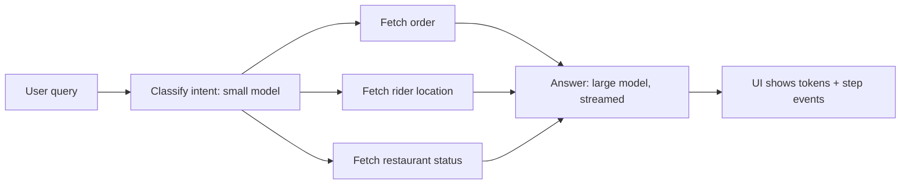

# Cost & Latency

This page teaches you to control an agent's bill and speed: token economics, model routing, caching, fewer steps, streaming, budgets, and when to fine-tune. Interviewers ask because an agent works fine in a demo, but in production one task takes 8 LLM calls, 50k tokens and 30 seconds. A senior engineer is expected to state the saving and the trade-off of each lever, with numbers.

## ⭐ Token economics

**In one line:** bill = (input tokens × input price) + (output tokens × output price), and an agent resends its whole growing context at every step, so cost grows faster than linearly with steps.

> **Example:** Zerodha's "explain my portfolio" agent. The user asks one question; the agent takes 6 steps to fetch holdings, fetch prices, map sectors, compute P&L and write the final answer. It spends ~7x what a single LLM call would.

**Token types:**

| Type | What it is | Price (relative) |
|---|---|---|
| Input | system prompt + tool schemas + history + tool results | base (cheap) |
| Output | what the model generates | often ~3–5x input |
| Cached input | same prefix as an earlier request, read from the provider cache | ~10–50% of input (depends on provider) |
| Reasoning / thinking | hidden chain of thought, billed at the output rate | output price, and you do not even see it |

- Output tokens are expensive and **slow** (generated one by one). Most of the latency comes from here.
- Reasoning models can burn thousands of thinking tokens even for a short answer. Set `reasoning_effort` / a thinking budget.
- Tool schemas go into the input on every call. 30 tools × ~150 tokens = ~4.5k tokens per step, whether the tools are used or not.

**Worked example (illustrative prices: assume $3 / 1M input, $15 / 1M output, cached read $0.30 / 1M):**

- Static prefix (system + tool schemas) = 4,000 tokens, user query = 500.
- Each step adds ~1,500 tokens to the history (AI tool-call message + tool result).
- Step inputs: 4.5k, 6k, 7.5k, 9k, 10.5k, 12k → **49.5k input total**.
- Output: 5 tool-call steps × 300 + final answer 700 = **2.2k output**.
- Cost = 49,500 × 3/1M + 2,200 × 15/1M = $0.1485 + $0.033 ≈ **$0.18 per task**.
- Single call (4.5k in, 700 out) ≈ $0.024. The agent is ≈ **7.5x** more expensive.
- Cache the 4k static prefix (cached read on steps 2–6): saving $2.70/1M on 20k tokens ≈ $0.054. New total ≈ **$0.128**. At 1 lakh tasks/day that is $18,000 → $12,800 per day.

**Why agents multiply cost:**
- **Full context resend** at every step (the LLM is stateless): total input ≈ O(steps²) when each step grows the history.
- Retries, self-reflection loops, critic agents, multi-agent handoffs: each is a new LLM call.
- Large tool results (raw JSON, full web pages) stay in the context.

```python
def task_cost(steps, prefix=4000, query=500, per_step=1500, out_step=300,
              out_final=700, p_in=3.0, p_out=15.0, p_cache=0.30, cache=True):
    # illustrative prices per 1M tokens, real provider prices differ
    cost = 0.0
    for i in range(steps):
        ctx = prefix + query + i * per_step
        cached = prefix if (cache and i > 0) else 0
        cost += (ctx - cached) * p_in / 1e6 + cached * p_cache / 1e6
        out = out_final if i == steps - 1 else out_step
        cost += out * p_out / 1e6
    return round(cost, 4)

print(task_cost(6, cache=False), task_cost(6))  # ~0.1815, ~0.1275
```

**Interview tip:** talk about cost "per task" (per resolved ticket, per report), not per call. Write the formula, then name 3 levers: fewer steps, fewer tokens per step, cheaper tokens (cache / small model).

**Common mistake:** looking only at the output price. In agents, input tokens are 10–20x the volume, so most of the bill comes from input.

## ⭐ Model routing and cascading

**In one line:** do not send every request to the biggest model; try a small/cheap model first, and escalate only hard or low-confidence cases to the big model.

> **Example:** Swiggy support bot. 70% of queries are simple ("where is my order", "refund status"), and a small model is enough. Multi-issue cases like "wrong item, only half refunded, and my coupon was also used up" go to the big model.

- **Routing (upfront):** a classifier (small LLM, or embedding + logistic regression, or rules) decides the difficulty/intent of the request, then picks the right model/subgraph.
- **Cascading (try-then-escalate):** the small model answers, then a check runs: structured confidence, a verifier, schema validation, or a tool error. Fail → big model.
- **Per-step routing:** also inside the agent: planning and final synthesis on the big model; extraction/summarize/classify on the small model.
- Typical saving is 40–70% when most traffic is simple. Trade-off: router mistakes (a hard query on the small model) hurt quality, and an escalation in a cascade doubles latency.

```python
from typing import Literal, TypedDict
from pydantic import BaseModel
from langchain.chat_models import init_chat_model
from langgraph.graph import StateGraph, START, END

small = init_chat_model("openai:gpt-5-mini")        # cheap, fast
large = init_chat_model("anthropic:claude-sonnet-4-5")  # expensive, strong

class Route(BaseModel):
    tier: Literal["simple", "complex"]
    confidence: float  # 0..1

class S(TypedDict):
    question: str
    tier: str
    answer: str

def router(s: S):
    r = small.with_structured_output(Route).invoke(
        f"Classify difficulty of this support query: {s['question']}")
    # low confidence: play safe, treat as complex
    tier = r.tier if r.confidence >= 0.7 else "complex"
    return {"tier": tier}

def answer_small(s: S):
    return {"answer": small.invoke(s["question"]).content}

def answer_large(s: S):
    return {"answer": large.invoke(s["question"]).content}

g = StateGraph(S)
g.add_node("router", router)
g.add_node("small", answer_small)
g.add_node("large", answer_large)
g.add_edge(START, "router")
g.add_conditional_edges("router", lambda s: s["tier"],
                        {"simple": "small", "complex": "large"})
g.add_edge("small", END)
g.add_edge("large", END)
app = g.compile()
```

**Interview tip:** "I evaluate the router too: a confusion matrix (simple sent to complex = wasted money, complex sent to simple = quality loss). The second error costs more, so I bias the threshold that way."

**Common mistake:** using a big model as the router, which wipes out the saving; or not defining any escalation signal.

## ⭐ Caching

**In one line:** three layers: provider **prompt caching** (same prefix is cheaper), **semantic cache** (old answer for a similar question), and **tool-result cache** (same tool call's result until a TTL).

> **Example:** Flipkart's product-QnA agent. The system prompt + 25 tool schemas are the same on every call (prompt cache). "iPhone 16 return policy?" comes a thousand times a day (semantic cache). The result of `get_product(sku)` stays the same for 10 minutes (tool cache).

**1. Provider prompt caching:**
- The provider keeps a KV cache of the request's **exact prefix**. If the next request starts with the same prefix, those tokens are cheaper + faster (TTFT also drops).
- Some providers do it automatically (prefix ≥ ~1k tokens); others need an explicit marker (`cache_control`). The cache TTL is short (minutes), and a cache write can cost slightly more.
- **Stable prefix rule:** static things first (system prompt, tool schemas, few-shot), dynamic things later (user data, timestamp, history). Put `datetime.now()` at the start of the prompt and the cache breaks every time.
- Keep tool order deterministic; adding/removing tools dynamically breaks the prefix.

**2. Semantic cache:**
- Embed the query, find the nearest old query in a vector store; if similarity ≥ threshold (e.g. cosine 0.95), return the cached answer.
- **Risks:** "status of order 123" and "status of order 124" have very similar embeddings → another user's answer. Do not use a semantic cache on personalized or time-sensitive data, or put `user_id`/`tenant` in the key.
- Low threshold = more hits but wrong answers; high = fewer hits. Tune it on an eval set, and keep TTL + invalidation (flush on policy change).
- In agents, caching a **plan or sub-step** instead of the full answer is often safer.

**3. Tool-result caching:**
- Results of read-only, deterministic tools (product info, FX rate, docs search) keyed on `(tool, normalized_args)` with a TTL.
- Never cache write tools (payment, cancel order). Those need [idempotency](../01-topics/10-idempotency-retries.md), not a cache.

```python
import hashlib, json
from langgraph.types import CachePolicy
from langgraph.cache.memory import InMemoryCache

def fetch_product(state):
    # expensive API call, result stays the same for 10 min
    return {"product": catalog_api.get(state["sku"])}

def key_by_sku(state) -> str:
    return hashlib.sha256(json.dumps({"sku": state["sku"]}).encode()).hexdigest()

builder.add_node("fetch_product", fetch_product,
                 cache_policy=CachePolicy(key_func=key_by_sku, ttl=600))
graph = builder.compile(cache=InMemoryCache())  # Redis-backed cache in prod
```

**Interview tip:** name all three layers separately, and raise the semantic-cache risk yourself (personalized data leak, stale answers). That is a senior signal. Basics: [Caching](../01-topics/05-caching.md).

**Common mistake:** putting per-request dynamic data (date, user name) at the start of the prompt, which drops the provider cache hit rate to zero, and then thinking "caching doesn't work".

## Reducing steps

**In one line:** the cheapest LLM call is the one that never happens; fewer iterations = less cost + less latency + fewer chances to fail.

> **Example:** Razorpay's merchant-support agent used to take 3 loop iterations for three separate calls: `get_merchant`, `get_settlements`, `get_disputes`. One `get_merchant_overview(merchant_id)` tool turned it into one step.

- **Better tool design:** coarse-grained, task-shaped tools (`get_order_summary`) instead of thin CRUD wrappers. Keep tool results small and relevant (only the needed fields, not raw JSON).
- **Parallel tool calls:** the model can emit multiple independent tool calls in one turn; the executor runs them in parallel (LangGraph `ToolNode` does this). 3 sequential steps → 1 step.
- **Fewer loop iterations:** a clear system prompt ("stop once you have the answer"), good tool error messages (so the model does not get stuck retrying), a max-iteration cap.
- **Workflows instead of agents:** when the steps are known upfront (fetch → classify → reply), build a fixed workflow graph. Use the LLM only where judgment is needed. This is the [Workflow patterns](03-workflow-patterns.md) argument.
- **Plan once, execute many:** in plan-and-execute, a big model plans once and a small model/plain code runs the steps.

**Interview tip:** "First I check traces for the average step count and which steps are redundant; merging 2–3 tools or switching to a workflow often cuts 40% of the steps."

**Common mistake:** making everything an autonomous agent. Where the flow is fixed, an agent only adds extra calls and unpredictability.

## ⭐ Latency

**In one line:** users feel two things: **TTFT** (when the first token shows up) and **total latency** (when the job is done); in agents, total latency = the sum of sequential LLM + tool calls, so streaming and parallelism are essential.

> **Example:** Swiggy's "why is my order late" agent takes 9 seconds over 4 steps. 9 seconds of blank screen and the user closes the app. If it shows "Finding your order... checking rider location..." and then streams the final answer, the same 9 seconds feel fine.

| Metric | What it is | What controls it |
|---|---|---|
| TTFT | request to first token | prompt size, prompt cache, model size, queueing |
| TPOT / tokens per sec | time per token | model size, provider load |
| Total latency | whole task | steps × (TTFT + output tokens × TPOT) + tool time |

**Levers:**
- **Stream tokens** of the final answer, and **intermediate steps** too (tool start/end, "searching..."). In LangGraph: `stream_mode=["messages", "updates", "custom"]`.
- **Async + parallel nodes:** run independent branches (order API + rider API + weather) together; in LangGraph, fan-out edges run in parallel in the same superstep.
- **Speculative / optimistic execution:** start the likely next step early (e.g. fetch the order as soon as intent classification starts, because 80% of queries are about the order). If the guess is wrong, discard the result. Only for read-only work.
- **Small/fast models for sub-steps:** small model for classification, extraction, summarization; big model for the final synthesis.
- **Produce less output:** output tokens are the slowest. Concise format, structured output, "max 3 lines".
- **Prompt caching** also lowers TTFT (a lot, on long prefixes).



```python
async def stream_run(graph, question: str, thread_id: str):
    cfg = {"configurable": {"thread_id": thread_id}}
    async for mode, chunk in graph.astream(
        {"messages": [("user", question)]}, cfg,
        stream_mode=["updates", "messages"],
    ):
        if mode == "updates":            # a node finished, send a step event
            for node in chunk:
                yield {"type": "step", "node": node}
        elif mode == "messages":         # LLM token
            msg, meta = chunk
            if msg.content:
                yield {"type": "token", "text": msg.content}
```

**Interview tip:** give a latency budget breakdown: "p95 target 6s: classify 300ms, parallel tools 1.2s, synthesis TTFT 800ms, then streaming." Saying it with numbers sounds senior.

**Common mistake:** watching only average latency. An agent's p95/p99 is very long (one extra loop iteration = +3s), so monitor percentiles and step count together.

## Batch APIs for offline jobs

**In one line:** send work that is not real-time (nightly evals, bulk tagging, doc enrichment) to the provider's batch API; often ~50% cheaper, with results in hours.

> **Example:** Meesho extracts category + attributes for 5 lakh new product listings a day. Send them to the batch API at night, get results in the morning.

- Upload a JSONL file of requests → the provider processes it async (typically within 24h) → a results file.
- Use cases: eval runs, LLM-as-judge scoring, embeddings backfill, summarizing old tickets, synthetic data.
- Trade-off: no latency guarantee, you must handle partial failures (retry by `custom_id`), rate limits are a separate pool.
- Batching an agent's multi-step loop is hard (each step depends on the previous one). Use batch per step in a pipeline ("step 1 for all docs in one batch").

**Interview tip:** "The bill for evals and offline enrichment halves with the batch API; never on the online path."

**Common mistake:** mapping batch results by order; always map by `custom_id`.

## Context size control

**In one line:** every token you send at each step costs money and latency; trim/summarize history, and retrieve data instead of stuffing all of it into the context.

> **Example:** a 40-turn HDFC support chat. Send the full history every turn and turn 40 has 30k input tokens. The last 8 messages + a running summary does the job in 4k.

- **Trimming:** last N messages or last T tokens (`trim_messages`). Never split an AI tool-call from its tool result, or the API errors out.
- **Summarizing:** turn older history into a summary with a small model (LangChain `SummarizationMiddleware`, trigger e.g. at 4k tokens). Trade-off: details (order ID, amount) can be lost, so keep important facts as structured fields in state.
- **Tool result compaction:** only the needed fields instead of 20 KB of JSON; keep big results in a store and put a reference ID in the context.
- **Retrieval vs long context:** a 1M-token window does not mean you should fill it. Long context = cost on every call + slow TTFT + "lost in the middle". Retrieval = only the relevant 2–5k tokens. A small, stable corpus + caching makes long context fine. Detail: [Memory & Context Engineering](05-memory-context.md).

**Interview tip:** "Context is a budget: system + tools + memory + retrieved + history. I keep a cap on each bucket."

**Common mistake:** while trimming, keeping the AI tool_call message but dropping its ToolMessage (or the reverse), so the provider rejects the request.

## ⭐ Budgets and limits

**In one line:** always bound the agent loop with hard limits: max steps, token cap, per-user spend limit and wall-clock timeout; otherwise one bug or prompt injection can run up a huge bill overnight.

> **Example:** a coding agent got stuck in a test fail → fix → test fail loop, 400 iterations, and one user spent $900 in a night. `recursion_limit` and a per-user daily cap would have stopped it at 25 steps and $5.

- **Max steps:** LangGraph `recursion_limit` (in config, counts supersteps; the default depends on the version, so always set it explicitly). Exceeding it raises `GraphRecursionError`. For a graceful exit, read `RemainingSteps` in state and wrap up early. In `create_agent`: `ModelCallLimitMiddleware(run_limit=..., thread_limit=...)`.
- **Token caps:** `max_tokens` per call, and a run-level token counter in state (from `usage_metadata`).
- **Per-user / per-tenant spend limits:** Redis counter (daily $); at the limit, a graceful message or a smaller model. Same as [Rate limiting](../01-topics/11-rate-limiting.md), only the unit is tokens/$.
- **Timeouts:** on every LLM call (client timeout), every tool, and the whole run (`asyncio.timeout`).
- On hitting a limit, **exit gracefully**: partial answer + "please talk to a human", not a 500 error.

```python
import asyncio
from langgraph.errors import GraphRecursionError

PRICE_IN, PRICE_OUT = 3 / 1e6, 15 / 1e6     # illustrative per-token prices
DAILY_LIMIT_USD = 5.0

async def run_with_budget(graph, user_id: str, thread_id: str, msg: str):
    key = f"spend:{user_id}:{today()}"
    if float(await redis.get(key) or 0) >= DAILY_LIMIT_USD:
        return "Daily limit reached. Try tomorrow or contact support."
    cfg = {"configurable": {"thread_id": thread_id}, "recursion_limit": 20}
    try:
        async with asyncio.timeout(60):          # wall-clock cap for the whole run
            out = await graph.ainvoke({"messages": [("user", msg)]}, cfg)
    except (GraphRecursionError, TimeoutError):
        return "This request ran long, a support agent will help you."
    cost = 0.0
    for m in out["messages"]:
        u = getattr(m, "usage_metadata", None)   # present only on AI messages
        if u:
            cost += u["input_tokens"] * PRICE_IN + u["output_tokens"] * PRICE_OUT
    await redis.incrbyfloat(key, cost)
    await redis.expire(key, 86400)
    return out["messages"][-1].content
```

**Interview tip:** "Guards at three levels: per call (max_tokens, timeout), per run (recursion_limit, run token budget), per user/tenant (daily $ cap). And I attribute cost per run in traces." Monitoring: [AI Observability](10-agent-observability.md).

**Common mistake:** relying only on `recursion_limit`. Even in one step the model can produce a 30k-token output or make a very expensive tool call; you need a separate spend cap.

## Fine-tuning and distillation vs prompting

**In one line:** start with prompting; fine-tune/distill when volume is very high, the task is narrow and stable, and a small model trained on good data can match the big one.

> **Example:** PhonePe's transaction-dispute classifier runs on 20 lakh tickets a day. A big model + 3k-token prompt was expensive. They distilled a small model from 50k labelled outputs of the big model: 300-token prompt, 4x lower latency, ~10x lower cost, equal accuracy on the eval.

| | Prompting (+RAG) | Fine-tuning / distillation |
|---|---|---|
| Upfront cost | almost zero | data + training + eval pipeline |
| Per-call cost | long prompt, big model | short prompt, small model |
| Making changes | minutes | retrain, re-eval |
| Facts / fresh data | better with RAG | weak (do not do it for facts) |
| Best for | early stage, changing tasks | high-volume, narrow, stable tasks (routing, extraction, format) |

- **Distillation:** a big "teacher" model generates outputs and a small "student" trains on them. Common in agents for the router, classifier, tool-arg extractor.
- **Break-even thinking:** (saving per call × calls per month) vs (training + eval + maintenance + retraining when the base model changes).
- Trade-off: model drift, redoing it when a new base model ships, and the ops cost of hosting (self-hosted).

**Interview tip:** "Fine-tuning for behaviour/format, RAG for knowledge. Distillation for cost when one narrow step runs at high volume and the eval set is ready."

**Common mistake:** fine-tuning to teach new facts, or distilling without an eval set (you will never know how much quality dropped).

## ⭐ Cost/latency levers table

| Lever | What it saves | Trade-off |
|---|---|---|
| Model routing / cascade | cost 40–70%, latency (simple cases) | router mistake = quality loss, double latency on escalation |
| Provider prompt caching | input cost + TTFT | stable-prefix discipline, short TTL |
| Semantic cache | the whole LLM call | risk of wrong/stale/other user's answer |
| Tool-result cache | tool latency + API cost | staleness, read-only tools only |
| Better tools / fewer steps | both cost and latency | tool design effort |
| Parallel tool calls / nodes | latency | rate limits, partial failure handling |
| Workflow instead of agent | cost, latency, variance | less flexibility |
| Streaming | perceived latency (TTFT) | total cost unchanged, UI complexity |
| Context trim/summarize | input cost + TTFT | details can be lost |
| Batch API | ~50% offline cost | hours of latency |
| Budgets / limits | runaway cost | some valid long tasks get cut too |
| Distillation / fine-tune | per-call cost + latency | training, eval, maintenance |

## Read next

- [Memory & Context Engineering](05-memory-context.md), [Workflow patterns](03-workflow-patterns.md)
- [AI Observability](10-agent-observability.md): cost per run and latency in traces
- [Agents in Production](12-agents-in-production.md): rate limits, retries, failover
- [Caching](../01-topics/05-caching.md), [Rate limiting](../01-topics/11-rate-limiting.md), [LLM chat app](../02-questions/t2-22-llm-chat-app.md)
- [Production agent lab](/viewinter/agents/labs/prod)

## Checklist

- [ ] I can explain the difference between input, output, cached and reasoning tokens and how they are priced
- [ ] I can calculate the cost per task of a 6-step agent by hand and explain why agents multiply cost
- [ ] I can explain routing vs cascading and write a router node in LangGraph
- [ ] I can explain prompt caching, semantic caching and tool-result caching, with their risks
- [ ] I can list ways to reduce steps (tool design, parallel calls, workflows)
- [ ] I can explain TTFT vs total latency and streaming, parallel nodes and speculative execution
- [ ] I can explain context trimming/summarization and the retrieval vs long context trade-off
- [ ] I can write code for max steps, token caps, per-user spend limits and timeouts
- [ ] I can explain when fine-tuning/distillation pays off, with numbers
