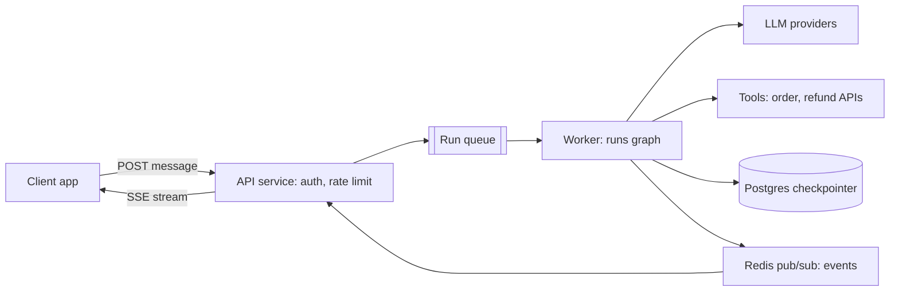

# Agents in Production

This page shows how a notebook agent becomes a production service: serving architecture, background runs, durable execution, LangGraph Platform vs self-hosted FastAPI, reliability, security, versioning, human handoff, and 4 real case studies. Interviewers use it to check whether you can think of an agent as a **distributed system**, or only know how to write prompts.

## ⭐ Serving architecture

**In one line:** the API accepts the request, long work goes through a queue to a worker, the worker runs the graph and saves every step to a Postgres checkpointer, and events stream back to the user over SSE/WebSocket.

> **Example:** Swiggy's order-issue bot. 20k concurrent chats at peak dinner time. API pods only do auth + enqueue, worker pods run LangGraph runs, Postgres holds each thread's state, and Redis pub/sub carries tokens back to the API pod and from there over SSE to the app.



- **Stateless API layer:** auth, input validation, rate limit, create run. No long work here.
- **Queue:** backpressure, retries, and a run can be picked up again if a worker crashes. Redis streams / SQS / Kafka ([Message queues](../01-topics/07-message-queues-kafka.md)).
- **Workers:** run the graph; scale on queue depth, not CPU (most time is spent waiting on the LLM, so async workers can take high concurrency).
- **Checkpointer (Postgres):** saves state after every superstep. This is what enables resume, human-in-the-loop and time-travel debugging.
- **Streaming back:** SSE is simple (one-way, over HTTP, auto-reconnect); use WebSocket when the client also sends interrupt/cancel mid-run. Detail: [Real-time communication](../01-topics/08-real-time-communication.md).
- For small, fast agents (< ~10s) you can skip the queue and stream straight from the API pod.

**Interview tip:** "An agent run is a long-running job, not a request. So I separate the API from the worker and keep state in the checkpointer, not in process memory."

**Common mistake:** running the graph synchronously inside the API request handler with in-memory state. A pod restart = all conversations gone, and runs get cut at the 60s load-balancer timeout.

## Sync vs background runs, durable execution

**In one line:** short interactive runs are sync + streaming; long tasks (minutes to hours) become background runs that resume from the last checkpoint after a crash.

> **Example:** Zerodha's "build my quarterly tax report" agent takes 8 minutes. The user gets a `run_id` immediately and progress streams; if a worker crashes midway, a new worker continues from the thread's last checkpoint instead of starting over.

| | Sync (streaming) run | Background run |
|---|---|---|
| Duration | seconds | minutes–hours |
| Client | keeps the connection open | takes a `run_id`, then polls / webhook / re-joins the stream |
| Failure | client retries | worker resumes from checkpoint |
| Example | support chat reply | deep research, bulk refund audit |

- **Durable execution:** state persists after every step; after a crash, calling `invoke(None, config)` with the same `thread_id` continues the graph from the last successful checkpoint.
- So **nodes must be idempotent**: a node that was half-done at crash time will run again. Use an idempotency key on side effects (refunds).
- LangGraph `durability` modes: `"exit"` (save only at the end, fast), `"async"` (default, saves in the background), `"sync"` (saves after each step before moving on; safest).
- **Temporal-style durability (brief):** Temporal logs every activity result in the workflow's event history; after a crash the workflow replays and completed activities do not run again. For very long, multi-day, money-moving workflows, teams wrap LLM calls as activities inside Temporal. The LangGraph checkpointer gives step-level durability; Temporal gives stronger workflow guarantees (timers, signals, versioning).

**Interview tip:** "Background run + checkpointer + idempotent nodes = crash-safe agent. I will say which node re-runs on resume and how its side effects stay safe."

**Common mistake:** assuming the checkpointer gives exactly-once. It gives step-level resume; an external call inside a node can happen again.

## LangGraph Platform vs self-hosted FastAPI

**In one line:** LangGraph Platform (Agent Server) gives you ready-made assistants/threads/runs/cron/streaming/double-texting; with self-hosted FastAPI you build all of that yourself but get full control.

> **Example:** a startup that wants to launch fast deploys on the Platform. A bank (like HDFC) with strict data residency and its own infra builds FastAPI + its own Postgres + its own queue.

**Platform concepts:**
- **Assistant:** a versioned instance of graph + config (model, prompt, tools). Many assistants from one graph (e.g. "support-hindi", "support-english").
- **Thread:** the persistent state of one conversation (checkpoints).
- **Run:** one execution of an assistant on a thread; sync, streaming or background.
- **Cron:** scheduled runs (e.g. a portfolio summary every day at 9 am).
- **Double-texting:** a run is in progress and the user sends another message. Strategies: `reject` (reject the new one), `enqueue` (let the first finish, then run the new one), `interrupt` (stop the first, keep its progress, run the new one), `rollback` (stop the first, discard its progress, run the new one).

```python
from langgraph_sdk import get_client

client = get_client(url="https://my-agent.example.com")
thread = await client.threads.create(metadata={"user_id": "u_42"})

# user sent the first message, stream the run
async for chunk in client.runs.stream(
    thread["thread_id"], "support_agent",
    input={"messages": [{"role": "user", "content": "Order late hai"}]},
    stream_mode="messages-tuple",
):
    print(chunk.event, chunk.data)

# a second message mid-run: interrupt the first run and start a new one
await client.runs.create(
    thread["thread_id"], "support_agent",
    input={"messages": [{"role": "user", "content": "Cancel kar do"}]},
    multitask_strategy="interrupt",
)
```

**Self-hosted FastAPI (SSE + Postgres checkpointer):**

```python
import json
from contextlib import asynccontextmanager
from fastapi import FastAPI, Depends
from fastapi.responses import StreamingResponse
from langgraph.checkpoint.postgres.aio import AsyncPostgresSaver

@asynccontextmanager
async def lifespan(app: FastAPI):
    async with AsyncPostgresSaver.from_conn_string(DB_URI) as saver:
        await saver.setup()                       # creates the tables (once)
        app.state.graph = builder.compile(checkpointer=saver)
        yield

app = FastAPI(lifespan=lifespan)

@app.post("/threads/{thread_id}/messages")
async def chat(thread_id: str, body: dict, user=Depends(current_user)):
    assert_thread_owner(thread_id, user.id)       # tenant isolation
    cfg = {"configurable": {"thread_id": f"{user.tenant}:{thread_id}"},
           "recursion_limit": 25}
    graph = app.state.graph

    async def events():
        async for msg, meta in graph.astream(
            {"messages": [("user", body["text"])]}, cfg, stream_mode="messages"
        ):
            if msg.content:
                yield f"data: {json.dumps({'node': meta['langgraph_node'], 'text': msg.content})}\n\n"
        yield "data: [DONE]\n\n"

    return StreamingResponse(events(), media_type="text/event-stream")
```

| | LangGraph Platform | Self-hosted FastAPI |
|---|---|---|
| Time to prod | days | weeks |
| Threads/runs/cron/double-texting | built-in | build yourself |
| Task queue, horizontal workers | built-in | yourself (Celery/Arq/SQS) |
| Control, data residency | cloud/hybrid/self-hosted options | full |
| Cost | license/managed fees | infra + eng time |

**Interview tip:** "List what the Platform gives you (persistence, queue, double-texting, cron, streaming), then say which of these you would have to build yourself on FastAPI." It shows you understand the problem, not just the tool.

**Common mistake:** forgetting double-texting in the FastAPI version. Two runs on the same thread in parallel corrupt the state; you need a per-thread lock or queue.

## ⭐ Reliability

**In one line:** LLM providers rate-limit, time out and sometimes go fully down; an agent survives with retries with backoff, failover, timeouts, circuit breakers and idempotent tools.

> **Example:** Dream11's support agent during the IPL final. The provider starts returning 429s. Without backoff, all workers retry at once and make it worse (thundering herd). Backoff + jitter + failover to another provider keeps the service up.

- **Provider rate limits:** both RPM and TPM (tokens per minute). Keep a client-side token bucket to pace yourself before 429s arrive ([Rate limiting](../01-topics/11-rate-limiting.md)). Spread load across multiple API keys/regions/deployments.
- **Retries with exponential backoff + jitter:** only on retryable errors (429, 5xx, timeout). No retry on 400 (bad request) or content filter. Respect the `Retry-After` header.
- **Failover:** primary model down → secondary provider/model. Run evals on the fallback model too; a prompt does not behave the same on every model.
- **Idempotent tools:** `create_refund` must not run twice on retry or resume. Idempotency key = `thread_id + step + tool_call_id` ([Idempotency](../01-topics/10-idempotency-retries.md)).
- **Timeouts:** on every LLM call, every tool, the whole run. On a tool timeout, give the model a clear error message, not a crash.
- **Circuit breaker:** if a tool/provider keeps failing, stop using it for a while, fail fast + fallback; do not make every request wait 30s.
- **Graceful degradation:** if everything fails, "we are having trouble, connecting you to a human agent", and the run's state is preserved.

```python
from langgraph.types import RetryPolicy
from langchain.agents import create_agent
from langchain.agents.middleware import ModelFallbackMiddleware

# node level: retry transient errors with backoff + jitter
builder.add_node(
    "call_order_api", call_order_api,
    retry_policy=RetryPolicy(max_attempts=4, initial_interval=0.5,
                             backoff_factor=2.0, jitter=True,
                             retry_on=(TimeoutError, ConnectionError)),
    timeout=10,                                   # seconds
)

# agent level: if the primary provider is down, use another model
agent = create_agent(
    model="anthropic:claude-sonnet-4-5",
    tools=tools,
    middleware=[ModelFallbackMiddleware("openai:gpt-5")],
)
```

**Interview tip:** always mention retries and idempotency together: "I consider a retry safe only when the tool is idempotent; an idempotency key is mandatory on write tools."

**Common mistake:** retrying at every layer (SDK retry 3 × node retry 3 × queue retry 3 = 27 calls). One layer should own retries; turn them off elsewhere.

## ⭐ Security

**In one line:** an agent acts on behalf of a user, so the user's identity must reach every tool, each tenant's memory/checkpoints must be separate, secrets stay away from the model, and code execution runs in a sandbox.

> **Example:** Razorpay's merchant agent. If merchant A's agent is prompt-injected into "show merchant B's settlements", the tool layer itself must return `403`; do not rely on the LLM being "sensible".

- **Secrets:** API keys in a secret manager (Vault/KMS); never in the prompt, tool output or traces. Redact PII/secrets in traces.
- **Per-user auth propagated to tools:** the tool gets the user's scoped token / identity from the runtime context, not from LLM arguments. The LLM can write anything into a `user_id` argument.
- **Least privilege:** minimum scopes per agent/tool; separate read and write tools; human approval on high-risk writes ([Guardrails & Safety](08-guardrails.md)).
- **Multi-tenant isolation:** tenant prefix in `thread_id` + ownership check; long-term memory store namespace `(tenant, user)`; tenant filter in vector search; row-level security or a per-tenant schema for checkpoints.
- **Sandboxing:** code-execution / browser tools in isolated containers (gVisor, Firecracker, an E2B-style sandbox), no network or an allowlist, CPU/memory/time limits, no host secrets.
- **Prompt injection:** tool results and retrieved docs are untrusted data. They must not be treated as instructions.

```python
from dataclasses import dataclass
from langchain.tools import tool, ToolRuntime

@dataclass
class Ctx:
    user_id: str
    tenant_id: str
    token: str          # user's scoped OAuth token, never shown to the LLM

@tool
def get_settlements(days: int, runtime: ToolRuntime[Ctx]) -> list[dict]:
    """Fetches settlements for the last N days."""
    c = runtime.context
    # identity comes from context, not from the model's args
    return payments_api.settlements(merchant=c.tenant_id, days=days,
                                    auth=c.token)

agent = create_agent(model, tools=[get_settlements], context_schema=Ctx)
agent.invoke({"messages": [("user", "Last week ke settlements")]},
             context=Ctx(user_id="u1", tenant_id="m_77", token=user_token))
```

**Interview tip:** "Authorization is enforced at the tool/API layer, not in the prompt. The LLM only sees the tools this user's role is allowed to use."

**Common mistake:** running all tools with one shared service-account key, and leaving the tenant filter to arguments the LLM generates.

## ⭐ Versioning

**In one line:** prompts, graph code, tools and the model all change behaviour; version all of them, pin model versions, and roll out new versions via canary/shadow deploys that only progress when evals pass.

> **Example:** Flipkart changed one line in the support prompt ("explain the refund policy briefly"). Evals looked fine, but in production fewer refund offers went to refund-eligible users. A 5% canary on metrics (refund rate, CSAT, escalation rate) caught it and they rolled back.

- **Prompts:** versioned in git or a prompt registry; a `prompt_version` tag on every trace.
- **Models:** use a dated/pinned version (`...-2025-xx-xx` style), not a floating alias (`latest`). A silent provider upgrade changes behaviour.
- **Graphs:** deployed with code; mind **in-flight threads**: renaming/removing a node in the new graph can break resume of old checkpoints. Keep state schema changes backward-compatible (new fields optional).
- **Release flow:** offline eval suite (golden set) → **shadow** (the new version runs on real traffic, its response does not reach the user, it is compared; read-only tools only!) → **canary** (1–5% of users) → full rollout. Evals + online metrics at every gate.
- Rollback should be a config flip (assistant/config version), not a redeploy.

| Thing | How to version | Gate |
|---|---|---|
| Prompt | registry / git hash | offline evals |
| Model | pinned snapshot ID | evals + cost/latency compare |
| Graph code | release tag, schema migration | integration tests + resume test |
| Tools | API version | contract tests |

**Interview tip:** "In a shadow deploy, write tools are mocked or disabled, otherwise the new version will also issue real refunds." Evals: [Evals for Agents](09-agent-evals.md).

**Common mistake:** leaving the model alias floating and then debugging "the agent has been acting weird since yesterday".

## Human escalation and support handoff

**In one line:** the agent must know when to stop and hand over to a human, and the handoff must carry the full context (summary, actions taken, state) so the user does not have to repeat themselves.

> **Example:** Swiggy bot: if the user angrily writes "connect me to an agent" for the third time, or the refund is above ₹2,000, or it is a food-safety complaint, go to a human immediately. The human agent's screen shows a summary: "Order #8812, missing item, ₹180 refund already given, user now wants a full refund."

- **Triggers:** explicit user request, negative sentiment trend, low confidence, policy limit (amount, VIP, legal/safety keywords), loop/step-limit hit, repeated tool failures.
- **Mechanism:** pause the run with LangGraph `interrupt()`, create a ticket (Zendesk/Freshdesk), show the thread state to the human; the human's decision goes back into the agent with `Command(resume=...)`, or the human takes over the conversation.
- **Context packet:** summary, user intent, actions + tool results, pending decision, `thread_id` link to the trace.
- Escalation rate is a core metric: too low = the agent is handling cases it should not; too high = the agent adds little value.

**Interview tip:** present escalation as a design feature, not a failure, and name its metrics (escalation rate, resolution after handoff).

**Common mistake:** saying only "connecting you to an agent" at handoff without sending context; the user has to type everything again.

## ⭐ Case studies

**In one line:** every well-known agent product is a combination of a few patterns; in an interview you should be able to state the architecture + pattern + "what the hard part is".

> **Example:** below are 4 systems that come up again and again in interviews: coding agent, customer-support agent, deep-research agent, data-analyst agent.

### 1. Coding agent (like Cursor/Claude Code)
- **Architecture:** single agent loop (ReAct) + tools: `read_file`, `search_code` (grep + embeddings), `edit_file` (diff-based), `run_tests`, `shell` in a sandbox. Optional planner + sub-agents for big tasks.
- **Patterns:** ReAct loop, evaluator-optimizer (tests as verifier), human approval for destructive commands.
- **Hard parts:** context (the repo is big and does not fit, hence search + file summaries), edit reliability (exact string/diff edits), sandbox security, infinite fix-test loops (step budget), cost of long runs.

### 2. Customer-support agent (Swiggy order-issue bot)
- **Architecture:** intent router → specialised subgraphs (missing item, late order, refund, payment) → tools (`get_order`, `get_rider_eta`, `issue_refund` with idempotency) → policy check → reply; escalation node.
- **Patterns:** routing, mostly a **workflow** with the LLM at decision points, HITL for high-value refunds, RAG on policy docs.
- **Hard parts:** refund abuse/fraud (policy limits in code, not the prompt), multilingual + Hinglish, latency at peak, correct escalation, consistent policy application.

### 3. Deep-research agent
- **Architecture:** planner breaks the question into sub-questions → parallel researcher sub-agents (search + fetch + summarize) → aggregator → writer with citations → critic/reflection loop. Background run, minutes long.
- **Patterns:** orchestrator-workers, parallelization (`Send`), reflection, background runs + checkpointer.
- **Hard parts:** source quality and citation faithfulness, cost (sub-agents multiply tokens), context overflow (pass summaries, not raw pages), stopping criteria, progress streaming.

### 4. Data-analyst (text-to-SQL) agent
- **Architecture:** schema retrieval (relevant tables + column docs + sample queries) → SQL generation → validate (parse, read-only, LIMIT, cost estimate) → execute on a read replica → on error, self-correct loop → chart/answer.
- **Patterns:** RAG over schema/semantic layer, evaluator-optimizer (DB error as feedback), tool sandboxing.
- **Hard parts:** ambiguous business metrics (definition of "active user", solved with a semantic layer), SQL that is wrong but runs (silent errors, eval with gold queries), row-level permissions, expensive queries (timeouts, read-only role).

| Agent | Main pattern | Hardest part |
|---|---|---|
| Coding | ReAct + test verifier | repo context, safe execution |
| Support | router + workflow + HITL | policy correctness, fraud, escalation |
| Deep research | orchestrator-workers + reflection | faithfulness, cost, stopping |
| Text-to-SQL | schema RAG + self-correction | metric semantics, silent wrong answers |

**Interview tip:** name the "hard part" in each case yourself; the interviewer will deep-dive right there. Full walkthroughs: [Agentic AI Interview Prep](13-agentic-interview-qa.md).

**Common mistake:** turning every case study into a "multi-agent supervisor". For a support bot, workflow + router is often better.

## ⭐ Production-readiness checklist table

| Area | What must be in place |
|---|---|
| State | Postgres checkpointer, tenant-scoped thread IDs, schema migration plan |
| Execution | background runs for long tasks, resume after crash, idempotent nodes |
| Limits | recursion_limit, token caps, per-user spend cap, timeouts ([Cost & Latency](11-cost-latency.md)) |
| Reliability | backoff + jitter, single retry owner, model failover, circuit breakers |
| Security | secrets in vault, user identity via runtime context, least-privilege tools, sandbox |
| Safety | input/output guardrails, HITL on risky writes ([Guardrails & Safety](08-guardrails.md)) |
| Quality | offline eval suite in CI, online evals on sampled traffic ([Evals for Agents](09-agent-evals.md)) |
| Observability | traces per run, cost/latency/step-count dashboards, alerts ([AI Observability](10-agent-observability.md)) |
| Release | pinned models, versioned prompts, shadow + canary, one-click rollback |
| Support | escalation triggers, context handoff, feedback loop to evals |

## Read next

- [Cost & Latency](11-cost-latency.md), [AI Observability](10-agent-observability.md), [Guardrails & Safety](08-guardrails.md)
- [Idempotency & retries](../01-topics/10-idempotency-retries.md), [Message queues](../01-topics/07-message-queues-kafka.md), [Reliability & observability](../01-topics/20-reliability-observability.md)
- [LLM chat app design](../02-questions/t2-22-llm-chat-app.md)
- Labs: [Production agent](/viewinter/agents/labs/prod), [Multi-agent](/viewinter/agents/labs/multi)

## Checklist

- [ ] I can draw and explain the API → queue → worker → checkpointer → SSE serving architecture
- [ ] I can explain sync vs background runs and resume after a crash (durability modes, idempotent nodes)
- [ ] I can explain LangGraph Platform's assistants, threads, runs, cron and double-texting strategies
- [ ] I can write a FastAPI endpoint that streams a compiled graph over SSE with a thread_id
- [ ] I can give a reliability plan with rate limits, backoff, failover, timeouts and circuit breakers
- [ ] I can explain propagating per-user auth to tools and multi-tenant isolation
- [ ] I can explain prompt, model and graph versioning and shadow/canary deploys with eval gates
- [ ] I can list human-escalation triggers and what context goes with a handoff
- [ ] I can explain the architecture and hard parts of coding, support, deep-research and text-to-SQL agents
