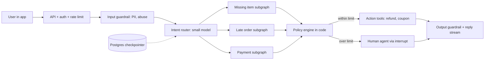
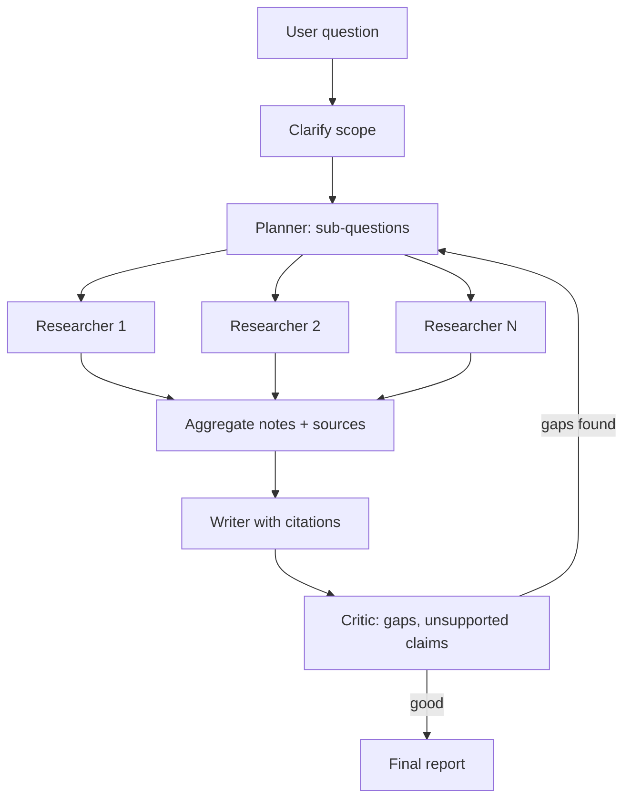
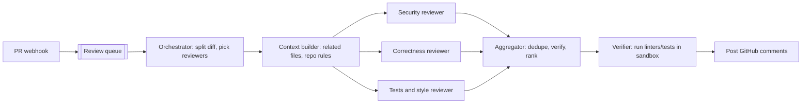

# Agentic AI Interview Prep

This page is for revision: 27 rapid-fire conceptual questions (crisp 2–4 line answers), 3 full system design walkthroughs, trade-off discussions, the flow of a 45-minute round, and red flags. Agentic AI Engineer interviews check three things: your concepts are clear, you can design end to end, and you can argue trade-offs with numbers and reasons.

## ⭐ Rapid-fire: foundations and LangGraph

**In one line:** agent = LLM + tools + loop + state; LangGraph makes that loop an explicit graph where you control state, persistence and flow.

> **Example:** "Is the Swiggy bot an agent or a chatbot?" If it picks tools like `get_order` and `issue_refund` itself and runs in a loop, it is an agent; if it returns fixed FAQ answers, it is a chatbot.

**Q1. Agent vs workflow?**
In a workflow, code decides the steps (the LLM works only inside nodes). In an agent, the LLM picks the next step/tool in a loop. Predictable task = workflow; open-ended = agent. ([Foundations](01-agent-foundations.md))

**Q2. What is ReAct?**
Reason → Act (tool call) → Observe (tool result) → repeat until there is an answer. Today's native tool-calling agents are a form of this loop.

**Q3. When should you not build an agent?**
When the flow is fixed, latency/cost are tight, or a mistake is very costly and autonomy adds little. Try a simple prompt chain or workflow first.

**Q4. State, node, edge in LangGraph?**
State = typed dict (with reducers, e.g. messages append). Node = function that reads state and returns an update. Edge = next node; conditional edge = function that picks the route. ([LangGraph Core](02-langgraph-core.md))

**Q5. Why a checkpointer and thread_id?**
State is saved after every superstep against the `thread_id`. That gives multi-turn memory, crash resume, human-in-the-loop (`interrupt`) and time travel. Postgres checkpointer in prod.

**Q6. What do `interrupt()` and `Command` do?**
`interrupt()` pauses the run and surfaces a value (e.g. approval needed); `Command(resume=...)` continues the run from there. `Command(goto=..., update=...)` does node routing + state update together.

## ⭐ Rapid-fire: patterns, memory and RAG

**In one line:** patterns = which control flow (chain, route, parallel, orchestrator, evaluator); memory = what to remember and where; RAG = the right knowledge in context at the right time.

> **Example:** deep-research agent = orchestrator-workers + reflection; support bot = routing + workflow + HITL.

**Q7. Main workflow patterns?**
Prompt chaining, routing, parallelization (sectioning/voting), orchestrator-workers, evaluator-optimizer. Start with the simplest pattern that works. ([Workflow patterns](03-workflow-patterns.md))

**Q8. Supervisor vs swarm/handoff multi-agent?**
Supervisor: a central agent routes to sub-agents, clear control. Swarm/handoff: agents pass control to each other directly, fewer hops but harder debugging. ([Agent patterns](04-agent-patterns.md))

**Q9. When is multi-agent worth it?**
When tasks are genuinely parallel (research), need different tools/permissions, or a single agent's context/tool list has grown too large. Otherwise a single agent + good tools; multi-agent multiplies tokens.

**Q10. Short-term vs long-term memory?**
Short-term = the thread's conversation state (checkpointer). Long-term = cross-thread facts/preferences (store, namespaced per user), of semantic/episodic/procedural types. ([Memory & Context](05-memory-context.md))

**Q11. What is context engineering?**
Designing what the model sees at each step: write (save outside), select (retrieve), compress (summarize/trim), isolate (sub-agents). Bigger context = more expensive + slower + distraction.

**Q12. Agentic RAG vs classic RAG?**
Classic: retrieve once → generate. Agentic: the agent decides when/where to search, rewrites queries, uses multiple sources, grades results and re-retrieves. Better for multi-hop, but slower and costlier. ([Data & Retrieval](06-agentic-data-rag.md))

## ⭐ Rapid-fire: tools, MCP, guardrails and evals

**In one line:** tools are the agent's hands, MCP makes them a standard plug, guardrails stop the hands from doing the wrong thing, and evals tell you whether it all works.

> **Example:** the Razorpay agent's `issue_refund` tool comes from an MCP server, a HITL guardrail kicks in above ₹5,000, and a trajectory eval checks that `get_payment` was called before the refund.

**Q13. What does a good tool look like?**
Clear name + description (docs for the model), strictly typed args, task-shaped (not thin CRUD), small relevant output, helpful error messages, idempotent writes. ([Tools, MCP & A2A](07-tools-mcp-a2a.md))

**Q14. What is MCP?**
Model Context Protocol: an open standard to expose tools, resources and prompts (client–server, stdio/HTTP). Build an MCP server once, use it in any MCP-compatible agent/host.

**Q15. MCP vs A2A?**
MCP = agent ↔ tools/data. A2A = agent ↔ agent (hand a task to another vendor's/team's agent, discovery via an agent card, task lifecycle). They complement each other.

**Q16. How do you stop prompt injection?**
No single fix: tool results/docs are untrusted data, least-privilege tools, HITL on risky actions, output validation, input classifiers, and never combine sensitive data + untrusted input + external action in one place. ([Guardrails](08-guardrails.md))

**Q17. How do you eval agents?**
Three levels: final output (correctness, LLM-as-judge with a rubric), trajectory (right tools, right order, how many steps), single step/tool call (unit tests). Golden dataset + CI gate + online sampled evals. ([Evals for Agents](09-agent-evals.md))

**Q18. Risks of LLM-as-judge?**
Position/length/self bias; a vague rubric makes it noisy. Fix: clear rubric, pairwise or binary pass/fail, calibrate the judge on human labels, a strong judge model if needed.

## ⭐ Rapid-fire: observability, cost and production

**In one line:** traces show what the agent did, cost/latency levers keep the bill down, and production patterns protect you from crashes, rate limits and bad deploys.

> **Example:** a run took 40 seconds; the trace showed the `search` tool ran 5 times with the same query. After a tool cache + prompt fix, 9 seconds.

**Q19. What do you track for agent observability?**
A trace per run (spans: LLM calls, tools, tokens, latency, errors), prompt/model version, cost per run, step count, user feedback. Dashboards for p95 latency, cost/task, error/escalation rate. OpenTelemetry GenAI conventions. ([AI Observability](10-agent-observability.md))

**Q20. How do you cut an agent's cost?**
Model routing/cascade, prompt caching (stable prefix), tool/semantic cache, fewer steps (better tools, workflows), context trimming, batch API for offline work, distillation for high-volume steps. ([Cost & Latency](11-cost-latency.md))

**Q21. How do you cut latency?**
Stream tokens + step events (TTFT), parallel tool calls/nodes, small models for sub-steps, fewer output tokens, speculative fetch, prompt caching.

**Q22. How do you stop a runaway agent?**
`recursion_limit`, model-call limits, token caps, per-user $ cap, timeouts, and loop detection (same tool + same args again and again) → stop or escalate.

**Q23. What if a run crashes midway?**
Resume from the last superstep via the checkpointer. The half-done node runs again, so write tools must be idempotent (idempotency key). Long tasks as background runs. ([Agents in Production](12-agents-in-production.md))

**Q24. How do you ship a new prompt/model safely?**
Pinned model versions, versioned prompts, offline eval gate, shadow (write tools off), canary 1–5% with online metrics, instant rollback.

**Q25. When sync vs background run?**
Interactive replies that take seconds: sync + streaming. Tasks of minutes to hours (research, bulk audits): background run with an immediate `run_id`, progress stream/poll, resume on worker crash.

**Q26. How do you do multi-tenant isolation?**
Tenant-scoped thread IDs + ownership check, memory store namespace `(tenant, user)`, tenant filter in vector search, identity reaches tools via runtime context. Never trust the LLM's arguments.

**Q27. When do you escalate to a human?**
When the user asks, sentiment worsens, confidence is low, a policy limit (amount, safety, legal) is crossed, or a step/tool-failure limit is hit. The handoff carries a summary + actions taken + trace link.

## ⭐ Design: customer-support agent for food delivery

**In one line:** router + mostly-workflow subgraphs + idempotent action tools + policy engine in code + HITL/escalation, with a Postgres checkpointer and streaming.

> **Example:** "Design a support agent for Swiggy that handles missing items, late orders, refunds and payment issues."

**Clarifying questions:** which issue types (do the top 5 cover ~80% of traffic?), which actions the agent may take alone (refund limit?), channels (in-app chat, voice?), languages (Hindi/Hinglish), peak QPS, latency target, handoff tool for the human team, success metric (resolution rate, CSAT, refund leakage).

- **Pattern choice:** routing + workflow subgraphs (steps are predictable), the LLM only for intent, extraction and an empathetic reply. Not a fully autonomous agent, because money moves.
- **Tools:** `get_order(order_id)`, `get_rider_eta`, `get_restaurant_status`, `issue_refund(order_id, amount, idempotency_key)`, `create_ticket`. User identity from runtime context, not LLM args.
- **Memory:** thread state (current issue, order_id, actions taken) in the checkpointer; long-term: the user's refund history/abuse score (store), language preference.
- **Guardrails:** refund amount/frequency limits in code (not the prompt), PII redaction, injection-safe tool outputs, high-value/food-safety → HITL.
- **Evals:** golden conversations per intent, trajectory check ("get_order + policy check before refund"), policy-violation rate, LLM judge for tone; online: resolution rate, CSAT, escalation rate, refund leakage.
- **Cost/latency:** intent + extraction on a small model, reply on a big or the same mid-size model; prompt cache for the policy text; parallel fetch (order + rider + restaurant); p95 < 5s, streaming.
- **Failure modes:** provider down → fallback model → canned flows + human; order API down → circuit breaker + "update shortly"; double refund → idempotency key; fraud ring → per-user limits + abuse score; double-texting → interrupt strategy.

**Interview tip:** say it yourself: "the policy engine is in code, the LLM only explains". That is the strongest signal.

**Common mistake:** leaving the refund decision to the LLM, or never mentioning an escalation path.

## ⭐ Design: deep-research agent

**In one line:** planner → parallel researcher sub-agents → synthesizer with citations → critic loop, as a background run with streaming progress and strict budgets.

> **Example:** "Design an agent that produces a cited report on 'unit economics of quick commerce in India' in 10 minutes."

**Clarifying questions:** sources (open web, paid DBs, internal docs?), output (report length, citation format), time budget (2 min vs 30 min), cost budget per report, freshness, is user clarification allowed?, how many concurrent reports.

- **Pattern:** orchestrator-workers (dynamic fan-out with LangGraph `Send`), reflection loop (max 2 rounds), background run + Postgres checkpointer.
- **Tools:** web search API, page fetch + clean (HTML → text), PDF parse, internal RAG; each researcher has its own isolated context.
- **Memory/context:** researchers return **compressed notes + source URLs**, not raw pages; the aggregator dedupes. Long-term: the user's past reports/preferences, optional.
- **Guardrails:** web content is untrusted (injection), source allowlist/quality score, a citation with every claim, the critic flags unsupported claims.
- **Evals:** citation faithfulness (is the claim in the source?), coverage vs an expert outline, LLM-judge rubric, cost and time per report.
- **Cost/latency:** small/mid model for researchers, big model for planner + writer; max sub-questions (e.g. 5), per-run token budget, tool-result cache; stream progress events ("3/5 sub-questions done").
- **Failure modes:** search API rate limit → backoff + queue; one researcher hangs → timeout, partial report; loop never satisfied → max reflection rounds; context overflow → summaries only; crash → resume from checkpoint.

**Interview tip:** state stopping criteria and budget first; the biggest risk in deep research is unbounded cost.

**Common mistake:** putting all raw pages into the writer's context, giving 200k tokens and lost-in-the-middle.

## ⭐ Design: multi-agent code-review system

**In one line:** PR event → orchestrator that splits the diff and gives it in parallel to specialised reviewers (security, correctness, style/tests) → aggregator dedupes + ranks by severity → GitHub comments, all with a sandbox and budgets.

> **Example:** "Design a PR review bot for Flipkart's engineering team that gives useful comments on every PR within 5 minutes."

**Clarifying questions:** languages/monorepo size, PR size distribution, can the agent run code (tests, linters)?, do comments block or are they advisory?, false-positive tolerance, latency (how soon after PR open), data policy for private code (which model/hosting).

- **Pattern:** orchestrator-workers + parallelization; reviewers have different prompts/tools (this is what justifies multi-agent); the aggregator acts as an evaluator and filters low-confidence findings.
- **Tools:** `get_diff`, `read_file`, `search_code`, `run_linter`, `run_tests` (sandbox, no network, time limit), `post_comment`.
- **Memory:** repo-level rules (CONTRIBUTING, past accepted/rejected comments) in a long-term store; PR-level state in the checkpointer; incremental review on new commits.
- **Guardrails:** sandbox, read-only repo token, PR content is untrusted (injection comments in code!), max comments per PR, never auto-approve/merge.
- **Evals:** historical PRs with known bugs (recall), human-labelled comment usefulness (precision), online comment acceptance/resolution rate, false-positive rate.
- **Cost/latency:** big PR → chunk by file, skip generated/vendor files, cache file summaries, small model for style, big model for security/correctness; target < 5 min, background run.
- **Failure modes:** huge PR → summary-only mode; noisy comments → developers ignore it (precision > recall); duplicate comments across reviewers → aggregator dedupe; sandbox escape → isolated microVM.

**Interview tip:** "Precision matters more than recall; once developers decide the bot is noisy, they ignore everything." That shows product sense.

**Common mistake:** giving every reviewer the whole repo as context (cost explodes), or giving the bot merge/approve permission.

## ⭐ Trade-off discussions

**In one line:** for every trade-off, say "default + when you would switch + how you would measure"; a one-sided answer sounds weak.

> **Example:** "Why LangGraph, why not plain Python?" Answer: "Persistence, HITL and streaming come free; but for a 3-step pipeline, plain code + retries is enough."

| Trade-off | Default | When the other | What to say |
|---|---|---|---|
| Framework vs custom code | a low-level framework like LangGraph | a very simple flow, or extreme control/perf | "The framework gives persistence, HITL, streaming; I avoid heavy abstractions so prompts and control flow stay visible" |
| Single vs multi-agent | single agent + good tools | parallel subtasks, different permissions, tool list > ~15–20 | "Multi-agent costs 3–10x tokens; only when evals show a gain" |
| RAG vs long context | RAG | small stable corpus + prompt cache | "Long context costs on every call + TTFT; RAG gives the relevant 2–5k tokens and citations" |
| Fine-tuning vs prompting vs RAG | prompting + RAG | high-volume narrow task (distill), strict format/style | "RAG for knowledge, fine-tuning for behaviour, distillation for cost" |
| Open vs closed models | closed API for quality + speed to market | data residency, cost at scale, customization | "Hybrid: router/extraction on self-hosted open models, complex reasoning on closed; I count GPU ops cost too" |

- **Framework vs custom:** use the framework as long as it does not take control away; if debugging forces you inside the framework, go custom there.
- **Single vs multi:** first an eval baseline for the single agent, then for multi-agent; compare cost per task for both.
- **Open vs closed:** total cost includes GPUs, the MLOps team, evals, upgrades; do not compare token prices alone.

**Interview tip:** end every trade-off with "I would decide by measuring on the eval set and cost per task."

**Common mistake:** absolute statements like "multi-agent is always better" or "fine-tuning removes hallucination".

## 45-minute interview flow

**In one line:** time-box it: clarify → requirements → high level → deep dive → evals/ops → wrap-up; give the interviewer a hook at every stage.

> **Example:** the time split below for a "Design a customer-support agent" round.

| Minute | What to do |
|---|---|
| 0–5 | Clarifying questions: users, allowed actions, scale, latency, success metric, risk |
| 5–10 | Functional + non-functional requirements, agent vs workflow decision with a reason |
| 10–20 | High-level architecture mermaid: API, router, graph, tools, memory, checkpointer, streaming |
| 20–30 | Deep dive 1–2: tool design + guardrails/HITL, or multi-agent orchestration (wherever the interviewer pushes) |
| 30–38 | Evals (offline + online), observability, cost/latency numbers |
| 38–43 | Failure modes, reliability, versioning/rollout |
| 43–45 | Recap + "how to make it better" (fine-tune the router, better memory, more automation) |

- At each stage, state the decision + trade-off in one line, then move on.
- Numbers: cost per task, p95 latency, steps per task, escalation rate.

**Interview tip:** the diagram should be on the board within 20 minutes; after that the interviewer picks the deep dive.

**Common mistake:** spending 20 minutes writing prompts and never reaching evals/failures.

## Red flags interviewers notice

**In one line:** these signals tell the interviewer you have built demos but never run a production agent.

> **Example:** a candidate said "GPT-4 will handle everything" in the design, with no tool permissions, evals or budget. The interviewer's note: "no production depth".

- "Multi-agent" or "a bigger model" as the answer to every problem; never asking workflow vs agent.
- No mention of evals, or only "we will check manually".
- Authorization/tenant isolation in the prompt ("we will tell the model not to show other users' data").
- Retrying write tools without idempotency; no HITL anywhere.
- No numbers for cost/latency; no step limits or budgets.
- "Solving" prompt injection with "we will forbid it in the system prompt".
- A list of framework names, but unable to explain state, checkpointing, failure handling.
- No pinned model versions, no rollout/rollback plan.

**Interview tip:** say the opposite of these red flags on your own (evals, budgets, idempotency, auth at the tool layer); saying it unprompted is a senior signal.

**Common mistake:** designing only the happy path; the interviewer will always ask "and what if the tool fails?".

## Read next

- [AI Agents: Foundations](01-agent-foundations.md), [LangGraph Core](02-langgraph-core.md), [Workflow patterns](03-workflow-patterns.md), [Agent patterns](04-agent-patterns.md)
- [Memory & Context](05-memory-context.md), [Data & Retrieval](06-agentic-data-rag.md), [Tools, MCP & A2A](07-tools-mcp-a2a.md)
- [Guardrails](08-guardrails.md), [Evals](09-agent-evals.md), [Observability](10-agent-observability.md), [Cost & Latency](11-cost-latency.md), [Agents in Production](12-agents-in-production.md)
- [RAG Interview Q&A](../09-rag/10-rag-interview-qa.md), [LLM chat app](../02-questions/t2-22-llm-chat-app.md)
- Labs: [Production agent](/viewinter/agents/labs/prod), [Multi-agent](/viewinter/agents/labs/multi), [Web agent](/viewinter/agents/labs/web)

## Checklist

- [ ] I can give 2–4 line answers to the rapid-fire questions on foundations and LangGraph
- [ ] I can confidently answer questions on patterns, memory and agentic RAG
- [ ] I can answer on tools, MCP vs A2A, prompt injection and agent evals
- [ ] I can give rapid-fire answers on observability, cost, latency and production, with numbers
- [ ] I can do the full food-delivery support agent design (from clarifying to failure modes) in 15 minutes
- [ ] I can explain the deep-research agent design with budgets and stopping criteria
- [ ] I can explain the multi-agent code-review design and the precision vs recall trade-off
- [ ] I can discuss the framework, single/multi-agent, RAG/long context, fine-tuning and open/closed trade-offs
- [ ] I can give the 45-minute round time split and the red flags
