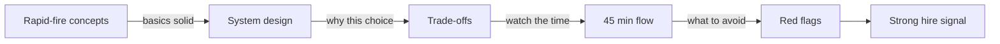
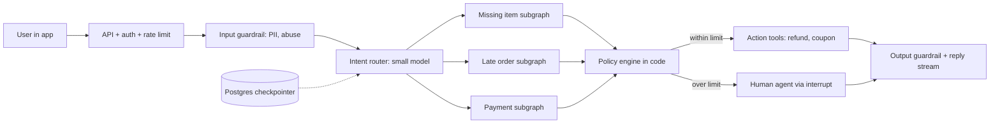
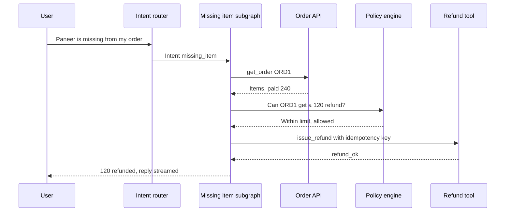
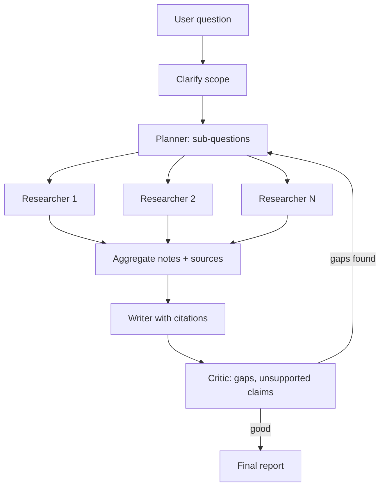
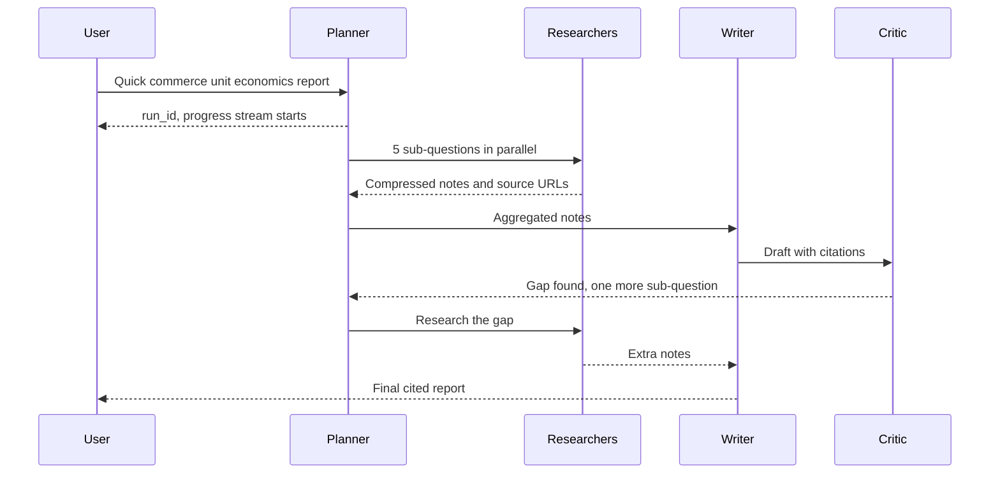
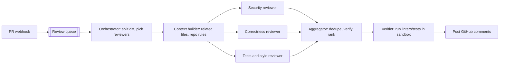
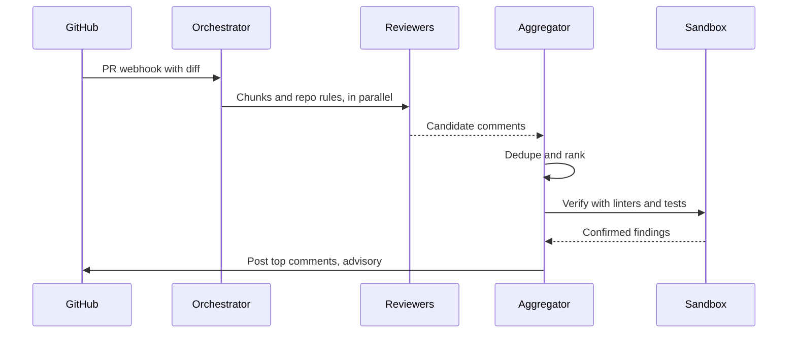
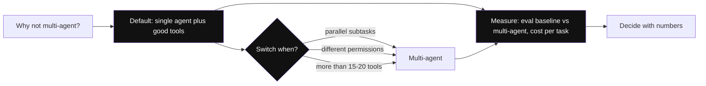
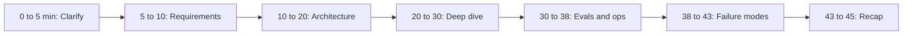

# Agentic AI Interview Prep

This page is for revision before the interview. Agentic AI Engineer interviews check three things: are your concepts clear, can you design a system end to end, and can you state trade-offs with reasons. This page lets you practise all three.

**After this page you can explain:**
- 2–4 line answers to 27 common conceptual questions, plus the plain meaning of each jargon word.
- The design of a support agent, a deep-research agent and a code-review system, in the order a strong candidate says it.
- Answers to "why X, why not Y?" trade-off questions: the default, when you would switch, how you would measure.
- How to split time in a 45-minute round and which red flags to avoid.

## Words you need first

New to LLMs? Read [How LLMs Work](14-how-llms-work.md) first. It explains tokens, context windows and how a model generates text.

| Word | Plain meaning |
|---|---|
| LangGraph | A Python library for building agents as graphs: steps (nodes) joined by arrows (edges), sharing one state. |
| Tool | A function the model can ask your code to run, like `get_order` or `issue_refund`. |
| Superstep | One round of a LangGraph run: every ready node executes, then the state is saved. |
| RAG | Retrieval-augmented generation: search your documents, put the relevant parts in the prompt, then answer. |
| HITL | Human-in-the-loop: the run pauses until a person approves or edits, then continues. |
| Store / namespace | A database for facts kept across chats; the namespace, like `(tenant, user)`, keeps each user's facts separate. |
| Guardrail | A check before or after the model that blocks unsafe input, output or actions. |
| Eval | An automated test that scores the agent's outputs on fixed example inputs. |
| LLM-as-judge | Using a second model call to grade an answer against a rubric, a written scoring guide. |
| Prompt caching | The provider reuses work on a repeated prompt start and bills those tokens much cheaper. |
| Semantic cache | Returns a stored answer when a new question means nearly the same as an old one. |
| `recursion_limit` | LangGraph setting that stops a run after N steps, so a looping agent cannot run forever. |
| Subgraph | A smaller graph used as one step inside a bigger graph, like one per issue type. |
| Hallucination | When the model states something false or made up as if it were true. |

## Big picture: what the interview checks

An agentic AI round usually runs in three parts. First come short conceptual questions (rapid-fire), which check that your basics are solid. Then a system design ("design a support agent"), where they watch whether you clarify, pick the right pattern, and get all the way to evals, cost and failures. Trade-off questions ("why multi-agent?") come up along the way. Through the whole round the interviewer also notes red flags. The sections on this page follow the same order.

**How to use this page:** practise the rapid-fire answers out loud. Read the design sections like a script, then draw the diagram on a board without looking.

## ⭐ Rapid-fire: foundations and LangGraph

**In one line:** agent = LLM + tools + loop + state; LangGraph turns that loop into an explicit graph where state, persistence and control are in your hands.

> **Example:** "Is the Swiggy bot an agent or a chatbot?" If it picks tools like `get_order` and `issue_refund` itself and runs in a loop, it is an agent; if it gives fixed FAQ answers, it is a chatbot.

**Q1. Agent vs workflow?**
In a workflow, code decides the steps (the LLM works only inside nodes). In an agent, the LLM picks the next step/tool itself in a loop. Predictable task = workflow; open-ended = agent. ([Foundations](01-agent-foundations.md))

**Q2. What is ReAct?**
Reason → Act (tool call) → Observe (tool result) → repeat until there is an answer. Today's native tool-calling agents are a form of this loop.
*In simple words:* the model thinks, runs a tool, looks at the result, and thinks again, until the job is done.

**Q3. When should you not build an agent?**
When the flow is fixed, latency/cost is tight, or the cost of a mistake is very high and autonomy adds little. Try a simple prompt chain or workflow first.

**Q4. State, node, edge in LangGraph?**
State = a typed dict (with reducers, e.g. messages append). Node = a function that reads state and returns an update. Edge = the next node; conditional edge = a function that picks the route. ([LangGraph Core](02-langgraph-core.md))
*In simple words:* state is a shared notebook, a node is a step that writes into that notebook, and an edge says which step comes next. A reducer says how new data merges with old data (like appending to a list).

**Q5. Why a checkpointer and thread_id?**
State is saved after every superstep against a `thread_id`. This gives multi-turn memory, crash resume, human-in-the-loop (`interrupt`) and time-travel (re-running from an older save point). In prod, use the Postgres checkpointer.
*In simple words:* after every step a game "save point" is made. `thread_id` is the name of that save file. If there is a crash, or the user comes back tomorrow, the same save is loaded.

**Q6. What do `interrupt()` and `Command` do?**
`interrupt()` pauses the run and hands a value out (e.g. approval needed); `Command(resume=...)` continues the run from that spot. `Command(goto=..., update=...)` does node routing + state update together.
*In simple words:* `interrupt` = "wait, let me ask a human"; `Command(resume=...)` = "got the answer, continue from here".

## ⭐ Rapid-fire: patterns, memory and RAG

**In one line:** patterns = which control flow (chain, route, parallel, orchestrator, evaluator); memory = what to remember and where; RAG = the right knowledge in context at the right time.

> **Example:** deep-research agent = orchestrator-workers + reflection; support bot = routing + workflow + HITL.

**Q7. Main workflow patterns?**
Prompt chaining, routing, parallelization (sectioning/voting), orchestrator-workers, evaluator-optimizer. Start with the simplest pattern that works. ([Workflow patterns](03-workflow-patterns.md))
*In simple words:* chaining = one step after another; routing = pick the right path by looking at the question; parallel = split the work and do it together; orchestrator = one boss hands out work; evaluator = one writes, another checks.

**Q8. Supervisor vs swarm/handoff multi-agent?**
Supervisor: one central agent routes to sub-agents, so control is clear. Swarm/handoff: agents pass control to each other directly, fewer hops but harder debugging. ([Agent patterns](04-agent-patterns.md))
*In simple words:* supervisor = one manager gives everyone their work; swarm = team members pass the baton themselves, with no manager.

**Q9. When is multi-agent worth it?**
When tasks are truly parallel (research), need different tools/permissions, or a single agent's context/tool list has grown too big. Otherwise a single agent + good tools; multi-agent multiplies tokens.

**Q10. Short-term vs long-term memory?**
Short-term = the thread's conversation state (checkpointer). Long-term = cross-thread facts/preferences (store, namespace per user), semantic/episodic/procedural types. ([Memory & Context](05-memory-context.md))
*In simple words:* short-term = what happened in this chat; long-term = what should be remembered about the user in the next chat too (like "prefers Hindi"). Semantic = facts, episodic = past experiences, procedural = ways of doing tasks.

**Q11. What is context engineering?**
Designing what the model sees at each step: write (save outside), select (retrieve), compress (summarize/trim), isolate (sub-agents). Bigger context = costlier + slower + more distraction.
*In simple words:* keep only the papers you need right now on the model's desk. Keep the rest in a file and pull them out when needed.

**Q12. Agentic RAG vs classic RAG?**
Classic: retrieve once → generate. Agentic: the agent decides when/where to search, rewrites the query, uses multiple sources, grades results and re-retrieves. Better for multi-hop, but slower and costlier. ([Data & Retrieval](06-agentic-data-rag.md))
*In simple words:* classic RAG goes to the library once; agentic RAG keeps looking until it finds the right book. Multi-hop = the answer needs several lookups, one after another.

## ⭐ Rapid-fire: tools, MCP, guardrails and evals

**In one line:** tools are the agent's hands, MCP makes them a standard plug, guardrails stop the hands from doing wrong things, and evals tell you whether everything is working.

> **Example:** a Razorpay agent's `issue_refund` tool comes from an MCP server, a HITL guardrail kicks in above ₹5,000, and a trajectory eval checks that `get_payment` was called before the refund.

**Q13. What makes a good tool?**
Clear name + description (docs for the model), strictly typed args, task-shaped (not thin CRUD), small relevant output, helpful error messages, idempotent writes. ([Tools, MCP & A2A](07-tools-mcp-a2a.md))
*In simple words:* a tool should do one whole job (like `refund_order`), not small DB operations the model has to stitch together. Idempotent = running it twice has the effect of running it once.

**Q14. What is MCP?**
Model Context Protocol: an open standard for exposing tools, resources and prompts (client–server, over stdio, i.e. a local process, or HTTP). Build an MCP server once, use it in any MCP-compatible agent/host.
*In simple words:* MCP is like USB for tools. One standard plug that fits any device (agent app).

**Q15. MCP vs A2A?**
MCP = agent ↔ tools/data. A2A = agent ↔ agent (giving a task to another vendor's/team's agent, discovery through an agent card, task lifecycle). They complement each other.
*In simple words:* with MCP an agent picks up a tool; with A2A an agent outsources work to another agent. Agent card = that agent's visiting card (what it can do, where to reach it).

**Q16. How do you stop prompt injection?**
There is no single fix: treat tool results/docs as untrusted data, least-privilege tools, HITL on risky actions, output validation, input classifiers, and never have sensitive data + untrusted input + external action all together. ([Guardrails](08-guardrails.md))
*In simple words:* prompt injection = a hidden line in a document or webpage that tells the agent to do something wrong. Defence: give the agent little power, and get a human's yes before dangerous actions.

**Q17. How do you evaluate agents?**
Three levels: final output (correctness, LLM-as-judge with a rubric), trajectory (right tools, right order, how many steps), single step/tool call (unit tests). Golden dataset + CI gate + online sampled evals. ([Evals for Agents](09-agent-evals.md))
*In simple words:* check the path too, not just the final answer. Trajectory = which tools the agent ran in which order. Golden dataset = sample questions with their correct answers.

**Q18. Risks of LLM-as-judge?**
Position/length/self bias, and noisy results if the rubric is vague. Fix: a clear rubric, pairwise (compare two answers, pick the better) or binary pass/fail, calibrate the judge on human labels, a strong judge model when needed.
*In simple words:* the judge model makes mistakes too: it may prefer the first answer or the longer one. So give a clear rubric and match its verdicts against human verdicts.

## ⭐ Rapid-fire: observability, cost and production

**In one line:** traces show what the agent did, cost/latency levers keep the bill down, and production patterns protect against crashes, rate limits and bad deploys.

> **Example:** a run took 40 seconds; the trace showed the `search` tool ran 5 times with the same query. After a tool cache + prompt fix it took 9 seconds.

**Q19. What do you track for agent observability?**
A trace per run (spans: LLM calls, tools, tokens, latency, errors), prompt/model version, cost per run, step count, user feedback. Dashboards for p95 latency, cost/task, error/escalation rate. OpenTelemetry GenAI conventions. ([AI Observability](10-agent-observability.md))
*In simple words:* trace = the CCTV recording of one run; span = one clip of that recording (one LLM call or one tool). p95 = 95 out of 100 requests are faster than this.

**Q20. How do you cut an agent's cost?**
Model routing/cascade, prompt caching (stable prefix), tool/semantic cache, fewer steps (better tools, workflows), context trimming, batch API for offline work, distillation for high-volume steps. ([Cost & Latency](11-cost-latency.md))
*In simple words:* give easy work to a small cheap model, cache the prompt you send again and again, and cut steps. Distillation = training a small model on a big model's answers.

**Q21. How do you cut latency?**
Stream tokens + step events (TTFT), parallel tool calls/nodes, small models for sub-steps, fewer output tokens, speculative fetch (fetching likely-needed data before the model asks), prompt caching.
*In simple words:* show the user the first word quickly (TTFT = time to first token), and do together whatever can run together.

**Q22. How do you stop a runaway agent?**
`recursion_limit`, model-call limits, token caps, a per-user $ cap, timeouts, and loop detection (same tool + same args again and again) → stop or escalate.

**Q23. What if a crash happens mid-run?**
Resume from the last superstep via the checkpointer. A half-done node runs again, so write tools must be idempotent (idempotency key). Long tasks are background runs. ([Agents in Production](12-agents-in-production.md))
*In simple words:* another worker continues from the last save point; the step that was half done runs again, so send actions like refunds with a unique key so they do not happen twice.

**Q24. How do you ship a new prompt/model safely?**
Pinned model versions, versioned prompts, an offline eval gate, shadow (write tools off), canary at 1–5% with online metrics, instant rollback.
*In simple words:* shadow = the new version quietly runs alongside but its answer does not go to the user; canary = show it to 1–5% of users first, then to everyone if all is well.

**Q25. When sync vs background run?**
Interactive replies that take seconds: sync + streaming. Tasks that take minutes to hours (research, bulk audits): background run with an immediate `run_id`, progress stream/poll, and resume on worker crash.

**Q26. How do you do multi-tenant isolation?**
Tenant-scoped thread IDs + an ownership check, memory store namespace `(tenant, user)`, a tenant filter in vector search, tools get identity from runtime context. Never trust the LLM's arguments.
*In simple words:* tenant = one customer company. Everywhere (threads, memory, search) the server, not the LLM, puts the company's label on the data.

**Q27. When do you escalate to a human?**
When the user asks, sentiment drops, confidence is low, a policy limit (amount, safety, legal) is crossed, or a step/tool-failure limit is hit. Hand off with a summary + actions taken + trace link.

## ⭐ Design: customer-support agent for food delivery

> **Example:** "Design a support agent for Swiggy that handles missing items, late orders, refunds and payment issues."

**In one line:** router + mostly-workflow subgraphs + idempotent action tools + a policy engine in code + HITL/escalation, with a Postgres checkpointer and streaming.

Below is the script a strong candidate says, in this order.

**1. Clarify (0–5 min).** "Before designing, I'll ask a few questions."
- "Which issue types are there, and how much traffic do the top 5 cover?" (Assume: ~80%.)
- "Which actions can the agent take on its own? What is the refund limit?" (Assume: up to ₹500 on its own.)
- "Which channels (in-app chat, voice) and languages (Hindi/Hinglish)?"
- "Peak QPS and latency target? What handoff tool does the human team use?"
- "How do we measure success: resolution rate, CSAT, refund leakage?"

**2. Pick the pattern.** "The steps are mostly predictable and money moves. So I won't build a fully autonomous agent; I'll build **routing + workflow subgraphs**. The LLM only understands the intent, extracts details and writes an empathetic reply. Code makes the refund decision."

**3. High-level diagram (10–20 min).** "Now I'll draw the architecture, from the user inwards."

**4. Trace one request.** "Let me walk one real message through it: 'Paneer is missing from my order'."

"The LLM only catches the intent and writes the reply; the refund decision comes from the policy engine in code, and the refund call goes with an idempotency key."

**5. Tools and memory.** "Tools: `get_order(order_id)`, `get_rider_eta`, `get_restaurant_status`, `issue_refund(order_id, amount, idempotency_key)`, `create_ticket`. The user's identity comes from runtime context, not the LLM's args. Thread state (current issue, order_id, actions taken) lives in the checkpointer. The long-term store holds the user's refund history/abuse score and language preference."

**6. Guardrails.** "Refund amount/frequency limits live in code, not the prompt. PII redaction. I treat tool outputs as untrusted (prompt injection). High-value or food-safety cases go straight to HITL."

**7. Evals.** "Golden conversations per intent. A trajectory check: 'did get_order + policy check happen before the refund?'. Policy-violation rate. An LLM judge for tone. Online: resolution rate, CSAT, escalation rate, refund leakage."

**8. Cost and latency.** "Intent and extraction on a small model, the reply on a mid-size model. Prompt cache on the policy text. Fetch order, rider and restaurant data in parallel. Target p95 < 5s, with streaming."

**9. Failure modes.** "If you ask what happens when this breaks:"
- Provider down → fallback model → canned flows + human.
- Order API down → circuit breaker + "I'll update you shortly".
- Double refund → idempotency key.
- Fraud ring → per-user limits + abuse score.
- The user sends another message mid-run (double-texting) → interrupt strategy.

*In simple words:* HITL = human-in-the-loop, a human's approval; policy engine = plain code that checks rules; idempotency key = a unique number for each refund so it never happens twice.

**Interview tip:** say it yourself: "the policy engine is in code, the LLM only explains". This is the strongest signal.

**Common mistake:** leaving the refund decision to the LLM, or not mentioning the escalation path at all.

## ⭐ Design: deep-research agent

> **Example:** "Design an agent that builds a cited report on 'quick-commerce unit economics in India' in 10 minutes."

**In one line:** planner → parallel researcher sub-agents → synthesizer with citations → critic loop, as a background run with streamed progress and strict budgets.

The script, in the order you should say it:

**1. Clarify (0–5 min).** "First I'll ask:"
- "Which sources: open web, paid DBs, internal docs?"
- "What output: how long a report, which citation format?"
- "Is the time budget 2 min or 30 min? What is the cost budget per report?"
- "How much does freshness matter? Can the agent ask the user for clarification?"
- "How many reports run at the same time?"

**2. Budget and stopping first.** "The biggest risk in deep research is unbounded cost. So I fix these at the start: max 5 sub-questions, max 2 reflection rounds, a per-run token budget. It runs in the background because it takes minutes."

**3. High-level diagram.** "Now I'll draw the flow. The planner splits the work, researchers work in parallel, the writer writes, the critic checks."

**4. Trace one run.** "For the quick-commerce question, a run goes like this:"

"Researchers return compressed notes, not raw pages, and the critic can send the run back to the planner only a limited number of times; then the report ships."

**5. Pattern and tools.** "The pattern is orchestrator-workers: dynamic fan-out with LangGraph `Send` (one parallel branch per sub-question), a reflection loop of max 2 rounds, a background run + Postgres checkpointer. Tools: web search API, page fetch + clean (HTML → text), PDF parse, internal RAG. Each researcher has its own isolated context."

**6. Memory and context.** "Researchers return **compressed notes + source URLs**, not raw pages; the aggregator dedupes. Long-term, the user's past reports/preferences are optional."

**7. Guardrails.** "Web content is untrusted (injection). A source allowlist/quality score, a citation with every claim, and the critic flags unsupported claims."

**8. Evals.** "Citation faithfulness (is the claim really in the source?), coverage against an expert outline, an LLM-judge rubric, and cost + time per report."

**9. Cost and latency.** "Researchers on a small/mid model, planner and writer on a big one. Max 5 sub-questions, a per-run token budget, a tool-result cache. Progress events for the user: '3/5 sub-questions done'."

**10. Failure modes.**
- Search API rate limit → backoff + queue.
- One researcher hangs → timeout, partial report.
- The critic is never satisfied → max reflection rounds.
- Context overflow → summaries only.
- Worker crash → resume from checkpoint.

*In simple words:* fan-out = splitting one job across many workers; reflection = reviewing and improving your own draft; citation faithfulness = whether what is written is really in that source.

**Interview tip:** state the stopping criteria and budget first; the biggest risk in deep research is unbounded cost.

**Common mistake:** putting all raw pages into the writer's context, which means 200k tokens and lost-in-the-middle.

## ⭐ Design: multi-agent code-review system

> **Example:** "Design a PR review bot for Flipkart's engineering team that gives useful comments on every PR within 5 minutes."

**In one line:** PR event → an orchestrator that splits the diff and hands it in parallel to specialised reviewers (security, correctness, style/tests) → an aggregator that dedupes + ranks by severity → GitHub comments, all with a sandbox and budgets.

The script:

**1. Clarify (0–5 min).** "First I'll ask:"
- "Which languages, how big is the monorepo, what does the PR size distribution look like?"
- "Can the agent run code (tests, linters)?"
- "Do comments block the merge or are they advisory only?"
- "How many false positives are acceptable? How soon after the PR opens is the review needed?"
- "What is the data policy for private code: which model, hosted where?"

**2. Why multi-agent.** "Multi-agent is justified here because the security, correctness and style reviewers need different prompts and different tools, and they can run in parallel. The aggregator acts as an evaluator and filters low-confidence findings."

**3. High-level diagram.** "The flow from webhook to comment looks like this:"

**4. Trace one PR.** "On one PR, this happens:"

"Reviewers produce candidates in parallel, but only what the aggregator dedupes and the sandbox confirms gets posted. That keeps precision high."

**5. Tools and memory.** "Tools: `get_diff`, `read_file`, `search_code`, `run_linter`, `run_tests` (sandbox, no network, time limit), `post_comment`. Repo-level rules (CONTRIBUTING, past accepted/rejected comments) in the long-term store. PR-level state in the checkpointer. Incremental review on new commits."

**6. Guardrails.** "Sandbox, read-only repo token. PR content is untrusted (code can contain injection comments!). Max comments per PR. The bot never auto-approves or merges."

**7. Evals.** "Recall on historical PRs with known bugs. Precision from human-labelled comment usefulness. Online: comment acceptance/resolution rate and false-positive rate."

**8. Cost and latency.** "Chunk a big PR by file, skip generated/vendor files, cache file summaries. A small model for style, a big one for security/correctness. Target < 5 min, background run."

**9. Failure modes.**
- Huge PR → summary-only mode.
- Noisy comments → developers start ignoring the bot (so precision > recall).
- Duplicate comments across reviewers → aggregator dedupe.
- Sandbox escape → isolated microVM.

*In simple words:* precision = of the comments given, how many were right; recall = of the real bugs, how many were caught. Sandbox = a closed room where code can run but cannot damage anything outside.

**Interview tip:** "Precision matters more than recall; once devs decide the bot is noisy, they ignore everything." This shows product sense.

**Common mistake:** giving every reviewer the whole repo as context (cost explodes), or giving the bot merge/approve permission.

## ⭐ Trade-off discussions

**Why do we need this?** The interviewer asks "why X, why not Y?" because there is no single right answer. Saying "always X" sounds weak. A strong answer has three parts: **what the default is, when you would switch, and how you would measure.**

> **Example:** "Why LangGraph, why not plain Python?" Answer: "Persistence, HITL and streaming come for free; but for a 3-step pipeline, plain code + retries is enough."

*Diagram:* The three highlighted parts are the answer shape for any trade-off question: state the default, name when you would switch, and say how you would measure.

| If they ask | Say | Because | When you would pick the other |
|---|---|---|---|
| "Why a framework, why not custom code?" | "A low-level framework like LangGraph; I avoid heavy abstractions so prompts and control flow stay visible" | persistence, HITL and streaming come for free | a very simple flow, or you need extreme control/perf |
| "Why not multi-agent?" | "First a single agent + good tools" | multi-agent multiplies tokens 3–10x; only when evals show a gain | parallel subtasks, different permissions, tool list > ~15–20 |
| "RAG or long context?" | "RAG" | long context adds cost + TTFT on every call; RAG gives the relevant 2–5k tokens and citations | a small stable corpus + prompt cache |
| "Will you fine-tune?" | "Prompting + RAG first" | RAG for knowledge, fine-tuning for behaviour, distillation for cost | a high-volume narrow task (distill), strict format/style |
| "Open model or closed?" | "A closed API for quality and speed to market; hybrid where it makes sense" | router/extraction on open self-hosted, complex reasoning on closed; GPU ops cost counts too | data residency, cost at scale, customization |

- **If they ask "when did the framework get in the way?":** say "when I had to dig into the framework to debug, I went custom there", because a framework is good only until it takes control away.
- **If they ask "how do you know multi-agent is better?":** say "first an eval baseline for the single agent, then multi-agent, and compare cost per task for both", because without numbers it is only an opinion.
- **If they ask "isn't an open model cheaper?":** say "I add GPU, the MLOps team, evals and upgrades to the token price", because total cost is not just the token price.

*In simple words:* TTFT = time until the first token arrives; distill = train a small, cheap model from a big model; data residency = a legal rule about which country the data must stay in.

**Interview tip:** end every trade-off with "I'll decide by measuring it on an eval set and cost per task".

**Common mistake:** absolute statements like "multi-agent is always better" or "fine-tuning removes hallucination".

## 45-minute interview flow

**Why do we need this?** Even good candidates fail because they spend 20 minutes writing prompts and never reach evals or failures. Split your time in advance.

**In one line:** time-box it: clarify → requirements → high-level → deep dive → evals/ops → wrap-up; give the interviewer a hook at every stage.

> **Example:** the time split below is for a "Design a customer-support agent" round.

| Minute | What to do | A sample line |
|---|---|---|
| 0–5 | Clarifying questions: users, allowed actions, scale, latency, success metric, risk | "Which actions can the agent take on its own?" |
| 5–10 | Functional + non-functional requirements, agent vs workflow decision with a reason | "The steps are predictable, so workflow + router." |
| 10–20 | High-level architecture mermaid: API, router, graph, tools, memory, checkpointer, streaming | "I'll draw from the user inwards." |
| 20–30 | Deep dive 1–2: tool design + guardrails/HITL, or multi-agent orchestration (wherever the interviewer pushes) | "Which part would you like to go deeper on?" |
| 30–38 | Evals (offline + online), observability, cost/latency numbers | "Golden set + trajectory checks, p95 < 5s." |
| 38–43 | Failure modes, reliability, versioning/rollout | "If the provider is down, fallback, then human." |
| 43–45 | Recap + "how to make it better" (fine-tune the router, better memory, more automation) | "Next step: I'd distill the router." |

- At each stage, state the decision + trade-off in one line, then move on.
- Numbers: cost per task, p95 latency, steps per task, escalation rate.

The round is a pipeline: get the diagram done by minute 20, and make sure evals and failure modes get their slot before the recap.

**Interview tip:** the diagram should be on the board within 20 minutes; after that the interviewer picks the deep dive.

**Common mistake:** spending 20 minutes on writing prompts and never reaching evals/failures.

## Red flags interviewers notice

**In one line:** these signals tell the interviewer the candidate has only built demos and never run a production agent.

> **Example:** the candidate said "GPT-4 will handle everything" in the design, with no tool permissions, evals or budget. The interviewer's note: "no production depth".

| Red flag | Say this instead |
|---|---|
| "Multi-agent" or "a bigger model" for every problem; never raising workflow vs agent | "First I'll check whether a workflow is enough or we need an agent." |
| No mention of evals, or only "we'll check manually" | "Golden set, trajectory checks, a CI gate and online sampled evals." |
| Authorization/tenant isolation in the prompt ("we'll tell the model not to show other users' data") | "Identity from runtime context, checked at the tool/API layer." |
| Retrying write tools without idempotency; no HITL anywhere | "An idempotency key on write tools, human approval on risky actions." |
| No cost/latency numbers; no step limits or budgets | "Cost per task ~₹X, p95 < 5s, recursion_limit and a token budget." |
| "Solving" prompt injection with "we'll forbid it in the system prompt" | "Tool outputs are untrusted, least privilege, HITL." |
| A list of framework names, but unable to explain state, checkpointing or failure handling | "Resume from the checkpoint, and which node runs again." |
| No pinned model versions, no rollout/rollback plan | "Pinned model, shadow + canary, rollback by config flip." |

**Interview tip:** say the opposite of these red flags yourself (evals, budgets, idempotency, auth at the tool layer); saying it without being asked is a senior signal.

**Common mistake:** designing only the happy path; the interviewer will always ask "and what if the tool fails?".

## Read next

- [AI Agents: Foundations](01-agent-foundations.md), [LangGraph Core](02-langgraph-core.md), [Workflow patterns](03-workflow-patterns.md), [Agent patterns](04-agent-patterns.md)
- [Memory & Context](05-memory-context.md), [Data & Retrieval](06-agentic-data-rag.md), [Tools, MCP & A2A](07-tools-mcp-a2a.md)
- [Guardrails](08-guardrails.md), [Evals](09-agent-evals.md), [Observability](10-agent-observability.md), [Cost & Latency](11-cost-latency.md), [Agents in Production](12-agents-in-production.md)
- [LLM Engineer Interview Prep](22-llm-engineer-interview.md): fundamentals, serving and fine-tuning questions
- [RAG Interview Q&A](../09-rag/10-rag-interview-qa.md), [LLM chat app](../02-questions/t2-22-llm-chat-app.md)
- Labs: [Production agent](/viewinter/agents/labs/prod), [Multi-agent](/viewinter/agents/labs/multi), [Web agent](/viewinter/agents/labs/web)

## Checklist

- [ ] I can give 2–4 line answers to the rapid-fire questions on foundations and LangGraph
- [ ] I can confidently answer questions on patterns, memory and agentic RAG
- [ ] I can answer questions on tools, MCP vs A2A, prompt injection and agent evals
- [ ] I can give rapid-fire answers on observability, cost, latency and production, with numbers
- [ ] I can talk through the full design of a food-delivery support agent (from clarifying to failure modes) in 15 minutes
- [ ] I can explain the design of a deep-research agent with budgets and stopping criteria
- [ ] I can explain the design of a multi-agent code-review system and the precision vs recall trade-off
- [ ] I can explain the framework, single/multi-agent, RAG/long context, fine-tuning and open/closed trade-offs in an "if they ask, say, because" format
- [ ] I can explain the 45-minute round time split and the red flags
