# How LLMs Work

This page explains what actually happens inside a large language model, from the text you type to the words it sends back. Every agent, RAG system and AI feature sits on top of this machine. Interviewers start here to check that you understand the engine, not only the API call.

**After this page you can answer:**
- "Walk me through what happens when you send a prompt to an LLM."
- "Why can't the model count the r's in 'strawberry'?"
- "Why is attention quadratic in sequence length, and what does that cost us?"
- "What is GQA, and why does it shrink the KV cache?"
- "I set temperature to 0 and still get different answers. Why?"
- "What are the trade-offs of Mixture of Experts?"
- "When would you use a reasoning model, and when would you not?"
- "Why do LLMs hallucinate, and how do you reduce it?"

## Words you need first

| Word | Plain meaning |
|---|---|
| Token | A small piece of text, like "chai" or "ing". The model reads and writes tokens, not letters. |
| Tokenizer | The program that cuts text into tokens and turns each one into a number (its ID). |
| Vocabulary | The fixed list of all tokens a model knows, usually 32,000 to 200,000 of them. |
| Parameter (weight) | One learned number inside the model. A "7B model" has 7 billion of them. |
| Vector | A list of numbers, like [0.2, -1.3, 0.7]. Models do all their thinking with these. |
| Embedding | The vector that stands for a token. Similar meanings get similar vectors. |
| Logit | A raw score the model gives each possible next token. Higher means more likely. |
| Softmax | A formula that turns raw scores into probabilities that add up to 1. |
| Attention | The step where each token looks at earlier tokens and picks what is relevant. |
| Transformer | The neural network design used by all modern LLMs, built from stacked attention blocks. |
| Context window | The maximum number of tokens the model can look at in one call. |
| Inference | Using a trained model to produce output. Training is learning; inference is answering. |
| VRAM | Memory on the GPU. The model and its working data must fit here. |
| KV cache | Saved attention data for earlier tokens, so they are not recomputed for every new token. |

## Big picture

An LLM is a function that takes a list of tokens and returns a score for every token in its vocabulary: "how likely is this to come next?" Your text is cut into tokens. Each token becomes a vector (embedding). The vectors pass through a stack of transformer layers, where attention lets every token gather meaning from earlier tokens. The last layer produces logits. A sampling rule picks one token. That token is added to the input, and the whole thing repeats until the answer is done. Everything else on this page is a detail of one of these boxes.

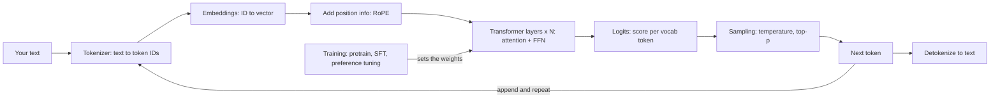

## What an LLM really is

**In one line:** An LLM is a very large function that predicts the next token, trained on trillions of tokens of text so its predictions become useful.

**Why it exists:** Writing rules for language by hand does not scale. There are too many cases. Instead we show a model a huge amount of text and let it learn the patterns by itself. "Predict the next word" turns out to be a task that forces the model to learn grammar, facts and some reasoning.

**Picture it:** Think of the autocomplete on your phone keyboard. You type "Happy" and it suggests "birthday". An LLM is that same idea, scaled up a billion times, and run in a loop so it can write whole pages.

**How it works, step by step:**
1. **The task.** Given "The capital of India is", the model outputs a probability for every token. " New" might get 0.92. " Mumbai" might get 0.03.
2. **Parameters are the knowledge.** The model is mostly big tables of numbers (matrices). These numbers are the parameters. They start random.
3. **Training.** We feed real text, ask the model to predict each next token, and measure how wrong it was (the "loss"). An algorithm called gradient descent nudges every parameter a tiny bit to reduce the error. Repeat this over trillions of tokens. Llama 3, for example, was pretrained on roughly 15 trillion tokens.
4. **Inference.** After training, the parameters are frozen. We only run the model forward to get predictions. This is what happens when you call an API.
5. **Size in memory.** Each parameter is stored as a number. In 16-bit format (FP16 or BF16) one number takes 2 bytes. So a 7B model needs 7B × 2 bytes = **14 GB** just to hold its weights. A 70B model needs about 140 GB, which means at least two 80 GB GPUs.

| | Training | Inference |
|---|---|---|
| Goal | Learn the parameters | Use the parameters |
| Parameters change? | Yes, every step | No, frozen |
| Memory per parameter | Roughly 16 bytes (weights, gradients, optimizer state) | 2 bytes in FP16, 1 byte in INT8, 0.5 in 4-bit |
| Who does it | Model labs, once, for weeks | You, on every request |

**Interview tip:** "What is an LLM, in one sentence?" Say: "A transformer trained to predict the next token. At inference it runs that prediction in a loop, sampling one token at a time, and everything useful it does comes from patterns learned in that next-token training."

**Common mistake:**
- Saying the model "looks things up". It does not have a database. Its knowledge is compressed into the weights, and it can be wrong or out of date.
- Forgetting that weights alone are not the full memory cost. At inference you also need room for the KV cache (see below).

## ⭐ Tokens and tokenization

**In one line:** Text is cut into tokens (common chunks of characters) and each token gets an integer ID, because the model can only work with numbers from a fixed list.

**Why it exists:** The model needs a fixed vocabulary. Using whole words fails: there are millions of words, plus typos, names and code. Using single characters works but makes sequences very long, and long sequences are slow and costly. Subword tokens are the middle path: common words are one token, rare words are split into pieces.

**Picture it:** Think of a kirana shop that packs common orders in ready bags. "1 kg atta + 1 kg sugar" is so common that it is one bag. A rare order is packed from loose items. Tokenization does the same: frequent letter groups become one token, rare ones are built from smaller pieces.

**How it works, step by step (Byte Pair Encoding, BPE):** BPE is the method used by GPT, Llama and most other LLMs. It builds the vocabulary by repeatedly merging the most frequent pair of symbols.

Tiny training corpus, with how often each word appears: `hug` ×10, `pug` ×5, `pun` ×12, `bun` ×4, `hugs` ×5.

1. **Start with single characters.** Vocabulary = `b, g, h, n, p, s, u`. Each word is split: `h u g`, `p u g`, `p u n`, `b u n`, `h u g s`.
2. **Count every adjacent pair.** `u g` appears in hug (10) + pug (5) + hugs (5) = **20**. `u n` appears in pun (12) + bun (4) = 16. `h u` appears 10 + 5 = 15.
3. **Merge the top pair.** `u g` wins, so add token `ug`. Words become `h ug`, `p ug`, `p u n`, `b u n`, `h ug s`.
4. **Count again and merge.** Now `u n` (16) is top. Add `un`. Words: `p un`, `b un`.
5. **Again.** `h ug` (10 + 5 = 15) is top. Add `hug`. Now `hug` is one token and `hugs` is `hug` + `s`.
6. **Stop at the target size.** Real tokenizers repeat this until the vocabulary has 32K to 200K tokens. The ordered list of merges is saved and replayed on new text.

```mermaid
flowchart LR
    C["Corpus: hug x10, pug x5, pun x12, bun x4, hugs x5"] --> S0["Start: single letters b g h n p s u"]
    S0 --> M1["Count pairs: u+g = 20 is top"]
    M1 --> T1["Merge 1: new token ug"]:::hot
    T1 --> M2["Count again: u+n = 16 is top"]
    M2 --> T2["Merge 2: new token un"]:::hot
    T2 --> M3["Count again: h+ug = 15 is top"]
    M3 --> T3["Merge 3: new token hug"]:::hot
    T3 --> R["Repeat until 32K to 200K tokens"]
    R --> L["Saved merge list is replayed on new text"]
    classDef hot fill:#111,color:#fff
    classDef dim fill:#fff
```

*Diagram:* Follow the dark boxes: each round merges the most frequent neighbour pair into one new token, so common chunks like hug end up as a single token.

Modern tokenizers run BPE on **bytes**, not characters. So any text, emoji or language can be encoded, and nothing is ever "unknown".

**Tokens vs words, in numbers:**

| Fact | Rough value |
|---|---|
| English words per token | about 0.75 (so 1,000 tokens ≈ 750 words) |
| Characters per token, English | about 4 |
| Hindi, Tamil and other Indic text | often 2–4 times more tokens for the same meaning, depending on the tokenizer |
| Vocabulary sizes | GPT-2: 50,257. Llama 2: 32,000. Llama 3: about 128,000. GPT-4o: about 200,000 |

Why does Hindi cost more? The tokenizer was trained on mostly English data, so few Hindi letter groups earned their own token. A Hindi word gets split into many small pieces. Since APIs bill per token, the same answer in Hindi can cost 2–3 times more and use more of the context window. Newer tokenizers with larger vocabularies narrow this gap.

**Why "strawberry" letter counting fails:** The model never sees letters. It sees something like `str` + `aw` + `berry` (the exact split depends on the tokenizer), which become three IDs. To count the r's it must have memorised how each token is spelled. It often has not. The same reason explains trouble with reversing words, counting characters and some arithmetic on long numbers.

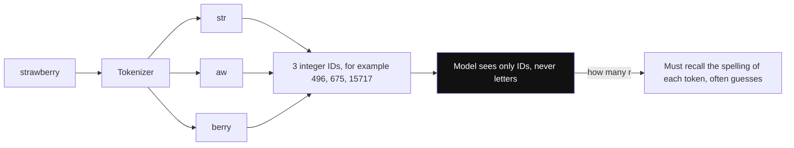

*Diagram:* The word is split into 3 pieces before the model sees it; the three r's are hidden inside IDs, so counting them is a memory test, not a reading task (IDs here are illustrative).

**A bigger vocabulary is a trade-off:**
- Bigger vocabulary: fewer tokens per text, so faster and cheaper per sentence, and better for many languages.
- Cost: the embedding table and output layer grow. With 128,000 tokens and 4,096 numbers per vector, one table is 128,000 × 4,096 ≈ 0.5B parameters.

```python
# pip install tiktoken
import tiktoken

enc = tiktoken.get_encoding("o200k_base")  # tokenizer used by GPT-4o models

for text in ["strawberry", "unbelievable", "Mujhe chai chahiye", "मुझे चाय चाहिए"]:
    ids = enc.encode(text)
    # decode each ID separately to see the actual pieces
    pieces = [enc.decode_single_token_bytes(i).decode("utf-8", errors="replace") for i in ids]
    print(f"{text!r}: {len(ids)} tokens -> {pieces}")

# Rough cost check: tokens, not words, are what you pay for
prompt = "Summarise this customer complaint in two lines. " * 50
print("tokens:", len(enc.encode(prompt)), "words:", len(prompt.split()))
```

**What the code does:**
- Loads a real tokenizer (`o200k_base`) with the `tiktoken` library.
- Encodes each string to token IDs and prints the piece each ID stands for.
- Shows that one English word can be several tokens and that Devanagari text usually needs more tokens.
- Compares token count with word count, which is how you estimate API cost.

**Interview tip:** "Why does the model struggle to count letters?" Say: "It never sees letters, it sees subword tokens. 'strawberry' might be three tokens, and the model has to have memorised the spelling of each one. You fix it by asking it to spell the word out letter by letter first, or by giving it a code tool."

**Common mistake:**
- Estimating cost or context limits in words. Always count tokens with the model's own tokenizer, because each model family tokenizes differently.
- Assuming non-English users cost the same as English users. Budget more tokens for Indic languages.

## ⭐ Embeddings

**In one line:** Each token ID is turned into a vector of a few thousand numbers, and the model learns these vectors so that tokens with similar meaning end up close together.

**Why it exists:** An ID like 4,821 is just a label. It says nothing about meaning. The number 4,821 is not "closer" to 4,822 in meaning. The model needs a representation where math (distance, direction) matches meaning.

**Picture it:** Think of a map of Mumbai. Places that are similar in some way sit near each other: all the cricket grounds in one area, all the banks in another. An embedding is a position on a map with thousands of directions instead of two. "King" and "queen" are neighbours. "King" and "samosa" are far apart.

**How it works, step by step:**
1. The model has an embedding table: one row per vocabulary token. Llama 2 7B has 32,000 rows, each with 4,096 numbers.
2. Lookup: token ID 4,821 means "take row 4,821". That row is the token's starting vector.
3. These rows are parameters. Training moves them so that useful patterns emerge. Nobody hand-writes them.
4. Closeness is usually measured by **cosine similarity**: 1 means same direction, 0 means unrelated.
5. Tiny example with 3 numbers per vector: `cat = [0.9, 0.1, 0.0]`, `dog = [0.8, 0.2, 0.1]`, `invoice = [0.0, 0.1, 0.9]`. Cat and dog point the same way (cosine ≈ 0.98). Cat and invoice do not (cosine ≈ 0.01).
6. Inside the model, these first vectors are only a start. After attention layers, each vector also carries meaning from its context. So "bank" ends up with different vectors in "river bank" and "bank loan".

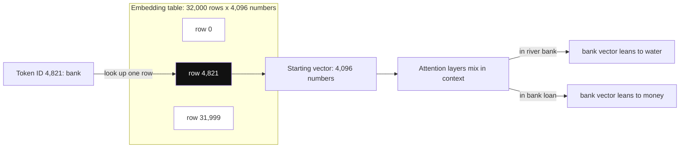

*Diagram:* An embedding is just one row of a learned table; the same starting row turns into different vectors once attention mixes in the neighbouring words.

**Tie to semantic search:** A separate **embedding model** (for example a sentence-transformer or an embeddings API) turns a whole sentence into one vector. You store the vectors of your documents in a vector database. At query time you embed the question and find the nearest document vectors. "How do I get my money back?" finds a doc titled "Refund policy" even though no words match. That is the core of RAG.

**Interview tip:** "What is the difference between the embeddings inside an LLM and the embeddings you use for search?" Say: "Inside the LLM, each token has a vector that gets refined layer by layer. For search we use a separate model trained so that one vector per sentence or chunk captures meaning, usually with contrastive training. Same idea, different model and goal."

**Common mistake:**
- Comparing vectors from two different embedding models. Their spaces are unrelated, so the distances mean nothing.
- Thinking each number in the vector is a clean human concept like "is an animal". Meaning is spread across many numbers.

## ⭐ The transformer and self-attention

**In one line:** A transformer is a stack of identical layers; in each layer, attention lets every token pull in information from earlier tokens, and a feed-forward network then processes each token on its own.

**Why it exists:** Older models (RNNs) read text one word at a time and passed a single memory forward. Long-range links got lost, and training could not run in parallel. The 2017 paper "Attention Is All You Need" introduced the transformer. Every token can look directly at every other token, and all tokens are processed in parallel during training.

**Picture it:** A cricket team meeting. Each player (token) asks a question: "Who here knows about the pitch?" (the **query**). Every player wears a badge saying what they know (the **key**). Players whose badge matches the question get more attention. Each player then shares their actual notes (the **value**). You leave the meeting with a mix of notes, weighted by how relevant each person was.

**How it works, step by step (one attention head):**
1. Each token's vector is multiplied by three learned matrices to get three new vectors: **Q** (query: what am I looking for?), **K** (key: what do I contain?), and **V** (value: what do I pass on if chosen?).
2. For the current token, compute a score against every earlier token: the dot product of its Q with their K. A high score means "relevant to me".
3. Divide the scores by √d_k (the square root of the vector size). This keeps numbers from getting too large and making softmax too sharp.
4. Apply softmax to turn the scores into weights that add up to 1.
5. The output is the weighted sum of the V vectors. Formula: `Attention(Q, K, V) = softmax(Q·Kᵀ / √d_k) · V`.

**Worked example: "the river bank".** We want a new vector for "bank". Say the scaled scores of bank's query against each key are: `the` = 0.1, `river` = 2.0, `bank` = 1.0.

| Token | Score | Softmax weight |
|---|---|---|
| the | 0.1 | 0.10 |
| river | 2.0 | 0.66 |
| bank | 1.0 | 0.24 |

Use 2-number value vectors where the first number means "water" and the second means "money": `V_the = [0, 0]`, `V_river = [1, 0]`, `V_bank = [0.5, 0.5]` (ambiguous on its own).

Output for bank = 0.10 × [0, 0] + 0.66 × [1, 0] + 0.24 × [0.5, 0.5] = **[0.78, 0.12]**. The new "bank" vector leans strongly to "water". In "the bank approved my loan", the word "loan" would get the high weight, and bank would lean to "money". This is how context changes meaning.

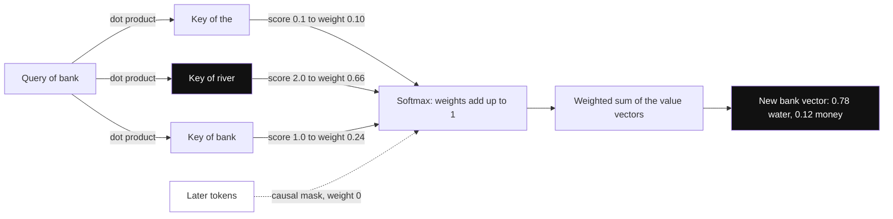

*Diagram:* Q is compared with every earlier K, softmax turns the scores into weights, and those weights mix the V vectors; river wins 0.66, so bank now means river bank. Future tokens are masked to weight 0.

**Causal mask.** When generating, a token must not see the future. So scores for later positions are set to minus infinity before softmax, which makes their weight exactly 0. Token 3 can attend to tokens 1, 2 and 3 only. This is why these models are called "causal" or "decoder-only".

**Multi-head attention.** One head learns one kind of relationship. So each layer runs many heads in parallel, for example 32 heads of size 128 (32 × 128 = 4,096). One head may track grammar, another may link pronouns to names, another may track quotes. Their outputs are joined and mixed by another matrix.

**The rest of one layer (the decoder block):**
1. **Layer norm** rescales each vector to a stable range so training does not blow up. Modern models apply it before each sub-step ("pre-norm"), often using a variant called RMSNorm.
2. **Attention**, as above.
3. **Residual connection:** add the attention output back to the input (`x = x + attention(x)`). Each layer only adds a correction, so the original signal is never lost and deep stacks train well.
4. **Feed-forward network (FFN):** two or three matrix multiplies applied to each token separately, typically expanding to about 3–4 times the width and back. Roughly two thirds of the parameters live here. Think of attention as "gather information" and the FFN as "think about it and recall stored facts".
5. Another residual add. Then the next layer. A 7B model stacks 32 such layers. A 70B model stacks 80.

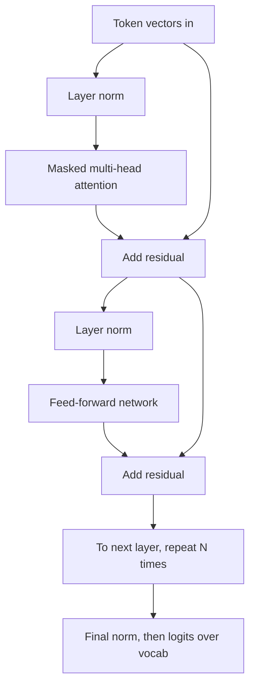

**Why attention is O(n²).** With n tokens, every token scores against every other token. That is an n × n table of scores, per head, per layer.

| Sequence length n | Scores per head per layer (n²) |
|---|---|
| 1,000 | 1 million |
| 4,000 | 16 million |
| 32,000 | about 1 billion |
| 128,000 | about 16 billion |

Doubling the prompt length quadruples attention work. The FFN part grows only linearly. So for short prompts the FFN dominates, and for very long prompts attention dominates. FlashAttention (2022) computes the same result in tiles without ever storing the full n × n table. That cuts memory to linear and makes it much faster, but the compute is still quadratic.

```python
import numpy as np

def softmax(x, axis=-1):
    x = x - x.max(axis=axis, keepdims=True)   # subtract max for numerical safety
    e = np.exp(x)
    return e / e.sum(axis=axis, keepdims=True)

def causal_self_attention(X, Wq, Wk, Wv):
    """X: (n_tokens, d_model). Returns (n_tokens, d_head)."""
    Q, K, V = X @ Wq, X @ Wk, X @ Wv           # project each token into query, key, value
    d_k = Q.shape[-1]
    scores = Q @ K.T / np.sqrt(d_k)            # (n, n): every token vs every token -> O(n^2)
    n = X.shape[0]
    mask = np.triu(np.ones((n, n)), k=1)       # 1s above the diagonal = future tokens
    scores = np.where(mask == 1, -np.inf, scores)  # hide the future
    weights = softmax(scores)                  # each row sums to 1
    return weights @ V, weights                # weighted mix of values

rng = np.random.default_rng(0)
n, d_model, d_head = 4, 8, 4
X = rng.normal(size=(n, d_model))              # 4 token vectors
Wq, Wk, Wv = (rng.normal(size=(d_model, d_head)) for _ in range(3))
out, w = causal_self_attention(X, Wq, Wk, Wv)
print(np.round(w, 2))   # lower-triangular: token i only attends to tokens 0..i
```

**What the code does:**
- Projects each token vector into Q, K and V with three weight matrices.
- Builds the n × n score table, which is where the quadratic cost comes from.
- Applies the causal mask so no token can see later tokens.
- Softmaxes each row into weights and mixes the value vectors.
- Prints the weight table, which is lower-triangular because of the mask.

**Interview tip:** "Why is attention quadratic, and what do people do about it?" Say: "Each of n tokens computes a score with each of n tokens, so n² scores per head per layer. FlashAttention keeps the compute but removes the n² memory by tiling. Sliding-window or sparse attention reduces the compute itself. At inference, the KV cache means each new token only does n work, but the cache grows linearly with context."

**Common mistake:**
- Saying FlashAttention makes attention linear. It makes memory linear; the compute is still n².
- Mixing up Q, K and V. Q and K decide **how much** to attend. V is **what** gets passed along.

## Attention variants: MHA, MQA, GQA

**In one line:** These variants decide how many key/value heads the query heads share, which directly sets the size of the KV cache.

**Why it exists:** During generation, the model saves the K and V vectors of every past token (the KV cache) so it does not recompute them. With standard attention this cache gets huge at long contexts and big batches. Memory, not compute, becomes the limit on how many users one GPU can serve.

**Picture it:** In a classroom, every student (query head) could have a personal textbook (own K and V). That is expensive. Or the whole class shares one textbook, which is cheap but crowded. Or groups of four share a book. That is the sweet spot.

**How it works, step by step:**
1. **MHA (multi-head attention):** every query head has its own K and V head. 32 query heads → 32 KV heads. Original transformer, Llama 2 7B.
2. **MQA (multi-query attention):** all query heads share **one** K and V head. Cache is 32 times smaller. Quality drops a little and training can be less stable. Used in PaLM and Falcon.
3. **GQA (grouped-query attention):** query heads are split into groups, and each group shares one KV head. For example 32 query heads and 8 KV heads, so 4 query heads per KV head. Quality is close to MHA, and the cache is 4 times smaller. Used in Llama 2 70B, Llama 3 and Mistral.
4. **The math.** KV cache bytes per token = 2 (K and V) × layers × KV heads × head size × bytes per number.
   - Llama 2 7B, MHA: 2 × 32 × 32 × 128 × 2 bytes = **512 KB per token**. A 4,000-token chat uses 2 GB.
   - Llama 3 8B, GQA with 8 KV heads: 2 × 32 × 8 × 128 × 2 = **128 KB per token**. The same chat uses 0.5 GB.
5. A 4 times smaller cache means 4 times more concurrent users or 4 times longer contexts on the same GPU.

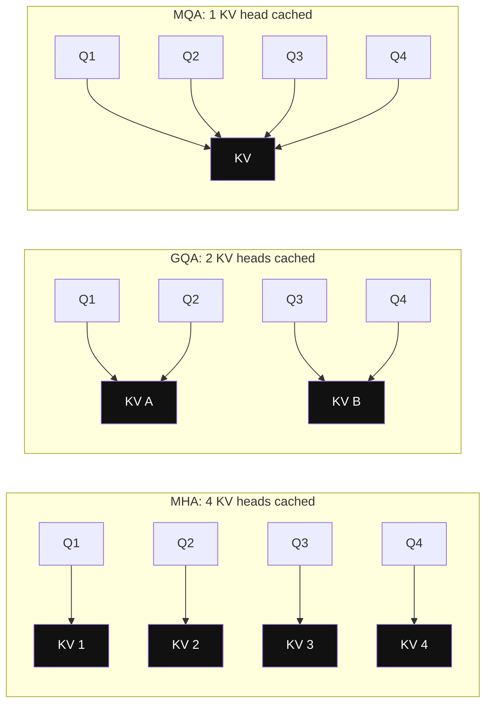

*Diagram:* Drawn with 4 query heads: the dark boxes are what gets stored in the KV cache for every token. Query heads stay the same; only the number of K/V heads shrinks (Llama 3: 32 query heads share 8 KV heads, a 4x smaller cache).

| | MHA | GQA | MQA |
|---|---|---|---|
| KV heads (for 32 query heads) | 32 | 8 (typical) | 1 |
| KV cache size | 1× | 1/4× | 1/32× |
| Quality | Best | Nearly MHA | Slightly lower |
| Seen in | GPT-2, Llama 2 7B | Llama 3, Mistral, most new models | PaLM, Falcon |

DeepSeek models go further with MLA (multi-head latent attention), which compresses K and V into a small vector before caching. More on caches in [Inference and Serving](15-inference-serving.md).

**Interview tip:** "What is GQA and why does everyone use it?" Say: "Grouped-query attention lets several query heads share one key/value head. With 32 query heads and 8 KV heads, the KV cache is 4 times smaller with almost no quality loss. Since decoding is memory-bound and the cache limits batch size, that directly means more users per GPU."

**Common mistake:**
- Thinking GQA reduces the number of query heads. It reduces only K and V heads.
- Forgetting that the KV cache grows with **both** context length and batch size.

## Positional encodings

**In one line:** Attention alone ignores word order, so the model adds position information to each token, and modern models do it with RoPE, which rotates vectors by an angle that depends on position.

**Why it exists:** The attention math is a weighted sum. It gives the same result if you shuffle the tokens. But "dog bites man" and "man bites dog" mean different things. The model needs to know where each token is.

**Picture it:** A clock hand. Each position turns the hand a bit more. Two tokens next to each other have hands at almost the same angle. Two tokens far apart have very different angles. The model can read the gap between two hands, which is their distance.

**How it works, step by step:**
1. **Sinusoidal (original 2017):** add a fixed pattern of sine and cosine waves to each token's vector. Position 5 always gets the same pattern. Simple, but it handles lengths beyond training poorly.
2. **Learned absolute (GPT-2):** a trained vector for position 0, 1, 2 … up to a maximum (1,024 for GPT-2). The model cannot go past that maximum at all.
3. **RoPE (rotary position embedding, used by Llama, Mistral, Qwen and most open models):** do not add anything. Instead, rotate the Q and K vectors. Split each vector into pairs of numbers, and rotate each pair by angle `position × θ`, with a different speed θ per pair.
4. **Why rotation helps:** when you take the dot product of a query at position 10 and a key at position 7, the rotations cancel except for the difference, 3. So the attention score depends on **relative distance**, which is what language needs.
5. **Context extension:** a model trained on 4K or 8K positions sees new, untrained angles beyond that and breaks. Fixes squeeze or stretch the angles so long positions look like familiar ones:
   - **Position interpolation:** divide positions by a factor (for example 4), so 32K positions map onto the trained 8K range.
   - **NTK-aware scaling and YaRN:** scale the fast-rotating pairs (nearby detail) less and the slow ones (long distance) more. YaRN needs only a short fine-tune. Llama 3.1 reaches 128K tokens with this kind of RoPE scaling.

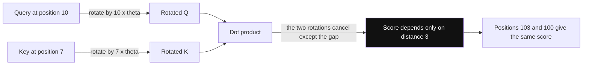

*Diagram:* RoPE rotates Q and K by their positions; in the dot product only the difference survives, so attention sees relative distance, not absolute position.

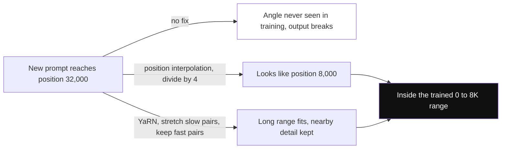

*Diagram:* Context extension squeezes long positions back into the range of angles the model already learned; YaRN squeezes only the slow-rotating pairs, so nearby word order stays sharp.

**Interview tip:** "Why RoPE over learned positions?" Say: "RoPE encodes position by rotating Q and K, so the attention score depends only on relative distance. It adds no parameters, and with interpolation tricks like YaRN you can extend the context well past the training length with a small fine-tune."

**Common mistake:**
- Thinking a model with a 128K window uses all 128K equally well. Quality often drops before the advertised limit.
- Saying RoPE is added to the token embedding. It is applied to Q and K inside every attention layer.

## ⭐ The generation loop: prefill and decode

**In one line:** The model first reads your whole prompt in one parallel pass (prefill), then writes the answer one token at a time (decode), feeding each new token back in.

**Why it exists:** The model only predicts **one** next token per pass. To write 200 tokens it must run 200 passes. Knowing the two phases explains latency, cost and most serving tricks.

**Picture it:** An IRCTC agent with a long form. First they read your whole form in one go (prefill). Then they type your ticket one character at a time, checking the form again before each character (decode). Reading is fast. Typing is the slow part.

**How it works, step by step:**
1. **Tokenize** the prompt: "Translate to Hindi: Good morning" → say 9 tokens.
2. **Prefill:** run all 9 tokens through the model in parallel. Save each layer's K and V for every token in the KV cache. The last position's logits give the first output token. Time to here = **time to first token (TTFT)**.
3. **Logits to probabilities:** the model outputs one logit per vocab token (say 128,000 numbers). Softmax turns them into probabilities.
4. **Sample** one token, for example "सु" (more on sampling below).
5. **Decode:** feed only the new token in. It computes its own Q, K and V, attends to the cached K and V of all earlier tokens, and produces logits for the next token. Append its K and V to the cache.
6. **Repeat** until the model emits an end-of-sequence token or hits `max_tokens`. The gap between tokens is the **time per output token (TPOT)**.
7. **Detokenize** IDs back into text and stream them to the user.

| | Prefill | Decode |
|---|---|---|
| Tokens per pass | All prompt tokens at once | One new token per sequence |
| Bottleneck | Compute (many matrix multiplies, GPU is busy) | Memory bandwidth (load all weights to make one token) |
| Latency metric | Time to first token | Time per output token |
| Cost driver | Prompt length | Output length |

**Why decode is memory-bound:** to produce one token from a 7B model, the GPU must read all 14 GB of weights from memory. An H100 reads about 3.35 TB/s, so the floor is roughly 14 GB ÷ 3,350 GB/s ≈ 4 ms per token, no matter how fast the math is. Batching many users together lets one weight read serve many tokens. This is why APIs charge more per output token than per input token.

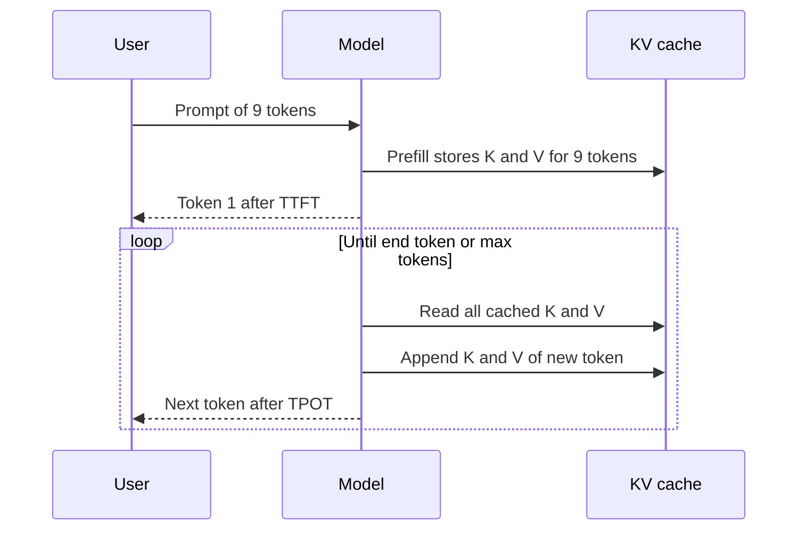

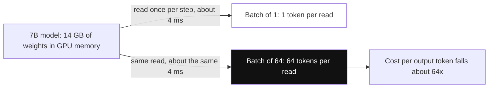

*Diagram:* Each decode step is paid for by reading all the weights; sharing that one read across 64 users is why batching makes output tokens cheap.

**Interview tip:** "Walk me through what happens when you send a prompt." Say: "The text is tokenized into IDs. Each ID is looked up as an embedding vector. In prefill, all prompt tokens go through every transformer layer in parallel, attention uses a causal mask, and K and V are cached. The final position's vector is projected to logits over the vocabulary, softmax gives probabilities, and a sampler picks a token. Then decode repeats one token at a time using the KV cache until a stop token or max tokens. Tokens are detokenized and streamed back."

**Common mistake:**
- Thinking the model plans the whole answer first. It commits to one token at a time and cannot take one back.
- Optimising only total latency. Users feel TTFT for chat, while throughput matters for batch jobs.

## ⭐ Sampling: choosing the next token

**In one line:** Sampling is the rule that turns the model's probabilities into one chosen token, and settings like temperature and top-p control how safe or how varied the output is.

**Why it exists:** Always taking the single most likely token makes text repetitive and dull, and can get stuck in loops. Picking freely from all 128,000 tokens lets in nonsense. We need knobs between these two extremes.

**Picture it:** Ordering on Swiggy. Greedy = always order your usual biryani. Temperature = how adventurous you feel today. Top-k = "only look at the top 5 restaurants". Top-p = "only look at restaurants that together cover 90% of my usual orders".

**How it works, step by step.** Prompt: "The chai was very". The model's top three logits: `hot` = 2.0, `sweet` = 1.0, `purple` = 0.1.

1. **Greedy:** pick the highest logit. Always `hot`. Same input → same output, in theory.
2. **Temperature T:** divide every logit by T, then softmax.

| Temperature | hot | sweet | purple | Effect |
|---|---|---|---|---|
| 0.5 | 0.864 | 0.117 | 0.019 | Sharper, safer |
| 1.0 | 0.659 | 0.242 | 0.099 | Model's own distribution |
| 2.0 | 0.502 | 0.304 | 0.194 | Flatter, more random |

   Check T = 1: e^2.0 = 7.39, e^1.0 = 2.72, e^0.1 = 1.11. Sum = 11.21. So hot = 7.39 / 11.21 = 0.659. T near 0 becomes greedy.
3. **Top-k:** keep only the k most likely tokens, renormalise, sample. With k = 2, `purple` is removed. Problem: k is fixed, but sometimes 1 option is sensible and sometimes 50 are.
4. **Top-p (nucleus):** sort by probability and keep the smallest set whose total reaches p. At T = 1 with p = 0.9: hot (0.659) + sweet (0.242) = 0.901 ≥ 0.9, so keep those two. Renormalised: hot 0.731, sweet 0.269. The set size adapts to how confident the model is.
5. **Min-p:** keep tokens whose probability is at least `min_p × top probability`. With min_p = 0.2, the cut-off is 0.2 × 0.659 = 0.132, so `purple` (0.099) is dropped. It works well at higher temperatures.
6. **Repetition controls:** a repetition penalty lowers the logits of tokens that already appeared (for example divides a positive logit by 1.1). OpenAI-style APIs offer `frequency_penalty` (grows with each repeat) and `presence_penalty` (flat, once a token has appeared). Use them lightly; high values damage names and code.
7. **Order in most libraries:** apply penalties, then temperature, then top-k / top-p / min-p filters, then sample.

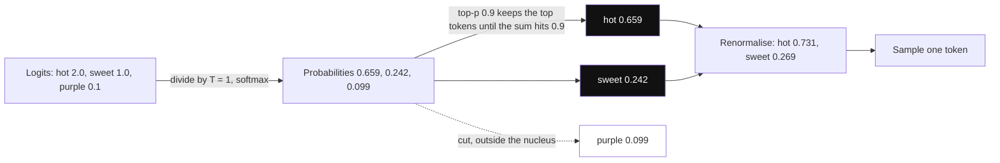

*Diagram:* Temperature reshapes the probabilities, top-p cuts the long tail (purple is dropped), and the survivors are renormalised before one token is drawn.

**Which settings for which job:**

| Task | Settings | Why |
|---|---|---|
| Extraction, classification, JSON, tool calls | Temperature 0 to 0.2 | You want the single most likely, consistent answer |
| Code generation | Temperature 0.2 or so, top-p 0.95 | Mostly precise; some variety helps when sampling several tries |
| Chat assistant | Temperature 0.7, top-p 0.9 | Natural but on topic |
| Brainstorming, stories, marketing copy | Temperature 0.9 to 1.2, top-p 0.95 or min-p 0.05 | More variety |

Reasoning models often fix or ignore these settings; follow each provider's docs.

**Seed and determinism caveats.** Temperature 0 does not guarantee the same output:
1. GPUs add numbers in different orders depending on batch size and kernel choice. Floating-point addition is not associative, so `(a + b) + c` can differ from `a + (b + c)` in the last bits.
2. Your request is batched with other users' requests, so the batch size changes from call to call, and so does the order of adds. Tiny differences in logits can flip a near tie between two tokens. After one flip, the rest of the text diverges.
3. In MoE models, other requests in the batch can also affect which expert a token goes to when experts have capacity limits.
4. Hosted models get silent updates. A `seed` parameter, where offered, is "best effort" only.

For reproducibility, pin the model version, log the full prompt and settings, and for evals sample several times and measure the spread.

```python
import numpy as np

def sample_next(logits, temperature=1.0, top_k=None, top_p=None, rng=None):
    rng = rng or np.random.default_rng()
    logits = np.asarray(logits, dtype=float)
    if temperature == 0:
        return int(np.argmax(logits))              # greedy
    logits = logits / temperature                  # sharpen (<1) or flatten (>1)
    probs = np.exp(logits - logits.max())
    probs /= probs.sum()                           # softmax
    order = np.argsort(probs)[::-1]                # most likely first
    keep = np.ones_like(probs, dtype=bool)
    if top_k is not None:
        keep[order[top_k:]] = False                # drop everything after rank k
    if top_p is not None:
        cum = np.cumsum(probs[order])
        cutoff = np.searchsorted(cum, top_p) + 1   # smallest set reaching top_p
        keep[order[cutoff:]] = False
    probs = np.where(keep, probs, 0.0)
    probs /= probs.sum()                           # renormalise what is left
    return int(rng.choice(len(probs), p=probs))

vocab = ["hot", "sweet", "purple"]
logits = [2.0, 1.0, 0.1]
rng = np.random.default_rng(42)
picks = [vocab[sample_next(logits, 1.0, top_p=0.9, rng=rng)] for _ in range(1000)]
print({w: picks.count(w) for w in vocab})          # roughly 730 hot, 270 sweet, 0 purple
```

**What the code does:**
- Returns the arg-max token when temperature is 0 (greedy).
- Divides logits by temperature, then applies softmax.
- Applies top-k and top-p filters by zeroing out tokens outside the kept set.
- Renormalises and samples one token ID.
- Runs 1,000 samples to show top-p 0.9 never picks `purple` and splits about 73/27 between the other two.

**Interview tip:** "Temperature 0 still gives different answers. Why?" Say: "Temperature 0 is greedy, but the logits themselves are not bit-identical across runs. Batching with other requests changes the order of floating-point additions in GPU kernels. A tiny change can flip a near tie, and after that the text diverges. MoE routing and silent model updates add more variance. Pin versions, log everything, and design evals that tolerate variation."

**Common mistake:**
- Using temperature 1.0 for JSON extraction and then blaming the model for broken output.
- Tuning temperature and top-p together aggressively. Change one, usually temperature, and leave the other at its default.

## Context window

**In one line:** The context window is the model's working memory for one call; everything it uses must fit inside it, and every token in it costs money, time and attention.

**Why it exists:** The model has no memory between calls. The only things it knows about your task are what you put in the window this time. The limit comes from the KV cache size and from the lengths the model was trained on.

**Picture it:** A desk in a library. You can only work with the papers on the desk. A bigger desk helps, but if you dump 500 pages on it, you will miss the one page that matters, especially if it is buried in the middle of the pile.

**How it works, step by step:**
1. **What fills it:** system prompt + tool definitions + retrieved documents + conversation history + the user's message + the model's own output (including hidden reasoning tokens). Output tokens count too.
2. **Typical sizes (2025–2026):** many models offer 128K to 1M tokens. 128K tokens is roughly 96,000 English words, about a 300-page book.
3. **Cost grows with length:**
   - Money: APIs bill per input token, so a 100K-token prompt costs 100 times a 1K-token one on every call.
   - Time: prefill time grows with length. Attention part grows quadratically.
   - Memory: the KV cache grows linearly. At 128 KB per token (Llama 3 8B), 100K tokens is about 12.5 GB for one user.
4. **Lost in the middle:** a 2023 study ("Lost in the Middle") showed models use facts at the start and end of a long context far better than facts in the middle. Accuracy also tends to drop as total length grows, even on long-context models.
5. **What to do:** retrieve only relevant chunks, put instructions at the start and the question at the end, summarise old turns, and keep a stable prefix so prompt caching can reuse it. Details in [Memory & Context](05-memory-context.md).

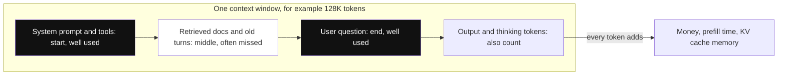

*Diagram:* Everything the model uses, including its own output, shares one window; facts at the start and end get used well, while the middle is where lost-in-the-middle bites.

**Interview tip:** "We have a 1M-token model. Why not put all our docs in every prompt?" Say: "Cost and latency scale with tokens on every call, the KV cache limits how many users we can serve, and quality drops with long, noisy context because of lost-in-the-middle. Retrieval of the top relevant chunks is usually cheaper, faster and more accurate. Long context is great for one-off analysis of a single large document."

**Common mistake:**
- Forgetting that the output and reasoning tokens also take space in the window.
- Assuming "it fits" means "it will be used well".

## ⭐ Mixture of Experts (MoE)

**In one line:** An MoE model has many feed-forward "experts" in each layer, and a small router sends each token to only a few of them, so you get a big model's knowledge for a smaller model's compute per token.

**Why it exists:** Bigger models know more, but compute per token grows with size. MoE breaks that link. Total parameters (knowledge capacity) can be large while active parameters (work per token) stay small.

**Picture it:** A big hospital with 8 specialists on each floor. At reception (the router), each patient is sent to the 2 most suitable doctors, not to all 8. The hospital has the knowledge of 8 doctors, but each patient takes only 2 doctors' time. The building still has to hold all 8 doctors' rooms, though.

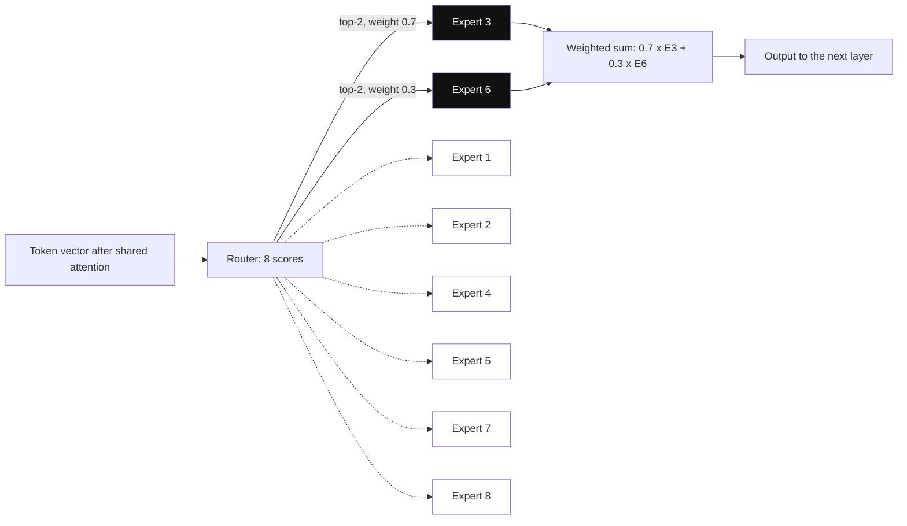

*Diagram:* One MoE layer for one token: the router scores all 8 experts but only the top 2 (dark) actually run; their outputs are mixed 0.7 / 0.3 and the other 6 sit idle for this token.

**How it works, step by step (Mixtral 8x7B):**
1. In each layer, attention is shared as usual. The single FFN is replaced by 8 expert FFNs.
2. The **router** is a tiny linear layer. For each token it outputs 8 scores, one per expert.
3. Pick the **top 2** experts. Softmax over their two scores gives mixing weights, for example 0.7 and 0.3.
4. Run the token through only those 2 experts. Output = 0.7 × expert A + 0.3 × expert B.
5. The next token, and the same token in the next layer, may pick different experts.
6. **The numbers:** Mixtral has about **47B total** parameters (not 56B, because attention and embeddings are shared) but only about **13B active** per token. So per token it computes like a 13B model.
7. **Memory:** all 47B parameters must sit in VRAM, because any token might need any expert. At 2 bytes each that is about 94 GB. So it needs the memory of a 47B model.
8. **Training trick:** a load-balancing loss pushes the router to use all experts evenly. Otherwise a few experts get all the traffic and others never learn.

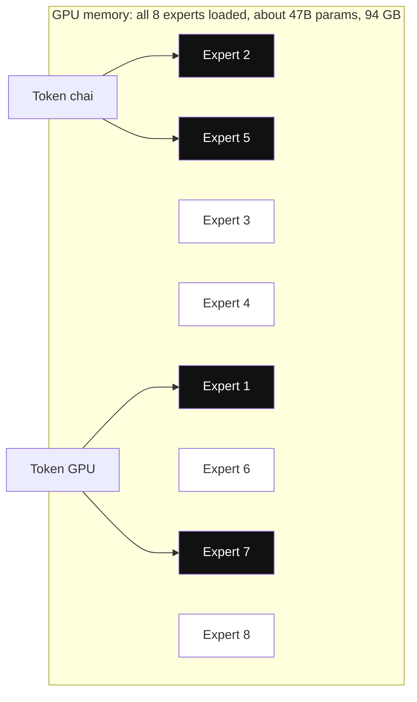

*Diagram:* Two tokens in the same layer pick different experts, so every expert must stay in VRAM: compute per token is like a 13B model, but memory is like a 47B model.

| | Dense 13B | MoE 47B total / 13B active | Dense 47B |
|---|---|---|---|
| Compute per token | Low | Low (about like 13B) | High |
| VRAM for weights (FP16) | ~26 GB | ~94 GB | ~94 GB |
| Quality | Lower | Close to a much bigger dense model | High |
| Serving complexity | Simple | Harder: expert parallelism, load balance | Simple |

Bigger examples: DeepSeek-V3 has 671B total and about 37B active, with many small experts plus a shared expert.

**Trade-offs to say out loud:**
- Cheaper and faster per token at a given quality. Good for high-traffic APIs.
- Heavy on memory, so it is a bad fit for small GPUs or edge devices.
- Small batches waste the advantage: each token loads different experts, so decode stays memory-bound.
- Fine-tuning and serving are more complex (routing collapse, expert parallelism across GPUs).

**Interview tip:** "What are the trade-offs of MoE?" Say: "You get the quality of a large model at the per-token compute of a small one, because only the top-k experts run. But all experts must be in memory, so VRAM is set by total params. Serving needs expert parallelism and good batching, and training needs load balancing so the router does not collapse onto a few experts."

**Common mistake:**
- Saying "8x7B means 56B parameters". Shared parts make it about 47B.
- Saying "MoE needs less memory". It needs less **compute** per token, not less memory.

## ⭐ Reasoning models and test-time compute

**In one line:** Reasoning models are trained to "think" by writing many intermediate tokens before the final answer, trading extra time and tokens at inference for better accuracy on hard problems.

**Why it exists:** A model produces each token with a fixed amount of compute. A hard maths or coding problem may need more steps than one pass can hold. Letting the model write out steps gives it more compute exactly where the problem needs it. This is called **test-time compute**: spending more at answer time instead of only at training time.

**Picture it:** A student in an exam. Writing the answer directly works for "2 + 2". For a long sum, they use rough work on the side of the paper. The rough work is not the answer, but it makes the answer right. Reasoning tokens are that rough work.

**How it works, step by step:**
1. **Chain-of-thought prompting (2022):** simply asking "think step by step" or showing worked examples made models much better at multi-step problems. The steps act as working memory.
2. **Thinking tokens:** reasoning models produce a long hidden or visible "thinking" section, sometimes thousands of tokens, then a short final answer. You pay for these tokens and wait for them.
3. **RL-trained reasoning:** OpenAI's o1 (2024) and DeepSeek-R1 (2025) were trained with reinforcement learning on problems with checkable answers, such as maths results or code that must pass tests. The model tries, gets a reward if the final answer is right, and learns which thinking patterns help. DeepSeek-R1 used GRPO (group relative policy optimisation): sample a group of answers per question, and reward each relative to the group's average. Behaviours like checking work and backtracking emerged on their own.
4. **Self-consistency:** sample, say, 5 independent reasoning paths at temperature around 0.7 and take the majority final answer. If 4 of 5 say "42", answer 42. It costs 5 times the tokens but gives a solid accuracy gain on maths-style tasks.
5. **Reasoning effort knobs:** many APIs let you set effort or a thinking-token budget (low, medium, high). More budget = slower, costlier, usually more accurate on hard tasks.

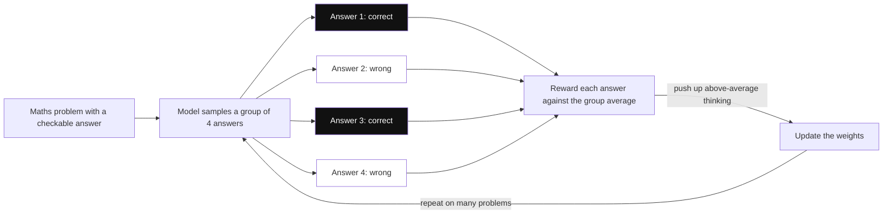

*Diagram:* GRPO, the RL loop behind DeepSeek-R1: answers that beat their group's average are reinforced, so useful habits like checking work grow on their own.

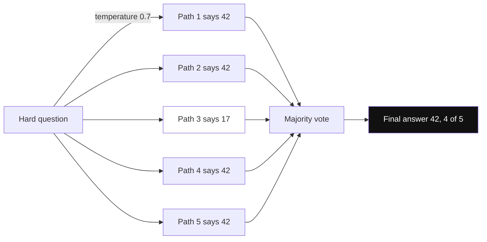

*Diagram:* Self-consistency spends 5x the tokens at answer time: independent reasoning paths vote, and the odd one out (17) is outvoted.

**When to use vs not:**

| Use a reasoning model | Use a standard model |
|---|---|
| Multi-step maths, logic, planning | Simple extraction, classification, formatting |
| Hard coding, debugging, complex agent plans | Chat replies where latency matters (under ~1 s TTFT) |
| Analysis where a wrong answer is costly | High-volume, low-margin calls |
| Problems with a verifiable answer | Creative writing, where extra thinking adds little |

A common production pattern: a reasoning model plans once, and cheaper fast models execute the many small steps.

**Interview tip:** "When would you not use a reasoning model?" Say: "When the task is simple or latency-sensitive. Reasoning models can spend thousands of thinking tokens, which adds seconds and multiplies cost. For extraction, routing or short chat replies a fast model is as accurate. I would use reasoning for planning, hard code and maths, and measure on evals whether the extra cost pays off."

**Common mistake:**
- Treating the visible chain of thought as a faithful explanation. It may not reflect how the model really got the answer.
- Forgetting thinking tokens in cost and context budgets. They are billed as output tokens.

## The training pipeline at a glance

**In one line:** A chat model is made in three stages: pretraining teaches language and knowledge, supervised fine-tuning teaches the assistant format, and preference tuning teaches it which answers people prefer.

**Why it exists:** A pretrained model only continues text. Ask it "What is the capital of France?" and it may reply with more quiz questions. The later stages turn a text-completer into a helpful assistant.

**Picture it:** A cricketer's career. Pretraining = years of playing gully cricket and watching matches (huge, general experience). SFT = coaching on proper technique with model examples. Preference tuning = a coach watching your shots and saying "this one better than that one".

**How it works, step by step:**
1. **Pretraining:** next-token prediction on trillions of tokens from the web, books and code. Weeks on thousands of GPUs. Output: a **base model**.
2. **SFT (supervised fine-tuning):** train on tens of thousands to millions of example conversations (prompt → ideal answer). The model learns to follow instructions and use the chat format.
3. **Preference tuning:** show two answers to the same prompt and mark which is better. **RLHF** (reinforcement learning from human feedback) trains a reward model on these choices, then optimises the LLM against it. **DPO** (direct preference optimisation, 2023) skips the reward model and learns from the pairs directly.
4. **Reasoning RL (optional):** RL on verifiable tasks, as in the section above.
5. You usually customise the last stages yourself with methods like LoRA. See [Fine-tuning and Post-training](16-fine-tuning.md).

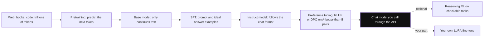

*Diagram:* Three stages turn raw text into an assistant: pretraining gives knowledge, SFT gives the format, preference tuning gives judgement; the dotted steps are optional extras.

**Interview tip:** "What is the difference between a base model and an instruct model?" Say: "A base model is only pretrained, so it continues text. An instruct or chat model has gone through SFT and preference tuning, so it follows instructions, uses a chat template and refuses harmful requests."

**Common mistake:**
- Thinking fine-tuning is the right way to add new facts. Retrieval is usually cheaper and easier to update.

## Why LLMs hallucinate

**In one line:** The model is trained to produce text that looks plausible, not to check facts, so when it lacks the answer it still produces a confident, fluent guess.

**Why it exists:** Next-token training rewards text that fits the pattern. Nothing in that objective says "say I don't know when unsure". Training data also has gaps and errors, and knowledge stops at the training cut-off date.

**Picture it:** A student in a viva who never says "I don't know". Asked about a chapter they skipped, they answer smoothly with words that sound right. Fluent is not the same as correct.

**How it works, step by step:**
1. You ask about a rare fact, for example the founding year of a small company.
2. The model has seen little or nothing about it. Its probabilities spread over several years.
3. Sampling still has to pick a token. It picks one, say "2014", and writes it in a confident sentence.
4. Later tokens are conditioned on "2014", so the model builds a consistent story around the guess.
5. Common triggers: rare facts, recent events, exact numbers, citations and URLs, long contexts, and leading questions ("Why did X happen?" when X never happened).

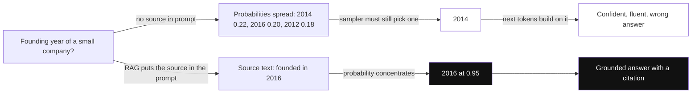

*Diagram:* Top path: with no knowledge the probabilities are flat, the sampler still commits to a guess, and the rest of the text defends it. Bottom path: grounding with a source makes one answer clearly most likely.

**Standard fixes:**

| Fix | What it does |
|---|---|
| RAG (retrieval) | Puts the real source text into the prompt and asks the model to answer only from it |
| Citations | Requires a source for each claim, so you can check it |
| Tools | Use a calculator, database or API for numbers and live data |
| Allow "I don't know" | Say in the prompt that "not found in the documents" is an acceptable answer |
| Low temperature | Reduces random low-probability picks for factual tasks |
| Verification step | A second pass or model checks claims against sources |
| Structured output | Constrains answers to allowed values, such as a fixed list of categories |
| Evals | Measure hallucination rate on a test set before and after changes |

**Interview tip:** "Why do LLMs hallucinate, and how do you fix it?" Say: "They are trained to produce likely text, not true text, and sampling always emits something. I ground answers with retrieval and citations, use tools for facts and maths, allow 'I don't know', keep temperature low for factual tasks, and measure faithfulness with evals. You cannot reach zero, so high-risk outputs get a verification step or a human."

**Common mistake:**
- Believing RAG removes hallucination. The model can still misread or ignore the retrieved text, so you need faithfulness checks.
- Asking the model "are you sure?" as the only check. It may just change a correct answer.

## Interview questions

**Q: Walk me through what happens when you send a prompt to an LLM.**
Tokenize to IDs, look up embeddings, run prefill through all layers in parallel with causal attention and fill the KV cache. Project the last position to logits, softmax, sample one token, then decode one token at a time using the cache until a stop token, and detokenize and stream the text.

**Q: Why is attention O(n²), and does that matter at inference?**
Every token scores against every other token, so n × n scores per head per layer. In prefill that is quadratic. In decode each new token does O(n) work thanks to the KV cache, but the cache itself grows linearly and limits batch size.

**Q: What is the KV cache and how big is it?**
Saved K and V vectors for all past tokens, so they are not recomputed. Size per token = 2 × layers × KV heads × head size × bytes. Llama 2 7B uses 512 KB per token, so 4K tokens takes 2 GB.

**Q: What is GQA?**
Grouped-query attention: groups of query heads share one key/value head. 32 query heads with 8 KV heads makes the KV cache 4 times smaller with nearly MHA quality, so more users fit on a GPU.

**Q: Temperature 0 is still nondeterministic. Why?**
GPU floating-point sums depend on batch size and kernel choice, so logits differ slightly between runs. A near tie can flip and the rest diverges. MoE routing and provider-side model updates add more variance.

**Q: Top-k vs top-p?**
Top-k keeps a fixed number of tokens. Top-p keeps however many tokens are needed to reach probability p, so it keeps few when the model is confident and many when it is unsure. Top-p adapts better.

**Q: MoE trade-offs?**
Per-token compute like a small model and quality like a big one. But VRAM must hold all experts, serving needs expert parallelism, small batches lose much of the benefit, and training needs load balancing.

**Q: Why do Hindi prompts cost more?**
The tokenizer was trained mostly on English, so Hindi words split into more tokens, often 2–4 times more. Billing and context limits are per token.

**Q: Why does the model fail at counting letters?**
It sees subword tokens, not characters. Ask it to spell the word letter by letter first, or give it a code tool.

**Q: Why is decoding memory-bound?**
Each new token requires reading every weight from GPU memory, but does only a little math per weight. Memory bandwidth, not compute, sets the speed. Batching more requests is the main fix.

**Q: Trade-off: a 1M-context model or RAG for a 10,000-document knowledge base?**
RAG. 10,000 documents will not fit anyway, and even if they did, cost, latency and lost-in-the-middle would hurt. Long context is useful for deep analysis of one large document per request.

**Q: What would you do if a reasoning model is accurate but too slow for your chat product?**
Route by difficulty: a fast model for simple turns, the reasoning model only for hard ones. Lower the reasoning effort, stream a quick acknowledgement, or use the reasoning model offline to create examples that improve the fast model.

**Q: How does RoPE let models handle longer contexts?**
RoPE rotates Q and K by position, so scores depend on relative distance. Scaling methods like position interpolation and YaRN compress the angles so longer positions look like trained ones, followed by a short fine-tune.

**Q: Why do LLMs hallucinate?**
They are trained to produce plausible next tokens, not to verify facts, and sampling always outputs something. Ground with retrieval and citations, use tools, allow "I don't know" and measure with evals.

**Q: Base model vs instruct model?**
Base is only pretrained and continues text. Instruct has SFT and preference tuning (RLHF or DPO), so it follows instructions in a chat format.

## Read next

- [Inference and Serving](15-inference-serving.md): KV cache, batching, quantisation and serving at scale.
- [Fine-tuning and Post-training](16-fine-tuning.md): SFT, LoRA, DPO and when to fine-tune.
- [Memory & Context](05-memory-context.md): how agents manage the context window.
- [What is RAG](../09-rag/01-what-is-rag.md): grounding answers in your own data.

## Checklist

- [ ] I can explain what an LLM is as a next-token predictor and how big a 7B model is in memory.
- [ ] I can walk through BPE on a tiny example and explain why "strawberry" letter counting fails.
- [ ] I can explain embeddings and how they connect to semantic search.
- [ ] I can explain Q, K, V and the causal mask with the "river bank" example.
- [ ] I can explain why attention is O(n²) and what FlashAttention does and does not fix.
- [ ] I can compare MHA, MQA and GQA and compute the KV cache size per token.
- [ ] I can explain prefill vs decode and why decoding is memory-bound.
- [ ] I can work through temperature, top-k and top-p with numbers, and explain why temperature 0 is not deterministic.
- [ ] I can explain MoE total vs active parameters and its trade-offs.
- [ ] I can say when to use a reasoning model and how to reduce hallucinations.
