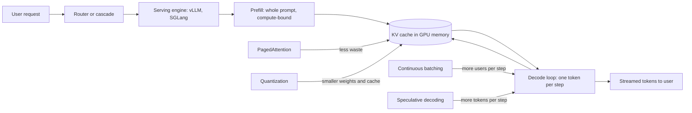
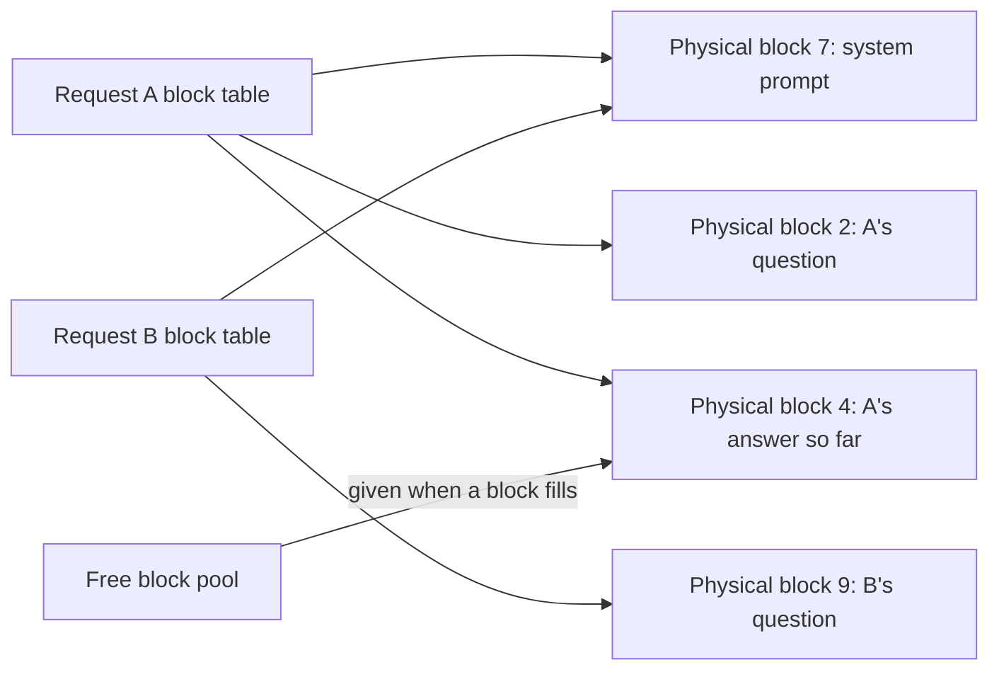
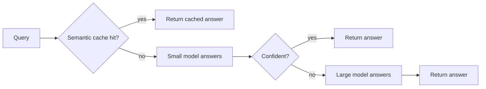

# Inference and Serving

Inference means running a trained model to get answers. Serving means doing that for thousands of users at once, fast and cheap, on expensive GPUs. Interviewers ask about it because few candidates know why LLMs are slow, where GPU memory goes, and which tricks (KV cache, batching, quantization, speculative decoding) fix which problem.

**After this page you can answer:**
- "Why is decoding memory-bound while prefill is compute-bound?"
- "Estimate the KV cache size for a Llama-3-8B request with 8k context."
- "How does continuous batching raise throughput compared to static batching?"
- "Speculative decoding: why is the output exactly the same as without it?"
- "Can a 70B model run on one 80 GB H100? What would you use?"
- "INT4, FP8, GPTQ, AWQ, GGUF: which do you pick and what do you lose?"
- "When would you self-host instead of calling an API?"
- "Design the serving layer for a chat product at 1,000 requests per second."

## Words you need first

| Word | Plain meaning |
|---|---|
| Token | A piece of text, roughly 3/4 of an English word. Models read and write tokens. |
| Parameter (weight) | One learned number inside the model. An 8B model has 8 billion of them. |
| GPU memory (HBM) | The fast memory on the GPU card. An H100 has 80 GB. Weights must sit here. |
| Memory bandwidth | How many bytes per second the GPU can read from its memory. H100: roughly 3.35 TB/s. |
| FLOPs | Floating point operations: the multiply and add work the GPU does. |
| Prefill | The first pass that reads the whole prompt at once. |
| Decode | The loop that generates the answer, one token per step. |
| KV cache | Saved intermediate results for past tokens, so each new token does not redo old work. |
| Batch | A group of requests the GPU processes together in one step. |
| Throughput | Total tokens per second the server produces across all users. |
| Latency | How long one user waits. |
| TTFT / TPOT | Time To First Token; Time Per Output Token, the gap between later tokens. |
| Quantization | Storing weights with fewer bits (for example 4 instead of 16) to save memory. |
| LoRA adapter | A small add-on of extra weights that customizes a base model for one task. |

## Big picture

A request arrives. A router picks a model. The serving engine runs prefill over the prompt, which fills the KV cache. Then it runs decode, one token per step, reading all the weights each step. Almost every serving trick attacks one of two limits: **GPU memory** (weights plus KV cache must fit) and **memory bandwidth** (decode re-reads all weights per step). PagedAttention and quantization save memory. Continuous batching and speculative decoding get more tokens out of each weight read.



## ⭐ Prefill vs decode

**In one line:** Prefill reads the whole prompt in one big parallel pass and is limited by compute; decode makes one token per step and is limited by how fast the GPU can read its own memory.

**Why it exists:** Users see two different waits. First a pause before anything appears, then a stream of words. These are two different phases with two different bottlenecks. If you don't separate them, you will tune the wrong thing.

**Picture it:** A Swiggy delivery partner. Prefill is loading 40 orders at the restaurant in one go: the work is big, but it happens all at once. Decode is delivering one order per trip, and each trip needs the full ride back to the hub. The ride (reading memory), not the handover (math), is what takes the time.

**How it works, step by step:**

1. **Quick recap.** A transformer predicts the next token from all earlier tokens. To make 300 tokens it runs 300 times. (See [How LLMs Work](14-how-llms-work.md).)
2. **Prefill.** The prompt has 2,000 tokens. The GPU processes all 2,000 together as one big matrix multiplication. The work is roughly `2 × params × tokens` FLOPs. For an 8B model: `2 × 8B × 2,000 = 32 trillion FLOPs`. An H100 does roughly 1,000 trillion dense BF16 FLOPs per second, so in theory about 30 ms; in practice maybe 50–150 ms. The GPU's math units are busy, so prefill is **compute-bound**.
3. **Decode.** Now we generate one token. That needs every weight once: 8B params × 2 bytes = **16 GB read from memory**. The math is only `2 × 8B = 16 billion FLOPs`, which takes the H100 about 16 microseconds. Reading 16 GB at 3.35 TB/s takes about **5 ms**. The math units wait for data about 99% of the time. Decode is **memory-bandwidth-bound**.
4. **The speed limit.** One user alone gets at most `1 / 5 ms ≈ 200 tokens/s` from this 8B model, no matter how strong the GPU's compute is.
5. **Why batching is nearly free.** If 64 users decode together, the GPU still reads the 16 GB once per step, but now does 64× the math. The step takes only a little longer, yet produces 64 tokens. This is why serving engines fight to batch many requests.
6. **The ratio to remember.** Decode at batch 1 does about 1 FLOP per byte read. An H100 can do about 300 FLOPs per byte it reads. Until your batch is in the hundreds, you are wasting compute.

**Metrics you must know:**

| Metric | Meaning | Mostly set by | Typical chat target |
|---|---|---|---|
| TTFT (Time To First Token) | Wait before the first token appears | queueing + prefill | under ~500 ms |
| TPOT / ITL (Time Per Output Token / Inter-Token Latency) | Gap between later tokens | decode step time | ~20–50 ms (faster than people read) |
| End-to-end latency | `TTFT + TPOT × (output tokens − 1)` | both | depends on answer length |
| Tokens/s per user | `1 / TPOT` | decode | 20–100 |
| Throughput | Total output tokens/s across all users | batch size | as high as SLOs allow |
| Goodput | Requests per second that still meet the latency targets | everything | the real business number |

Example: TTFT 300 ms, TPOT 25 ms, 400 output tokens → `0.3 + 0.025 × 399 ≈ 10.3 s` total.

**Throughput vs latency trade-off.** A bigger batch gives more total tokens/s (cheaper per token) but each step gets slower (higher TPOT for every user). You pick the batch size that maximizes throughput while TPOT stays under your target.

**Interview tip:** "Why is decode memory-bound?" Say: "Each decode step makes one token per sequence but must read all the weights and the KV cache from GPU memory. For an 8B BF16 model that is 16 GB per step versus only 16 GFLOPs of math. At 3.35 TB/s that is about 5 ms of reading and microseconds of math, so bandwidth sets the speed. Batching fixes it by sharing one weight read across many sequences."

**Common mistake:**
- Saying "decode is slow because the GPU is weak". The GPU's math units are mostly idle; memory reads are the limit.
- Reporting only tokens/s. A server with great throughput but 3 s TTFT feels broken to users. Always report TTFT and TPOT at a given load.

## ⭐ KV cache

**In one line:** The KV cache stores each past token's key and value vectors in every layer, so each new token computes attention without redoing the whole prompt; it trades GPU memory for speed.

**Why it exists:** Attention makes each new token "look at" every earlier token. Without a cache, generating token 1,001 would reprocess tokens 1 to 1,000 again. Generating N tokens would cost work that grows with N². With the cache, each step only computes the new token and reads the old results.

**Picture it:** An IRCTC booking clerk. Without notes, for every new passenger they re-read the whole queue's forms from the start. With a register (the cache), they just add one line and glance at the register. The register gets thick, though, and the desk (GPU memory) is small.

**How it works, step by step:**

1. Inside each layer, each token is turned into three vectors: query (Q, "what am I looking for"), key (K, "what do I contain"), value (V, "what I pass on").
2. A new token's query is compared with all earlier keys, and the matching values are mixed. Old keys and values never change, so we save them.
3. Prefill computes K and V for all prompt tokens and writes them to the cache. Each decode step adds one more K and V per layer.
4. **Size formula, per token:**
   `2 (K and V) × layers × kv_heads × head_dim × bytes per value`
5. **Worked example, a Llama-3-8B-like model:** 32 layers, 8 KV heads, head_dim 128, FP16 (2 bytes).
   `2 × 32 × 8 × 128 × 2 = 131,072 bytes ≈ 128 KB per token`.
6. One request with 8,192 tokens of context: `128 KB × 8,192 = 1 GB`. 32 such users = **32 GB of KV cache**, which is double the 16 GB of weights. At high load, the KV cache, not the weights, decides how many users fit.
7. **GQA effect.** Grouped-Query Attention (GQA) lets several query heads share one K/V head. Llama-3-8B has 32 query heads but only 8 KV heads. Older Llama-2-7B used 32 KV heads: `2 × 32 × 32 × 128 × 2 = 512 KB per token`, 4× bigger. GQA cuts cache memory by 4× with a small quality cost. Multi-Query Attention (MQA) goes to one shared KV head.
8. **Bigger model, same idea.** A Llama-3-70B-like model (80 layers, 8 KV heads, head_dim 128): `2 × 80 × 8 × 128 × 2 = 320 KB per token`, so 8k context ≈ 2.5 GB per request.

| Model shape | KV per token (FP16) | 8k context per request |
|---|---|---|
| 7B, no GQA (32 KV heads) | 512 KB | 4 GB |
| 8B with GQA (8 KV heads) | 128 KB | 1 GB |
| 70B with GQA (8 KV heads) | 320 KB | 2.5 GB |

**Prefix caching.** Many requests start with the same tokens: a 2,000-token system prompt, the same tool list, the same document. Their KV cache is identical. The engine keeps those blocks and reuses them for the next request with the same prefix. That request skips most of its prefill, so TTFT drops and GPU work drops. vLLM does this with block hashes ("automatic prefix caching"); SGLang uses a radix tree. Provider "prompt caching" (Anthropic, OpenAI) is the same idea sold as a discount.

```python
# KV cache calculator: use it to answer "estimate the KV cache" questions
def kv_bytes_per_token(layers, kv_heads, head_dim, bytes_per_value=2):
    # 2 = one key vector + one value vector, per layer, per KV head
    return 2 * layers * kv_heads * head_dim * bytes_per_value

def kv_gb(layers, kv_heads, head_dim, tokens, users=1, bytes_per_value=2):
    return kv_bytes_per_token(layers, kv_heads, head_dim, bytes_per_value) * tokens * users / 1024**3

# Llama-3-8B-like: 32 layers, 8 KV heads, head_dim 128, FP16
print(kv_bytes_per_token(32, 8, 128) / 1024, "KB per token")   # 128.0
print(kv_gb(32, 8, 128, tokens=8192), "GB for one 8k request")  # 1.0
print(kv_gb(32, 8, 128, tokens=8192, users=32), "GB for 32 users")  # 32.0

# Same model with an FP8 KV cache (1 byte per value)
print(kv_gb(32, 8, 128, tokens=8192, users=32, bytes_per_value=1), "GB")  # 16.0

# Llama-3-70B-like: 80 layers, 8 KV heads, head_dim 128
print(kv_bytes_per_token(80, 8, 128) / 1024, "KB per token")  # 320.0
```

**What the code does:**
- Puts the formula in one function so you can redo it in an interview without notes.
- Shows 128 KB per token and 1 GB per 8k request for an 8B GQA model.
- Shows that 32 concurrent long chats need more memory than the weights.
- Shows that an FP8 KV cache halves this memory.

**Interview tip:** "Estimate the KV cache for a 70B model, 4k context, 50 users." Say: "Per token it's 2 × 80 layers × 8 KV heads × 128 × 2 bytes = 320 KB. Times 4,096 tokens is 1.25 GB per user, times 50 is about 62 GB. Add 140 GB of BF16 weights, so I need at least 4 H100s, or I quantize."

**Common mistake:**
- Using the number of query heads instead of KV heads. With GQA that overestimates by 4–8×.
- Forgetting that the KV cache grows with users × context length. A model that "fits" with one user can run out of memory at 30.

## ⭐ PagedAttention

**In one line:** PagedAttention (vLLM, 2023) stores the KV cache in small fixed-size blocks that can sit anywhere in GPU memory, like pages in an operating system, so almost no memory is wasted.

**Why it exists:** Older servers reserved one contiguous chunk per request, sized for the maximum length (say 4,096 tokens), because they did not know how long the answer would be. A request that used only 300 tokens wasted the rest. Gaps between chunks were also unusable. The vLLM paper reported that older systems wasted roughly 60–80% of KV memory this way. Less usable memory means smaller batches, which means lower throughput.

**Picture it:** A restaurant that reserves a full 10-seat table for every group "in case more friends come". Most groups are 2 people, so the place looks full while half the chairs are empty. PagedAttention gives out seats in 2-chair units, anywhere in the hall, and keeps a seating chart.

**How it works, step by step:**

1. GPU memory for the KV cache is cut into **blocks**, each holding the K and V of a fixed number of tokens (vLLM default: 16 tokens).
2. Each request has a **block table**: logical block 0 → physical block 57, logical block 1 → physical block 3, and so on. This is the same as an OS page table mapping virtual pages to physical frames.
3. A new block is given only when the previous one fills up. A 300-token request uses `ceil(300 / 16) = 19` blocks. Waste is at most 15 token slots, in the last block.
4. The attention kernel reads K and V by following the block table, so blocks do not need to be next to each other.
5. **Sharing.** Two requests with the same system prompt can point to the same physical blocks. A reference count tracks how many requests use each block. If one request must write into a shared block (for example, parallel samples that diverge), it gets a private copy first. This is **copy-on-write**, exactly like `fork()` in an OS.
6. **Result.** Waste falls to a few percent. The same GPU holds 2–4× more concurrent requests, and throughput rises by a similar factor.

| Problem | Contiguous allocation | PagedAttention |
|---|---|---|
| Reserved but unused space | up to max length per request | at most one partial block |
| Gaps between requests | yes (external fragmentation) | none, any free block works |
| Shared system prompt | copied per request | shared blocks with ref counts |
| Concurrent requests per GPU | low | 2–4× higher |



**Interview tip:** "What problem does PagedAttention solve?" Say: "Memory fragmentation of the KV cache. Instead of reserving max-length contiguous memory per request, it allocates small blocks on demand through a per-request block table, like OS virtual memory. Waste drops from most of the cache to a few percent, so more requests fit in a batch, and identical prefixes can share blocks."

**Common mistake:**
- Saying PagedAttention makes attention math faster. It is a memory-management idea; the speed gain comes from fitting bigger batches.
- Confusing it with FlashAttention. FlashAttention is a kernel that computes attention with fewer memory reads; the two are used together.

## ⭐ Continuous batching and chunked prefill

**In one line:** Continuous (in-flight) batching rebuilds the batch at every decode step, so a finished request leaves and a waiting one joins at once, instead of the whole batch waiting for its slowest member.

**Why it exists:** Answers have very different lengths: one is 5 tokens, another 800. With static batching, the GPU runs the batch until the longest answer finishes. Short requests sit done but still occupy a slot, and new requests wait in the queue. GPU slots go empty and TTFT for new users goes up.

**Picture it:** A shared auto-rickshaw. Static batching: the auto waits until all 3 passengers reach their stops before going back to pick anyone new. Continuous batching: as soon as one passenger gets off, the driver picks up the next person waiting on that road.

**How it works, step by step:**

1. Three requests arrive together. A needs 10 output tokens, B needs 3, C needs 5. D arrives just after.
2. **Static batching timeline:**

| Step | 1 | 2 | 3 | 4 | 5 | 6 | 7 | 8 | 9 | 10 | 11–15 |
|---|---|---|---|---|---|---|---|---|---|---|---|
| Slot 1 | A | A | A | A | A | A | A | A | A | A | D |
| Slot 2 | B | B | B | idle | idle | idle | idle | idle | idle | idle | |
| Slot 3 | C | C | C | C | C | idle | idle | idle | idle | idle | |

   Useful work: 18 slot-steps out of 30, so 60%. D waits 10 steps before it starts.

3. **Continuous batching timeline:**

| Step | 1 | 2 | 3 | 4 | 5 | 6 | 7 | 8 | 9 | 10 |
|---|---|---|---|---|---|---|---|---|---|---|
| Slot 1 | A | A | A | A | A | A | A | A | A | A |
| Slot 2 | B | B | B | D | D | D | D | D | E | E |
| Slot 3 | C | C | C | C | C | F | F | F | F | F |

   D joins at step 4, the moment B finishes. E and F also fill free slots. Slots stay busy, so throughput goes up and queue wait goes down.

4. The scheduler checks at every step: who finished (end token or max length)? Free their KV blocks. Who is waiting and fits in free KV memory? Add them.
5. **The prefill problem.** A new request needs a prefill first. A 16,000-token prefill can take hundreds of ms. If the engine runs it alone, every decoding user freezes, which shows as a TPOT spike.
6. **Chunked prefill.** Split that long prefill into chunks (say 512 or 2,048 tokens). Each step runs one chunk plus the decode tokens of all active users. Decode users keep streaming smoothly, and the GPU's spare compute in decode steps gets used by prefill math.
7. **Preemption.** If KV memory runs out, the engine pauses a request, frees its blocks, and later recomputes or reloads them. Seeing many preemptions in logs means you need more memory or a lower concurrency limit.

The idea comes from the Orca paper (2022), which called it iteration-level scheduling. Today vLLM, SGLang, TensorRT-LLM and TGI all do it.

**Interview tip:** "How does continuous batching raise throughput?" Say: "Static batching holds the batch until the longest sequence finishes, so slots of short requests sit idle and new requests queue. Continuous batching schedules at every token step: finished sequences leave, waiting ones join immediately. Slots stay full, so tokens per second go up several times, and TTFT drops because new requests don't wait for the batch to drain. Chunked prefill keeps long prompts from stalling everyone's decode."

**Common mistake:**
- Thinking continuous batching makes a single request faster. It mostly raises total throughput; single-request TPOT can even rise slightly with a bigger batch.
- Setting max concurrency so high that requests keep getting preempted. That wastes work and hurts tail latency.

## Serving engines compared

**In one line:** A serving engine bundles the KV cache manager, scheduler, fast kernels and an HTTP API; pick by hardware, workload shape and how much ops effort you can afford.

**Why it exists:** Writing your own batching, paging and kernels is months of work. These open-source engines already do it, and they differ in speed, ease and where they run.

**Picture it:** Choosing a cloud kitchen setup. vLLM is the well-equipped standard kitchen everyone knows. SGLang is the kitchen tuned for repeat orders. TensorRT-LLM is a custom factory line: fastest, but you set it up per dish. llama.cpp is the home kitchen that works without a commercial stove.

**How it works, step by step:**

1. Start from your constraints: NVIDIA or AMD GPUs, or CPU / Mac? One user or thousands? Lots of shared prefixes (agents, multi-turn chat) or not?
2. Pick from the table, then benchmark on **your** prompts at **your** target concurrency. Published benchmarks change with every release.

| Engine | Key idea | Strengths | Pick it when |
|---|---|---|---|
| vLLM | PagedAttention, continuous batching | Widest model support, OpenAI-compatible server, quantization, multi-LoRA, speculative decoding, active community | Default choice for GPU serving |
| SGLang | RadixAttention: KV cache kept in a radix tree for prefix reuse across requests | Very fast for multi-turn chat, agents, few-shot prompts, structured output | Many requests share prefixes; agent workloads |
| TensorRT-LLM | NVIDIA's compiled engines with tuned kernels (FP8, in-flight batching) | Often the top raw performance on NVIDIA GPUs | Large fleet on NVIDIA, team can handle build steps (often with Triton server) |
| TGI (Text Generation Inference) | Hugging Face's server | Simple setup in the HF ecosystem | Already on HF tooling; development has slowed, so new projects often choose vLLM or SGLang |
| llama.cpp / Ollama | C++ engine, GGUF quantized files; Ollama wraps it with a simple CLI | Runs on CPU, Mac (Apple Silicon), small GPUs | Laptop, edge, offline, single user or dev use; not high-concurrency serving |

**Interview tip:** "vLLM or SGLang?" Say: "Both do paged KV and continuous batching. I'd start with vLLM for breadth and community. If the workload is agentic or multi-turn with lots of shared prefix, SGLang's RadixAttention can give higher cache hit rates. I'd decide with a benchmark on our real traffic, measuring TTFT, TPOT and goodput at target load."

**Common mistake:**
- Putting Ollama behind a high-traffic production API. It is built for convenience and a few users, not for maximum batching throughput.
- Picking an engine from a blog benchmark that used different prompt lengths and hardware than yours.

## ⭐ Speculative decoding

**In one line:** A small fast "draft" guesses the next few tokens, and the big model checks all the guesses in one pass; you get several tokens per big-model step, and the output distribution stays exactly the same.

**Why it exists:** Decode is memory-bound: each big-model step reads all weights to produce just one token per sequence. Verifying 5 tokens in one pass costs about the same memory read as producing 1, because it looks like a tiny prefill. If the guesses are often right, you get more tokens per weight read.

**Picture it:** A junior writes a draft reply and a senior reviews it. The senior reads the whole draft in one go and keeps it up to the first wrong word, then writes the correct word themselves. If the junior is good, the senior signs off five words for the effort of one.

**How it works, step by step:**

1. **Draft.** A small model (say 1B) generates k = 4 tokens quickly: "the", "order", "is", "late".
2. **Verify.** The big model (say 70B) runs once on the prompt plus all 4 draft tokens. In that single pass, it gets its own probabilities for each of the 4 positions plus the position after.
3. **Accept or reject, left to right.** In greedy mode: keep each draft token if it equals the big model's top choice. Stop at the first mismatch.
4. **Fix and bonus.** At the first mismatch, use the big model's token instead. If all 4 match, the big model also gives a 5th token for free. So each verify step yields between 1 and k + 1 tokens.
5. **Example.** Draft "the order is late", big model agrees on "the order is" but wants "delayed". Output: "the order is delayed": 4 tokens for one big-model pass instead of 4 passes.
6. **Why it is lossless with sampling.** Let `p` be the big model's probability for a token and `q` the draft's. Accept a draft token with probability `min(1, p / q)`. On reject, sample a fresh token from the leftover `max(0, p − q)`, normalized. The math of this rejection sampling guarantees each output token follows exactly `p`, the big model's distribution (speculative sampling papers, 2023). The draft only changes speed, never which answers you get on average.
7. **Acceptance rate.** If each draft token is accepted with probability α = 0.8 and k = 4, the expected tokens per big step is `(1 − α^(k+1)) / (1 − α) = (1 − 0.8^5) / 0.2 ≈ 3.4`. Real speedups are usually around 2–3×, since drafting and verifying also cost time.
8. **When it helps less.** At large batch sizes the GPU is already busy with compute, so extra verify work is not free; gains shrink. It shines at low to medium batch, where latency matters most.

| Variant | Where the draft comes from | Note |
|---|---|---|
| Draft model | A small model of the same family (same tokenizer) | Classic form; must share the tokenizer |
| Medusa | Extra prediction heads added on top of the big model, guessing tokens t+2, t+3... | No separate model; needs head training |
| EAGLE | A light draft layer that reads the big model's internal features | Usually higher acceptance than a separate small model |
| N-gram / prompt lookup | Copies a matching span from the prompt itself | No training; great for summarizing, code editing, RAG answers that quote text |

**Interview tip:** "Speculative decoding: why is it lossless?" Say: "The big model verifies every token. With greedy decoding we only keep draft tokens that match the big model's argmax. With sampling we accept each draft token with probability min(1, p/q) and resample from the normalized residual on rejection, which provably gives the target distribution p. So quality is identical; only the number of big-model passes changes."

**Common mistake:**
- Saying "the small model's quality leaks into the output". It cannot; a bad draft only lowers the acceptance rate and the speedup.
- Enabling it at very high batch sizes and expecting the same gain as at batch 1.

## ⭐ Quantization

**In one line:** Quantization stores numbers with fewer bits, so the model uses less memory and each decode step reads fewer bytes, at a small and measurable quality cost.

**Why it exists:** A 70B model in BF16 needs 140 GB, more than one GPU holds. And decode speed is set by bytes read per step. Halving the bytes roughly halves the time for memory-bound decode. So quantization helps with both fitting and speed.

**Picture it:** Storing photos as compressed JPEG instead of RAW. Files get 4× smaller, and for most uses you can't see the difference. Compress too hard and faces get blocky. Quantization is the same deal for weights.

**How it works, step by step:**

1. A weight like `0.0371` is stored in BF16 (16 bits). INT8 maps a group of weights to 256 levels using a **scale** number: `int_value = round(weight / scale)`. INT4 uses only 16 levels.
2. Scales are kept per group (say every 128 weights), which keeps error small. This adds a little memory, so "4-bit" is really about 4.25–5 bits per weight.
3. **Bytes per parameter:**

| Format | Bytes per param | 8B model | 70B model | Note |
|---|---|---|---|---|
| FP32 | 4 | 32 GB | 280 GB | Training master weights; never used for serving |
| BF16 / FP16 | 2 | 16 GB | 140 GB | Standard serving baseline |
| FP8 | 1 | 8 GB | 70 GB | Native on H100 and newer; near-lossless for most models |
| INT8 | 1 | 8 GB | 70 GB | Mature, small quality loss |
| INT4 | ~0.5 (plus scales) | ~4.5 GB | ~35–40 GB | Noticeable but often acceptable loss; check on your evals |

4. **Weight-only vs weight + activation.**
   - **Weight-only (for example W4A16):** weights stored in 4 bits, turned back to 16 bits just before the math. Saves memory and bandwidth, so decode at small batch gets faster. Math is still 16-bit.
   - **Weight + activation (for example W8A8, FP8):** both weights and activations are 8-bit, and the math runs on 8-bit tensor cores. This also speeds up compute-bound prefill and big batches. H100 has native FP8 tensor cores, which is why FP8 is the common production choice on Hopper GPUs.
5. **Methods and formats:**
   - **GPTQ (2022):** quantizes layer by layer using a small calibration dataset, adjusting remaining weights to cancel the error. Common for INT4 GPU serving.
   - **AWQ (Activation-aware Weight Quantization, 2023):** finds the small set of weight channels that matter most (the ones hit by large activations) and scales them to protect them. Usually robust at 4-bit; well supported in vLLM.
   - **GGUF:** the file format of llama.cpp and Ollama. Names like `Q4_K_M` mean about 4-bit "K-quant", medium size, roughly 4.5–5 bits per weight. `Q8_0` is 8-bit, `Q5_K_M` sits between. Used for CPU and Mac.
   - **FP8:** often done with simple per-tensor or per-channel scales, little calibration needed.
6. **Quality trade-offs.** 8-bit is usually within noise of BF16. 4-bit costs a bit more: small drops on reasoning, math, code and long context are common. Smaller models suffer more than large ones. Always run your own eval set before and after.
7. **KV-cache quantization.** The cache can also be stored in FP8. That halves KV memory (32 GB → 16 GB in the example above), so about 2× more users or context fit. Quality impact is usually small but test long-context tasks.

```python
from vllm import LLM, SamplingParams

# AWQ 4-bit weights + FP8 KV cache on one GPU
llm = LLM(
    model="Qwen/Qwen2.5-7B-Instruct-AWQ",  # a pre-quantized AWQ checkpoint
    quantization="awq",                    # how to read the weights
    kv_cache_dtype="fp8",                   # store K and V in 1 byte instead of 2
    max_model_len=8192,
)
out = llm.generate(["Explain UPI in one sentence."], SamplingParams(max_tokens=60))
print(out[0].outputs[0].text)
```

**What the code does:**
- Loads a model whose weights were already quantized with AWQ (about 4 bits per weight).
- Tells vLLM the weight format; vLLM picks fast kernels for it.
- Stores the KV cache in FP8, doubling how many tokens fit.
- Runs one prompt to check the output still looks right; your real check is an eval set.

**Interview tip:** "Would you serve in INT4 or FP8?" Say: "On H100s I'd start with FP8: near-lossless and it speeds up both prefill and decode. If the model doesn't fit or I'm on smaller GPUs, I'd go to 4-bit AWQ or GPTQ weight-only, which mostly helps memory-bound decode. Either way I'd compare on our eval set, especially reasoning and long-context cases."

**Common mistake:**
- Assuming 4-bit is always 4× faster. Weight-only 4-bit speeds up memory-bound decode, but at large batches dequantization overhead can eat the gain.
- Quantizing and shipping without re-running evals. Quality loss often hides in math, code or non-English inputs.

## GPU sizing and parallelism

**In one line:** GPU memory needed = weights + KV cache for your concurrent users + overhead; if it doesn't fit, quantize or split the model across GPUs.

**Why it exists:** "Which GPUs and how many?" is the first cost decision of any self-hosted model. Too few means out-of-memory errors or tiny batches. Too many means wasted money.

**Picture it:** Packing a Tempo for a house move. The furniture (weights) is fixed. The boxes (KV cache) grow with how many people's things you carry. You also leave some space to move around (overhead). If it doesn't fit, you fold the furniture (quantize) or book two Tempos (parallelism).

**How it works, step by step:**

1. **Formula:** `memory ≈ weights + KV cache + overhead`. Overhead (activations, CUDA graphs, buffers) is roughly 10–20% or a few GB.
2. **Example: can a 70B model fit on one 80 GB H100?**
   - BF16: 70B × 2 bytes = **140 GB**. No, not even the weights.
   - FP8: 70 GB of weights. It technically loads, but leaves only about 5 GB for KV cache after overhead; at 320 KB per token that is about 15k tokens total, so just a handful of users. Not practical.
   - INT4 (AWQ/GPTQ): about **35–40 GB**. Yes. About 30–35 GB is left for KV cache, which is roughly 100k tokens: around 25 users at 4k context each.
   - Common production answer: FP8 on 2× H100, or BF16 on 4× H100 with tensor parallelism, or INT4 on one GPU if the quality is acceptable.
3. **Tensor parallelism (TP):** split every layer's weight matrices across GPUs. Each GPU does part of every layer, and the GPUs combine results (an all-reduce) after every layer. It needs very fast links like NVLink, so it is used **inside one server** (2, 4 or 8 GPUs). It cuts per-token latency because each GPU reads only its share of the weights.
4. **Pipeline parallelism (PP):** put layers 1–40 on GPU group 1 and layers 41–80 on group 2. Only activations pass between stages, so it works **across servers** with slower networks. Downside: stages wait for each other ("bubbles"), which hurts latency unless many requests are in flight.
5. **Data parallelism (replicas):** full copies of the model on separate GPUs behind a load balancer. This is how you scale throughput once one copy fits.
6. **Rough throughput reasoning.** One decode step of an 8B BF16 model on H100 reads about 16 GB plus the KV cache, so roughly 5–10 ms. With 64 sequences batched, that is about `64 / 0.008 s ≈ 8,000 tokens/s` as an upper bound. Real numbers are lower (prefill interleaving, scheduling, kernel efficiency). Treat this as an order-of-magnitude check, then benchmark.

| | Tensor parallel | Pipeline parallel |
|---|---|---|
| Splits | each layer's matrices | groups of layers |
| Communication | every layer, heavy | between stages, light |
| Needs | NVLink, same server | works across servers |
| Effect on latency | lowers it | can raise it (bubbles) |
| Typical use | 70B on 4–8 GPUs in one box | very large models over several boxes |

**Interview tip:** "70B on what hardware?" Say: "BF16 weights are 140 GB, so not on one 80 GB card. For production I'd use FP8 on 2× H100 with tensor parallelism of 2, which leaves room for KV cache, or 4× H100 BF16 if I want no quantization. If budget is tight, INT4 AWQ fits one H100 at about 35–40 GB with room for a few dozen users, after checking quality."

**Common mistake:**
- Sizing only for weights and forgetting KV cache, then seeing OOM errors or tiny batches under real load.
- Using tensor parallelism across servers over a normal network; the per-layer communication kills speed.

## Multi-LoRA serving

**In one line:** Keep one base model in GPU memory and attach many small LoRA adapters per request, so 100 customer-specific fine-tunes cost about as much as one model.

**Why it exists:** Suppose you fine-tune a model for each of 50 enterprise customers. 50 full copies of an 8B model is 800 GB of weights and 50 mostly idle GPUs. But a LoRA adapter (Low-Rank Adaptation, 2021) is tiny, often 10–200 MB, because it stores only small extra matrices added to the base weights.

**Picture it:** One Domino's kitchen and base dough, with different toppings per order. You don't build a new kitchen for each pizza type.

**How it works, step by step:**

1. Load the base model once (for example 16 GB).
2. Keep adapters in GPU memory, with extras in CPU memory, swapped in as needed.
3. Each request names its adapter. The engine batches requests for **different** adapters together: the base-model math is shared, and special kernels add each request's own small adapter math. This approach comes from S-LoRA and Punica (2023).
4. Example: 50 adapters × 100 MB = 5 GB, plus a 16 GB base. One GPU serves all 50 customers.
5. In vLLM: start with `--enable-lora --lora-modules support-bot=/path/to/adapter`. Clients pass `model="support-bot"` in the normal OpenAI-style call.

**Interview tip:** "How would you serve 200 fine-tuned variants?" Say: "Train them as LoRA adapters on one base model, and serve with multi-LoRA in vLLM. One base copy in memory, adapters loaded on demand, and mixed batches across adapters. Cost scales with traffic, not with the number of variants."

**Common mistake:**
- Merging every adapter into a full model copy and deploying each separately.
- Using adapters trained on a different base model version; they silently produce garbage.

## ⭐ Model routing, cascades and semantic cache

**In one line:** Send easy requests to a small cheap model, escalate hard or uncertain ones to a big model, and answer repeated questions from a cache.

**Why it exists:** Most real traffic is easy: greetings, FAQs, simple lookups. Sending all of it to the largest model wastes money and adds latency. A small model is often 10–30× cheaper per token and much faster.

**Picture it:** A hospital front desk. A nurse handles most questions. Hard cases go to a general doctor, and only the toughest go to the specialist. Very common questions ("where is the pharmacy?") are on a printed board (the cache).

**How it works, step by step:**

1. **Router (decide first):** a classifier or small LLM labels the request (intent, difficulty, needs tools, language) and picks a model before any answer is generated. Cheap and fast. Examples in research: RouteLLM (2024).
2. **Cascade (try small first):** the small model answers. A check estimates confidence: token log-probabilities, a self-check, a verifier model, or a rule like "valid JSON and cites a source". If confidence is low, escalate to the big model. FrugalGPT (2023) studied this.
3. **Worked example.** 1M requests a day. Small model handles 70% at cost 1 unit each; 30% escalate and cost 1 + 20 = 21 units each. Total `0.7 × 1 + 0.3 × 21 = 7` units per request, versus 20 for all-big. About 65% cheaper. Latency gets worse only for the escalated 30%.
4. **Semantic cache.** Embed the user query into a vector. If a past query is very similar (cosine similarity above, say, 0.95) and its answer is still valid, return the cached answer. Use an exact-match cache first; it is cheaper and never wrong.
5. **Cache safety rules.** Never share cached answers across users when they contain personal data. Don't cache time-sensitive answers ("my order status") or set short TTLs. Watch for false hits: "cancel my order" and "don't cancel my order" can embed close together.



**Interview tip:** "How do you cut LLM serving cost by half without hurting quality?" Say: "A cascade: small model first, a verifier or confidence threshold, escalate the rest. Plus exact and semantic caching for repeated queries, and prefix caching for the shared system prompt. I'd tune the escalation threshold on an eval set so quality on escalated cases stays equal to all-big."

**Common mistake:**
- Escalating on the small model's self-reported confidence ("I'm 90% sure"). Verbal confidence is poorly calibrated; use a verifier, rules or eval-tuned thresholds.
- A semantic cache with a loose threshold that returns a near-but-wrong answer.

## Self-host vs API

**In one line:** Use an API until volume, data rules or latency control make running your own GPUs worth the operations burden.

**Why it exists:** Self-hosting looks cheaper per token on paper, but GPUs bill every hour whether busy or idle, and someone must run them. The right answer depends on volume, privacy needs and team skills.

**Picture it:** Ola vs buying a car. For a few rides a week, Ola is cheaper and hassle-free. If you drive all day every day, owning wins, but you now handle fuel, servicing and parking.

**How it works, step by step:**

| Factor | API (hosted model) | Self-host (open weights) |
|---|---|---|
| Cost at low volume | Cheap, pay per token | Expensive, GPUs idle |
| Cost at high, steady volume | Grows linearly | Can be much cheaper per token |
| Data privacy | Data leaves your network (check retention and region terms) | Stays inside your VPC or data centre |
| Latency control | Shared queues, rate limits | You tune batch size, region, TTFT |
| Model quality ceiling | Frontier models available | Best open models; may lag the frontier |
| Customization | Limited fine-tuning | Full control: LoRA, quantization, decoding |
| Ops burden | Almost none | GPU capacity, upgrades, on-call, autoscaling |

**Break-even way of thinking:**

1. Self-host cost per million tokens = `GPU $ per hour ÷ (actual tokens per second × 3,600 ÷ 1,000,000)`.
2. Example with assumed numbers: one GPU at $3 per hour, actually averaging 1,000 output tokens/s across the day → 3.6M tokens per hour → about **$0.83 per million tokens**.
3. If traffic is spiky and the GPU averages only 200 tokens/s, the cost becomes about **$4.2 per million**. Utilization is everything.
4. Add engineer time (part of a salary for on-call and upgrades), and at least 2 GPUs for redundancy.
5. Compare with the API price for a model of **similar quality** on your eval set. Self-host usually wins only with high, steady volume, strict data rules, or a need for a custom fine-tuned model.

**Interview tip:** "Would you self-host?" Say: "I'd start on an API to find product fit. I'd move to self-hosting when monthly token volume is high and steady enough that GPU cost at realistic utilization beats API cost, or when data residency rules or a custom fine-tune require it. Often it's hybrid: a self-hosted small model for bulk traffic, an API frontier model for hard cases."

**Common mistake:**
- Computing self-host cost at 100% GPU utilization. Real traffic has nights and weekends.
- Comparing a small open model's price against a frontier API without checking they reach the same quality.

## Hands-on with vLLM

**In one line:** vLLM gives you an offline Python API for batch jobs and an OpenAI-compatible HTTP server for apps, so existing OpenAI client code works by changing the base URL.

**Why it exists:** You need two modes in practice: batch jobs (label 1M rows overnight) and an online service (chat app). vLLM covers both with the same engine.

**Picture it:** The same kitchen running both bulk catering orders and a live dine-in counter.

**How it works, step by step:**

1. **Offline batch:** create `LLM(...)` once, pass a list of prompts to `generate`. vLLM batches them for you.
2. **Online server:** run `vllm serve <model>`. It listens on port 8000 with `/v1/chat/completions` and `/v1/completions`.
3. **Client:** use the official `openai` Python package with `base_url="http://localhost:8000/v1"`.

```python
# 1) Offline batch inference
from vllm import LLM, SamplingParams

llm = LLM(
    model="meta-llama/Llama-3.1-8B-Instruct",
    gpu_memory_utilization=0.90,  # share of GPU memory for weights + KV cache
    max_model_len=8192,           # longest prompt + answer allowed
    enable_prefix_caching=True,   # reuse KV cache for shared prefixes
)
params = SamplingParams(temperature=0.7, top_p=0.9, max_tokens=200)
prompts = ["Summarize: the Swiggy order was late by 40 minutes.",
           "Write a one-line apology for a late IRCTC refund."]
for out in llm.generate(prompts, params):  # all prompts batched together
    print(out.outputs[0].text)
```

```bash
# 2) OpenAI-compatible server (tensor parallel over 2 GPUs as an example)
vllm serve meta-llama/Llama-3.1-8B-Instruct \
  --max-model-len 8192 --gpu-memory-utilization 0.90 --tensor-parallel-size 2
```

```python
# 3) Call it with the standard openai client
from openai import OpenAI

client = OpenAI(base_url="http://localhost:8000/v1", api_key="EMPTY")
stream = client.chat.completions.create(
    model="meta-llama/Llama-3.1-8B-Instruct",
    messages=[{"role": "user", "content": "Why is decode memory-bound?"}],
    max_tokens=200,
    stream=True,  # stream tokens so the user sees TTFT, not total time
)
for chunk in stream:
    print(chunk.choices[0].delta.content or "", end="")
```

**What the code does:**
- `gpu_memory_utilization` tells vLLM how much GPU memory it may take; what is left after weights becomes KV cache blocks.
- `max_model_len` caps context length; a smaller cap lets more requests fit.
- `generate` on a list lets continuous batching run all prompts together, far faster than a loop of single calls.
- `vllm serve` exposes the OpenAI API format, so app code only changes `base_url` and `model`.
- `stream=True` makes the user experience depend on TTFT and TPOT instead of full-answer time.

**Interview tip:** "How would you put an open model behind your existing OpenAI-based app?" Say: "Run vLLM's OpenAI-compatible server, point the client's base_url at it, and keep the same code. Then tune max-model-len, GPU memory share and tensor parallelism, and load test TTFT and TPOT at target concurrency."

**Common mistake:**
- Calling `llm.generate` one prompt at a time in a Python loop, which throws away batching.
- Leaving `max_model_len` at the model's maximum (say 128k) when your traffic needs 8k, which reduces how many requests fit.

## Interview questions

**Q: Why is decode memory-bound?**
Each step makes one token per sequence but reads all weights (16 GB for an 8B BF16 model) plus the KV cache. The math is tiny next to that read, so memory bandwidth sets the step time; batching shares one read across many sequences.

**Q: Estimate the KV cache for a Llama-3-8B request with 8k context.**
`2 × 32 layers × 8 KV heads × 128 head_dim × 2 bytes = 128 KB per token`; × 8,192 tokens ≈ 1 GB per request. With 40 such users that's 40 GB, more than the weights.

**Q: How does continuous batching raise throughput?**
It schedules per token step: finished requests leave, waiting ones join immediately. Slots never sit idle waiting for the longest sequence, so GPU utilization and tokens/s rise, and queueing time drops.

**Q: Speculative decoding: why is it lossless?**
The target model verifies every draft token. Greedy keeps only tokens matching its argmax; sampling uses accept with `min(1, p/q)` and resample from the residual, which mathematically reproduces the target distribution.

**Q: 70B model: what hardware?**
BF16 is 140 GB: 4× H100 with tensor parallelism, or FP8 on 2× H100. INT4 (~35–40 GB) fits one H100 with room for a few dozen users if evals accept the quality.

**Q: What does PagedAttention fix?**
KV cache fragmentation from reserving max-length contiguous memory per request. Blocks on demand plus a block table cut waste to a few percent and allow prefix sharing, so batches get bigger.

**Q: TTFT is high but TPOT is fine. What do you check?**
Queueing (too few replicas, concurrency limit), long prompts without prefix caching, and long prefills not chunked. Fixes: prefix caching, chunked prefill, more replicas, or separate prefill and decode servers.

**Q: TPOT got worse after you raised max batch size. Why, and what would you do?**
Each step now does more work and long prefills interrupt decode. Lower the batch cap to meet the TPOT target, enable chunked prefill, or add replicas. It's a throughput vs latency trade-off.

**Q: FP8 or INT4 for a 70B model on H100s?**
FP8 if you can afford 2 GPUs: near-lossless and speeds up prefill and decode. INT4 weight-only if you must fit one GPU; check reasoning and long-context evals for the drop.

**Q: Tensor vs pipeline parallelism?**
Tensor splits each layer across GPUs and needs NVLink inside a server; it lowers latency. Pipeline splits layers into stages, works across servers, and adds bubbles.

**Q: What is prefix caching and when does it matter most?**
Reusing the KV cache of an identical prompt prefix. It matters most for long shared system prompts, agents re-sending history, and RAG over the same documents: big TTFT and cost savings.

**Q: When would you self-host instead of using an API?**
High, steady volume where GPU cost at real utilization beats API price, strict data residency, or a custom fine-tune. Otherwise the API's zero ops usually wins.

**Q: How do you serve 100 customer-specific fine-tunes cheaply?**
LoRA adapters on one base model with multi-LoRA serving (vLLM, S-LoRA style). One base in memory, mixed-adapter batches.

**Q: Design serving for a chat product at 1,000 RPS.**
Estimate first: say 1,000 input and 300 output tokens per request → 300k output tokens/s and 1M prefill tokens/s. Benchmark one replica at your TPOT target (say it gives 3,000 output tokens/s), so about 100 replicas plus ~30% headroom. Use vLLM or SGLang with prefix caching for the system prompt, chunked prefill, streaming, prefix-aware load balancing, autoscaling on queue depth and KV usage (not CPU), a cascade so a small model takes easy traffic, and a cache for repeated questions. At this scale consider separate prefill and decode pools (disaggregated serving).

**Q: Your GPU bill doubled but traffic didn't. What would you look at?**
Utilization (replicas idle at night, no scale-down), prompt length growth (bigger prefill and KV), lost prefix-cache hits after a prompt change, and preemptions from too-high concurrency.

## Read next

- [How LLMs Work](14-how-llms-work.md): tokens, attention and the next-token loop this page builds on.
- [Cost & Latency](11-cost-latency.md): the application-side view of tokens, caching and budgets.
- [Fine-tuning and Post-training](16-fine-tuning.md): how LoRA adapters are made before you serve them.
- [LLMOps](21-llmops.md): deploying, monitoring and rolling out models in production.

## Checklist

- [ ] I can explain why prefill is compute-bound and decode is memory-bandwidth-bound, with the 8B numbers
- [ ] I can define TTFT, TPOT, throughput and goodput, and explain the batch-size trade-off
- [ ] I can compute KV cache size from the formula and explain how GQA and prefix caching shrink the cost
- [ ] I can explain PagedAttention with the OS paging analogy, blocks and shared prefixes
- [ ] I can draw static vs continuous batching timelines and explain chunked prefill
- [ ] I can explain speculative decoding, why it is lossless, and what the acceptance rate does
- [ ] I can compare FP8, INT8, INT4, GPTQ, AWQ and GGUF, and say what quality I might lose
- [ ] I can size GPUs for a 70B model and explain tensor vs pipeline parallelism
- [ ] I can design routing, cascades and caching to cut serving cost
- [ ] I can argue self-host vs API with a break-even calculation
