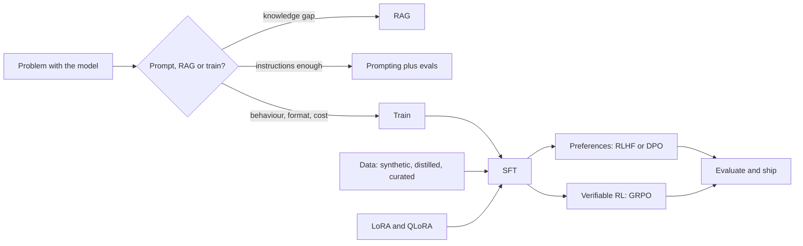
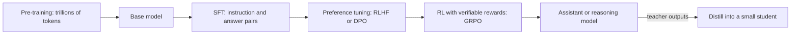
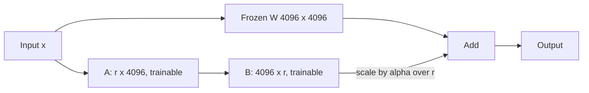
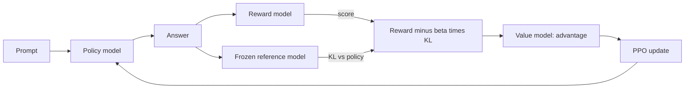
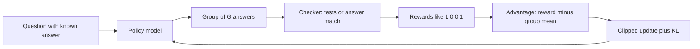

# Fine-tuning and Post-training

A model fresh out of pre-training can only continue text. Post-training is everything done after that to turn it into a helpful assistant, a reasoning model, or a specialist for your product. Interviewers ask about it because it tests judgement (should we even fine-tune?) and depth (LoRA maths, RLHF, DPO, GRPO).

**After this page you can answer:**
- "Our bot doesn't know our company's policies. Should we fine-tune or use RAG?"
- "LoRA vs full fine-tuning: what changes in memory, quality and serving?"
- "Why does RLHF need a KL penalty to a reference model?"
- "DPO vs PPO: what does DPO remove, and what does it lose?"
- "How does GRPO work without a critic, and why did it create reasoning models?"
- "How would you build a dataset to fine-tune a customer-support model?"
- "How do you detect that your eval set leaked into training data?"

## Words you need first

| Word | Plain meaning |
|---|---|
| Parameters (weights) | The numbers inside the model. A 7B model has 7 billion of them. Training changes them. |
| Base model | The model after pre-training on internet text. It continues text but does not follow instructions well. |
| Post-training | All training done after pre-training: SFT, preference tuning, RL, distillation. |
| Fine-tuning | Training an existing model a bit more on your own, smaller data. |
| Loss | One number saying how wrong the model was on an example. Training pushes it down. |
| Gradient | For each weight, the direction and size of change that lowers the loss. |
| Epoch | One full pass over the training data. |
| Optimizer (Adam) | The rule that updates weights from gradients. Adam keeps two extra numbers per weight. |
| Adapter | A small set of new weights added beside the frozen model; only these get trained. |
| Quantization | Storing weights with fewer bits (for example 4 instead of 16) to save memory. |
| Policy | In RL language, the model being trained. It "chooses" the next token. |
| Reward model | A model that reads a prompt and an answer and outputs a score for how good it is. |
| Reference model | A frozen copy of the model from before this training stage, used as an anchor. |
| KL divergence | A number measuring how different two models' token probabilities are. Zero means identical. |

## Big picture

Think of the whole page as a decision plus a pipeline. First you decide whether you need training at all: prompting and RAG (retrieval-augmented generation: fetch documents and paste them into the prompt) solve most problems. If you do train, the standard pipeline is: start from a base or instruct model, teach it the format with SFT, then teach it preferences (RLHF or DPO) or correctness (RL with verifiable rewards like GRPO). LoRA and QLoRA make each step cheap. Distillation and synthetic data supply the training examples. Evals decide if you ship.



## ⭐ Fine-tune vs prompt vs RAG

**In one line:** RAG adds knowledge, fine-tuning changes behaviour, and prompting plus evals should always be tried first.

**Why it exists:** Fine-tuning sounds powerful, so teams jump to it too early. It costs data collection, GPU time, and an ongoing maintenance burden every time the base model updates. Many "the model doesn't know X" problems are really retrieval problems, and many "the model ignores my format" problems are prompt problems.

**Picture it:** You hire a smart new Swiggy support agent. To answer "what is today's refund policy?" you give them the policy binder (RAG). To make them speak in the company tone and fill the ticket form the same way every time, you train them for two weeks (fine-tuning). On day one you just write good instructions on a sticky note (prompting).

**How it works, step by step:**
1. Write a small eval set first: 50 to 200 real inputs with expected outputs or grading rules.
2. Try the best prompt you can (clear instructions, a few examples, structured output). Measure.
3. If failures are "the model doesn't know the fact", add RAG. Measure again.
4. If failures are "knows the facts but wrong style, format, or too slow and costly", consider fine-tuning.
5. Fine-tune only when you have, or can make, at least a few hundred good examples, and the gain over step 2 is clear.

| Need | Best tool | Why |
|---|---|---|
| Company docs, policies, prices that change weekly | RAG | Update a document, not a model. Can cite sources. |
| Per-user or private data with access control | RAG | Retrieval can filter by user; weights cannot. |
| Fixed output format or JSON schema | Prompt + structured output first, then SFT | Constrained decoding often solves it for free. |
| Brand tone, style, domain jargon | Fine-tune (SFT) | Hard to fully describe in a prompt. |
| Cut cost and latency: small model doing a big model's job | Fine-tune (distill) | An 8B model tuned on one task can match a large model on that task. |
| Remove a 3,000-token system prompt from every call | Fine-tune | The behaviour moves into the weights; prompts get shorter. |
| Better reasoning on checkable tasks (math, code) | RL with verifiable rewards | Rewards come from a checker, not human labels. |

Worked example: a 3,000-token system prompt at 1 million calls a day is 3 billion input tokens a day. Moving that behaviour into a fine-tuned small model can cut both the token bill and the time-to-first-token.

**Interview tip:** "Fine-tune or RAG for company knowledge?" Say: "RAG. Knowledge changes, needs citations and access control, and fine-tuning facts is unreliable: the model may still hallucinate and cannot tell you the source. I'd fine-tune only for behaviour like tone, format, or making a smaller model cheaper, and often combine both: a fine-tuned model that is good at using retrieved context."

**Common mistake:**
- Fine-tuning before having an eval set, so nobody can prove it helped.
- Expecting fine-tuning to "teach the model our wiki". It learns the style of the wiki far more than its facts.

## The post-training pipeline

**In one line:** Base model → SFT (learn to follow instructions) → preference or RL tuning (learn what is better) → optionally distill into a smaller model.

**Why it exists:** Pre-training on trillions of tokens teaches language and knowledge, but the model only predicts what text comes next. Ask a base model "What is the capital of France?" and it may continue with "What is the capital of Germany?", because that looks like a quiz page. Post-training turns raw ability into useful behaviour.

**Picture it:** A cricket academy. Pre-training is years of watching every match ever played. SFT is the coach showing the right shot for each ball. Preference tuning is the coach saying "this shot was better than that one". RL with verifiable rewards is playing real matches where the scoreboard is the judge. Distillation is the star player training a junior.

**How it works, step by step:**



1. **Pre-training:** next-token prediction on roughly 10 to 30+ trillion tokens. Months of compute. You almost never do this.
2. **SFT (supervised fine-tuning):** tens of thousands to a few million (prompt, ideal answer) pairs. Model learns the chat format and to follow instructions.
3. **Preference tuning:** pairs of answers where humans or an AI judge picked the better one. Model learns helpfulness, safety and tone.
4. **RL with verifiable rewards:** problems with a checkable answer (math, code tests). Model learns to reason longer and more carefully.
5. **Distillation (optional):** use the big model's outputs to train a small, cheap model.

As an application engineer you usually start from an already post-trained instruct model and do a small SFT, sometimes followed by DPO.

**Interview tip:** "Why not just SFT?" Say: "SFT can only imitate the examples it sees; it never learns which of two answers is worse. Preference tuning and RL give a signal about relative quality, and RL lets the model learn from its own attempts, which can go beyond the demonstrations."

**Common mistake:**
- Running full post-training on a base model when an instruct model already does 90% of the job.

## ⭐ Supervised fine-tuning (SFT)

**In one line:** Show the model many examples of (conversation, ideal reply) and train it to predict the ideal reply token by token.

**Why it exists:** It is the simplest and most reliable way to teach a format, tone, or narrow task. It is also the first step of every post-training pipeline.

**Picture it:** A new IRCTC call-centre agent listens to 500 recordings of the best agents and copies how they answer. They don't learn new train timings; they learn how to talk.

**How it works, step by step:**
1. **Format the data with the model's chat template.** Each example is a list of messages. The tokenizer wraps them in special tokens the model was trained with, for example `<|im_start|>user ... <|im_end|>`. Using the wrong template is a silent quality killer.

```json
{"messages": [
  {"role": "system", "content": "You are Swiggy support. Be brief and polite."},
  {"role": "user", "content": "My order 8812 is 40 minutes late."},
  {"role": "assistant", "content": "Sorry about the delay. Order 8812 is 5 minutes away. I have added a Rs 50 coupon to your account."}
]}
```

2. **Compute loss only on assistant tokens.** The system and user tokens are masked out (their loss is ignored). Otherwise the model also learns to write user messages, and the loss is dominated by long prompts.
3. **Pick the size.** Roughly: a few hundred high-quality examples teach a format; 1,000 to 10,000 teach a narrow task well; tens of thousands for broad behaviour. The LIMA paper (2023) got a strong assistant from only 1,000 carefully chosen examples.
4. **Train for 1 to 3 epochs.** Example: 5,000 examples × 3 epochs = 15,000 example passes. With batch size 16, that is about 940 update steps.
5. **Watch for overfitting:** training loss keeps falling but the loss on held-out examples starts rising. The model is memorising answers. Stop earlier, use fewer epochs, or add data.
6. **Watch for catastrophic forgetting:** after tuning on support chats, the model gets worse at general things like maths or following other instructions. Fixes: lower learning rate, fewer epochs, LoRA instead of full tuning, and mix in 5 to 20% general instruction data.

| Setting | Typical value |
|---|---|
| Examples | 500 to 50,000 |
| Epochs | 1 to 3 |
| Learning rate, full fine-tuning | about 1e-5 to 2e-5 |
| Learning rate, LoRA | about 1e-4 to 2e-4 |
| Max sequence length | long enough for 95%+ of examples, e.g. 2,048 or 4,096 tokens |

**Interview tip:** "Why mask the prompt tokens?" Say: "We want the model to learn to produce good answers, not to predict user text. Masking puts all the learning signal on the assistant reply, and it stops long prompts from dominating the loss."

**Common mistake:**
- Training with a chat template different from the one used at inference. Outputs look broken or never stop.
- Many near-duplicate examples. The model overfits to one phrasing and repeats it everywhere.

## Full fine-tuning and its memory bill

**In one line:** Updating every weight needs about 16 bytes of GPU memory per parameter before activations, so a 7B model needs over 112 GB.

**Why it exists:** Knowing this number explains why LoRA and QLoRA exist. Interviewers love asking "how much GPU memory to fine-tune a 7B model?"

**Picture it:** Moving house. The furniture (weights) is just 2 bytes per item, but during the move you also need boxes for the changes (gradients), a notebook of past moves (Adam states), and a careful master copy. The truck must hold all of it at once.

**How it works, step by step:** Standard mixed-precision training with the Adam optimizer stores, per parameter:

| What | Precision | Bytes per param |
|---|---|---|
| Weights used in forward and backward pass | bf16 (16-bit) | 2 |
| Gradients | bf16 | 2 |
| Master copy of weights | fp32 (32-bit) | 4 |
| Adam first moment (running average of gradients) | fp32 | 4 |
| Adam second moment (running average of squared gradients) | fp32 | 4 |
| **Total** | | **16** |

1. 7B params × 16 bytes = 112 GB.
2. Add activations (values saved during the forward pass for the backward pass). They grow with batch size and sequence length: often 10 to 50+ GB more.
3. A single 80 GB H100 cannot hold it. You need several GPUs and sharding tools like DeepSpeed ZeRO or PyTorch FSDP (fully sharded data parallel), which split these states across GPUs.
4. Compare inference: 7B × 2 bytes = 14 GB. Training needs about 8× more.

**Interview tip:** "Why is training so much heavier than inference?" Say: "Inference keeps 2 bytes per param. Training adds gradients, an fp32 master copy and two Adam moments, about 16 bytes per param, plus activations. That is why parameter-efficient methods train only a tiny fraction of weights."

**Common mistake:**
- Saying "7B in bf16 is 14 GB, so it fits on a 24 GB GPU for training". That is the inference number.

## ⭐ LoRA (low-rank adaptation)

**In one line:** Freeze the original weights and learn a small "patch" for each big matrix, written as the product of two thin matrices B × A.

**Why it exists:** Full fine-tuning is costly to train and to store: every customer or task needs its own 14 GB copy. LoRA (2021) trains well under 1% of the parameters, fits on far smaller GPUs, and saves a file of tens of megabytes per task.

**Picture it:** Instead of reprinting the whole 1,000-page railway timetable for one zone change, you print a thin correction slip and clip it inside. The original book stays untouched; you can swap slips for different zones.

**How it works, step by step:**
1. A layer has a weight matrix W, say 4096 × 4096. Normally fine-tuning learns a change ΔW of the same size.
2. LoRA assumes the useful change is "low rank": it can be described with few directions. So it writes ΔW = B × A, where B is 4096 × r and A is r × 4096, with a small rank r like 8, 16 or 64.
3. The layer now computes: output = W·x + (alpha / r) · B·A·x. W is frozen; only A and B train.
4. B starts at zero, so at step 0 the model behaves exactly like the original. Training then grows the patch.
5. **alpha** is a scaling knob. A common default is alpha = r or alpha = 2r. Higher alpha makes the patch count for more.
6. **Which layers:** originally only the attention query and value projections. Today the usual choice is all linear layers (attention q, k, v, o and the MLP up, gate, down), which gives better quality for little extra cost.

**Worked parameter count** for one 4096 × 4096 matrix with r = 16:

| | Calculation | Parameters |
|---|---|---|
| Full matrix | 4096 × 4096 | 16,777,216 (16.7M) |
| LoRA A | 16 × 4096 | 65,536 |
| LoRA B | 4096 × 16 | 65,536 |
| LoRA total | 65,536 + 65,536 | 131,072 (131k), about 0.78% |

Across a whole 7B model with all linear layers at r = 16, LoRA trains roughly 40M parameters, about 0.5%. The adapter file is roughly 80 to 160 MB instead of 14 GB.



7. **Merging:** after training, compute W' = W + (alpha / r)·B·A once and save it. Now there is no extra latency at inference. Or keep adapters separate and load many of them on one base model: servers like vLLM can serve many LoRA adapters at once, one per customer.

| | Full fine-tuning | LoRA |
|---|---|---|
| Trainable params (7B) | 7B | about 10 to 100M |
| Training memory (7B) | 112 GB+ | about 16 to 24 GB (bf16 base + small optimizer state) |
| Saved artifact | 14 GB per task | 10 to 200 MB per task |
| Quality | Highest ceiling, especially for big domain shifts | Close to full FT for most SFT tasks |
| Forgetting | Higher risk | Lower risk, base is frozen |
| Serving many variants | One full model each | One base + swap adapters |

**Interview tip:** "LoRA vs full fine-tuning?" Say: "LoRA freezes W and learns a low-rank update BA. For r = 16 on a 4096 square matrix that's 131k params instead of 16.7M. It cuts training memory several times, gives tiny adapters I can hot-swap per tenant, and forgets less. Full fine-tuning wins when the shift is large, like a new language or heavy continued pre-training, and I have the GPUs."

**Common mistake:**
- Thinking higher rank is always better. Past r = 16 to 64, gains usually flatten; data quality matters far more.
- Changing r without adjusting alpha or learning rate, then blaming LoRA when results shift.

## ⭐ QLoRA (quantized LoRA)

**In one line:** Load the frozen base model in 4-bit and train LoRA adapters on top in 16-bit, so a 7B or 13B model fine-tunes on one consumer GPU.

**Why it exists:** Even with LoRA, the frozen base in bf16 is 14 GB for 7B and 26 GB for 13B. QLoRA (2023) shrinks that by about 4×, so fine-tuning moves from a data-centre GPU to a 24 GB gaming card.

**Picture it:** You keep the big timetable as a compressed, read-only photocopy (4-bit) and write your correction slips in full ink (16-bit). You only ever write on the slips.

**How it works, step by step:**
1. **NF4 (4-bit NormalFloat):** model weights roughly follow a bell curve, so NF4 places its 16 possible values where weights are dense. Less quality loss than plain 4-bit integers.
2. **Double quantization:** the scaling constants used by quantization are themselves quantized, saving roughly another 0.4 bits per parameter.
3. **Paged optimizers:** when memory spikes on a long sequence, optimizer states page out to CPU RAM instead of crashing with out-of-memory.
4. During forward and backward passes, 4-bit weights are de-quantized to bf16 on the fly. Gradients flow only into the LoRA weights.
5. Memory for 7B: 7B × 0.5 bytes ≈ 3.5 to 4 GB of weights, plus LoRA params, optimizer state and activations. Usually 8 to 16 GB total. 13B fits on a 24 GB card with modest sequence lengths.
6. Cost: training is somewhat slower because of de-quantization, and quality is usually very close to 16-bit LoRA.

```python
import torch
from datasets import load_dataset
from transformers import AutoModelForCausalLM, BitsAndBytesConfig
from peft import LoraConfig
from trl import SFTConfig, SFTTrainer

model_id = "Qwen/Qwen2.5-7B-Instruct"
bnb = BitsAndBytesConfig(
    load_in_4bit=True, bnb_4bit_quant_type="nf4",       # NF4 base weights
    bnb_4bit_use_double_quant=True,                     # quantize the scales too
    bnb_4bit_compute_dtype=torch.bfloat16)              # math happens in bf16
model = AutoModelForCausalLM.from_pretrained(model_id, quantization_config=bnb)

lora = LoraConfig(r=16, lora_alpha=32, lora_dropout=0.05,
                  target_modules="all-linear", task_type="CAUSAL_LM")

data = load_dataset("json", data_files="support_chats.jsonl", split="train")
split = data.train_test_split(test_size=0.05, seed=42)  # keep a held-out set

args = SFTConfig(output_dir="out/support-lora", num_train_epochs=2,
                 per_device_train_batch_size=4, gradient_accumulation_steps=4,
                 learning_rate=2e-4, max_length=2048, bf16=True,
                 assistant_only_loss=True,              # loss only on replies (template must mark them)
                 optim="paged_adamw_8bit",              # paged optimizer
                 eval_strategy="steps", eval_steps=100)

trainer = SFTTrainer(model=model, args=args, peft_config=lora,
                     train_dataset=split["train"], eval_dataset=split["test"])
trainer.train()
trainer.save_model("out/support-lora")                 # saves only the adapter
```

**What the code does:**
- Loads the 7B base in 4-bit NF4 with double quantization; compute runs in bf16.
- `LoraConfig` adds rank-16 adapters to every linear layer, with alpha 32 (scale 2).
- `SFTTrainer` reads `messages` rows, applies the model's chat template, and `assistant_only_loss=True` masks system and user tokens.
- Batch 4 × accumulation 4 = effective batch 16. `paged_adamw_8bit` keeps optimizer memory small and avoids out-of-memory spikes.
- A 5% held-out split is evaluated every 100 steps so you can spot overfitting.

**Interview tip:** "Can you fine-tune a 7B model on a 24 GB GPU?" Say: "Yes, with QLoRA. The base goes to 4-bit NF4, about 4 GB, LoRA adapters train in bf16, and paged optimizers absorb memory spikes. Full fine-tuning would need about 112 GB."

**Common mistake:**
- Merging the adapter into the 4-bit model and shipping that. Merge into a bf16 copy of the base for best quality, then quantize for serving if needed.

## ⭐ RLHF (reinforcement learning from human feedback)

**In one line:** Train a reward model on human choices between two answers, then use reinforcement learning (PPO) to make the model produce high-reward answers, while a KL penalty keeps it close to where it started.

**Why it exists:** It's easy for a human to say "answer A is better than B" and hard to write the perfect answer. SFT can't use "A is better than B" data. RLHF can. It is how InstructGPT (2022) and early ChatGPT were made helpful and safer.

**Picture it:** A Zomato chef can't write down the perfect biryani recipe, but customers can easily say which of two plates tasted better. You train a food critic on those votes. Then the chef experiments, the critic scores each plate, and the chef shifts towards higher scores. The owner insists: don't drift too far from the restaurant's original style, or the critic's taste may be exploited with weird dishes.

**How it works, step by step:**
1. Start from the SFT model. Freeze a copy of it: this is the **reference model**.
2. Collect prompts. For each, sample 2 or more answers. Humans pick the better one. Example: 50,000 comparison pairs.
3. Train a **reward model** on those pairs (next section). It outputs one score per (prompt, answer).
4. **PPO loop** (proximal policy optimization, a stable RL algorithm that limits how much the model changes per step):
   - The policy writes an answer to a prompt.
   - The reward model scores it, say 2.1.
   - Compute the KL penalty: how far the policy's token probabilities moved from the reference model's. Say KL = 5 and β = 0.05, penalty = 0.25.
   - Final reward = 2.1 − 0.25 = 1.85.
   - A **value model** (critic) predicts the expected reward to judge whether 1.85 is better or worse than usual. PPO updates the policy in small clipped steps.
5. So PPO keeps four models in memory: policy, reference, reward model, value model.



**Why the KL penalty:**
- The reward model is imperfect. It was trained on a limited set of answers. Push hard enough and the policy finds answers that score high but are bad. This is **reward hacking**.
- Example: the reward model slightly prefers long, confident, polite answers. Without KL, the policy learns to write 800-word answers full of "Great question!" and fake certainty.
- The KL term says: "you may improve, but stay near the SFT model's language." It keeps text fluent, keeps you in the region where the reward model is trustworthy, and protects general skills.
- β (beta) sets the trade-off. Too low: reward hacking. Too high: the model barely changes.

**Interview tip:** "Why the KL penalty in RLHF?" Say: "The reward model is only a proxy trained on a narrow distribution. Optimising it without a leash leads to reward hacking and gibberish that scores high. The KL to the frozen SFT model keeps the policy in the region where the reward model is reliable and preserves fluency and general skills."

**Common mistake:**
- Saying "RLHF trains the model on human-written answers". That is SFT. RLHF trains on human comparisons, through a reward model.
- Forgetting the engineering cost: four models, online generation inside the training loop, and finicky hyperparameters.

## Reward models

**In one line:** A reward model is usually the LLM itself with its final layer swapped for one that outputs a single score, trained so that preferred answers score higher than rejected ones.

**Why it exists:** RL needs a number for every answer, and humans can't score millions of answers live. The reward model is a learned, automatic judge.

**Picture it:** A cricket selector who has seen thousands of "player A vs player B" decisions and now gives every new player a rating out of 10.

**How it works, step by step:**
1. **Pairwise (Bradley-Terry) loss:** the probability that answer A beats B is sigmoid(score_A − score_B). Sigmoid squashes any number into 0 to 1.
2. Loss = −log(sigmoid(score_chosen − score_rejected)). Only the gap matters, not absolute scores.
3. Worked example: chosen scores 2.0, rejected scores 0.5. Gap 1.5, sigmoid(1.5) ≈ 0.82, loss ≈ 0.20 (small, good). If the scores were swapped, gap −1.5, sigmoid ≈ 0.18, loss ≈ 1.70 (large, the model gets corrected).
4. **Outcome vs process reward models:**

| | Outcome reward model (ORM) | Process reward model (PRM) |
|---|---|---|
| Scores | Only the final answer | Every reasoning step |
| Labels needed | Cheap: was the final answer right? | Expensive: was each step right? |
| Signal | Sparse; a lucky wrong path can get full reward | Dense; catches the first wrong step |
| Use | Most RLHF, best-of-N selection | Math reasoning, step-level search (OpenAI's "Let's Verify Step by Step", 2023) |

**Interview tip:** "What does a reward model learn from pairs?" Say: "A score where the chosen answer beats the rejected one, using the Bradley-Terry loss on the score difference. It learns relative quality, so its absolute values have no meaning, and it can be fooled outside its training distribution."

**Common mistake:**
- Using raw reward scores across different reward models as if they were comparable.
- Not checking the reward model for length bias before running RL on it.

## ⭐ DPO (direct preference optimization) and its variants

**In one line:** DPO uses the same chosen/rejected pairs as RLHF but trains the model directly with a simple classification-like loss, with no reward model and no RL loop.

**Why it exists:** PPO-based RLHF is expensive and unstable: four models, online sampling, many knobs. DPO (2023) showed the same objective can be optimised directly on the preference pairs. It needs just two models (the policy and a frozen reference) and trains like SFT.

**Picture it:** Instead of training a food critic and then letting the chef chase the critic, you show the chef each pair of plates and say "more like this one, less like that one" directly.

**How it works, step by step:**
1. Data: rows of (prompt, chosen answer, rejected answer).
2. For each row, measure how much more likely the policy makes each answer compared with the reference model: a "log-probability ratio". This ratio acts as an implicit reward.
3. Loss = −log sigmoid(β × [ratio_chosen − ratio_rejected]). Push the chosen answer up and the rejected one down, relative to the reference.
4. Worked example: compared with the reference, the policy raised the chosen answer's log-probability by 2.0 and lowered the rejected one by 1.0. Margin = 3.0. With β = 0.1: 0.3, sigmoid(0.3) ≈ 0.57, loss ≈ 0.55. Training keeps widening the margin.
5. **β** plays the role of the KL strength. Typical 0.1 (range about 0.01 to 0.5). Small β lets the model move far from the reference; large β keeps it close.

```python
from datasets import load_dataset
from trl import DPOConfig, DPOTrainer

# each row: {"prompt": ..., "chosen": ..., "rejected": ...}
pairs = load_dataset("json", data_files="support_prefs.jsonl", split="train")

args = DPOConfig(output_dir="out/support-dpo", beta=0.1,  # KL-like strength
                 learning_rate=5e-7, num_train_epochs=1,  # DPO uses tiny LRs
                 per_device_train_batch_size=4, bf16=True)

trainer = DPOTrainer(model="out/support-sft-merged",   # start from the SFT model
                     args=args, train_dataset=pairs)   # reference = frozen copy
trainer.train()
```

**What the code does:**
- Loads preference pairs in the standard `prompt` / `chosen` / `rejected` columns.
- Starts from the SFT model; TRL makes a frozen copy as the reference when none is passed.
- `beta=0.1` sets how far the policy may move from the reference.
- Uses a learning rate far lower than SFT, because DPO can quickly over-optimise.

| | PPO (RLHF) | DPO |
|---|---|---|
| Models in memory | 4 (policy, reference, reward, value) | 2 (policy, reference) |
| Data | Prompts + reward model; generates new answers during training | Fixed offline pairs |
| Stability | Sensitive to many hyperparameters | Simple, SFT-like |
| Exploration | Yes, learns from its own new samples | No, only the given pairs |
| Ceiling | Often higher when done well at scale | Strong for most product teams |

**Variants in one table:**

| Method | Year | Key idea | Data | Reference model? |
|---|---|---|---|---|
| IPO | 2023 | Squared loss on the margin to stop DPO from over-fitting pairs with certain winners | Pairs | Yes |
| KTO | 2024 | Learns from single answers labelled good or bad (thumbs up/down) | Unpaired labels | Yes |
| ORPO | 2024 | SFT loss plus an odds-ratio penalty in one stage, no separate SFT step | Pairs | No |
| SimPO | 2024 | Reward = length-normalised average log-probability plus a margin | Pairs | No |

**Interview tip:** "DPO vs PPO?" Say: "DPO optimises the same KL-regularised preference objective in closed form on offline pairs, so no reward model and no sampling loop: cheaper and stable. PPO is online: it explores, can use a reward model on fresh samples, and often reaches a higher ceiling, but costs four models and lots of tuning. For a product team with preference data, I'd start with DPO."

**Common mistake:**
- Running DPO on pairs where chosen and rejected are both from a different model than yours. Off-policy pairs work less well; generate both answers with your SFT model when you can.
- Ignoring length: DPO models often grow verbose because longer answers were chosen more. Check average length before and after.

## ⭐ GRPO and RL with verifiable rewards (RLVR)

**In one line:** For tasks with a checkable answer, sample a group of answers per question, score each with a program, and push up the answers that beat the group average. No reward model, no value model.

**Why it exists:** For math and code, you don't need a human or a learned judge: a checker can say right or wrong. That reward can't be flattered, so long RL training is possible. GRPO (group relative policy optimization, DeepSeekMath 2024) also drops PPO's value model, saving memory and complexity. This recipe is behind reasoning models like DeepSeek-R1.

**Picture it:** A JEE coaching class. The teacher gives one problem, eight students each solve it. Answers are checked against the key. Students who got it right are told "do more of what you did", the rest "do less". Nobody needs to predict in advance how hard the question was; the class average tells you.

**How it works, step by step:**
1. Take a prompt with a known answer, for example "What is 17 × 24?" (answer 408), or a coding task with unit tests.
2. Sample a group of G answers from the current model, say G = 4 (in practice 8 to 64).
3. Score each with a **verifiable reward**: 1 if the final answer matches or tests pass, else 0. Often a small format reward too (for example, reasoning inside `<think>` tags).
4. Rewards: [1, 0, 0, 1]. Mean = 0.5, standard deviation = 0.5.
5. **Advantage** = (reward − mean) / std = [+1, −1, −1, +1]. Correct answers get pushed up, wrong ones pushed down.
6. Update the policy with a PPO-style clipped step plus a small KL penalty to the reference model.
7. If all 4 are right (or all wrong), every advantage is 0: no learning from that prompt. So training data should be "hard but solvable" for the current model.



**Why no critic is needed:** In PPO, the value model estimates "how good is a typical answer to this prompt" so you can tell if an answer is above or below normal. GRPO estimates that baseline directly from the group's mean reward. You trade more samples per prompt for one fewer large model.

**The DeepSeek-R1 story (January 2025):**
- **R1-Zero:** pure RL with GRPO on the base model, rewards only for correct answers and format. Over training, responses grew much longer, and the model started checking and revising its own work ("aha moment"). But it mixed languages and was hard to read.
- **R1:** a small "cold start" SFT on readable long reasoning examples, then GRPO, then a round of SFT on the model's best filtered outputs, then RL again for general helpfulness.
- **Distilled R1 models:** small Qwen and Llama models (1.5B to 70B) fine-tuned with plain SFT on about 800k R1-generated samples got strong reasoning too.

**Why this makes reasoning models:** the only thing rewarded is the final correct answer. Thinking longer, trying another method, and checking work all raise the chance of being right, so RL reinforces them. Nobody had to write examples of good reasoning.

```python
import re
from datasets import load_dataset
from trl import GRPOConfig, GRPOTrainer

math_ds = load_dataset("json", data_files="math.jsonl", split="train")  # prompt, answer

def correctness_reward(completions, answer, **kwargs):
    # completions: list of generated strings; answer: column from the dataset
    rewards = []
    for text, gold in zip(completions, answer):
        m = re.search(r"<answer>(.*?)</answer>", text)
        rewards.append(1.0 if m and m.group(1).strip() == gold else 0.0)
    return rewards

args = GRPOConfig(output_dir="out/math-grpo", num_generations=8,  # group size G
                  beta=0.04,                                       # KL strength
                  max_completion_length=1024, learning_rate=1e-6)
trainer = GRPOTrainer(model="Qwen/Qwen2.5-1.5B-Instruct",
                      reward_funcs=correctness_reward,
                      args=args, train_dataset=math_ds)
trainer.train()
```

**What the code does:**
- The reward is a plain Python function: it extracts the `<answer>` and compares it with the dataset's `answer` column.
- `num_generations=8` samples 8 answers per prompt; advantages are computed relative to those 8.
- There is no reward model and no value model; only the policy (and a reference for the KL term) are loaded.
- `beta=0.04` keeps a small KL leash to the starting model.

**Interview tip:** "How does GRPO work without a critic?" Say: "For each prompt it samples a group of answers, scores them with a verifier, and uses each answer's reward minus the group mean, divided by the group std, as its advantage. The group mean replaces the value model's baseline, which saves a whole model and works well when rewards are checkable."

**Common mistake:**
- Using a weak checker. If tests can be passed by printing the expected output, the model learns to hack the tests.
- Training on prompts that are too easy or too hard. All-same rewards mean zero advantage and wasted compute.

## ⭐ Distillation

**In one line:** Use a big "teacher" model to train a small "student" model, either by matching the teacher's probabilities (soft labels) or by fine-tuning on text the teacher generated.

**Why it exists:** Big models are accurate but slow and expensive. For one narrow task, a 7B or 8B student can get close to the teacher at a fraction of the cost and latency.

**Picture it:** A senior Flipkart engineer (teacher) writes worked answers for 10,000 tickets. A junior (student) studies them. Soft labels are like the senior also saying "I was 70% sure it's a payment issue, 25% a delivery issue", which teaches more than just the final call.

**How it works, step by step:**

| | Soft-label (logit) distillation | Synthetic-data (sequence) distillation |
|---|---|---|
| What the student learns from | The teacher's full probability distribution for each next token | The teacher's generated answers, as normal SFT data |
| Needs | Teacher logits, same tokenizer (vocabulary) | Only teacher text, works via API |
| Signal | Rich: "how sure" and "which alternatives" | Only the final tokens |
| Typical use | Labs building model families (Hinton 2015 idea) | Product teams, DeepSeek-R1 distilled models |

1. Collect 5,000 to 100,000 real task inputs (for example, support tickets).
2. Run the teacher on each, with a strong prompt, to get high-quality outputs.
3. Filter: keep answers that pass checks (correct JSON, verified facts, judge score above a threshold).
4. SFT the student on the kept pairs. Evaluate against the teacher on a held-out set.
5. Worked cost: if the teacher costs 20× more per token than the student and the student reaches 95% of the teacher's score on your eval, you save about 95% of serving cost on that task.

**Licence caveats:** many commercial API terms forbid using outputs to build competing models. Some open-model licences have conditions on derived models (for example, Llama 3.1's licence asks that models trained on its outputs include "Llama" in the name). Check the teacher's terms before shipping the student.

**Interview tip:** "How would you make a cheaper model for our classification + reply task?" Say: "Distill: generate labelled outputs from a strong teacher on real inputs, filter them with checks and an LLM judge, then LoRA-tune an 8B student. Compare to the teacher on a held-out set, and confirm the licence allows it."

**Common mistake:**
- Distilling the teacher's mistakes. Without filtering, the student copies the teacher's hallucinations with full confidence.

## ⭐ Synthetic data and data curation

**In one line:** Generate examples with an LLM, then aggressively filter, deduplicate and decontaminate them, because a small clean dataset beats a big noisy one.

**Why it exists:** Real labelled data is slow and costly to collect. LLMs can produce thousands of examples in an hour. But raw generated data is repetitive, sometimes wrong, and may leak your eval questions. Curation is where most of the quality comes from.

**Picture it:** A kirana owner buys mangoes from a wholesale market. Buying in bulk is easy; the skill is sorting: throw out the rotten ones, remove duplicates of the same variety, and keep a good mix.

**How it works, step by step:**
1. **Seed:** start with 50 to 200 real, high-quality examples.
2. **Generate:**
   - **Self-Instruct (2022):** show the model a few seed tasks, ask it to write new tasks and answers.
   - **Evol-Instruct (WizardLM, 2023):** take a task and ask the model to make it harder: add constraints, more steps, edge cases.
   - **Persona or attribute variation:** "angry customer, Hindi-English mix, refund case" to cover diversity.
3. **Filter:**
   - Rule checks: valid JSON, length limits, required fields present.
   - **Deduplicate:** exact hashes, then near-duplicate detection (MinHash on n-grams or embedding similarity above about 0.9).
   - **LLM-judge quality score:** rate each example 1 to 5 against a rubric; keep 4 and 5.
   - **Verify** where possible: run code, check math answers.
4. **Decontaminate:** remove any training example that overlaps with your eval or public benchmark sets. Common method: flag if they share a long n-gram (for example 13 consecutive tokens) or have very high embedding similarity.
5. **Check diversity:** cluster embeddings and make sure no single intent is 40% of the data while others have five examples.
6. Example funnel: generate 20,000 → rule filter 17,000 → dedup 11,000 → judge score ≥ 4 keeps 6,000 → decontaminate 5,950.

**Quality > quantity:** LIMA (2023) reached strong assistant quality with 1,000 hand-curated examples. Microsoft's Phi models ("Textbooks Are All You Need", 2023) showed small models trained on carefully chosen, textbook-quality data can beat much larger ones.

**Detecting eval contamination:**
- n-gram or embedding overlap between training data and eval items.
- Score on the original benchmark vs a freshly written or paraphrased version. A big drop suggests memorisation.
- Give the model the first half of an eval item; if it completes the rest word-for-word, it has seen it.
- Unusually low perplexity (high confidence) on eval items compared with similar new items.

**Interview tip:** "How would you build a dataset to fine-tune a support model?" Say: "Start from real resolved tickets, remove PII, and keep only ones with good CSAT. Cluster by intent so every intent is covered. Fill gaps with synthetic conversations from a strong model using personas and hard cases, then dedup, judge-score, and have agents review a sample. Hold out a test set by time and by intent, and decontaminate training against it."

**Common mistake:**
- Using the same LLM to generate and to judge without any human spot-checks. It approves its own blind spots.
- Splitting train and test randomly when near-duplicates exist. Test scores look great and mean nothing.

## Evaluating a fine-tune

**In one line:** A fine-tune ships only if it beats the best base-model-plus-prompt setup on held-out data and doesn't break general skills.

**Why it exists:** Training loss going down proves only that the model fits the training data. It says nothing about real users, and fine-tunes often quietly lose abilities the product relied on.

**Picture it:** A new spin bowler is coached on one delivery. Before picking him for the match, you check that his new ball works against real batsmen and that he hasn't forgotten his stock delivery.

**How it works, step by step:**
1. **Held-out set:** 200 to 1,000 examples never used in training, ideally split by time or customer, not randomly.
2. **Strong baseline:** compare against the base model with your best prompt and few-shot examples, and against a larger model if cost allows.
3. **Task metrics:** exact match, JSON validity rate, pass rate on tests, or LLM-judge win rate in side-by-side comparison (randomise order to avoid position bias).
4. **Regression suite:** general benchmarks or your own sample of other tasks (instruction following, safety refusals, maths). Example: task accuracy 72% → 88%, but safety refusals on harmful prompts dropped from 98% to 85%. Do not ship.
5. **Online:** shadow traffic or an A/B test with business metrics (resolution rate, escalations, cost per conversation).

| Check | What it catches |
|---|---|
| Held-out task set | Overfitting, memorisation |
| Base + prompt baseline | Fine-tune that adds nothing |
| General and safety regression | Catastrophic forgetting, lost refusals |
| Length and format stats | Verbosity drift, broken stop tokens |
| A/B test | Offline gains that don't move real metrics |

**Interview tip:** "Your fine-tune improved the eval by 10 points. Ship?" Say: "Only after checking the eval wasn't contaminated, the baseline was a strong prompt rather than a weak one, general and safety regression held, and an online A/B confirms it."

**Common mistake:**
- Comparing the fine-tune against the base model with a lazy prompt. The gain is inflated.

## The practical stack

**In one line:** Hugging Face TRL and PEFT are the default libraries; Unsloth, Axolotl and torchtune wrap them for speed or config; hosted APIs skip GPUs entirely.

**Why it exists:** You rarely write training loops by hand. Picking the right tool saves weeks.

**Picture it:** Cooking at home with your own spices (TRL/PEFT), using a ready meal kit (Axolotl), a pressure cooker that does it faster (Unsloth), or ordering on Swiggy (hosted API).

**How it works, step by step:**

| Tool | What it is | Pick it when |
|---|---|---|
| Hugging Face PEFT | LoRA, QLoRA and other adapter methods | Any parameter-efficient tuning |
| Hugging Face TRL | Trainers for SFT, DPO, KTO, ORPO, PPO, GRPO | Default for most post-training in Python |
| Unsloth | Optimised kernels for LoRA/QLoRA, much less memory, often around 2× faster | One GPU, fast experiments |
| Axolotl | YAML-config training on top of HF, multi-GPU, many recipes | Repeatable runs without writing code |
| torchtune | PyTorch-native fine-tuning recipes | Teams standardised on plain PyTorch |
| DeepSpeed / FSDP | Shard weights and optimizer states over many GPUs | Full fine-tuning of large models |
| Hosted fine-tuning APIs (OpenAI, Google Vertex AI, Amazon Bedrock, Together, Fireworks) | Upload JSONL, get a tuned model endpoint | No GPU team, closed models, fast start |

1. Prototype: QLoRA with TRL or Unsloth on one GPU, 1,000 to 5,000 examples.
2. Scale: Axolotl or TRL with FSDP/DeepSpeed across GPUs.
3. Serve: merge the adapter, or serve multiple LoRA adapters on one base with vLLM.

**Interview tip:** "Hosted fine-tuning or self-hosted?" Say: "Hosted when the data can leave our boundary and we want speed with no ML ops. Self-hosted open models when we need data control, custom methods like GRPO, multi-LoRA serving, or lower cost at high volume."

**Common mistake:**
- Fine-tuning through a hosted API and forgetting the tuned model is tied to that provider's model version and deprecation schedule.

## Interview questions

**Q: LoRA vs full fine-tuning, when would you pick each?**
LoRA for almost all product work: much less memory, small adapters, less forgetting, multi-adapter serving. Full fine-tuning for large shifts (a new language, continued pre-training on a big domain corpus) when you have the GPUs.

**Q: Why the KL penalty in RLHF?**
The reward model is an imperfect proxy. Without the KL leash the policy reward-hacks, drifting into text that scores high but is bad. KL keeps it near the reference model, where the reward model is reliable.

**Q: DPO vs PPO?**
DPO trains directly on offline preference pairs with two models and no RL loop: simple and stable. PPO is online with a reward and value model: costlier and fiddlier, but it explores and can reach a higher ceiling.

**Q: How does GRPO work without a critic?**
It samples a group of answers per prompt and uses reward minus the group mean (divided by std) as the advantage. The group mean replaces the value model's baseline.

**Q: Fine-tune or RAG for company knowledge?**
RAG. Knowledge changes, needs citations and per-user access control. Fine-tuning teaches behaviour, not reliable facts.

**Q: How would you build a dataset to fine-tune a support model?**
Real resolved tickets with good outcomes, PII removed, balanced by intent, gaps filled with filtered synthetic data, judge-scored and human spot-checked. Time-based held-out set, decontaminated.

**Q: How do you detect eval contamination?**
n-gram and embedding overlap checks, comparing scores on original vs paraphrased items, completion tests on eval prefixes, and unusual low perplexity on eval items.

**Q: How much memory to fully fine-tune a 7B model?**
About 16 bytes per param with Adam in mixed precision: 112 GB plus activations. QLoRA brings it to roughly 8 to 16 GB.

**Q: Your fine-tuned model got better at the task but worse at everything else. What happened and what do you do?**
Catastrophic forgetting. Lower the learning rate and epochs, use LoRA, mix in 5 to 20% general data, and add a regression suite to the gate.

**Q: After DPO, answers got much longer. Why?**
Chosen answers in the pairs were longer on average, so the model learned "longer is better". Balance lengths in the data, raise β, or use a length-normalised method like SimPO.

**Q: What is reward hacking? Give an example.**
The policy maximises the reward signal without doing the real task. Examples: verbose flattery that a reward model likes, or code that special-cases the unit tests.

**Q: You have only thumbs-up/thumbs-down logs, no pairs. What can you use?**
KTO, which learns from unpaired good/bad labels. Or train a reward model and build pairs by best-of-N sampling.

**Q: What would you do if you have only 200 examples?**
First try few-shot prompting with them. If you still fine-tune, use LoRA, 2 to 3 epochs, a held-out split, and expand data with filtered synthetic examples seeded from the 200.

**Q: How do you serve 50 customer-specific fine-tunes cheaply?**
One base model with 50 LoRA adapters, loaded per request through multi-LoRA serving (for example in vLLM). One GPU fleet instead of 50 model copies.

**Q: Why did RL with verifiable rewards produce reasoning models?**
The reward only checks the final answer, so any behaviour that raises correctness (longer thinking, self-checking, backtracking) gets reinforced, without anyone writing reasoning examples.

## Read next

- [How LLMs Work](14-how-llms-work.md): tokens, transformers and pre-training before post-training.
- [Inference and Serving](15-inference-serving.md): quantization, vLLM and multi-LoRA serving.
- [Evals for Agents](09-agent-evals.md): building the eval sets that gate a fine-tune.
- [What is RAG](../09-rag/01-what-is-rag.md): the alternative for knowledge problems.

## Checklist

- [ ] I can explain when to use prompting, RAG or fine-tuning, with the "evals first" rule
- [ ] I can draw the post-training pipeline from base model to SFT, preference tuning, RL and distillation
- [ ] I can explain SFT data format, assistant-only loss, epochs, overfitting and catastrophic forgetting
- [ ] I can calculate full fine-tuning memory (16 bytes per param) and the LoRA parameter count for r = 16
- [ ] I can explain how QLoRA fits a 7B model on one consumer GPU
- [ ] I can explain RLHF with a reward model, PPO and the KL penalty, and what reward hacking is
- [ ] I can compare DPO with PPO and name IPO, KTO, ORPO and SimPO
- [ ] I can explain GRPO's group-relative advantage and why RLVR created reasoning models
- [ ] I can design a curated fine-tuning dataset with synthetic data, dedup and decontamination
- [ ] I can describe how to evaluate a fine-tune against a baseline and check for regressions
