# Multimodal and Voice Agents

A multimodal agent works with more than text: it reads images, scanned documents and video, or it listens and talks back. Interviewers ask about it because two products are everywhere right now: "read this invoice or PDF" and "answer the phone like a human". Both look simple in a demo and both break in production for reasons that have nothing to do with the prompt.

**After this page you can answer:**
- "How does an LLM actually 'see' an image, and why does a big image cost more tokens?"
- "For invoices, would you use a vision LLM or an OCR pipeline? Why?"
- "How would you search 50,000 scanned PDFs full of tables and charts?"
- "Cascaded STT → LLM → TTS or a speech-to-speech model: which one and when?"
- "A voice turn takes 2 seconds. Where does the latency go, and how do you get it under 1 second?"
- "How do you handle a user who interrupts the bot mid-sentence?"
- "Design a voice agent that takes restaurant reservations over the phone."
- "How do you test a voice agent before real customers call it?"

## Words you need first

| Word | Plain meaning |
|---|---|
| Multimodal | A model that takes more than one kind of input: text, images, audio, video. |
| VLM (vision-language model) | An LLM that can also take images as input and answer in text. |
| Patch | A small square of an image, for example 14 × 14 pixels, treated like one "word". |
| Vision encoder | A neural network that turns image patches into lists of numbers the LLM can use. |
| OCR (optical character recognition) | Software that reads printed or handwritten text from an image and outputs plain text. |
| STT (speech-to-text) | Turns audio into text. Also called ASR, automatic speech recognition. |
| TTS (text-to-speech) | Turns text into spoken audio. |
| VAD (voice activity detection) | A small model that says "someone is speaking now" or "this is silence". |
| Endpointing | Deciding the user has finished their turn and the bot may reply. |
| Barge-in | The user starts talking while the bot is still speaking. |
| TTFT (time to first token) | Time from sending a request until the LLM produces its first output token. |
| WER (word error rate) | Share of words the STT got wrong, compared to a correct human transcript. |
| PSTN (public switched telephone network) | The normal phone network that mobile and landline calls travel on. |
| WebRTC | A browser standard for real-time audio and video over the internet, built for low delay. |

## Big picture

There are two halves. The **seeing** half: images become tokens, documents get read either by a VLM or by an OCR pipeline, and pages can be searched as images. The **talking** half: audio comes in over a phone line or WebRTC, a turn detector decides when the user is done, a cascaded or speech-to-speech model produces a reply, and every millisecond is budgeted. Both halves end in the same place: evaluation and production cost control.

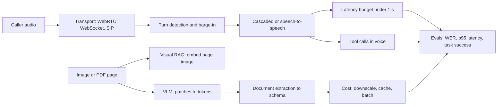

Each box is a section below. We start with how a model sees an image, because image token cost drives many later decisions.

## How vision-language models see an image

**In one line:** the image is cut into small squares, each square becomes a vector, a small adapter maps those vectors into the LLM's "word" space, and the LLM reads them like extra tokens.

**Why it exists:** an LLM only understands tokens, which are vectors of numbers. Pixels are not tokens. We need a way to turn a photo of a bill into something the LLM can attend to, next to the text question "what is the total?".

**Picture it:** a jigsaw puzzle posted to a friend piece by piece. You cut the photo into 576 pieces, write a short description on the back of each, and translate each description into the friend's language. The friend never sees the photo, only 576 described pieces in order.

**How it works, step by step:**
1. **Resize.** The image is resized to the encoder's input size, for example 336 × 336 pixels.
2. **Cut into patches.** With 14 × 14 pixel patches: 336 / 14 = 24 per side, so 24 × 24 = **576 patches**.
3. **Vision encoder.** A Vision Transformer (ViT), often trained CLIP-style (matching images to their captions), turns each patch into a vector, for example 1,024 numbers. Patches "look at" each other, so each vector knows its neighbourhood.
4. **Projector.** A small network (often a 2-layer MLP, a simple stack of matrix multiplies) maps each 1,024-number vector to the LLM's embedding size, for example 4,096. Now each patch looks like a word embedding.
5. **Into the LLM.** The 576 image tokens are placed in the prompt next to the text tokens. The LLM attends over both. This is the LLaVA-style design. Some models compress patches (pool 2 × 2 into 1) to use fewer tokens.

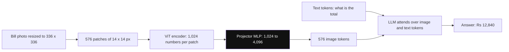

*Diagram:* The projector (highlighted) is the bridge: after it, the 576 image patches are just more tokens in the context, side by side with the question.

**Resolution tiling.** 336 pixels is too small to read a printed invoice. So high-resolution models split a big image into tiles, encode each tile, and often add one low-resolution thumbnail for the overall layout.

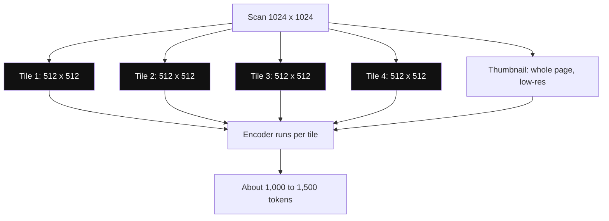

*Diagram:* The tiles read the fine print and the thumbnail keeps the layout; doubling width and height gives 4x the tiles, so about 4x the tokens.

| Image | Tiles (example 512 px tiles) | Rough image tokens |
|---|---|---|
| 512 × 512 photo | 1 tile + thumbnail | a few hundred |
| 1024 × 1024 scan | 4 tiles + thumbnail | roughly 1,000–1,500 |
| 2048 × 2048 page | 16 tiles + thumbnail | several thousand, often capped by downscaling |

Numbers differ by provider. One provider documents roughly **(width × height) / 750** tokens, so 1000 × 1000 ≈ 1,333 tokens. The rule that holds everywhere: **tokens grow with pixel area**, so doubling width and height costs about 4x.

**Interview tip:** "How does a VLM read an image?" Say: "Patches go through a ViT encoder, a projector maps them into the LLM embedding space, and they enter the context as tokens. High-res images are tiled, so token cost grows with area. That is why I downscale to the smallest size where the text is still readable."

**Common mistake:**
- Sending a 12-megapixel phone photo as is. It either gets downscaled by the provider anyway (you lose control) or costs thousands of tokens for no accuracy gain.
- Assuming the model sees "pixels". It sees compressed patch vectors, so tiny text in one corner can be lost.

## ⭐ Document understanding: VLM or OCR pipeline

**In one line:** you can read a document with a classic pipeline (OCR → layout → LLM on text) or send the page image straight to a VLM; pick by accuracy needs, cost, volume and audit needs, and always verify numbers.

**Why it exists:** most business data still lives in PDFs, scans and photos: invoices, KYC (know your customer) documents, bank statements, lab reports. A finance team wants `{"gstin": ..., "total": ..., "line_items": [...]}` in a database, not a picture.

**Picture it:** two ways to copy a handwritten kirana bill into Excel. Option A: one person types every word exactly, another marks which words are the table, and a third person reads the typed copy and fills Excel. Option B: one smart person looks at the bill and fills Excel directly. B is faster and handles messy layouts, but sometimes "fills in" a number that looked right instead of the one actually written.

**How it works, step by step:**

*Classic pipeline:*
1. **OCR** turns the page image into words, each with a bounding box (x, y, width, height) and a confidence score.
2. **Layout analysis** groups words into blocks: header, table rows, key-value pairs, footer.
3. **Serialize** the layout to text or markdown (tables as markdown tables).
4. **LLM** reads that text and fills the JSON schema.

*VLM direct:*
1. Render the PDF page to an image (for example 150–200 DPI, dots per inch).
2. Send image + schema + instructions to a VLM.
3. The VLM returns JSON directly.

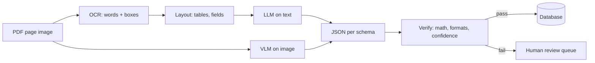

| | OCR + layout + LLM | VLM on page image |
|---|---|---|
| Messy layouts, stamps, charts | weak; layout step breaks | strong; sees the whole page |
| Exact characters (IDs, amounts) | strong; OCR copies, does not guess | can **hallucinate** plausible digits |
| Charts and diagrams | loses them (no text inside) | can read trends and values roughly |
| Cost per page | OCR is cheap; LLM sees fewer tokens | image tokens per page, more per page |
| Traceability | every value has a bounding box | harder to point to "where on the page" |
| Handwriting | depends on the OCR engine | often better, still error-prone |
| Engineering effort | more moving parts | one call, simpler |

A strong production answer is often **hybrid**: run OCR to get text with boxes, and send both the OCR text and the page image to the VLM. The VLM uses the image for layout and the OCR text for exact characters.

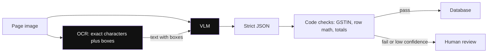

*Diagram:* In the hybrid, the VLM reads layout from the image and copies digits from the OCR text, so each covers the other's weakness.

**Extraction to a schema, then verify.** Ask for strict JSON (structured outputs or a tool schema), then check it with code, not with another prompt.

```python
from pydantic import BaseModel, field_validator, model_validator
import re

GSTIN_RE = re.compile(r"^\d{2}[A-Z]{5}\d{4}[A-Z][1-9A-Z]Z[0-9A-Z]$")

class LineItem(BaseModel):
    description: str
    qty: float
    unit_price: float
    amount: float

class Invoice(BaseModel):
    invoice_no: str
    gstin: str
    line_items: list[LineItem]
    tax: float
    total: float

    @field_validator("gstin")
    @classmethod
    def gstin_format(cls, v: str) -> str:
        if not GSTIN_RE.match(v):
            raise ValueError(f"bad GSTIN format: {v}")
        return v

    @model_validator(mode="after")
    def totals_add_up(self):
        for item in self.line_items:
            # each row: qty x price must match the printed amount
            if abs(item.qty * item.unit_price - item.amount) > 1.0:
                raise ValueError(f"row math wrong: {item.description}")
        subtotal = sum(i.amount for i in self.line_items)
        if abs(subtotal + self.tax - self.total) > 1.0:
            raise ValueError("line items + tax != total")
        return self

# raw_json comes from the VLM; a ValidationError sends the page to a human
# invoice = Invoice.model_validate_json(raw_json)
```

**What the code does:**
- Defines the target schema with Pydantic, so the VLM output must have these fields and types.
- Checks the GSTIN (Indian GST number) against its 15-character pattern.
- Checks every row: quantity × unit price must equal the printed amount, within ₹1 for rounding.
- Checks that line items plus tax equal the grand total.
- Any failure raises a `ValidationError`, which you route to retry or human review instead of the database.

**Failure modes and how to catch them:**

| Failure | Example | Catch it with |
|---|---|---|
| Small text lost | 6-point GSTIN in the footer misread | crop and re-send that region at higher resolution |
| Handwriting | "7" read as "1" on a handwritten bill | OCR confidence score + human review for low confidence |
| Hallucinated numbers | total "₹12,480" when the page says "₹12,840" | arithmetic checks, cross-check with OCR text |
| Table rows merged or skipped | 9 rows extracted from a 10-row table | row count check, sum check |
| Multi-page tables | row split across page 3 and 4 | process pages together or stitch by header |
| Rotated or skewed scans | 90-degree phone photo | auto-rotate and deskew before the model |

**Interview tip:** "VLM or OCR for invoices?" Say: "For a fixed set of clean invoice templates at high volume, OCR plus layout is cheap and exact. For many vendors with messy layouts, a VLM is more robust. In practice I go hybrid: OCR text plus page image into the VLM, strict schema, then arithmetic and format checks, and anything that fails or has low confidence goes to a human."

**Common mistake:**
- Trusting a VLM's numbers because the JSON "looks right". VLMs produce plausible digits. Money fields need code checks.
- Measuring accuracy per document only. Measure **per field**: a 98% document score can hide a 90% score on the total field, the one that matters.

## Visual RAG: retrieve the page image

**In one line:** instead of OCR-ing every page and embedding the text, embed the page image itself, retrieve the best page images for a question, and give those images to a VLM to answer.

**Why it exists:** in annual reports, product manuals and research papers, the answer is often in a chart, a table or a diagram. Text extraction flattens or drops these. Text RAG then cannot find "which quarter had the highest margin" because that fact only exists as bar heights in a chart.

**Picture it:** a librarian who remembers what each page **looks like**, not just its words. You ask "the page with the pie chart of revenue by region", and she pulls it out.

**How it works, step by step:**
1. Render each PDF page to an image, for example 50,000 pages.
2. A ColPali-style model (2024; built on a VLM) encodes each page into **many vectors, one per patch**, for example about 1,000 vectors of 128 numbers each.
3. Encode the question into one vector per query token, for example 12 vectors.
4. Score with **late interaction (MaxSim)**: for each query vector, find the most similar patch vector on the page, then add up those 12 best scores. This is the ColBERT idea applied to image patches.
5. Take the top 3 pages and send their images plus the question to a VLM for the answer.

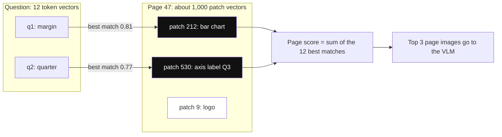

*Diagram:* Each query vector keeps only its single best patch (MaxSim); the page score adds those best matches, so a chart patch can make the page win.

**Storage maths:** 50,000 pages × 1,000 vectors × 128 numbers × 2 bytes ≈ **12.8 GB**, versus about 0.3 GB for one 1,536-number float32 vector per page. Multi-vector is powerful but heavy. Common fixes: pool patch vectors, quantize to fewer bits, or use a cheap single-vector search first and re-rank the top 100 pages with MaxSim.

| | Text RAG (OCR then embed text) | Visual RAG (embed page image) |
|---|---|---|
| Charts, diagrams, layout | lost | kept |
| Indexing pipeline | OCR + chunking + embedding | render + embed, simpler |
| Index size | small | large (multi-vector) |
| Answering model | any LLM | must be a VLM (costs image tokens) |
| Exact keyword match ("invoice 88213") | good with hybrid BM25 | weaker |

**Interview tip:** "How would you search 50,000 scanned reports full of charts?" Say: "Visual retrieval with a ColPali-style multi-vector index over page images, a cheap first stage to keep it fast, MaxSim re-ranking, and a VLM to answer over the top pages. I would keep a text index alongside for exact IDs and numbers."

**Common mistake:** forgetting the answer step costs image tokens too. Retrieving 10 full pages for a VLM can be 15,000+ tokens per question. Retrieve fewer, or crop.

## Images and video in production

**In one line:** image cost is mostly a pixel-count problem, so control resolution, avoid sending the same image twice, batch non-urgent work, and sample video frames instead of sending every frame.

**Why it exists:** a demo sends one image. Production sends a million a day. At those volumes, a 3x token difference per image is a 3x bill difference, and latency also grows with image tokens.

**Picture it:** sending photos on WhatsApp. You do not send the 48 MP original to ask "is this the right charger?". The compressed version is enough. But for a document you send "as document" so the text stays sharp.

**How it works, step by step:**
1. **Downscale to the task.** A product-photo classifier may need 512 px. A dense invoice may need 1,500 px on the long side. Test accuracy at 3–4 sizes and pick the smallest that holds.
2. **Crop to the region.** If you only need the address block, crop it. Fewer pixels, fewer tokens, and the text gets more resolution per token.
3. **Use the provider's detail setting.** Some APIs have a "low detail" mode with a small fixed token cost per image. Use it for "is this a cat" style tasks.
4. **Cache.** Hash the image bytes (for example SHA-256). Same hash + same prompt = return the stored result. Put stable images early in the prompt so prompt caching can reuse them across turns.
5. **Batch.** Overnight work (re-extracting 2 lakh old invoices) goes to a batch API, often around half the price, with hours of turnaround.
6. **Video = frames.** A 60-second clip at 1 frame per second is 60 images. At ~250 tokens per small frame, that is ~15,000 tokens. Sample fewer frames, detect scene changes, and add the audio transcript as text.

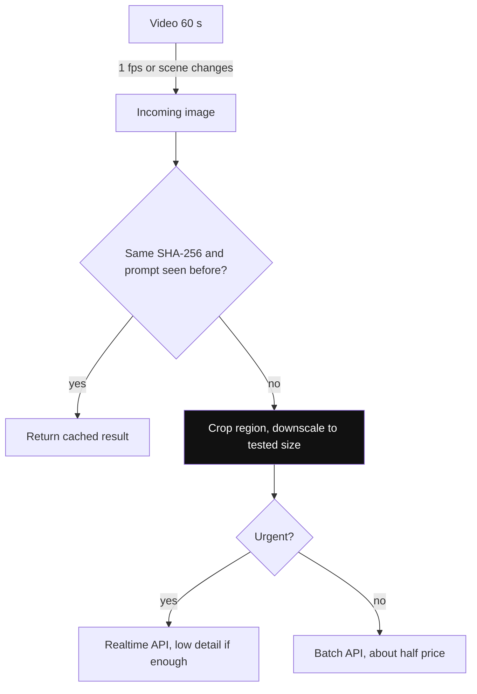

*Diagram:* Every image passes the cheap checks first: cache hit, then fewer pixels, then the cheaper batch lane when nobody is waiting.

**Worked example:** 10 lakh product images per day. At 1,500 tokens each, that is 1.5 billion input tokens. Downscaling to ~400 tokens each makes it 0.4 billion: about 73% fewer tokens, with no accuracy loss on this task after testing.

**Interview tip:** "Your image pipeline is too expensive. What do you do?" Say: "Measure tokens per image first. Then downscale and crop to the smallest size that keeps accuracy, use low-detail mode where possible, dedupe by hash, move non-urgent work to batch, and for video sample frames by scene change."

**Common mistake:** downscaling without an eval. A size that is fine for photos can make 8-point invoice text unreadable. Always check accuracy per field at each size.

## ⭐ Voice agent architectures: cascaded vs speech-to-speech

**In one line:** a cascaded agent chains three models (STT → LLM → TTS) with text in between; a speech-to-speech (realtime) model takes audio in and gives audio out from one model; cascaded gives control, speech-to-speech gives naturalness and lower latency.

**Why it exists:** a voice agent must listen, think and speak, fast, on a noisy phone line. How you split that work decides latency, cost, how well tools work, and how easily you can debug a bad call.

**Picture it:** an IRCTC enquiry desk. Cascaded = three people in a row: one writes down what you say, one decides the answer, one reads it out. You can see every note they passed. Speech-to-speech = one fluent person who listens and replies directly. Faster and warmer, but nothing is written down, so you cannot easily check what went wrong.

**How it works, step by step:**

*Cascaded:*
1. Audio streams to STT. STT sends partial transcripts while the user talks, and a final transcript at the end of the turn.
2. The final text plus history goes to the LLM. The LLM streams tokens and can call tools.
3. As soon as the first sentence is complete, it goes to TTS. TTS streams audio back while the LLM keeps writing.

*Speech-to-speech (realtime):*
1. Audio streams over a WebSocket or WebRTC session to one model (for example OpenAI's Realtime API or Google's Gemini Live API).
2. The model listens, often runs its own turn detection, and replies with audio directly. It can also emit tool calls and a text transcript.

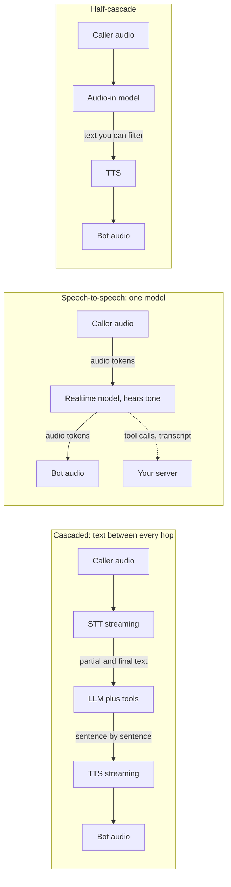

*Diagram:* In the cascade you can read and filter text at every arrow; in speech-to-speech the only text is a side transcript; the half-cascade keeps one text hop before speaking.

| | Cascaded STT → LLM → TTS | Speech-to-speech |
|---|---|---|
| Latency | sum of 3 stages; ~0.8–1.5 s with good streaming | often lower, ~0.5–1 s |
| Naturalness | TTS voice is good, but tone of the user is lost in text | hears tone, laughter, hesitation; responds with emotion |
| Control | swap any part: best STT for Hindi, any LLM, brand voice | one vendor, fewer knobs |
| Tool use and reasoning | full power of a strong text LLM | supported, but often less reliable on complex tools |
| Cost | pay 3 vendors per minute or per token, often predictable | audio tokens can be pricey; varies a lot |
| Debuggability | text at every hop; read the transcript, replay a stage | mostly audio; harder to see why it said something |
| Guardrails, compliance | filter the text before TTS | must filter audio output or its transcript after the fact |

Many teams also run a **half-cascade**: speech in to an audio-understanding model, text out, then TTS. It keeps tone understanding but lets you check the text before speaking.

**Interview tip:** "Cascaded or speech-to-speech?" Say: "For a business agent with many tools, compliance needs and Indian languages, I start cascaded: I can pick the best STT for Hinglish, filter text before it is spoken, and debug every hop. For a companion or tutor app where warmth and very low latency matter more than complex tools, speech-to-speech fits. I would keep the agent logic behind an interface so I can switch."

**Common mistake:**
- Comparing a non-streaming cascade with a streaming realtime model and concluding "cascaded is too slow". A properly streamed cascade gets close.
- Choosing speech-to-speech and then finding you cannot redact a card number before the bot speaks it.

## ⭐ Latency budget for one voice turn

**In one line:** humans reply to each other in roughly 200–300 ms, so a bot that takes over ~1 second feels broken; you budget every stage in milliseconds and stream every stage so they overlap.

**Why it exists:** in text chat, 2 seconds is fine. On a call, 2 seconds of silence makes people say "hello? hello?", which the bot hears as a new turn, and the call falls apart.

**Picture it:** a relay race. Total time is not the speed of the best runner. It is every runner plus every baton handover. Streaming means the next runner starts running before the baton fully arrives.

**How it works, step by step:** measure from "user stops speaking" to "user hears the first bot audio". A typical cascaded turn, before optimization:

| Stage | What happens | Typical range | Example |
|---|---|---|---|
| Endpointing (VAD silence wait) | wait to be sure the user stopped | 200–500 ms (biggest single cost) | 500 ms |
| STT final | finish the last words after endpoint | 50–200 ms with streaming | 150 ms |
| LLM TTFT | first token from the model | 200–600 ms depending on model and prompt size | 450 ms |
| First sentence | enough tokens for TTS to start | 50–200 ms | 150 ms |
| TTS first audio | first audio chunk from TTS | 80–250 ms | 200 ms |
| Network and playout | transport both ways plus jitter buffer | 50–150 ms | 100 ms |
| **Total** | | | **1,550 ms** |

Now optimize, stage by stage:
1. **Endpointing 500 → 250 ms** using a semantic turn detector (next section) instead of a fixed long silence.
2. **STT 150 → 80 ms** because the transcript was streamed as partials; only the last word remains.
3. **LLM TTFT 450 → 250 ms**: a smaller fast model, a short system prompt, prompt caching on the fixed prefix, server in the same region (Mumbai region for Indian callers).
4. **First sentence 150 → 60 ms**: instruct short first sentences ("Sure, let me check."), send to TTS at the first comma or full stop.
5. **TTS 200 → 120 ms** with a low-latency streaming TTS and a persistent connection.
6. **Network 100 → 80 ms** with WebRTC and co-located servers.

New total: 250 + 80 + 250 + 60 + 120 + 80 = **840 ms**. That is inside the 800 ms–1 s target.

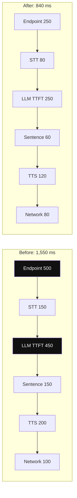

*Diagram:* Endpointing and LLM TTFT (highlighted) are the two biggest cuts: together they save 450 of the 710 ms.

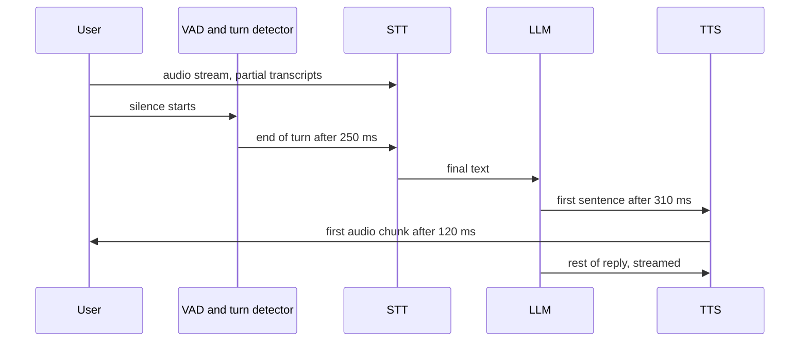

**Other tricks:** **speculative start** (send the partial transcript to the LLM before the endpoint, throw it away if the user keeps talking), **pre-generated fillers** ("Hmm," cached as audio), and **track p95, not average**: one slow tool call in 20 ruins the experience.

**Interview tip:** "Where does latency go in a voice turn?" Say: "Endpointing is usually the biggest single piece, then LLM time to first token, then TTS first audio. I measure each stage per turn, stream everything so stages overlap, use a semantic turn detector, a fast model with a cached prefix, sentence-level TTS, and co-located servers. Target p95 under about 1 second."

**Common mistake:**
- Measuring LLM total generation time instead of TTFT. The user only waits for the first audio.
- Waiting for the full LLM reply before calling TTS. That alone can add 1–2 seconds.

## ⭐ Turn detection, barge-in and backchannels

**In one line:** turn detection decides when the user has finished; barge-in handling stops the bot instantly when the user cuts in and keeps the history honest about what was actually heard.

**Why it exists:** people pause mid-sentence ("my booking is for... umm... Saturday"). A plain silence timer either cuts them off (too short) or adds lag (too long). And people interrupt: "no no, not Saturday, Sunday". If the bot keeps talking, or later believes it said things the user never heard, the conversation breaks.

**Picture it:** a good waiter at a busy restaurant. He waits when you say "I'll have the... let me see", but replies at once when you say "That's all, thanks." If you say "wait, no onions" while he is repeating the order, he stops mid-sentence. His notepad only has what he actually said.

**How it works, step by step:**

*Turn detection:*
1. **VAD** (for example Silero VAD) marks each 20–30 ms audio frame as speech or silence.
2. **Silence timer:** after N ms of silence, end the turn. Simple, but one value never fits all: 300 ms cuts off thinkers, 800 ms feels slow.
3. **Semantic end-of-turn model:** a small text or audio model looks at the words so far. "I want to book a table for" → probably not done, wait longer (for example 1 s). "For four people at 8 pm." → done, reply after 200 ms. LiveKit and Pipecat both ship such turn-detector models.

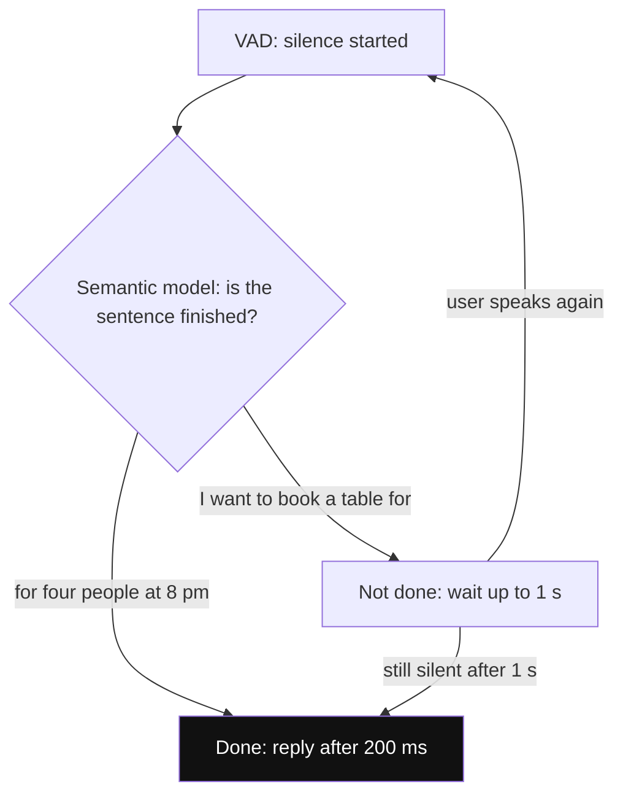

*Diagram:* The same silence gets a different wait depending on the words: an unfinished sentence waits up to 1 s, a finished one replies after 200 ms.

| | VAD + silence timer | Semantic end-of-turn model |
|---|---|---|
| Signal | sound vs silence | meaning of the words, sometimes intonation |
| Mid-sentence pause | cuts the user off or must wait long | waits, because the sentence is unfinished |
| Added latency | the fixed timer, every turn | small model inference, ~10–50 ms |
| Failure | noisy room keeps the turn open | unusual phrasing, other languages less tested |

*Barge-in (interruption):*
1. While the bot speaks, VAD keeps listening to the user (with echo cancellation, so the bot does not hear itself).
2. User speech lasting more than ~200–300 ms, or a real word from STT, counts as barge-in. A cough or "hmm" should not.
3. **Stop TTS playback at once** and flush the audio buffers. Cancel the pending LLM generation and TTS request.
4. **Truncate the transcript.** The LLM wrote "Your table is booked for Saturday at 8 pm for four people." Playback stopped after "Your table is booked for Saturday". Save only that spoken part as the assistant message. Otherwise the model thinks the user heard "8 pm for four".
5. Process the new user turn with that truncated history.

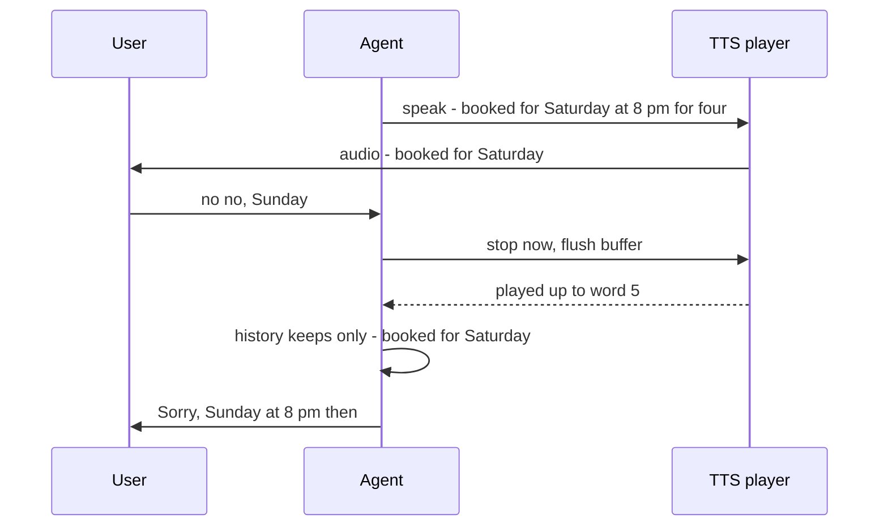

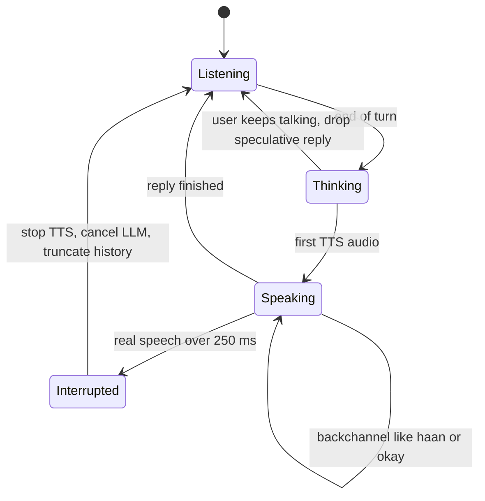

*Diagram:* Backchannels loop back into Speaking; only real speech moves to Interrupted, which always truncates history before listening again.

*Backchannels:* short sounds like "haan", "okay", "mm-hmm" while the other person talks. If the user says "okay" while the bot speaks, it is usually agreement, not an interruption: keep talking. Keep a small list of backchannel words, or use the turn detector to classify them. Some systems also let the bot add short "mm-hmm" sounds during long user turns.

```python
import asyncio

class SpokenTracker:
    """Tracks which words of the bot's reply were actually played to the user."""
    def __init__(self, text: str):
        self.words = text.split()
        self.played = 0  # number of words already played

    def on_word_played(self):
        self.played += 1

    def spoken_text(self) -> str:
        return " ".join(self.words[: self.played])

BACKCHANNELS = {"ok", "okay", "haan", "hmm", "mm-hmm", "achha", "right"}

async def on_user_speech(text: str, tts_task: asyncio.Task,
                         tracker: SpokenTracker, history: list[dict]):
    if text.lower().strip(" .!") in BACKCHANNELS:
        return  # agreement, not an interruption: keep speaking
    tts_task.cancel()  # stop audio and the pending generation
    # store only what the user really heard
    history.append({"role": "assistant", "content": tracker.spoken_text()})
    history.append({"role": "user", "content": text})
```

**What the code does:**
- `SpokenTracker` counts how many words of the reply have been played, using word-timing events from the TTS.
- Short backchannel words like "haan" or "okay" are ignored, so the bot keeps speaking.
- Real speech cancels the TTS task (in a real framework this also flushes audio buffers).
- History gets only the spoken part of the reply, then the user's new message.
- Frameworks like LiveKit Agents and Pipecat do this for you; the code shows the idea you must explain.

**Interview tip:** "How do you handle interruptions?" Say: "Keep VAD running during bot speech with echo cancellation, require a minimum speech length or a real word so coughs and 'haan' do not count, then stop TTS immediately, cancel the in-flight LLM and TTS, and truncate the assistant message in history to what was actually played, using TTS word timestamps."

**Common mistake:**
- Keeping the full generated reply in history after an interruption. The bot then says "as I mentioned, it's 8 pm", which the user never heard.
- No echo cancellation, so the bot's own voice from the speaker triggers barge-in and it keeps interrupting itself.

## Telephony and transport

**In one line:** audio reaches your agent over WebRTC (browser and apps), WebSocket (simple server streams, many phone providers) or SIP (the phone-network protocol); phone audio is low quality at 8 kHz, and echo must be cancelled.

**Why it exists:** a voice agent is a real-time media system first and an AI system second. Wrong transport choices add hundreds of milliseconds or make audio choppy, and no model can fix that.

**Picture it:** three roads to the same restaurant. WebRTC is the expressway with lane discipline built for live traffic. WebSocket is a good city road: fine most days, jams on a bad network. SIP and PSTN is the old highway every phone in India already uses: everyone can reach you, but the road is narrow (8 kHz).

**How it works, step by step:**
1. **Web or app caller:** the client uses WebRTC. It runs over UDP (no waiting to resend lost packets), has jitter buffers, and includes echo cancellation and noise suppression in browsers.
2. **Phone caller:** the call arrives on the PSTN at a telephony provider or your SIP trunk. SIP (Session Initiation Protocol) sets up the call. The audio itself flows as RTP (Real-time Transport Protocol) packets.
3. **Bridge to your agent:** the provider either streams audio to your server over a WebSocket, or connects SIP directly to a media server (for example a LiveKit SIP bridge).
4. **Audio format:** phone audio is usually **8 kHz, G.711 (μ-law or A-law)**, so frequencies above ~3.4 kHz are gone. That hurts STT on "f" vs "s" sounds. Use STT models trained on phone audio, and resample carefully (8 kHz in, the STT's expected rate, then 8 kHz back out).
5. **Echo cancellation (AEC):** on speakerphone, the bot's voice comes back into the mic. Without AEC, the bot hears itself and barge-in fires. Browsers do AEC in WebRTC; on phone lines you rely on the handset and the carrier, plus your own filtering.

| | WebRTC | WebSocket | SIP / PSTN |
|---|---|---|---|
| Used for | browser, mobile app | server-to-server audio streams | real phone numbers |
| Network | UDP, built for real time | TCP; a lost packet stalls the stream | carrier network + RTP |
| Audio quality | wideband (16–48 kHz) | whatever you send | narrowband 8 kHz typical |
| Echo, noise handling | built into browsers | you build it | handset and carrier, partly |
| Complexity | higher (media servers, NAT traversal) | lowest | telephony provider, numbers, regulations |

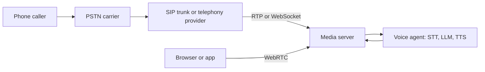

**Interview tip:** "WebSocket or WebRTC for a voice agent?" Say: "WebRTC for client audio because it is UDP-based with jitter buffers and built-in echo cancellation. WebSocket is fine server-to-server inside a data centre or when the phone provider streams audio to us. For phone numbers, SIP into a media server, and an STT tuned for 8 kHz audio."

**Common mistake:** testing only with clean laptop-mic audio, then going live on 8 kHz phone lines with traffic noise, where WER doubles.

## Tool calls in voice

**In one line:** a tool call in voice is dead air, so keep tools fast, say something while they run, and read back anything important before you act on it.

**Why it exists:** in a chat UI, a 3-second tool call shows a spinner. On a call, 3 seconds of silence sounds like a dropped line. Voice also has no "Confirm" button, so mistakes in names, dates and numbers go straight into bookings and payments.

**Picture it:** a phone banker who says "One moment, I'm pulling up your account" before typing. And before transferring money he says "₹5,000 to Ramesh, account ending 4321, shall I go ahead?"

**How it works, step by step:**
1. **Fill the silence.** If a tool may take more than ~700 ms, speak a short filler first: "Let me check that for you." Have the LLM emit a short sentence before the tool call, or play a pre-recorded filler.
2. **Keep tools fast.** Set timeouts (for example 2 s), cache common lookups (menu, opening hours), and pre-fetch data you will likely need (load the caller's last booking when the call connects, using the caller ID).
3. **Run slow work async.** For long jobs, say "I'll send you an SMS confirmation in a minute", and finish after the call or in the background.
4. **Confirm critical actions verbally.** Read back the slots: "Table for 4, Saturday 14th, 8 pm, name Sharma. Shall I confirm?" Only call `create_booking` after a clear yes.

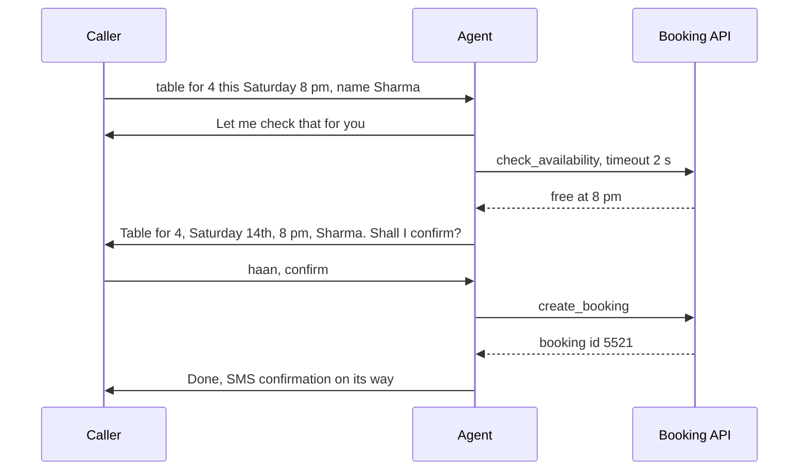

*Diagram:* The filler covers the lookup's silence, and the write call create_booking happens only after the read-back gets a clear yes.

5. **Few, simple tools.** Every extra tool adds prompt tokens (higher TTFT) and choice errors. A voice agent with 5 well-named tools beats one with 40.

**Interview tip:** "Your booking tool takes 4 seconds. What do you do?" Say: "Speak a filler before calling it, pre-fetch what I can at call start, cache static data, put a timeout with a spoken fallback, and if it is truly slow, accept the request and confirm by SMS. And always read back the details before the write action."

**Common mistake:** confirming with the user's raw transcript instead of the parsed values. Read back what the system will actually save ("Saturday the 14th"), not what STT heard ("this Saturday").

## Frameworks and vendors

**In one line:** you rarely build the audio plumbing yourself; frameworks handle streaming, turn detection and interruptions, and you plug in STT, LLM and TTS providers.

**Why it exists:** streaming audio, cancellation, buffering, echo and turn-taking are hard real-time problems. Getting them right from scratch takes months. Frameworks give you a tested pipeline so you work on the agent logic.

**Picture it:** a modular kitchen. The framework is the cabinet frame and plumbing. STT, LLM and TTS are appliances you choose and swap.

**How it works, step by step:**
1. Pick a framework that owns the real-time loop (transport, VAD, turn detection, interruptions).
2. Plug in an STT, an LLM and a TTS, or one speech-to-speech model.
3. Write your agent logic: system prompt, tools, state.
4. Add telephony (SIP or a phone provider) if callers use real phone numbers.

| Layer | Examples | Notes |
|---|---|---|
| Framework | LiveKit Agents, Pipecat | both open source, Python; LiveKit adds its own WebRTC media server, Pipecat is a pipeline of "frame processors" with many transports |
| STT | Deepgram, Whisper (OpenAI, also open weights), Google, Azure, Sarvam for Indian languages | check streaming support, Hinglish and phone-audio accuracy |
| LLM | any fast chat model with tool calling | TTFT matters more than top benchmark scores |
| TTS | ElevenLabs, Cartesia, Google, Azure | check time to first audio, Indian voices, word timestamps for barge-in |
| Speech-to-speech | OpenAI Realtime API, Gemini Live API | one model, audio in and out |
| Telephony | Twilio, Plivo, Exotel, or your own SIP trunk | numbers, call routing, Indian regulations |

Prices and latency change every few months, so in an interview name the **criteria**: streaming support, time to first result, accuracy on your audio (8 kHz, Hinglish), word timestamps, regions near your users, and cost per minute.

**Interview tip:** "Which stack would you use?" Say: "A framework like LiveKit Agents or Pipecat for the real-time loop, then I choose STT and TTS by measured WER and time to first audio on our own recorded calls, not vendor benchmarks, and keep each provider behind an interface so I can switch."

**Common mistake:** picking the TTS with the nicest demo voice without checking latency and Indian-name pronunciation on your real script.

## ⭐ Evaluating voice agents

**In one line:** test the voice agent at three levels: each component (WER, latency), each conversation (task success, interruption handling), and at scale with simulated callers before real ones.

**Why it exists:** a voice bug is hard to see. The transcript looks fine, but the bot spoke over the user twice and took 2.5 seconds on one turn. Without numbers per stage and per call, you only learn from angry customers.

**Picture it:** mock calls in a call-centre training room. A trainer plays a difficult customer (fast speaker, interrupts, bad network) and scores the trainee on a sheet.

**How it works, step by step:**
1. **STT quality: WER.** WER = (substitutions + deletions + insertions) / words in the correct transcript. Reference "book a table for four at eight", hypothesis "book table for for at eight": 1 deletion ("a") + 1 substitution ("four" → "for") = 2 errors / 7 words ≈ **29%**. Also track **entity accuracy** (names, dates, phone numbers), which matters more than overall WER.
2. **Latency percentiles.** Per turn, log each stage. Report p50, p95, p99 of "user stopped → first bot audio". Example target: p50 600 ms, p95 under 1,000 ms.
3. **Task success.** Did the booking get created with the correct slots? Check the database, not the transcript.
4. **Interruption tests.** Scripted cases: interrupt at word 3, cough during bot speech, say "haan" during bot speech, long pause mid-sentence. Measure false barge-ins and missed barge-ins.
5. **Simulated callers.** An LLM plays the caller with a persona ("elderly, speaks slowly, Hinglish, changes date once"), its text goes through TTS with background noise and 8 kHz, and calls your agent. Run hundreds of calls per release.

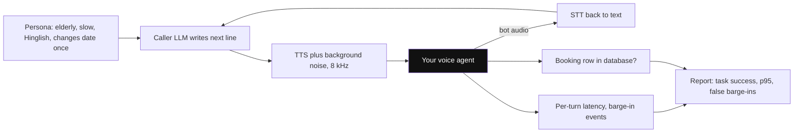

*Diagram:* The simulated caller talks to your agent through real audio (TTS, noise, 8 kHz), and success is read from the database and logs, not the transcript.

6. **Production monitoring.** Record calls (with consent), sample and review, track hang-up rate, transfer-to-human rate, and turns per successful task.

```python
import jiwer  # pip install jiwer

reference = "book a table for four at eight"
hypothesis = "book table for for at eight"

print(f"WER: {jiwer.wer(reference, hypothesis):.2f}")  # 2 errors / 7 words = 0.29

# latency per turn in ms: user stops speaking -> first bot audio
turn_ms = sorted([640, 710, 580, 900, 1450, 620, 700, 680, 760, 2100])

def pct(values, p):
    idx = min(len(values) - 1, int(round(p / 100 * (len(values) - 1))))
    return values[idx]

print("p50", pct(turn_ms, 50), "p95", pct(turn_ms, 95))
```

**What the code does:**
- Uses the `jiwer` library to compute WER for one reference and one STT output.
- Shows that two small errors in a 7-word sentence already mean ~29% WER, and one of them ("four" → "for") changes the booking.
- Sorts per-turn latencies and reads off p50 and p95 with a simple nearest-rank percentile.
- The p50 looks fine (~700 ms) while p95 is ~2 s, which is the number users remember.

**Interview tip:** "How do you test a voice agent?" Say: "Component metrics: WER and entity accuracy on our own call audio, per-stage latency at p50 and p95. Conversation metrics: task success checked against the database, interruption and backchannel test cases. Then simulated callers with personas, noise and 8 kHz audio on every release, and production sampling with hang-up and transfer rates."

**Common mistake:** evaluating on text only by feeding the LLM typed messages. You miss STT errors, timing, barge-in and noise, which are where voice agents actually fail.

## Indian context: Hinglish, accents and numbers

**In one line:** Indian callers switch languages mid-sentence, have many accents, and say numbers and addresses in mixed ways, so you choose STT for code-switching, normalize entities, and read critical values back.

**Why it exists:** "Kal shaam 8 baje four logon ke liye table book karna hai" is one normal sentence. An English-only STT mangles it, and a Hindi-only STT mangles the English parts. Phone numbers and addresses are where wrong bookings and failed deliveries come from.

**Picture it:** a Swiggy delivery partner who calls to confirm "flat 402, B wing, near Hanuman mandir?" before climbing the stairs. Reading back is cheaper than a wrong delivery.

**How it works, step by step:**
1. **Code-switching STT.** Test STT models on real Hinglish recordings from your callers. Measure WER and entity accuracy separately for Hindi, English and mixed turns. Some models do better when told the expected languages.
2. **Decide the transcript script.** Roman Hinglish ("kal shaam") or Devanagari? Pick one, and tell the LLM which it will receive.
3. **Normalize numbers.** "Nau aath saat..." "double five", "ninety-eight four one...", "do hazaar" (2,000), "dedh sau" (150). Convert to digits in a normalization step and validate (10-digit mobile starting 6–9, 6-digit PIN code).
4. **Read back in chunks.** "98 41 2 3 4 5 6 7, is that right?" Speak numbers in small groups, slowly, and digit by digit for phone numbers.

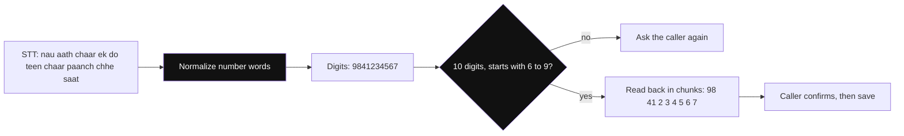

*Diagram:* Spoken words become digits, digits are checked by rules, and only a confirmed read-back gets saved.

5. **TTS pronunciation.** Test Indian names and places ("Thiruvananthapuram", "Sharma ji"). Use the TTS's pronunciation dictionary or phonetic hints where available.
6. **Reply in the caller's language.** If the caller speaks Hinglish, reply in Hinglish. Keep the system prompt explicit about this.

**Interview tip:** "Your agent serves callers across India. What changes?" Say: "STT chosen by measured WER on our own Hinglish and regional-accent calls at 8 kHz, a normalization layer for Indian number words, validation of mobile numbers and PIN codes, digit-by-digit read-back for critical values, language mirroring in replies, and TTS tested on Indian names."

**Common mistake:** trusting the LLM to fix STT number errors silently. If STT heard "98 41 23" and the user said "98 14 23", the LLM cannot know. Only read-back catches it.

## Interview questions

**Q: Design a voice agent for restaurant reservations over the phone.**
Phone number on a telephony provider, SIP into a media server running a framework like LiveKit Agents or Pipecat; cascaded Hinglish-capable STT, a fast LLM with 4 tools (`check_availability`, `create_booking`, `cancel_booking`, `transfer_to_human`), streaming TTS. Slots (date, time, party size, name, phone) are collected step by step, the caller's number is pre-filled from caller ID, the booking is read back and confirmed before `create_booking`, an SMS confirmation follows, and humans take over on repeated failures; measure task success, p95 turn latency and transfer rate.

**Q: Cascaded or speech-to-speech?**
Cascaded when you need control: many tools, compliance filtering before speaking, Indian-language STT choice, debuggable text logs. Speech-to-speech when naturalness and lowest latency matter most and tool use is light.

**Q: How do you handle interruptions?**
VAD keeps listening during bot speech with echo cancellation. Real speech (not a cough or "haan") stops TTS at once, cancels in-flight generation, and the assistant message is truncated to the words actually played.

**Q: Where does latency go in a voice turn?**
Mostly endpointing (200–500 ms), LLM time to first token (200–600 ms) and TTS first audio (80–250 ms), plus network. Stream every stage, use semantic turn detection, a fast model with cached prefix, sentence-level TTS and co-located servers.

**Q: VLM or OCR for invoices?**
Few clean templates at high volume: OCR plus layout is cheap and exact. Many messy vendors: VLM, ideally hybrid with OCR text as input. Either way, schema validation, arithmetic checks and human review for failures.

**Q: Your VLM extraction is 97% accurate on totals. Is that good enough to auto-post to accounting?**
Not alone. Add checks that catch the 3% (line items + tax = total, cross-check with OCR digits, duplicate invoice number) and auto-post only when all checks pass; the rest goes to a human. Measure the error rate of auto-posted items, not overall accuracy.

**Q: Why does a 4000 × 3000 image cost so many more tokens than a 1000 × 750 one?**
High-res images are tiled and token count grows with pixel area: 16x the area means roughly 16x the tokens, unless the provider downscales first.

**Q: How would you do RAG over scanned annual reports full of charts?**
Embed page images with a ColPali-style multi-vector model, retrieve with MaxSim (after a cheap first stage), answer with a VLM over the top 2–3 pages, and keep a text index for exact IDs.

**Q: The bot keeps cutting users off mid-sentence. What would you do?**
Look at endpointing: the silence timeout is too short or VAD is too sensitive. Move to a semantic end-of-turn model, which waits on unfinished sentences and replies fast on finished ones, and tune on recorded calls.

**Q: The bot interrupts itself on speakerphone calls. Why?**
Its own audio echoes into the mic and triggers barge-in. Fix echo cancellation, require a minimum speech duration or a recognized word, and raise the barge-in threshold while the bot is speaking.

**Q: A tool call takes 3 seconds. What does the caller hear?**
A short filler ("let me check that") spoken before the call, never silence. Also cache and pre-fetch, add a timeout with a spoken fallback, and move slow work to SMS follow-up.

**Q: How do you evaluate a voice agent before launch?**
WER and entity accuracy on your own call audio, per-stage latency p50 and p95, task success checked in the database, scripted interruption tests, and hundreds of simulated callers with personas, noise and 8 kHz audio.

**Q: Your STT WER is 8%. Is that good?**
It depends which words are wrong. 8% on filler words is fine; one wrong digit in a phone number fails the task. Track entity accuracy for names, dates and numbers, and read critical values back.

**Q: Cost per minute is too high on a cascaded agent. Where do you cut?**
Measure per stage. Usually LLM tokens (long prompts resent every turn: trim history, cache the prefix, use a smaller model) and TTS characters (shorter replies). Avoid STT on silence, and hand simple FAQs to cached audio.

## Read next

- [Cost & Latency](11-cost-latency.md): token budgets, caching and model routing that also apply to image and voice workloads.
- [Inference and Serving](15-inference-serving.md): what TTFT is made of and how serving choices change it.
- [Evals for Agents](09-agent-evals.md): building eval sets and LLM judges for task success.
- [What is RAG](../09-rag/01-what-is-rag.md): the text RAG baseline that visual RAG extends.

## Checklist

- [ ] I can explain how a VLM turns an image into tokens (patches, encoder, projector) and why token cost grows with pixel area
- [ ] I can compare a VLM with an OCR + layout + LLM pipeline for documents and argue for a hybrid with verification
- [ ] I can list document extraction failure modes and the code checks that catch hallucinated numbers
- [ ] I can explain ColPali-style visual RAG with late interaction and its storage trade-off
- [ ] I can compare cascaded and speech-to-speech voice architectures on latency, control, tools, cost and debuggability
- [ ] I can break a voice turn's latency into stages with numbers and explain how to get p95 under about 1 second
- [ ] I can explain VAD vs semantic turn detection, barge-in with transcript truncation, and backchannels
- [ ] I can choose between WebRTC, WebSocket and SIP and explain 8 kHz audio and echo cancellation
- [ ] I can design a restaurant reservation voice agent with fillers, fast tools and verbal confirmation
- [ ] I can describe how to evaluate a voice agent with WER, latency percentiles, task success and simulated callers, including Hinglish callers
