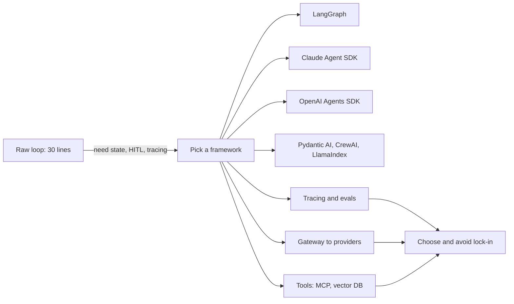
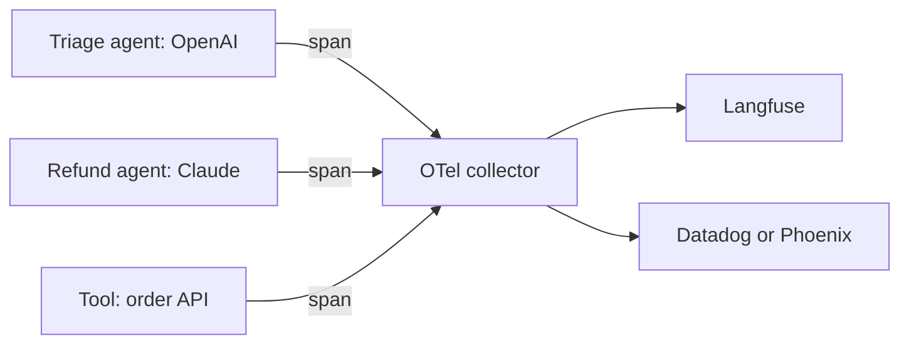
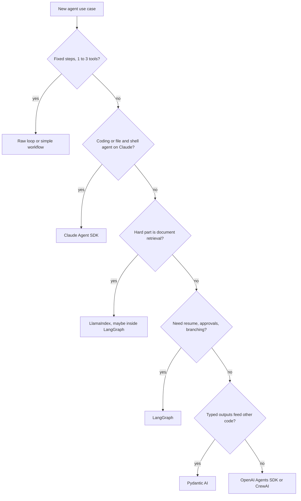

# Agent Frameworks and Tooling

An agent is a loop: call the model, run the tool it asks for, feed the result back, repeat. Frameworks like LangGraph, the OpenAI Agents SDK or CrewAI wrap that loop and add saving, streaming, tracing and multi-agent features. Interviewers ask about them to see if you can pick a tool for a reason, not because it is popular, and if you know what it costs you.

**After this page you can answer:**
- "Why would you use LangGraph instead of writing the agent loop yourself?"
- "LangGraph vs CrewAI: when would you pick each?"
- "When would you not use a framework at all?"
- "What does the Claude Agent SDK give you that a plain API call does not?"
- "How do you trace one multi-agent run that calls OpenAI and Anthropic models?"
- "Which tool would you use for evals, and why?"
- "Why put a gateway like LiteLLM in front of your model providers?"
- "How do you avoid getting locked into a framework that may be dead in two years?"

## Words you need first

| Word | Plain meaning |
|---|---|
| Agent loop | Code that repeats: ask the model, run the tool it picked, send back the result, until it answers. |
| Tool call | The model's structured request to run one of your functions, with arguments as JSON. |
| Framework | A library that owns the agent loop for you and adds features around it. |
| State | The data an agent carries between steps: messages, tool results, custom fields. |
| Checkpointer | A component that saves state after each step to a database, so a run can resume. |
| Handoff | One agent passing the conversation to another, more specialised agent. |
| Guardrail | A check that runs on input or output and can block or fix it. |
| Trace / span | A trace is one full run; a span is one step inside it (one LLM call, one tool call). |
| OpenTelemetry (OTel) | An open, vendor-neutral standard for sending traces and metrics to any backend. |
| MCP | Model Context Protocol: an open standard for plugging tools and data into any agent. |
| Gateway | A proxy in front of model providers that gives one API, keys, limits and fallbacks. |
| Eval | A repeatable test that scores agent outputs, by code or by an LLM judge. |
| Lock-in | When leaving a library or vendor becomes so costly that you stay even if it is worse. |

## Big picture

You can build an agent with about 30 lines of raw API code. Frameworks add things you will need later: saved state, streaming, tracing, multi-agent handoffs. Around any framework sit three layers you choose separately: an observability and eval tool, a gateway to the model providers, and the tools and data (MCP servers, vector DBs). This page walks through the raw loop, the main frameworks, those three layers, and then how to choose and stay unlocked.



## ⭐ What a framework gives you, and what it costs

**In one line:** A framework is the agent loop plus the boring production parts (state, persistence, streaming, tool plumbing, tracing, handoffs); you pay for it in abstraction, lock-in and harder debugging.

**Why it exists:** The raw loop is easy on day one. By week four you need to resume a run after a pod restart, pause for a human approval, stream tokens to the UI, and see why step 7 picked the wrong tool. Each of those is a few hundred lines you would write and test yourself. Frameworks ship them ready.

**Picture it:** Cooking at home vs running a cloud kitchen for Swiggy. At home a pan and a stove are enough. A cloud kitchen needs order tickets, a fridge log, a pass where the head chef checks plates, and CCTV. A framework is that kitchen setup. Great at 500 orders a day, overkill for making Maggi.

**How it works, step by step:**

1. Start with the raw loop: model call, check if it asked for a tool, run it, append the result, repeat with a step cap.
2. List the features you actually need. Each row below is one a framework gives you.
3. For each feature, estimate the cost to build it yourself. If two or three big ones are needed, a framework usually wins.
4. Then check the costs: new concepts to learn, a dependency that changes every few months, stack traces through library code.

| Feature | Raw loop | Framework |
|---|---|---|
| State between steps | a Python list you manage | typed state with merge rules |
| Persistence / resume | you write DB save and load | checkpointer: save after each step, resume by thread ID |
| Human approval mid-run | you build pause and resume | built in (e.g. LangGraph `interrupt`) |
| Streaming tokens and steps | you handle SSE events | stream modes ready |
| Tool plumbing | you write JSON schemas by hand | schema from type hints and docstring |
| Tracing | you add spans yourself | auto traces to a dashboard |
| Multi-agent handoffs | you design the routing | handoff or sub-agent primitives |

A worked number: on one team, the raw loop was 40 lines. Adding Postgres persistence, resume, approval pause, streaming and retries took it to roughly 900 lines and two weeks. Swapping to LangGraph gave the same features in about 150 lines. The cost: two engineers spent a week learning reducers and checkpoints, and one bug took a day because the stack trace was inside library code.

**What it costs:**
- **Abstraction:** you no longer see the exact prompt sent. Some frameworks add hidden system text.
- **Lock-in:** your state, tools and traces take the framework's shape.
- **Churn:** APIs in this space changed a lot in 2024–2025. Upgrades can break code.
- **Debugging:** errors surface deep inside the library.

**Interview tip:** "Would you start with a framework?" Say: "I start with a raw loop to learn the task and get an eval set. I adopt a framework when I need two or more of: durable state, resume after failure, human approval, streaming, or multi-agent routing. For a single-tool bot, a raw loop is simpler and easier to debug."

**Common mistake:**
- Picking a framework first, then forcing the problem into it.
- Thinking the framework makes the agent smarter. The model and the prompt decide quality; the framework only runs the loop.

## ⭐ The same task three ways

**In one line:** One agent with one tool ("get weather"), written as a raw loop, with LangChain's `create_agent` on LangGraph, and with the OpenAI Agents SDK, so you can see what each layer hides.

**Why it exists:** Comparing frameworks in words is vague. Seeing the same 1-tool agent in each makes the trade-off concrete: the raw loop shows every message; the frameworks remove plumbing but hide it.

**Picture it:** Booking a train ticket three ways. Standing at the IRCTC counter and filling the form yourself (raw loop). Using the IRCTC app (framework). Asking a travel agent (higher-level framework). Same ticket, different control.

**How it works, step by step:**

1. User asks: "Do I need an umbrella in Mumbai?"
2. Model replies with a tool call: `get_weather(city="Mumbai")`.
3. Code runs the tool: returns `"Mumbai: 31°C, humid, 80% chance of rain"`.
4. Code sends the result back. Model answers: "Yes, carry one."
5. That is 2 LLM calls and 1 tool call. Every framework below does exactly these 4 steps.

**Version 1: raw loop (Anthropic Python SDK).**

```python
import anthropic

client = anthropic.Anthropic()            # reads ANTHROPIC_API_KEY from env
MODEL = "claude-sonnet-5-5"               # use a current model ID from the docs

def get_weather(city: str) -> str:
    return f"{city}: 31°C, humid, 80% chance of rain"   # fake data for the demo

TOOLS = [{
    "name": "get_weather",
    "description": "Current weather for one city.",
    "input_schema": {"type": "object",
                     "properties": {"city": {"type": "string"}},
                     "required": ["city"]},
}]

messages = [{"role": "user", "content": "Do I need an umbrella in Mumbai?"}]
for step in range(5):                                   # hard cap on steps
    resp = client.messages.create(model=MODEL, max_tokens=1024,
                                  tools=TOOLS, messages=messages)
    messages.append({"role": "assistant", "content": resp.content})
    if resp.stop_reason != "tool_use":
        break                                           # final answer, stop looping
    results = []
    for block in resp.content:
        if block.type == "tool_use":                    # model asked for a tool
            out = get_weather(**block.input)
            results.append({"type": "tool_result",
                            "tool_use_id": block.id, "content": out})
    messages.append({"role": "user", "content": results})

print("".join(b.text for b in resp.content if b.type == "text"))
```

**What the code does:**
- You write the JSON schema for the tool by hand.
- `stop_reason == "tool_use"` means the model wants a tool; anything else means it is done.
- Each tool result goes back with the matching `tool_use_id`, as a user message.
- `range(5)` is the safety cap. Without it a confused model can loop forever.
- Nothing is saved. A restart loses `messages`.

**Version 2: LangChain `create_agent` (runs on LangGraph).**

```python
from langchain.agents import create_agent
from langchain_core.tools import tool
from langgraph.checkpoint.memory import InMemorySaver

@tool
def get_weather(city: str) -> str:
    """Current weather for one city."""            # docstring = tool description
    return f"{city}: 31°C, humid, 80% chance of rain"

agent = create_agent(
    model="anthropic:claude-sonnet-5-5",
    tools=[get_weather],
    system_prompt="Answer weather questions. Use the tool, never guess.",
    checkpointer=InMemorySaver(),                  # dev only; PostgresSaver in prod
)
cfg = {"configurable": {"thread_id": "user-42"}}
out = agent.invoke({"messages": [{"role": "user", "content": "Umbrella in Mumbai?"}]}, cfg)
print(out["messages"][-1].content)

# Same thread_id later: the agent still sees the Mumbai turn
agent.invoke({"messages": [{"role": "user", "content": "And Pune?"}]}, cfg)
```

**What the code does:**
- `@tool` builds the JSON schema from the type hints and docstring.
- `create_agent` builds the same model-tool loop as Version 1, as a LangGraph graph.
- The checkpointer saves state after each step under `thread_id`, so turn 2 remembers turn 1.
- Swap `InMemorySaver` for `PostgresSaver` and a crash mid-run can resume.

**Version 3: OpenAI Agents SDK.**

```python
from agents import Agent, Runner, function_tool

@function_tool
def get_weather(city: str) -> str:
    """Current weather for one city."""
    return f"{city}: 31°C, humid, 80% chance of rain"

agent = Agent(
    name="Weather bot",
    instructions="Answer weather questions. Use the tool, never guess.",
    tools=[get_weather],
)
result = Runner.run_sync(agent, "Do I need an umbrella in Mumbai?")
print(result.final_output)
```

**What the code does:**
- `@function_tool` turns the function into a tool, schema included.
- `Runner.run_sync` runs the whole loop until the agent gives a final answer.
- Tracing is on by default and goes to the OpenAI dashboard; you can add other trace processors.
- For memory across turns you add a session object; for routing you add `handoffs`.

| | Raw loop | LangChain / LangGraph | OpenAI Agents SDK |
|---|---|---|---|
| Lines for this task | ~30 | ~15 | ~12 |
| You see every message | yes | yes, in state | yes, in the result and trace |
| Persistence | write it | checkpointer, one line | sessions |
| Swap model provider | rewrite calls | change model string | best with OpenAI; others via adapters |

**Interview tip:** "What does the framework hide in this example?" Say: "The tool schema, the stop check, the message bookkeeping and the step cap. That is fine until something goes wrong. So I always keep tracing on and know how to print the exact messages sent."

**Common mistake:**
- Forgetting the step cap in a raw loop. One stuck run can cost hundreds of calls.
- Using `InMemorySaver` in production and losing every thread on deploy.

## LangGraph

**In one line:** A library for building agents as a graph of steps over a shared, typed state, with a checkpointer that saves after every step.

**Why it exists:** Real agents are not one loop. They branch ("is this a refund or a delivery issue?"), loop with limits, pause for a human, and must survive restarts. LangGraph makes that control flow explicit as nodes and edges, and saves state so runs can resume. See [LangGraph Core](02-langgraph-core.md) for the full API.

**Picture it:** A flowchart taped on the wall of an IRCTC refund desk. Each box is a desk (node). Arrows say where the file goes next (edges). The file itself (state) travels with stamps, and a photocopy is kept after each desk (checkpoint).

**How it works, step by step:**

1. Define state, e.g. `messages`, `order_id`, `refund_amount`.
2. Add nodes: plain functions that read state and return updates.
3. Add edges, including conditional ones: "if the model asked for a tool, go to the tools node, else end".
4. Compile with a checkpointer (`PostgresSaver` in production).
5. Run with a `thread_id`. After each step (a "super-step") the state is saved.
6. To pause for approval, a node calls `interrupt(...)`. The run stops; later you resume with the human's answer.

Example: a refund agent has 4 nodes (classify, fetch order, decide, approve). Refunds over ₹5,000 hit `interrupt` and wait for a human. The pod restarts overnight. Next morning the human clicks approve, and the run resumes from the saved checkpoint, not from scratch.

| | |
|---|---|
| Mental model | state machine / graph; you own the control flow |
| Strengths | fine control, durable checkpoints, human-in-the-loop, time travel, streaming, any model provider, large ecosystem, LangSmith integration |
| Weaknesses | more concepts (reducers, super-steps, channels), more code than higher-level tools, tied to LangChain-style messages and tools |
| Pick it when | long-running or branching flows, approval steps, need to resume, need production control |

**Interview tip:** "Why LangGraph over a raw loop?" Say: "Durable state with a checkpointer, resume after crash, `interrupt` for human approval, explicit branching I can test node by node, and streaming. For a one-tool bot I would not bother."

**Common mistake:**
- Building a big graph for a task that is one prompt plus one tool.
- Putting large blobs (whole PDFs) in state; every checkpoint then copies them.

## Claude Agent SDK

**In one line:** The agent harness behind Claude Code, released as a library (Python and TypeScript), so you get its built-in tools, context management, subagents and MCP support in your own agent.

**Why it exists:** Building a good general agent is more than a loop. You need file and shell tools that are safe, automatic context compaction when the window fills, permission prompts, subagents that work in their own window, and MCP connections. Anthropic built all of that for Claude Code. The SDK (earlier called the Claude Code SDK) exposes the same harness.

**Picture it:** Hiring an experienced site engineer who brings his own toolkit, versus hiring a fresher and buying every tool yourself. You still tell him what to build and which rooms he may enter.

**How it works, step by step:**

1. You call the SDK with a prompt and options: allowed tools, working directory, system prompt, MCP servers, permission mode.
2. The harness runs the loop with Claude. Built-in tools include reading, writing and editing files, running shell commands, searching files, and web fetch and search.
3. When the window gets long, the harness compacts older context so the run can continue.
4. For a side task, the agent can start a **subagent** with a fresh window; only its summary comes back.
5. Your own tools plug in as MCP servers (external, or in-process in the same Python app).
6. Hooks let your code run before or after tool calls, for example to block `rm -rf` or log every command.
7. Messages stream back to your code as the agent works; sessions can be resumed.

Example: a "fix failing test" bot for a repo. Allowed tools: read, edit, run tests. It reads the test, edits the file, runs tests, repeats. You wrote no file tools and no compaction logic, only the options and a hook that blocks writes outside `src/`.

| | |
|---|---|
| Mental model | a ready-made general agent harness you configure, not a graph you draw |
| Strengths | strong built-in tools for code and files, context compaction, subagents, MCP first-class, hooks and permissions, same behaviour as Claude Code |
| Weaknesses | built for Claude models; less explicit control flow than a graph; shell and file access need careful sandboxing |
| Pick it when | coding agents, ops and research agents that work on files and shells, or when you want Claude Code's behaviour inside your product |

**Interview tip:** "Claude Agent SDK vs LangGraph?" Say: "The Agent SDK is a ready harness: tools, compaction, subagents, MCP. LangGraph is a toolkit to design your own control flow with durable state. For an open-ended coding agent I would start with the SDK. For a fixed business process with approvals I would use LangGraph."

**Common mistake:**
- Giving the agent shell access with no sandbox or allow-list.
- Treating it as a thin chat wrapper and then rebuilding tools it already ships.

## OpenAI Agents SDK

**In one line:** OpenAI's lightweight agent library (successor to the Swarm experiment) built on a few primitives: agents, handoffs, guardrails, sessions and built-in tracing.

**Why it exists:** Many teams wanted a small, Python-first way to build multi-agent apps without learning a graph library. The SDK keeps the number of concepts small and adds tracing by default, so you see every run without extra setup.

**Picture it:** A bank branch. The front desk (triage agent) listens, then hands you to the loans desk or the cards desk (handoff). The security guard at the door (guardrail) can stop anyone. The CCTV (tracing) records everything.

**How it works, step by step:**

1. Create an `Agent` with `name`, `instructions`, `tools` and optional `handoffs` (other agents).
2. `Runner.run(...)` runs the loop: model call, tools, repeat until a final output.
3. If the model picks a handoff, control passes to that agent with the conversation.
4. **Input guardrails** check the user message first; **output guardrails** check the answer. If one "trips", the run stops with an exception.
5. A **session** stores conversation history across runs.
6. Every run is traced: agent spans, LLM spans, tool spans, handoffs.

Example: a support bot. `triage = Agent(name="Triage", instructions="Route to the right desk.", handoffs=[billing_agent, refund_agent])`. A user says "I was charged twice". Triage hands off to `billing_agent`. An input guardrail first checks the message is not a jailbreak attempt; it costs one cheap model call.

| | |
|---|---|
| Mental model | a few agents that hand off to each other, plus guardrails and tracing |
| Strengths | very small API, handoffs and guardrails as first-class ideas, tracing on by default, Python and TypeScript |
| Weaknesses | less control over complex flows than a graph; durable long-running workflows need extra pieces; best fit with OpenAI models (others work through adapters) |
| Pick it when | OpenAI-centric teams, triage-and-specialist designs, quick prototypes that may grow |

**Interview tip:** "What is a handoff vs an agent-as-tool?" Say: "In a handoff the new agent takes over the conversation. As a tool, the main agent calls a sub-agent, gets a result, and stays in charge. Handoff fits routing; agent-as-tool fits delegation of a sub-task."

**Common mistake:**
- Chaining many handoffs; each hop adds latency and context can get lost.
- Leaving default tracing on for data that must not leave your region.

## Pydantic AI

**In one line:** An agent library from the Pydantic team that makes agents type-safe: typed dependencies in, validated structured output out.

**Why it exists:** Most bugs in LLM apps are at the boundaries. The model returns JSON with a missing field, or a tool gets the wrong DB connection. Pydantic AI uses Python types and Pydantic models to catch these early, and retries the model when its output fails validation.

**Picture it:** A Swiggy order form with required fields. You cannot submit without an address and a phone number. If the model fills it wrong, the form bounces back and asks again.

**How it works, step by step:**

1. Define the output as a Pydantic model, e.g. `Weather(city: str, temp_c: float, carry_umbrella: bool)`.
2. Create `Agent(model, output_type=Weather, deps_type=...)`.
3. Register tools with decorators. Tools that need the DB or an API client receive them through `RunContext` (dependency injection), not globals.
4. Run. If the model's final answer does not validate, the library sends the error back and the model tries again.
5. You get `result.output` as a real `Weather` object.

```python
from pydantic import BaseModel
from pydantic_ai import Agent

class Weather(BaseModel):
    city: str
    temp_c: float
    carry_umbrella: bool

agent = Agent("openai:gpt-4.1-mini", output_type=Weather,
              system_prompt="Use the tool. Never guess the weather.")

@agent.tool_plain                       # tool with no injected dependencies
def get_weather(city: str) -> str:
    """Current weather for one city."""
    return f"{city}: 31°C, humid, 80% chance of rain"

result = agent.run_sync("Do I need an umbrella in Mumbai?")
print(result.output.carry_umbrella)     # a real bool, already validated
```

**What the code does:**
- `output_type=Weather` forces a structured answer and validates it.
- `@agent.tool_plain` registers a tool from a plain function; the schema comes from type hints.
- `result.output` is a typed object, so your IDE and type checker understand it.
- Changing `"openai:..."` to another provider string swaps the model.

| | |
|---|---|
| Mental model | FastAPI-style agents: types, validation, dependency injection |
| Strengths | type safety, structured outputs, testable tools via injected deps, model-agnostic, OTel-based tracing (Logfire) |
| Weaknesses | younger ecosystem, fewer prebuilt multi-agent patterns, Python only |
| Pick it when | your agent feeds other code (APIs, DB writes) and wrong shapes are costly |

**Interview tip:** "How do you guarantee the agent's output shape?" Say: "Validate against a schema and retry on failure. Pydantic AI does that by default with `output_type`; in other stacks I use provider structured outputs plus Pydantic validation."

**Common mistake:**
- Assuming validation means correctness. A valid `temp_c=31.0` can still be the wrong city.

## CrewAI

**In one line:** A framework for role-based multi-agent teams: you describe agents by role and goal, give them tasks, and a crew runs the tasks.

**Why it exists:** Some problems feel like a small team: a researcher, a writer, a reviewer. CrewAI lets you describe that team in a few lines, which is fast for demos and content pipelines.

**Picture it:** A cricket team sheet. Each player has a role (opener, spinner, keeper). The captain sets the batting order (sequential) or decides on the go (hierarchical).

**How it works, step by step:**

1. Define agents with `role`, `goal` and `backstory`, plus tools.
2. Define tasks with a description and an `expected_output`, each assigned to an agent.
3. Put them in a `Crew` with a process: **sequential** (task 1, then 2, then 3) or **hierarchical** (a manager agent delegates).
4. `crew.kickoff()` runs it. Output of one task feeds the next.
5. For more control, CrewAI **Flows** let you write event-driven, deterministic steps and call crews inside them.

Example: market research. Researcher searches 5 sources, Analyst writes 3 findings, Writer makes a 300-word brief. 3 agents, 3 tasks, about 6–10 LLM calls.

| | |
|---|---|
| Mental model | a team of role-played agents running tasks |
| Strengths | fastest path to a multi-agent demo, readable configs, Flows for more control |
| Weaknesses | less fine control over each step, role prompts add tokens, more LLM calls than needed for simple tasks, harder to debug "why did the manager do that" |
| Pick it when | content and research pipelines, prototypes, teams that think in roles |

**Interview tip:** "LangGraph vs CrewAI?" Say: "CrewAI is high-level: roles and tasks, fast to start, less control. LangGraph is low-level: explicit state and edges, checkpointing and human approval. For a demo or content pipeline I'd try CrewAI. For a production flow with branching, approvals and resume, LangGraph."

**Common mistake:**
- Using 4 role-play agents where one agent with 4 tools would be cheaper and more accurate.

## LlamaIndex

**In one line:** A data-first framework: connectors, parsing, indexes and query engines for RAG, plus event-driven Workflows and agents on top.

**Why it exists:** Many "agents" are mostly about getting the right data from PDFs, wikis and databases. LlamaIndex started as the data layer for that: load, chunk, index, retrieve. Agents and Workflows were added so the retrieval can be one tool among many. See [What is RAG](../09-rag/01-what-is-rag.md).

**Picture it:** A library with a great catalogue and a librarian. The catalogue (index) is the main value. The librarian (agent) uses it to answer.

**How it works, step by step:**

1. Load data with connectors (files, Notion, databases); parse tricky PDFs.
2. Chunk and embed into an index (in memory or a vector DB).
3. Wrap the index as a query engine, and expose it to an agent as a tool.
4. For multi-step logic, write a **Workflow**: steps that listen for events and emit new events.

Example: an HR policy bot over 2,000 PDF pages. LlamaIndex parses, chunks into about 6,000 chunks, indexes, and the agent has two tools: `search_policy` and `get_leave_balance`.

| | |
|---|---|
| Mental model | data and retrieval first, agent on top |
| Strengths | rich ingestion and parsing, many retrievers and index types, Workflows for event-driven control |
| Weaknesses | large API surface; if you only need a loop with simple tools it is heavy |
| Pick it when | the hard part is the data: documents, RAG, knowledge assistants |

**Interview tip:** "LlamaIndex or LangGraph for a RAG agent?" Say: "If ingestion and retrieval quality are the hard part, LlamaIndex. If control flow is the hard part, LangGraph. They can be combined: LlamaIndex query engine as a tool inside a LangGraph agent."

**Common mistake:**
- Blaming the framework for bad answers when the chunks or embeddings are the problem.

## AutoGen, AG2 and Google ADK

**In one line:** Two more families you should recognise: AutoGen/AG2 (agents that talk to each other in conversations) and Google's Agent Development Kit (ADK, code-first agents tuned for Gemini and Google Cloud).

**Why it exists:** Interviewers check that you know the landscape beyond LangChain and OpenAI. You do not need their APIs; you need one line on what each is for.

**Picture it:** AutoGen is a WhatsApp group of agents chatting until they solve it. ADK is Google's own kitchen kit, best with Google's stove.

**How it works, step by step:**

1. **AutoGen** (Microsoft Research): multi-agent conversations, for example an assistant agent and a code-executing agent talking in turns. Version 0.4 was a rewrite to an event-driven design.
2. **AG2**: a community fork of the earlier AutoGen line, led by some of its original creators. Same conversational idea.
3. Microsoft has since announced **Microsoft Agent Framework**, which brings AutoGen ideas and Semantic Kernel together. Mention it as the direction for new Microsoft-stack work.
4. **Google ADK**: you define LLM agents plus workflow agents (sequential, parallel, loop) and deploy to Google Cloud. It works best with Gemini and supports the A2A protocol for agent-to-agent calls.

| | AutoGen / AG2 | Google ADK |
|---|---|---|
| Mental model | agents chatting in a group | code-first agents plus workflow agents |
| Best for | research, code-execution teams | Gemini and Google Cloud shops |
| Watch out | conversation loops are hard to bound and cost a lot | strongest inside the Google ecosystem |

**Interview tip:** "Have you used AutoGen?" If not, say what you know honestly: "Its model is agents talking in a group chat. I prefer explicit control flow for production because chat-style loops are harder to bound and test."

**Common mistake:**
- Claiming deep experience with a framework you only read about. Interviewers ask one follow-up and it shows.

## ⭐ The big comparison table

**In one line:** One table that lets you compare all the main frameworks on the dimensions interviewers care about.

**Why it exists:** "Compare X and Y" is a common question. Having fixed dimensions (control, multi-agent, persistence, typing, ecosystem, learning curve) makes your answer structured instead of opinion.

**Picture it:** Comparing cars on a CarDekho sheet: mileage, boot space, price, service network. You pick based on your trip, not on the brand.

**How it works, step by step:**

1. Fix the dimensions first.
2. Rate each framework roughly: low, medium, high.
3. Match the row to your problem: what is hard in your use case?

| Framework | Control | Multi-agent | Persistence | Typing | Ecosystem | Learning curve | Best for |
|---|---|---|---|---|---|---|---|
| Raw loop | full | you build it | you build it | yours | none needed | lowest | 1–3 tools, learning, max transparency |
| LangGraph | high, explicit graph | supervisor, subgraphs, handoffs | checkpointer, resume, time travel | typed state | very large (LangChain, LangSmith) | medium-high | long, branching, human-in-loop production flows |
| Claude Agent SDK | medium, harness decides loop | subagents | sessions, compaction | moderate | MCP, Claude Code | low-medium | coding, file and shell agents on Claude |
| OpenAI Agents SDK | medium | handoffs, agents as tools | sessions | moderate | OpenAI platform | low | OpenAI-centric triage and specialist bots |
| Pydantic AI | medium-high | agent delegation, graphs | via integrations | strongest | growing | low-medium | typed outputs feeding other code |
| CrewAI | low-medium | core feature (roles, crews) | limited, Flows add state | light | medium | low | role-based content and research pipelines |
| LlamaIndex | medium | agent workflows | workflow state | moderate | large for data | medium | document-heavy RAG agents |
| AutoGen / AG2 | low-medium | core feature (group chat) | limited | light | medium | medium | research and code-execution teams |
| Google ADK | medium | workflow agents, A2A | sessions on Google Cloud | moderate | Google Cloud | medium | Gemini and Vertex AI shops |

**Interview tip:** When asked "which is best", say: "Best for what? If the hard part is control flow and durability, LangGraph. Typed outputs, Pydantic AI. Data, LlamaIndex. A coding agent, the Claude Agent SDK. A quick role-based pipeline, CrewAI."

**Common mistake:**
- Quoting a table like this as fact for every version. These libraries change fast; say "as of the versions I used".

## ⭐ Observability and eval tools

**In one line:** Tracing tools record every step of every run; eval tools score outputs on a fixed dataset; most products now do both, and OpenTelemetry GenAI conventions are the neutral layer under them.

**Why it exists:** An agent that fails 1 time in 20 is hard to debug without a trace of its 8 steps. And a prompt change that fixes one case can break five others; only an eval set catches that. See [AI Observability](10-agent-observability.md) and [Evals for Agents](09-agent-evals.md).

**Picture it:** Tracing is the black box flight recorder. Evals are the driving test you retake after every engine change.

**How it works, step by step:**

1. Instrument the app: each LLM call, tool call and agent step becomes a span with model, tokens, latency and cost.
2. Send spans to a backend (hosted or self-hosted).
3. Build a dataset: 50–200 real inputs with expected behaviour.
4. Run evals on every prompt or model change: code checks (did it call the right tool?) plus LLM-as-judge scores.
5. Compare runs side by side; block the release if the score drops, say, from 92% to 85%.

| Tool | Type | Strength | Watch out |
|---|---|---|---|
| Langfuse | open source, self-host or cloud | tracing, prompt management, evals, cost; OTel-based | you run its infra if self-hosting |
| LangSmith | hosted (self-host for enterprise) | deep LangChain/LangGraph integration, datasets, annotation queues, online evals; works without LangChain too | strongest inside the LangChain world |
| Braintrust | hosted | evals-first: experiments, scorers, side-by-side diffs, prompt playground, logging | less of a pure tracing tool |
| Arize Phoenix | open source | OpenInference/OTel tracing, evals, runs locally in a notebook | Arize's paid platform for large scale |
| W&B Weave | hosted | `@weave.op` tracing, evals, fits teams already on Weights & Biases | W&B ecosystem |
| promptfoo | open-source CLI | YAML test cases with assertions, model comparison, red-teaming, runs in CI | not a production tracing tool |

**OpenTelemetry GenAI semantic conventions:** an agreed set of span names and attributes for LLM work, such as `gen_ai.operation.name`, `gen_ai.request.model`, `gen_ai.usage.input_tokens` and `gen_ai.usage.output_tokens`. If your app emits these, any OTel backend can read them. They are still marked experimental, so names can change.



**Tracing one run across vendors:** give every run a single trace ID at the entry point. Pass it through every agent and tool (OTel context propagation does this; across HTTP it travels in the `traceparent` header). Emit GenAI attributes on every LLM span, whatever the provider. Then one trace shows OpenAI and Claude calls in one tree.

**Interview tip:** "Which tool for evals and why?" Say: "Depends on constraints. Data must stay on our servers: Langfuse or Phoenix, self-hosted. LangGraph-heavy team: LangSmith. Eval-driven product team that compares many prompt versions: Braintrust. In CI for regression tests: promptfoo. Whatever I pick, I emit OTel GenAI spans so I can move later."

**Common mistake:**
- Running two or three tools in parallel, none with complete traces.
- Having tracing but no eval dataset; you see failures but cannot prove a fix works.

## Gateways and routers

**In one line:** A gateway is a proxy between your app and model providers that gives one API, central keys, budgets, fallbacks, caching and logging.

**Why it exists:** By month three a company often uses 3 providers and 8 models across 10 teams. Without a gateway, every team stores its own API keys, handles rate limits differently, and nobody knows who spent ₹4 lakh last month. A gateway fixes that in one place.

**Picture it:** A society's main gate. All delivery boys (requests) go through one gate with one register. The guard knows who came, can stop someone, and can send them to the back gate if the front is blocked.

**How it works, step by step:**

1. App calls the gateway with one API format (often OpenAI-compatible) and a model name.
2. Gateway checks the team's virtual key and budget.
3. It routes to the provider; on a 429 or timeout it retries, then falls back to a backup model.
4. It logs tokens and cost per team; it may cache identical requests and redact PII.

| Option | What it is | Good for |
|---|---|---|
| LiteLLM | open-source Python SDK and proxy server; OpenAI-format API for many providers | self-hosted gateway with keys, budgets, fallbacks |
| OpenRouter | hosted service: one key, many models, one bill | fast access to many models, prototypes |
| Cloud gateways | AWS Bedrock, Azure AI Foundry, Google Vertex AI; also Cloudflare AI Gateway, Kong, Portkey | enterprise: data residency, IAM, existing cloud contracts |

Example: primary model times out at p99 (99th percentile latency) 12 seconds. The gateway rule is "after 8 seconds, fall back to a smaller model". Users now see at most ~9 seconds, and the cost report shows the fallback handled 3% of traffic.

**Interview tip:** "Why a gateway?" Say: "One API across providers, central keys and per-team budgets, retries and fallbacks, one place for cost logging and PII redaction. And it reduces lock-in to any one model vendor."

**Common mistake:**
- Making the gateway a single point of failure with no high-availability setup.
- Silent fallbacks to a weaker model with no metric, so quality drops and nobody knows why.

## Vector DBs and MCP around the framework

**In one line:** Two plug-in layers sit next to any framework: a vector DB for semantic search over your data, and MCP as the standard way to connect tools.

**Why it exists:** Frameworks run the loop, but the agent is only as useful as the data and tools it can reach. Choosing these independently of the framework keeps you portable.

**Picture it:** The framework is the delivery app. The vector DB is the warehouse with a good index. MCP is the standard plug socket every appliance fits.

**How it works, step by step:**

1. **Vector DB:** embed chunks of your data, store vectors, search by similarity. Options: pgvector (if you already run Postgres), Qdrant, Weaviate, Milvus, Pinecone, Elasticsearch/OpenSearch with vectors. See [Vector Databases](../05-db/11-vector.md).
2. Rule of thumb: under a few million vectors and already on Postgres, start with pgvector.
3. **MCP:** write a tool once as an MCP server; LangGraph, the Claude Agent SDK, the OpenAI Agents SDK, Pydantic AI and others can all use it through their MCP clients. See [Tools, MCP & A2A](07-tools-mcp-a2a.md).
4. So if you change framework, your MCP servers and your vector DB stay.

**Interview tip:** "How do you keep tools portable across frameworks?" Say: "Expose them as MCP servers. Then switching from one agent framework to another is a client change, not a rewrite of every tool."

**Common mistake:**
- Writing each tool three times in three framework-specific formats.

## ⭐ How to choose

**In one line:** Start from what is hard in your problem (control flow, data, typing, coding tasks, roles) and the constraints (model vendor, data residency, team skill), then pick the lightest tool that covers it.

**Why it exists:** "Which framework would you use?" is really asking "can you reason about trade-offs?". A clear decision flow shows that.

**Picture it:** Choosing between auto, Ola and the metro. Short trip, any. Long trip with luggage, cab. Rush hour, metro. You pick by the trip.

**How it works, step by step:**



1. Is it really an agent? If steps are fixed, a workflow or raw loop is enough.
2. Check constraints: which model vendor, must data stay in-region, what does the team already know?
3. Pick from the flow above.
4. Add tracing (OTel-based) and an eval set from day one.
5. Put a gateway in front if more than one team or provider is involved.

**What I'd say in an interview:** "I start with a raw loop and an eval set of about 50 real cases. When I need durable state, human approval or branching, I move to LangGraph because I can see and test every edge. If it's a coding agent on Claude, I use the Claude Agent SDK instead of rebuilding its tools. Tools are MCP servers, tracing is OpenTelemetry into Langfuse or LangSmith, and model calls go through a gateway. That way the framework is the easiest part to replace."

**Interview tip:** "When would you not use a framework?" Say: "Single agent, 1–3 tools, no long runs, no approvals. Or when latency and transparency matter most and the team must debug every token. The raw loop is 30 lines and has no upgrade risk."

**Common mistake:**
- Choosing by GitHub stars or by the last conference talk.

## Framework churn and lock-in

**In one line:** Agent frameworks change fast, so keep the framework a thin, replaceable layer and own the parts that hold real value: prompts, tools, evals and data.

**Why it exists:** In 2023–2025 several popular agent APIs were deprecated or rewritten (for example, LangChain's older agent classes moving to LangGraph, AutoGen's 0.4 rewrite, the Claude Code SDK being renamed the Claude Agent SDK). Teams that put framework calls everywhere had painful upgrades.

**Picture it:** Renting a furnished flat. Fine to use their sofa. But keep your documents and valuables in your own bag, so you can move in a day.

**How it works, step by step:**

1. **Thin adapter:** your business code calls your own `run_agent(task) -> Result`. Only one module imports the framework.
2. **Own your prompts:** keep them in your repo or prompt store as plain text, not hidden in framework defaults.
3. **Own your tools:** plain functions or MCP servers, wrapped by the framework, not written for it.
4. **Own your evals and data:** datasets and scorers in your repo; traces in OTel format.
5. **Pin versions** and read changelogs; upgrade on a branch and run evals before merging.
6. Test the swap once: try running 20 eval cases through a second framework or a raw loop. If it takes a day, you are not locked in.

**Interview tip:** "How do you avoid lock-in?" Say: "One adapter module imports the framework. Prompts, tools (as MCP), eval datasets and OTel traces are ours. If the framework dies, we rewrite the adapter and rerun evals."

**Common mistake:**
- Using the framework's message classes as your database schema.
- No eval set, so you cannot tell if a migration made things worse.

## Interview questions

**Q: Why LangGraph over a raw loop?**
A: When you need durable state (checkpointer), resume after crash, human approval with `interrupt`, explicit branching you can test, and streaming. For a single agent with 1–3 tools a raw loop is simpler.

**Q: LangGraph vs CrewAI?**
A: LangGraph is low-level and explicit: you design state and edges and get checkpointing. CrewAI is high-level: roles, tasks and crews, fast to start, less control. Production flows with approvals go to LangGraph; quick role-based pipelines suit CrewAI.

**Q: When would you not use a framework?**
A: Small, fixed tasks; when every token and millisecond must be visible; when the team cannot afford upgrade churn. A raw loop with a step cap, tracing and evals is enough.

**Q: How do you trace a multi-agent run across vendors?**
A: One trace ID from the entry point, propagated through every agent and tool with OpenTelemetry context (the `traceparent` header across services). Every LLM span carries GenAI attributes like `gen_ai.request.model` and token counts, so OpenAI and Claude calls appear in one tree in any OTel backend.

**Q: Which tool for evals and why?**
A: By constraint: self-host and data residency, Langfuse or Phoenix; LangGraph team, LangSmith; heavy experiment comparison, Braintrust; CI regression gates, promptfoo. Keep datasets in your own repo so the tool is replaceable.

**Q: What does the Claude Agent SDK give you over the Messages API?**
A: The Claude Code harness: built-in file, shell and search tools, automatic context compaction, subagents, MCP, hooks and permissions. With the raw API you build all of those.

**Q: Handoff vs agent-as-tool?**
A: Handoff transfers control of the conversation to another agent. Agent-as-tool keeps the caller in charge and gets back a result. Use handoffs for routing, tools for delegated sub-tasks.

**Q: What does Pydantic AI add?**
A: Type safety: validated structured outputs with automatic retry, and dependency injection for tools so they are easy to test. Good when the output feeds APIs or DB writes.

**Q: Why put a gateway in front of providers?**
A: One API, central keys and budgets, retries and fallbacks, cost per team, PII redaction, and less lock-in to any provider. LiteLLM self-hosted, OpenRouter hosted, or your cloud's gateway.

**Q: Your team built on a framework that is now deprecated. What do you do?** (trade-off)
A: Freeze the version, then move behind a thin adapter. Port tools to MCP or plain functions, run the eval set on the new stack, and switch traffic gradually with a flag. The eval set is what makes it safe.

**Q: Latency budget is 2 seconds and the framework adds overhead. What would you do?** (trade-off)
A: Measure first; framework overhead is usually milliseconds, while LLM calls are seconds. Cut LLM calls (fewer steps, smaller model for routing, parallel tools) before dropping the framework. If the overhead really matters, use a raw loop for that hot path.

**Q: How do you keep tools portable?**
A: Write them as plain functions or MCP servers, with framework-specific wrappers in one place. MCP clients exist in most major frameworks.

**Q: Is multi-agent always better than one agent?**
A: No. Each extra agent adds calls, latency and lost context. Start with one agent and good tools; split only when tool count or context size forces it.

**Q: How do you evaluate a framework before adopting it?**
A: Build the same small task in it, run your eval set, read the traces, check how persistence and human approval work, and check release history and community size. Then estimate the cost of leaving.

## Read next

- [LangGraph Core](02-langgraph-core.md)
- [Tools, MCP & A2A](07-tools-mcp-a2a.md)
- [AI Observability](10-agent-observability.md)
- [Evals for Agents](09-agent-evals.md)

## Checklist

- [ ] I can explain what a framework adds over a raw agent loop and what it costs.
- [ ] I can write a raw tool-calling loop with a step cap from memory.
- [ ] I can give one line, a strength and a weakness for LangGraph, Claude Agent SDK, OpenAI Agents SDK, Pydantic AI, CrewAI and LlamaIndex.
- [ ] I can compare LangGraph and CrewAI and say when I'd pick each.
- [ ] I can explain how to trace one multi-agent run across OpenAI and Anthropic with OpenTelemetry.
- [ ] I can pick an eval or tracing tool for a given constraint and justify it.
- [ ] I can explain why teams put a gateway like LiteLLM in front of providers.
- [ ] I can walk through my framework decision flow and say when not to use one.
- [ ] I can explain how thin adapters, MCP tools and owned evals prevent lock-in.
