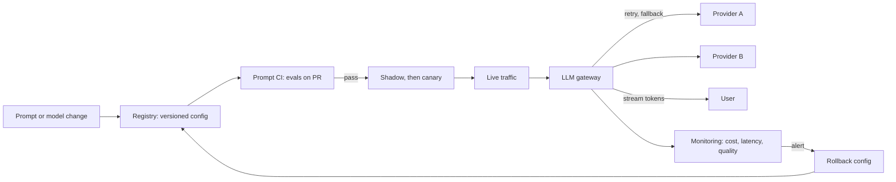
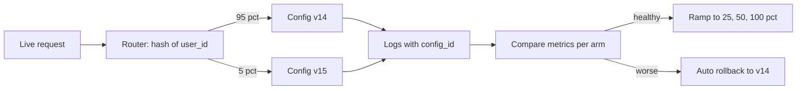
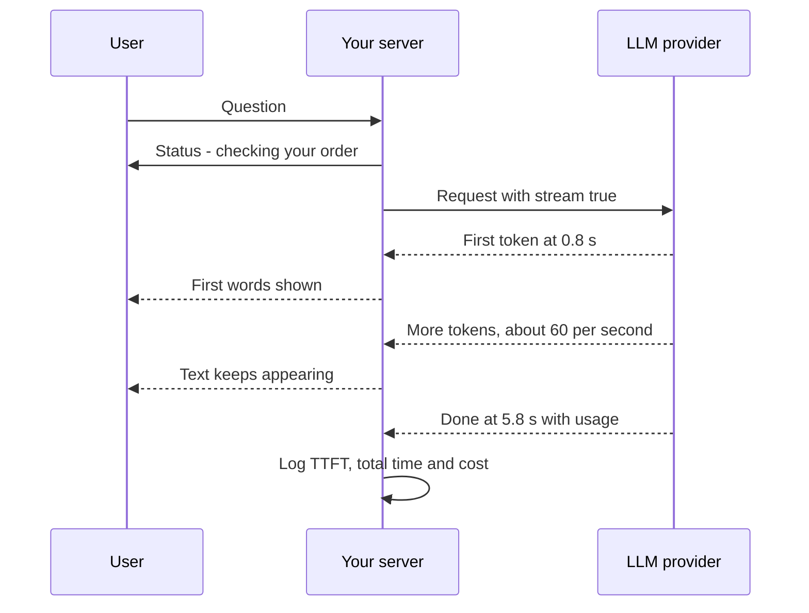

# LLMOps

LLMOps is the day-to-day engineering of running LLM features in production: shipping prompt and model changes safely, keeping the feature up when a provider fails, and keeping the bill and the latency under control. Interviewers ask about it because a demo is easy and production is hard. They want to hear that you have owned an LLM feature after launch, not only built it.

**After this page you can answer:**
- "How do you ship a prompt change safely?"
- "Your LLM provider is down. What happens to your users?"
- "How do you keep cost under control when traffic grows 10x?"
- "How do you detect a quality regression in production when nothing throws an error?"
- "How do you A/B test a new model, and how much traffic do you need?"
- "Why is time to first token more important than total time for a chat product?"
- "A provider is retiring the model you use in 3 months. What is your migration plan?"

## Words you need first

| Word | Plain meaning |
|---|---|
| Token | A piece of text, roughly 3/4 of an English word. Providers bill and rate-limit by tokens. |
| Prompt version | A numbered, saved copy of a prompt, so you know exactly which text ran. |
| Model snapshot | A dated, frozen model ID (like `gpt-4.1-2025-04-14`) that will not change under you. |
| Golden set | A fixed list of test inputs with known good answers, used to check every change. |
| LLM-as-judge | A second LLM call that scores an answer against a rubric, like a grader. |
| Canary | Sending a new version to a small slice of real users first, like 5%. |
| Shadow mode | Running the new version on real traffic, but showing users only the old answer. |
| RPM / TPM | Requests per minute and tokens per minute: the two limits a provider puts on your account. |
| Exponential backoff with jitter | Wait 0.5s, 1s, 2s, 4s between retries, with a random part so clients do not retry together. |
| Circuit breaker | A switch that stops calling a failing service for a while, then tests it again. |
| LLM gateway | One internal service that all LLM calls go through; it handles keys, retries, fallbacks and cost. |
| TTFT | Time to first token: how long until the first word of the answer appears. |
| p95 latency | 95% of requests are faster than this number; the slowest 5% are slower. |

## Big picture

Think of every LLM feature as a pipeline with two loops. The **change loop**: a prompt or model change is saved as a versioned config, checked by evals in CI (continuous integration, the tests that run on every pull request), then rolled out through shadow and canary. The **runtime loop**: every live request goes through a gateway that handles rate limits, retries, fallbacks and cost logging, then streams back to the user. Monitoring watches both loops. When it sees a regression, you roll back the config, not the code.



Each box is one section below. We start with why this is different from normal ops.

## What makes LLM ops different

**In one line:** an LLM feature can get worse without any error, cost depends on text length, and the model itself can change under you.

**Why it exists:** Normal ops assumes code is deterministic: the same input gives the same output, and a bug shows up as an exception or a 500. LLM features break that. A prompt edit can make 10% of answers worse, and every call still returns HTTP 200. Your standard dashboards stay green while users suffer.

**Picture it:** A normal service is a vending machine. Press B4, you always get the same chips, or it visibly jams. An LLM feature is a cook at a dhaba. He always serves a plate, but one day the dal is saltier. Nobody files a bug. Customers just stop coming.

**How it works, step by step:** the four differences and what each one forces you to build.

| Difference | What happens | What you build |
|---|---|---|
| Non-determinism | Same input, different outputs, even at temperature 0 (batching and hardware make tiny differences) | Evals that score many samples, not exact-match tests |
| Silent quality regressions | Bad answers return HTTP 200 | Quality metrics: judge scores, thumbs, escalation rate |
| Provider changes | Aliases like `latest` move, models get deprecated, outages happen | Pinned snapshots, fallbacks, a migration process |
| Token-based cost | Cost grows with prompt length, output length and steps, not just request count | Cost per task, token budgets, spend alerts |

A worked example of silent regression:
1. A team shortens the system prompt from 1,800 to 1,200 tokens to save cost.
2. Error rate: 0.2% before, 0.2% after. Latency: slightly better. Every normal dashboard is happy.
3. The removed lines contained "always ask for the order ID before promising a refund".
4. Over a week, the human escalation rate goes from 6% to 9%. That is the only signal.
5. Without a quality metric on the dashboard, nobody connects the two for weeks.

**Interview tip:** "What is different about operating LLMs?" Say: "Failures are silent and statistical. So I treat quality as a metric with its own dashboards and alerts, I pin everything that can change, and I measure cost per task because tokens, not requests, drive the bill."

**Common mistake:**
- Relying on error rate and latency alone. They catch outages, not bad answers.
- Writing exact-string tests for LLM output. They fail randomly and teach the team to ignore CI.

## ⭐ Prompt versioning and the prompt registry

**In one line:** a prompt is code, so you version it, review it and pin it together with the model and parameters as one config you can roll back.

**Why it exists:** Behaviour comes from four things together: the prompt text, the model snapshot, the parameters (temperature, `max_tokens`) and the tool definitions. If any one changes without a record, you cannot answer "what was running when this bad answer happened?". You also cannot roll back in 30 seconds.

**Picture it:** A restaurant chain's recipe card. The card says the recipe version, which brand of masala, how many grams, and how long on the flame. Changing only the masala brand without updating the card means every branch's dal tastes different and nobody knows why.

**How it works, step by step:**
1. Bundle prompt + model snapshot + params into one **config** with an ID, for example `support_reply@v15`.
2. Store it in git (prompts as code) or in a managed **prompt registry** (a database with a UI and version history).
3. The app does not hardcode a prompt. At runtime it asks for "the version labelled `production`".
4. Every trace and log line records `config_id=support_reply@v15`, so any answer can be traced back to the exact config.
5. Rollback = move the `production` label from v15 back to v14. No redeploy. About 30 seconds.

A config file kept in git:

```yaml
# prompts/support_reply.yaml  (reviewed in a pull request like any code)
id: support_reply
version: 15
model: gpt-4.1-mini-2025-04-14     # pinned snapshot, never "latest"
params:
  temperature: 0.2
  max_tokens: 400
tools: [get_order, create_ticket]
template: |
  You are the support assistant for an online grocery app.
  Always ask for the order ID before discussing refunds.
  Customer message: {{message}}
```

**What the code does:**
- Puts the model ID, parameters, tools and template in one reviewed file, so they change together.
- Pins a dated snapshot, so a provider update cannot silently change behaviour.
- Gives a version number that goes into every trace and every eval report.
- Makes the diff of a prompt change readable in code review.

**Prompts as code vs a managed registry:**

| | Prompts in git | Managed registry (e.g. Langfuse, LangSmith, PromptLayer) |
|---|---|---|
| Who edits | engineers, through pull requests | engineers and product/ops people, through a UI |
| Review | normal code review | approval flow inside the tool |
| Rollout speed | needs a deploy (or a config sync) | label switch, live in seconds |
| Risk | slow for non-engineers | edits can skip CI unless you wire it in |
| Good default | small teams, prompts tightly tied to code | many prompts, non-engineers tuning wording |

Many teams do both: git is the source of truth, and CI publishes approved versions to the registry.

**Interview tip:** "How do you version prompts?" Say: "Prompt, model snapshot, params and tools form one immutable config with an ID. The app reads the config labelled production. Every trace logs the config ID. Rollback is a label move, not a deploy."

**Common mistake:**
- Versioning the prompt but leaving the model as a floating alias. Half the config is still unpinned.
- Letting people edit prompts live in a registry UI with no eval gate. That is deploying untested code to production.

## ⭐ Prompt CI: evals on every pull request

**In one line:** every prompt or model change runs against a golden set in CI, and the merge is blocked if quality, cost or latency crosses a threshold.

**Why it exists:** A prompt edit that fixes one complaint often breaks five other cases. Humans cannot re-check 300 cases by hand on every change. CI makes "did this change make anything worse?" an automatic yes/no before merge.

**Picture it:** A board exam with a fixed question paper. Every new batch of students (every prompt version) writes the same paper. If the class average drops, or the paper takes too long, the batch is not promoted.

**How it works, step by step:**
1. Keep a **golden set**: 200–500 real inputs (anonymized), covering common cases, edge cases and past bugs. Each has a reference answer or a rubric.
2. On a pull request that touches `prompts/`, CI runs the new config on every case.
3. **Scorers:** cheap code checks first (valid JSON, required fields, no banned phrases), then an **LLM judge** with a written rubric that returns pass/fail per case.
4. **Budgets:** CI also records average tokens, cost per case and p95 latency.
5. **Gate:** compare with the current production config on the same cases. Block the merge if pass rate drops more than the noise margin, or cost rises more than, say, 15%.
6. CI posts a comment on the pull request: pass rate, cost, latency, and the list of cases that flipped from pass to fail.

A GitHub Actions style flow:

```yaml
# .github/workflows/prompt-ci.yml
name: prompt-ci
on:
  pull_request:
    paths: ["prompts/**", "app/llm/**"]
jobs:
  evals:
    runs-on: ubuntu-latest
    steps:
      - uses: actions/checkout@v4
      - uses: actions/setup-python@v5
        with: { python-version: "3.12" }
      - run: pip install -r requirements.txt
      - name: Run golden set against PR config and production config
        run: python evals/run.py --cases evals/golden.jsonl --samples 3 --out results.json
        env: { OPENAI_API_KEY: "${{ secrets.OPENAI_API_KEY }}" }
      - name: Gate on quality, cost and latency
        run: python evals/gate.py results.json --max-drop 0.03 --max-cost-rise 0.15 --max-p95-ms 4000
```

**What the code does:**
- Runs only when prompt or LLM code changes, so normal pull requests stay fast and cheap.
- Runs each case 3 times (`--samples 3`) to smooth out randomness.
- Compares the pull request config with production on the same cases.
- Fails the job, and so blocks the merge, if quality drops more than 3 points, cost rises more than 15%, or p95 goes above 4 seconds.

**Handling flaky evals.** LLM output is random, so the same prompt can score 86% on one run and 89% on the next. Treat scores as estimates with error bars.

1. **How big is the noise?** With 200 cases and an 88% pass rate, the standard error is √(0.88 × 0.12 / 200) ≈ 0.023. The 95% confidence interval is about ±4.5 points. So a 2-point drop on 200 cases is not proof of anything.
2. **Compare paired, not raw.** Run old and new on the same cases. Count only cases that flipped. "9 cases went pass→fail, 3 went fail→pass" is much more informative than two averages.
3. **Sample more than once.** Run each case 3–5 times and use the majority or mean. This reduces random flips.
4. **Make the judge stable.** Temperature 0, a fixed judge model snapshot, a specific rubric, and pass/fail instead of a 1–10 score.
5. **Grow the set.** If you need to detect small changes, you need more cases. Halving the error bar needs 4x the cases.

**Interview tip:** "Your eval score dropped 2 points. Do you block the release?" Say: "First I check if it is outside the noise. On 200 cases the interval is about ±4.5 points, so I look at the paired flips and rerun with more samples. If specific important cases flipped, I block. If it is random spread, I don't."

**Common mistake:**
- Running evals only by hand before big launches. Small daily prompt edits then go out untested.
- Using an LLM judge that is never checked against human labels. Check judge agreement on ~50–100 human-labelled cases first. See [Evals for Agents](09-agent-evals.md).

## ⭐ A/B tests and canary rollouts

**In one line:** offline evals tell you a change is probably safe; a canary or A/B test on real users tells you it is actually better.

**Why it exists:** A golden set is a small, old sample of reality. Real users ask things you never saw, in Hinglish, with typos, at 2 a.m. Some effects only appear live: users re-asking the question, clicking thumbs-down, or asking for a human. You need real traffic to see them, but in a controlled way.

**Picture it:** A new item at Swiggy. First the kitchen tastes it (offline eval). Then it is cooked alongside the old dish but not served (shadow). Then it goes to 5% of orders in one city (canary). If ratings hold, it goes to the whole menu.

**How it works, step by step:**
1. **Shadow:** send live requests to both old and new configs. Users see only the old answer. Log both, and score them with the judge offline. Turn off write tools (refunds, emails) for the new version. Cost: you pay for double the calls during shadow.
2. **Canary:** route 1–5% of users to the new config. Use a sticky split: hash the user ID, so one user always sees the same version.
3. **Guardrail metrics** (stop if any gets worse beyond a set limit): task success rate, thumbs-down rate, human escalation rate, cost per task, p95 latency, error rate, safety filter triggers.
4. **Ramp up:** 5% → 25% → 50% → 100%, waiting for enough data at each step.
5. **Auto-rollback:** if a guardrail metric crosses its limit, the router moves traffic back to the old config without waiting for a human.



**Sample-size intuition.** Small differences need a lot of traffic.

- Rule of thumb: users per arm ≈ 16 × p × (1 − p) / δ², where p is the base rate and δ is the change you want to detect. This gives about 95% confidence and 80% power.
- Task success 80%, want to detect a 2-point change (80% → 82%): 16 × 0.8 × 0.2 / 0.02² = 16 × 0.16 / 0.0004 = **6,400 users per arm**.
- Want to detect a 5-point change: 16 × 0.16 / 0.0025 ≈ **1,000 per arm**.
- Thumbs data is sparse. If only 3% of users click thumbs, you need ~33x more traffic to get the same number of votes. So prefer metrics that every session has, like escalation rate or "user re-asked".

**Offline vs online:**

| | Offline eval | Online A/B or canary |
|---|---|---|
| Data | fixed golden set | real, current traffic |
| Speed | minutes | days |
| Risk to users | none | small, limited by traffic % |
| Measures | correctness on known cases | real outcomes: success, thumbs, escalation, cost |
| Catches | regressions on known cases | new input types, user behaviour changes |

**Interview tip:** "How do you A/B test a model?" Say: "Offline evals first, then shadow to compare on live inputs with no user risk, then a sticky canary by user ID. I define the primary metric and guardrail metrics up front, compute the sample size, and set auto-rollback thresholds. I also compare cost per task and p95, not just quality."

**Common mistake:**
- Splitting by request instead of by user. One user sees two different personalities in one chat.
- Stopping the test the moment the graph looks good ("peeking"). Decide the sample size first.

## ⭐ Reliability: rate limits, retries and circuit breakers

**In one line:** LLM APIs are slow, rate-limited shared services, so every call needs a timeout, smart retries and a breaker that stops hammering a failing provider.

**Why it exists:** Provider errors are normal, not rare. You will see `429 Too Many Requests` when you hit your limits, and `500`, `503` or overloaded errors during busy hours. A call can also hang for 60 seconds. Without handling, one slow provider makes all your worker threads wait, and your whole app slows down.

**Picture it:** Booking Tatkal tickets on IRCTC at 10 a.m. If everyone presses refresh every second, the site gets worse. If you wait a bit longer each time, with a random pause, you have a better chance and the site recovers faster.

**How it works, step by step:**

1. **Know your limits.** A provider gives each account **RPM** (requests per minute) and **TPM** (tokens per minute). Example: 500 RPM and 200,000 TPM. If each request uses 2,000 tokens, TPM allows only 100 requests a minute. TPM is the real limit, not RPM.
2. **Shape traffic on your side.** Keep a token bucket per provider in your gateway. Queue or shed low-priority work (batch jobs, background summaries) before user-facing chat. Some providers count the `max_tokens` you request against TPM, so do not ask for 4,000 when you need 300.
3. **Timeouts on every call.** Set a connect timeout (~5s) and a total timeout tied to the expected output (for 400 output tokens at ~50 tokens/s, ~15–20s). For streaming, also time out if no token arrives for N seconds.
4. **Retry only what is retryable.** Retry 408, 429, 500, 502, 503, 504, timeouts and connection errors. Never retry 400 (bad request), 401 (bad key) or "context too long". Those fail again every time.
5. **Exponential backoff with jitter.** Wait `random(0, min(cap, base × 2^attempt))`. With base 0.5s: attempt 0 waits up to 0.5s, attempt 1 up to 1s, attempt 2 up to 2s. The randomness ("full jitter") stops 1,000 clients from retrying in the same millisecond.
6. **Honour `Retry-After`.** On a 429, providers often send a `Retry-After` header (in seconds). Wait that long instead of your own guess.
7. **Cap the total.** 3 attempts, and a total deadline. A user waiting 40 seconds for a retry is worse than a quick fallback.
8. **Circuit breaker.** If more than 50% of the last 20 calls to a provider failed, open the breaker: send no calls there for 30–60s and go straight to the fallback. Then let one trial call through (half-open). If it works, close the breaker. The full outage timeline is in [Agents in Production](12-agents-in-production.md).

**Idempotency for side effects.** Retries are safe for reading. They are dangerous for doing. If an agent calls `issue_refund` and the response times out, a retry may refund twice.
- Give each side-effecting tool call an **idempotency key**, for example `f"{run_id}:{step_id}"`.
- The payments or ticket API stores the key. A second call with the same key returns the first result instead of acting again.
- Example: run `r42`, step 3, key `r42:3`. First call refunds ₹499 and times out on the way back. The retry sends `r42:3` again; the API says "already done, refund id RF-881". The customer gets ₹499 once.

**Request hedging.** For the slow tail, send a second request if the first is slow, and use whichever returns first.
- Example: your p95 time to first token is 1.5s. If no first token after 2s, fire the same request to a backup model and cancel the loser.
- It cuts tail latency but costs extra tokens. Hedge only on time to first token, only for read-only calls, and cap it (say, at most 5% of requests get hedged).

**Interview tip:** "Why add jitter?" Say: "Without jitter, all clients that failed at the same moment retry at the same moment, so the provider sees synchronized waves of load and keeps failing. Jitter spreads retries out so it can recover."

**Common mistake:**
- Retrying inside the SDK and again in your code and again in the gateway. 3 × 3 × 3 = 27 calls for one request during an outage. Retry in one layer only.
- Retrying a tool call that sends money or email without an idempotency key.

## ⭐ Fallbacks through an LLM gateway

**In one line:** route every LLM call through one gateway that knows a fallback chain, so when one model or provider fails, the next one answers.

**Why it exists:** Every provider has outages. If your product depends on one model from one provider, their outage is your outage. Putting retry and fallback logic into every service also means 10 slightly different, buggy copies. A central gateway does it once, and also gives you one place for keys, budgets and cost logs.

**Picture it:** Your phone has two SIMs. When Jio has no signal, calls go out on Airtel automatically. You do not dial differently; the phone handles it.

**How it works, step by step:**
1. All services call the gateway with a logical name, like `model="support-chat"`, not a provider model ID.
2. The gateway maps it to a chain: primary `provider A / model X` → fallback `provider B / model Y` → last resort `a smaller, cheaper model` or a canned message.
3. On a retryable error (after 1–2 retries) or an open circuit breaker, the gateway tries the next entry.
4. On a 429 from the primary, it can go to the fallback right away instead of waiting, if latency matters more than cost.
5. Each fallback model has its **own prompt variant**, tested in CI. A prompt tuned for one model often does worse on another.
6. The gateway logs which entry answered. A spike in fallback usage is an alert.

Tools: LiteLLM (an open-source proxy and Python library with one OpenAI-style API for many providers, plus fallbacks, retries, per-key budgets and cost tracking), or a managed gateway from your cloud provider. Cloud platforms that host several model families also make cross-provider fallback easier inside one account.

**Things that differ between fallback models (test all of these):**

| Difference | Why it matters |
|---|---|
| Context window | A long prompt that fits model X may not fit model Y |
| Tool-call and JSON behaviour | The fallback may break your output parser |
| Tokenizer | Same text, different token count, different cost |
| Quality | Fallback answers may be worse; tell users if needed |
| Data policy and region | The fallback provider must meet the same compliance rules |

**Interview tip:** "The provider is down. What happens?" Say: "The calls time out or return 5xx. The gateway retries once or twice with jittered backoff, the circuit breaker opens after the failure rate crosses a threshold, and traffic moves to the fallback model on another provider with its own tested prompt. Users see slightly different answers, not errors. Alerts fire on fallback rate. If everything fails, we show a graceful message or hand off to a human, and long jobs resume from their checkpoint later."

**Common mistake:**
- Having a fallback that was never tested. The first time it runs is during the outage, and it breaks the JSON parser.
- Falling back to a provider your contracts or data rules do not allow for that customer.

## ⭐ A resilient client in Python

**In one line:** a small wrapper that adds a timeout, jittered retries, provider fallback and per-request cost logging around any OpenAI-compatible API.

**Why it exists:** It shows, in one place, the reliability rules from the last two sections. In production a gateway like LiteLLM does this for you, but interviewers often ask you to sketch it, and writing it once makes the rules stick.

**Picture it:** A delivery agent's routine: wait a fixed time at the door, ring again with growing gaps, then try the back gate, and write every delivery and its fuel cost in a logbook.

**How it works, step by step:**
1. A list of routes in fallback order. Each has a client, a model ID and prices per 1M tokens.
2. For each route, try up to 3 times.
3. On success, compute cost from the `usage` field and log it with latency.
4. On a retryable error, wait `Retry-After` if given, else a jittered backoff, then retry.
5. On a non-retryable error, raise at once. After all routes fail, raise a clear error.

```python
import logging, random, time
from openai import OpenAI, APIStatusError, APITimeoutError, APIConnectionError

# Fallback order. Prices are per 1M tokens and only illustrative.
ROUTES = [
    {"name": "primary", "model": "gpt-4.1-mini-2025-04-14", "in": 0.40, "out": 1.60,
     "client": OpenAI(timeout=20.0, max_retries=0)},   # SDK retries off: we retry here
    {"name": "backup", "model": "backup-model-v2", "in": 0.50, "out": 2.00,
     "client": OpenAI(base_url="https://backup.example.com/v1", api_key="KEY",
                      timeout=20.0, max_retries=0)},
]
RETRYABLE = {408, 429, 500, 502, 503, 504}

def backoff(attempt, base=0.5, cap=8.0):
    return random.uniform(0, min(cap, base * 2 ** attempt))   # full jitter

def chat(messages, attempts=3):
    for r in ROUTES:
        for i in range(attempts):
            try:
                t0 = time.monotonic()
                resp = r["client"].chat.completions.create(
                    model=r["model"], messages=messages, max_tokens=400)
                u = resp.usage
                cost = (u.prompt_tokens * r["in"] + u.completion_tokens * r["out"]) / 1e6
                logging.info("llm route=%s ms=%.0f in=%d out=%d cost_usd=%.6f", r["name"],
                             (time.monotonic() - t0) * 1000, u.prompt_tokens, u.completion_tokens, cost)
                return resp.choices[0].message.content
            except (APITimeoutError, APIConnectionError):
                wait = backoff(i)
            except APIStatusError as e:
                if e.status_code not in RETRYABLE:
                    raise                                       # 400/401: retrying will not help
                ra = e.response.headers.get("retry-after")
                wait = float(ra) if ra and ra.isdigit() else backoff(i)
            if i < attempts - 1:
                time.sleep(wait)
    raise RuntimeError("all LLM routes failed")
```

**What the code does:**
- Turns off the SDK's built-in retries (`max_retries=0`) so retries happen in exactly one layer.
- Uses a 20-second timeout per call, so a hung provider cannot block a worker forever.
- Retries only retryable errors, waits `Retry-After` when the provider sends it, and otherwise uses full-jitter backoff.
- Moves to the backup route after 3 failed attempts, using any OpenAI-compatible endpoint through `base_url`.
- Logs route, latency, tokens and dollar cost for every successful call, which feeds the cost dashboard.

**Interview tip:** "What would you add for production?" Say: "A circuit breaker per route, a total deadline across all attempts, async calls, idempotency keys on tool calls, a per-model prompt variant for the fallback, and tagging each log line with config ID, user and tenant for cost attribution."

**Common mistake:**
- Sleeping after the final attempt before moving to the fallback. That only adds latency. The code skips it.
- Computing cost from string length instead of the provider's `usage` numbers.

## ⭐ Cost engineering

**In one line:** measure cost per completed task, set token budgets at every level, and use caching, batching and routing to cut the bill before traffic grows.

**Why it exists:** An agent may make 4–8 LLM calls for one user task, plus retries and guardrail checks. "Average cost per call" hides this. At 10x traffic, a bill that was fine becomes a board-level problem. One bug, like an agent loop, can also burn thousands of dollars overnight. Deeper levers are in [Cost & Latency](11-cost-latency.md).

**Picture it:** An auto-rickshaw ride. The meter per kilometre (cost per call) is not what you care about. You care about the total fare from home to station (cost per task), including the detour and waiting time.

**How it works, step by step:** a worked example for one support task (illustrative prices: big model $3 input / $15 output per 1M tokens, small model $0.30 / $1.20).

| Call | Model | Tokens in / out | Cost |
|---|---|---|---|
| Intent router | small | 500 / 10 | $0.00016 |
| Agent step 1 | big | 4,000 / 250 | $0.01575 |
| Agent step 2 | big | 4,000 / 250 | $0.01575 |
| Agent step 3 (final answer) | big | 4,000 / 250 | $0.01575 |
| Safety check on answer | small | 800 / 5 | $0.00025 |
| Retries (~5% extra) | mixed | | $0.00238 |
| **Total per task** | | | **≈ $0.050** |

1. Per call this looks like $0.01. Per task it is $0.05. Budget and price by task.
2. At 2 lakh tasks a day: $0.05 × 2,00,000 = **$10,000/day**. At 10x traffic: $100,000/day.
3. **Prompt caching:** 3,000 of each step's 4,000 input tokens are a fixed prefix (system prompt + tool definitions). Cached input often costs about 10% of normal. Per step: 1,000 × $3 + 3,000 × $0.30 = $3,900 per 1M, so $0.0039 instead of $0.012. Saves $0.0081 × 3 steps ≈ **$0.024 per task**. The task drops to ~$0.026.
4. **Model routing:** if the router sends 40% of simple tasks ("where is my order") to a one-step small-model flow costing ~$0.002, the average drops further, to roughly $0.017.
5. **Batch API:** for async work (nightly evals, tagging old tickets), providers' batch APIs are about 50% cheaper and return within 24 hours. Never for live users.

**Token budgets at every level:**

| Level | Example limit | When hit |
|---|---|---|
| Per request | `max_tokens=400`, input trimmed to 8k | answer is cut or context is summarized |
| Per task / run | max 8 steps, max 40k tokens total | agent stops and gives a best answer or hands off |
| Per user per day | $2 | polite "limit reached" or a cheaper model |
| Per tenant per month | from their plan, e.g. 50M tokens | alert the account owner at 80%, throttle at 100% |
| Global per hour | 1.5x the forecast | page on-call |

**Monitoring spend:**
- Tag every call with feature, config ID, user and tenant. Then cost per feature and per tenant is a simple group-by.
- Alert on rate of spend, not only the monthly total: "spend in the last hour > 1.5x the same hour last week".
- Watch tokens per task over time. Slow growth usually means prompts or retrieved context are bloating.

**Interview tip:** "How do you keep cost under control at 10x traffic?" Say: "First I know cost per task and which feature and tenant drive it. Then the safe levers: prompt caching with a stable prefix, trimming context, batch API for anything async. Then routing easy tasks to a small model, checked with evals. Finally hard limits: max steps, per-user and per-tenant budgets, and spend-rate alerts so a loop bug cannot burn money overnight."

**Common mistake:**
- Reporting average cost per call to finance. It undercounts agents by 4–8x.
- Putting a timestamp or user name at the top of the prompt. It breaks the cached prefix on every call.

## ⭐ Streaming and latency

**In one line:** stream tokens as they are generated, so users see the answer start in under a second even when the full answer takes several seconds.

**Why it exists:** An LLM writes its answer one token at a time. A 300-token answer at 60 tokens per second takes 5 seconds to generate. If you wait for the whole thing, the user stares at a spinner for 5–6 seconds and thinks the app is broken. With streaming, they start reading at 0.8 seconds.

**Picture it:** A cricket commentator does not wait for the over to end and then describe all six balls. He talks ball by ball. You hear the action as it happens.

**How it works, step by step:**
1. **Measure the right things.** **TTFT** (time to first token), **tokens per second** (decode speed, often roughly 50–150 for hosted models), and total time.
2. **Total time ≈ TTFT + output tokens ÷ tokens per second.** Example: TTFT 0.8s, 300 tokens at 60 tokens/s = 5s. Total ≈ 5.8s. Users feel the 0.8s, not the 5.8s.
3. **Stream over SSE** (server-sent events: one long HTTP response that sends small `data:` chunks). The provider streams to your server, and your server streams to the browser.
4. **Cut TTFT:** shorter prompts, prompt caching (a cached prefix also speeds up processing), a nearer region, a smaller model for the first step.
5. **Cut total time:** shorter outputs (`max_tokens`, "answer in 3 lines"), fewer agent steps, and parallel tool calls instead of one after another.
6. **Perceived latency tricks:** show progress ("Checking your order…") while tools run, stream partial answers, and show the first useful sentence first.
7. **Set budgets per percentile.** Example targets for a chat feature: TTFT p50 < 0.8s, p95 < 2s; total p95 < 8s; p99 < 15s with a hard timeout at 30s.



**Why p95 and p99, not the average?** An average of 2s can hide that 1 in 20 users waits 12s. Those users are the ones who complain and churn. Agent tasks with many steps have especially long tails, because every step adds its own variance.

**Interview tip:** "Why is TTFT more important than total time?" Say: "Users judge speed by when something starts happening. Streaming makes a 6-second answer feel fast if the first words arrive in under a second. But for agents, TTFT of the final answer includes all the tool steps before it, so I also show progress and cut steps."

**Common mistake:**
- Streaming from the provider but buffering in a proxy or load balancer, so the browser still gets everything at once. Check proxy buffering settings.
- Forgetting that streamed responses still need usage logging. Many APIs send usage only in the final chunk, sometimes only if you ask for it.

## Monitoring in production

**In one line:** dashboards for health, cost and quality, plus drift detection and alerts, so you hear about a bad answer trend before users tweet it.

**Why it exists:** As shown earlier, LLM failures are silent. You need signals that move when quality moves. Tracing tools are covered in [AI Observability](10-agent-observability.md); this section is about what to put on the screen and when to page someone.

**Picture it:** A car dashboard. Speed (latency), fuel (cost), engine warning light (errors), and the passenger's face (user feedback). You need all of them, not just the speedometer.

**How it works, step by step:**

1. **Build these dashboards:**

| Dashboard | Signals |
|---|---|
| Health | request rate, error rate by provider and error code, 429 count, fallback rate, breaker state |
| Latency | TTFT and total time at p50 / p95 / p99, by model and feature |
| Cost | spend per hour, cost per task, tokens per task, cache hit rate, by feature and tenant |
| Quality | online LLM-judge score on a 1–5% sample, task success, escalation rate, re-ask rate |
| Safety | guardrail triggers (prompt injection, PII, toxicity), refusals |
| Feedback | thumbs up/down rate, comments, by config version |

2. **Online scoring:** run the judge on a random 1–5% of production traffic, asynchronously, so it adds no user latency.
3. **Drift detection:** compare this week with last week.
   - **Input drift:** new topics (cluster query embeddings and watch new clusters), language mix, average prompt length.
   - **Output drift:** answer length, refusal rate, tool-call rate, JSON parse failures.
   - **Quality drift:** judge score and escalation rate trends.
4. **Alerts that page someone:** error rate > 2% for 5 min; fallback rate > 10%; p95 TTFT > 3s for 10 min; spend per hour > 1.5x the forecast.
5. **Alerts that open a ticket:** judge score down more than 3 points week-over-week; guardrail triggers up 2x; a new large input cluster appears.
6. **Every chart can be split by config ID**, so after a rollout you can see the old and new versions side by side.

**Interview tip:** "How do you detect quality regressions in prod?" Say: "Three signal types. Proxy signals on every request: escalation, re-ask rate, thumbs, answer length, refusal rate. An online judge on a small sample with a fixed rubric. And drift checks on inputs and outputs. All split by config version, with alerts on week-over-week drops. Bad cases go back into the golden set."

**Common mistake:**
- Only alerting on errors and latency. Quality drops never page anyone.
- Not feeding production failures back into the golden set, so CI never learns from real bugs.

## Model upgrades and deprecations

**In one line:** treat a model change like a risky deploy: eval, re-tune the prompt, shadow, canary, and keep the old model as a fallback until it retires.

**Why it exists:** Providers release new models every few months and retire old snapshots, usually with a few months' notice. A newer model is not automatically better for your task. It may follow instructions more literally, write longer answers, call tools differently, or use a different tokenizer that changes your costs.

**Picture it:** Your favourite mobile network shuts down 3G. You have a few months to move to 4G. The new phone is faster, but you still test that your banking app and OTPs work before you throw the old phone away.

**How it works, step by step:**
1. **Track deprecation dates** for every pinned snapshot in a simple table with an owner. Start migration as soon as notice arrives, not in the last week.
2. **Run the golden set** on the new model with the current prompt. Look at flipped cases, not just the average.
3. **Re-tune the prompt** for the new model. Remove old workarounds ("DO NOT forget to…"), which newer models may over-follow. Save it as a new config version.
4. **Compare cost and latency.** Count tokens with the new tokenizer. A 10% difference in token count is a 10% cost change at the same price.
5. **Shadow** on live traffic for a few days, then **canary** with guardrail metrics, as described above.
6. **Keep the old model as a fallback** until the retirement date, then remove it and update the fallback chain.

**Interview tip:** "A model you depend on is being deprecated. What do you do?" Say: "I already pin snapshots and track dates, so it is a planned migration: golden set on candidate models, re-tune prompts per model, compare quality, cost and latency, shadow, canary, then switch the config. The old snapshot stays as fallback until it retires."

**Common mistake:**
- Swapping the model ID and keeping the old prompt untouched. Prompts are tuned to a model.
- Waiting until the shutdown week, then skipping shadow and canary under time pressure.

## Durable execution for long-running jobs

**In one line:** long LLM jobs save their progress after each step, so a crash or deploy resumes the job instead of restarting it and paying again.

**Why it exists:** A research agent or report job may run for 10 minutes and 50 LLM calls. Pods restart, deploys happen, and providers time out. Restarting from zero wastes time and money and can repeat side effects.

**Picture it:** Saving a video game at each checkpoint. If the power goes, you continue from the last checkpoint, not from level 1.

**How it works, step by step:**
1. Split the job into steps. After each step, save state to durable storage (a LangGraph checkpointer on Postgres, or a workflow engine like Temporal that records each activity's result).
2. A queue gives the job to a worker. If the worker dies, the job returns to the queue after a visibility timeout.
3. A new worker loads the last checkpoint and continues from the next step. Finished steps are not re-run.
4. Side-effecting steps use idempotency keys, so a half-finished step that re-runs does not act twice.
5. The user sees status ("step 3 of 5") and gets notified when it finishes.

The full walk-through, with a sequence diagram, is in [Agents in Production](12-agents-in-production.md).

**Interview tip:** "How do you run a 10-minute agent job reliably?" Say: "Not in the request thread. Return a job ID, run it on a worker, checkpoint after each step, use idempotency keys for side effects, and let a new worker resume from the checkpoint after a crash. Temporal or a LangGraph checkpointer gives you this."

**Common mistake:**
- Running long jobs inside an HTTP request with a 60-second load balancer timeout.

## Interview questions

**Q: How do you ship a prompt change safely?**
Version it as a new config (prompt + model snapshot + params), run the golden set in CI with gates on quality, cost and latency, then shadow and canary with guardrail metrics and auto-rollback. Rollback is a config label move, not a deploy.

**Q: The provider is down. What happens?**
Calls time out or return 5xx. The gateway retries once or twice with jittered backoff, the circuit breaker opens, and traffic moves to a tested fallback model on another provider. If all fail, users get a graceful message or a human, and long jobs resume from checkpoints.

**Q: How do you keep cost under control at 10x traffic?**
Know cost per task by feature and tenant, then apply prompt caching, context trimming, batch APIs for async work, and routing easy tasks to small models. Back it with per-request, per-user and per-tenant token budgets and spend-rate alerts.

**Q: How do you detect quality regressions in production?**
Proxy metrics on every request (escalation, re-ask, thumbs, refusals, answer length), an online LLM judge on a 1–5% sample, and input/output drift checks, all split by config version with week-over-week alerts.

**Q: How do you A/B test a model?**
Offline eval, then shadow, then a sticky canary by user ID. Define the primary metric and guardrail metrics up front, compute sample size (about 6,400 users per arm to see 80% → 82%), and compare cost and latency too.

**Q: Your CI eval dropped 2 points on 200 cases. Block or ship?**
On 200 cases the 95% interval is about ±4.5 points, so 2 points may be noise. Look at paired flips and rerun with more samples; block if important cases flipped.

**Q: Why exponential backoff with jitter, and why honour Retry-After?**
Backoff gives the provider time to recover; jitter stops all clients retrying at the same instant. `Retry-After` is the provider telling you exactly when capacity returns, so it beats your guess.

**Q: Which errors do you not retry?**
400 bad request, 401/403 auth errors, and context-length errors. They fail the same way every time, so retrying only adds cost and latency.

**Q: Trade-off: fail over to another provider immediately on a 429, or wait and retry?**
Failing over keeps latency low but may cost more and gives slightly different answers. Waiting keeps quality consistent but users wait. For live chat I fail over fast; for batch work I wait and retry.

**Q: What is an idempotency key and where do you need it?**
A unique key per side-effecting action, like `run_id:step_id`. The downstream API stores it and ignores duplicates, so retries cannot refund or email twice.

**Q: What is request hedging, and when would you not use it?**
Sending a duplicate request when the first is slow and taking the first response. Do not use it for side-effecting calls, and cap it, because it adds token cost.

**Q: What would you do if spend doubled overnight with flat traffic?**
Group cost by feature, config and tenant to find the source. Usual causes: an agent loop, a new prompt that broke caching, a retry storm, or larger retrieved context. Add or tighten max-step and per-run token limits.

**Q: How do you migrate to a new model before a deprecation?**
Golden set on the new model, re-tune the prompt, compare quality, cost (new tokenizer) and latency, then shadow and canary. Keep the old snapshot as fallback until it retires.

**Q: Why pin a model snapshot instead of using an alias like latest?**
An alias can change under you, so behaviour changes without any deploy on your side. A snapshot makes every eval and trace reproducible.

## Read next

- [Evals for Agents](09-agent-evals.md): golden sets, judges and online evals in depth
- [Cost & Latency](11-cost-latency.md): token economics, caching and routing levers with full numbers
- [Agents in Production](12-agents-in-production.md): serving architecture, outage timeline, durable execution
- [Inference and Serving](15-inference-serving.md): what drives TTFT and tokens per second on the server side

## Checklist

- [ ] I can explain four ways LLM ops differs from normal ops and what each one forces you to build
- [ ] I can explain why prompt, model snapshot and params are versioned together as one config, and how rollback works
- [ ] I can describe a prompt CI pipeline and explain how to handle noisy eval scores with paired comparison and more samples
- [ ] I can plan a shadow and canary rollout with guardrail metrics and estimate the sample size per arm
- [ ] I can explain RPM vs TPM, timeouts, which errors to retry, backoff with jitter and Retry-After
- [ ] I can explain circuit breakers, gateway fallbacks, idempotency keys and request hedging
- [ ] I can write a client wrapper with timeout, retries, provider fallback and cost logging
- [ ] I can calculate cost per task and name the budgets, caching, batch and routing levers
- [ ] I can explain TTFT vs total time, streaming over SSE and latency percentile budgets
- [ ] I can list the dashboards and alerts for an LLM feature and describe a safe model migration
