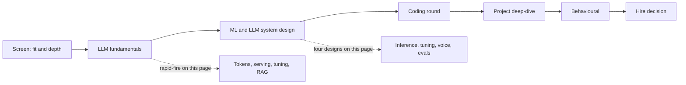
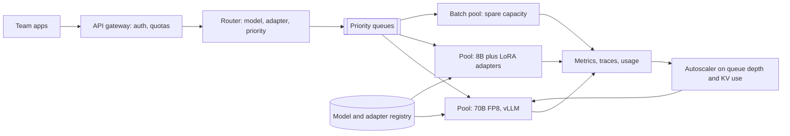
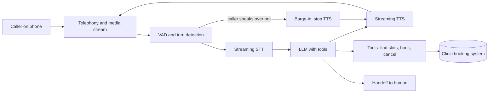
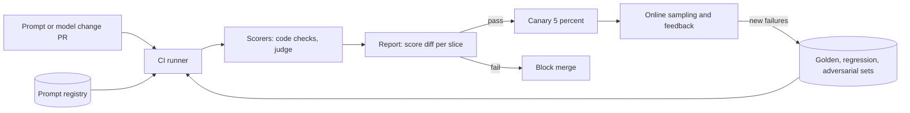

# LLM Engineer Interview Prep

This page is the night-before revision for an LLM engineer or AI engineer interview loop. The agent rounds (agent design, LangGraph, memory, tool use) are on [Agentic AI Interview Prep](13-agentic-interview-qa.md). This page covers everything else: model fundamentals, inference and serving, fine-tuning, RAG and prompting, ML system design, coding and your project deep-dive.

**After this page you can answer:**
- "Why is decoding memory-bound, and what does that mean for batching?"
- "How much GPU memory does a 70B model need to serve 8K-token requests?"
- "LoRA vs full fine-tuning vs RAG: when do you pick which?"
- "What is the difference between RLHF, DPO and GRPO?"
- "Design an inference platform that serves open-weight models to 40 internal teams."
- "Design a realtime voice agent that books appointments. Where do the 800 ms go?"
- "Implement top-p sampling and causal attention in NumPy."
- "Walk me through an LLM project you built. What were the numbers?"

## Words you need first

| Word | Plain meaning |
|---|---|
| Token | A chunk of text the model reads or writes; roughly 3–4 English characters. |
| Logits | Raw scores the model gives every possible next token, before turning them into probabilities. |
| Attention | Each token looks at earlier tokens and decides how much each one matters. |
| KV cache | Saved keys and values of past tokens, so the model does not recompute them for every new token. |
| Prefill / decode | Prefill reads the whole prompt at once. Decode writes the answer one token at a time. |
| TTFT | Time to first token: how long the user waits before text starts appearing. |
| Quantization | Storing model numbers in fewer bits (16 → 8 or 4) to save memory and speed up. |
| Fine-tuning | Training an existing model a little more on your own examples. |
| LoRA | Fine-tuning that trains two small extra matrices instead of the whole model. |
| RLHF / DPO | Ways to teach a model which of two answers people prefer. |
| MoE | Mixture of Experts: many sub-networks, only a few run for each token. |
| Eval set | A fixed list of test inputs with expected results, used to score a model or prompt. |
| LLM-as-judge | Using a strong model with a scoring rubric to grade another model's answers. |
| Golden set | A small, hand-checked eval set you trust most. |

## Big picture

A typical AI engineer loop has five to six rounds. A recruiter or hiring-manager screen checks fit and depth. An LLM fundamentals round checks that you understand how models work and run. An ML or LLM system design round checks that you can build a real product with numbers. A coding round checks plain coding plus small LLM building blocks. A project deep-dive checks that your own work is real and measured. A behavioural round checks ownership and judgement. This page follows the same order.



## ⭐ What each round tests and how to prepare

**In one line:** every round checks one thing: can you make an LLM product work in production, explain why, and prove it with numbers.

| Round | What they really test | How to prepare | Signal that wins |
|---|---|---|---|
| Screen (30 min) | Have you shipped LLM features? Can you explain one clearly? | A 2-minute story of your best project, with one metric | "Faithfulness went from 71% to 89% on a 400-case eval set" |
| LLM fundamentals (45–60 min) | Tokens, attention, sampling, KV cache, fine-tuning, RAG basics | The rapid-fire sections below, out loud | Short correct answers plus the "why" |
| ML / LLM system design (45–60 min) | Requirements, numbers, architecture, evals, cost, failure modes | The four designs below; practise drawing in 35 min | Starts with eval and numbers, not with a vendor name |
| Coding (45–60 min) | Clean Python, plus small LLM pieces (sampling, attention, retriever) | Write the snippets on this page from memory | Correct, tested, edge cases said out loud |
| Project deep-dive (45–60 min) | Did you do it? Do you know why it worked? | Template in the deep-dive section | Baseline, eval, iterations, numbers, what failed |
| Behavioural (30–45 min) | Ownership, conflict, ambiguity, shipping under pressure | 5–6 STAR stories, two of them about AI work | Specific "I" actions and measured outcomes |

**Interview tip:** "What would you do first on a new LLM feature?" Say: "Build a small eval set from real inputs and a baseline with a plain prompt. Then I iterate against that number."

**Common mistake:**
- Preparing only for agents and frameworks, then freezing on "what is in the KV cache?".
- Giving answers with no numbers. Every senior answer has at least one number.

## ⭐ Rapid-fire: LLM fundamentals

**In one line:** an LLM is a next-token predictor: text becomes tokens, a stack of attention layers turns them into logits, and a sampler picks the next token.

**Q: What is a token, and why does tokenization matter?**
A token is a piece of text from a fixed vocabulary, built by BPE (byte pair encoding: start from bytes, repeatedly merge the most frequent pair). English is about 0.75 words per token. Tokenization drives cost, context length, and odd failures like bad arithmetic or letter counting. Hindi and other non-Latin scripts often need more tokens for the same meaning (with older tokenizers, 2–4× more).

**Q: Walk me through one forward pass.**
Token IDs → embedding vectors → N transformer blocks (each = attention + feed-forward MLP, with residual connections and normalisation) → a final layer that maps to logits over the vocabulary → softmax → probabilities for the next token.

**Q: What does attention compute?**
Each token makes a query (Q), key (K) and value (V) vector. Scores = Q·Kᵀ / √d, a causal mask hides future tokens, softmax turns scores into weights, and the output is the weighted sum of V. Dividing by √d keeps scores from growing with dimension and saturating softmax.

**Q: Why is attention O(n²), and what does FlashAttention change?**
Every token scores against every earlier token, so a sequence of n tokens builds an n×n score matrix. FlashAttention computes the exact same result but in tiles that stay in fast on-chip memory, never writing the full n×n matrix to GPU memory. It saves memory traffic and time; it is not an approximation.

**Q: Multi-head, MQA and GQA?**
Multi-head attention runs several attention heads in parallel, each learning different relations. MQA (multi-query attention) shares one K/V head across all query heads. GQA (grouped-query attention) shares one K/V head per group, e.g. 64 query heads and 8 KV heads. GQA cuts the KV cache by 8× there with little quality loss, which is why Llama 3 uses it.

**Q: How does the model know word order?**
Through positional information. Most current models use RoPE (rotary position embeddings), which rotates Q and K by an angle that depends on position. Context extension tricks (position interpolation, YaRN) stretch RoPE so a model trained on 8K can work at 32K–128K after a short extra training run.

**Q: Explain temperature, top-k, top-p and min-p.**
Temperature divides logits before softmax: below 1 makes the top token more likely, above 1 flattens the distribution, 0 means greedy. Top-k keeps only the k most likely tokens. Top-p (nucleus) keeps the smallest set whose probabilities sum to p. Min-p keeps tokens with probability at least min_p × the top token's probability, so the cut adapts to how confident the model is.

**Q: Why can temperature 0 still give different outputs?**
GPU floating-point maths is not perfectly associative. Results change with batch size and kernel choice, and the server batches your request with other people's. In MoE models, tiny differences can also flip which expert a token goes to. Greedy is "mostly" deterministic, not guaranteed.

**Q: What is a Mixture of Experts model?**
The feed-forward part of each layer is split into many "experts". A small router picks the top-k experts (often 2 to 8) for each token. Mixtral 8x7B has about 47B total parameters but only about 13B active per token; DeepSeek-V3 has 671B total and about 37B active. Compute per token follows active parameters; GPU memory must still hold all of them.

**Q: Trade-offs of MoE in serving?**
Cheaper compute per token and better quality per FLOP. But you need memory for all experts, routing can be unbalanced (some experts overloaded), and multi-GPU serving needs expert parallelism with all-to-all communication. Small-batch latency gains are smaller than the active-parameter count suggests.

**Q: What are reasoning models?**
Models like OpenAI o1 and DeepSeek-R1 that write a long hidden chain of thought before answering. They are trained with reinforcement learning on tasks with checkable answers (maths, code). They trade more output tokens (test-time compute) for higher accuracy. Cost and latency go up a lot, so use them for hard multi-step problems, not for classification.

**Q: What is a context window, and is bigger always better?**
It is the maximum number of tokens (prompt plus output) the model can attend to. Bigger windows cost more (attention and KV cache grow with length), and quality drops on facts buried in the middle ("lost in the middle"). Retrieval of the right 5K tokens usually beats dumping 500K.

**Q: Base model vs instruct model?**
A base model is only pre-trained to continue text. An instruct (chat) model is then trained with SFT (supervised fine-tuning) on instruction-answer pairs and preference tuning so it follows instructions and has a chat format. Fine-tune on top of the instruct model unless you have a lot of data.

**Q: Why do LLMs hallucinate?**
They are trained to produce likely text, not true text. When the answer is not well stored in their weights, the likeliest continuation can still be confident and wrong. Fixes: ground answers in retrieved sources, ask for citations, allow "I don't know", lower temperature, and check outputs.

**Q: What are scaling laws, in one sentence?**
Loss falls predictably as a power law of parameters, data and compute; Chinchilla (2022) showed compute-optimal training needs roughly 20 tokens per parameter, though modern small models train far past that because inference cost matters more.

**Q: Embedding model vs generative model?**
An embedding model maps text to one fixed-size vector for similarity search. A generative model predicts next tokens. They are trained for different goals, so do not use a chat model's hidden states as your search embeddings.

**Q: Trade-off: a bigger model or a smaller model with more context or tools?**
Start with the smallest model that passes your eval. If it fails because it lacks knowledge, add retrieval. If it fails at reasoning, move up a model size or use a reasoning model only for the hard route. Measure; do not guess.

## ⭐ Rapid-fire: inference and serving

**In one line:** prefill is compute-bound, decode is memory-bandwidth-bound, and almost every serving trick (batching, KV cache paging, quantization, speculative decoding) is a way to use the GPU better during decode.

**Q: Why is decoding memory-bound?**
To produce each new token, the GPU must read every weight from memory once. For one request, that is a lot of reading for very little maths. An H100 reads about 3.35 TB/s, so an 8B model in 16-bit (16 GB) caps out near 200 tokens/s for a single request. Batching many requests reuses the same weight read, which is why throughput rises with batch size.

**Q: Prefill vs decode, and TTFT vs TPOT?**
Prefill processes all prompt tokens in parallel; it is compute-bound and sets TTFT (time to first token). Decode makes one token per step; it is memory-bound and sets TPOT (time per output token, also called inter-token latency). Long prompts hurt TTFT; long answers hurt total latency.

**Q: What is the KV cache, and how big is it?**
For every past token and every layer, the model stores the key and value vectors so it never recomputes them. Size per token = 2 (K and V) × layers × KV heads × head dim × bytes. Llama 3 8B: 2 × 32 × 8 × 128 × 2 bytes = 128 KB per token, so an 8K-token request uses about 1 GB.

**Q: What is continuous batching?**
Old static batching waits until every request in the batch finishes. Continuous (in-flight) batching adds and removes requests at every decode step, so a short answer leaves and a new request joins immediately. It typically raises throughput several times over static batching.

**Q: What does PagedAttention (vLLM) solve?**
KV caches grow unpredictably, and reserving max length per request wastes most of the memory. PagedAttention (vLLM, 2023) stores the KV cache in small fixed-size blocks, like OS memory pages, allocated on demand. Waste drops to near zero, so more requests fit in a batch.

**Q: What is prefix caching?**
If many requests share the same start (system prompt, tool list, few-shot examples), the server keeps the KV blocks for that prefix and reuses them. This cuts TTFT and cost. It only works if the prefix is byte-identical, so put stable content first and per-request content last.

**Q: Chunked prefill and disaggregated serving?**
A long prefill can stall everyone's decode. Chunked prefill splits a long prompt into chunks mixed with decode steps, so inter-token latency stays smooth. Disaggregated serving goes further: separate GPU pools for prefill and decode, with the KV cache transferred between them, so each pool is tuned for its own bottleneck.

**Q: What quantization options exist, and what do they cost?**
Weight-only INT8 or INT4 (methods like GPTQ and AWQ) cut memory and speed up memory-bound decode. FP8 weights and activations (supported on H100-class GPUs) also speed up compute with very small quality loss. KV cache quantization (FP8) doubles how many tokens fit. INT4 can hurt maths, code and long-context tasks, so always rerun your eval after quantizing.

**Q: How does speculative decoding work?**
A small, fast draft model (or extra prediction heads like Medusa or EAGLE) guesses the next 3–5 tokens. The big model checks all guesses in one forward pass and keeps the longest correct run. With the right acceptance rule the output distribution is exactly the big model's. It helps most at low batch sizes, where the GPU has spare compute.

**Q: Tensor parallelism vs pipeline parallelism?**
Tensor parallelism splits each layer's matrices across GPUs; it needs fast links (NVLink) and is used inside one node to cut latency. Pipeline parallelism puts different layers on different GPUs; it suits multi-node setups but adds pipeline bubbles. For serving a 70B model, tensor parallelism across 2–8 GPUs in one node is the default.

**Q: How do you serve many fine-tuned variants cheaply?**
Keep one base model in GPU memory and load LoRA adapters per request (multi-LoRA serving in vLLM, the S-LoRA idea). Each adapter is tens of MB, so hundreds can share one deployment instead of one GPU set per variant.

**Q: Throughput vs latency: what do you tune?**
Bigger batches raise tokens per second per GPU but make each user's tokens slower. Set an SLO (service-level objective) first, for example p95 TTFT under 1 s and 30+ tokens/s per user, then raise batch size until you hit it. Offline jobs can use huge batches; chat cannot.

**Q: Estimate GPUs for serving a 70B model (worked example).**

| Step | Maths | Result |
|---|---|---|
| Weights in FP8 | 70B params × 1 byte | 70 GB |
| KV per token (Llama 3 70B: 80 layers, 8 KV heads, dim 128, FP16) | 2 × 80 × 8 × 128 × 2 bytes | ≈ 320 KB |
| KV for one 8K-token request | 8,192 × 320 KB | ≈ 2.6 GB |
| One replica = 2 × H100 80 GB | 160 GB − 70 GB weights − ~15 GB overhead | ≈ 75 GB for KV |
| Concurrent 8K requests per replica | 75 / 2.6 | ≈ 28 (more with FP8 KV or shorter prompts) |
| Peak load | 100 req/s × 300 output tokens | 30,000 output tokens/s |
| Replica throughput (assume, then benchmark) | roughly 2,000–3,000 output tokens/s | use 2,500 |
| Replicas needed | 30,000 / 2,500 = 12, plus 30% headroom | ≈ 16 replicas = 32 H100s |

> **Say:** "These are planning numbers. Before committing, I would benchmark with real prompt and output lengths at our SLO, because throughput changes 2–3× with length mix."

**Common mistake:** sizing GPUs by weights only and forgetting the KV cache, which often needs as much memory as the weights.

## ⭐ Rapid-fire: fine-tuning and post-training

**In one line:** prompt first, retrieve for knowledge, fine-tune for behaviour and format, and use preference tuning or RL when "good" is easier to judge than to write.

**Q: When do you fine-tune instead of prompting or RAG?**
RAG for knowledge that changes or must be cited. Prompting for anything a good instruction plus examples solves. Fine-tune for a consistent style, format or narrow skill; to make a small model match a big one on one task (cheaper, faster); or when the prompt is so long that it costs too much. Fine-tuning is a poor way to add facts.

**Q: What is SFT, and what is the one bug everyone makes?**
SFT (supervised fine-tuning) trains on input-output pairs with next-token loss. Compute loss only on the assistant tokens, not the prompt, and use exactly the chat template the model was trained with. A template mismatch quietly ruins quality.

**Q: How does LoRA work, with numbers?**
LoRA (2021) freezes the weight matrix W and learns a low-rank update ΔW = B·A, where A is r × d and B is d × r. For a 4096 × 4096 matrix that is 16.8M parameters; with rank r = 16, LoRA trains 2 × 4096 × 16 ≈ 131K, under 1%. Adapters can be merged into W for zero extra latency, or kept separate for multi-adapter serving.

**Q: LoRA hyperparameters that matter?**
Rank r (8–64 is common), alpha (scaling, often 1–2× r), which modules get adapters (all linear layers usually beats only attention), and learning rate (higher than full fine-tuning, around 1e-4 to 2e-4).

**Q: What does QLoRA add?**
QLoRA (2023) keeps the frozen base model in 4-bit NF4 format and trains LoRA adapters in 16-bit on top. Memory falls about 4× for the base weights, so a 65B model could be fine-tuned on one 48 GB GPU. It is slower per step and slightly lower quality than LoRA on a 16-bit base.

**Q: How much memory does full fine-tuning need?**
With Adam and mixed precision, roughly 16 bytes per parameter: 2 for weights, 2 for gradients, 12 for FP32 master weights and two Adam moments. A 7B model needs about 112 GB before activations, so multiple GPUs plus sharding (FSDP or DeepSpeed ZeRO). LoRA on the same model fits on one 24–48 GB GPU.

**Q: Explain RLHF.**
Three steps: SFT the model; collect human comparisons ("answer A is better than B") and train a reward model on them; then optimise the policy with PPO (proximal policy optimization) to get high reward, with a KL penalty that stops it drifting too far from the SFT model. It works but is complex: four models in memory and unstable training.

**Q: What is DPO, and why is it popular?**
DPO (direct preference optimization, 2023) uses the same preference pairs but skips the reward model and the RL loop. Its loss directly raises the probability of the chosen answer relative to the rejected one, compared with a frozen reference model; beta controls how far it may drift. It is simpler, stable, and needs only two models.

**Q: What is GRPO?**
GRPO (group relative policy optimization, from DeepSeekMath and used for DeepSeek-R1) samples a group of answers, say 8, for each prompt and scores each one. Each answer's advantage = (its reward − group mean) / group std. No separate value (critic) model is needed, which saves memory. With checkable rewards (unit tests pass, maths answer matches) this is called RLVR (RL with verifiable rewards).

**Q: What is reward hacking?**
The model finds a way to get high reward without doing the task: very long answers if the judge likes length, deleting failing tests if the reward is "tests pass". Fix it with a KL penalty, better and harder-to-fool rewards, length controls, and reading samples by hand.

**Q: What is distillation?**
Training a small student model to copy a big teacher. Sequence-level: generate teacher answers and SFT the student on them (works with API-only teachers). Logit-level: train the student to match the teacher's full probability distribution (needs teacher logits; richer signal). Check the teacher's licence terms before using its outputs for training.

**Q: How do you make good synthetic data?**
Seed with real inputs, generate with a strong model, then filter hard: dedupe, verify (run the code, check the maths, LLM judge with a rubric), balance difficulty, and remove anything overlapping your eval set (decontamination). 1,000 clean examples usually beat 50,000 noisy ones.

**Q: What is catastrophic forgetting, and how do you limit it?**
After fine-tuning on a narrow task the model gets worse at general skills. Limit it with LoRA (smaller change), a low learning rate, few epochs (1–3), mixing in some general instruction data, and running a general benchmark next to your task eval.

**Q: Trade-off: DPO or GRPO for your task?**
DPO when you have (or can collect) preference pairs and "better" is a matter of taste: tone, helpfulness. GRPO or RLVR when correctness can be checked automatically: maths, code, SQL, extraction with exact answers. Both start from a good SFT model.

## ⭐ Rapid-fire: RAG, structured outputs, prompting, multimodal, security, LLMOps

**In one line:** most production LLM failures are not model failures; they come from bad retrieval, unparsed output, untested prompts, unguarded inputs or missing monitoring.

**Q: Walk through a production RAG pipeline in one breath.**
Parse and clean docs → chunk (300–800 tokens with structure) → embed → store with metadata → hybrid search (BM25 + vectors) → rerank top 50 down to 5 with a cross-encoder → prompt with sources → answer with citations → evaluate faithfulness and retrieval recall. Details are on [What is RAG](../09-rag/01-what-is-rag.md).

**Q: Answers are wrong. How do you debug RAG?**
Split it into two questions. Was the right chunk retrieved (check recall@k on a labelled set)? If not, fix chunking, hybrid search, query rewriting, or the reranker. If it was retrieved, is the answer faithful to it? If not, fix the prompt, put the best chunk first, or use a stronger model.

**Q: Why hybrid search plus reranking?**
Vectors match meaning but miss exact terms like error codes and product IDs; BM25 (keyword ranking) catches those. A cross-encoder reranker reads the query and each chunk together, so it is far more accurate than either, but too slow for millions of docs, so it runs only on the top 50.

**Q: JSON mode vs function calling vs constrained decoding?**
JSON mode makes the output valid JSON but not your schema. Function calling or "structured outputs" make the model fill a schema you give. Constrained decoding (grammar or schema masks at the sampler, as in Outlines, XGrammar or provider structured outputs) makes invalid tokens impossible, so the output always parses. Still validate with Pydantic, because valid shape is not correct content.

**Q: Can strict schemas hurt quality?**
Yes. Forcing the answer field first stops the model from reasoning before answering. Put a short "reasoning" field before the answer, or reason first and extract second. Keep schemas flat and give fields clear names and descriptions.

**Q: Few-shot, chain of thought, and prompt caching: one line each?**
Few-shot: 2–5 real input-output examples fix format and edge cases better than rules. Chain of thought: asking for step-by-step reasoning helps multi-step tasks on non-reasoning models. Prompt caching: keep a byte-identical prefix so the provider charges much less for those tokens and TTFT drops.

**Q: What is DSPy?**
A framework where you declare the task as a signature (inputs → outputs) and modules, give a metric and some examples, and an optimizer (such as BootstrapFewShot or MIPROv2) searches for instructions and few-shot examples that maximise the metric. It turns prompt tuning into a measured search. It only helps if your metric and dataset are good.

**Q: How does a vision-language model "see" an image?**
A vision encoder (often a ViT, vision transformer) cuts the image into patches and turns them into vectors. A small projector maps those vectors into the LLM's token space, and the LLM reads them like extra tokens. A high-resolution image can cost hundreds to a few thousand tokens, so resize when detail is not needed.

**Q: Voice agents: cascade or speech-to-speech?**
Cascade = STT (speech to text) → LLM → TTS (text to speech). It is easy to debug, works with any LLM and tools, but adds latency at each hop. Speech-to-speech models (realtime audio APIs) give lower latency and keep tone, but are harder to control, evaluate and log. Most production booking and support bots today use a streaming cascade.

**Q: What is prompt injection, and what is the strongest defence?**
Untrusted text (a user, a webpage, a PDF, a tool result) contains instructions the model follows. Direct injection comes from the user; indirect injection hides in content the model reads. There is no full fix in the model. The strongest defence is architectural: least-privilege tools, human approval for risky actions, and never letting one context hold private data, untrusted input and a way to send data out at the same time.

**Q: Give one real data-exfiltration path.**
An injected doc tells the model to render a markdown image like ``. The chat UI loads the image and leaks the secret in the URL. Fix: do not render images from untrusted domains, and strip or allowlist links in outputs.

**Q: What is LLMOps, in practice?**
Versioned prompts and model IDs; an eval suite that runs in CI on every change; tracing every call (inputs, outputs, tokens, latency, cost); online quality signals (thumbs, LLM-judge sampling, escalations); cost and latency dashboards; and safe rollout (shadow, canary, rollback).

**Q: Your provider silently updated the model and quality dropped. What now?**
Pin dated model versions in production. Detect it with daily online eval sampling and alerts on quality metrics. Roll back to the pinned version or a fallback provider, then rerun the offline eval to find which slices broke.

**Q: How do you cut the cost of an LLM feature by 5×?**
Route easy requests to a small model (cascade), cache prompts and repeated answers, trim context (fewer, better chunks), cap output length, batch offline work (batch APIs are often half price), and distil the high-volume step into a fine-tuned small model.

**Q: Trade-off: one big general model or many small specialised ones?**
One big model is fastest to ship and simplest to run. Small fine-tuned models are cheaper and faster at high volume but each needs data, evals and upkeep. Start big, log everything, and specialise the one or two routes that carry most of the traffic.

**Q: How do you evaluate an open-ended feature like summarisation?**
Combine a rubric-based LLM judge (calibrated against 100–200 human labels), checks you can compute (length, required fields, citation present), and pairwise comparison against the current version. Track agreement between judge and humans; if it falls below about 80%, fix the rubric.

## ⭐ Design round 1: LLM inference platform for internal teams

> **Prompt:** "Design a platform that serves open-weight models (Llama, Qwen, Mistral) to 40 internal teams. Some teams need chat latency, some run batch jobs, some bring their own LoRA adapters."

**1. Clarify.** Ask: which models and sizes? Peak load and the mix of chat vs batch? Latency SLOs? Data rules (no data leaves our VPC)? Do teams bring fine-tunes? Budget and GPU types available?

**2. Requirements.**
- Functional: OpenAI-compatible API, streaming, multiple models, per-team LoRA adapters, batch endpoint, usage reporting.
- Non-functional: p95 TTFT < 1 s for chat, > 30 tokens/s per stream, 99.9% availability, per-team quotas, no prompt logging without consent, cost per team visible.

**3. Numbers.** Use the GPU estimate from the serving section: 100 chat req/s on a 70B FP8 model needs about 16 replicas of 2 × H100. Batch jobs run on the same pools at night or on spare capacity, at lower priority. An 8B model for simple routes needs a single GPU per replica and handles many more requests.

**4. Architecture.**



**5. Key decisions.**

| Decision | Choice | Why | Alternative |
|---|---|---|---|
| Serving engine | vLLM or SGLang | Continuous batching, PagedAttention, prefix caching, multi-LoRA | TensorRT-LLM for peak speed, more build effort |
| Precision | FP8 weights and KV on H100 | ~2× memory saving, small quality loss | BF16 when the eval shows a drop |
| Parallelism | Tensor parallel inside one node | Lowest latency for 70B | Pipeline parallel only for models that do not fit one node |
| Fine-tunes | Shared base plus per-request LoRA | One deployment serves hundreds of adapters | Dedicated deployment only for very high-traffic adapters |
| Autoscaling signal | Queue depth, KV cache usage, TTFT | GPU utilisation is misleading for LLMs | Request count alone |
| Isolation | Per-team quotas and priority classes | One team's batch job must not hurt another's chat | Separate clusters per team (wasteful) |
| API | OpenAI-compatible | Teams reuse existing SDKs and tools | Custom API |

**6. Failure modes.**

| Failure | Effect | Fix |
|---|---|---|
| Cold start of a 70B model (minutes) | Scale-up too slow for spikes | Keep warm minimum replicas, cache weights on local NVMe, scale on queue trend |
| One team floods the queue | Others time out | Per-team token-rate limits, fair-share scheduling |
| KV cache full | Requests get preempted and recomputed | Cap max context per tier, admit by KV budget, FP8 KV |
| Bad adapter upload | Garbage outputs for that team | Registry runs a smoke eval before an adapter goes live |
| GPU node failure | Lost in-flight streams | Health checks, retry idempotent requests on another replica |
| New engine version changes outputs | Silent quality drop | Canary with an eval suite before rollout |

> **Say:** "I size by KV cache, not by weights. I scale on queue depth and TTFT, not GPU utilisation. And I treat batch traffic as a lower priority class that fills spare capacity."

## ⭐ Design round 2: fine-tuning pipeline for a support domain

> **Prompt:** "We pay a lot to call a GPT-class model for customer support replies. Design a pipeline to make a small open model (7–8B) match its quality on our domain."

**1. Clarify.** What does "match" mean, measured how? Volume and cost today? Latency target? Do we have past tickets with human-approved replies? Can the big model's outputs be used for training under its terms? Which languages (Hindi, Hinglish)?

**2. Data.**
1. Pull 50K past conversations; remove PII (names, phones, card numbers).
2. Keep only good ones: resolved, high CSAT, no escalation. Expect 30–40% to survive.
3. Generate gaps with the big model (rare intents, Hinglish), then filter with an LLM judge plus rules.
4. Dedupe, balance by intent, and split by time: train on older months, test on the newest month.
5. Freeze a 500-case golden test set reviewed by the support team. Never train on it.

**3. Training.**
1. Baseline: the small model with a good prompt plus RAG. Many teams stop here.
2. SFT with LoRA (r = 16–32, all linear layers, 2–3 epochs, loss on assistant tokens only).
3. If tone or policy errors remain, collect preference pairs (agents pick the better of two drafts) and run DPO.
4. Distillation option: use the big model's replies as targets for intents where human replies are weak.

**4. Evaluation.**

| Check | How | Ship bar |
|---|---|---|
| Correctness and policy | LLM judge with rubric, calibrated on 200 human labels | Within 2 points of the big model |
| Pairwise preference | Judge and humans compare small vs big on the golden set | Win or tie ≥ 45% |
| Hard rules | Regex and code: no wrong refund promises, no PII echo | 100% pass |
| General skills | Small general benchmark | No large drop vs base |
| Slices | Per intent, per language | No slice drops more than 5 points |

**5. Deploy.**
1. Serve the base model with the adapter on the shared platform (design 1).
2. Shadow traffic for a week: compare with the big model's replies offline.
3. Canary 5% with a router: confident, common intents go to the small model; hard or rare intents stay on the big one.
4. Watch CSAT, escalation rate and policy violations; roll back by flipping the route.

**6. Cost.**

| Item | Big model API | Small fine-tuned model |
|---|---|---|
| Per 1M tokens (rough) | Several dollars | Tens of cents on own GPUs at good batch |
| Training | none | A few GPU-hours for LoRA; a few hundred dollars including data generation |
| Hidden cost | Price changes | Retraining every quarter, eval upkeep, on-call |

> **Say:** "The project is mostly data and evals; the training run is the easy part. I would ship with a router so the small model only takes traffic where the eval says it is as good."

## ⭐ Design round 3: realtime voice agent for appointment booking

> **Prompt:** "Design a phone agent for a clinic chain that books, moves and cancels appointments in English and Hindi."

**1. Clarify.** Phone (PSTN) or app? Peak concurrent calls? Which calendar or booking system? Languages and accents? What must go to a human (medical advice, complaints)? Recording consent rules?

**2. Latency budget.** People expect a reply within about a second of stopping. Aim for under 800 ms from end of speech to first audio.

| Stage | Budget | How |
|---|---|---|
| End-of-turn detection | 200–300 ms | VAD (voice activity detection) plus a turn-end model, not a fixed long silence |
| STT final text | 100–200 ms | Streaming STT; partials already arrived during speech |
| LLM first token | 200–300 ms | Small fast model, short prompt, prompt caching |
| TTS first audio | 100–150 ms | Streaming TTS that starts on the first sentence |
| Network and telephony | 50–100 ms | Servers in the same region as the telephony provider |

**3. Architecture.**



**4. Turn-taking.**
- Barge-in: when the caller talks over the bot, stop TTS at once and drop the unspoken text from history.
- Fillers: if a tool call takes over 1 s, say "Let me check that slot" so silence does not feel like a dropped call.
- Confirmation: read back the date, time and doctor before booking ("Tuesday 14th at 4:30 pm with Dr Mehta, correct?").

**5. Tools.** `find_slots(clinic, doctor, date_range)`, `book(slot_id, patient_id, idempotency_key)`, `reschedule`, `cancel`, `transfer_to_human(reason)`. The patient ID comes from the verified caller number plus date of birth, never from what the LLM guesses. Booking calls use an idempotency key so retries never double-book.

**6. Evaluation.**
- Offline: 200 scripted calls with simulated callers (an LLM playing the patient, with accents and noise added to TTS audio). Score task success, wrong bookings, turns per booking.
- Component: STT word error rate on real clinic audio, especially names and dates.
- Latency: p50 and p95 voice-to-voice, measured per stage.
- Online: booking completion rate, transfer rate, hang-ups in the first 10 seconds, and human review of a daily sample.

**7. Failure modes.** Misheard dates (always confirm), the caller asks for medical advice (refuse and transfer), booking API slow (filler, then a callback offer), noisy line (ask to repeat, then transfer after two failures).

> **Say:** "I budget latency per stage, stream everything, handle barge-in, and confirm before any write. Correctness of the booking matters more than sounding clever."

## ⭐ Design round 4: evaluation and prompt-CI system

> **Prompt:** "Design the system that stops bad prompt or model changes from reaching users in our LLM product."

**1. Clarify.** How many features and prompts? How often do they change? Who edits prompts (engineers, PMs)? Is there labelled data or user feedback? What is the budget for judge calls in CI?

**2. Pieces.**
1. **Prompt registry:** every prompt is versioned with its model ID, parameters and owner. Production code refers to a version, not a string literal.
2. **Datasets:** per feature, a golden set (100–300 hand-checked cases), a regression set (every past bug becomes a case), and an adversarial set (injections, edge inputs).
3. **Scorers:** code checks first (schema valid, required fields, length), then reference-based checks, then an LLM judge with a rubric, calibrated against human labels.
4. **CI gate:** a pull request that changes a prompt, model or retrieval setting runs the suite and posts a diff: overall score, per-slice scores, and the worst regressions with examples.
5. **Online loop:** sample live traffic, score it with the same judges, collect thumbs and escalations, and feed failures back into the regression set.



**3. Key decisions.**

| Decision | Choice | Why |
|---|---|---|
| Gate rule | No slice drops more than X points, hard checks 100% | An average can hide a broken slice |
| Judge | Strong model, binary or 1–5 rubric, pairwise for close calls | Binary and pairwise are more stable than fine scales |
| Noise | Run each case 2–3 times or use enough cases; report confidence intervals | LLM outputs vary run to run |
| Cost | Code checks on every PR, full judge suite on prompt or model changes | Keeps CI cheap and fast |
| Ownership | Each feature owns its datasets and thresholds | Central team owns the tooling, not every metric |

**4. Failure modes.** The judge drifts when its own model updates (pin the judge version, recheck agreement monthly). The team overfits to the golden set (refresh it with new production samples every quarter, keep a hidden holdout). Flaky results block merges (use thresholds with margins and repeat runs).

> **Say:** "Every bug becomes an eval case. Every change is gated per slice, not only on the average. And the judge is itself tested against humans."

## Coding round

**In one line:** expect normal coding plus one or two small LLM building blocks; they check that you understand the maths and write clean, tested code.

**Common tasks and key points:**

| Task | Key points to say and code |
|---|---|
| Top-p sampling | Temperature first, stable softmax, sort, cumulative sum, renormalise, handle temperature 0 |
| Causal attention in NumPy | Q·Kᵀ/√d, upper-triangle mask with −inf, subtract row max, softmax per row, multiply by V |
| BPE merge step | Count adjacent pairs across the corpus, pick the most frequent, replace it everywhere with the merged token, repeat |
| Cosine-similarity retriever | Normalise vectors once, scores = matrix product, `argpartition` for top-k, then sort only those k |
| Retry-with-backoff client | Retry only on 429, 5xx and timeouts; exponential delay with jitter; cap attempts; respect `Retry-After`; idempotency for writes |
| Agent loop | Call model, if tool calls run them and append results, else return; max-steps limit; handle tool errors as messages |
| Streaming parser | Accumulate chunks, emit complete lines or JSON objects, handle partial UTF-8 and the final flush |

**Reference: causal self-attention (one head).**

```python
import numpy as np

def causal_attention(X, Wq, Wk, Wv):
    """X: (n, d_model) token vectors. Returns (n, d_head)."""
    Q, K, V = X @ Wq, X @ Wk, X @ Wv          # each (n, d_head)
    d = Q.shape[-1]
    scores = Q @ K.T / np.sqrt(d)              # (n, n): how much token i looks at token j
    mask = np.triu(np.ones_like(scores, dtype=bool), k=1)
    scores = np.where(mask, -np.inf, scores)   # causal: no peeking at future tokens
    scores -= scores.max(axis=-1, keepdims=True)   # numerical stability
    w = np.exp(scores)
    w /= w.sum(axis=-1, keepdims=True)         # softmax: each row sums to 1
    return w @ V                               # weighted mix of value vectors

rng = np.random.default_rng(0)
n, d_model, d_head = 4, 8, 4
X = rng.normal(size=(n, d_model))
Wq, Wk, Wv = (rng.normal(size=(d_model, d_head)) for _ in range(3))
print(causal_attention(X, Wq, Wk, Wv).shape)   # (4, 4)
```

**What the code does:**
- Projects each token into query, key and value vectors with three weight matrices.
- Scores every pair of tokens and scales by √d so softmax does not saturate.
- Sets future positions to −inf, so after softmax they get weight 0.
- Subtracts the row max before `exp` to avoid overflow; the result is unchanged.
- Returns, for each token, a weighted mix of the value vectors it is allowed to see.

**Reference: top-p (nucleus) sampling with temperature.**

```python
import numpy as np

def sample_top_p(logits, p=0.9, temperature=0.8, rng=np.random.default_rng()):
    """Sample from the smallest set of tokens whose probability sums to >= p."""
    if temperature == 0:
        return int(np.argmax(logits))              # greedy
    z = logits / temperature                       # <1 sharpens, >1 flattens
    probs = np.exp(z - z.max())
    probs /= probs.sum()                           # stable softmax
    order = np.argsort(probs)[::-1]                # most likely first
    cum = np.cumsum(probs[order])
    cutoff = np.searchsorted(cum, p) + 1           # keep tokens until mass >= p
    keep = order[:cutoff]
    kept = probs[keep] / probs[keep].sum()         # renormalise
    return int(rng.choice(keep, p=kept))

logits = np.array([2.0, 1.0, 0.5, -1.0, -3.0])
print(sample_top_p(logits, p=0.9))                 # usually 0 or 1, sometimes 2
print(sample_top_p(logits, temperature=0))         # always 0
```

**What the code does:**
- Treats temperature 0 as greedy so it never divides by zero.
- Applies temperature to logits, then a numerically stable softmax.
- Sorts tokens by probability and finds the first index where the running total reaches p.
- Keeps only that "nucleus", renormalises it to sum to 1, and samples from it.

**Interview tip:** "What changes for a batch of sequences?" Say: "Add a batch axis, apply the cut per row, and for attention add a padding mask next to the causal mask."

**Common mistake:**
- Forgetting the max-subtraction in softmax, which overflows with large logits.
- In top-p, dropping the token that crosses p; you must include it.

## Project deep-dive

**In one line:** tell one project as an experiment log: problem, baseline, eval, iterations with numbers, what failed, and what you would do next.

**Why it matters:** this round separates people who built LLM features from people who read about them. Interviewers dig two or three levels deep on every claim: "how did you measure that?", "why not X?", "what broke?".

**Template (STAR-style, about 5 minutes, then follow-ups):**

| Part | What to say | Example (support-reply assistant) |
|---|---|---|
| Situation | Users, scale, why it mattered | "Agents spent 6 min per ticket; 40K tickets a month." |
| Task | Your role and the target metric | "I owned the drafting service. Goal: 30% less handle time without CSAT loss." |
| Baseline | The simplest thing first, with its score | "Plain GPT-class prompt: 58% drafts accepted with no edits on a 300-case eval." |
| Eval | How you measured, and how you trusted the judge | "Rubric judge, 88% agreement with two senior agents on 150 labels." |
| Iterations | 3–4 changes, each with its number | "Hybrid search plus reranker: 58 → 71%. Policy snippets in prompt: 71 → 79%. LoRA on 8B for top intents: same score at 1/8 the cost." |
| What failed | One honest failure and the lesson | "Fine-tuning for facts failed; refund rules changed monthly, so we moved them to retrieval." |
| Result | Business numbers | "Handle time down 34%, CSAT flat, cost per ticket down 70%." |
| Next | What you would do with more time | "Online judge sampling and DPO from agents' edits." |

**Interview tip:** "What would you do differently?" Have a real answer ready, like "build the eval set in week 1, not week 4".

**Common mistake:**
- Saying "we" for everything; the interviewer must hear what you did.
- Numbers with no eval behind them ("it got much better").

## ⭐ Red flags and green flags

**In one line:** interviewers trust candidates who measure, size, and name trade-offs; they distrust buzzwords without numbers.

| Red flag | Green flag |
|---|---|
| "Just fine-tune it" for a knowledge problem | "Knowledge goes to retrieval; fine-tuning is for behaviour and format" |
| Picks a vendor or framework in the first minute | Starts with requirements, eval and numbers |
| No eval, or "we checked a few examples by hand" | Golden set, calibrated judge, per-slice scores |
| Sizes GPUs from weights only | Adds KV cache, concurrency and headroom |
| "Temperature 0 is deterministic" | Knows batching and floating point break exact repeatability |
| Treats prompt injection as solvable by a better prompt | Designs least privilege and human approval for risky actions |
| Cannot say what failed in their own project | Tells one failure and what changed because of it |
| Long answers that never land | Answers in 2–3 sentences, then offers depth |
| Ignores cost and latency | Gives p95 latency, cost per request and how to cut both |
| Trusts LLM output as structured data | Validates with a schema and retries or falls back |

## A 4-week study plan

**In one line:** one week each for fundamentals, serving and tuning, applied systems, and mock interviews; say answers out loud every day.

| Week | Read | Practise |
|---|---|---|
| 1. Fundamentals | [How LLMs Work](14-how-llms-work.md), [Structured Outputs and Prompt Optimization](17-structured-outputs-prompting.md), [What is RAG](../09-rag/01-what-is-rag.md) | Code attention and top-p from memory; answer the fundamentals rapid-fire aloud |
| 2. Serving and tuning | [Inference and Serving](15-inference-serving.md), [Fine-tuning and Post-training](16-fine-tuning.md), [Cost & Latency](11-cost-latency.md) | Do the 70B GPU estimate on paper; explain LoRA, DPO and GRPO in 60 seconds each |
| 3. Applied systems | [RAG Evaluation](../09-rag/08-rag-evaluation.md), [Multimodal and Voice Agents](18-multimodal-voice.md), [LLM Security and Governance](20-llm-security-governance.md), [LLMOps](21-llmops.md), [Evals for Agents](09-agent-evals.md) | Draw design rounds 1–4 in 35 minutes each; write your project story with numbers |
| 4. Mock loop | [Agentic AI Interview Prep](13-agentic-interview-qa.md), [RAG Interview Q&A](../09-rag/10-rag-interview-qa.md), this page | Two full mock loops with a friend; fix every answer longer than 90 seconds |

## Read next

- [Agentic AI Interview Prep](13-agentic-interview-qa.md)
- [Inference and Serving](15-inference-serving.md)
- [Fine-tuning and Post-training](16-fine-tuning.md)
- [RAG Interview Q&A](../09-rag/10-rag-interview-qa.md)

## Checklist

- [ ] I can explain what each round in an AI engineer loop tests and how I would prepare for it.
- [ ] I can explain attention, sampling, MoE and reasoning models in 2–3 sentences each.
- [ ] I can explain why decoding is memory-bound and how batching, paging and speculative decoding help.
- [ ] I can estimate GPUs for a 70B model including the KV cache.
- [ ] I can compare SFT, LoRA, QLoRA, RLHF, DPO and GRPO and say when to use each.
- [ ] I can debug a RAG system by separating retrieval errors from generation errors.
- [ ] I can design an inference platform, a fine-tuning pipeline, a voice agent and a prompt-CI system with numbers.
- [ ] I can code causal attention and top-p sampling in NumPy from memory.
- [ ] I can present my own LLM project with a baseline, an eval, iterations and an honest failure.
- [ ] I can list the red flags interviewers watch for and the green-flag answer to each.
