# LangChain

LangChain is the most widely used Python and JavaScript library for building apps on top of LLMs. It gives you one interface for every model provider, a way to turn Python functions into tools, and a ready-made agent loop (`create_agent`) that runs on LangGraph. Interviewers ask about it because most teams have touched it, many have strong opinions about it, and the 1.0 rewrite changed a lot of what people learned in 2023.

Written against **LangChain 1.x** (`langchain` 1.4 era, November 2026) with LangGraph 1.x. Old tutorials with `LLMChain`, `initialize_agent` or `AgentExecutor` are pre-1.0 code.

**After this page you can answer:**
- "What changed in LangChain 1.0, and where did `LLMChain` and `AgentExecutor` go?"
- "What is the difference between LangChain, LangGraph and LangSmith?"
- "What does `create_agent` actually build, and what is middleware for?"
- "How do you get typed JSON out of a LangChain agent?"
- "Is LCEL still used? When would you still write `prompt | model | parser`?"
- "People say LangChain is too much abstraction. How do you answer that?"
- "How would you debug a LangChain agent that keeps calling the wrong tool?"
- "How do you make a LangChain agent production-ready?"

## Words you need first

| Word | Plain meaning |
|---|---|
| Chat model | A wrapper around one provider's LLM API that takes a list of messages and returns a message. |
| Message | One turn in a conversation: system, human, AI or tool, with text and maybe tool calls. |
| Tool | A Python function the model may ask to run. LangChain builds its JSON schema for you. |
| Agent | A loop: the model picks a tool, code runs it, the result goes back, repeat until an answer. |
| `create_agent` | LangChain 1.x's one function that builds a tool-calling agent as a LangGraph graph. |
| Middleware | Small hooks that run before, after or around each model call or tool call inside the agent. |
| Structured output | Making the model return data that matches a schema (for example a Pydantic class), not free text. |
| Retriever | Anything that takes a query string and returns a list of relevant documents. |
| Vector store | A database that stores text with its embedding and finds the closest ones to a query. |
| Runnable | LangChain's common interface: anything with `invoke`, `stream`, `batch` and their async forms. |
| LCEL | LangChain Expression Language: joining Runnables with `|` into a pipeline. |
| Partner package | A separate pip package for one provider, like `langchain-openai` or `langchain-anthropic`. |
| LangSmith | LangChain's hosted platform for tracing, evals, prompt management and deployment. |
| Checkpointer | A LangGraph component that saves agent state after each step so a run can resume. |

## Big picture

LangChain today is three things stacked. At the bottom, `langchain-core` defines common interfaces: messages, chat models, tools, retrievers, Runnables. Around it sit partner packages that plug in real providers and databases. On top, the `langchain` package gives you `create_agent`, a prebuilt agent loop that runs on LangGraph and that you customise with middleware. LangSmith sits to the side and watches everything. This page walks through each block, builds one real app, then shows what happens inside a run and how to defend the choice in an interview.

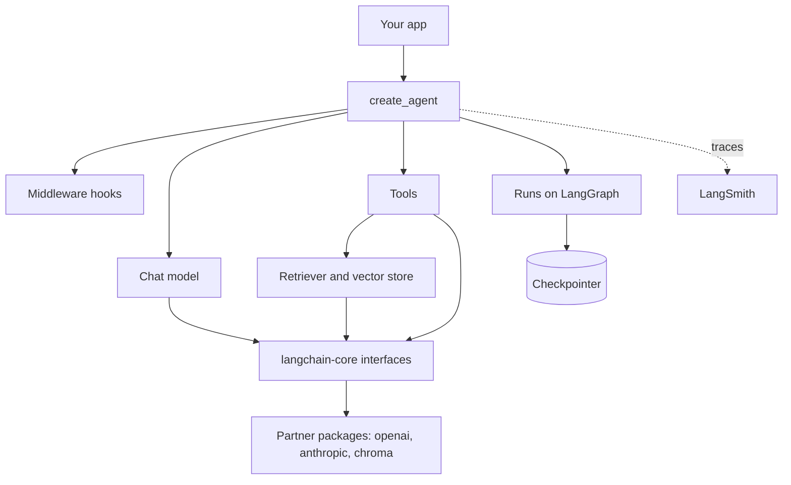

## ⭐ What LangChain is today, and the mental model

**In one line:** LangChain 1.x is a thin, provider-neutral layer for models, messages and tools, plus one prebuilt agent (`create_agent`) that runs on LangGraph and is customised with middleware.

**Why it exists:** Every LLM provider has a different API shape for messages, tool calls, images and streaming. Without a common layer, switching from OpenAI to Claude means rewriting every call. LangChain started in late 2022 (by Harrison Chase, now the company LangChain Inc.) as that common layer plus "chains" of prompts. By 2024 it had grown many overlapping abstractions. Version 1.0 (October 2025) cut it back to one agent abstraction on top of LangGraph.

**Picture it:** A universal travel adapter plus a standard kitchen. The adapter (chat model interface) lets any appliance plug into any country's socket. The kitchen (`create_agent`) has a fixed layout: stove, sink, counter. You do not rebuild the kitchen, you add fittings (middleware) like a chimney or a water filter.

**How it works, step by step:**

1. You pick a model with a string, for example `"openai:gpt-5.5"`. LangChain loads the matching partner package.
2. You write tools as plain Python functions with `@tool`.
3. You call `create_agent(model, tools, ...)`. It builds a small LangGraph graph: a model node and a tools node in a loop.
4. You add middleware for the extra behaviour: summarise long chats, ask a human before refunds, cap model calls.
5. You run it with `invoke` or `stream`. Each step is traced to LangSmith if tracing is on.
6. When you outgrow the prebuilt loop (several agents, fixed branches, parallel steps), you write a LangGraph graph yourself. See [LangGraph Core](02-langgraph-core.md).

| Product | What it is | You use it for |
|---|---|---|
| LangChain (`langchain`) | agent framework: models, tools, `create_agent`, middleware | most agents with one loop and some tools |
| LangGraph (`langgraph`) | low-level runtime: graphs, state, checkpoints, interrupts | custom control flow, multi-agent, durable runs |
| Deep Agents (`deepagents`) | opinionated harness on LangChain agents: planning, virtual files, subagents | long research or coding tasks |
| LangSmith | hosted platform: tracing, evals, prompts, deployment | debugging and measuring any of the above |

**Interview tip:** "LangChain vs LangGraph?" Say: "LangGraph is the runtime: state, graph, checkpoints, interrupts. LangChain 1.x is the higher layer: model and tool integrations plus `create_agent`, which is itself a LangGraph graph. I start with `create_agent` and drop to LangGraph when I need custom control flow."

**Common mistake:**
- Saying "LangChain and LangGraph are competitors". In 1.x, LangChain agents are LangGraph graphs.
- Learning from 2023 blog posts. Most of that API is now in `langchain-classic`.

## ⭐ The package split and what changed in 1.0

**In one line:** LangChain is many small pip packages: `langchain-core` for interfaces, `langchain` for agents, one package per provider, and `langchain-classic` for the old chains.

**Why it exists:** One giant package meant every install pulled hundreds of integrations and every provider change broke someone. Splitting lets each provider package version on its own and keeps `langchain` small. The 1.0 cleanup then moved all legacy code out, so the main package only contains what the team recommends today.

**Picture it:** An IRCTC app that used to ship every train's timetable inside the APK. Now the app is small and downloads only the routes you travel.

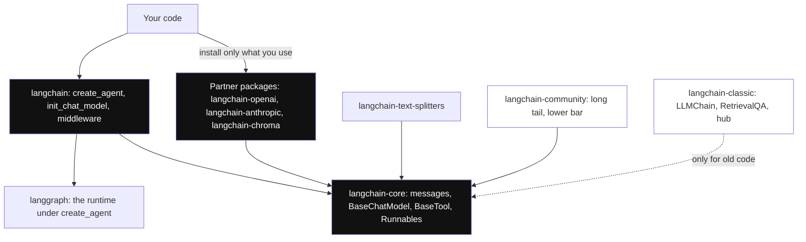

*Diagram:* Everything plugs into the small `langchain-core` interfaces; you install `langchain` plus only the partner packages you use, while the old chains sit apart in `langchain-classic`.

**How it works, step by step:**

1. `langchain-core`: base classes and interfaces. Messages, `BaseChatModel`, `BaseTool`, retrievers, vector store interface, Runnables. Very few dependencies.
2. `langchain`: the agent layer. Namespaces are short: `langchain.agents` (`create_agent`), `langchain.messages`, `langchain.tools`, `langchain.chat_models` (`init_chat_model`), `langchain.embeddings`.
3. Partner packages: `langchain-openai`, `langchain-anthropic`, `langchain-google-genai`, `langchain-chroma`, `langchain-postgres` and many more. Each one is maintained and released separately.
4. `langchain-community`: long tail of community integrations, lower quality bar.
5. `langchain-text-splitters`: chunking utilities like `RecursiveCharacterTextSplitter`.
6. `langchain-classic`: legacy chains (`LLMChain`, `ConversationChain`), the old `langchain.retrievers` module (for example `MultiQueryRetriever`), the indexing API, the hub module, and community re-exports. Install it only for old code.
7. All packages need Python 3.10 or newer.

| Before 1.0 | In 1.x |
|---|---|
| `AgentExecutor`, `initialize_agent`, many agent types | one `create_agent` built on LangGraph |
| `langgraph.prebuilt.create_react_agent(prompt=...)` | `langchain.agents.create_agent(system_prompt=...)` |
| `pre_model_hook`, `post_model_hook` | middleware: `before_model`, `after_model`, `wrap_model_call` |
| `LLMChain`, `RetrievalQA`, `ConversationChain` | moved to `langchain-classic`; use an agent or plain LCEL |
| `message.content` differs per provider | `message.content_blocks`: one standard format for text, reasoning, images, citations |
| `msg.text()` method | `msg.text` property (method form warns) |
| pass per-run data in `config["configurable"]` | still works, but `context=` with a `context_schema` is preferred |
| custom agent state as Pydantic or dataclass | `TypedDict` only for `create_agent` state |

**Interview tip:** "What changed in LangChain 1.0?" Say: "Three things. All chains and agent types collapsed into `create_agent` on LangGraph. Customisation moved to middleware. Messages got standard content blocks across providers. Legacy code went to `langchain-classic`, so the core package is much smaller."

**Common mistake:**
- Importing from `langchain_community` when a maintained partner package exists (`langchain_openai`, `langchain_chroma`).
- Not pinning versions. Partner packages release often; pin them together and upgrade on a branch with evals.

## ⭐ Chat models and `init_chat_model`

**In one line:** A chat model is one object with the same methods for every provider: `invoke`, `stream`, `batch`, `bind_tools` and `with_structured_output`.

**Why it exists:** OpenAI, Anthropic and Google each name things differently (`max_tokens`, `stop_reason`, `tool_use` blocks vs `tool_calls`). A common interface lets you switch models with one string, and run A/B tests or fallbacks without new code.

**Picture it:** A UPI app. Paytm, PhonePe and GPay talk to different banks, but you always see "enter amount, enter PIN". The chat model interface is that screen.

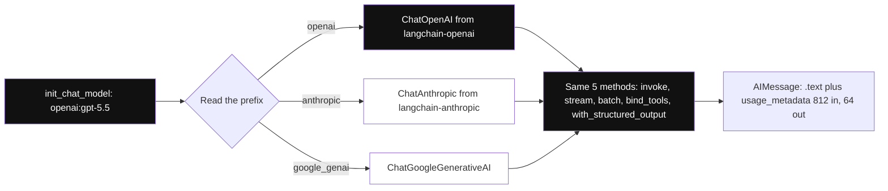

*Diagram:* The prefix picks one partner class (here OpenAI); whichever is picked, your code only ever calls the same five methods.

**How it works, step by step:**

1. `init_chat_model("openai:gpt-5.5")` reads the prefix (`openai`), imports `langchain_openai.ChatOpenAI` and creates it.
2. `model.invoke(messages)` sends the messages and returns an `AIMessage`.
3. `model.stream(messages)` yields small `AIMessageChunk` pieces as tokens arrive.
4. `model.batch([m1, m2, m3])` runs several inputs in parallel threads.
5. `model.bind_tools([...])` attaches tool schemas, so the reply may contain `tool_calls`.
6. `AIMessage.usage_metadata` gives token counts, for example `{"input_tokens": 812, "output_tokens": 64}`. At ₹0.0002 per input token that one call costs about ₹0.16.

```python
from langchain.chat_models import init_chat_model

# The "provider:model" string picks the partner package (needs langchain-openai installed)
model = init_chat_model("openai:gpt-5.5", temperature=0, timeout=30, max_retries=2)

reply = model.invoke("In one line, what is a vector database?")
print(reply.text)                 # .text is a property in 1.x
print(reply.usage_metadata)       # input/output token counts for cost tracking

# Streaming: print tokens as they arrive
for chunk in model.stream("Explain RAG to a 10 year old in 3 lines."):
    print(chunk.text, end="", flush=True)

# Same code, different provider: only the string changes
claude = init_chat_model("anthropic:claude-sonnet-5", max_tokens=1024)
```

**What the code does:**
- `init_chat_model` builds the right provider class from one string.
- `temperature=0`, `timeout` and `max_retries` are common settings every provider class accepts.
- `.text` joins all text parts of the reply; `usage_metadata` is the standard token report.
- `stream` yields chunks; summing chunks gives the full message.
- Switching to Claude is one line. For Anthropic, set `max_tokens` yourself; the 1.x default is no longer fixed at 1024.

**Interview tip:** "How do you switch providers safely?" Say: "Models are created in one place from a config string with `init_chat_model`. I run the eval set on the new model before switching, because prompts and tool-calling behaviour differ between providers even with the same interface."

**Common mistake:**
- Thinking the interface makes models interchangeable. A prompt tuned for one model can drop 10–20 points on another.
- No `timeout`. One slow provider call can hang a request worker for minutes.

## Messages and content blocks

**In one line:** Messages are typed objects (`SystemMessage`, `HumanMessage`, `AIMessage`, `ToolMessage`), and `content_blocks` gives one standard view of text, reasoning, images and tool calls across providers.

**Why it exists:** Modern model replies are not one string. They contain reasoning blocks, citations, server-side tool calls and images, each in a different provider format. Standard blocks let your UI and logs read them the same way whatever the provider.

**Picture it:** A courier waybill. Every courier company has its own form, but Shiprocket gives you one standard label with sender, receiver, weight. `content_blocks` is that label.

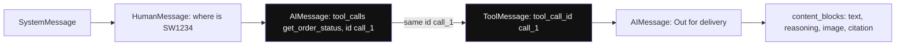

*Diagram:* The tool call and its `ToolMessage` share the id `call_1`, so they must be kept or trimmed together; `content_blocks` gives the same block types whatever the provider.

**How it works, step by step:**

1. A conversation is a list: system, human, AI, tool, AI, and so on.
2. When the model wants a tool, the `AIMessage` has `tool_calls`, for example `[{"name": "get_order_status", "args": {"order_id": "SW1234"}, "id": "call_1"}]`.
3. Your code (or the agent) runs the tool and adds a `ToolMessage` with `tool_call_id="call_1"`.
4. `msg.content` keeps the provider's raw shape. `msg.content_blocks` gives standard blocks like `{"type": "text"}`, `{"type": "reasoning"}`, `{"type": "image"}`.
5. Plain dicts like `{"role": "user", "content": "hi"}` are accepted anywhere and converted.
6. `trim_messages` (in `langchain.messages`) cuts old messages to fit a token budget without splitting a tool call from its result.

**Interview tip:** "Why must every tool call have a matching tool result?" Say: "Providers reject a history where an AI tool call has no `ToolMessage` with the same ID. So trimming must keep pairs together, or the next call fails with a 400 error."

**Common mistake:**
- Trimming history by count and cutting between a tool call and its result.
- Storing LangChain message objects as your database schema. Store your own simple format and convert at the edge.

## ⭐ Tools

**In one line:** A tool is a Python function with a docstring and type hints; `@tool` turns it into a schema the model can call, and `ToolRuntime` gives it safe access to run context and state.

**Why it exists:** Writing JSON schemas by hand for every function is slow and error-prone. Tools also need things the model must not control, like the logged-in `user_id`. Mixing those into model-visible arguments is a security hole.

**Picture it:** A Swiggy delivery partner's app. The partner (model) sees buttons: "mark picked up", "call customer". The app fills in the order ID and partner ID itself. The partner never types them.

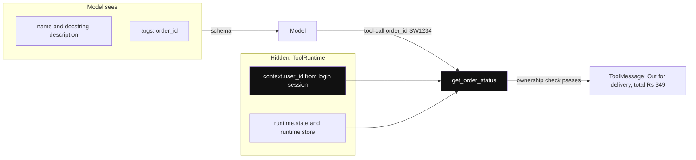

*Diagram:* The model only sees the name, description and `order_id`; `user_id` arrives through `ToolRuntime` from your server, so the model cannot ask for another user's order.

**How it works, step by step:**

1. Write a function with type hints and a clear docstring. The docstring becomes the tool description the model reads.
2. Add `@tool`. LangChain reads the hints and builds the JSON schema.
3. Add a parameter `runtime: ToolRuntime[Context]`. It is hidden from the model. Inside, `runtime.context.user_id`, `runtime.state` and `runtime.store` are available.
4. Pass the tools to `create_agent`. The model sees only name, description and the model-facing arguments.
5. MCP servers can be loaded as LangChain tools through the MCP adapter, so the same agent can use tools from any MCP server.
6. Older code used `InjectedState`, `InjectedStore` or `InjectedToolCallId`. In 1.x use `ToolRuntime` for all of these.

**Interview tip:** "How do you stop the model from reading another user's orders?" Say: "The user ID never comes from model arguments. It comes from `ToolRuntime.context`, which my server fills from the authenticated session. The tool checks ownership before returning data."

**Common mistake:**
- Vague docstrings like "gets data". The model picks tools from descriptions; bad descriptions mean wrong tool calls.
- Returning a 50 KB JSON blob from a tool. Return only the fields the model needs.

## ⭐ `create_agent`

**In one line:** `create_agent(model, tools, system_prompt, middleware, response_format, checkpointer, context_schema)` returns a compiled LangGraph graph that runs the model-tool loop for you.

**Why it exists:** Nearly every agent is the same loop: call model, run tools, repeat. Before 1.0 there were many agent classes with different behaviour. Now there is one, built on LangGraph, so it gets persistence, streaming and human-in-the-loop for free.

**Picture it:** A Zomato cloud-kitchen franchise kit. Every outlet gets the same layout and process. You choose the menu (tools) and the head chef (model), and add rules on the wall (middleware).

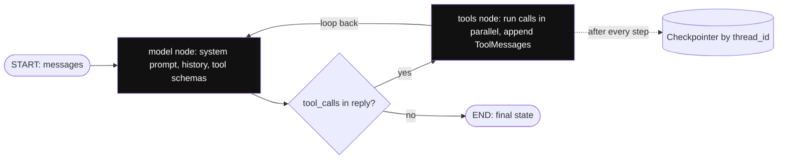

*Diagram:* `create_agent` compiles exactly this two-node LangGraph loop: model, tools, model, until a reply has no tool calls.

**How it works, step by step:**

1. The graph has a `model` node and a `tools` node. Middleware can add nodes before and after them.
2. Input: `{"messages": [...]}`. State: at least `messages`, plus fields your middleware adds.
3. The model node calls the model with the system prompt, history and tool schemas.
4. If the reply has tool calls, the tools node runs them (in parallel when there are several) and appends `ToolMessage`s.
5. Loop back to the model. When the reply has no tool calls, the run ends.
6. With a `checkpointer` and `thread_id`, state is saved after every step. With `response_format`, the final state also has `structured_response`.
7. Because the result is a LangGraph graph, you can add it as a node or subgraph inside a bigger graph.

**Interview tip:** "What does `create_agent` return?" Say: "A compiled LangGraph `StateGraph`. So it supports `invoke`, `stream`, `ainvoke`, checkpointers, interrupts and LangSmith Studio, exactly like a graph I would write by hand."

**Common mistake:**
- Passing a model that already has tools bound. In 1.x pass the plain model and the tools list separately.
- Giving the agent 40 tools. Accuracy drops as tool count grows; split by domain or use a tool-selector middleware.

## ⭐ Middleware

**In one line:** Middleware are hooks that run at fixed points of the agent loop (before or after the agent, before or after each model call, or wrapped around each model or tool call) to change prompts, state or control flow.

**Why it exists:** The old criticism was: "the prebuilt agent works until you need one small change, then you must rewrite everything". Middleware is the answer. Summarisation, approvals, retries, PII masking and dynamic prompts become plug-ins on the same loop, not forks of it.

**Picture it:** Security checks at an airport. Same journey for every passenger, but there is a check before boarding (before_model), a check on arrival (after_model), and a scanner the bag passes through (wrap_tool_call). You add or remove checks without rebuilding the airport.

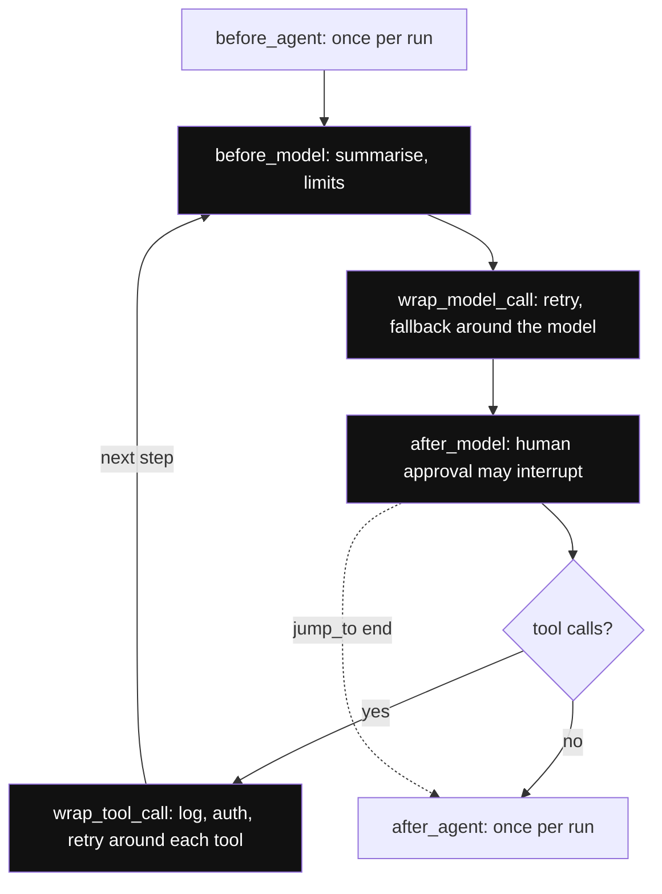

*Diagram:* Node hooks sit before and after the model node, wrap hooks surround every model and tool call; with `middleware=[a, b, c]` before-hooks run a, b, c and after-hooks run c, b, a.

**How it works, step by step:**

1. Node-style hooks: `before_agent`, `before_model`, `after_model`, `after_agent`. They read state and return a state update, or `{"jump_to": "end"}` to stop.
2. Wrap-style hooks: `wrap_model_call` and `wrap_tool_call`. They get the request and a `handler`. Call the handler zero, one or many times (for example, retry 3 times, or swap the model).
3. `@dynamic_prompt` builds the system prompt per call, for example from `request.runtime.context.user_role`.
4. Order: with `middleware=[a, b, c]`, before-hooks run a, b, c; after-hooks run c, b, a; wrap-hooks nest so `a` wraps everything.
5. Built-in middleware cover common needs:

| Middleware | What it does | Example setting |
|---|---|---|
| `SummarizationMiddleware` | summarises old messages near a token limit | `trigger=("tokens", 4000), keep=("messages", 20)` |
| `HumanInTheLoopMiddleware` | pauses before chosen tools for approve, edit or reject | `interrupt_on={"issue_refund": True}` |
| `ModelCallLimitMiddleware` | caps model calls per run or per thread | `run_limit=8` |
| `ToolCallLimitMiddleware` | caps tool calls, globally or for one tool | `tool_name="search", run_limit=3` |
| `ModelFallbackMiddleware` | tries backup models when the main one fails | `"openai:gpt-5.4-mini"` |
| `ToolRetryMiddleware` / model retry | retries with exponential backoff | `max_retries=3` |
| `PIIMiddleware` | detects and redacts, masks or blocks PII | email, credit card |
| `LLMToolSelectorMiddleware` | a cheap model picks the relevant tools first | many tools |
| `TodoListMiddleware`, `ContextEditingMiddleware` | planning list; clearing old tool outputs | long tasks |

```python
from langchain.agents.middleware import before_model, wrap_tool_call, AgentState
from langgraph.runtime import Runtime

@before_model(can_jump_to=["end"])
def stop_long_chats(state: AgentState, runtime: Runtime):
    if len(state["messages"]) > 60:                    # safety valve on runaway threads
        return {"messages": [{"role": "assistant",
                              "content": "Let me connect you to a human agent."}],
                "jump_to": "end"}
    return None                                         # None = no change

@wrap_tool_call
def log_tools(request, handler):
    print("tool:", request.tool_call["name"], request.tool_call["args"])
    return handler(request)                             # run the real tool
```

**What the code does:**
- `stop_long_chats` runs before every model call and ends the run if the thread is too long.
- `can_jump_to=["end"]` declares the jump, so the graph has that edge.
- `log_tools` wraps every tool call; you could add timing, auth checks or caching here.
- Both are passed as `middleware=[stop_long_chats, log_tools]` to `create_agent`.

**Interview tip:** "How would you add human approval for refunds above ₹500 only?" Say: "`HumanInTheLoopMiddleware` gates a tool by name. For an amount rule I would write a small `wrap_tool_call` or `after_model` middleware that checks the args and calls `interrupt` only when the amount is over ₹500. A checkpointer is required so the paused run survives."

**Common mistake:**
- Forgetting a checkpointer with `HumanInTheLoopMiddleware`; the run cannot resume after the pause.
- Putting business logic in middleware that belongs in the tool. Middleware is for cross-cutting concerns.

## Structured output

**In one line:** Pass a schema as `response_format` (or call `model.with_structured_output(Schema)`) and LangChain returns a validated object in `structured_response`.

**Why it exists:** Downstream code needs fields, not prose. "The refund is probably ₹349" cannot go into a database. A schema with `amount: int` can.

**Picture it:** A bank form with boxes for each field instead of a blank page. The clerk can process it without reading an essay.

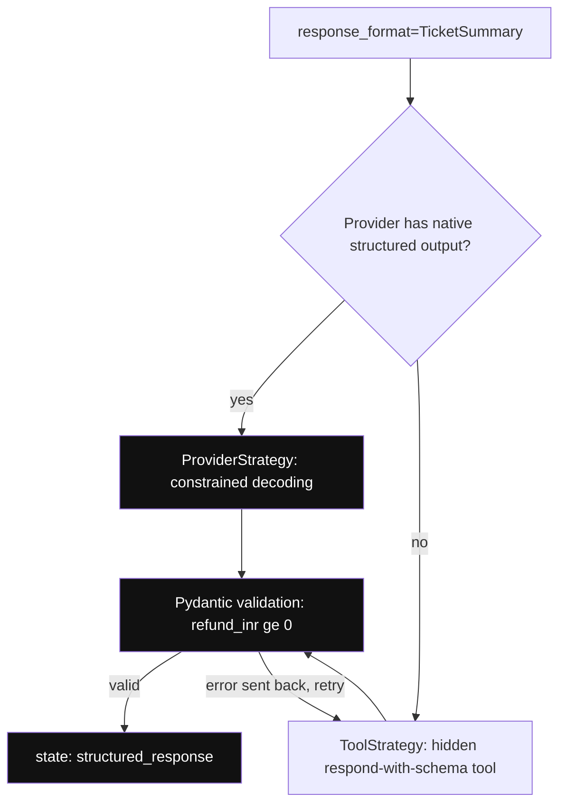

*Diagram:* LangChain picks the native path when the provider supports it; only the tool path can fail validation and loop back for a retry.

**How it works, step by step:**

1. Define a Pydantic model, dataclass, TypedDict or JSON schema.
2. Pass it as `response_format=Schema`. LangChain picks a strategy:
   - `ProviderStrategy`: the provider's native structured output (OpenAI, Anthropic, xAI and others that support it). Strongest guarantee.
   - `ToolStrategy`: a hidden "respond with this schema" tool for models without native support.
3. A plain JSON-schema dict must be wrapped in one of the two strategies explicitly.
4. The output is validated. With `ToolStrategy`, a validation error is sent back to the model to retry.
5. Read `result["structured_response"]`.
6. For a single call without an agent, use `model.with_structured_output(Schema).invoke(...)`.

```python
from pydantic import BaseModel, Field
from langchain.agents import create_agent

class TicketSummary(BaseModel):
    category: str = Field(description="late_delivery, missing_item, refund or other")
    order_id: str | None
    refund_inr: int = Field(ge=0, description="0 if no refund")

agent = create_agent("openai:gpt-5.5", tools=[], response_format=TicketSummary)
out = agent.invoke({"messages": [{"role": "user",
        "content": "Order SW1234 came without the raita, please refund 40 rupees"}]})
print(out["structured_response"])   # TicketSummary(category='missing_item', order_id='SW1234', refund_inr=40)
```

**What the code does:**
- The Pydantic class is the contract; `Field` descriptions guide the model.
- `response_format=TicketSummary` lets LangChain choose native or tool strategy from the model's profile.
- `ge=0` is enforced by validation, not just by the prompt.
- The parsed object sits next to `messages` in the final state.

**Interview tip:** "Native structured output vs tool-based?" Say: "Native uses the provider's constrained decoding, so the JSON always parses. The tool strategy works on any tool-calling model but relies on the model following the schema, with retries on errors. I prefer native when the provider supports it." See [Structured Outputs and Prompt Optimization](17-structured-outputs-prompting.md).

**Common mistake:**
- Asking for JSON in the prompt and parsing with regex. Use a schema.
- Huge nested schemas. Each extra level adds failures; keep it flat.

## Retrievers, vector stores and RAG

**In one line:** LangChain gives one interface for embeddings, vector stores and retrievers, so a RAG search can become a tool your agent calls.

**Why it exists:** There are dozens of vector databases. A common `VectorStore` interface (`add_documents`, `similarity_search`, `as_retriever`) means you can prototype with an in-memory store and move to pgvector or Pinecone by changing one class. See [What is RAG](../09-rag/01-what-is-rag.md).

**Picture it:** A library catalogue system that works the same whether the books are in a small school library or the National Library.

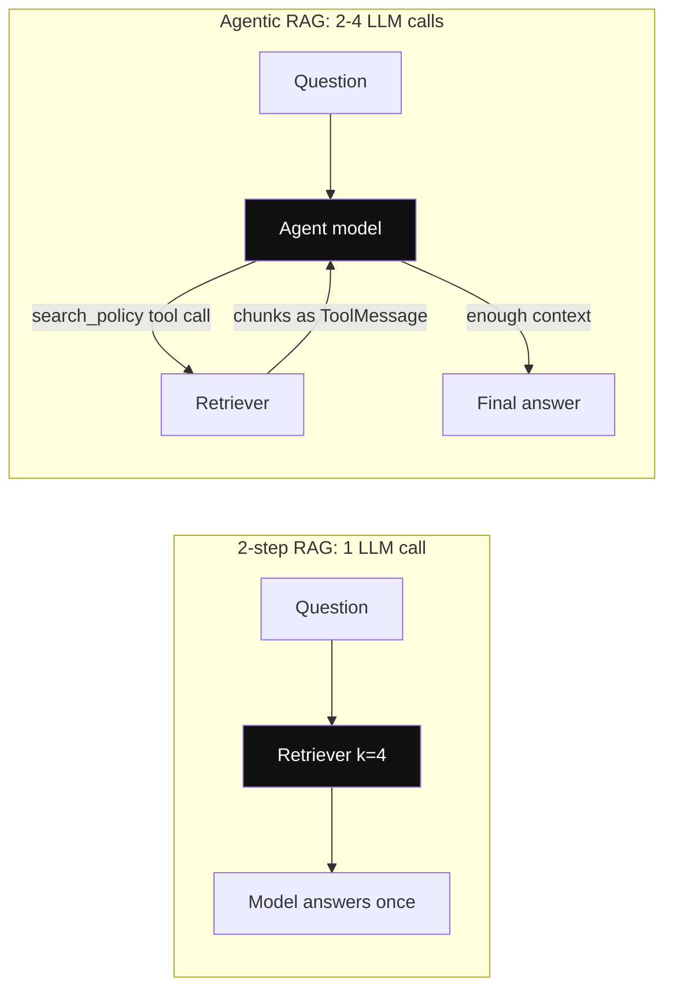

*Diagram:* Left: retrieval always runs once before a single model call. Right: the agent decides when and how often to search, which costs more calls but handles comparisons.

**How it works, step by step:**

1. Load files with a document loader into `Document(page_content, metadata)` objects.
2. Split with `RecursiveCharacterTextSplitter(chunk_size=1000, chunk_overlap=200)` from `langchain-text-splitters`. A 40-page policy of about 100,000 characters becomes roughly 120 chunks. See [Chunking](../09-rag/03-chunking.md).
3. Embed and store: `vector_store.add_documents(chunks)` with an embeddings model like `OpenAIEmbeddings`.
4. `vector_store.as_retriever(search_kwargs={"k": 4})` gives a retriever. A retriever is a Runnable: `retriever.invoke("refund window")`.
5. Two ways to use it:
   - **2-step RAG:** always retrieve, then call the model once. Fast and predictable.
   - **Agentic RAG:** wrap the search in a `@tool`; the agent decides when and what to search, maybe several times.
6. Advanced retrievers like `MultiQueryRetriever` now live in `langchain-classic`. Hybrid search and reranking are usually done by your vector DB or a reranker integration. See [Hybrid Search](../09-rag/04-hybrid-search.md).

| | 2-step RAG | Agentic RAG |
|---|---|---|
| LLM calls per question | 1 | 2–4 |
| Latency | low | higher |
| Handles "compare policy A and B" | weak | good |
| Predictability | high | lower |

**Interview tip:** "LangChain or LlamaIndex for RAG?" Say: "LangChain's retrieval layer is fine for standard pipelines. If ingestion and retrieval quality are the hard part, with messy PDFs and many index types, LlamaIndex goes deeper. They mix well: a LlamaIndex query engine can be a tool in a LangChain agent." See [LlamaIndex](24-llamaindex.md).

**Common mistake:**
- Using `InMemoryVectorStore` in production; it is gone on restart.
- Changing the embedding model without re-embedding everything. Old and new vectors are not comparable.

## LCEL and Runnables, where they stand now

**In one line:** Runnables (`invoke`, `stream`, `batch`, async) are still the base interface of every model, retriever and tool; LCEL `prompt | model | parser` pipelines still work, but for agents the recommended path is `create_agent` or LangGraph.

**Why it exists:** In 2023 LangChain introduced LCEL so any chain gets streaming, batching, async and tracing for free by composing Runnables with `|`. Teams then built complex branching logic in LCEL, which was hard to read and debug. LangGraph took over control flow; LCEL stayed for short, linear pipelines.

**Picture it:** A pipe fitting system. Great for connecting a tap, a filter and a bottle in a line. Bad for building a whole house's plumbing with loops and valves; for that you want a proper plan (LangGraph).

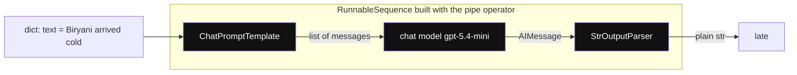

*Diagram:* Each pipe passes one Runnable's output type to the next (dict, messages, AIMessage, str); the whole box is itself one Runnable with `invoke`, `batch` and `stream`.

**How it works, step by step:**

1. Every Runnable has `invoke`, `batch`, `stream`, `ainvoke`, `abatch`, `astream`.
2. `a | b` makes a `RunnableSequence`: output of `a` is input to `b`.
3. `RunnableParallel({"context": retriever, "question": RunnablePassthrough()})` runs branches side by side.
4. The whole chain streams and traces as one unit.
5. Use it for: a summariser, a classifier, a 2-step RAG chain, an evaluation pipeline.
6. Do not use it for: loops, tool-calling agents, human approval, anything that must resume after a crash.

```python
from langchain_core.prompts import ChatPromptTemplate
from langchain_core.output_parsers import StrOutputParser
from langchain.chat_models import init_chat_model

prompt = ChatPromptTemplate.from_messages([
    ("system", "Classify the complaint into one word: late, missing, quality, other."),
    ("human", "{text}"),
])
classify = prompt | init_chat_model("openai:gpt-5.4-mini", temperature=0) | StrOutputParser()

print(classify.invoke({"text": "Biryani arrived cold after 70 minutes"}))   # late
print(classify.batch([{"text": "No spoon"}, {"text": "Too salty"}]))       # parallel calls
```

**What the code does:**
- `ChatPromptTemplate` fills `{text}` into a message list.
- `|` chains prompt, model and parser into one Runnable.
- `StrOutputParser` turns the `AIMessage` into a plain string.
- `batch` runs inputs in parallel, useful for offline labelling jobs.

**Interview tip:** "Is LCEL dead?" Say: "No, Runnables are still the core interface and LCEL is fine for short linear chains. But it is no longer the way to build agents. Control flow belongs in LangGraph or `create_agent`, which is easier to read, test and persist."

**Common mistake:**
- Building branching, retry and loop logic in LCEL with `RunnableBranch` and lambdas. It becomes unreadable.
- Thinking LCEL means "LangChain". Interviewers who used LangChain in 2024 may mean LCEL; ask which version.

## ⭐ A complete small app: Swiggy order support bot

**In one line:** One agent that answers order-status questions, looks up the refund policy with RAG, and issues refunds only after a human approves, with summarisation and a call cap.

**Why it exists:** This one example uses every block above: chat model, tools with runtime context, a retriever tool, `create_agent`, built-in middleware, a checkpointer and human-in-the-loop.

**Picture it:** A Swiggy support desk with a policy binder, an order lookup screen, and a supervisor who must sign every refund.

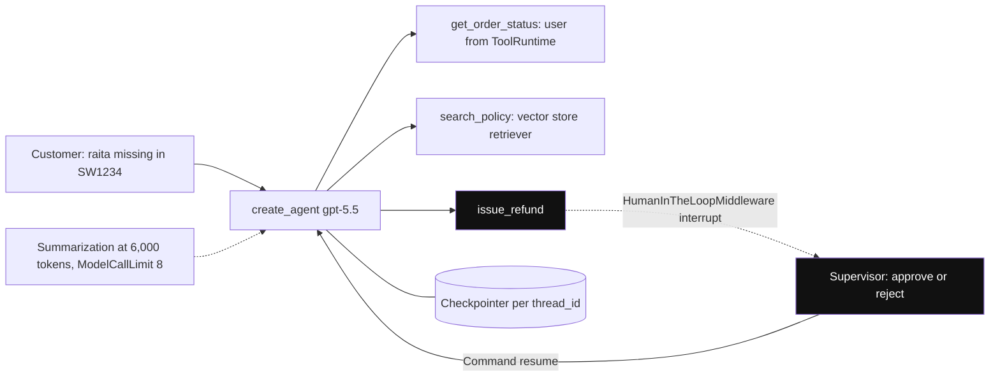

*Diagram:* Two tools run freely; `issue_refund` pauses the run until a supervisor answers, and the checkpointer is what lets it resume.

**How it works, step by step:**

1. Build a small policy vector store (block 1).
2. Write three tools: `search_policy`, `get_order_status`, `issue_refund` (block 2).
3. Create the agent with middleware and a checkpointer (block 3).
4. Run it; it pauses on the refund; a human approves; it resumes (block 4).

**Block 1: the policy knowledge base.**

```python
from langchain_core.documents import Document
from langchain_core.vectorstores import InMemoryVectorStore
from langchain_openai import OpenAIEmbeddings
from langchain_text_splitters import RecursiveCharacterTextSplitter

policy_text = open("swiggy_refund_policy.md").read()          # ~40 pages in real life
docs = [Document(page_content=policy_text, metadata={"source": "refund_policy"})]
chunks = RecursiveCharacterTextSplitter(chunk_size=800, chunk_overlap=100).split_documents(docs)

store = InMemoryVectorStore(OpenAIEmbeddings(model="text-embedding-3-small"))
store.add_documents(chunks)                                    # embeds and stores each chunk
retriever = store.as_retriever(search_kwargs={"k": 3})
```

**What the code does:**
- Wraps the policy file as one `Document` with source metadata.
- Splits it into ~800-character chunks with 100 overlap, so sentences at edges are not lost.
- Embeds each chunk and stores it in memory (swap for `langchain-postgres` PGVector in production).
- `as_retriever` returns the top 3 chunks for any query.

**Block 2: tools.**

```python
from dataclasses import dataclass
from langchain.tools import tool, ToolRuntime

@dataclass
class Ctx:
    user_id: str                                    # set by our server from the login session

ORDERS = {"SW1234": {"user": "u42", "status": "delivered", "total": 349}}

@tool
def search_policy(query: str) -> str:
    """Search Swiggy's refund and delivery policy. Use for any policy question."""
    return "\n\n".join(d.page_content for d in retriever.invoke(query))

@tool
def get_order_status(order_id: str, runtime: ToolRuntime[Ctx]) -> str:
    """Get status and total for one of the current user's orders."""
    o = ORDERS.get(order_id)
    if not o or o["user"] != runtime.context.user_id:    # ownership check, not model-controlled
        return "Order not found for this user."
    return f"{order_id}: {o['status']}, total Rs {o['total']}"

@tool
def issue_refund(order_id: str, amount_inr: int) -> str:
    """Refund an amount in rupees for an order. Needs human approval."""
    return f"Refund of Rs {amount_inr} issued for {order_id}."
```

**What the code does:**
- `Ctx` holds data the model must not invent; `runtime` is hidden from the model's schema.
- `search_policy` turns the retriever into a tool, so this is agentic RAG.
- `get_order_status` checks the order belongs to the logged-in user.
- Docstrings are the descriptions the model uses to pick tools.

**Block 3: the agent.**

```python
from langchain.agents import create_agent
from langchain.agents.middleware import (
    HumanInTheLoopMiddleware, SummarizationMiddleware, ModelCallLimitMiddleware)
from langgraph.checkpoint.memory import InMemorySaver

agent = create_agent(
    model="openai:gpt-5.5",
    tools=[search_policy, get_order_status, issue_refund],
    system_prompt=("You are Swiggy support. Check the order and the policy before any refund. "
                   "Never promise more than the policy allows."),
    context_schema=Ctx,
    middleware=[
        HumanInTheLoopMiddleware(interrupt_on={"issue_refund": {"allowed_decisions": ["approve", "reject"]}}),
        SummarizationMiddleware(model="openai:gpt-5.4-mini", trigger=("tokens", 6000), keep=("messages", 20)),
        ModelCallLimitMiddleware(run_limit=8),        # hard cap per user message
    ],
    checkpointer=InMemorySaver(),                     # PostgresSaver in production
)
```

**What the code does:**
- Pauses before `issue_refund`; the human can only approve or reject, not edit.
- Summarises old turns with a cheaper model once the thread passes 6,000 tokens.
- Stops a run after 8 model calls, so a confused loop cannot burn money.
- The checkpointer saves state per `thread_id`, which the pause and resume need.

**Block 4: run, pause, approve, resume.**

```python
from langgraph.types import Command

cfg = {"configurable": {"thread_id": "chat-9001"}}
ctx = Ctx(user_id="u42")

out = agent.invoke({"messages": [{"role": "user",
        "content": "SW1234 was missing raita worth 40 rupees, refund please"}]}, cfg, context=ctx)

if "__interrupt__" in out:                            # paused before issue_refund
    print("Needs approval:", out["__interrupt__"][0].value)
    out = agent.invoke(Command(resume={"decisions": [{"type": "approve"}]}), cfg, context=ctx)

print(out["messages"][-1].text)                       # "Done, Rs 40 refunded for SW1234."
```

**What the code does:**
- The first call runs get_order_status and search_policy, then stops before the refund.
- `__interrupt__` holds the pending tool call for a supervisor UI.
- `Command(resume=...)` with the same `thread_id` continues from the saved checkpoint.
- In a real app the approve call comes hours later from another request; the checkpointer makes that work.

**Interview tip:** "Walk me through how you'd build a support agent with LangChain." Use this exact order: tools with ownership checks, retriever tool for policy, `create_agent`, middleware for approval, summarisation and limits, Postgres checkpointer, LangSmith tracing, an eval set of 50 real tickets.

**Common mistake:**
- Letting the model pass `user_id` as a tool argument.
- Testing only the happy path. Add tickets where the refund should be refused.

## ⭐ How it works inside: one run, step by step

**In one line:** One `invoke` is a LangGraph run: middleware hooks, a model call with tool schemas, tool execution, state saved after each step, repeat until the model stops calling tools.

**Why it exists:** When an agent misbehaves you must know which step to look at: the prompt that was sent, the tool args, or the state after a hook. Knowing the internal path makes debugging fast.

**Picture it:** A train journey with stations. At each station (step) the ticket checker stamps the ticket (checkpoint). If the train stops, you restart from the last stamped station.

**How it works, step by step:**

1. `invoke` loads the thread's last checkpoint (empty for a new thread) and appends the new human message.
2. `before_agent` hooks run once. Then `before_model` hooks run (summarisation may replace old messages here).
3. The model node builds the request: system prompt (or `dynamic_prompt` result), message history, tool schemas, and the structured-output schema if any. `wrap_model_call` hooks wrap the call (retries, fallback).
4. The provider returns an `AIMessage`. `after_model` hooks run (human-in-the-loop checks tool calls here and may `interrupt`).
5. If there are tool calls, the tools node runs each through `wrap_tool_call` hooks and appends `ToolMessage`s. Checkpoint saved.
6. Back to step 2. No tool calls means done: `after_agent` hooks run and the final state returns.
7. For the Swiggy example: 3 model calls (plan, then after order check, then after policy), 2 tool calls, 1 interrupt, then 1 more model call after approval. About 6,000 input tokens in total.

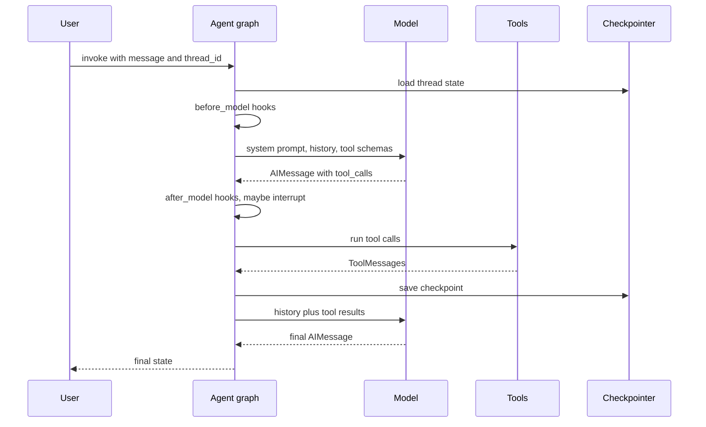

**Interview tip:** "How would you debug an agent that keeps calling the wrong tool?" Say: "Open the LangSmith trace and read the exact model request: tool descriptions, system prompt and history. Usually two tools have overlapping descriptions or the history is cluttered. I fix descriptions, reduce tools, add a few examples, then rerun the eval set to confirm."

**Common mistake:**
- Debugging from the final answer only. The bug is almost always visible in one intermediate message.
- Forgetting that summarisation changes what the model sees; check the post-hook messages, not the raw thread.

## Production concerns

**In one line:** In production you add a durable checkpointer, streaming, LangSmith tracing and evals, limits on calls and cost, and a deployment target.

**Why it exists:** The demo agent works on a laptop. Production needs runs that survive restarts, a UI that shows progress, a way to see why answer #4,512 was wrong, and a bill that does not surprise finance.

**Picture it:** Moving from a home tiffin service to a licensed restaurant: fridge logs, CCTV, a cash register and fire safety, not just good food.

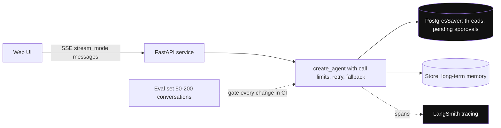

*Diagram:* The laptop demo becomes production when state moves to Postgres, every step is traced, and an eval set gates changes.

**How it works, step by step:**

1. **Persistence:** `PostgresSaver` (or another LangGraph checkpointer) for threads; a LangGraph `Store` for long-term memory across threads. See [Memory & Context](05-memory-context.md).
2. **Streaming:** `agent.stream(input, cfg, stream_mode="messages")` for tokens, `"updates"` for step-by-step progress. In 1.x streamed node names are `model` and `tools` (old code matched `agent`).
3. **Tracing:** set `LANGSMITH_TRACING=true` and `LANGSMITH_API_KEY`. Every model call, tool call and middleware step becomes a span. OpenTelemetry export is available if you use another backend. See [AI Observability](10-agent-observability.md).
4. **Evals:** keep a dataset of 50–200 real conversations; run LangSmith `evaluate` (or your own runner) with code checks and LLM-judge scores on every prompt or model change. See [Evals for Agents](09-agent-evals.md).
5. **Deployment:** any Python web server (FastAPI) works; LangSmith Deployment (formerly LangGraph Platform) hosts agents with built-in task queues, persistence and streaming APIs.
6. **Cost and latency:** `ModelCallLimitMiddleware`, a cheaper model for summarisation and tool selection, prompt caching by keeping the system prompt and tool list stable. A run with 4 model calls at about 3,000 input tokens each is 12,000 tokens; at ₹0.0002 per token that is about ₹2.4 per ticket. See [Cost & Latency](11-cost-latency.md).
7. **Failure modes:** provider timeouts (retry and fallback middleware), tool exceptions (tool error or retry middleware returns the error to the model), infinite loops (call limits), version drift (pin packages).

**Interview tip:** "How do you make a LangChain agent production-ready?" Say: "Postgres checkpointer, streaming to the UI, LangSmith tracing, call and tool limits, retries with fallback models, PII middleware where needed, pinned versions, and an eval set that runs in CI before any change ships."

**Common mistake:**
- `InMemorySaver` in production. Every deploy wipes all threads and pending approvals.
- No eval set, so a minor `langchain-openai` upgrade silently changes behaviour.

## ⭐ When to use it, and how it compares

**In one line:** Use LangChain when you want a standard tool-calling agent with many integrations and a clear upgrade path to LangGraph; skip it for tiny scripts or when you want the thinnest possible layer over one provider.

**Why it exists:** "Why LangChain?" is a favourite interview question, usually followed by "isn't it too much abstraction?". You need a fair answer, not a fan answer.

**Picture it:** Choosing between Ola, a rented car and your own scooter. Each is right for some trips.

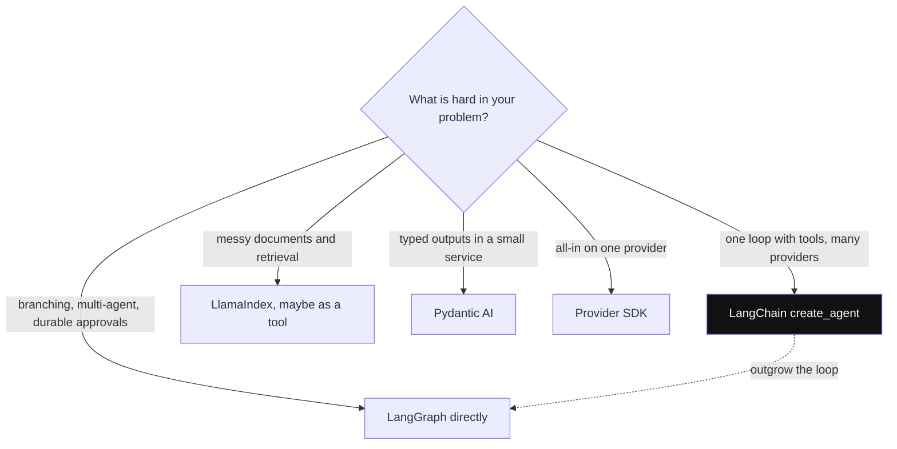

*Diagram:* Pick by the hard part of the problem; a `create_agent` app can drop one level to LangGraph without a rewrite.

**How it works, step by step:**

1. Ask what is hard in your problem: control flow, data, typing, or provider features.
2. If it is one agent loop with tools and you want provider freedom: `create_agent`.
3. If it is complex branching, multi-agent or long-running with approvals: LangGraph directly.
4. If it is ingestion and retrieval over messy documents: LlamaIndex, maybe as a tool.
5. If it is typed outputs and dependency injection in a small service: Pydantic AI. See [DSPy and Pydantic AI](30-dspy-pydantic-ai.md).
6. If you are all-in on one provider: that provider's SDK (OpenAI Agents SDK, Claude Agent SDK).

| | LangChain 1.x | LangGraph | LlamaIndex | OpenAI Agents SDK |
|---|---|---|---|---|
| Main idea | prebuilt agent plus middleware | explicit graph you design | data and retrieval first | agents, handoffs, guardrails |
| Control flow | fixed loop, hooks | anything | Workflows (events) | loop plus handoffs |
| Integrations | largest catalogue | uses LangChain's | very large for data | fewer, OpenAI-centred |
| Persistence | via LangGraph checkpointer | built in | serialise Context | sessions |
| Learning curve | low-medium | medium-high | medium | low |
| Best for | standard tool agents, many providers | custom, durable flows | RAG-heavy apps | OpenAI shops, quick agents |

**The "too much abstraction" criticism, and how 1.x answered it.** The 2023–2024 complaints were real: many classes doing similar things, deep inheritance, hidden prompts, stack traces through ten layers, frequent breaking changes. Version 1.x answered with:
- One agent abstraction instead of many chain and agent classes.
- Legacy code moved out to `langchain-classic`.
- Customisation through small middleware hooks instead of subclassing.
- No hidden prompts in the agent: you write the system prompt; tool schemas come from your functions.
- A stability promise: no breaking changes until 2.0.
- LangGraph underneath, so you can always drop one level down instead of fighting the abstraction.

A fair answer still admits the cost: one more dependency that changes often, and a layer between you and the provider's newest features.

**Interview tip:** "Isn't LangChain too much abstraction?" Say: "It was, before 1.0. In 1.x the agent is one function on LangGraph, customised with middleware, and the old chains are in a separate package. I use it for integrations and the agent loop, keep my tools as plain functions, and drop to LangGraph or the raw SDK when I need control. Tracing shows me every raw request, so nothing is truly hidden."

**Common mistake:**
- Picking LangChain because "everyone uses it" without naming what it gives you.
- Mixing `langchain-classic` chains and new agents in one codebase for years. Migrate.

## Common pitfalls in real projects

**In one line:** Most LangChain bugs come from old tutorials, version mismatches, unsafe tool inputs and missing limits, not from the model.

**Why it exists:** These come up in code reviews and in "tell me about a problem you hit" interview answers.

**Picture it:** Driving with an old Google Maps download. The roads changed, and you keep taking closed exits.

**How it works, step by step:**

1. **Old imports.** `from langchain.chains import LLMChain` fails on 1.x. Use `create_agent`, LCEL, or `langchain_classic`.
2. **Mismatched versions.** `langchain` 1.x with an old `langchain-openai` 0.x causes odd errors. Upgrade them together.
3. **Sync in async servers.** Calling `invoke` inside FastAPI async routes blocks the event loop; use `ainvoke` and `astream`.
4. **Tool errors crash the run.** Use tool-error or retry middleware so the model sees "error: order service timeout" and can respond.
5. **Unbounded loops.** No `ModelCallLimitMiddleware` and no recursion limit, so a confused agent makes 25 calls.
6. **Huge state.** Putting full PDFs in state; every checkpoint copies them. Store IDs, not blobs.
7. **Prompt-cache misses.** Changing tool order or adding timestamps to the system prompt on every call breaks the provider's prefix cache.
8. **Streaming name changes.** UI code that filtered stream events by node `"agent"` breaks in 1.x where it is `"model"`.

**Interview tip:** "Tell me about a LangChain issue you debugged." Pick one real pattern, for example: "Upgrading to 1.x broke our UI streaming because node names changed from `agent` to `model`. We caught it in a staging eval run, fixed the filter, and added a test on stream events."

**Common mistake:**
- Copying code from a 2023 blog post into a 2026 codebase.
- Catching all exceptions inside tools and returning "success", hiding failures from both the model and you.

## Interview questions

**Q: What is LangChain in one sentence, in its 1.x form?**
A: A provider-neutral layer for chat models, messages and tools, plus `create_agent`, a prebuilt tool-calling agent that runs on LangGraph and is customised with middleware.

**Q: What changed in LangChain 1.0?**
A: All chains and agent classes were replaced by `create_agent` on LangGraph, customisation moved to middleware, messages got standard `content_blocks`, and legacy code moved to `langchain-classic`. Python 3.10+ is required.

**Q: LangChain vs LangGraph vs LangSmith?**
A: LangGraph is the runtime (graph, state, checkpoints, interrupts). LangChain is the higher-level framework on top (integrations plus `create_agent`). LangSmith is the platform for tracing, evals and deployment, and works with any of them.

**Q: What is middleware and why was it added?**
A: Hooks at fixed points of the agent loop: before or after the model, around model or tool calls. It lets you add summarisation, approvals, retries, limits and PII handling without forking the agent, which was the main pain of the old prebuilt agents.

**Q: How do you get guaranteed JSON from an agent?**
A: Pass a Pydantic schema as `response_format`. LangChain uses the provider's native structured output when supported (`ProviderStrategy`), otherwise a hidden tool (`ToolStrategy`) with validation and retry. Read `structured_response`.

**Q: Is LCEL still relevant?**
A: Runnables are still the core interface for models, retrievers and tools, and `prompt | model | parser` is fine for short linear chains. Agents and branching flows should use `create_agent` or LangGraph.

**Q: How do you pass the logged-in user to a tool safely?**
A: Define a `context_schema`, pass `context=` at invoke time from the authenticated session, and read it through `ToolRuntime` in the tool. The model never sees or sets it.

**Q: How would you debug an agent that calls the wrong tool?** (debugging)
A: Read the LangSmith trace for the exact request: tool descriptions, history, system prompt. Fix overlapping descriptions, cut tool count or add an LLM tool-selector middleware, then rerun the eval set.

**Q: How do you make it production-ready?**
A: Postgres checkpointer, streaming, LangSmith tracing, call and tool limits, retry and fallback middleware, PII handling, pinned versions, and evals in CI.

**Q: "LangChain is too much abstraction." Respond.** (trade-off)
A: Fair for 0.x. In 1.x there is one agent function, middleware for changes, and LangGraph underneath when you need full control. I keep tools as plain functions and models behind one factory, so leaving costs days, not months.

**Q: When would you not use LangChain?**
A: A single provider with a 30-line loop, a latency-critical hot path, or a team that cannot absorb dependency churn. Then I use the provider SDK directly with my own step cap and tracing.

**Q: 2-step RAG chain or agentic RAG?** (trade-off)
A: 2-step is one LLM call, cheap and predictable, good for single-fact questions. Agentic RAG lets the model search several times and compare, at 2–4x the calls. Start with 2-step and switch when evals show multi-hop questions failing.

**Q: Your team has a 2024 codebase on `AgentExecutor`. Plan the migration.** (what would you do)
A: Freeze versions, build an eval set from production logs, rewrite the agent with `create_agent` and middleware for custom hooks, keep any old chains on `langchain-classic` temporarily, compare evals, then roll out behind a flag.

**Q: What is Deep Agents and when would you use it?**
A: An opinionated harness on top of LangChain agents with planning, a virtual filesystem and subagents. Use it for long research or coding tasks where you want those built in; use plain `create_agent` when you want full control.

**Q: How do you cap cost per conversation?**
A: `ModelCallLimitMiddleware` and `ToolCallLimitMiddleware` per run and per thread, summarisation with a cheap model, stable prompt prefix for caching, and alerts on tokens per thread from LangSmith.

## Read next

- [Agent Frameworks and Tooling](19-agent-frameworks.md)
- [LangGraph Core](02-langgraph-core.md)
- [LlamaIndex](24-llamaindex.md)
- [OpenAI Agents SDK](27-openai-agents-sdk.md)

## Checklist

- [ ] I can explain what LangChain 1.x is and how it relates to LangGraph and LangSmith.
- [ ] I can list what changed in 1.0 and what moved to `langchain-classic`.
- [ ] I can create a chat model with `init_chat_model` and switch providers with one string.
- [ ] I can write a tool that reads the user ID from `ToolRuntime` context instead of model arguments.
- [ ] I can explain what `create_agent` builds and walk through one run step by step.
- [ ] I can name the middleware hook types and pick built-in middleware for approval, summarisation and limits.
- [ ] I can get validated structured output and explain native vs tool strategy.
- [ ] I can explain where LCEL still fits and where LangGraph is better.
- [ ] I can answer the "too much abstraction" criticism and compare LangChain with LangGraph, LlamaIndex and the OpenAI Agents SDK.
