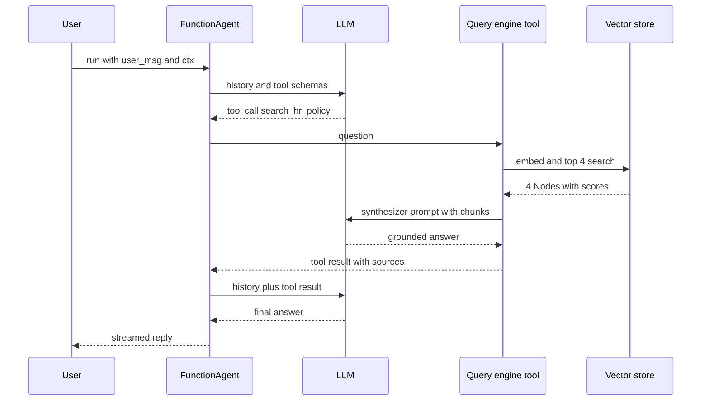

# LlamaIndex

LlamaIndex is a Python (and TypeScript) framework for building LLM apps over your own data: loading files, chunking, indexing, retrieving and answering, plus event-driven Workflows and agents on top. Where LangChain started from "call models and tools", LlamaIndex started from "get the right data into the prompt". Interviewers ask about it for RAG-heavy roles: knowledge assistants, document Q&A, contract and invoice extraction.

Written against **LlamaIndex Python 0.14.x** (`llama-index-core`, November 2026) with the separate `llama-index-workflows` package. Old tutorials with `ServiceContext`, `OpenAIAgent`, `AgentRunner` or `chat_mode="react"` are outdated code.

**After this page you can answer:**
- "What is the difference between a Document and a Node in LlamaIndex?"
- "Query engine vs chat engine vs agent: when do you use each?"
- "What does a response synthesizer do, and what are `compact`, `refine` and `tree_summarize`?"
- "How does the ingestion pipeline avoid re-embedding unchanged documents?"
- "What are LlamaIndex Workflows, and how are they different from a LangGraph graph?"
- "How would you evaluate a LlamaIndex RAG app?"
- "LlamaIndex or LangChain for an HR policy bot over 2,000 PDFs?"
- "What does LlamaParse do that a normal PDF reader does not?"

## Words you need first

| Word | Plain meaning |
|---|---|
| Document | One loaded source (a PDF, a web page, a DB row) with its text and metadata. |
| Node | One chunk of a Document, with metadata and links to its neighbours and parent. |
| Reader | A connector that loads data from a source into Documents. |
| LlamaHub | The catalogue of community readers, tools and integrations for LlamaIndex. |
| Node parser | The splitter that turns Documents into Nodes (by sentences, markdown headings, meaning). |
| Embedding | A list of numbers that captures the meaning of text, so similar texts are close. |
| Index | A structure over Nodes that makes them searchable, most often a vector index. |
| Retriever | Takes a question and returns the most relevant Nodes with scores. |
| Response synthesizer | Takes the question plus retrieved Nodes and makes the LLM write the answer. |
| Query engine | Retriever plus postprocessors plus synthesizer: one question in, one answer out. |
| Chat engine | A query engine with conversation memory, for multi-turn chat. |
| Workflow | LlamaIndex's event-driven orchestration: steps that listen for events and emit new ones. |
| Agent | An LLM that picks tools in a loop; in LlamaIndex, `FunctionAgent` or `ReActAgent`. |
| LlamaCloud | LlamaIndex's hosted platform: LlamaParse, extraction, managed indexes, deployment. |

## Big picture

LlamaIndex is a data pipeline with an LLM at the end. Readers load Documents. Node parsers split them into Nodes. An ingestion pipeline embeds and stores Nodes, with caching so reruns are cheap. An index makes Nodes searchable; a retriever finds the best ones; a response synthesizer writes the answer. Query engines and chat engines package that path. Workflows and agents sit on top, so retrieval becomes one tool among many. This page walks through each block, builds an HR policy bot, then shows what happens inside a query and how to defend the choice.


## ⭐ What LlamaIndex is, and the mental model

**In one line:** LlamaIndex is a data-first framework: connectors, parsing, chunking, indexing, retrieval and answer synthesis for RAG, with event-driven Workflows and agents built on top.

**Why it exists:** LLMs do not know your company's data, and context windows are limited and costly. Most of the work in a knowledge assistant is getting the right 2–5 chunks out of thousands of messy pages. LlamaIndex (started by Jerry Liu in late 2022 as "GPT Index", now LlamaIndex Inc.) focuses on exactly that. Agents and Workflows were added later so retrieval can be combined with other tools and multi-step logic.

**Picture it:** A big library. Readers are the trucks that bring books. Node parsers cut books into chapters. The index is the catalogue. The retriever is the librarian who finds 4 relevant chapters. The synthesizer is the person who reads them and writes your answer. Agents are the research assistant who decides whether to ask the librarian, call HR, or both.

**How it works, step by step:**

1. Load: `SimpleDirectoryReader("./policies").load_data()` gives Documents.
2. Split: a node parser turns 2,000 pages into roughly 6,000 Nodes of ~512 tokens.
3. Embed and store: each Node gets an embedding (6,000 × 1 call each, batched) and goes into a vector store.
4. Query: the retriever embeds the question and picks the top `k` Nodes (say 4).
5. Synthesize: the LLM gets the question plus those 4 Nodes and writes an answer with source references.
6. Wrap: expose the query engine as a tool for an agent, or chain steps in a Workflow.

Package layout:

| Package | What it holds |
|---|---|
| `llama-index` | starter bundle: core plus OpenAI LLM, embeddings and a few readers |
| `llama-index-core` | Documents, Nodes, indexes, retrievers, query engines, agents, `Settings` |
| `llama-index-workflows` | the Workflow engine (imported as `workflows`, also re-exported in `llama_index.core.workflow`) |
| `llama-index-llms-*`, `llama-index-embeddings-*` | one package per provider, e.g. `llama-index-llms-anthropic` |
| `llama-index-vector-stores-*`, `llama-index-readers-*` | one package per vector DB or data source |
| `llama-cloud` | SDK for LlamaCloud services such as LlamaParse |

**Interview tip:** "What is LlamaIndex best at?" Say: "The data side of RAG: many readers, strong parsing with LlamaParse, many node parsers and index types, and good retrieval building blocks. Agents and Workflows are solid, but I pick it mainly when ingestion and retrieval quality are the hard part."

**Common mistake:**
- Thinking LlamaIndex is "just a vector database wrapper". The value is in parsing, chunking, retrieval strategies and synthesis.
- Copying 2023 code with `ServiceContext`. It was replaced by the global `Settings` object.

## ⭐ Documents and Nodes

**In one line:** A Document is one whole source; a Node is one chunk of it with metadata and relationships, and Nodes are what get embedded and retrieved.

**Why it exists:** You cannot embed a 200-page PDF as one vector; the meaning blurs and it will not fit in a prompt. Splitting into Nodes gives precise search. Keeping links (source document, previous and next Node, parent) lets you show citations, fetch neighbours and update a file without rebuilding everything.

**Picture it:** A textbook (Document) and its numbered paragraphs (Nodes). Each paragraph knows its book, chapter and the paragraphs before and after it.

**How it works, step by step:**

1. A `Document` has `text`, `metadata` (for example `{"file_name": "leave_policy.pdf", "dept": "HR"}`) and a stable `doc_id`.
2. A node parser creates `TextNode`s. Each Node copies the Document's metadata and gets relationships: `SOURCE`, `PREVIOUS`, `NEXT`, and sometimes `PARENT` or `CHILD`.
3. By default metadata is included in the text that gets embedded and sent to the LLM. You can exclude keys with `excluded_embed_metadata_keys` and `excluded_llm_metadata_keys`.
4. Metadata enables filters at query time: "only `dept == HR` and `year >= 2025`".
5. Stable `doc_id`s let the ingestion pipeline detect changed files and update only their Nodes.

**Interview tip:** "Why keep metadata on Nodes?" Say: "Three reasons: filtering (only this tenant or department), citations (file and page in the answer), and incremental updates (find all Nodes for one changed file by its doc ID)."

**Common mistake:**
- Putting long metadata (like a full summary) on every Node; it eats the embedding and the prompt budget.
- Random Document IDs on every run, so every file looks new and gets re-embedded.

## Readers and LlamaHub

**In one line:** Readers load data from a source into Documents; `SimpleDirectoryReader` handles local files, and LlamaHub lists hundreds of others (Notion, Google Drive, Slack, SQL, S3).

**Why it exists:** Every source has its own API, auth and paging. A reader hides that behind one call: `load_data()` returns Documents with sensible metadata.

**Picture it:** Universal phone chargers. One cable end fits your app; the other end fits whatever socket the data lives in.

**How it works, step by step:**

1. Local files: `SimpleDirectoryReader("./policies", recursive=True, required_exts=[".pdf", ".md"])` picks a parser per file type.
2. Each file becomes one or more Documents (PDFs often one per page) with `file_name`, `page_label` and similar metadata.
3. Other sources: `pip install llama-index-readers-notion` (for example) and use that reader the same way.
4. Readers are often the weakest link for complex PDFs: tables, multi-column layouts and scanned pages come out messy. That is where LlamaParse comes in.

**Interview tip:** "How do you pick a reader for PDFs?" Say: "Simple text PDFs: the default reader. Tables, forms, scans or slides: a layout-aware parser like LlamaParse, because bad parsing cannot be fixed by better retrieval later."

**Common mistake:**
- Checking only retrieval scores and never reading the parsed text. Look at 20 parsed pages first.

## LlamaParse

**In one line:** LlamaParse is LlamaCloud's hosted document parser that uses vision and language models to turn PDFs, slides and spreadsheets into clean markdown, tables included.

**Why it exists:** Standard PDF text extraction loses table structure, reads two-column pages in the wrong order and fails on scans. A bad parse gives bad chunks, and no retriever can fix that. LlamaParse reads the page layout like a person would.

**Picture it:** Giving a messy photocopy to a careful typist who retypes it neatly, keeping tables as tables.

**How it works, step by step:**

1. Upload a file through the `llama-cloud` SDK (`LlamaCloud` client, API key in `LLAMA_CLOUD_API_KEY`).
2. Choose a tier. Higher tiers (for example `agentic`, `agentic_plus`) use stronger models and cost more credits per page; cheaper tiers suit plain text documents.
3. Get back markdown, text, page metadata or structured items per page.
4. Feed the markdown into `MarkdownNodeParser` so chunks follow headings and tables stay whole.
5. Cost check: at a few credits per page, 2,000 pages is a one-time cost; re-parse only changed files.

```python
from llama_cloud import LlamaCloud

client = LlamaCloud()                              # reads LLAMA_CLOUD_API_KEY
file = client.files.create(file="leave_policy.pdf", purpose="parse")
result = client.parsing.parse(file_id=file.id, tier="agentic",
                              version="latest", expand=["markdown"])
print(result.markdown.pages[0].markdown)           # tables come out as markdown tables
```

**What the code does:**
- Uploads the PDF to LlamaCloud.
- Parses it with the `agentic` tier; `parse` waits for the job to finish.
- Returns markdown per page, ready for a markdown-aware node parser.

Older tutorials use `from llama_parse import LlamaParse` (or `llama-cloud-services`); the current docs use the `llama-cloud` SDK shown here.

**Interview tip:** "Would you send confidential HR PDFs to a hosted parser?" Say: "Only after checking data residency and the contract, or using the enterprise/self-hosted option. Otherwise I use a local layout-aware parser and accept lower quality on complex tables."

**Common mistake:**
- Using the most expensive tier for every file. Route plain text files to cheap parsing.

## ⭐ Node parsers (chunking)

**In one line:** Node parsers split Documents into Nodes; the choice of splitter and chunk size often matters more than the choice of LLM.

**Why it exists:** Chunks too big carry noise and waste tokens. Chunks too small lose context ("it" with no idea what "it" is). Different documents need different splits: markdown by heading, code by function, policies by section. See [Chunking](../09-rag/03-chunking.md).

**Picture it:** Cutting a cake for guests. Too big and people waste it; too small and nobody gets the cherry with the cream. Cut along the layers.

**How it works, step by step:**

1. `SentenceSplitter(chunk_size=512, chunk_overlap=50)`: the default; respects sentence boundaries. A 1,000-token page gives about 2–3 Nodes.
2. `MarkdownNodeParser`: splits on headings; pairs well with LlamaParse output.
3. `SemanticSplitterNodeParser`: splits where the meaning changes, using embeddings between sentences. Better boundaries, slower ingestion.
4. `SentenceWindowNodeParser`: embeds single sentences but stores a window of neighbours; at answer time a postprocessor swaps in the window. Precise search, enough context.
5. `HierarchicalNodeParser` with sizes like 2048 → 512 → 128 plus `AutoMergingRetriever`: retrieve small chunks, merge up to the parent when many siblings match.
6. `CodeSplitter` for source code, by syntax tree.

| Parser | Good for | Cost |
|---|---|---|
| SentenceSplitter | most text | cheap |
| MarkdownNodeParser | parsed PDFs, docs sites | cheap |
| SemanticSplitter | long mixed-topic text | extra embedding calls |
| SentenceWindow | fact lookup needing context | more storage |
| Hierarchical + auto-merge | long structured docs | more Nodes, more storage |

**Interview tip:** "How do you choose chunk size?" Say: "Start at about 512 tokens with 10% overlap, then run a retrieval eval (hit rate, MRR) at 256, 512 and 1024 on 50 real questions. Pick by numbers, not by feel."

**Common mistake:**
- Changing chunk size without re-indexing everything.
- Using one splitter for PDFs, code and spreadsheets.

## ⭐ Indexes and storage

**In one line:** An index organises Nodes for search; `VectorStoreIndex` (embeddings in a vector DB) is the default, and a `StorageContext` decides where Nodes, vectors and index metadata live.

**Why it exists:** Different questions need different structures. "Find the clause about notice period" needs similarity search. "Summarise the whole handbook" needs to visit every Node. "Which managers approve leave for whom?" needs a graph.

**Picture it:** A library with three catalogues: by topic (vector), a full shelf list (summary), and a family tree of who reports to whom (graph).

**How it works, step by step:**

1. `VectorStoreIndex(nodes)` embeds Nodes (if not already embedded) and stores them. Default store is in memory.
2. For production, plug in a vector DB: `QdrantVectorStore`, `PGVectorStore`, `ChromaVectorStore`, and many more, via `StorageContext.from_defaults(vector_store=...)`. See [Vector Databases](../05-db/11-vector.md).
3. Persist the default stores with `index.storage_context.persist("./storage")` and reload with `load_index_from_storage`.
4. Other index types:

| Index | How it finds Nodes | Use when |
|---|---|---|
| `VectorStoreIndex` | embedding similarity | most Q&A |
| `SummaryIndex` | visits all Nodes (optionally filtered) | summarise a whole document |
| `PropertyGraphIndex` | graph of entities and relations plus vectors | multi-hop, relationship questions |
| `DocumentSummaryIndex` | picks documents by their summaries first | many documents, pick the right file |
| `KeywordTableIndex` | keyword lookup | exact terms, small corpora |

**Interview tip:** "When would you use something other than a vector index?" Say: "SummaryIndex for 'summarise this report', a property graph for multi-hop relationship questions, and a router that picks between them based on the question."

**Common mistake:**
- Rebuilding the index from scratch on every app start. Persist it or use an external vector DB.
- Storing everything in the default in-memory store in production.

## ⭐ Retrievers and postprocessors

**In one line:** A retriever turns a question into a ranked list of Nodes; postprocessors then filter, rerank or expand that list before the LLM sees it.

**Why it exists:** Top-k by cosine similarity is a weak first guess. Real systems combine keyword and vector search, drop low-score Nodes, rerank with a cross-encoder, and apply permission filters. See [Hybrid Search](../09-rag/04-hybrid-search.md) and [Reranking](../09-rag/05-reranking.md).

**Picture it:** Shortlisting for a job. HR's keyword filter gives 200 CVs (retriever), a quick read cuts to 20 (cutoff), and the hiring manager ranks the final 4 (reranker).

**How it works, step by step:**

1. `index.as_retriever(similarity_top_k=20)` returns the 20 nearest Nodes with scores.
2. Add metadata filters, for example `MetadataFilters(filters=[ExactMatchFilter(key="dept", value="HR")])`, often pushed down into the vector DB.
3. Hybrid: combine a BM25 retriever and a vector retriever with `QueryFusionRetriever` (reciprocal rank fusion), or use the vector DB's built-in hybrid mode.
4. Postprocess: `SimilarityPostprocessor(similarity_cutoff=0.5)` drops weak matches; a reranker (for example `SentenceTransformerRerank` or a Cohere rerank integration) keeps the best 4 of 20.
5. Smarter retrieval: `RouterRetriever` or `RouterQueryEngine` picks an index per question; `SubQuestionQueryEngine` splits "compare 2024 and 2025 leave policy" into two sub-questions. See [Advanced Retrieval](../09-rag/07-advanced-retrieval.md).

**Interview tip:** "Retrieval returns the wrong chunks. What do you try, in order?" Say: "Check parsing and chunking first, then add hybrid search for exact terms like policy codes, then a reranker over top 20, then metadata filters. Measure hit rate after each change."

**Common mistake:**
- Sending top 20 Nodes straight to the LLM. More context is not better; rerank to 3–5.
- Filtering permissions after retrieval in Python, which leaks counts and wastes `k`. Filter in the query.

## ⭐ Query engines, chat engines and response synthesizers

**In one line:** A query engine answers one question (retrieve, postprocess, synthesize); a chat engine adds conversation memory; a response synthesizer is the part that makes the LLM write the answer from the chunks.

**Why it exists:** The same retrieved chunks can be turned into an answer in different ways. If they fit in one prompt, one call is enough. If there are 50 chunks, you need to refine across several calls or summarise in a tree. And chat needs to rewrite "what about for interns?" into a full question before searching.

**Picture it:** A student answering an exam question from notes. `compact`: stuff all notes on one sheet and write once. `refine`: write a draft from note 1, then improve it with note 2, note 3. `tree_summarize`: summarise notes in pairs, then summarise the summaries.

**How it works, step by step:**

1. `index.as_query_engine(similarity_top_k=4, response_mode="compact")` builds retriever + synthesizer.
2. Response modes:

| Mode | What happens | LLM calls for 12 chunks that need 3 prompts' worth of space |
|---|---|---|
| `compact` (default) | pack as many chunks as fit per prompt, refine across packs | about 3 |
| `refine` | one call per chunk, improving the answer each time | 12 |
| `tree_summarize` | summarise groups, then summarise the summaries | about 4 |
| `simple_summarize` | truncate everything into one prompt | 1, may lose text |
| `accumulate` | answer per chunk, then join | 12 |
| `no_text` | only retrieve, no LLM | 0 |

3. The response object has `.response` (text) and `.source_nodes` (chunks with scores), so you can show citations.
4. Chat engines: `index.as_chat_engine(chat_mode="condense_plus_context")` rewrites the follow-up into a standalone question using history, retrieves, then answers with history and context. `context` mode retrieves on the raw message; `simple` is the LLM with no retrieval.
5. Agent chat modes (`react`, `openai`) were removed; use `FunctionAgent` or `ReActAgent` with a `QueryEngineTool` instead.

| | Query engine | Chat engine | Agent |
|---|---|---|---|
| Turns | one | many | many |
| Decides to search? | always searches | always searches | decides per step |
| Other tools | no | no | yes |
| LLM calls per turn | 1–3 | 2–3 | 2–6 |

**Interview tip:** "Query engine, chat engine or agent?" Say: "Query engine for one-shot Q&A, chat engine for conversation over one knowledge base, agent when it must choose between several sources or take actions like checking a leave balance."

**Common mistake:**
- Using `refine` with `top_k=20`; 20 serial LLM calls make the answer take 30 seconds.
- Not showing `source_nodes`. Users trust answers with citations, and you need them for debugging.

## Settings

**In one line:** `Settings` is a global object that holds the default LLM, embedding model, chunk size and callbacks used by every component unless you pass one explicitly.

**Why it exists:** Without it you pass the same LLM and embed model into every index, retriever and engine. `Settings` replaced the older `ServiceContext`, which had to be threaded through every call.

**Picture it:** The default settings on your phone: language, font size. Each app uses them unless it has its own.

**How it works, step by step:**

1. `Settings.llm = OpenAI(model="gpt-5.4-mini", temperature=0)`.
2. `Settings.embed_model = OpenAIEmbedding(model="text-embedding-3-small")`.
3. `Settings.chunk_size = 512` and `Settings.chunk_overlap = 50` set default splitting.
4. Any component can override: `index.as_query_engine(llm=other_llm)`.
5. The embedding model at query time must be the same one used at ingest time.

**Interview tip:** "Any danger with global Settings?" Say: "In a multi-tenant server or tests, a global default can surprise you. I set it once at startup and pass models explicitly where they differ, for example a cheaper LLM for summarisation."

**Common mistake:**
- Forgetting to set `Settings.embed_model`, then wondering why it calls OpenAI by default.
- Changing the embed model in Settings after indexing; queries and stored vectors no longer match.

## ⭐ Workflows

**In one line:** A Workflow is a class of async `@step` methods; each step receives an event type and returns new events, and the engine routes events to steps until a `StopEvent` is returned.

**Why it exists:** RAG apps grow loops and branches: "if the retrieved chunks are bad, rewrite the query and try again", "run three retrievers in parallel, then merge". Hard-coded chains cannot express that well. Workflows make each step small and testable, and the flow is defined by which events each step accepts and returns.

**Picture it:** A restaurant kitchen with order tickets. The waiter drops a ticket (event). The station that handles that ticket type picks it up, cooks, and drops a new ticket ("ready for plating"). Nobody draws a fixed path; tickets decide who works next.

**How it works, step by step:**

1. Define events as Pydantic-style classes: `class RetrievedEvent(Event): nodes: list`.
2. Write steps: `async def retrieve(self, ctx: Context, ev: StartEvent) -> RetrievedEvent`. The type hints tell the engine which events go where.
3. `ctx.store` holds shared state across steps (`await ctx.store.set("tries", 1)`).
4. `ctx.send_event` can fan out several events; `ctx.collect_events` waits for all of them (parallel branches).
5. `ctx.write_event_to_stream` pushes progress events to the caller for streaming UIs.
6. Human-in-the-loop: emit an `InputRequiredEvent`, wait with `ctx.wait_for_event(HumanResponseEvent, ...)`.
7. The run returns a handler; `await handler` gives the result, `handler.stream_events()` gives live events. `ctx.to_dict()` serialises state so a run can resume later.

```python
from llama_index.core.workflow import Workflow, step, Context, Event, StartEvent, StopEvent

class Query(Event):
    question: str

class Retrieved(Event):
    question: str
    nodes: list

class PolicyRAG(Workflow):
    def __init__(self, retriever, synth, **kw):
        super().__init__(**kw)
        self.retriever, self.synth = retriever, synth

    @step
    async def start(self, ev: StartEvent) -> Query:
        return Query(question=ev.question)

    @step
    async def retrieve(self, ev: Query) -> Retrieved:
        nodes = await self.retriever.aretrieve(ev.question)
        return Retrieved(question=ev.question, nodes=nodes)

    @step
    async def answer(self, ctx: Context, ev: Retrieved) -> Query | StopEvent:
        good = [n for n in ev.nodes if n.score and n.score > 0.5]
        tries = await ctx.store.get("tries", default=0)
        if not good and tries < 1:                           # weak hits: retry once with a rewrite
            await ctx.store.set("tries", tries + 1)
            return Query(question=f"HR leave policy: {ev.question}")
        resp = await self.synth.asynthesize(ev.question, nodes=good or ev.nodes)
        return StopEvent(result=str(resp))

# result = await PolicyRAG(retriever, synth, timeout=60).run(question="Notice period for interns?")
```

**What the code does:**
- `Query` and `Retrieved` are custom events that carry data between steps.
- `start` handles `StartEvent`, `retrieve` handles `Query`, `answer` handles `Retrieved`. Routing comes from the type hints.
- If no Node scores above 0.5, `answer` emits a new `Query` with a rewritten question, once, which loops back to `retrieve`.
- `ctx.store` keeps the retry count across steps; `timeout=60` bounds the whole run.
- `synth` is a response synthesizer from `get_response_synthesizer()`.

**Interview tip:** "Workflows vs LangGraph?" Say: "Both orchestrate steps with shared state. LangGraph is an explicit graph with nodes, edges and a checkpointer that saves after every step. LlamaIndex Workflows are event-driven: steps declare which events they accept, and you persist by serialising the Context. Both support streaming, parallel branches and human input."

**Common mistake:**
- No `timeout` and a loop that never returns `StopEvent`.
- Putting huge objects in `ctx.store` and then trying to serialise the Context.

## ⭐ Agents: FunctionAgent, ReActAgent and AgentWorkflow

**In one line:** LlamaIndex agents are prebuilt Workflows: `FunctionAgent` uses the model's native tool calling, `ReActAgent` uses a text reasoning format, and `AgentWorkflow` connects several agents that hand off to each other.

**Why it exists:** Many questions need more than retrieval: "How many leave days do I have left, and can I carry them over?" needs a database lookup plus a policy search. Agents let the LLM pick tools, including query engines, in a loop.

**Picture it:** An HR helpdesk executive with two screens: the policy handbook search and the HR system. They decide which screen to look at for each part of your question.

**How it works, step by step:**

1. Wrap retrieval as a tool: `QueryEngineTool.from_defaults(query_engine=qe, name="search_hr_policy", description="...")`.
2. Plain Python functions become tools automatically (or via `FunctionTool.from_defaults`); the docstring is the description.
3. `FunctionAgent(tools=[...], llm=llm, system_prompt="...")` for models with tool calling (OpenAI, Anthropic, Gemini and others). `ReActAgent` for models without it. `CodeActAgent` writes and runs code as its action.
4. `handler = agent.run(user_msg="...", ctx=ctx)`; stream `AgentStream`, `ToolCall`, `ToolCallResult` events; `await handler` for the final answer.
5. Memory: pass a `Context(agent)` to keep chat history across runs, or a `Memory.from_defaults(session_id=..., token_limit=40000)` object. `Memory` replaced the older `ChatMemoryBuffer`.
6. Multi-agent: `AgentWorkflow(agents=[...], root_agent="triage", initial_state={...})`. Each `FunctionAgent` has a `name`, `description` and `can_handoff_to=[...]`. A handoff passes control to another agent.
7. The legacy agent classes (`OpenAIAgent`, `AgentRunner`, the old `ReActAgent` in `llama_index.core.agent`) were removed in 2025; new code imports from `llama_index.core.agent.workflow`.

**Interview tip:** "FunctionAgent or ReActAgent?" Say: "FunctionAgent whenever the model supports native tool calling: arguments are structured and parsing failures are rare. ReActAgent only for models without tool calling, since it relies on the model following a text format."

**Common mistake:**
- One query engine tool with a vague description like "search docs" next to five other tools. The agent cannot tell when to use it.
- Multi-agent handoffs for a task one agent with three tools can do.

## Ingestion pipeline and caching

**In one line:** `IngestionPipeline` runs a list of transformations (splitter, metadata extractors, embedder) over Documents, caches each step's output, and with a docstore skips or updates documents that did not change.

**Why it exists:** Re-embedding 6,000 chunks every night because one PDF changed wastes money and hours. The pipeline caches by hashing (node content + transformation), and the docstore tracks document hashes so only new or changed files are processed.

**Picture it:** A laundry service that tags every shirt. Shirts that were already washed and not worn since are skipped. Only new or dirty ones go in the machine.

**How it works, step by step:**

1. `transformations=[SentenceSplitter(...), TitleExtractor(), OpenAIEmbedding()]`. Each is run in order.
2. `cache=IngestionCache(...)` (local, Redis, Mongo and others): if the same input hits the same transformation, the cached output is reused.
3. `docstore=SimpleDocumentStore()` (or Redis, Postgres) stores a hash per `doc_id`. With `docstore_strategy=DocstoreStrategy.UPSERTS`, changed documents are re-processed and old Nodes replaced; unchanged ones are skipped.
4. `vector_store=...` writes Nodes straight into your vector DB.
5. `pipeline.run(documents=docs, num_workers=4)` parallelises; `pipeline.persist("./pipeline_storage")` saves cache and docstore.
6. Example: 2,000 PDFs, 6,000 Nodes. Nightly run, 15 files changed: about 45 Nodes re-embedded instead of 6,000, more than 99% fewer embedding calls.

**Interview tip:** "How do you keep the index fresh without re-embedding everything?" Say: "Ingestion pipeline with a docstore and upserts strategy keyed by stable doc IDs, a persistent cache, and a vector store that supports delete by doc ID. Deleted source files need a separate cleanup, for example `UPSERTS_AND_DELETE`."

**Common mistake:**
- Random or path-dependent doc IDs that change on every run, which defeats the docstore.
- A local cache file on an ephemeral container; it is gone on the next deploy. Use Redis or another shared store.

## Evaluation

**In one line:** LlamaIndex ships evaluators for retrieval (hit rate, MRR) and for answers (faithfulness, relevancy, correctness), plus helpers to generate test questions from your own Nodes.

**Why it exists:** RAG fails silently: the answer reads well but is wrong or unsupported. You need numbers to compare chunk sizes, retrievers and prompts. See [RAG Evaluation](../09-rag/08-rag-evaluation.md).

**Picture it:** A mock exam with an answer key. Without it, you only know the student "sounded confident".

**How it works, step by step:**

1. Build a dataset: `generate_question_context_pairs(nodes, llm=llm, num_questions_per_chunk=2)` makes synthetic questions; mix in 50+ real user questions.
2. Retrieval eval: `RetrieverEvaluator.from_metric_names(["hit_rate", "mrr"], retriever=retriever)`. Hit rate 0.82 means the right chunk was in the top k for 82% of questions.
3. Answer eval with an LLM judge: `FaithfulnessEvaluator` (is the answer supported by the retrieved context?), `RelevancyEvaluator` (does it answer the question?), `CorrectnessEvaluator` (matches a reference answer?).
4. `BatchEvalRunner` runs many evaluators over many questions in parallel.
5. Track results per change; also integrate with external tools (Ragas, Phoenix, Langfuse) if your team uses them.

**Interview tip:** "Faithfulness is 0.95 but users still complain. Why?" Say: "Faithfulness only checks the answer is supported by what was retrieved. If retrieval found the wrong chunk, the answer can be faithful and still wrong. Check retrieval hit rate and correctness against reference answers."

**Common mistake:**
- Only synthetic questions. They are easier and use the document's own words; real questions are messier.
- Using the same LLM as generator and judge without spot-checking by a human.

## ⭐ A complete small app: HR policy bot

**In one line:** An HR assistant over company policy PDFs that can also look up an employee's leave balance, built with an ingestion pipeline, a query engine tool, a function tool and a `FunctionAgent` with memory.

**Why it exists:** This one example uses the key blocks: Settings, reader, node parser, ingestion pipeline with cache, vector index, query engine, tools, agent, streaming and memory.

**Picture it:** An HR helpdesk on the company intranet. It reads the handbook for policy questions and checks the HR system for your personal numbers.

**How it works, step by step:**

1. Configure models and ingest the PDFs with caching (block 1).
2. Build the query engine and tools; the leave tool is bound to the logged-in employee (block 2).
3. Create the agent and run a two-turn chat with streaming (block 3).

**Block 1: settings and ingestion.**

```python
from llama_index.core import Settings, SimpleDirectoryReader, VectorStoreIndex
from llama_index.core.ingestion import IngestionPipeline, DocstoreStrategy
from llama_index.core.node_parser import SentenceSplitter
from llama_index.core.storage.docstore import SimpleDocumentStore
from llama_index.llms.openai import OpenAI
from llama_index.embeddings.openai import OpenAIEmbedding
from llama_index.vector_stores.qdrant import QdrantVectorStore
from qdrant_client import QdrantClient

Settings.llm = OpenAI(model="gpt-5.4-mini", temperature=0)
Settings.embed_model = OpenAIEmbedding(model="text-embedding-3-small")
vector_store = QdrantVectorStore(client=QdrantClient(path="./qdrant"), collection_name="hr")

docs = SimpleDirectoryReader("./hr_policies", filename_as_id=True).load_data()  # stable doc IDs
pipeline = IngestionPipeline(
    transformations=[SentenceSplitter(chunk_size=512, chunk_overlap=50), Settings.embed_model],
    docstore=SimpleDocumentStore(),
    vector_store=vector_store,                  # upserts need a vector store
    docstore_strategy=DocstoreStrategy.UPSERTS,
)
pipeline.run(documents=docs)                    # split, embed, write to Qdrant
pipeline.persist("./pipeline_storage")          # next run: pipeline.load(...) then skip unchanged files
index = VectorStoreIndex.from_vector_store(vector_store)
```

**What the code does:**
- Sets the default LLM and embedding model once, and a local Qdrant collection as the vector store.
- `filename_as_id=True` gives each file a stable ID, so the docstore can detect changes.
- The pipeline splits into ~512-token Nodes, embeds them and writes them to Qdrant.
- `persist` saves the cache and docstore; on the next run `pipeline.load(...)` restores them and unchanged files are skipped.
- `from_vector_store` builds the index over what is already stored; nothing is re-embedded.

**Block 2: query engine and tools.**

```python
from llama_index.core.tools import QueryEngineTool, FunctionTool

policy_qe = index.as_query_engine(similarity_top_k=4, response_mode="compact")
policy_tool = QueryEngineTool.from_defaults(
    query_engine=policy_qe, name="search_hr_policy",
    description="Answers questions about leave, notice period, WFH and benefits policy.")

LEAVE_DB = {"E1001": {"earned": 12, "sick": 5}}

def make_leave_tool(employee_id: str) -> FunctionTool:
    def get_leave_balance() -> str:
        """Get the current employee's remaining earned and sick leave days."""
        b = LEAVE_DB.get(employee_id)                  # employee_id comes from login, not the model
        return f"Earned: {b['earned']} days, Sick: {b['sick']} days" if b else "No record."
    return FunctionTool.from_defaults(fn=get_leave_balance)
```

**What the code does:**
- The query engine retrieves 4 Nodes and writes an answer in about one LLM call.
- `QueryEngineTool` lets the agent call the whole RAG path as one tool; the description says when.
- The leave tool is built per request with the employee ID closed over, so the model cannot ask for someone else's balance.

**Block 3: agent with memory and streaming.**

```python
import asyncio
from llama_index.core.agent.workflow import FunctionAgent, AgentStream, ToolCallResult
from llama_index.core.workflow import Context

async def chat(employee_id: str):
    agent = FunctionAgent(
        tools=[policy_tool, make_leave_tool(employee_id)],
        llm=OpenAI(model="gpt-5.5"),
        system_prompt="You are the HR assistant. Cite the policy. Never guess numbers.")
    ctx = Context(agent)                                   # keeps chat history across turns
    for msg in ["How many earned leaves do I have?", "Can I carry them to next year?"]:
        handler = agent.run(user_msg=msg, ctx=ctx)
        async for ev in handler.stream_events():
            if isinstance(ev, ToolCallResult):
                print(f"\n[tool {ev.tool_name}]")
            elif isinstance(ev, AgentStream):
                print(ev.delta, end="", flush=True)        # tokens as they arrive
        await handler

asyncio.run(chat("E1001"))
```

**What the code does:**
- `FunctionAgent` uses the model's native tool calling to pick between policy search and leave lookup.
- `Context(agent)` carries history, so "them" in turn 2 means the earned leaves from turn 1.
- `stream_events` shows tool results and streams tokens to the UI.
- Turn 1 calls the leave tool; turn 2 calls the policy tool. About 4–5 LLM calls in total (agent plus synthesizer).

**Interview tip:** "Walk me through building an HR bot with LlamaIndex." Use this order: parse (LlamaParse for tables), chunk and embed through an ingestion pipeline with stable IDs, vector index in a real DB, query engine with reranking, tools with identity from the session, `FunctionAgent` with memory, evals on 50 real HR questions, tracing.

**Common mistake:**
- Letting the model pass `employee_id` as a tool argument.
- Using the top model for the inner synthesizer and the agent; a smaller model often works for synthesis.

## ⭐ How it works inside: one query and one agent run

**In one line:** A query is retrieve → postprocess → synthesize; an agent run is a Workflow that loops model call → tool calls (maybe a full query inside) → model call, emitting events at each step.

**Why it exists:** When an answer is wrong, you need to know whether retrieval, the synthesizer prompt or the agent's tool choice failed. Each has a different fix.

**Picture it:** A dabbawala chain. The pickup, the sorting station and the delivery each have a mark on the tiffin. When a tiffin goes missing, the marks show which hand dropped it.

**How it works, step by step:**

1. `agent.run` starts the agent Workflow; the user message and chat history from `ctx` form the input.
2. The agent step calls the LLM with the system prompt, history and tool schemas (`AgentInput` event).
3. The LLM returns tool calls (`AgentOutput` with `tool_calls`). Each tool runs (`ToolCall`, then `ToolCallResult`).
4. For `search_hr_policy`, the tool runs a full query: embed question (1 embedding call), vector search top 4, postprocess, synthesizer prompt with the 4 chunks (1 LLM call).
5. Tool results are added to memory; the agent calls the LLM again. No more tool calls means the final answer (`StopEvent`).
6. Instrumentation emits spans for every LLM call, embedding call, retrieval and tool call, which tracing tools turn into a tree.



**Interview tip:** "How would you debug a wrong answer?" Say: "Look at the trace. Did the agent call the right tool? Did retrieval return the right Nodes (check `source_nodes`)? If yes, the synthesizer prompt or model is the issue. If no, fix parsing, chunking, filters or add reranking. Then add that question to the eval set."

**Common mistake:**
- Debugging only the agent prompt when the retrieval step returned nothing relevant.
- Forgetting the agent's LLM and the synthesizer's LLM are separate calls with separate costs.

## Production concerns

**In one line:** In production you need a real vector DB, a persistent ingestion pipeline, saved agent context, streaming, tracing, evals in CI, and a deployment path for Workflows.

**Why it exists:** The notebook version keeps everything in memory, re-embeds on start and has no traces. That fails on the first restart and the first angry user.

**Picture it:** Moving a home kitchen to a central kitchen that supplies 50 outlets: cold storage, labelled batches, quality checks and a delivery schedule.

**How it works, step by step:**

1. **Storage:** vector DB (Qdrant, pgvector, Pinecone, Elasticsearch and others), a shared docstore and cache (Redis or Postgres), stable doc IDs.
2. **Ingestion as a job:** run the pipeline on a schedule or on file-change events, not in the request path.
3. **Agent state:** serialise `ctx.to_dict()` to your DB per session and restore with `Context.from_dict(agent, data)`; same for paused human-in-the-loop runs.
4. **Streaming:** forward `AgentStream` deltas over SSE or WebSocket; show tool steps as progress.
5. **Tracing:** LlamaIndex's instrumentation module emits spans and events; integrations exist for Arize Phoenix, Langfuse, OpenTelemetry backends and others. See [AI Observability](10-agent-observability.md).
6. **Deployment:** Workflows are plain async Python, so FastAPI works. LlamaIndex also offers `WorkflowServer` and the `llamactl` CLI (LlamaAgents) to serve Workflows as an API and deploy them to LlamaCloud.
7. **Cost:** embeddings are cheap and one-time with caching; most cost is LLM calls. An agent turn with 2 agent calls and 1 synthesis at about 3,000 input tokens each is 9,000 tokens. Use a smaller model for synthesis and cap `top_k`. See [Cost & Latency](11-cost-latency.md).
8. **Failure modes:** empty retrieval (answer "I don't know", do not guess), stale index (ingestion lag alerts), wrong tenant data (filters in every query), timeouts (Workflow `timeout`).

**Interview tip:** "How do you make a LlamaIndex RAG app production-ready?" Say: "External vector DB and shared docstore and cache, ingestion as a scheduled job with upserts, tenant filters in every retriever, reranking, saved agent context, streaming, tracing, and an eval set with retrieval and faithfulness metrics in CI."

**Common mistake:**
- Running ingestion inside the web server on startup.
- No "I don't know" path; the model fills gaps with confident guesses.

## LlamaCloud

**In one line:** LlamaCloud is LlamaIndex's hosted platform: LlamaParse for parsing, Extract for schema-based extraction, managed Index for hosted ingestion and retrieval, Classify, and hosting for Workflow apps.

**Why it exists:** Parsing complex documents and running ingestion at scale are operational work many teams do not want. LlamaCloud sells that as a service, while the open-source framework stays free.

**Picture it:** Buying ready-made masala from a trusted brand instead of roasting and grinding spices yourself. Faster and consistent, but you pay and depend on the brand.

**How it works, step by step:**

1. **Parse (LlamaParse):** files in, clean markdown or structured items out, priced per page by tier.
2. **Extract:** give a schema (for example invoice number, GSTIN, total) and get typed JSON from documents.
3. **Index:** upload or connect sources; LlamaCloud parses, chunks, embeds and serves a retriever you can use from the framework.
4. **Classify:** route documents into types (invoice, contract, resume) before processing.
5. **Deploy:** push Workflow apps with `llamactl`.
6. Product names and tiers change often; check the console and changelog before quoting them.

**Interview tip:** "Build or buy parsing?" Say: "Buy (LlamaParse or similar) when documents are complex and volume is moderate, because parsing quality drives everything. Build or self-host when data cannot leave our network or volume makes per-page pricing too costly."

**Common mistake:**
- Locking the whole pipeline into a hosted index without an export path.
- Not budgeting per-page parse costs for millions of pages.

## ⭐ When to use it, and how it compares

**In one line:** Use LlamaIndex when data ingestion and retrieval quality are the hard part; use LangChain or LangGraph when control flow and integrations around a tool-calling agent are the hard part; mix them freely.

**Why it exists:** "Why LlamaIndex and not LangChain?" is a standard question. A good answer names what is hard in your problem.

**Picture it:** A specialist eye hospital vs a general hospital. For a complex eye case, the specialist. For everything else, the general one. They refer patients to each other.

**How it works, step by step:**

1. Messy PDFs, tables, many document types, many retrieval strategies: LlamaIndex.
2. One agent with many tools and providers, approval steps, middleware: LangChain's `create_agent`. See [LangChain](23-langchain.md).
3. Complex durable control flow, strict checkpointing: LangGraph, with a LlamaIndex query engine as a tool.
4. Typed extraction into Pydantic models with minimal framework: Pydantic AI or a provider SDK. See [DSPy and Pydantic AI](30-dspy-pydantic-ai.md).
5. Small RAG over a few hundred docs: either framework, or about 100 lines of your own code.

| | LlamaIndex | LangChain 1.x | LangGraph | Haystack |
|---|---|---|---|---|
| Starting point | data and retrieval | models, tools, agent loop | graph runtime | search pipelines |
| Ingestion and parsing | deepest (LlamaParse, many parsers) | loaders and splitters | none, bring your own | good |
| Retrieval strategies | many built in (auto-merge, router, sub-question) | basics plus integrations | none, bring your own | good |
| Orchestration | Workflows (events) | `create_agent` plus middleware | explicit graph | pipelines |
| Persistence | serialise Context | LangGraph checkpointer | checkpointer built in | custom |
| Best for | RAG-heavy assistants, document AI | standard tool agents | durable custom agents | search-heavy RAG |

**Interview tip:** "LlamaIndex or LangChain for an HR bot over 2,000 PDFs?" Say: "LlamaIndex for ingestion and retrieval, because parsing tables and tuning chunking and reranking is the hard part. If the bot later needs approvals and complex flows, I can wrap the query engine as a tool inside a LangGraph or LangChain agent."

**Common mistake:**
- Framework wars. Teams often use both: LlamaIndex for retrieval, LangGraph for orchestration.
- Choosing by GitHub stars instead of by which part of the problem is hard.

## Common pitfalls in real projects

**In one line:** Most LlamaIndex problems are data problems (parsing, chunking, IDs, embeddings) or outdated API usage, not model problems.

**Why it exists:** These show up in code reviews and make good "a problem I solved" stories.

**Picture it:** A chef blaming the stove when the vegetables were rotten.

**How it works, step by step:**

1. **Outdated APIs.** `ServiceContext`, `GPTVectorStoreIndex`, `OpenAIAgent`, `chat_mode="react"` are gone. Use `Settings`, `VectorStoreIndex`, `FunctionAgent`.
2. **Re-indexing on every start.** Persist the index or use an external vector DB.
3. **Embedding mismatch.** Indexed with one embedding model, queried with another. Results look random.
4. **Unstable doc IDs.** The docstore treats every run as new; costs explode.
5. **Default metadata in embeddings.** File paths and long metadata dilute the embedding; exclude them.
6. **Too many chunks to the LLM.** `top_k=20` with `refine` is slow and costly; rerank to 4.
7. **Async confusion.** Agents and Workflows are async; in notebooks use `await`, in scripts `asyncio.run`, in FastAPI do not nest event loops.
8. **Version drift.** `llama-index-core` and integration packages must be compatible; pin and upgrade together.

**Interview tip:** "Tell me about a RAG bug you fixed." A strong story: "Answers about leave carry-over were wrong. Traces showed the right table was split across two chunks by the PDF parser. Switching to LlamaParse markdown with a markdown node parser kept the table whole; hit rate went from 0.71 to 0.88 on our eval set."

**Common mistake:**
- Tuning prompts for a week before reading the retrieved chunks.
- Upgrading `llama-index-core` without upgrading the integration packages.

## Interview questions

**Q: What is LlamaIndex, in one sentence?**
A: A data-first framework for LLM apps: readers, parsing, node parsers, indexes, retrievers and synthesizers for RAG, plus event-driven Workflows and agents on top.

**Q: Document vs Node?**
A: A Document is one whole source with metadata; a Node is a chunk of it with inherited metadata and links to source, neighbours and parent. Nodes are what get embedded and retrieved.

**Q: Query engine vs chat engine vs agent?**
A: Query engine: one question, always retrieves, one answer. Chat engine: adds history and rewrites follow-ups into standalone questions. Agent: decides per step which tools to call, including query engines, and can take actions.

**Q: Explain `compact`, `refine` and `tree_summarize`.**
A: `compact` packs as many chunks as fit per prompt and refines across packs, the default and usually fewest calls. `refine` makes one call per chunk, improving the answer. `tree_summarize` summarises groups then summarises summaries, good for summarisation over many chunks.

**Q: How does the ingestion pipeline avoid re-embedding?**
A: A cache keyed by node content plus transformation reuses outputs, and a docstore keyed by stable doc IDs and hashes skips unchanged documents and upserts changed ones.

**Q: What are Workflows and how do they differ from LangGraph?** (trade-off)
A: Event-driven steps: each `@step` accepts an event type and returns events, and routing follows the types. LangGraph uses explicit nodes and edges with a checkpointer after every step. Workflows feel natural for async, fan-out RAG pipelines; LangGraph gives stronger built-in durability and time travel.

**Q: FunctionAgent vs ReActAgent?**
A: FunctionAgent uses native tool calling, so arguments are structured and reliable. ReActAgent prompts the model to write thought, action and input as text, for models without tool calling.

**Q: How do you evaluate a LlamaIndex RAG app?**
A: Retrieval: hit rate and MRR with `RetrieverEvaluator` on real and synthetic questions. Answers: faithfulness, relevancy and correctness with LLM judges, spot-checked by humans. Run on every change.

**Q: Retrieval hit rate is 0.6. What do you do?** (what would you do)
A: Read failing cases. Usually fix parsing (tables, columns), then chunking (size, markdown-aware), then add hybrid search for exact terms, then a reranker over top 20, then metadata filters. Re-measure after each change.

**Q: How do you handle multi-tenant data?**
A: Tenant ID in Node metadata at ingest, a metadata filter in every retriever pushed down to the vector DB, and tenant ID taken from the session, never from the model. Or a separate collection per tenant for strict isolation.

**Q: How do you persist an agent conversation?**
A: Serialise the Context with `ctx.to_dict()` into a DB keyed by session and restore with `Context.from_dict(agent, data)`, or use a `Memory` object with a session ID and a persistent backend.

**Q: What changed recently in LlamaIndex?**
A: `ServiceContext` became `Settings`; old agent classes were replaced by Workflow-based `FunctionAgent`, `ReActAgent`, `CodeActAgent` and `AgentWorkflow`; Workflows moved into their own package; `Memory` replaced `ChatMemoryBuffer`; LlamaParse moved to the `llama-cloud` SDK.

**Q: LlamaIndex or LangChain?** (trade-off)
A: LlamaIndex when ingestion and retrieval quality are the hard part; LangChain when the agent loop, integrations and middleware are. Many teams use a LlamaIndex query engine as a tool inside a LangChain or LangGraph agent.

**Q: When would you not use LlamaIndex?**
A: Tiny RAG over a few hundred clean documents where 100 lines of your own code is clearer, or a strictly controlled agent flow with no retrieval focus.

**Q: How would you make answers cite sources?**
A: Return `source_nodes` with file name and page metadata, ask the synthesizer to cite them, or use a citation query engine. Show sources in the UI and check them in evals.

## Read next

- [Agent Frameworks and Tooling](19-agent-frameworks.md)
- [What is RAG](../09-rag/01-what-is-rag.md)
- [LangChain](23-langchain.md)
- [Data & Retrieval for Agents](06-agentic-data-rag.md)

## Checklist

- [ ] I can explain what LlamaIndex is for and how its packages are split.
- [ ] I can explain Documents vs Nodes and why metadata and stable IDs matter.
- [ ] I can pick a node parser and justify a chunk size with a retrieval eval.
- [ ] I can choose an index type and explain retrievers, postprocessors and reranking.
- [ ] I can compare query engines, chat engines and agents, and explain the response modes.
- [ ] I can build an ingestion pipeline with cache and docstore that skips unchanged files.
- [ ] I can write a small Workflow with custom events and explain how routing works.
- [ ] I can build a `FunctionAgent` with a query engine tool, memory and streaming.
- [ ] I can evaluate a RAG app with retrieval and answer metrics.
- [ ] I can compare LlamaIndex with LangChain, LangGraph and Haystack and say when to use each.
