# CrewAI

CrewAI is a Python framework where you describe a small team of AI agents by **role**, give each one **tasks**, and let a **crew** run them. On top of that it has **Flows**, a plain event-driven way to write the deterministic parts of your app around the crews. Interviewers ask about CrewAI because it is one of the most used multi-agent frameworks, and because "role-play agents vs explicit graph" is a classic trade-off question.

Written against **CrewAI 1.15.x** (November 2026, Python 3.10–3.13). The library moves fast, so check the changelog before you copy code.

**After this page you can answer:**
- "What are Agent, Task, Crew and Process in CrewAI, and how do they connect?"
- "Sequential vs hierarchical process: what does the manager agent actually do?"
- "What is a CrewAI Flow, and when would you use a Flow instead of a Crew?"
- "How do you get typed, validated output from a CrewAI task?"
- "What prompt does CrewAI build from role, goal and backstory, and what does it cost you?"
- "How would you debug a crew that loops or gives a wrong answer?"
- "CrewAI vs LangGraph vs AutoGen: which would you pick for a production support bot?"
- "What changed in CrewAI recently?"

## Words you need first

New to agents? Read [Agent Foundations](01-agent-foundations.md) and [Agent Frameworks and Tooling](19-agent-frameworks.md) first.

| Word | Plain meaning |
|---|---|
| Agent | One LLM worker with a role, a goal, a backstory, a model and some tools. |
| Role / goal / backstory | Three short texts that CrewAI turns into the agent's system prompt. |
| Task | One unit of work: a description, the expected output, and the agent who does it. |
| Crew | A group of agents plus a list of tasks, run together with `kickoff()`. |
| Process | The rule for running tasks: one after another (sequential) or via a manager (hierarchical). |
| Delegation | An agent handing a sub-question to a coworker agent through a built-in tool. |
| Tool | A Python function the agent can call, with a name, a description and typed arguments. |
| Guardrail | A check on a task's output; if it fails, the agent retries with your feedback. |
| Pydantic model | A Python class that defines a typed shape; CrewAI parses output into it. |
| Flow | An event-driven Python class: methods that start, listen for other methods, and route. |
| Flow state | One typed object shared by all steps of a Flow, read and written through `self.state`. |
| Memory | Stored facts the crew can recall in later tasks or later runs. |
| Knowledge | Documents (text, PDF, CSV) attached to an agent or crew and searched like RAG. |
| AMP | CrewAI's paid platform (Agent Management Platform) for tracing, deploys and integrations. |

## Big picture

CrewAI has two layers. The **Crew** layer is about autonomy: agents with roles work through tasks, use tools, and may delegate. The **Flow** layer is about control: normal Python steps that run in a fixed order or branch on state, and call crews where you want an LLM team. A real app is usually a Flow that calls one or two small crews. Around both sit tools, memory, knowledge, guardrails and tracing.

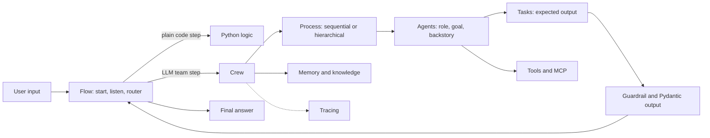

## ⭐ What CrewAI is and the mental model

**In one line:** CrewAI models an AI app as a team of role-playing agents doing assigned tasks, plus Flows for the deterministic glue around them.

**Why it exists:** Many business problems already look like a small team: a researcher, an analyst, a writer, a reviewer. Writing that by hand with a raw agent loop means a lot of prompt and routing code. CrewAI lets you describe the team in a few lines or a config file and get a working multi-agent pipeline in an afternoon. It was started in late 2023 by João Moura and is now maintained by CrewAI Inc., with an open-source core (MIT licence) and the paid AMP platform.

**Picture it:** A Swiggy cloud kitchen. Each cook has a role (tandoor, curry, packing). The order ticket is the task. The head chef either passes tickets down the line in order (sequential) or decides who cooks what on the go (hierarchical). The kitchen's opening and closing routine (lights, gas, cleaning) is fixed and written on a sheet: that is the Flow.

**How it works, step by step:**

1. You define **agents**: each has `role`, `goal`, `backstory`, an `llm` and `tools`.
2. You define **tasks**: each has a `description`, an `expected_output` and an `agent`.
3. You put them in a **crew** with a **process**.
4. You call `crew.kickoff(inputs={...})`. Placeholders like `{order_id}` in texts are filled from `inputs`.
5. For each task, CrewAI builds a prompt from the agent's role texts plus the task, runs a tool-calling loop until the agent gives a final answer, and passes that answer on as context.
6. You get a `CrewOutput` with `.raw`, `.pydantic`, `.json_dict`, `.tasks_output` and `.token_usage`.
7. When you need fixed steps, branches or loops around this, you wrap crews in a **Flow**.

Where it sits among its neighbours:

| Framework | Main idea | Level |
|---|---|---|
| CrewAI | role-based team + Flows | high-level, opinionated |
| LangGraph | explicit graph of nodes over typed state | low-level, you wire everything |
| AutoGen / Microsoft Agent Framework | agents talking in group chats, plus graph workflows | middle |
| OpenAI Agents SDK | one agent loop with handoffs and guardrails | thin |

Note: since early 2025 CrewAI does **not** depend on LangChain. It is a standalone package. Older blog posts that import LangChain classes into CrewAI are out of date.

**Interview tip:** "What is CrewAI in one sentence?" Say: "A high-level framework where I describe agents by role and goal, give them tasks, and a crew runs them sequentially or under a manager. For the deterministic parts I wrap crews in Flows."

**Common mistake:**
- Thinking CrewAI is only about role-play. Since 2025 Flows are half the framework, and most production CrewAI apps are Flow-first.

## ⭐ Agent

**In one line:** An agent is an LLM plus a persona (role, goal, backstory), a set of tools and a few limits.

**Why it exists:** A specialised prompt does better than a generic one. "You are a refund investigator who trusts only system data" makes the model stay in its lane. The role texts also tell other agents (and the manager) what this agent is good at, so delegation can pick the right one.

**Picture it:** A job description on a Naukri post: title (role), what success looks like (goal), and the kind of person you want (backstory).

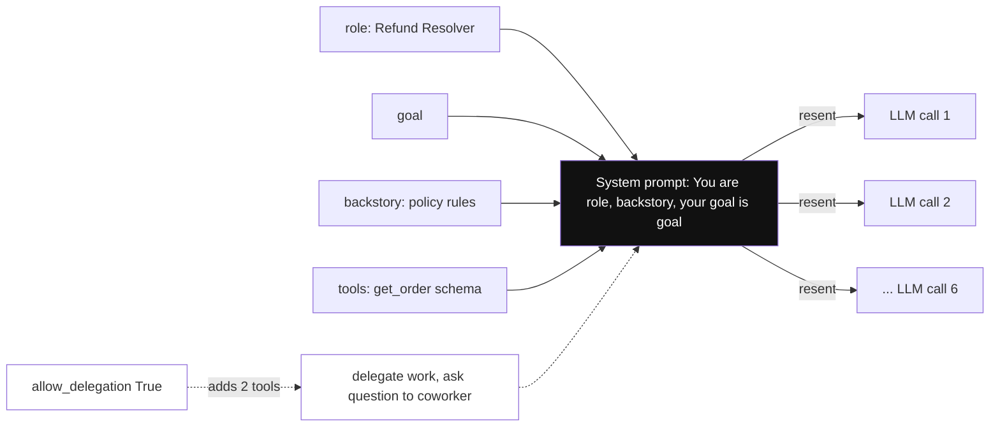

*Diagram:* The three role texts plus tool schemas become one system prompt that is resent on every call: 6 calls in a task means 6 copies of the persona.

**How it works, step by step:**

1. `role`: a short title, for example "Order Investigator". It is also the agent's name for delegation.
2. `goal`: what the agent tries to achieve. Can use `{placeholders}`.
3. `backstory`: experience and rules, written like a short bio. This is where you put style and policy hints.
4. `llm`: a model string like `"openai/gpt-4.1-mini"` or an `LLM(...)` object with `temperature`, `max_tokens` and so on. Providers outside the built-in set (OpenAI, Anthropic, Gemini, Azure, Bedrock) need the `crewai[litellm]` extra.
5. `tools`: a list of tools the agent may call.
6. `allow_delegation`: if `True`, the agent gets two extra tools, "delegate work to coworker" and "ask question to coworker". Default is `False`.
7. Limits: `max_iter` (max reasoning steps per task), `max_execution_time` (seconds), `max_rpm` (requests per minute), `respect_context_window=True` (summarise history when near the model's limit).

| Field | Example | Why it matters |
|---|---|---|
| `role` | "Refund Resolver" | name for delegation and the first line of the prompt |
| `goal` | "Decide a fair refund within policy" | keeps the agent focused |
| `backstory` | "Policy: refund at most the order amount" | rules and tone |
| `llm` | `LLM(model="openai/gpt-4.1-mini", temperature=0)` | cost and quality per agent |
| `tools` | `[get_order]` | what it can actually do |
| `allow_delegation` | `False` | stops surprise extra LLM calls |
| `max_iter` | `5` | caps loops |

A worked number: the three role texts are often 80–200 tokens. They are sent on **every** LLM call of that agent. An agent that makes 6 calls in a task sends them 6 times.

**Interview tip:** "Why does role and backstory help, and when does it hurt?" Say: "It narrows the model's behaviour and gives delegation a description to route on. It hurts when it is long and fluffy: it adds tokens to every call and can make the model chatty. I keep backstories short and put hard rules in code or guardrails."

**Common mistake:**
- Writing a 400-word backstory full of adjectives. Short, factual rules work better and cost less.
- Leaving `allow_delegation=True` on every agent; agents then bounce questions to each other and the bill grows.

## ⭐ Task

**In one line:** A task is one piece of work with a clear description, a clear expected output and an owner agent.

**Why it exists:** LLMs do better with a precise brief and a precise shape for the answer. `expected_output` is that shape. Tasks also let you chain work: the output of one task becomes context for the next.

**Picture it:** A JIRA ticket. It has a title, acceptance criteria, an assignee and "blocked by" links.

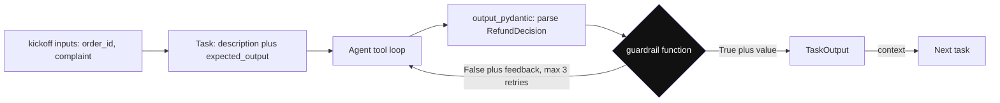

*Diagram:* A task's answer is parsed into the Pydantic shape, then checked by the guardrail; a failure sends feedback back into the agent loop, a pass flows on as context.

**How it works, step by step:**

1. `description`: what to do. Use `{placeholders}` filled from `kickoff(inputs=...)`.
2. `expected_output`: what "done" looks like, for example "A bullet list with status, amount and items". CrewAI puts it in the prompt as the criteria for the final answer.
3. `agent`: who does it. In a hierarchical crew you may leave it empty and let the manager choose.
4. `context=[other_task]`: feed earlier task outputs into this task. In a sequential crew, earlier outputs flow in by default; `context` makes it explicit.
5. `output_pydantic=MyModel` (or `output_json`): CrewAI asks for structured output and parses it. You read it as `task_output.pydantic`.
6. `guardrail=fn` (or `guardrails=[...]`): a function that gets the output and returns `(True, value)` to accept or `(False, "feedback")` to make the agent retry. A plain string guardrail ("must be under 100 words") is checked by an LLM. Retries are capped (`guardrail_max_retries`, default 3).
7. Other useful fields: `tools` (task-only tools), `output_file`, `human_input=True` (a person reviews before moving on), `async_execution=True` (run in parallel with the next task), `markdown=True`.

| Field | What it gives you |
|---|---|
| `expected_output` | the answer shape in the prompt |
| `context` | explicit data flow between tasks |
| `output_pydantic` | typed, validated output |
| `guardrail` | code check plus automatic retry with feedback |
| `human_input` | a review step before the crew moves on |
| `async_execution` | parallel tasks |

```python
from pydantic import BaseModel
from crewai import Task

class Summary(BaseModel):
    title: str
    bullets: list[str]

def max_five_bullets(output):
    s = output.pydantic                      # parsed Summary object
    if len(s.bullets) > 5:
        return (False, "Too many bullets. Keep at most 5.")
    return (True, output)                    # accept

summarise = Task(
    description="Summarise this HR policy for new joiners: {policy_text}",
    expected_output="A title and at most 5 short bullets.",
    agent=writer,                            # an Agent defined elsewhere
    output_pydantic=Summary,
    guardrail=max_five_bullets,
)
```

**What the code does:**
- Declares the answer shape as a Pydantic model, so you get a typed object, not a string.
- Adds a guardrail in plain Python; a failed check sends the feedback text back to the agent.
- The agent retries up to the retry limit; after that the task raises an error you can catch.
- `{policy_text}` is filled when the crew is kicked off with `inputs={"policy_text": ...}`.

**Interview tip:** "How do you get reliable structured output from CrewAI?" Say: "`output_pydantic` on the task for the shape, plus a code guardrail for business rules like 'refund not above order amount'. The guardrail's feedback goes back to the agent, so it fixes itself in one retry most of the time."

**Common mistake:**
- A vague `expected_output` like "a good answer". The agent then decides the format and downstream parsing breaks.
- Putting `output_pydantic` on the agent. It belongs on the task.

## ⭐ Crew and Process

**In one line:** A crew runs a list of tasks with a list of agents, using either a fixed order (sequential) or a manager agent that delegates (hierarchical).

**Why it exists:** You need one object that owns the run: which tasks, in which order, with which shared settings (memory, knowledge, rate limits, tracing). The process is the main control knob.

**Picture it:** A cricket team. In **sequential** the batting order is fixed: opener, one-down, two-down. In **hierarchical** the captain decides on the go who bowls the next over, and can ask any player for help.

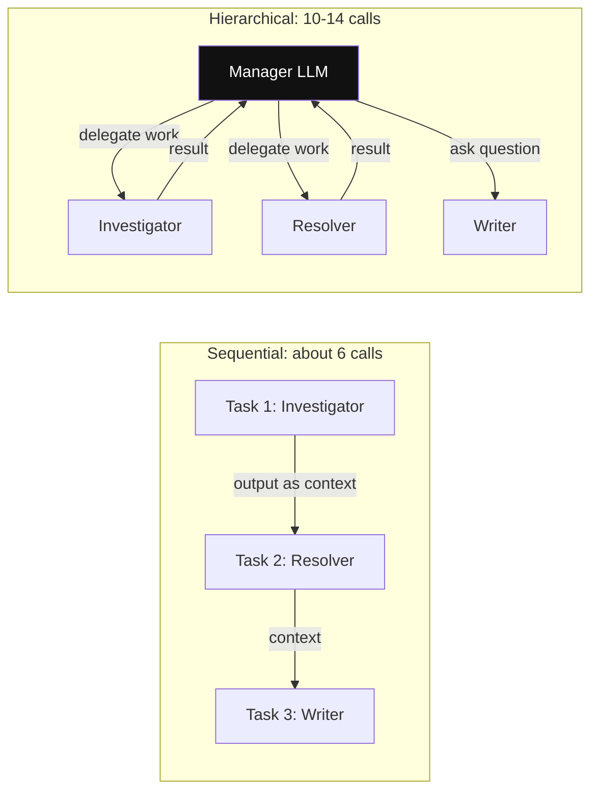

*Diagram:* Left: list order decides the next step and outputs flow straight on. Right: every hop goes through the manager LLM, which is where the extra calls and surprises come from.

**How it works, step by step:**

1. **Sequential** (`Process.sequential`, default): task 1 runs, its output is added as context, then task 2, and so on. Very predictable. Number of tasks = number of task runs.
2. **Hierarchical** (`Process.hierarchical`): you give `manager_llm=...` or a custom `manager_agent=...`. CrewAI creates a manager agent whose tools are "delegate work to coworker" and "ask question to coworker". The manager reads each task, picks a coworker by role, delegates, reviews the result, and may delegate again.
3. Crew-level options: `memory=True`, `knowledge_sources=[...]`, `max_rpm`, `planning=True` (an extra LLM call that writes a step plan before tasks run), `verbose=True`, `stream=True`.
4. Run modes: `kickoff(inputs=...)`, `kickoff_async`, and `kickoff_for_each(inputs=[...])` for a batch.

| | Sequential | Hierarchical |
|---|---|---|
| Who picks the next step | you, by list order | the manager LLM |
| LLM calls for 3 tasks | roughly 3 × (1–4 per task) | add 2–6 manager calls on top |
| Predictability | high | lower |
| Debugging | easy | "why did the manager pick that agent?" |
| Good for | pipelines with known steps | open tasks where the split is not known |

A worked number: 3 tasks, each needing about 2 LLM calls, is about 6 calls sequentially. Hierarchical often adds a manager call before and after each delegation, so 10–14 calls. At 3,000 input tokens per call, that is 18k vs 36k input tokens for the same job.

```python
from crewai import Crew, Process, LLM

crew = Crew(
    agents=[researcher, analyst, writer],
    tasks=[research, analyse, write],
    process=Process.hierarchical,
    manager_llm=LLM(model="openai/gpt-4.1", temperature=0),  # stronger model for routing
    max_rpm=30,                                              # stay under provider rate limit
    verbose=True,
)
result = crew.kickoff(inputs={"topic": "UPI fraud trends in 2026"})
print(result.raw)
print(result.token_usage)                                    # total tokens for the run
```

**What the code does:**
- Builds a hierarchical crew; CrewAI creates the manager agent from `manager_llm`.
- Uses a stronger model only for the manager, because routing mistakes are the costliest.
- Caps requests per minute so a burst of delegations does not hit rate limits.
- Prints the final text and the token usage, which you should log for every run.

**Interview tip:** "Sequential or hierarchical?" Say: "Sequential by default, because it is predictable and cheap. I use hierarchical only when the split of work is not known up front, and I give the manager a strong model, short agent descriptions and a cap on iterations."

**Common mistake:**
- Choosing hierarchical for a pipeline whose steps are known. You pay for a manager that adds no value.
- Forgetting that every agent's role text is the manager's only routing signal. Vague roles cause wrong delegation.

## Tools

**In one line:** Tools are Python functions with a name, a description and typed arguments that an agent can call.

**Why it exists:** Without tools an agent can only write text. With tools it can look up an order, search the web, query a database or call an API. The description is the only thing the model reads to decide when to call it, so it matters a lot.

**Picture it:** The kitchen's appliances. A cook knows the tandoor exists and what it does because of the label on it.

**How it works, step by step:**

1. Quick way: decorate a function with `@tool("Name")` from `crewai.tools`. The docstring becomes the description, type hints become the argument schema.
2. Full way: subclass `BaseTool` with `name`, `description`, `args_schema` (a Pydantic model) and `_run`.
3. Ready-made tools live in the `crewai-tools` package (web search, scraping, file and directory read, RAG over PDFs, and more).
4. MCP: agents can use tools from MCP servers (see [Tools, MCP and A2A](07-tools-mcp-a2a.md)), so the same tool server works with other frameworks too.
5. Tool results are cached by default within a crew run (same tool, same arguments), which saves repeat calls.

**Interview tip:** "How do you keep tools safe in CrewAI?" Say: "Narrow tools with typed inputs, read-only by default, server-side checks on the user's permissions, a human-review task before any write, and tool outputs capped in size so they do not flood the context."

**Common mistake:**
- Giving every agent every tool. Each tool's schema is sent on every call and the model picks wrong tools more often.

## Memory and knowledge

**In one line:** Memory is what the crew learns and recalls across tasks and runs; knowledge is documents you attach up front and search like RAG.

**Why it exists:** Without memory, every run starts blank: the bot forgets that this customer had two refunds last week. Without knowledge, you would paste the whole policy into every prompt.

**Picture it:** Memory is the shift manager's diary of what happened. Knowledge is the policy binder on the shelf.

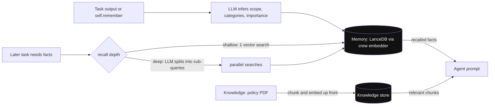

*Diagram:* Memory is written during runs and recalled later (deep recall costs extra LLM calls); knowledge is loaded up front and searched like RAG. Both end up in the prompt.

**How it works, step by step:**

1. `Crew(memory=True)` creates one **unified `Memory`** object. On save, an LLM infers a scope, categories and importance for the item. Storage is LanceDB locally by default. Embeddings come from the crew's `embedder` setting.
2. Recall has two depths: `shallow` (one vector search) and `deep` (an LLM splits the query into sub-queries and searches in parallel). Deep is better but costs extra LLM calls.
3. In a Flow, use `self.remember("...")` and `self.recall("...")`. You can pass a read-only slice of flow memory to a crew.
4. **Knowledge**: `knowledge_sources=[StringKnowledgeSource(content=...), PDFKnowledgeSource(file_paths=[...])]` on an agent or crew. CrewAI chunks, embeds and stores them, then injects relevant chunks into the prompt.
5. Reset with the CLI: `crewai reset-memories -m` (memory) or `-kn` (knowledge).

What changed: older CrewAI (0.x) had separate short-term, long-term and entity memory types. The 1.x line replaced them with the single unified `Memory` class. Old tutorials that configure the three types separately are out of date.

**Interview tip:** "Memory vs knowledge in CrewAI?" Say: "Knowledge is static reference data I load up front, like a policy PDF. Memory is learned during runs, like a customer's past complaints. I scope memory per user, because a shared memory leaks one user's data into another's answer."

**Common mistake:**
- Turning on `memory=True` in a multi-user app without scoping. One customer's facts can show up in another customer's run.
- Using deep recall on every call and wondering why latency doubled.

## Project layout and the CLI

**In one line:** `crewai create crew <name>` scaffolds a project; the default is now a JSON-first layout, and `--classic` gives the older YAML plus `crew.py` layout.

**Why it exists:** Keeping agent and task texts in config files lets non-engineers edit prompts, keeps code small and makes reviews easy.

**Picture it:** A restaurant menu card (config) kept separate from the kitchen equipment (code). You can change the menu without rewiring the kitchen.

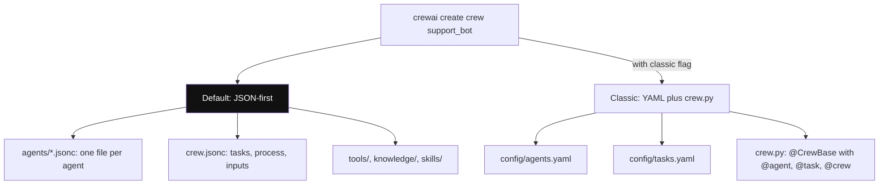

*Diagram:* Both layouts keep prompts in config files; the JSON-first one is loaded directly by `crewai run`, the classic one is wired by decorated methods in `crew.py`.

**How it works, step by step:**

1. Install the CLI with `uv tool install crewai`. Projects use `uv`; `crewai install` syncs dependencies.
2. `crewai create crew support_bot` creates `agents/*.jsonc` (one file per agent), `crew.jsonc` (tasks, process, inputs), plus `tools/`, `knowledge/` and `skills/` folders. `crewai run` loads the JSON directly; no `crew.py`.
3. `crewai create crew support_bot --classic` creates `config/agents.yaml`, `config/tasks.yaml` and a `crew.py` with a `@CrewBase` class. Methods marked `@agent` and `@task` build objects from the YAML keys; a `@crew` method returns the `Crew`.
4. `crewai create flow <name>` creates a Flow project: `src/<pkg>/main.py` plus crews under `src/<pkg>/crews/<name>/`.
5. Other commands: `crewai run`, `crewai flow plot` (draws the flow graph), `crewai replay -t <task_id>` (rerun from a task), `crewai log-tasks-outputs`, `crewai eval`, `crewai deploy ...` (AMP).

```yaml
# config/agents.yaml  (classic layout)
investigator:
  role: Order Investigator
  goal: Find the facts of order {order_id} using tools, never guess
  backstory: You work in Swiggy support ops and trust only system data.

# config/tasks.yaml
investigate:
  description: Customer says {complaint}. Look up order {order_id}.
  expected_output: Bullet list of status, amount, items and the claim.
  agent: investigator
```

**What the code does:**
- Keeps prompts out of Python, so a support lead can tune wording in a pull request.
- Uses the same `{placeholders}` as code; they are filled at `kickoff(inputs=...)`.
- In `crew.py`, a method named `investigator` decorated with `@agent` builds `Agent(config=self.agents_config["investigator"], tools=[...])`.

**Interview tip:** "What changed recently in CrewAI's project layout?" Say: "The default scaffold became JSON-first: `agents/*.jsonc` and `crew.jsonc`, no `crew.py`. The old YAML plus `@CrewBase` layout is still there behind `--classic`."

**Common mistake:**
- Mixing both layouts in one project, so nobody knows which file is the source of truth.

## ⭐ Flows

**In one line:** A Flow is a Python class whose methods are steps; decorators say which step starts, which step listens to which, and where to branch, with one typed state shared by all steps.

**Why it exists:** Crews are autonomous, which is great for open-ended work and bad for things that must happen in a fixed way: validate input, branch on a category, call an API, save to a DB, retry. Flows let you write that control in normal code and call a crew only where you want LLM judgement. They also add state persistence and resume.

**Picture it:** An IRCTC booking process. Login, pick train, fill passengers, pay, confirm: fixed steps with clear branches (payment failed → retry page). One step, "suggest alternate trains", could be a smart assistant. The flow is fixed; the assistant inside one step is free.

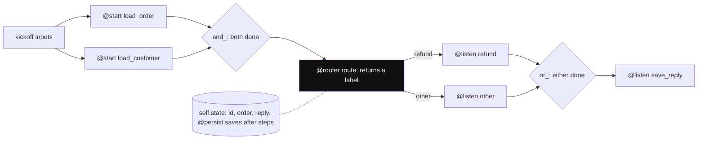

*Diagram:* Two `@start` steps run first, `and_` waits for both, the router's label picks one branch, `or_` joins them; every step reads and writes the same typed `self.state`.

**How it works, step by step:**

1. Define state as a Pydantic model and subclass `Flow[MyState]`. Fields with defaults are also the flow's inputs.
2. `@start()` marks entry methods. They run first when you call `flow.kickoff(inputs={...})`.
3. `@listen(step)` runs a method after `step` finishes and receives its return value.
4. `@router(step)` runs after `step` and returns a label string such as `"refund"`. Methods with `@listen("refund")` then run. A handler must not have the same name as its label.
5. `or_(a, b)` runs when either finishes; `and_(a, b)` runs when both have finished.
6. Steps read and write `self.state`. Each flow run has a unique `id` in state.
7. `@persist` (from `crewai.flow`) saves state after steps, so you can resume a run by passing its `id` later.
8. `flow.plot()` or `crewai flow plot` draws the graph as HTML.

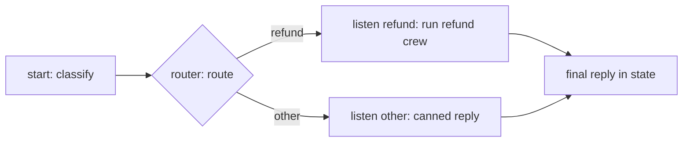

**Flows vs Crews:**

| Need | Use |
|---|---|
| Known steps, branches, loops, API calls, DB writes | Flow steps in plain Python |
| Open-ended work where LLMs should decide how | a Crew inside one Flow step |
| One LLM call with structured output | a direct `LLM` or single `Agent.kickoff()` in a Flow step, no crew |
| Long run that must survive a restart | Flow with `@persist` |

**Interview tip:** "When do you use Flows vs Crews?" Say: "Flow is the backbone, crews are the brains inside some steps. If I can write a step as code, it is code. I only call a crew where I need autonomy, which keeps cost, latency and failure modes under control."

**Common mistake:**
- Building the whole app as one big hierarchical crew and then fighting it to follow fixed steps. Use a Flow for the fixed part.
- Overwriting input fields inside `@start()`; inputs arrive as state fields with defaults.

## ⭐ A complete small app: Swiggy refund helper

**In one line:** A Flow classifies a complaint, routes refund cases to a two-agent crew with a tool, typed output and a guardrail, and replies to the customer.

**Why it exists:** This is the shape of most real CrewAI apps: deterministic routing in a Flow, a small crew where judgement is needed, and code checks on anything that touches money.

**Picture it:** A support desk. The front desk sorts tickets (Flow). Refund tickets go to a two-person team: one checks the order system, one decides the refund under policy. The finance rule "never refund more than the bill" is checked by a machine, not trusted to people.

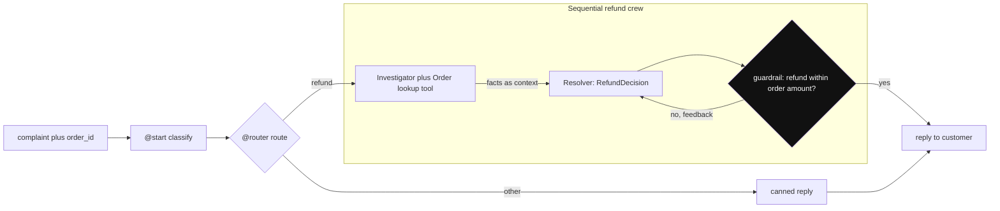

*Diagram:* The Flow does the routing in code; only refund tickets reach the two-agent crew, and the money rule is enforced by a code guardrail, not by the prompt.

**How it works, step by step:**

1. Install: `uv add crewai` (or `pip install crewai`), set `OPENAI_API_KEY`.
2. Write a tool and the output model.
3. Write two agents and two tasks with a guardrail.
4. Wrap the crew in a Flow with a router.

**Step 1: tool and output shape**

```python
from pydantic import BaseModel
from crewai.tools import tool

ORDERS = {"SW123": {"amount": 450, "status": "delivered", "items": ["Paneer Biryani", "Coke"]}}

@tool("Order lookup")
def get_order(order_id: str) -> str:
    """Return status, amount in INR and items for a Swiggy order id."""
    order = ORDERS.get(order_id)
    return str(order) if order else "Order not found"

class RefundDecision(BaseModel):
    order_id: str
    refund_inr: int
    reason: str
    reply_to_customer: str
```

**What the code does:**
- `@tool` turns a normal function into a tool; the docstring is what the model reads.
- `ORDERS` stands in for your real order service; in production the tool calls an API with the user's auth.
- `RefundDecision` is the exact shape the resolver must return.

**Step 2: agents, tasks and a guardrail**

```python
from crewai import Agent, Task, Crew, Process, LLM

llm = LLM(model="openai/gpt-4.1-mini", temperature=0)

investigator = Agent(
    role="Order Investigator",
    goal="Find the facts of order {order_id} using tools, never guess",
    backstory="You work in Swiggy support ops and trust only system data.",
    tools=[get_order], llm=llm, allow_delegation=False, max_iter=5,
)
resolver = Agent(
    role="Refund Resolver",
    goal="Decide a fair refund within policy",
    backstory="Policy: refund at most the order amount. Missing item means refund its share.",
    llm=llm, allow_delegation=False,
)

def refund_within_limit(output):
    d = output.pydantic
    amount = ORDERS.get(d.order_id, {}).get("amount", 0)
    if d.refund_inr > amount:
        return (False, f"Refund {d.refund_inr} is above order amount {amount}. Fix it.")
    return (True, output)

investigate = Task(
    description="Customer says: {complaint}. Look up order {order_id} and list the facts.",
    expected_output="Bullet list: status, amount, items, and what the customer claims.",
    agent=investigator,
)
decide = Task(
    description="Using the facts, decide the refund for order {order_id}.",
    expected_output="A RefundDecision object.",
    agent=resolver, context=[investigate],
    output_pydantic=RefundDecision, guardrail=refund_within_limit,
)
refund_crew = Crew(agents=[investigator, resolver], tasks=[investigate, decide],
                   process=Process.sequential, verbose=True)
```

**What the code does:**
- Two narrow agents, one model, `temperature=0` for stable answers, delegation off.
- The investigator is the only agent with the tool, so only it touches the order system.
- `context=[investigate]` passes the facts to the resolver explicitly.
- The guardrail enforces the money rule in code; on failure the resolver retries with the feedback.

**Step 3: the Flow around it**

```python
from crewai.flow import Flow, start, listen, router

class SupportState(BaseModel):
    order_id: str = ""
    complaint: str = ""
    category: str = ""
    reply: str = ""

class SupportFlow(Flow[SupportState]):
    @start()
    def classify(self):
        text = self.state.complaint.lower()
        words = ["missing", "cold", "refund", "wrong item"]
        self.state.category = "refund" if any(w in text for w in words) else "other"

    @router(classify)
    def route(self):
        return self.state.category            # label: "refund" or "other"

    @listen("refund")
    def handle_refund(self):
        out = refund_crew.kickoff(inputs={"order_id": self.state.order_id,
                                          "complaint": self.state.complaint})
        self.state.reply = out.pydantic.reply_to_customer
        return self.state.reply

    @listen("other")
    def handle_other(self):
        self.state.reply = "Connecting you to a support executive."
        return self.state.reply

flow = SupportFlow()
print(flow.kickoff(inputs={"order_id": "SW123", "complaint": "Coke was missing from my order"}))
```

**What the code does:**
- `classify` is plain Python: cheap, instant and testable. You can swap it for one LLM call later.
- `route` returns a label; only the matching `@listen` method runs.
- The refund branch runs the crew and reads the typed result from `out.pydantic`.
- `kickoff(inputs=...)` fills the state fields; the return value is the last step's output.
- Expected result: a refund of about Rs 40–60 for the Coke (its share), well under Rs 450, and a polite reply.

**Interview tip:** "Walk me through a CrewAI app you would put in production." Say: "A Flow as the backbone with typed state, deterministic routing in code, a small sequential crew only where judgement is needed, `output_pydantic` plus code guardrails on anything with money, tracing on, and persistence so a run can resume."

**Common mistake:**
- Letting the LLM decide refund limits with no code check. Guardrails exist for exactly this.

## ⭐ How it works inside

**In one line:** For each task, CrewAI builds a prompt from the agent's persona, the task and its context, runs a tool-calling loop until a final answer, validates it, and passes it on.

**Why it exists:** Interviewers ask "what actually happens when I call kickoff?" to check you can debug it. Knowing the prompt and the loop tells you where tokens go and why things fail.

**Picture it:** A cook gets a ticket stapled to the previous station's note. They cook, taste (tool call), adjust, and plate. The pass checks the plate before it leaves.

**How it works, step by step:**

1. `kickoff(inputs)` fills `{placeholders}` in all agent and task texts.
2. For the first task, the executor builds a system prompt, roughly: "You are {role}. {backstory}. Your personal goal is: {goal}", plus the tool list.
3. The user message holds the task: "Current Task: {description}", the expected output as "the criteria for your final answer", and any context from earlier tasks.
4. The loop: call the LLM; if it requests a tool (native function calling when the model supports it, otherwise a text ReAct format of Thought, Action, Action Input, Observation), run the tool, append the result, call again. Stop at a final answer or at `max_iter`.
5. If `output_pydantic` is set, the answer is parsed into the model. If a guardrail is set, it runs; on failure the feedback is added and the agent tries again.
6. Memory may be saved; the `TaskOutput` goes into the next task's context.
7. Events (task started, tool used, LLM call finished) are emitted on CrewAI's event bus, which tracing and your own listeners read.
8. After the last task, a `CrewOutput` comes back with outputs and token usage.

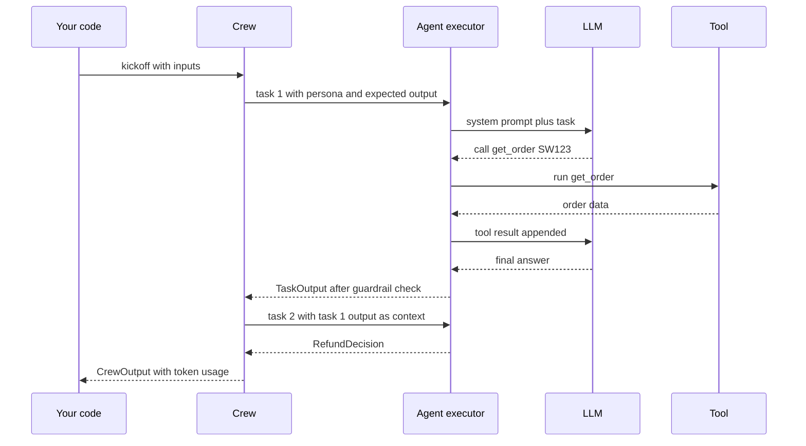

**Interview tip:** "Why is my crew slow?" Say: "Count the LLM calls. Each task is a loop, each tool call is another round trip, hierarchical adds manager calls, guardrail retries add more, and deep memory recall adds more still. I check the trace, then cut agents, tools and retries."

**Common mistake:**
- Assuming one task means one LLM call. With tools and retries it is often 3–6.

## Production concerns

**In one line:** Treat a crew like any LLM service: trace every call, cap loops and tokens, persist long runs, evaluate on a fixed set, and deploy behind your own API.

**Why it exists:** Multi-agent runs are long, costly and non-deterministic. Without limits and traces, one bad prompt can loop for minutes and nobody can tell why.

**Picture it:** A restaurant with CCTV, a gas cut-off and a daily taste test.

**How it works, step by step:**

1. **Observability:** built-in tracing to CrewAI AMP (`crewai traces enable` or `CREWAI_TRACING_ENABLED=true`). Third-party tools (Langfuse, Arize Phoenix, MLflow, OpenLIT and others) hook in through OpenTelemetry or CrewAI's event listeners. Log `token_usage` per run. See [AI Observability](10-agent-observability.md).
2. **Limits:** `max_iter`, `max_execution_time`, `max_rpm` on agents; `guardrail_max_retries` on tasks; a timeout on the whole request.
3. **Persistence:** `@persist` on Flows to save state and resume by `id`; `crewai replay -t <task_id>` reruns from a task during debugging.
4. **Streaming:** `Crew(stream=True)` streams chunks so the UI is not blank for 40 seconds.
5. **Evals:** `crewai eval` runs a traced run against criteria in `eval.jsonc`; you can also score outputs with your own golden set ([Evals for Agents](09-agent-evals.md)). `crewai test` and `crewai train` are now marked legacy.
6. **Deployment:** wrap `kickoff` in your own FastAPI service and run it as a background job for long crews, or deploy to AMP with `crewai deploy create`.
7. **Cost:** count role-text tokens × calls. See the next section.

**Interview tip:** "How do you make a CrewAI app production-ready?" Say: "Flow-first with typed state and persistence, sequential crews with small toolsets, `max_iter` and timeouts, Pydantic output plus guardrails, tracing with token usage per run, an eval set in CI, and an async job API because runs take tens of seconds."

**Common mistake:**
- Running `crew.kickoff()` inside a synchronous HTTP request. Long runs hit the gateway timeout; use a job queue or streaming.

## The cost of role-play prompts

**In one line:** Every agent, persona, delegation and retry is more tokens, so a crew can cost several times a single agent doing the same job.

**Why it exists:** Interviewers love "Isn't multi-agent just more expensive?". You need numbers, not opinion.

**Picture it:** Four people in a meeting each repeating their designation before every sentence.

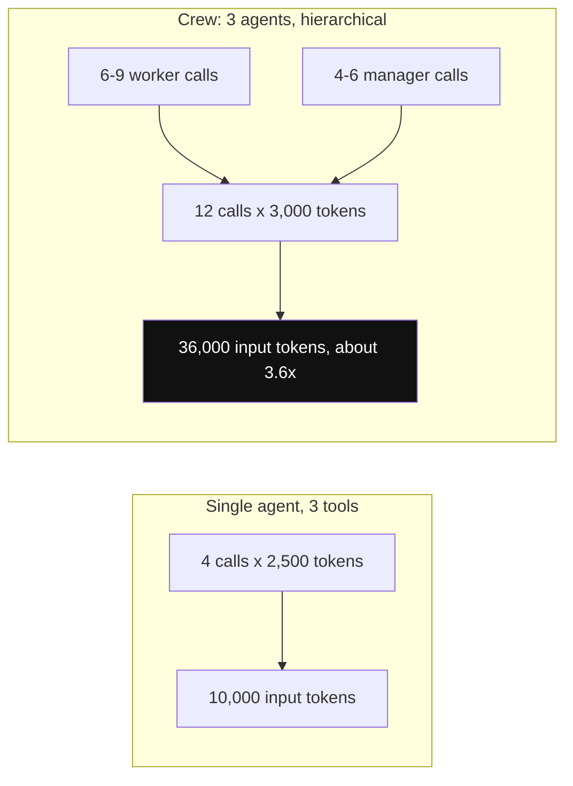

*Diagram:* Same job, two designs: personas, manager calls and passed-along context push the crew to roughly 3–4× the tokens of one agent.

**How it works, step by step:**

1. Count calls: 3 agents × 3 tasks, about 2–3 calls each, is 6–9 calls. Hierarchical adds 4–6 manager calls.
2. Count input tokens per call: persona (~150) + tool schemas (~100 per tool) + task + context from earlier tasks (often 1,000–3,000).
3. Example: 12 calls × 3,000 input tokens = 36,000 input tokens. A single agent with 3 tools might do it in 4 calls × 2,500 = 10,000. Roughly 3–4× more.
4. Reduce: sequential instead of hierarchical, fewer agents, short backstories, cheaper models for simple agents, `allow_delegation=False`, small tool outputs, prompt caching (keep persona and tool text identical so the provider caches the prefix).

**Interview tip:** "One agent or a crew?" Say: "Start with one agent and tools. Split into a crew only when roles need different tools, different models or isolated context, and prove the split helps on an eval set. A crew costs roughly 2–4× more tokens."

**Common mistake:**
- Splitting into agents for readability. Use functions and Flow steps for readability; use agents only when autonomy helps.

## ⭐ When to use CrewAI, and how it compares

**In one line:** Use CrewAI when the problem looks like a team of roles and you want speed of building; prefer LangGraph or Microsoft Agent Framework when you need fine control and durable execution.

**Why it exists:** "Why this and not X" is the most common senior question about frameworks.

**Picture it:** Ready-made thali vs ordering a la carte. The thali (CrewAI) is fast and good for most people. A la carte (LangGraph) gives exact control but you plan every dish.

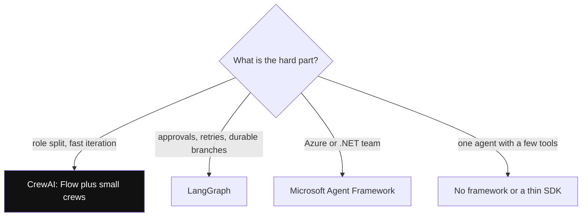

*Diagram:* Ask what is hard first; CrewAI wins when the work is shaped like a team of roles and speed of building matters.

**How it works, step by step:**

1. Ask: is the hard part control flow (approvals, retries, branches)? Lean to LangGraph, or a CrewAI Flow with small crews.
2. Is the hard part role split and quick iteration? CrewAI.
3. Is the team on Azure and .NET? Microsoft Agent Framework.
4. Is it one agent with tools? Maybe no framework, or a thin SDK.

| | CrewAI | LangGraph | AutoGen 0.4 / Microsoft Agent Framework |
|---|---|---|---|
| Mental model | role-based crew + Flows | explicit graph over typed state | agents in group chats + graph workflows |
| Control | medium (Flows high, crews low) | high | medium to high (workflows) |
| Multi-agent style | sequential or manager delegation | supervisor, subgraphs, handoffs, any graph | round-robin, selector, handoff, Magentic |
| Persistence / resume | Flow `@persist`, task replay | checkpointer per thread, time travel | AutoGen `save_state`; MAF workflow checkpoints |
| Human in the loop | `human_input` on task, flow feedback | `interrupt()` anywhere | user proxy, `request_info` in workflows |
| Learning curve | lowest | steepest | medium |
| Ecosystem | crewai-tools, AMP | LangChain, LangSmith | Azure, Foundry, .NET |
| Best for | content, research, ops pipelines, fast prototypes | long, branching production agents | Microsoft-stack enterprise agents |

**Interview tip:** "CrewAI vs LangGraph for a production support bot?" Say: "If the bot is mostly fixed steps with approvals and must resume after crashes, LangGraph, because state and checkpoints are first-class. If it is a research or content pipeline with clear roles, CrewAI with Flows gets there faster. Either way tools are MCP servers and tracing is OpenTelemetry, so switching later is not a rewrite."

**Common mistake:**
- Picking by GitHub stars or demo videos. Pick by what is hard in your use case.

## Common pitfalls

**In one line:** Most CrewAI problems come from too many agents, vague tasks, uncapped loops and trusting the manager.

**Why it exists:** These are the bugs you will see in the first two weeks of a real project.

**Picture it:** A new team with unclear job descriptions and no manager checklist.

**How it works, step by step:**

1. **Loops:** an agent keeps calling the same tool. Fix: `max_iter`, better tool descriptions, return clear "not found" messages.
2. **Wrong delegation:** the manager sends tasks to the wrong agent. Fix: short, distinct roles; or switch to sequential.
3. **Format drift:** the output shape changes run to run. Fix: `output_pydantic` and a precise `expected_output`.
4. **Context bloat:** each task gets all earlier outputs. Fix: explicit `context=[...]` with only what is needed.
5. **Hallucinated tool results:** with text-based ReAct, weak models sometimes write a fake Observation. Fix: use a model with native function calling.
6. **Silent cost growth:** memory deep recall, planning and guardrail retries each add calls. Fix: log `token_usage` per run and alert on spikes.
7. **Version churn:** fields get deprecated (`function_calling_llm`, `allow_code_execution`, the old `reasoning` flag). Fix: pin the version, read the changelog before upgrading.
8. **Telemetry surprise:** CrewAI sends anonymous usage telemetry by default; set `CREWAI_DISABLE_TELEMETRY=true` if policy needs it (separate from tracing).

**Interview tip:** "How would you debug a crew that gives a wrong answer?" Say: "Open the trace, find the first task whose output is wrong, check its prompt and context, check whether the tool returned the right data, then fix the narrowest thing: tool description, expected output, or a guardrail. Then add that case to the eval set."

**Common mistake:**
- Fixing a bad answer by adding another reviewer agent. That adds cost and often repeats the same mistake.

## Interview questions

**Q: What are the core building blocks of CrewAI?**
Agent (role, goal, backstory, llm, tools), Task (description, expected output, agent, context, structured output, guardrail), Crew (agents plus tasks plus process) and Flow (event-driven steps with typed state). Tools, memory and knowledge plug into agents and crews.

**Q: Sequential vs hierarchical process?**
Sequential runs tasks in list order and passes outputs along; predictable and cheap. Hierarchical adds a manager agent that delegates tasks to coworkers using delegation tools; flexible but adds manager calls and is harder to debug.

**Q: What does `allow_delegation=True` actually do?**
It gives the agent two tools, "delegate work to coworker" and "ask question to coworker", so it can send sub-questions to other agents by role. Each delegation is extra LLM calls, so keep it off unless needed.

**Q: How do you get typed output and enforce business rules?**
`output_pydantic` on the task for the shape, and a `guardrail` function returning `(True, value)` or `(False, feedback)` for rules. A failed guardrail sends feedback to the agent and retries up to the limit.

**Q: Flows vs Crews: when do you use which?**
Flows for anything you can write as code: fixed steps, branches, loops, API calls, persistence. Crews inside a Flow step only where autonomous LLM work helps. Most production apps are Flow-first.

**Q: How do `@start`, `@listen` and `@router` work?**
`@start` marks entry steps. `@listen(step)` runs after that step and gets its return value. `@router(step)` returns a label, and methods listening to that label run. `or_` and `and_` combine triggers.

**Q: What prompt does CrewAI send?**
Roughly: a system message from role, backstory and goal plus the tool list, and a user message with the task description, the expected output as the final-answer criteria, and earlier task context. It loops on tool calls until a final answer.

**Q: How would you debug a crew that loops forever?**
Check the trace for the repeated tool call, cap `max_iter` and `max_execution_time`, make the tool return a clear terminal message, and tighten the expected output so the agent knows when it is done.

**Q: What changed in CrewAI recently?**
It dropped the LangChain dependency (2025), reached 1.0 (late 2025), moved to a unified `Memory` class, made the project scaffold JSON-first (YAML with `--classic`), added Flow persistence and checkpointing, and deprecated fields like `function_calling_llm` and `allow_code_execution`.

**Q: How do you make CrewAI production-ready?**
Flow with typed state and `@persist`, small sequential crews, caps on iterations and time, Pydantic output plus guardrails, per-run token logging and tracing, an eval set in CI, and async job execution behind your API.

**Q: CrewAI vs LangGraph?**
CrewAI is high-level and fast to build with roles and tasks. LangGraph is low-level with explicit state, edges, checkpointing and `interrupt()`. For long, branching, resumable production flows I lean LangGraph; for role-shaped pipelines and quick builds, CrewAI with Flows.

**Q: CrewAI vs AutoGen?**
CrewAI organises work as tasks owned by agents. AutoGen organises it as a conversation between agents with termination conditions. AutoGen is now in maintenance mode; Microsoft's new work is in Microsoft Agent Framework.

**Q: A crew costs 4× your estimate. What do you do?**
Read token usage per task, then cut: switch hierarchical to sequential, remove delegation, shorten backstories, trim context to what each task needs, use a cheaper model for simple agents, and keep prompt prefixes stable for caching.

**Q: How do you handle multi-user memory safely?**
Scope memory per user (or slice it read-only per run), never share one global memory across customers, keep transactional facts in your database not in memory, and allow deletion for privacy requests.

**Q: What would make you not use CrewAI?**
A single agent with a few tools (no framework needed), strict durable workflows with many approvals (LangGraph or a workflow engine), or a team standardised on another stack.

## Read next

- [Agent Frameworks and Tooling](19-agent-frameworks.md)
- [LangGraph Core](02-langgraph-core.md)
- [AutoGen and Microsoft Agent Framework](26-autogen.md)
- [OpenAI Agents SDK](27-openai-agents-sdk.md)

## Checklist

- [ ] I can explain Agent, Task, Crew and Process and how a kickoff flows through them.
- [ ] I can explain what role, goal and backstory become in the prompt and what they cost.
- [ ] I can explain sequential vs hierarchical and what the manager agent does.
- [ ] I can add `output_pydantic` and a code guardrail to a task and explain the retry.
- [ ] I can write a Flow with `@start`, `@listen` and `@router` that calls a crew.
- [ ] I can explain when to use a Flow step, a single LLM call or a crew.
- [ ] I can explain CrewAI memory vs knowledge and how to scope memory per user.
- [ ] I can list how to make a crew production-ready: limits, tracing, persistence, evals.
- [ ] I can compare CrewAI with LangGraph and AutoGen and pick one for a use case.
