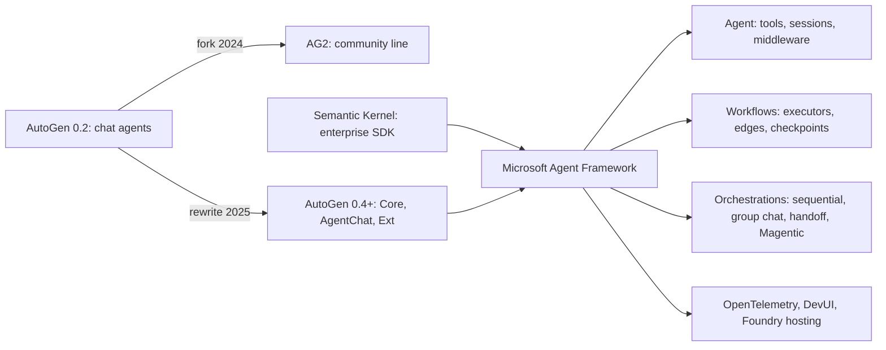
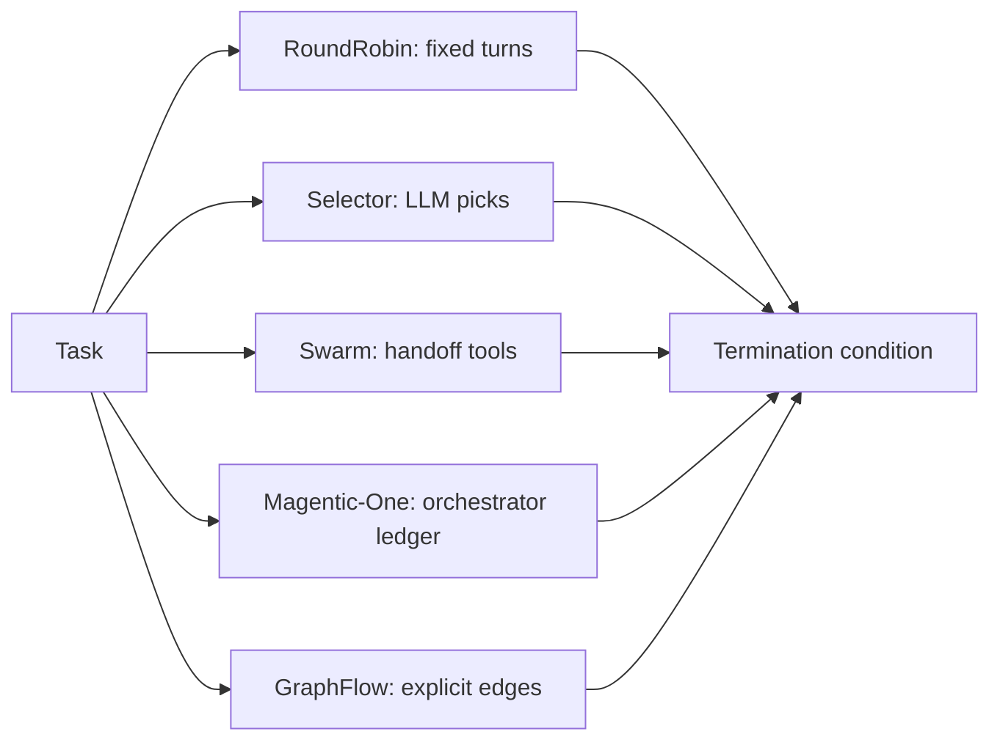
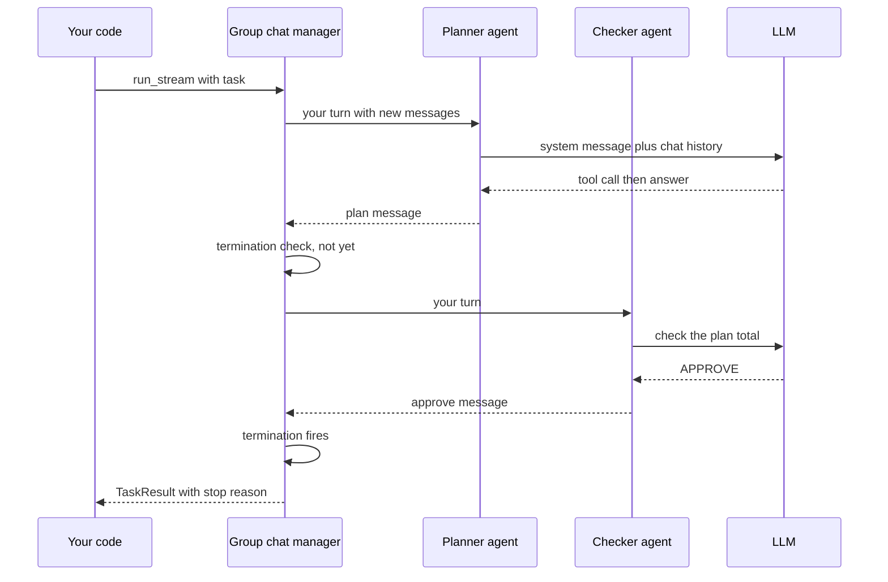

# AutoGen and Microsoft Agent Framework

AutoGen is Microsoft Research's framework where several AI agents solve a task by **talking to each other** in a group chat. Its ideas, together with Semantic Kernel's enterprise features, now live in **Microsoft Agent Framework**, which is Microsoft's supported way to build agents today. Interviewers ask about this family because many companies built on AutoGen, because the names and forks are confusing, and because "what would you start a new project on?" tests whether you keep up.

Written against **Microsoft Agent Framework 1.x** (Python, generally available since April 2026) and **AutoGen 0.7.x** (the last line of the 0.4+ rewrite, now in maintenance mode). Check both changelogs before you copy code.

**After this page you can answer:**
- "What are AutoGen's Core, AgentChat and Extensions layers?"
- "RoundRobinGroupChat vs SelectorGroupChat vs Swarm vs GraphFlow: when do you use each?"
- "How does an AutoGen team know when to stop?"
- "What is AG2, and why does `pip install autogen` not give you Microsoft's AutoGen?"
- "What is Microsoft Agent Framework, what does it merge, and is AutoGen dead?"
- "How do Agent Framework workflows differ from agent orchestrations?"
- "How would you run LLM-written code safely?"
- "You are starting a new agent project on Azure today. What do you pick and why?"

## Words you need first

New to agents? Read [Agent Foundations](01-agent-foundations.md) and [Agent Frameworks and Tooling](19-agent-frameworks.md) first.

| Word | Plain meaning |
|---|---|
| Multi-agent conversation | Several agents taking turns posting messages to one shared chat to finish a task. |
| Team | AutoGen's name for a group of agents plus the rule for who speaks next. |
| Speaker selection | How a team picks the next agent: fixed order, an LLM choice, a handoff or a graph. |
| Termination condition | A rule that stops a team, like "someone said APPROVE" or "20 messages reached". |
| Model client | A small object that talks to one model provider, like OpenAI or Azure OpenAI. |
| Actor model | Design where independent workers only talk by sending each other messages. |
| Code executor | A component that runs code an agent wrote, ideally inside a Docker container. |
| Handoff | An agent passing control to another agent by calling a special tool. |
| AG2 | A community fork of the old AutoGen 0.2 line, run by some of its original authors. |
| Semantic Kernel (SK) | Microsoft's earlier enterprise SDK for adding LLMs to apps in C#, Python and Java. |
| Microsoft Agent Framework (MAF) | Microsoft's current agent SDK for .NET and Python that merges AutoGen and SK ideas. |
| Workflow | In MAF, a typed graph of steps (executors) joined by edges, with checkpoints. |
| Executor | One step in a MAF workflow: an agent or a function that handles a message. |
| Maintenance mode | The project gets bug and security fixes only, no new features. |

## Big picture

There are four names in this family, and the trick is knowing how they relate. AutoGen started the "agents chatting" idea. AG2 forked the old version and went its own way. Semantic Kernel was Microsoft's separate enterprise SDK. Microsoft Agent Framework took AutoGen's multi-agent patterns and SK's enterprise features and became the one supported path. This page covers AutoGen's design first, because that is where the ideas and many interview questions come from, then the fork and SK, then Agent Framework in depth, a full app, internals and how to choose.



## ⭐ The history in one timeline

**In one line:** AutoGen 0.2 became popular, split into a fork (AG2) and a rewrite (0.4), and the rewrite plus Semantic Kernel were merged into Microsoft Agent Framework, which is now the supported choice.

**Why it exists:** Most confusion in interviews and on PyPI comes from this history. If you mix up AG2 and AutoGen 0.4, or call AutoGen "Microsoft's current framework", the interviewer notices.

**Picture it:** A popular restaurant. One head chef leaves with the old menu and opens his own place (AG2). The original restaurant rebuilds its kitchen (AutoGen 0.4). Later the owners merge it with their corporate catering arm (Semantic Kernel) under one new brand (Agent Framework). The old kitchen stays open for repairs only.

**How it works, step by step:**

| When | What happened |
|---|---|
| 2023 | Semantic Kernel is open-sourced: Microsoft's SDK for LLM features in enterprise apps. |
| Late 2023 | AutoGen 0.2 (`pyautogen`) from Microsoft Research makes multi-agent chat popular. |
| Nov 2024 | Some original AutoGen authors fork 0.2 as **AG2**; AG2 takes over the `autogen` and `pyautogen` PyPI names. |
| Jan 2025 | **AutoGen 0.4** ships: a full rewrite into Core, AgentChat and Extensions; async and event-driven. |
| Mid 2025 | AutoGen 0.6–0.7 adds GraphFlow and other features. |
| Oct 2025 | **Microsoft Agent Framework** public preview. AutoGen and Semantic Kernel move toward maintenance mode. |
| Apr 2026 | Agent Framework **1.0 GA** for .NET and Python. |
| Today | New Microsoft-stack projects start on Agent Framework. AutoGen gets fixes only. AG2 is a separate, active project. |

The package names matter:
1. `autogen-agentchat`, `autogen-core`, `autogen-ext` = Microsoft AutoGen 0.4+.
2. `autogen`, `pyautogen`, `ag2` = the AG2 fork.
3. `agent-framework` (Python) and `Microsoft.Agents.AI` (.NET) = Microsoft Agent Framework.
4. `semantic-kernel` = Semantic Kernel.

**Interview tip:** "Is AutoGen dead?" Say: "Not dead, but in maintenance mode: bug and security fixes only. Microsoft's new features go into Agent Framework, which merges AutoGen's multi-agent patterns with Semantic Kernel's enterprise features and went GA in April 2026. Existing AutoGen apps keep working and there is an official migration guide. AG2 is a separate community fork of the older 0.2 API."

**Common mistake:**
- Running `pip install autogen` and following a Microsoft 0.4 tutorial. You get AG2, and none of the imports match.

## ⭐ What AutoGen is and the mental model

**In one line:** AutoGen treats a multi-agent system as a conversation: agents post messages to a shared thread, a rule picks who speaks next, and a termination condition ends it.

**Why it exists:** Some tasks improve when one model checks another: a writer and a critic, a coder and a code runner, a planner and specialists. AutoGen made that pattern easy: define agents, put them in a team, start a chat. Its research results (and the Magentic-One generalist team) made it very popular in 2023–2025.

**Picture it:** A WhatsApp group for a wedding. The planner posts a task, the caterer and decorator reply in turn, someone says "Done, final", and the chat stops. The group admin decides who should answer next.

**How it works, step by step:**

1. Each agent has a name, a description and a model client, plus tools.
2. A team holds the agents and a shared message list.
3. You call `team.run(task=...)` or `team.run_stream(task=...)`.
4. The team picks a speaker, sends it the new messages, and the speaker replies (maybe after tool calls).
5. The reply is broadcast to everyone in the team.
6. The termination condition checks the new messages. If it fires, the run ends with a `TaskResult`. If not, go to step 4.
7. The team keeps its state, so calling `run` again continues the same conversation.

| Feature | AutoGen's answer |
|---|---|
| Coordination | shared conversation |
| Who acts next | team type (round robin, selector, swarm, graph) |
| When to stop | termination conditions |
| Running code | code executor agents, Docker by default in docs |
| Extensibility | Core actor runtime and Extensions packages |

**Interview tip:** "What's AutoGen's core abstraction?" Say: "Conversation as the unit of coordination. Agents share one message thread, the team decides who speaks, and a termination condition stops it. That is flexible but harder to bound than an explicit graph, which is why I always combine a semantic stop with a hard cap."

**Common mistake:**
- Forgetting the conversation grows every turn. Ten agents × 20 turns means a huge context sent on every call.

## ⭐ AutoGen 0.4+ layers: Core, AgentChat, Extensions

**In one line:** AutoGen 0.4+ is three packages: Core (an event-driven actor runtime), AgentChat (high-level agents and teams on top), and Extensions (model clients, code executors, tools).

**Why it exists:** AutoGen 0.2 was one big package with synchronous, tightly coupled agents. It was hard to scale, observe or extend. The 0.4 rewrite split it into layers: most users stay in AgentChat; people building custom distributed systems drop to Core.

**Picture it:** A food delivery platform. Core is the dispatch system that routes messages between riders and restaurants. AgentChat is the customer app with ready-made screens. Extensions are plug-in partners: payment, maps, SMS.

**How it works, step by step:**

1. **Core** (`autogen-core`): agents are actors. They receive typed messages through handlers (`RoutedAgent` with `@message_handler`). They talk by direct messages (request and response) or by publishing to topics that others subscribe to. A runtime delivers messages: `SingleThreadedAgentRuntime` in one process, or an experimental distributed gRPC runtime across machines.
2. **AgentChat** (`autogen-agentchat`): ready agents (`AssistantAgent`, `UserProxyAgent`, `CodeExecutorAgent`, `SocietyOfMindAgent`, `MessageFilterAgent`), teams (`RoundRobinGroupChat`, `SelectorGroupChat`, `Swarm`, `MagenticOneGroupChat`, `GraphFlow`), termination conditions and a `Console` UI helper.
3. **Extensions** (`autogen-ext`): model clients (OpenAI, Azure OpenAI, Anthropic, Ollama and others), code executors (Docker, local, Jupyter, Azure Container Apps), MCP tools through `McpWorkbench`, and extra agents like a web surfer.
4. Everything is `async`. You `await` runs and stream events.
5. Teams and agents can be saved and loaded as declarative JSON (`dump_component` and `load_component`), which AutoGen Studio uses.

| Layer | You use it when |
|---|---|
| AgentChat | almost always: build agents and teams fast |
| Core | custom message protocols, many agents, distributed runtime |
| Extensions | always, for model clients and executors |

Install: `pip install -U "autogen-agentchat" "autogen-ext[openai]"`.

**Interview tip:** "Why did AutoGen 0.4 rewrite everything?" Say: "0.2 was synchronous and tightly coupled. 0.4 moved to an async actor model in Core so agents talk by messages, which allows distributed runtimes, better observability and pluggable components, with AgentChat as a friendly layer on top."

**Common mistake:**
- Mixing 0.2-style code (`ConversableAgent`, `initiate_chat`, `llm_config` dicts) with 0.4 imports. 0.2-style is now AG2's API.

## ⭐ AssistantAgent

**In one line:** `AssistantAgent` is AutoGen's general agent: a model client, a system message, optional tools, and settings for how it handles tool results.

**Why it exists:** Most agents in a team are "an LLM with a role and tools". `AssistantAgent` covers that, so you do not write the tool loop yourself.

**Picture it:** A new employee with a job title (system message), a laptop (tools) and a manager's rule "after you use a tool, summarise what you found" (reflection).

**How it works, step by step:**

1. Create a model client: `OpenAIChatCompletionClient(model="gpt-4.1-mini")`.
2. Create the agent with `name`, `model_client`, `system_message`, `tools` (plain Python functions are wrapped automatically) and an optional `description` (used by selector teams).
3. On a turn, the agent calls the model. If the model asks for tools, the agent runs them.
4. By default it does **one** tool round (`max_tool_iterations=1`) and returns the tool output as its reply. Set `reflect_on_tool_use=True` to make one more model call that turns tool output into a natural answer, or raise `max_tool_iterations` to let it loop.
5. Useful extras: `handoffs=[...]` (for Swarm), `output_content_type=MyPydanticModel` (structured output), `model_context` (limit history, for example last N messages), `memory`, and `model_client_stream=True` for token streaming.
6. Run it alone with `await agent.run(task=...)` or put it in a team.

```python
import asyncio
from autogen_agentchat.agents import AssistantAgent
from autogen_agentchat.conditions import TextMentionTermination, MaxMessageTermination
from autogen_agentchat.teams import RoundRobinGroupChat
from autogen_agentchat.ui import Console
from autogen_ext.models.openai import OpenAIChatCompletionClient

def get_fare(src: str, dst: str) -> str:
    """Return the 3A train fare in INR between two cities."""
    return f"{src} to {dst}: Rs 1,150 in 3A"

async def main():
    mc = OpenAIChatCompletionClient(model="gpt-4.1-mini")
    planner = AssistantAgent("planner", model_client=mc, tools=[get_fare],
                             reflect_on_tool_use=True,
                             system_message="Plan Indian trips with a total cost in INR.")
    checker = AssistantAgent("checker", model_client=mc,
                             system_message="If the total is within Rs 15,000 reply APPROVE, else say what to cut.")
    stop = TextMentionTermination("APPROVE") | MaxMessageTermination(8)
    team = RoundRobinGroupChat([planner, checker], termination_condition=stop)
    await Console(team.run_stream(task="3 nights in Goa from Mumbai for 2 people"))
    await mc.close()

asyncio.run(main())
```

**What the code does:**
- A plain function becomes a tool; its docstring and type hints become the schema.
- `reflect_on_tool_use=True` makes the planner write a real answer after using the tool, not just echo the tool output.
- `RoundRobinGroupChat` alternates planner and checker until "APPROVE" appears or 8 messages pass.
- `|` combines two termination conditions with OR, so a semantic stop always has a hard cap.
- `Console` prints each message as it streams.

**Interview tip:** "My AutoGen agent returns raw tool output instead of an answer. Why?" Say: "In 0.4+ `AssistantAgent` defaults to one tool round and returns the tool result as its message. Turn on `reflect_on_tool_use` or raise `max_tool_iterations`."

**Common mistake:**
- Expecting AutoGen's agent to loop over tools until done, like most other frameworks. It does not by default. (Agent Framework's `Agent` does loop by default, a key migration difference.)

## ⭐ Teams: RoundRobin, Selector, Swarm, Magentic-One, GraphFlow

**In one line:** A team type is the speaker-selection rule: fixed order, an LLM choosing, agents handing off, an orchestrator with a plan, or an explicit graph.

**Why it exists:** Different problems need different coordination. A writer-reviewer loop is fine with turns. A support desk needs routing. A research task needs a planner. A business process needs a fixed graph.

**Picture it:** Five ways to run a meeting: go around the table (round robin), the chair picks who speaks (selector), people pass the mic themselves (swarm), a project manager with a task list (Magentic-One), or a written agenda (graph).

**How it works, step by step:**

1. **RoundRobinGroupChat:** agents speak in list order, repeatedly. Cheapest; good for reflection loops (writer, critic).
2. **SelectorGroupChat:** before each turn, an LLM reads the conversation and the agents' names and descriptions and picks the next speaker. You can override with `selector_func` (return a name, or `None` to let the LLM pick) and restrict with `candidate_func`. Costs one extra LLM call per turn.
3. **Swarm:** each agent has `handoffs=[...]`. The active agent keeps the turn until it calls a handoff tool to another agent. No central LLM selector. `HandoffTermination` can stop the team to hand control to a human.
4. **MagenticOneGroupChat:** an orchestrator keeps a task ledger and a progress ledger, plans, assigns steps to specialists (web surfer, file surfer, coder, terminal), and re-plans when stuck. Powerful for open web and file tasks; expensive and slow.
5. **GraphFlow:** you build a directed graph with `DiGraphBuilder` (nodes are agents, edges can have conditions). It supports sequence, parallel fan-out, joins, conditional branches and loops. `MessageFilterAgent` can limit what each node sees. It was marked experimental when added.

| Team | Who picks next | Extra cost | Best for |
|---|---|---|---|
| RoundRobinGroupChat | list order | none | write and review loops |
| SelectorGroupChat | an LLM (or your function) | 1 call per turn | routing among specialists |
| Swarm | the active agent, by handoff | none | support desks, triage |
| MagenticOneGroupChat | orchestrator with ledgers | high | open-ended web and file tasks |
| GraphFlow | your graph and edge conditions | none | known business processes |



**Interview tip:** "Selector or Swarm for a support bot?" Say: "Swarm, because routing decisions stay with the agent that has the context and there is no extra selector call per turn. Selector fits when no single agent knows who should go next. For a fixed process I would use a graph."

**Common mistake:**
- Using SelectorGroupChat with vague agent descriptions. The selector LLM only sees names and descriptions, so it routes badly.

## ⭐ Termination conditions

**In one line:** A termination condition is a small stateful check, run after each agent's response, that ends the run when a rule matches.

**Why it exists:** Conversations do not stop on their own. Without a stop rule, two polite agents can thank each other forever and burn tokens.

**Picture it:** A meeting ends when the chair says "decided", when the clock hits 5 pm, or when the budget runs out, whichever comes first.

**How it works, step by step:**

1. After each agent's response, the team passes the new messages to the condition.
2. Built-in conditions include: `MaxMessageTermination(n)`, `TextMentionTermination("APPROVE")`, `TokenUsageTermination`, `TimeoutTermination(seconds)`, `HandoffTermination(target)`, `SourceMatchTermination`, `FunctionCallTermination`, `StopMessageTermination` and `ExternalTermination` (stop from your code, for example a UI button).
3. Combine with `|` (OR) and `&` (AND).
4. Conditions reset automatically after each run.
5. `team.reset()` clears the conversation; `await team.save_state()` and `load_state()` persist it.

A worked number: a 3-agent round robin with `MaxMessageTermination(12)` makes at most 11 agent messages after the task. At about 4,000 input tokens per turn (the conversation grows), that is roughly 44,000 input tokens as a hard ceiling.

**Interview tip:** "How do you make sure an AutoGen team stops?" Say: "Always combine a semantic condition, like a keyword or a function call, with hard caps on messages, tokens and time, plus an external stop for the UI. The semantic one gives a clean finish; the caps protect the bill."

**Common mistake:**
- Relying only on `TextMentionTermination("TERMINATE")`. The model may never say it, or may say it in the middle of a sentence too early.

## Code execution agents

**In one line:** A code executor agent runs code that another agent wrote and returns the output, which is how AutoGen teams do data analysis and computation.

**Why it exists:** LLMs are bad at arithmetic and data crunching but good at writing Python. Writing code and running it gives exact answers, like "top 3 cities by revenue", from real data.

**Picture it:** A chartered accountant (coder) writes the formula; a junior (executor) runs it in Excel inside a locked room and reads out the result.

**How it works, step by step:**

1. The coder agent writes code in a fenced Python block.
2. `CodeExecutorAgent` extracts the code and runs it with an executor.
3. `DockerCommandLineCodeExecutor` runs it in a container (safe default). `LocalCommandLineCodeExecutor` runs on your machine (only for trusted demos). Jupyter and Azure Container Apps executors also exist.
4. The output (stdout, errors) goes back to the conversation; the coder fixes errors and tries again.
5. A termination condition stops when the coder says it is done.

```python
# reuses the imports from the AssistantAgent example above
from autogen_agentchat.agents import AssistantAgent, CodeExecutorAgent
from autogen_ext.code_executors.docker import DockerCommandLineCodeExecutor

async def analyse(mc):
    executor = DockerCommandLineCodeExecutor(work_dir="coding", timeout=60)
    await executor.start()                                   # starts the container
    coder = AssistantAgent("coder", model_client=mc,
        system_message="Write Python in a fenced python code block. Say TERMINATE when the answer is printed.")
    runner = CodeExecutorAgent("runner", code_executor=executor)
    team = RoundRobinGroupChat([coder, runner],
        termination_condition=TextMentionTermination("TERMINATE") | MaxMessageTermination(12))
    await Console(team.run_stream(task="Read coding/sales.csv and print the top 3 cities by revenue"))
    await executor.stop()                                    # always clean up
```

**What the code does:**
- Starts a Docker container where all generated code runs, with a 60-second timeout per run.
- The coder writes code; the runner executes it and posts the output.
- The loop continues until the coder says TERMINATE or 12 messages pass.
- Stops the container at the end so it does not leak.

**Interview tip:** "How do you run LLM-written code safely?" Say: "Never on the host. A container or microVM with no network by default, a read-only mount for inputs, CPU, memory and time limits, a non-root user, and a fresh sandbox per session. Then treat the output as untrusted data."

**Common mistake:**
- Using `LocalCommandLineCodeExecutor` in a server. One prompt injection and the model can delete files or read secrets.

## AutoGen Studio

**In one line:** AutoGen Studio is a local web UI for building, testing and exporting AutoGen teams without writing much code.

**Why it exists:** Product people and researchers want to try agent teams quickly: drag in agents, pick tools, chat with the team, see each message.

**Picture it:** A test kitchen where you try a recipe before putting it on the menu.

**How it works, step by step:**

1. `pip install -U autogenstudio`, then `autogenstudio ui --port 8081`.
2. Build a team in the team builder, or start from the gallery.
3. Test it in the playground and watch messages and tool calls live.
4. Export the team as JSON (the same declarative format as `dump_component`) and load it in Python.

It is a prototyping tool. The docs themselves say it is not meant for production (no hardened auth, scaling or security). Agent Framework has a similar local tool called **DevUI**.

**Interview tip:** "Would you ship AutoGen Studio?" Say: "No. It is for prototyping. I would export the team config, put it behind my own service with auth, limits and tracing, or rebuild it on Agent Framework."

**Common mistake:**
- Exposing the Studio UI on a public URL for a demo; it can run tools and code.

## AG2, the community fork

**In one line:** AG2 is a separate, community-run project forked from AutoGen 0.2 in late 2024, keeping the 0.2-style conversational API and growing in its own direction.

**Why it exists:** When Microsoft decided to rewrite AutoGen as 0.4, some original authors wanted to keep evolving the 0.2 design with an open community governance. They forked it as AG2 and kept the old PyPI names.

**Picture it:** Two branches of the same family restaurant with the same old name on the signboard. Same roots, different menus now.

**How it works, step by step:**

1. Install with `pip install ag2` (the `autogen` and `pyautogen` names also point to AG2).
2. The classic API uses `ConversableAgent`, `UserProxyAgent`, `GroupChat` and `initiate_chat`, with model settings in an `llm_config`.
3. AG2 added its own features over time (swarm-style patterns, reasoning agents, realtime voice agents, MCP and A2A support) and is working on a new API toward its 1.0.
4. It is not Microsoft's AutoGen and does not follow the 0.4 design.

**Interview tip:** "AutoGen vs AG2?" Say: "Same origin. AG2 is a community fork of the 0.2 API by some original authors. Microsoft AutoGen is the 0.4+ rewrite with Core, AgentChat and Extensions, now in maintenance mode, with new work in Microsoft Agent Framework."

**Common mistake:**
- Saying AG2 is "the new version of AutoGen". It is a fork, not a successor.

## Semantic Kernel

**In one line:** Semantic Kernel is Microsoft's earlier enterprise SDK for adding LLMs to apps in C#, Python and Java, built around a kernel, plugins and filters.

**Why it exists:** Big companies needed LLM features inside existing .NET and Java systems with dependency injection, telemetry, stable APIs and connectors to Azure services. SK gave them that before agent frameworks were mature.

**Picture it:** The corporate IT version of a kitchen: strict SOPs, approved suppliers, audit logs, works in every branch.

**How it works, step by step:**

1. The **kernel** holds AI services (model connectors) and **plugins** (groups of functions marked as kernel functions).
2. The model calls plugin functions through function calling. (Older "planners" were replaced by plain function calling.)
3. **Filters** wrap function calls and prompts for logging, approval or blocking, like middleware.
4. SK added an agent layer (chat completion agents, group chat orchestration) and a Process Framework for business workflows.
5. Today Microsoft positions Agent Framework as SK's successor. SK keeps getting fixes and security patches, and there is a migration guide.

**Interview tip:** "We are on Semantic Kernel. Should we migrate?" Say: "For new agent features, yes, plan for Agent Framework, since that is where new work goes and it keeps SK's concepts like middleware and telemetry. No need for a big-bang rewrite; migrate service by service following the official guide."

**Common mistake:**
- Thinking SK and Agent Framework are competitors. Agent Framework is the next generation built by the same teams.

## ⭐ Microsoft Agent Framework: what it is and what it merges

**In one line:** Microsoft Agent Framework (MAF) is Microsoft's open-source SDK for .NET and Python that combines AutoGen's simple agents and multi-agent patterns with Semantic Kernel's enterprise features, plus a new graph-based workflow engine.

**Why it exists:** Microsoft had two overlapping frameworks: AutoGen (great ideas, research-flavoured) and SK (enterprise-ready, less multi-agent). Customers asked which to use. MAF is the single answer, built by both teams, generally available since April 2026.

**Picture it:** Two sister companies merge into one brand. The product team brings the clever recipes (AutoGen), the operations team brings hygiene, audits and supply chain (SK).

**How it works, step by step:**

| From AutoGen | From Semantic Kernel | New in MAF |
|---|---|---|
| simple agent abstraction | middleware (like SK filters) | typed, graph-based workflows |
| group chat, handoff, Magentic patterns | telemetry and enterprise connectors | checkpointing and human-in-the-loop in workflows |
| multi-agent focus | session and state management | declarative YAML agents and workflows |
| | many model providers | DevUI, A2A and AG-UI protocol support |

The two main building blocks:
1. **Agents**: an LLM with instructions and tools, which decides its own steps. Use when the task is open-ended.
2. **Workflows**: you define the steps and the paths between them. Use when the process is known, long-running or needs approvals.

Ready-made **orchestrations** (`SequentialBuilder`, `ConcurrentBuilder`, `GroupChatBuilder`, `HandoffBuilder`, `MagenticBuilder`) are workflows pre-built for common multi-agent patterns.

What changed during preview: early previews used `ChatAgent(chat_client=...)` and threads (`get_new_thread()`). 1.x uses `Agent(client=...)` and sessions (`create_session()`). Old blog posts show the preview names.

**Interview tip:** "What should a new project on the Microsoft stack use?" Say: "Microsoft Agent Framework. It is the supported successor to both AutoGen and Semantic Kernel, it is GA for .NET and Python, and it has workflows with checkpoints and human approval, OpenTelemetry and Foundry hosting. I would only start on AutoGen to maintain an existing system."

**Common mistake:**
- Thinking MAF is Azure-only. It works with OpenAI, Anthropic, Ollama and others; Azure Foundry is one option.

## ⭐ Agent Framework building blocks

**In one line:** An `Agent` (model client, instructions, tools, session) for open tasks; a `Workflow` (executors, edges, checkpoints) for controlled processes; orchestration builders for common team patterns.

**Why it exists:** You need both freedom and control in one app: the agent chooses tools freely, the workflow guarantees the order of business steps.

**Picture it:** In a hospital, a doctor (agent) decides which tests to order. The admission process (workflow) is fixed: registration, triage, doctor, billing, discharge.

**How it works, step by step:**

1. **Chat client**: talks to a provider, for example `OpenAIChatClient(model="gpt-4.1-mini")`, Azure OpenAI, Foundry, Anthropic or Ollama clients.
2. **Agent**: `Agent(client=..., name=..., instructions=..., tools=[...])`. `await agent.run("...")` returns a response with `.text`. Unlike AutoGen, it loops over tool calls automatically until it has an answer.
3. **Tools**: plain typed functions or `@tool`-decorated ones. `approval_mode="always_require"` makes a tool call pause for human approval. MCP servers can be plugged in as tools.
4. **Sessions**: agents are stateless by default. `session = agent.create_session()` and `agent.run(..., session=session)` keep the conversation.
5. **Middleware and context providers**: middleware wraps agent runs and function calls (logging, policy, redaction). Context providers inject memory or retrieved data before each call.
6. **Workflows**: `WorkflowBuilder(start_executor=...)` plus `.add_edge(a, b)` (edges can have conditions, fan-out and fan-in). Executors are agents or functions decorated with `@executor` or classes with `@handler` methods. They pass typed messages, call `ctx.send_message(...)` to continue, and `ctx.yield_output(...)` to produce results.
7. **Checkpointing and HITL**: give the builder a checkpoint storage to save state at each step boundary and resume later. An executor can call `ctx.request_info(...)` to pause for a human, and a `@response_handler` continues when the answer arrives.
8. **Orchestrations** in `agent_framework.orchestrations`: Sequential, Concurrent, GroupChat (central manager picks the speaker), Handoff (agents route by tool call), Magentic (planner with ledgers).

| AutoGen | Agent Framework |
|---|---|
| `AssistantAgent(model_client=...)` | `Agent(client=...)` |
| one tool round by default | loops over tools by default |
| `RoundRobinGroupChat` | `SequentialBuilder` or `WorkflowBuilder` |
| `SelectorGroupChat` | `GroupChatBuilder` |
| `Swarm` | `HandoffBuilder` |
| `MagenticOneGroupChat` | `MagenticBuilder` |
| `GraphFlow` | `WorkflowBuilder` |
| team `save_state` | workflow checkpoint storage |

**Interview tip:** "Agents vs workflows in Agent Framework?" Say: "If I can draw the steps, it is a workflow, with agents as some of the executors. If the steps depend on what the model finds, it is an agent with tools. Workflows give me checkpoints, approvals and type checks between steps."

**Common mistake:**
- Forgetting sessions. Without passing a session, each `run` starts fresh and the agent "forgets" the last turn.

## ⭐ A complete small app: Goa trip planner with a budget check

**In one line:** A planner agent with two tools plans a Mumbai to Goa trip; a workflow loops planner and budget checker until the plan fits Rs 15,000.

**Why it exists:** It shows the core MAF pattern: an agent with tools for open work, a session for multi-turn chat, and a workflow with a code gate for the business rule.

**Picture it:** A travel agent at MakeMyTrip drafts a plan; the finance desk checks the total; if it is over budget the draft goes back with notes.

**How it works, step by step:**

1. Install: `pip install agent-framework`, set `OPENAI_API_KEY`.
2. Define tools and the planner agent.
3. Try a multi-turn chat with a session.
4. Build a workflow: planner → checker → gate; the gate either outputs the plan or sends it back.

**Step 1: tools and agent**

```python
import asyncio
from typing import Annotated
from pydantic import Field
from agent_framework import Agent, tool
from agent_framework.openai import OpenAIChatClient

@tool(approval_mode="never_require")
def search_trains(src: Annotated[str, Field(description="From city")],
                  dst: Annotated[str, Field(description="To city")]) -> str:
    """Return train options with 3A fares in INR."""
    return f"{src} to {dst}: Jan Shatabdi Rs 1,150, Konkan Kanya Rs 1,280 per person"

@tool(approval_mode="never_require")
def hotel_price(city: str, nights: int) -> str:
    """Return a typical 3-star hotel total in INR for one room."""
    return f"{city}: Rs {2500 * nights} for {nights} nights"

client = OpenAIChatClient(model="gpt-4.1-mini")        # reads OPENAI_API_KEY
planner = Agent(client=client, name="planner", tools=[search_trains, hotel_price],
    instructions="Plan Indian trips. Use tools for prices. Give a day-wise plan and a total in INR.")
```

**What the code does:**
- `@tool` builds the tool schema from type hints and `Field` descriptions.
- `approval_mode="never_require"` lets these read-only tools run without asking a human.
- The agent gets instructions and tools; it will loop over tool calls by itself.

**Step 2: multi-turn chat with a session**

```python
async def chat():
    session = planner.create_session()
    r1 = await planner.run("Plan 3 nights in Goa from Mumbai for 2 people", session=session)
    print(r1.text)
    r2 = await planner.run("Make it cheaper, budget Rs 15,000", session=session)
    print(r2.text)                                      # remembers the first plan
```

**What the code does:**
- Creates a session so the second message sees the first plan.
- Each `run` may make several model calls and tool calls before returning.
- Without `session=`, the second call would not know which trip you mean.

**Step 3: workflow with a budget gate**

```python
from agent_framework import (AgentExecutorRequest, AgentExecutorResponse,
                             WorkflowBuilder, WorkflowContext, executor)

checker = Agent(client=client, name="checker",
    instructions="Check the plan total. If it is within Rs 15,000 reply APPROVED, else list what to cut.")

@executor
async def gate(response: AgentExecutorResponse,
               ctx: WorkflowContext[AgentExecutorRequest, str]) -> None:
    convo = response.full_conversation
    if "APPROVED" in convo[-1].text:
        await ctx.yield_output(convo[-2].text)            # planner's last plan
    else:
        await ctx.send_message(AgentExecutorRequest(messages=convo, should_respond=True))

workflow = (WorkflowBuilder(start_executor=planner, max_iterations=6)
            .add_edge(planner, checker).add_edge(checker, gate).add_edge(gate, planner)
            .build())

async def main():
    result = await workflow.run("3 nights in Goa from Mumbai, 2 people, budget Rs 15,000")
    print(result.get_outputs())

asyncio.run(main())
```

**What the code does:**
- Agents become workflow executors directly; `gate` is a plain async function executor.
- Edges form a loop: planner → checker → gate → planner, capped by `max_iterations=6`.
- The gate is code, so "approved" is decided by a clear rule, not by another free-form chat.
- `yield_output` ends with the approved plan; `get_outputs()` returns it.
- Worked numbers: train Rs 1,150 × 2 × 2 ways = Rs 4,600, hotel Rs 7,500, food and taxi about Rs 2,500, total about Rs 14,600, so it should pass in one loop.

**Interview tip:** "How would you add a human approval before booking?" Say: "Add an executor that calls `ctx.request_info(...)` with the plan, and a `@response_handler` that continues on approval. With checkpoint storage set, the workflow can wait hours and resume on another server."

**Common mistake:**
- Letting two agents decide "approved" by chat alone. Put the stop rule in a code executor or a termination condition you control.

## ⭐ How it works inside

**In one line:** An AutoGen team is a loop of select speaker → speaker replies → broadcast → check termination; an Agent Framework workflow runs executors in supersteps, passing typed messages along edges and checkpointing between steps.

**Why it exists:** Debugging and cost questions need this picture: where the tokens go, where state lives, why a run stops or loops.

**Picture it:** AutoGen is a group call where the host keeps unmuting one person at a time. MAF workflows are a relay race with fixed lanes and a photo taken at each baton handover.

**How it works, step by step (AutoGen team):**

1. `run_stream(task)` publishes the task to the group chat manager (built on Core's message runtime).
2. The manager picks the next speaker (by order, LLM, handoff or graph).
3. The speaker gets the new messages since its last turn, calls the model with its system message plus its view of the chat, and may run tools.
4. Its response is published to all participants, who add it to their context.
5. The termination condition sees the response; if it fires, a `TaskResult` with all messages and the stop reason is returned.



**How it works, step by step (MAF workflow):**

1. `workflow.run(input)` sends the input message to the start executor.
2. In each superstep, every executor that has a pending message runs; outputs become messages on outgoing edges (filtered by edge conditions).
3. At the end of a superstep, state and pending messages can be saved as a checkpoint.
4. If an executor calls `request_info`, the run pauses and emits a request event; you resume with the answer.
5. The run ends when no messages are pending or the iteration limit is hit; `yield_output` values are the results. Events (executor started, output, agent updates) stream to you and to OpenTelemetry.

**Interview tip:** "Where does state live in an AutoGen team?" Say: "Each agent keeps its own model context of the shared messages, and the team manager keeps the turn state. `save_state` serialises all of it. In MAF workflows, state is the pending messages plus executor state, saved at superstep boundaries by the checkpoint storage."

**Common mistake:**
- Assuming each agent sees only its own messages. In group chats every agent receives everything, which is why context grows fast.

## Production concerns

**In one line:** Cap every loop, trace every call, keep state durable, sandbox code, and prefer workflows for anything with money or approvals.

**Why it exists:** Conversation-style systems fail in quiet, expensive ways: endless polite loops, huge contexts, unclear "why did it stop".

**Picture it:** A call centre with call timers, recorded calls and a supervisor's escalation button.

**How it works, step by step:**

1. **Observability:** MAF emits OpenTelemetry traces and metrics for agent runs, model calls, tool calls and workflow steps (following the GenAI semantic conventions), viewable in Azure Monitor, Aspire dashboard, Jaeger, Langfuse and others. AutoGen 0.4+ also emits OpenTelemetry traces. See [AI Observability](10-agent-observability.md).
2. **Limits:** AutoGen: message, token and time termination conditions. MAF: `max_iterations` on workflows, timeouts, middleware that blocks runaway calls.
3. **Persistence:** AutoGen `save_state` and `load_state` into your DB. MAF checkpoint storage (file for dev, a durable store in production) and session stores.
4. **Human in the loop:** AutoGen `UserProxyAgent` or `HandoffTermination` to a user; MAF `request_info` and tool `approval_mode`.
5. **Streaming:** `run_stream` in AutoGen; `stream=True` in MAF agents and workflows.
6. **Evals:** fixed task set, check final answer, tool-call correctness, turns and tokens per task ([Evals for Agents](09-agent-evals.md)).
7. **Deployment:** your own FastAPI or ASP.NET service, or hosted agents on Azure AI Foundry. MAF agents can be exposed over A2A for other agents.
8. **Cost:** group chats send the whole conversation every turn. Use `model_context` limits or `MessageFilterAgent` in AutoGen, and narrow inputs per executor in MAF.

**Interview tip:** "How do you make a multi-agent AutoGen or MAF system production-ready?" Say: "Move fixed steps into a workflow with checkpoints, keep agents for open steps, cap messages, tokens and time, put approvals on write tools, sandbox code, trace with OpenTelemetry, and run an eval set on every change."

**Common mistake:**
- Shipping a SelectorGroupChat with no token cap. One bad selector decision can loop the same two agents for 30 turns.

## ⭐ Which one to pick, and how they compare

**In one line:** New Microsoft-stack or .NET project: Agent Framework. Existing AutoGen app: keep it running and plan a migration. Python-first team wanting maximum control: LangGraph is a strong alternative. Fast role-based pipelines: CrewAI.

**Why it exists:** The senior question is never "do you know AutoGen?" but "what would you choose today and why?".

**Picture it:** Choosing a phone: the one your company's IT supports (MAF on Azure), the one with the most control (LangGraph), or the one that is easiest out of the box (CrewAI).

**How it works, step by step:**

1. Is the team on .NET or Azure, or needs Microsoft support? → Agent Framework.
2. Is there an existing AutoGen 0.4 app? → keep it (fixes still come), migrate team by team using the official mapping.
3. Is there an existing AG2 or 0.2 app? → AG2 is the natural home, or migrate to MAF if you want Microsoft support.
4. Python team, complex long-running graphs, LangChain ecosystem? → LangGraph.
5. Role-shaped content or research pipeline, fast build? → CrewAI.

| | AutoGen 0.4+ | Microsoft Agent Framework | AG2 | LangGraph | CrewAI |
|---|---|---|---|---|---|
| Status | maintenance mode | GA, active | active community | active | active |
| Languages | Python (.NET earlier) | Python and .NET | Python | Python and JS | Python |
| Core idea | agents in group chat | agents + typed workflows | 0.2-style conversable agents | graph over typed state | role crews + Flows |
| Control | medium (GraphFlow higher) | high in workflows | medium | high | medium |
| Durable resume | `save_state` | workflow checkpoints | limited | checkpointer per thread | Flow `@persist` |
| Human approval | user proxy, handoff | `request_info`, tool approval | human input modes | `interrupt()` | task `human_input` |
| Enterprise fit | low now | high (Azure, telemetry) | medium | medium to high | medium |

**Interview tip:** "We have an AutoGen 0.4 system in production. What do you do?" Say: "Nothing urgent: it gets security fixes. I would freeze new features on it, map each team to its MAF equivalent (round robin to sequential, selector to group chat, swarm to handoff, GraphFlow to a workflow), migrate one flow at a time behind the same API, and compare on our eval set before switching traffic."

**Common mistake:**
- Rewriting everything the week a framework is announced. Wait for GA, migrate by flow, and measure.

## Common pitfalls

**In one line:** Most problems are name confusion, endless conversations, growing context, unsafe code execution and preview-era APIs.

**Why it exists:** These are the bugs and wrong answers people actually hit.

**Picture it:** Classic first-month mistakes of a new team.

**How it works, step by step:**

1. **Wrong package:** `pip install autogen` gives AG2. Use `autogen-agentchat` for Microsoft AutoGen, `agent-framework` for MAF.
2. **Old tutorials:** 0.2 code (`initiate_chat`, `llm_config`) or MAF preview code (`ChatAgent`, `chat_client=`, threads) will not run on the current APIs.
3. **No hard stop:** only a keyword termination; add message, token and time caps.
4. **Raw tool output as answers:** AutoGen's one-tool-round default; turn on reflection or raise `max_tool_iterations`.
5. **Context explosion:** every agent sees every message; filter or summarise.
6. **Selector misroutes:** vague descriptions; write crisp ones or use a `selector_func` or a graph.
7. **Unsafe execution:** local code executor on a server; use Docker or a remote sandbox.
8. **Stateless surprise in MAF:** forgetting to pass a session.
9. **Teams reused across users:** AutoGen teams keep conversation state; create one per session or reset it.

**Interview tip:** "How would you debug a team that never finishes?" Say: "Read the trace to see the turn pattern, check which termination conditions are set, look for agents politely acknowledging each other, then add a hard cap, tighten the stop rule, and if the process is known, move it to a graph or workflow."

**Common mistake:**
- Sharing one team object across concurrent users; their conversations mix.

## Interview questions

**Q: What are AutoGen 0.4's three layers?**
Core is an async, event-driven actor runtime where agents exchange messages. AgentChat is the high-level API with ready agents, teams and termination conditions. Extensions provide model clients, code executors, MCP tools and extra agents.

**Q: RoundRobin vs Selector vs Swarm vs GraphFlow?**
RoundRobin uses fixed turns. Selector uses an LLM (or your function) to pick the next speaker each turn. Swarm lets the active agent hand off with a tool call. GraphFlow follows explicit edges with conditions, for known processes.

**Q: How does a team stop?**
Termination conditions run after each response: max messages, text mention, token usage, timeout, handoff, function call, or external. Combine them with `|` and `&`. Always have a hard cap.

**Q: Why does `AssistantAgent` return raw tool output?**
By default it does one tool round and returns the tool result. Set `reflect_on_tool_use=True` or a higher `max_tool_iterations`. Agent Framework's `Agent` loops by default.

**Q: What is AG2?**
A community fork of AutoGen 0.2 started in late 2024 by some original authors. It owns the `autogen` and `pyautogen` PyPI names, keeps the conversable-agent API and evolves separately from Microsoft.

**Q: What is Microsoft Agent Framework and what does it merge?**
Microsoft's open-source agent SDK for Python and .NET, GA in April 2026. It merges AutoGen's agent and multi-agent patterns with Semantic Kernel's enterprise features (middleware, telemetry, connectors) and adds typed workflows with checkpoints and human-in-the-loop.

**Q: Is AutoGen still a good choice?**
For maintaining existing systems, yes; it gets fixes. For new projects, Microsoft recommends Agent Framework, and there is an official migration guide with direct mappings.

**Q: Agents vs workflows in MAF?**
Agents decide their own steps with tools, for open tasks. Workflows are explicit graphs of executors with typed messages, checkpoints and approvals, for known or long processes. Workflows can contain agents.

**Q: How do you run generated code safely?**
In a container or remote sandbox, never on the host: no network by default, resource and time limits, non-root user, fresh environment per session, and treat output as untrusted.

**Q: How do you persist and resume?**
AutoGen: `save_state` and `load_state` on agents and teams, stored in your DB. MAF: checkpoint storage on the workflow saves state at superstep boundaries; resume from a checkpoint ID, even on another machine.

**Q: How do you control cost in group chats?**
Fewer agents, round robin or graphs over selector, limited model context per agent, message filters, token-usage termination, cheaper models for simple roles, and moving fixed steps out of the chat into code.

**Q: You are on Semantic Kernel. What is your plan?**
Keep running; it gets fixes. Build new agent features on Agent Framework, which keeps SK concepts, and migrate services gradually using the official guide.

**Q: What changed recently?**
AutoGen moved to maintenance mode, MAF went GA (April 2026), MAF renamed `ChatAgent` to `Agent` and threads to sessions during preview, AutoGen added GraphFlow in 0.6, and AG2 is moving to a new API toward 1.0.

**Q: AutoGen vs LangGraph?**
AutoGen coordinates through conversation and termination conditions; LangGraph through an explicit state graph with checkpoints and `interrupt()`. LangGraph gives finer control and durable execution; AutoGen is quicker for chatty multi-agent experiments. MAF workflows close much of that gap for Microsoft shops.

**Q: How would you migrate a Swarm support bot to MAF?**
Map each agent to an MAF `Agent`, rebuild routing with `HandoffBuilder`, turn `HandoffTermination` to user into the builder's human-in-the-loop mode, add checkpointing, then run both on the same eval set and shift traffic gradually.

## Read next

- [Agent Frameworks and Tooling](19-agent-frameworks.md)
- [CrewAI](25-crewai.md)
- [LangGraph Core](02-langgraph-core.md)
- [Google ADK](28-google-adk.md)

## Checklist

- [ ] I can tell the AutoGen, AG2, Semantic Kernel and Agent Framework history as a timeline.
- [ ] I can explain AutoGen's Core, AgentChat and Extensions layers.
- [ ] I can explain `AssistantAgent` defaults and why reflection on tool use matters.
- [ ] I can compare RoundRobin, Selector, Swarm, Magentic-One and GraphFlow teams.
- [ ] I can design termination conditions with a semantic stop and hard caps.
- [ ] I can explain how to run LLM-written code safely with a code executor.
- [ ] I can explain what Agent Framework merges and when to use agents vs workflows.
- [ ] I can build a small Agent Framework app with tools, a session and a workflow loop.
- [ ] I can say what a new project should pick today and how to migrate from AutoGen.
