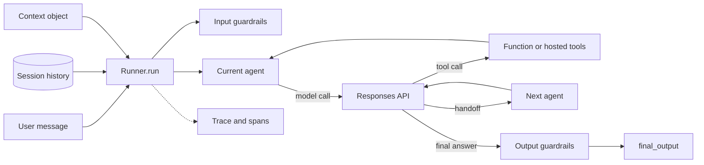
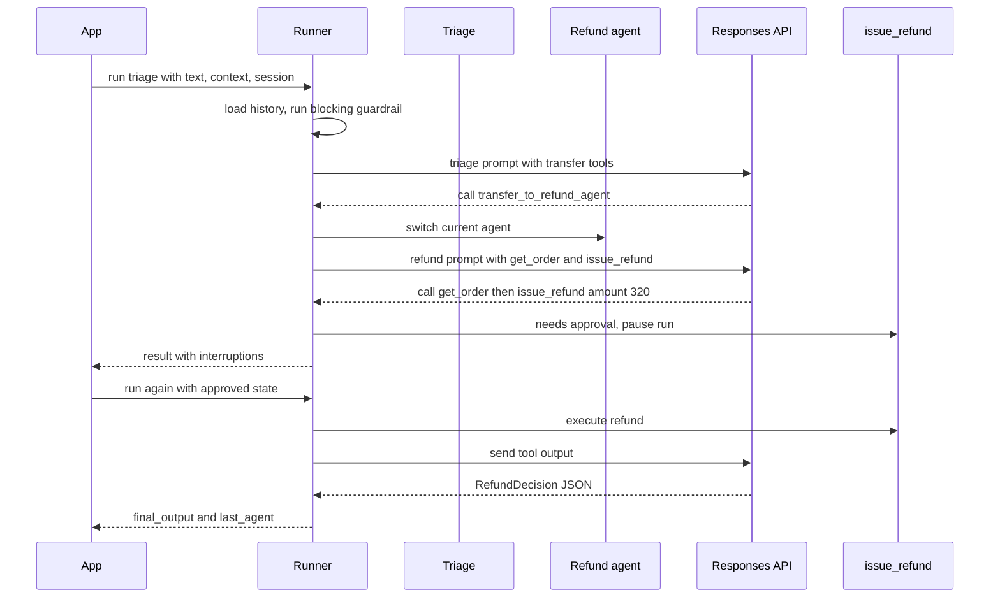

# OpenAI Agents SDK

The OpenAI Agents SDK is OpenAI's open-source Python (and TypeScript) library for building agents. It keeps the idea count small: agents, tools, handoffs, guardrails, sessions and tracing. Interviewers ask about it because many product teams on OpenAI models start here, and because "handoff vs agent-as-tool" and "where do guardrails run" are good tests of whether you understand multi-agent design.

Written against `openai-agents` 0.24 (Python), November 2026. The JavaScript version is `@openai/agents` and has the same ideas.

**After this page you can answer:**
- "What happens inside `Runner.run`, step by step, until you get `final_output`?"
- "Handoff vs agent-as-tool: what is the difference, and when do you pick each?"
- "Where do input and output guardrails run in a multi-agent chain, and what is a tripwire?"
- "How does the SDK remember a conversation across requests?"
- "How would you pause a ₹5,000 refund for human approval and resume it hours later?"
- "Can you use Claude or Gemini with the OpenAI Agents SDK? What do you lose?"
- "OpenAI Agents SDK vs LangGraph: which would you pick for a support bot, and why?"
- "How would you debug an agent that keeps handing off in circles?"

## Words you need first

New to LLMs? Read [How LLMs Work](14-how-llms-work.md) first. For the general agent loop, read [Agent Foundations](01-agent-foundations.md).

| Word | Plain meaning |
|---|---|
| Agent | A model plus instructions, tools and settings. It is a config object, not a running process. |
| Runner | The class that actually runs the loop: call model, run tools, repeat, until a final answer. |
| Turn | One model call inside a run. A run with two tool rounds and one answer is three turns. |
| Function tool | A Python function you expose to the model. The SDK builds its JSON schema for you. |
| Hosted tool | A tool OpenAI runs on its servers, like web search or file search. You only switch it on. |
| Handoff | One agent passes the whole conversation to another agent, which then answers the user. |
| Agent as tool | One agent calls another like a function, gets a result back, and stays in charge. |
| Guardrail | A check on the user input or the final output that runs alongside the agent. |
| Tripwire | The "stop" signal a guardrail raises. The run ends with an exception. |
| Session | A store of past messages, so the next run sees the earlier conversation. |
| Context object | Your own Python object (user id, DB handle) passed to tools. The model never sees it. |
| `output_type` | A Pydantic class. The agent must answer in that exact JSON shape. |
| Trace / span | A trace is one whole run. A span is one step inside it: a model call, a tool call, a handoff. |
| Responses API | OpenAI's main API for model calls with tools. The SDK uses it by default. |

## Big picture

You describe **agents** (instructions, tools, handoffs, guardrails, output type). You hand the first agent and the user's message to the **Runner**. The Runner loops: it calls the model through the **Responses API**, runs any **tools**, switches agent on a **handoff**, and stops when an agent gives a final answer. **Guardrails** check the input at the start and the output at the end. A **session** loads and saves history, a **context object** carries your app data to tools, and **tracing** records every step.



Each box is one section below. Then we build one Swiggy-style support desk that uses all of them.

## ⭐ What it is and the mental model

**In one line:** A small, Python-first agent library from OpenAI where an agent is a config object and a Runner runs the tool-calling loop, with handoffs, guardrails, sessions and tracing built in.

**Why it exists:** In 2024 OpenAI released **Swarm**, an experimental, educational repo that showed two ideas: "agents" and "handoffs". Teams liked the ideas but Swarm had no tracing, no guardrails and no support. In March 2025 OpenAI released the Agents SDK as the production-ready successor, together with the Responses API. The older Assistants API was then deprecated in favour of the Responses API.

**Picture it:** A bank branch. The front desk (triage agent) listens and sends you to the loans desk or the cards desk (handoff). A guard at the door checks who walks in (input guardrail). A manager checks every letter before it leaves (output guardrail). CCTV records everything (tracing). Your passbook remembers past visits (session).

**How it works, step by step:**

1. You create `Agent` objects. Nothing runs yet; they are just settings.
2. You call `Runner.run(first_agent, "user text")`.
3. The Runner sends the agent's instructions, the history and the tool list to the model.
4. The model replies with text, tool calls, or a handoff. The Runner acts on it and loops.
5. When an agent replies with a final answer (and no tool calls), the run ends.
6. Every step is recorded as a span in one trace, viewable in the OpenAI dashboard by default.

**Where it sits next to its neighbours:**

| Tool | What it mainly is | Who maintains it |
|---|---|---|
| OpenAI Agents SDK | small agent loop + handoffs + guardrails + tracing | OpenAI (MIT licence) |
| [LangGraph](02-langgraph-core.md) | graph runtime with durable checkpoints | LangChain Inc. |
| [Claude Agent SDK](29-claude-agent-sdk.md) | Claude Code's full harness (files, shell, subagents) as a library | Anthropic |
| [Google ADK](28-google-adk.md) | agent kit for Gemini and Vertex AI | Google |

It is **model-provider agnostic in design**: OpenAI models work best (Responses API, hosted tools), but other models work through LiteLLM or any OpenAI-compatible endpoint.

**Interview tip:** "What is the OpenAI Agents SDK in one sentence?" Say: "The production successor to Swarm: an agent is instructions plus tools, the Runner owns the loop, and handoffs, guardrails, sessions and tracing are the only extra ideas."

**Common mistake:**
- Calling it "Swarm". Swarm was the experiment; the SDK is the supported library.
- Thinking an `Agent` object is a running thing with memory. It is a stateless config; memory lives in the session.

## ⭐ Agent and Runner

**In one line:** `Agent` says *what* the agent is (instructions, tools, handoffs, output type, model); `Runner` says *how* one run happens (input, context, session, turn limit).

**Why it exists:** Separating config from execution means you build agents once at startup and reuse them for every request. Per-request things (user id, history, limits) go to the Runner call, so one agent object can serve thousands of users safely.

**Picture it:** A recipe card (Agent) and a cook who follows it today for one customer (Runner run). The card does not change per customer.

**How it works, step by step:**

1. Main `Agent` fields: `name`, `instructions` (the system prompt; can be a function of context), `tools`, `handoffs`, `handoff_description`, `model`, `model_settings`, `input_guardrails`, `output_guardrails`, `output_type`, `tool_use_behavior`.
2. Three ways to run:

| Method | Style | Use it when |
|---|---|---|
| `await Runner.run(agent, input)` | async, returns `RunResult` | web servers (FastAPI) |
| `Runner.run_sync(agent, input)` | blocking wrapper | scripts, notebooks |
| `Runner.run_streamed(agent, input)` | async, returns `RunResultStreaming` | chat UIs that show tokens live |

3. Useful run arguments: `context=`, `session=`, `max_turns=` (default **10**), `run_config=` (model override, tracing settings, global guardrails).
4. Useful result fields: `final_output`, `last_agent` (who answered), `new_items` (messages, tool calls, handoffs of this run), `to_input_list()` (history for the next run), `context_wrapper.usage` (tokens).
5. If the loop passes `max_turns`, the SDK raises `MaxTurnsExceeded`. You can catch it, or pass `error_handlers={"max_turns": ...}` to return a polite message instead.

```python
import asyncio
from agents import Agent, Runner
from openai.types.responses import ResponseTextDeltaEvent

agent = Agent(
    name="IRCTC helper",
    instructions="Answer Indian Railways questions in two short sentences.",
)

# 1. Simple run: wait for the whole answer
result = Runner.run_sync(agent, "What is Tatkal booking?")
print(result.final_output, "| answered by:", result.last_agent.name)

# 2. Streamed run: print tokens as they arrive
async def stream():
    run = Runner.run_streamed(agent, "When does Tatkal open for AC classes?")
    async for event in run.stream_events():
        if event.type == "raw_response_event" and isinstance(event.data, ResponseTextDeltaEvent):
            print(event.data.delta, end="", flush=True)
        elif event.type == "run_item_stream_event":
            print(f"\n[{event.item.type}]")  # tool_call_item, message_output_item ...

asyncio.run(stream())
```

**What the code does:**
- `Agent(...)` only stores settings; no model call happens there.
- `run_sync` runs the loop to the end and returns one `RunResult`.
- `run_streamed` returns immediately; `stream_events()` yields three event types: `raw_response_event` (token deltas), `run_item_stream_event` (a whole item finished: tool call, tool output, message) and `agent_updated_stream_event` (a handoff changed the agent).
- `last_agent` tells you which agent produced the answer, which matters once handoffs exist.

**Interview tip:** "Why is `max_turns` important?" Say: "A confused model can call tools forever. The default cap of 10 turns turns an infinite bill into a clean `MaxTurnsExceeded` that I handle and log."

**Common mistake:**
- Creating a new `Agent` per request inside the handler. Harmless but wasteful; build agents once.
- Using `run_sync` inside an async server. It blocks the event loop; use `await Runner.run`.

## ⭐ Tools: function tools, hosted tools and MCP

**In one line:** Tools are how the agent acts: your Python functions (function tools), OpenAI-run tools (hosted tools), or tools from MCP servers.

**Why it exists:** Writing JSON schemas by hand for every function is slow and goes out of sync with the code. The SDK reads your function's type hints and docstring and builds the schema. For common needs like web search, OpenAI runs the tool for you so you write no code at all.

**Picture it:** A kirana shop owner's helpers. Some are his own staff (function tools: he trained them). Some are services he calls, like the courier (hosted tools). Some come from an agency with a standard contract (MCP servers).

**How it works, step by step:**

1. Put `@function_tool` on a function. Name, description and parameter schema come from the name, docstring and type hints. (`agents.decorators.tool` is the same decorator under a shorter name.)
2. If the first parameter is `RunContextWrapper[YourCtx]`, the SDK passes your context object in, and hides that parameter from the model.
3. Useful decorator options: `name_override`, `needs_approval` (pause for a human), `failure_error_function` (what the model sees when your function raises), `timeout`, `strict_mode` (strict JSON schema, on by default).
4. Hosted tools (OpenAI runs them, Responses API only): `WebSearchTool`, `FileSearchTool` (your vector store), `CodeInterpreterTool`, `ImageGenerationTool`, `HostedMCPTool`.
5. Local runtime tools that run on your machine: `ComputerTool`, `ShellTool`, `ApplyPatchTool`.
6. MCP: pass `mcp_servers=[MCPServerStdio(...)]` or `MCPServerStreamableHttp(...)` to the agent; their tools appear next to yours. See [Tools, MCP & A2A](07-tools-mcp-a2a.md).
7. `tool_use_behavior` controls what happens after a tool runs: `"run_llm_again"` (default, model sees the result), `"stop_on_first_tool"` (the tool output becomes the final answer), or `StopAtTools([...])`.

```python
from agents import Agent, FileSearchTool, RunContextWrapper, WebSearchTool, function_tool

@function_tool
def pnr_status(ctx: RunContextWrapper[dict], pnr: str) -> str:
    """Get the live status of an Indian Railways PNR.

    Args:
        pnr: The 10-digit PNR number.
    """
    if len(pnr) != 10 or not pnr.isdigit():
        return "Invalid PNR. Ask the user for the 10-digit number."  # helpful error text
    return f"PNR {pnr}: CNF, coach B2, berth 34 (user {ctx.context['user_id']})"

travel_agent = Agent(
    name="Travel desk",
    instructions="Help with train travel. Use tools, never guess a PNR status.",
    tools=[
        pnr_status,                                     # our code
        WebSearchTool(),                                # OpenAI runs it
        FileSearchTool(vector_store_ids=["vs_rules"]),  # search our uploaded rule PDFs
    ],
)
```

**What the code does:**
- `pnr_status` becomes a tool with one string parameter `pnr`; the docstring `Args:` line becomes its description.
- `ctx` is hidden from the model and carries our `user_id`.
- Bad input returns a clear message instead of raising, so the model can recover and ask the user.
- `WebSearchTool` and `FileSearchTool` need no code from us; they only work with OpenAI models on the Responses API.

**Interview tip:** "How does the model know about your function?" Say: "The SDK turns the signature and docstring into a strict JSON schema and sends it with every model call. The model returns a function call with arguments; the SDK validates and runs my function and sends back the output."

**Common mistake:**
- Vague docstrings. The docstring is the tool's prompt; "does stuff" leads to wrong calls.
- Expecting hosted tools to work with LiteLLM or Chat Completions models. They are Responses-API only.

## ⭐ Handoffs and agents as tools

**In one line:** A handoff gives the conversation to another agent; agent-as-tool borrows another agent for one sub-task and keeps control.

**Why it exists:** One giant agent with 40 tools and a 5-page prompt gets confused. Splitting into specialists keeps each prompt short and each tool list small. The SDK gives two ways to connect specialists, because "transfer the customer" and "ask a colleague" are different needs.

**Picture it:** At a hospital, the reception desk *transfers* you to the cardiology OPD; from then on the cardiologist talks to you (handoff). A doctor who *sends your blood sample to the lab* still talks to you; the lab only returns a report (agent as tool).

**How it works, step by step:**

1. **Handoff:** list agents in `handoffs=[billing, refunds]`. Each becomes a tool named `transfer_to_<agent_name>` (for example `transfer_to_refund_agent`), described by the target's `handoff_description`.
2. When the model calls that tool, the Runner switches the current agent. The new agent sees the conversation history and answers the user. `result.last_agent` is now the specialist.
3. `handoff(agent, ...)` customises it: `on_handoff` (callback, for example to prefetch data), `input_type` (structured arguments like a reason), `input_filter` (trim what history the next agent sees; `handoff_filters.remove_all_tools` drops tool calls), `is_enabled` (turn on/off per request).
4. Put `RECOMMENDED_PROMPT_PREFIX` (from `agents.extensions.handoff_prompt`) in instructions so models understand the handoff convention.
5. **Agent as tool:** `specialist.as_tool(tool_name=..., tool_description=...)`. The main agent calls it with an input string, the specialist runs its own loop, and its final output comes back as a tool result. The main agent writes the answer.

| | Handoff | Agent as tool |
|---|---|---|
| Who answers the user | the new agent | the original agent |
| History given | full conversation (filterable) | only the input string it is called with |
| Control after | stays with the new agent | returns to the caller |
| Good for | routing: triage → billing | delegation: "translate this", "summarise this doc" |
| Parallel use | one handoff at a time | several sub-agents can run in one turn |

```python
from agents import Agent, handoff
from agents.extensions import handoff_filters
from agents.extensions.handoff_prompt import RECOMMENDED_PROMPT_PREFIX

hindi_translator = Agent(name="Hindi translator", instructions="Translate the text to simple Hindi.")
billing = Agent(name="Billing agent", handoff_description="Payment failures and double charges.",
                instructions=f"{RECOMMENDED_PROMPT_PREFIX} Solve billing issues.")
refunds = Agent(name="Refund agent", handoff_description="Refunds for late or wrong orders.",
                instructions=f"{RECOMMENDED_PROMPT_PREFIX} Solve refund issues.")

triage = Agent(
    name="Triage",
    instructions=f"{RECOMMENDED_PROMPT_PREFIX} Route billing or refund issues. Reply in Hindi if asked.",
    handoffs=[billing, handoff(refunds, input_filter=handoff_filters.remove_all_tools)],
    tools=[hindi_translator.as_tool(tool_name="to_hindi", tool_description="Translate text to Hindi.")],
)
```

**What the code does:**
- `billing` and `refunds` become tools `transfer_to_billing_agent` and `transfer_to_refund_agent`.
- The refund handoff strips earlier tool calls from the history the refund agent sees.
- `to_hindi` is an agent used as a tool: triage stays in charge and uses the translation in its own reply.

**Interview tip:** "Handoff or agent-as-tool for a support bot?" Say: "Handoff for routing, because the specialist should own the conversation and its prompt. Agent-as-tool when the main agent needs a result to combine, for example a translator or a policy summariser, or when I need several sub-results in parallel."

**Common mistake:**
- Handoff chains of 4–5 agents. Each hop costs a model call and loses focus; prefer one triage plus specialists.
- Agents that can hand off to each other in both directions without clear rules. This causes ping-pong until `max_turns`.

## ⭐ Guardrails and tripwires

**In one line:** Guardrails are functions that check the first agent's input or the last agent's output; if one returns `tripwire_triggered=True`, the run stops with an exception.

**Why it exists:** You do not want your expensive support model answering "write my college essay" or leaking a customer's phone number. A cheap check that runs before or next to the main agent catches this. See [Guardrails & Safety](08-guardrails.md) for the general theory.

**Picture it:** A metro station gate. The ticket check (input guardrail) happens before you board; if it beeps (tripwire), you do not travel. The exit gate (output guardrail) checks again at the end.

**How it works, step by step:**

1. Write `@input_guardrail async def check(ctx, agent, input) -> GuardrailFunctionOutput`. Return `output_info` (anything, for logs) and `tripwire_triggered` (bool).
2. Attach with `input_guardrails=[check]` on the agent (or globally in `RunConfig`).
3. **Input guardrails run only on the first agent** of the run. **Output guardrails run only on the agent that produces the final output.**
4. Input guardrails run **in parallel** with the agent by default (`run_in_parallel=True`): lower latency, but the main model may already have spent tokens or called tools before the tripwire fires. Use `@input_guardrail(run_in_parallel=False)` to block first.
5. On trip, the Runner raises `InputGuardrailTripwireTriggered` or `OutputGuardrailTripwireTriggered`. You catch it and reply politely.
6. **Tool guardrails** (`@tool_input_guardrail`, `@tool_output_guardrail`) run on every guarded function-tool call, even after handoffs. Use them for checks like "refund amount ≤ order amount".

Example numbers: the main agent is a large model at about 3 seconds per turn. A small-model guardrail takes about 0.5 seconds. Run in parallel, users wait ~3 s instead of ~3.5 s. Blocking first, an off-topic message costs only the 0.5 s check and no tool calls.

```python
from pydantic import BaseModel
from agents import Agent, GuardrailFunctionOutput, InputGuardrailTripwireTriggered, Runner, input_guardrail

class Topic(BaseModel):
    about_food_order: bool
    reason: str

checker = Agent(name="Topic checker", output_type=Topic,
                instructions="Is the message about a food order, delivery or refund?")

@input_guardrail(run_in_parallel=False)   # block before the main agent spends anything
async def only_food_orders(ctx, agent, user_input) -> GuardrailFunctionOutput:
    verdict = await Runner.run(checker, user_input, context=ctx.context)
    return GuardrailFunctionOutput(
        output_info=verdict.final_output,
        tripwire_triggered=not verdict.final_output.about_food_order,
    )

support = Agent(name="Support", instructions="Help with food orders.",
                input_guardrails=[only_food_orders])

try:
    Runner.run_sync(support, "Write my college essay on Gandhi")
except InputGuardrailTripwireTriggered as e:
    print("Blocked:", e.guardrail_result.output.output_info.reason)
```

**What the code does:**
- The guardrail itself is a tiny agent with a structured verdict.
- `run_in_parallel=False` makes the main agent wait for the check.
- The off-topic essay request trips the wire and raises; we read the reason from the exception for logging.

**Interview tip:** "Your agent hands off from triage to billing. Does billing's input guardrail run?" Say: "No. Input guardrails run only for the first agent of the run, and output guardrails only for the agent that gives the final answer. For checks on every tool call across handoffs I use tool guardrails, or put the guardrail in `RunConfig`."

**Common mistake:**
- Putting input guardrails on a specialist that is only reached by handoff; they never run.
- Forgetting that parallel guardrails can let a side-effect tool run before the trip. Use blocking mode when tools have side effects.

## Sessions and memory

**In one line:** A session object loads earlier messages before a run and saves new ones after, so you do not pass history by hand.

**Why it exists:** Without memory, turn 2 ("what about my other order?") has no idea what turn 1 was. You could keep `result.to_input_list()` yourself and pass it back, but every team then writes the same code. Sessions make it one argument. See [Memory & Context](05-memory-context.md) for memory theory.

**Picture it:** A clinic file with your patient number. The receptionist pulls the file before you see the doctor and adds today's notes after.

**How it works, step by step:**

1. Create a session with an id, for example per user chat: `SQLiteSession("u-77-chat", "support.db")`.
2. Pass `session=session` to every `Runner.run`.
3. Before the run, the SDK reads the session's items and puts them before the new input. After the run, it appends the new items.
4. Pick a backend:

| Session class | Where history lives | Use |
|---|---|---|
| `SQLiteSession` | in memory or a local file | dev, single server |
| `SQLAlchemySession` | Postgres, MySQL via SQLAlchemy | most production apps |
| `RedisSession` | Redis | many workers, fast reads |
| `OpenAIConversationsSession` | OpenAI's Conversations API | let OpenAI store history |
| `EncryptedSession` | wraps another session | encryption at rest plus TTL |
| `OpenAIResponsesCompactionSession` | wraps another session | compacts long histories |

5. Alternative: server-side history with `previous_response_id` or `conversation_id`. Do not combine those with a session in the same run; pick one.
6. Long chats still grow. Use a compaction session, or `session_settings` to limit how many items load.

**Interview tip:** "Where does conversation state live in the Agents SDK?" Say: "Not in the agent. Either in a session backend I choose (SQLAlchemy or Redis in production), or on OpenAI's side with `previous_response_id` or Conversations. The agent object stays stateless so it scales horizontally."

**Common mistake:**
- Using the default in-memory `SQLiteSession` behind a load balancer. Each pod has a different memory.
- One session id shared by all users. Session id must be per user and per conversation.

## Context object and structured output

**In one line:** The context object carries your app data to tools and dynamic instructions without the model seeing it; `output_type` forces the final answer into a typed Pydantic object.

**Why it exists:** Tools need things like the logged-in user id or a DB pool. Putting them in the prompt is unsafe (the model could change them) and wastes tokens. Separately, downstream code (a refund API, a DB write) needs a reliable shape, not free text. See [Structured Outputs and Prompt Optimization](17-structured-outputs-prompting.md).

**Picture it:** A courier's bag has a parcel (what the customer sees) and a delivery slip clipped to the back (context: address, payment status). The customer never reads the slip, but every hand that touches the parcel can.

**How it works, step by step:**

1. Define any class, for example `@dataclass class SupportCtx: user_id: str; is_gold: bool`.
2. Pass it: `Runner.run(agent, text, context=SupportCtx(...))`. The type hint `Agent[SupportCtx]` keeps editors happy.
3. Tools, guardrails, hooks and dynamic instructions receive `RunContextWrapper[SupportCtx]`; read `ctx.context.user_id`. The wrapper also has `ctx.usage` (token counts so far).
4. `instructions` can be a function `(ctx, agent) -> str`, so the prompt can say "this user is a Gold member" per request.
5. Set `output_type=RefundDecision` (a Pydantic model). The SDK sends the JSON schema to the model as a structured-output format. The run ends only when the model returns valid JSON for it, and `final_output` is a `RefundDecision` instance.
6. If the model returns invalid JSON, the SDK raises `ModelBehaviorError` (or you can handle it with `error_handlers={"invalid_final_output": ...}`).

**Interview tip:** "Why not put user_id in the prompt?" Say: "Because the model can be talked into using a different id by prompt injection. The id comes from my auth layer into the context object, and the tool enforces ownership in code."

**Common mistake:**
- Assuming the model sees the context object. It does not; if the model needs a fact, put it in instructions too.
- Very large `output_type` schemas with 30 optional fields. The model fills them badly; keep the schema small.

## Tracing

**In one line:** Every run automatically becomes a trace with spans for agents, model calls, tools, handoffs and guardrails, sent to OpenAI's Traces dashboard unless you change it.

**Why it exists:** An agent that fails 1 time in 20 is impossible to debug from logs alone. You need to see the exact prompt, tool arguments and the order of steps. The SDK records this with zero setup. See [AI Observability](10-agent-observability.md).

**Picture it:** A Swiggy order timeline: placed, accepted, picked up, delivered, each with a timestamp. A trace is that timeline for one agent run.

**How it works, step by step:**

1. Tracing is on by default. A run creates one trace; inside it `agent_span`, `generation_span` (model call), `function_span` (tool), `handoff_span`, `guardrail_span`.
2. Group several runs into one trace with `with trace("Refund workflow"):` around them.
3. Send traces elsewhere: `add_trace_processor(...)` adds a destination; `set_trace_processors([...])` replaces OpenAI's. Langfuse, Logfire, AgentOps, Braintrust and others offer processors or OpenTelemetry bridges.
4. Turn off: `RunConfig(tracing_disabled=True)` or env `OPENAI_AGENTS_DISABLE_TRACING=1`.
5. Hide prompts and tool data: `RunConfig(trace_include_sensitive_data=False)` or env `OPENAI_AGENTS_TRACE_INCLUDE_SENSITIVE_DATA=false`.
6. Using non-OpenAI models with no OpenAI key? Either set a tracing key with `set_tracing_export_api_key(...)` or disable OpenAI export.

**Interview tip:** "Is default tracing a compliance risk?" Say: "It can be. By default traces include inputs and outputs and go to OpenAI. For PII or data-residency rules I turn off sensitive data, or replace the processor with my own OTel or Langfuse exporter."

**Common mistake:**
- Shipping to production with sensitive data in traces and no one checking the data policy.
- Not setting `workflow_name` or `group_id`, so thousands of traces cannot be filtered by flow or by conversation.

## Models: Responses API underneath, and non-OpenAI models

**In one line:** By default every agent calls OpenAI's Responses API; you can switch per agent to Chat Completions, LiteLLM or any OpenAI-compatible endpoint, but you lose hosted tools and some features.

**Why it exists:** Teams want one framework but several models: a cheap model for routing, a strong one for hard cases, sometimes Claude or Gemini. The SDK separates the agent loop from the model client so you can mix them.

**Picture it:** A phone that takes any SIM. Calls work on all networks, but some special services only work on the home network.

**How it works, step by step:**

1. Default: `OpenAIResponsesModel`. If an agent sets no model, the SDK uses its default (in 0.24 this is `gpt-5.6-luna`; override with env `OPENAI_DEFAULT_MODEL` or `RunConfig(model=...)`).
2. Per agent: `Agent(model="gpt-5.6-sol")`, or pass a `Model` object.
3. LiteLLM: install `openai-agents[litellm]`, then use `model="litellm/anthropic/claude-sonnet-5-5"` or `LitellmModel(model=..., api_key=...)` from `agents.extensions.models.litellm_model`.
4. Any OpenAI-compatible server (vLLM, Ollama, a gateway): `OpenAIChatCompletionsModel(model=..., openai_client=AsyncOpenAI(base_url=...))`.
5. Lost outside the Responses API: hosted tools (web/file search, code interpreter), `previous_response_id`, tool search and some reasoning settings. Chat Completions may silently drop them; set `strict_feature_validation=True` to fail fast.

| Model path | Hosted tools | Handoffs, guardrails, sessions | Tracing |
|---|---|---|---|
| OpenAI via Responses API | yes | yes | yes |
| OpenAI-compatible via Chat Completions | no | yes | yes (needs OpenAI key or other processor) |
| LiteLLM (Claude, Gemini, Mistral...) | no | yes, if the model does tool calling well | yes, same note |

**Interview tip:** "Can I run Claude in the OpenAI Agents SDK?" Say: "Yes, through the LiteLLM extension or an OpenAI-compatible gateway. Handoffs, guardrails and sessions still work because they are just function calls in the loop. I lose OpenAI hosted tools, and I must check that the model handles strict JSON schemas and parallel tool calls."

**Common mistake:**
- Mixing providers without an eval set; tool-calling quality differs a lot between models.
- Forgetting to disable or redirect tracing when there is no OpenAI key, which spams export errors.

## Voice, realtime and sandbox agents (brief)

**In one line:** The same agent ideas extend to speech (a voice pipeline or the Realtime API) and to long jobs in a sandboxed workspace.

**Why it exists:** Phone support and in-app voice are big use cases in India (IVR replacements). Long coding or data jobs need a filesystem. Re-using agents, tools and handoffs avoids a second framework. See [Multimodal and Voice Agents](18-multimodal-voice.md).

**Picture it:** The same call-centre team, now on the phone line instead of chat, plus a back office with its own desk and files.

**How it works, step by step:**

1. **Voice pipeline** (`agents.voice.VoicePipeline`): speech-to-text → your normal agent workflow → text-to-speech. Easy to add to an existing text agent; latency is the sum of three steps.
2. **Realtime agents** (`agents.realtime.RealtimeAgent`, `RealtimeRunner`): speech-to-speech over the Realtime API with a realtime model, interruptions (barge-in) and handoffs. Lower latency, but a different runner and event stream.
3. **Sandbox agents** (`agents.sandbox.SandboxAgent`, newer): the agent works inside an isolated workspace defined by a `Manifest` (for example a cloned git repo), for long-horizon tasks.

**Interview tip:** "Pipeline or realtime for a voice bot?" Say: "Realtime when latency under about a second and barge-in matter, like a phone agent. A pipeline when I want to reuse my text agent exactly, need full control over STT and TTS vendors, or need transcripts at each step."

**Common mistake:**
- Turning a long text prompt directly into a voice prompt. Spoken answers must be short.

## ⭐ A complete small app: a Swiggy-style support desk

**In one line:** A triage agent with a blocking guardrail hands off to an order-status agent or a refund agent; refunds above ₹300 pause for a human; history is stored per user.

**Why it exists:** This is the most common shape interviewers ask you to design: routing, a lookup tool, a money-moving tool with approval, structured output, memory and an off-topic filter.

**Picture it:** A food delivery help screen. "Where is my order" goes to one desk, "refund" to another. Any refund above ₹300 needs a supervisor's OK.

**How it works, step by step:**

1. Context object with the logged-in user; tools check ownership in code.
2. Refund tool with `needs_approval` as a function: only amounts above ₹300 pause.
3. Two specialists and a triage agent with handoffs, plus a blocking topic guardrail.
4. A run loop that handles the tripwire, approvals and the session.

Worked example: order SW-1042 cost ₹640 and came 48 minutes late. Policy: 30+ minutes late → 50% refund = ₹320. ₹320 > ₹300, so the run pauses for approval.

**Step 1: context and tools.**

```python
from dataclasses import dataclass
from agents import Agent, RunContextWrapper, function_tool

@dataclass
class SupportCtx:                    # our data; the model never sees this object
    user_id: str
    is_gold_member: bool

ORDERS = {"SW-1042": {"user": "u-77", "status": "delivered", "amount": 640, "late_by_min": 48}}

@function_tool
def get_order(ctx: RunContextWrapper[SupportCtx], order_id: str) -> str:
    """Fetch one order of the current user. Args: order_id: like SW-1042."""
    order = ORDERS.get(order_id)
    if not order or order["user"] != ctx.context.user_id:   # ownership check in code
        return "No such order for this user."
    return str(order)

async def above_300(ctx: RunContextWrapper[SupportCtx], args: dict, call_id: str) -> bool:
    return args.get("amount", 0) > 300                       # big refunds need a human

@function_tool(needs_approval=above_300)
def issue_refund(ctx: RunContextWrapper[SupportCtx], order_id: str, amount: int, reason: str) -> str:
    """Refund an amount in rupees for one order."""
    return f"Refund of Rs {amount} queued for {order_id}."
```

**What the code does:**
- `SupportCtx` comes from our auth layer, so a prompt injection cannot change the user id.
- `get_order` refuses orders of other users, in code, not in the prompt.
- `above_300` is an approval policy: it receives the parsed arguments and returns True only for big refunds.

**Step 2: agents, structured output, handoffs and the guardrail.**

```python
from pydantic import BaseModel
from agents import GuardrailFunctionOutput, Runner, input_guardrail
from agents.extensions.handoff_prompt import RECOMMENDED_PROMPT_PREFIX as P

class RefundDecision(BaseModel):
    order_id: str
    refund_inr: int
    message_to_user: str

refund_agent = Agent[SupportCtx](
    name="Refund agent", handoff_description="Refunds for late, missing or wrong items.",
    instructions=f"{P} Use get_order first. 30+ min late: refund 50%. Never above the order amount.",
    tools=[get_order, issue_refund], output_type=RefundDecision)
status_agent = Agent[SupportCtx](
    name="Order status agent", handoff_description="Where is my order, ETA.",
    instructions=f"{P} Use get_order and explain the status in one line.", tools=[get_order])

class Topic(BaseModel):
    about_food_order: bool

checker = Agent(name="Topic checker", output_type=Topic, instructions="Is this about a food order?")

@input_guardrail(run_in_parallel=False)
async def only_food(ctx, agent, user_input) -> GuardrailFunctionOutput:
    v = await Runner.run(checker, user_input, context=ctx.context)
    return GuardrailFunctionOutput(output_info=v.final_output, tripwire_triggered=not v.final_output.about_food_order)

triage = Agent[SupportCtx](
    name="Triage",
    instructions=lambda ctx, agent: f"{P} Route the user. Gold member: {ctx.context.is_gold_member}.",
    handoffs=[status_agent, refund_agent], input_guardrails=[only_food])
```

**What the code does:**
- `refund_agent` must end with a valid `RefundDecision`, which our app can store or show.
- Triage's instructions are a function, so each request gets the user's Gold status.
- The guardrail is on triage, the first agent, so it actually runs; it blocks before any spend.

**Step 3: the run loop with tripwire, approvals and session.**

```python
import asyncio
from agents import InputGuardrailTripwireTriggered, SQLiteSession

async def handle(text: str, ctx: SupportCtx, session: SQLiteSession):
    try:
        result = await Runner.run(triage, text, context=ctx, session=session, max_turns=8)
    except InputGuardrailTripwireTriggered:
        return "Sorry, I can only help with your food orders."
    while result.interruptions:                    # paused: a refund needs approval
        state = result.to_state()                  # state.to_string() can be saved to a DB
        for item in result.interruptions:
            ok = input(f"Approve {item.tool_name} {item.raw_item.arguments}? (y/n) ") == "y"
            state.approve(item) if ok else state.reject(item)
        result = await Runner.run(triage, state, context=ctx, session=session)
    print("answered by:", result.last_agent.name, "| tokens:", result.context_wrapper.usage.total_tokens)
    return result.final_output

ctx = SupportCtx(user_id="u-77", is_gold_member=True)
session = SQLiteSession("u-77-chat", "support.db")
print(asyncio.run(handle("SW-1042 came 48 minutes late, I want a refund", ctx, session)))
```

**What the code does:**
- An off-topic message raises the tripwire and gets a fixed reply, with no main-model cost.
- `result.interruptions` lists tool calls waiting for approval; `to_state()` captures the paused run.
- `approve` / `reject` record the decision, and running again with the state continues from the pause, not from scratch.
- In a real app you save `state.to_string()` in Postgres, notify ops, and resume with `RunState.from_string(...)` when they click approve.
- Expected flow for the example: triage → `transfer_to_refund_agent` → `get_order` → `issue_refund(amount=320)` pauses → approved → `RefundDecision(order_id="SW-1042", refund_inr=320, ...)`.

**Interview tip:** "Where would a human approval sit in this design?" Say: "On the money-moving tool, not on the agent. `needs_approval` with a policy function pauses only risky calls, I persist the run state, and resume it when the human decides, so no process waits in memory."

**Common mistake:**
- Putting the refund limit only in the prompt. The model can be argued out of it; enforce it in the tool or a tool guardrail.
- Keeping the paused run only in memory. A deploy in between loses the approval.

## ⭐ How it works inside

**In one line:** The Runner is a loop around the Responses API that turns tools and handoffs into function definitions, then acts on what the model returns until a final output appears.

**Why it exists:** When a run misbehaves, you debug the loop, not the framework's marketing. Knowing exactly what is sent and how each reply is handled tells you where to look.

**Picture it:** A dabbawala relay. At each station (turn) someone reads the label (model output) and decides: deliver here (final answer), pass to the next runner (handoff), or pick up something first (tool call).

**How it works, step by step:**

1. **Setup:** start a trace; load session items; run input guardrails of the first agent (parallel or blocking).
2. **Build the request** for the current agent: instructions as the system prompt (calling the function if dynamic), the input items (history plus the new message), tool definitions (function tools as strict JSON schemas, hosted tools, MCP tools, and one `transfer_to_<agent>` function per handoff), and the `output_type` schema as the response format.
3. **Call the model** (one turn). The response is a list of items: messages, function calls, reasoning items, hosted tool results.
4. **Decide the next step:**
   - Any handoff call → run `on_handoff`, apply `input_filter`, switch the current agent, loop.
   - Any function or MCP tool calls → check approval and tool guardrails, run them (concurrently), append `function_call_output` items, loop.
   - Text that matches `output_type` and no tool calls → this is the final output.
5. **Finish:** run output guardrails of the final agent, save new items to the session, close spans, return `RunResult`.
6. **Limits:** each model call counts as a turn; after `max_turns` (default 10) → `MaxTurnsExceeded`.



Turn count for this run: triage call (1), refund agent calls `get_order` (2), refund agent calls `issue_refund` (3), refund agent writes the decision (4). Four turns, well under the cap of 10. If you see 10 turns and `MaxTurnsExceeded`, read the trace for repeated handoffs or repeated failing tool calls.

**Interview tip:** "How does a handoff work under the hood?" Say: "It is just a function tool named `transfer_to_<agent>`. When the model calls it, the Runner swaps the current agent, optionally filters the history, and calls the model again with the new agent's instructions and tools. No separate process or message bus."

**Common mistake:**
- Thinking agents run concurrently by default. Handoffs are sequential; only tool calls in one turn run concurrently.
- Not reading the trace before changing prompts; most "model is dumb" bugs are wrong tool descriptions or missing history.

## Production concerns

**In one line:** The SDK gives you the loop, sessions and traces; durability, cost control, evals and deployment are still your job.

**Why it exists:** A demo runs once on a laptop. Production runs 50,000 chats a day across pods, deploys mid-conversation, and must explain every refund to finance. See [Agents in Production](12-agents-in-production.md).

**Picture it:** A food truck vs a restaurant chain. Same recipes; the chain needs storage, staff rotas, audits and a kitchen display.

**How it works, step by step:**

| Concern | What the SDK gives | What you add |
|---|---|---|
| Memory | sessions (SQLAlchemy, Redis, encrypted) | per-user session ids, retention policy, PII rules |
| Durability | serialisable `RunState` for paused runs | store state in DB; for multi-hour workflows use a durable engine (Temporal has an Agents SDK integration) or LangGraph |
| Streaming | `run_streamed` events | SSE or WebSocket to the UI |
| Observability | traces by default, custom processors | export to Langfuse or OTel, dashboards, alerts |
| Evals | traces you can turn into datasets | an eval set of 50–200 real chats, run in CI. See [Evals for Agents](09-agent-evals.md) |
| Cost | `usage` per run | cheap model for triage and guardrails, cap `max_turns`, prompt caching via stable instructions |
| Safety | guardrails, `needs_approval` | limits enforced in tools, audit logs |
| Deployment | a Python library, no server | FastAPI or a worker; stateless pods since state is in sessions |

Cost example: triage on a small model at ~1,500 input tokens per turn, refund agent on a larger model at ~3,000 tokens per turn, 4 turns per chat. If the small model is roughly 10× cheaper, routing on it saves most of the triage cost, and keeping instructions identical across requests lets the provider's prompt cache cut repeated input cost further. See [Cost & Latency](11-cost-latency.md).

**Failure modes to plan for:** handoff ping-pong, tool exceptions shown to the model as raw stack traces, `MaxTurnsExceeded` on long tasks, guardrail false positives blocking real users, and hosted tools failing silently on non-OpenAI models.

**Interview tip:** "How do you make an Agents SDK app production-ready?" Say: "Stateless agents in a FastAPI service, history in a SQLAlchemy or Redis session, risky tools behind `needs_approval` with persisted run state, traces exported to our own backend with sensitive data controlled, a cheap model for triage and guardrails, a turn cap with an error handler, and an eval set that runs on every prompt change."

**Common mistake:**
- Treating sessions as durable workflow state. A session stores chat history, not "we are on step 3 of 7 waiting for KYC".

## ⭐ When to use it, when not, and alternatives

**In one line:** Pick it for OpenAI-centric chat agents with routing, guardrails and quick tracing; pick something else for long durable workflows, heavy file and shell work, or a non-OpenAI-first stack.

**Why it exists:** "Why this framework and not X?" is a standard senior question. A clear answer shows you match tools to the problem.

**Picture it:** Choosing between an auto, a cab and a train. All move you; distance, luggage and budget decide.

**How it works, step by step:**

1. Use it when: your models are mostly OpenAI; the design is triage plus specialists; you want guardrails and tracing on day one; the team wants few concepts.
2. Avoid it when: runs last hours or days with many pauses (durable graph or workflow engine is better); the agent mainly edits files and runs shells (Claude Agent SDK ships those tools); you need explicit, testable branching (LangGraph).

| | OpenAI Agents SDK | LangGraph | Claude Agent SDK | Google ADK |
|---|---|---|---|---|
| Mental model | agents + handoffs + Runner loop | graph of nodes over typed state | ready-made Claude Code harness | agents + workflow agents (sequential, parallel, loop) |
| Control flow | model decides via handoffs | you draw edges | harness decides; you configure | mix of LLM routing and fixed workflow agents |
| Durability | sessions + serialisable `RunState` | checkpointer after every step | sessions, resume, fork | sessions with pluggable services |
| Built-in tools | hosted web/file search, code interpreter | none (bring your own) | Read, Edit, Bash, Grep, WebSearch... | Google Search, code execution |
| Best models | OpenAI (others via LiteLLM) | any | Claude | Gemini (others via LiteLLM) |
| Learning curve | low | medium-high | low-medium | medium |
| Pick it for | support bots, routing, quick prototypes | approvals, long workflows, complex branching | coding, file and ops agents | Google Cloud and Gemini shops |

**Interview tip:** "OpenAI Agents SDK vs LangGraph for a bank's loan bot?" Say: "If it is a chat that routes to specialists, the Agents SDK is faster to build. If it is a loan workflow with KYC, credit check, manager approval and days of waiting, I want LangGraph's checkpoints and explicit edges, or a durable engine around the agent."

**Common mistake:**
- Choosing by GitHub stars. Choose by control-flow needs, model provider and durability needs.

## Common pitfalls

**In one line:** Most real bugs come from prompts and tool design, guardrail placement, missing durability and default settings nobody re-checked.

**Why it exists:** These come up again and again in real projects and in "how would you debug" interview questions.

**Picture it:** The same potholes on the same road; once you know where they are, you slow down there.

**How it works, step by step:**

1. **Handoff loops:** triage → billing → triage. Fix with clear `handoff_description`s, one-way handoffs, and `is_enabled` to hide the way back.
2. **Lost context after handoff:** an aggressive `input_filter` removed the order id. Pass key facts via `input_type` or the context object.
3. **Guardrail on the wrong agent:** input guardrail on a specialist never runs. Put it on the first agent, in `RunConfig`, or as a tool guardrail.
4. **Parallel guardrail side-effects:** a refund tool ran before the tripwire. Use `run_in_parallel=False`.
5. **Tool errors as stack traces:** set `failure_error_function` or return friendly error strings.
6. **Default tracing with PII:** set `trace_include_sensitive_data=False` or your own processor.
7. **Hosted tools on non-OpenAI models:** they do nothing or fail. Check the model path.
8. **In-memory sessions in a multi-pod deploy:** history disappears randomly. Use SQLAlchemy or Redis.
9. **No turn cap handling:** users see a 500 on `MaxTurnsExceeded`. Add `error_handlers`.

**Interview tip:** "How would you debug an agent that hands off in circles?" Say: "Open the trace, list the handoff spans, and read what each agent saw. Usually two descriptions overlap or a filter dropped the key fact. I fix descriptions, make handoffs one-way, add a test case for that conversation to the eval set, and keep a turn cap with a friendly fallback."

**Common mistake:**
- Fixing one bad conversation by adding a sentence to the prompt, without an eval set to catch what it breaks.

## Interview questions

**Q: What are the core primitives of the OpenAI Agents SDK?**
A: Agents (instructions, tools, handoffs, guardrails, output type), the Runner that runs the loop, tools (function, hosted, MCP), handoffs and agents-as-tools, guardrails, sessions and tracing. Everything else is configuration around these.

**Q: Walk me through `Runner.run`.**
A: Load session history, run the first agent's input guardrails, call the model with instructions, history and tool schemas. On a handoff, switch agent and loop; on tool calls, run them and loop; on text matching `output_type` with no tool calls, run output guardrails, save to the session and return. `max_turns` (default 10) caps the loop.

**Q: Handoff vs agent-as-tool?**
A: A handoff transfers the conversation; the new agent answers the user. Agent-as-tool runs a sub-agent on one input and returns its output; the caller stays in charge. Handoffs for routing, agent-as-tool for delegated sub-tasks or parallel sub-results.

**Q: Where do guardrails run in a multi-agent run?**
A: Input guardrails only on the first agent, output guardrails only on the agent that gives the final output. Tool guardrails run on every guarded tool call, so they cover specialists reached by handoff.

**Q: What is a tripwire, and what does parallel mode risk?**
A: A guardrail result with `tripwire_triggered=True`; the Runner raises `InputGuardrailTripwireTriggered` or `OutputGuardrailTripwireTriggered`. In the default parallel mode the main agent may already have spent tokens or run tools before the trip, so use blocking mode when tools have side effects.

**Q: How does the SDK remember conversations?**
A: Through a session object passed to `Runner.run`, which loads history before and saves new items after. In production use `SQLAlchemySession` or `RedisSession`; or use OpenAI server-side state with `previous_response_id` or Conversations, but not both in one run.

**Q: How do you pause for human approval and resume hours later?** (what would you do)
A: Mark the tool `needs_approval` (a bool or a policy function). The run returns with `interruptions`; I call `to_state()`, save `state.to_string()` in the database and notify the approver. On click, I load it with `RunState.from_string`, call `approve` or `reject`, and run again with the state.

**Q: How do you pass the user id to a tool safely?**
A: Through the context object (`context=` on the run, `RunContextWrapper` in the tool). The model never sees or edits it, and the tool checks ownership in code.

**Q: How does `output_type` work and what if the model returns bad JSON?**
A: The Pydantic schema is sent as the response format and the final output is parsed into that class. Invalid output raises `ModelBehaviorError`, or you handle it with the `invalid_final_output` error handler.

**Q: Can you use Claude or Gemini? What do you lose?**
A: Yes, via `LitellmModel` / `litellm/...` model names or an OpenAI-compatible endpoint with `OpenAIChatCompletionsModel`. You lose hosted tools, `previous_response_id` and other Responses-only features, and tracing needs an OpenAI key or another processor.

**Q: What changed recently, from Swarm to now?**
A: Swarm (2024) was an experiment; the Agents SDK (March 2025) is the supported successor, built on the Responses API, while the Assistants API was deprecated. Since then it added sessions, human-in-the-loop with `RunState`, tool guardrails, realtime agents, and sandbox agents.

**Q: Default tracing sends data to OpenAI. Your client is a bank. What do you do?** (trade-off)
A: Turn off sensitive data in traces or disable OpenAI export, and add my own processor to an in-region Langfuse or OTel collector. I keep the span structure because debugging without traces is too costly.

**Q: OpenAI Agents SDK vs LangGraph?**
A: The Agents SDK is smaller and faster to start, with handoffs, guardrails and tracing built in. LangGraph gives explicit graphs and checkpoints after every step, better for long, branching, pause-heavy workflows. Chat routing → Agents SDK; durable business process → LangGraph.

**Q: How would you make it production-ready?**
A: Stateless agents in a service, sessions in Postgres or Redis, approvals with persisted `RunState`, limits enforced in tools, cheap models for triage and guardrails, turn cap with error handlers, traces to our backend, and an eval set that gates every prompt or model change.

**Q: How would you debug a run that hit `MaxTurnsExceeded`?**
A: Open its trace and count spans by type. Repeated handoff spans mean overlapping descriptions; repeated identical tool calls mean the tool output is unclear or an error is hidden. Fix the cause, add the case to evals, then decide if the cap should change.

## Read next

- [Agent Frameworks and Tooling](19-agent-frameworks.md)
- [Claude Agent SDK](29-claude-agent-sdk.md)
- [LangChain](23-langchain.md)
- [Google ADK](28-google-adk.md)

## Checklist

- [ ] I can explain what `Agent` and `Runner` each own, and list the three ways to run.
- [ ] I can write a function tool with a context parameter and name three hosted tools.
- [ ] I can explain handoff vs agent-as-tool and when I pick each.
- [ ] I can explain where input, output and tool guardrails run, and the parallel-mode risk.
- [ ] I can explain sessions and pick a backend for production.
- [ ] I can pause a risky tool call for approval and resume it later with `RunState`.
- [ ] I can walk through the Runner loop turn by turn, including `max_turns`.
- [ ] I can explain how to use non-OpenAI models and what is lost.
- [ ] I can compare the Agents SDK with LangGraph, Claude Agent SDK and Google ADK.
- [ ] I can list common pitfalls and how I would debug a handoff loop.
