# Google ADK

Google's Agent Development Kit (ADK) is an open-source, code-first framework for building agents in Python, TypeScript, Go and Java. It is tuned for Gemini and Google Cloud, but it can run other models too. Interviewers at Google Cloud shops and enterprises ask about it to see if you know how its pieces fit: agents, workflows, sessions, the Runner and events, and how you ship it.

Written against `google-adk` 2.x for Python (2.0 went GA in May 2026; 2.14 is current at the time of writing). Where 1.x code differs, the page says so in one line.

**After this page you can answer:**
- "What is the difference between an `LlmAgent` and a workflow agent in ADK?"
- "How does state pass from one agent to the next in ADK?"
- "What does the `Runner` do, and what is an event?"
- "Sub-agent transfer vs `AgentTool`: when do you use which?"
- "How do you add a guardrail before a tool runs in ADK?"
- "How do you use Claude or GPT models inside ADK?"
- "What changed in ADK 2.0, and what breaks when you upgrade?"
- "How do you evaluate and deploy an ADK agent on Google Cloud?"

## Words you need first

New to agents? Read [Agent Foundations](01-agent-foundations.md) first. For a short tour of all frameworks, see [Agent Frameworks and Tooling](19-agent-frameworks.md).

| Word | Plain meaning |
|---|---|
| ADK | Agent Development Kit: Google's open-source library for building, testing and deploying agents. |
| Gemini | Google's family of large language models (LLMs). ADK uses them by default. |
| `LlmAgent` (`Agent`) | An agent whose next step is decided by an LLM. `Agent` is a short alias for it. |
| Workflow agent | An agent that runs other agents in a fixed order: one after another, side by side, or in a loop. |
| `Workflow` | The ADK 2.0 graph engine: agents, tools and plain functions become nodes joined by edges. |
| Tool | A Python function (or other agent, or remote API) the LLM can ask ADK to run. |
| Session | One conversation: its list of events plus a small key-value `state` dict. |
| State | The key-value dict inside a session that agents and tools read and write. |
| Event | One record of something that happened: a user message, a model reply, a tool call, a state change. |
| `Runner` | The engine that takes a user message, runs the agent, saves events and streams them back to you. |
| Callback | Your function that ADK calls before or after an agent, model call or tool call, to check or change it. |
| A2A | Agent2Agent protocol: an open standard for one agent to call another agent over HTTP. |
| MCP | Model Context Protocol: an open standard for plugging tool servers into any agent. |
| LiteLLM | A library that gives one API for 100+ model providers. ADK uses it for non-Gemini models. |

## Big picture

You define agents (LLM-driven ones, plus fixed-order workflows) and give them tools. The `Runner` is the engine: it loads the session, runs the root agent, and every step produces an event. Events are saved by a session service and streamed to your app. Callbacks let you check each model and tool call. Around this sit dev tools (`adk web`, `adk run`), evaluation (`adk eval`) and deployment (Cloud Run or Agent Engine). This page follows that order, then builds one complete app.

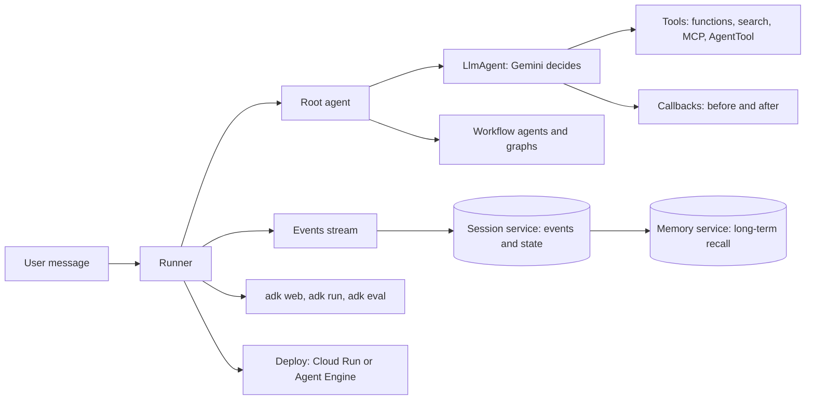

## ⭐ What ADK is and the mental model

**In one line:** ADK is Google's code-first agent framework where everything is an agent (or, from 2.0, a node in a graph), a `Runner` executes it, and every step becomes an event saved in a session.

**Why it exists:** Google needed one framework for its own agent products and for Google Cloud customers. It wanted agents that feel like normal software: written in code, unit-tested, versioned and deployed like a service. It also wanted first-class Gemini features (built-in Google Search, code execution, live audio) and a clean path to Vertex AI.

**Picture it:** A Zomato cloud kitchen. The head chef (`LlmAgent`) decides what to cook based on the order. Fixed stations like "wash, cut, fry" in order are workflow agents. The order ticket that travels with the dish is session state. The kitchen manager who takes the order, runs the kitchen and writes every step in a log book is the `Runner`. The log book entries are events.

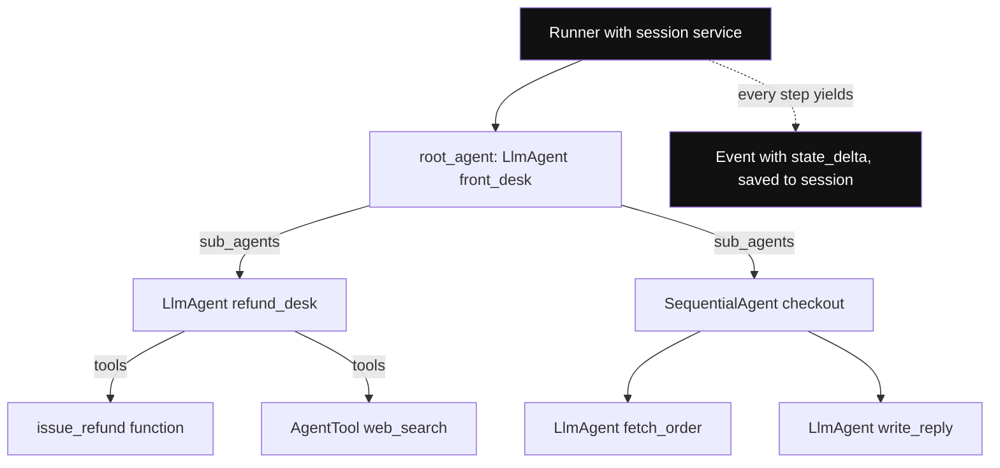

*Diagram:* Everything below the Runner is a tree of agents (LLM or workflow) with tools at the leaves; the Runner executes the tree and turns each step into a saved event.

**How it works, step by step:**

1. You write a root agent. It can be an `LlmAgent`, a workflow agent, or a `Workflow` graph.
2. The root agent can have children (`sub_agents`) and tools.
3. You create a `Runner` with the root agent and a session service.
4. Your app calls `runner.run_async(user_id, session_id, new_message)`.
5. The Runner loads the session, runs the agent, and yields events one by one.
6. Each event that changes state carries a `state_delta`. The Runner commits it to the session service.
7. Your app shows the events (stream to UI) and picks the final response.

**Who maintains it and where it sits:**

| | Google ADK | LangGraph | OpenAI Agents SDK |
|---|---|---|---|
| Maintainer | Google | LangChain Inc. | OpenAI |
| Core idea | agent tree, plus graph workflows in 2.0 | explicit state graph | agents with handoffs |
| Best model fit | Gemini, any via LiteLLM | any | OpenAI, others via adapters |
| Hosted runtime | Vertex AI Agent Engine | LangGraph Platform | none of its own |
| Languages | Python, TypeScript, Go, Java | Python, JS | Python, JS |

**What changed in 2.0:** ADK 2.0 added a graph-based **Workflow Runtime**. Agents, tools and functions now run as nodes in a graph. `BaseAgent` became a subclass of `BaseNode`. The old fixed workflow agents (`SequentialAgent` and friends) still run, but the docs say graph and dynamic workflows supersede them for new Python and Go code.

**Interview tip:** "Explain ADK in 30 seconds." Say: "Code-first agent framework from Google. `LlmAgent` for LLM-driven steps, workflow agents or the 2.0 `Workflow` graph for fixed control flow. A `Runner` executes the agent and emits events; a session service persists events and state. Callbacks for guardrails, `adk web` for debugging, `adk eval` for tests, deploy to Cloud Run or Agent Engine."

**Common mistake:**
- Thinking ADK only works with Gemini. It works best with Gemini, but `LiteLlm` lets you use Claude, GPT or a local model.
- Mixing up the agent tree (who can hand off to whom) with the session (what was said and stored).

## ⭐ LlmAgent: the thinking agent

**In one line:** An `LlmAgent` sends instructions, history and tool list to a model, runs the tools the model asks for, and repeats until the model gives a final answer.

**Why it exists:** Most real tasks need judgment: "is this a refund or a delivery question?". You cannot write that as `if-else`. The `LlmAgent` hands that judgment to the model while ADK handles the loop, the tool calls and the history.

**Picture it:** A Swiggy support executive with a script (instruction), a phone list of departments (tools and sub-agents), and the chat history on screen (session events).

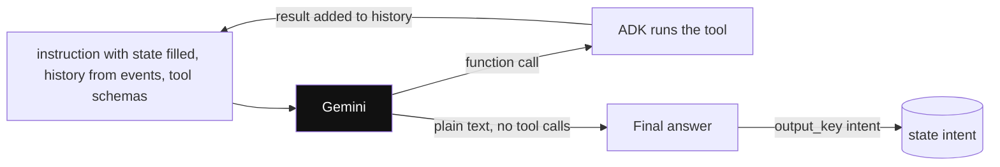

*Diagram:* An LlmAgent is this small loop: the model either asks for a tool (and ADK loops) or gives plain text, which output_key can save into state.

**How it works, step by step:**

1. You set `name`, `model`, `instruction`, `description` and `tools`.
2. `instruction` is the system prompt. It can read state with `{key}` placeholders, e.g. `"User's city is {city}"`.
3. `description` is a one-line summary. Other agents read it to decide whether to hand work to this agent.
4. `output_key="summary"` saves the agent's final text into `state["summary"]` automatically.
5. `output_schema=MyPydanticModel` forces a structured JSON answer. Some older docs say this cannot be mixed with tools; check your version.
6. `generate_content_config` sets temperature, max tokens and safety settings.

Worked example: a triage agent with `output_key="intent"` replies `"refund"`. After that turn, `state = {"intent": "refund"}`. The next agent's instruction `"Handle a {intent} request"` becomes `"Handle a refund request"`.

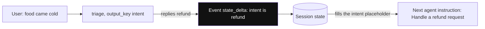

*Diagram:* Agents never parse each other's messages: one writes a state key through an event's state_delta, the next reads it through a placeholder in its instruction.

```python
from google.adk.agents import LlmAgent   # same class as: from google.adk import Agent

triage = LlmAgent(
    name="triage",
    model="gemini-3.5-flash",            # any current Gemini model id
    description="Classifies a customer message into an intent.",
    instruction=(
        "Read the user's message. Reply with exactly one word: "
        "refund, delivery or other."
    ),
    output_key="intent",                  # final text is saved to state["intent"]
)
```

**What the code does:**
- Creates one LLM-driven agent with a short, strict instruction.
- `description` lets a parent agent decide when to transfer to it.
- `output_key` writes the answer into session state, so the next agent can use it without parsing messages.

**Interview tip:** "How do two ADK agents share data?" Say: "Through session state. One agent writes with `output_key` or a tool writes `tool_context.state[...]`; the next agent reads it with a `{key}` placeholder in its instruction. State changes travel as `state_delta` on events, so they are saved and auditable."

**Common mistake:**
- Writing a vague `description`. The parent LLM picks sub-agents by description, so a vague one causes wrong routing.
- Using a `{key}` placeholder for a key that is not in state yet. It fails at runtime. Use `{key?}` to make it optional.

## ⭐ Workflow agents and the 2.0 Workflow graph

**In one line:** Workflow agents (`SequentialAgent`, `ParallelAgent`, `LoopAgent`) run sub-agents in a fixed pattern with no LLM deciding the order; ADK 2.0 adds a general `Workflow` graph for the same job with routing, retries and pauses.

**Why it exists:** Some steps must always happen in the same order: fetch order, then check policy, then reply. Letting an LLM choose the order costs tokens and sometimes skips a step. Fixed control flow is cheaper, faster and testable.

**Picture it:** An IRCTC booking counter. Fill form, then pay, then print ticket: always in that order (sequential). Two clerks checking ID and payment at the same time (parallel). A proofreader who checks the ticket again until it is right, max three tries (loop).

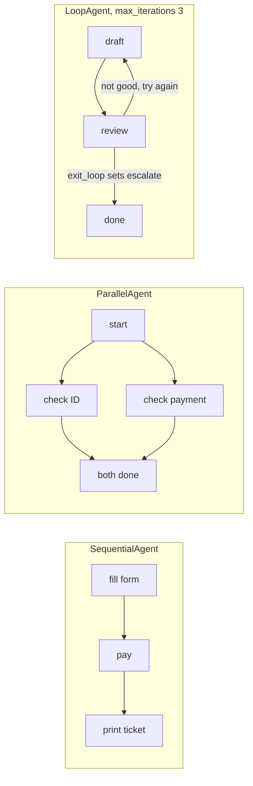

*Diagram:* Three fixed shapes with no LLM choosing the order: a straight line, a fan-out that joins, and a loop that ends on exit_loop or after 3 rounds.

**How it works, step by step:**

1. **`SequentialAgent(sub_agents=[a, b, c])`**: runs a, then b, then c. All share the same session state, so `a`'s `output_key` is visible to `b`.
2. **`ParallelAgent(sub_agents=[x, y])`**: runs x and y at the same time on separate branches. Give each a different `output_key` so they do not overwrite each other.
3. **`LoopAgent(sub_agents=[draft, review], max_iterations=3)`**: repeats until `max_iterations`, or until a sub-agent sets `escalate`. The built-in `exit_loop` tool does that.
4. **ADK 2.0 `Workflow`**: you list edges. A node can be an agent, a plain Python function or another workflow. A node can emit a `route` and the edge map picks the next node.

| Need | 1.x style | 2.0 style |
|---|---|---|
| A then B then C | `SequentialAgent` | `Workflow(edges=[(START, a, b, c)])` |
| X and Y together, then merge | `ParallelAgent` + a merge agent | tuple of nodes, then a `JoinNode` |
| Repeat until good | `LoopAgent` + `exit_loop` | loop edge plus routing |
| Branch on a value | custom agent | `Event(route="...")` and a route map |
| Pause for a human | custom work | built-in human-in-the-loop input |

Worked example: a parallel step calls a flights agent (2.1 s) and a hotels agent (1.6 s). Sequential would take 3.7 s; parallel takes about 2.1 s, the slowest branch.

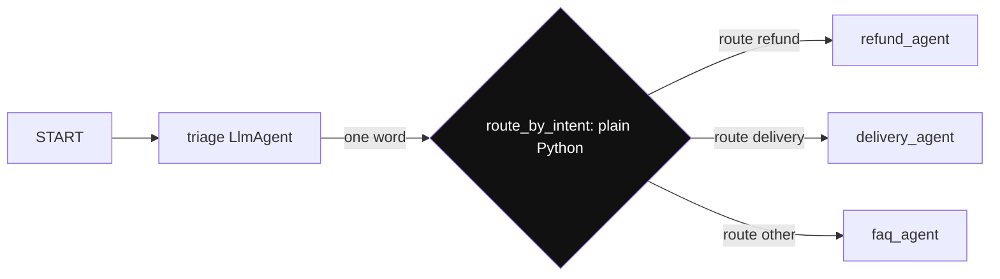

*Diagram:* This is the graph the 2.0 Workflow below builds: only triage uses the LLM; the highlighted function picks the next node for free by yielding a route.

```python
from google.adk import START, Event, Workflow

def route_by_intent(node_input: str):
    # node_input is the previous node's output, here the triage agent's word
    word = node_input.strip().lower()
    yield Event(route=word if word in ("refund", "delivery") else "other")

support_flow = Workflow(
    name="support_flow",
    edges=[
        (START, triage, route_by_intent,
         {"refund": refund_agent, "delivery": delivery_agent, "other": faq_agent}),
    ],
)
```

**What the code does:**
- Builds a graph: start, run `triage`, then a plain Python function decides the route.
- The function yields an `Event` with a `route` name; no LLM call is spent on routing.
- The dict maps each route to the next agent node. (`refund_agent`, `delivery_agent`, `faq_agent` are `LlmAgent`s defined elsewhere.)
- In 1.x you would write this as a custom agent or let a parent `LlmAgent` pick by transfer.

**Interview tip:** "Why not let one LLM agent do everything?" Say: "Deterministic parts belong in workflows. They cost zero tokens, never skip a step and are easy to test. I keep the LLM for judgment, like classifying intent or writing the reply."

**Common mistake:**
- Two parallel agents writing the same `output_key`. The last one wins and you lose data.
- A `LoopAgent` with no `max_iterations` and a reviewer that never calls `exit_loop`. It runs until your budget dies.

## Custom agents and dynamic nodes

**In one line:** When neither an LLM nor a fixed pattern fits, you write the control flow in Python: in 1.x by subclassing `BaseAgent`, in 2.0 by writing function nodes or a dynamic node that calls `ctx.run_node`.

**Why it exists:** Real flows have rules like "if the cart value is above ₹5,000, run the fraud agent first, else skip it". That is plain code, not a prompt.

**Picture it:** The kitchen manager follows a laminated rule card for special cases instead of asking the chef each time.

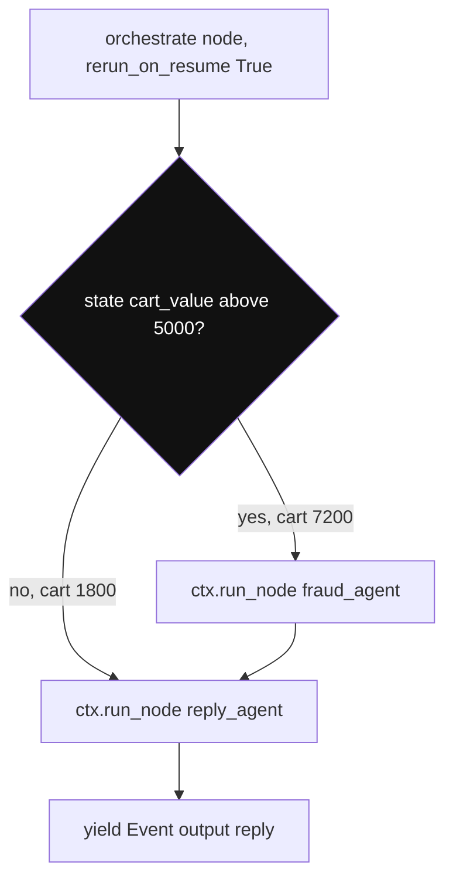

*Diagram:* The branch is an if-statement in Python, not a prompt; after a pause the whole node reruns from the top, so each child call must be safe to repeat.

**How it works, step by step:**

1. **1.x:** subclass `BaseAgent`, implement `async def _run_async_impl(self, ctx)`, and `yield` events from sub-agents you call in any order.
2. **2.0:** the migration guide warns that overriding legacy methods like `_run_async_impl` can be silently ignored now that `BaseAgent` is a `BaseNode`. Write logic as a function node instead.
3. For loops and branches decided at runtime, decorate a function with `@node(rerun_on_resume=True)` and call `await ctx.run_node(child, node_input=...)` inside it.
4. `rerun_on_resume=True` matters: after a pause or crash, the orchestrator runs again from the top, so child calls must be safe to repeat.

```python
from google.adk import Context, Event, Workflow
from google.adk.workflow import node

@node(rerun_on_resume=True)
async def orchestrate(ctx: Context, node_input: str):
    # plain Python decides which child runs
    if ctx.state.get("cart_value", 0) > 5000:
        await ctx.run_node(fraud_agent, node_input=node_input)
    reply = await ctx.run_node(reply_agent, node_input=node_input)
    yield Event(output=reply)

root_agent = Workflow(name="checkout", edges=[("START", orchestrate)])
```

**What the code does:**
- A function node reads state and decides at runtime whether the fraud agent runs.
- `ctx.run_node` runs a child agent and returns its output, like calling a function.
- `yield Event(output=...)` makes the reply the node's output.

**Interview tip:** "Your rule is 'refund above ₹2,000 needs a fraud check'. Where does it live?" Say: "In code, as a dynamic node or a callback, never only in the prompt. Prompts are suggestions; code is a guarantee."

**Common mistake:**
- Copying 1.x custom-agent code into a 2.0 project and assuming it still runs. Re-test after upgrade.

## ⭐ Tools: functions, built-ins, AgentTool, MCP and OpenAPI

**In one line:** A tool is anything the model can call: a Python function, a Google built-in like `google_search`, another agent wrapped with `AgentTool`, tools from an MCP server, or every endpoint of an OpenAPI spec.

**Why it exists:** The model cannot read your database or call your refund API by itself. Tools are its hands. ADK makes each kind of tool look the same to the model.

**Picture it:** A support executive's desk: a calculator (function tool), Google on the browser (built-in search), a phone to a senior colleague who answers and hangs up (`AgentTool`), and a shared office printer anyone can use (MCP server).

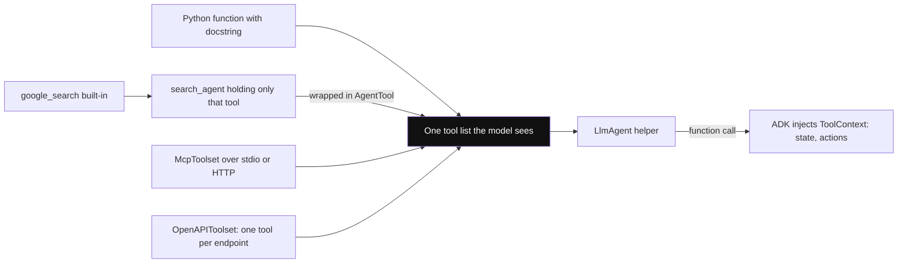

*Diagram:* Five different sources look identical to the model; note the built-in search sits in its own agent and joins through AgentTool to avoid the mixing limit.

**How it works, step by step:**

1. **Function tool:** pass a plain Python function in `tools=[...]`. ADK builds the JSON schema from type hints and the docstring. Return a dict like `{"status": "ok", "eta_min": 25}`.
2. **`ToolContext`:** add a parameter `tool_context: ToolContext` and ADK injects it. It gives `tool_context.state`, artifacts, memory search and `tool_context.actions` (e.g. `escalate`).
3. **Built-in tools:** `google_search`, code execution and Vertex AI Search run on Google's side. Gemini has limits on mixing built-in tools with your own function tools in one agent. Common fix: put `google_search` in its own small agent and wrap that agent with `AgentTool`.
4. **`AgentTool(agent=x)`:** the parent calls agent `x` like a function, gets its answer, and stays in control.
5. **MCP:** `McpToolset(connection_params=...)` connects to an MCP server over stdio or streamable HTTP and exposes its tools.
6. **OpenAPI:** `OpenAPIToolset(spec_str=..., spec_str_type="json")` turns each endpoint into a tool.
7. **Long-running tools and confirmation:** a tool can ask for human confirmation before it runs (tool confirmation flow).

**Sub-agent transfer vs `AgentTool`:**

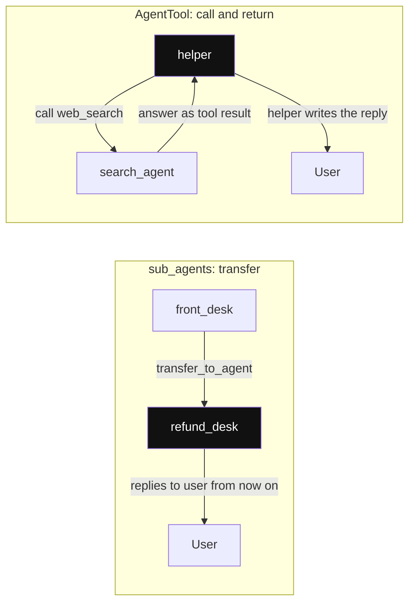

*Diagram:* The highlighted agent talks to the user next: with transfer control moves to the sub-agent; with AgentTool it comes back to the parent.

| | `sub_agents=[x]` (transfer) | `tools=[AgentTool(agent=x)]` |
|---|---|---|
| Who talks to the user next | `x` takes over the conversation | parent keeps talking |
| Control | handed over | parent stays in charge |
| Result | `x`'s replies go to the user | `x`'s answer returns to the parent as a tool result |
| Good for | "transfer to the refund desk" | "ask the search specialist, then I write the reply" |

```python
from google.adk.agents import LlmAgent
from google.adk.tools import google_search
from google.adk.tools.agent_tool import AgentTool

search_agent = LlmAgent(
    name="web_search", model="gemini-3.5-flash",
    instruction="Search the web and answer in 3 lines with sources.",
    tools=[google_search],                      # built-in tool alone in its agent
)

def get_order(order_id: str) -> dict:
    """Return status and ETA for one order id."""
    return {"order_id": order_id, "status": "picked_up", "eta_min": 25}

helper = LlmAgent(
    name="helper", model="gemini-3.5-flash",
    instruction="Use get_order for order questions, web_search for anything public.",
    tools=[get_order, AgentTool(agent=search_agent)],
)
```

**What the code does:**
- `get_order` becomes a function tool. Its docstring and type hints become the tool description and schema.
- `google_search` sits inside its own agent to avoid the built-in plus function tool mixing limit.
- `AgentTool` lets `helper` call the search agent and still write the final reply itself.

**Interview tip:** "How do you reuse the same tools across LangGraph and ADK?" Say: "Put them behind an MCP server. ADK loads them with `McpToolset`, and other frameworks have MCP clients too. One tool server, many agents."

**Common mistake:**
- Returning a huge raw JSON from a tool. It fills the context window. Return only the fields the model needs.
- Missing docstrings. The model chooses tools by their description, so a blank one gets ignored or misused.

## ⭐ Sessions, state and memory

**In one line:** A session is one conversation (events plus a `state` dict); a session service stores sessions; a memory service stores knowledge across many sessions for long-term recall.

**Why it exists:** LLMs are stateless. Every turn, ADK must rebuild the history and know facts like the order ID. Some facts must live longer than one chat, like "user is vegetarian".

**Picture it:** A hospital visit file (session) holds today's notes. The patient's master record (memory) holds allergies from all past visits.

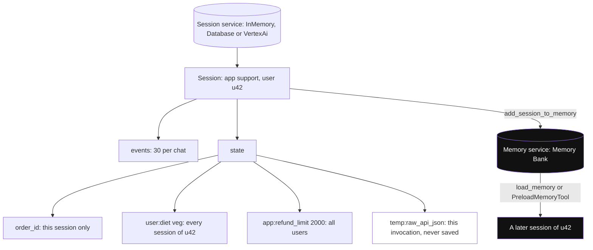

*Diagram:* The session holds one chat's events and state, with key prefixes setting how far each value reaches; the memory service is the separate long-term store later chats search.

**How it works, step by step:**

1. Session service options: `InMemorySessionService` (dev only), `DatabaseSessionService` (SQL database such as Postgres), `VertexAiSessionService` (managed by Google Cloud).
2. Each session has `app_name`, `user_id`, `id`, `events` and `state`.
3. State keys use prefixes for scope:

| Prefix | Scope | Example |
|---|---|---|
| none | this session only | `state["order_id"] = "8812"` |
| `user:` | all sessions of this user | `state["user:diet"] = "veg"` |
| `app:` | all users of this app | `state["app:refund_limit"] = 2000` |
| `temp:` | this invocation only, not saved | `state["temp:raw_api_json"]` |

4. Change state only through events: `output_key`, `tool_context.state[...]` or callback context state. ADK records these as `state_delta` and saves them. Editing `session.state` directly on an object you fetched is not saved.
5. Memory service options: `InMemoryMemoryService` (keyword match, dev) and `VertexAiMemoryBankService` (Memory Bank on Vertex AI, extracts and searches facts).
6. You add a finished session with `memory_service.add_session_to_memory(session)`. Agents read memory with the `load_memory` tool (on demand) or `PreloadMemoryTool` (every turn).

Worked example: a Postgres session table at 2 KB per event, 30 events per chat and 100,000 chats a day is about 6 GB of events per day. Plan retention, for example keep 30 days.

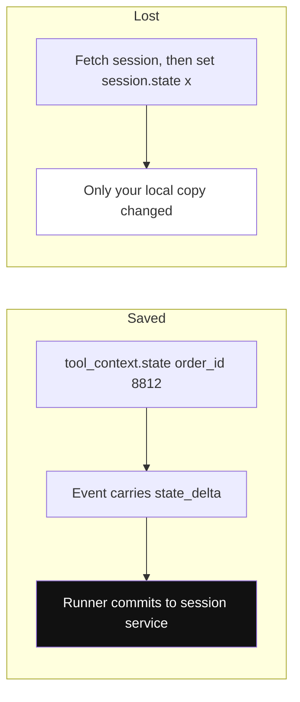

*Diagram:* Step 4 as a picture: a state change persists only when it rides on an event; editing a fetched session object changes nothing in storage.

**Interview tip:** "Session vs memory in ADK?" Say: "Session is short-term: one conversation's events and state, stored by a session service. Memory is long-term and searchable across sessions, stored by a memory service such as Vertex AI Memory Bank. User-level facts can also live in `user:`-prefixed state."

**Common mistake:**
- Shipping `InMemorySessionService` to production. A restart wipes every conversation.
- Mutating a fetched session's `state` dict and expecting it to persist. Only event deltas persist.

## Callbacks: guardrails and hooks

**In one line:** Callbacks are your functions that ADK calls before and after agents, model calls and tool calls; returning a value from a "before" callback skips the real step.

**Why it exists:** You need checks that the model cannot talk its way around: block a refund above the limit, mask PII in prompts, cache answers, log every tool call.

**Picture it:** A bank teller's supervisor who checks every withdrawal slip above ₹50,000 before cash leaves the counter.

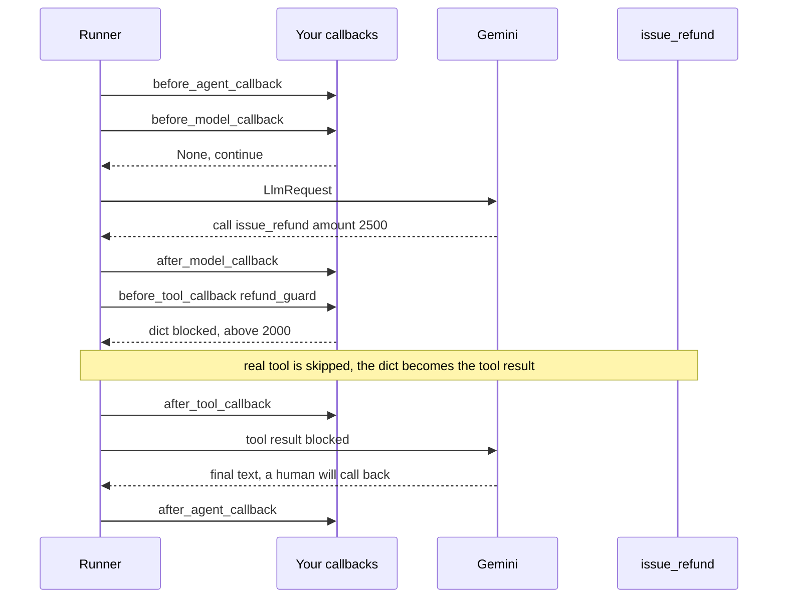

*Diagram:* The six hooks wrap the agent, each model call and each tool call; refund_guard returns a dict, so issue_refund never runs for Rs 2,500.

**How it works, step by step:**

1. Six hooks: `before_agent_callback`, `after_agent_callback`, `before_model_callback`, `after_model_callback`, `before_tool_callback`, `after_tool_callback`.
2. `before_model_callback(callback_context, llm_request)`: return an `LlmResponse` to skip the model call (cache hit, blocked prompt). Return `None` to continue.
3. `before_tool_callback(tool, args, tool_context)`: return a dict to skip the tool and use that dict as its result. Return `None` to run the tool.
4. `after_*` callbacks can rewrite the response or result.
5. Callbacks can read and write state through their context.

```python
from typing import Any
from google.adk.tools.base_tool import BaseTool
from google.adk.tools.tool_context import ToolContext

def refund_guard(tool: BaseTool, args: dict[str, Any],
                 tool_context: ToolContext) -> dict | None:
    if tool.name == "issue_refund" and args.get("amount", 0) > 2000:
        tool_context.state["needs_human"] = True
        return {"status": "blocked", "reason": "Above ₹2,000. Sent to a human."}
    return None   # None means: run the real tool
```

**What the code does:**
- Runs before every tool call of the agent it is attached to.
- If the refund is above ₹2,000, it skips the real tool and returns a "blocked" result to the model.
- Sets a state flag so the app or a later node can route to a human.

**Interview tip:** "Where do you put guardrails in ADK?" Say: "Policy checks in `before_tool_callback`, so they run in code on every call. Input filtering in `before_model_callback`. Output checks in `after_model_callback`. The prompt only explains the policy; the callback enforces it."

**Common mistake:**
- Doing slow network work in every `before_model_callback`. It adds latency to every single LLM call.

## ⭐ A complete small app: Zomato-style order support bot

**In one line:** A support bot that answers "where is my order" and handles refunds, with a coordinator agent, two specialist agents, a refund guardrail, persistent sessions and a Runner loop.

**Why it exists:** This is the shape of most real ADK apps: one coordinator that routes, specialists with tools, a code guardrail, and a Runner in your API server.

**Picture it:** The front-desk executive listens and transfers you to "delivery desk" or "refund desk". The refund desk has a supervisor rule for big amounts.

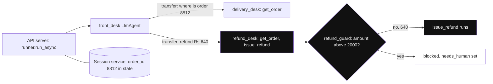

*Diagram:* Turn 2 of the example follows the highlighted path: transfer to refund_desk, guard check, and Rs 640 passes because it is under the Rs 2,000 limit.

**How it works, step by step:**

1. Write tools as plain functions (block 1).
2. Build two specialist agents and a coordinator with `sub_agents` (block 2).
3. Create a session service and a `Runner`, then send messages and read events (block 3).
4. Run it locally with `adk web` to see each event and state change.

Block 1: tools.

```python
# support_bot/agent.py
from google.adk.agents import LlmAgent
from google.adk.tools.tool_context import ToolContext

ORDERS = {"8812": {"status": "picked_up", "eta_min": 25, "paid": 640}}

def get_order(order_id: str, tool_context: ToolContext) -> dict:
    """Look up an order's status, ETA in minutes and amount paid in rupees."""
    order = ORDERS.get(order_id)
    if not order:
        return {"error": f"No order {order_id}"}
    tool_context.state["order_id"] = order_id        # saved as a state_delta
    return order

def issue_refund(order_id: str, amount: int) -> dict:
    """Refund an amount in rupees for an order. Call only after checking the order."""
    return {"status": "refunded", "order_id": order_id, "amount": amount}
```

**What the code does:**
- `get_order` returns a small dict and remembers the order ID in session state.
- `issue_refund` is the risky tool. Its docstring tells the model to check the order first.
- `ToolContext` is injected by ADK; the model never sees it in the tool schema.

Block 2: agents.

```python
delivery_desk = LlmAgent(
    name="delivery_desk", model="gemini-3.5-flash",
    description="Answers where an order is and when it will arrive.",
    instruction="Use get_order. Give status and ETA in one friendly line.",
    tools=[get_order],
)

refund_desk = LlmAgent(
    name="refund_desk", model="gemini-3.5-flash",
    description="Handles refund requests for late, wrong or missing items.",
    instruction=("Check the order with get_order, then refund at most the amount paid. "
                 "If a tool says blocked, tell the user a human will call back."),
    tools=[get_order, issue_refund],
    before_tool_callback=refund_guard,               # from the Callbacks section
)

root_agent = LlmAgent(
    name="front_desk", model="gemini-3.5-flash",
    instruction="Greet briefly. Transfer delivery questions to delivery_desk "
                "and refund requests to refund_desk.",
    sub_agents=[delivery_desk, refund_desk],
)
```

**What the code does:**
- Two specialists, each with only the tools it needs (least privilege).
- `refund_desk` has the ₹2,000 guardrail as a `before_tool_callback`.
- `front_desk` routes by transfer: the LLM reads each sub-agent's `description` and calls the transfer action ADK adds automatically.
- The variable must be named `root_agent` so `adk web` and `adk run` can find it.

Block 3: run it.

```python
import asyncio
from google.adk.runners import Runner
from google.adk.sessions import InMemorySessionService   # DatabaseSessionService in prod
from google.genai import types

async def main():
    sessions = InMemorySessionService()
    runner = Runner(agent=root_agent, app_name="support", session_service=sessions)
    s = await sessions.create_session(app_name="support", user_id="u42")
    for text in ["Where is order 8812?", "It came cold. Refund ₹640 please."]:
        msg = types.Content(role="user", parts=[types.Part(text=text)])
        async for event in runner.run_async(user_id="u42", session_id=s.id, new_message=msg):
            if event.is_final_response() and event.content and event.content.parts:
                print(f"[{event.author}] {event.content.parts[0].text}")

asyncio.run(main())
```

**What the code does:**
- Creates a session for user `u42` and a Runner tied to the app name `support`.
- Sends two turns on the same session, so the second turn sees the first (and `state["order_id"]`).
- Prints only final responses; `event.author` shows which agent replied (`delivery_desk`, then `refund_desk`).
- Swap `InMemorySessionService` for `DatabaseSessionService("postgresql+asyncpg://...")` and nothing else changes.

To try it in the browser: put `agent.py` and an `__init__.py` (`from . import agent`) in `support_bot/`, set `GOOGLE_API_KEY` in `.env`, then run `adk web` from the parent folder. The Dev UI shows every event, tool call, state change and trace.

**Interview tip:** "Walk me through what happens on 'Refund ₹640'." Say: "The Runner appends the user event, runs `front_desk`, which transfers to `refund_desk`. That agent calls `get_order`, then `issue_refund`. The callback checks the amount (₹640 is under ₹2,000, so it runs). Each step is an event; state deltas are committed by the session service; the final response is streamed back."

**Common mistake:**
- Giving every agent every tool. Routing gets confused and a delivery question can trigger a refund.

## ⭐ How it works inside: one run, step by step

**In one line:** The Runner drives an event loop: the agent yields events, the Runner commits each event (and its state change) to the session service, then lets the agent continue.

**Why it exists:** Knowing the loop lets you debug "why did state not save?", "why did it call the tool twice?" and "why is it slow?".

**Picture it:** A cricket scorer. Each ball (event) is written in the scorebook before the next ball is bowled. The total (state) is only official once written.

**How it works, step by step:**

1. Your app calls `run_async` with a new user message.
2. The Runner loads the session and appends the user message as an event.
3. It builds an `InvocationContext` (session, services, the current agent) and calls the root agent.
4. An `LlmAgent` builds an `LlmRequest`: instruction (with `{state}` filled in), conversation history from events, tool schemas, plus a transfer tool if it has sub-agents.
5. `before_model_callback` runs. Then Gemini (or LiteLLM) is called.
6. If the model returns function calls, ADK runs `before_tool_callback`, the tool, then `after_tool_callback`, and yields an event with the results.
7. Each yielded event goes to the Runner. The Runner appends it to the session and applies its `state_delta`. Only then does the agent continue.
8. If an event has a transfer action, the Runner switches the active agent to that sub-agent.
9. The loop repeats until the model returns plain text with no tool calls. That event is the final response.

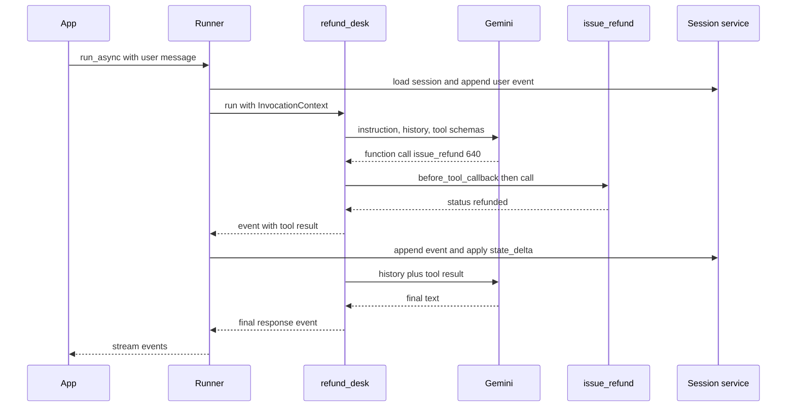

**Event fields you will use:**

| Field | Meaning |
|---|---|
| `author` | which agent (or `user`) produced the event |
| `content` | text parts, function calls or function responses |
| `actions.state_delta` | state keys changed by this event |
| `actions.transfer_to_agent` | hand control to another agent |
| `actions.escalate` | stop a loop or pass control upward |
| `partial` | true for streaming chunks |
| `node_info`, `output` | new in 2.0, used by the workflow graph |

**Interview tip:** "Why does ADK commit state per event?" Say: "So state is always consistent with history. If the process dies after event 5, the session has exactly 5 events and their state. It also gives an audit trail of who changed what."

**Common mistake:**
- In 2.0, appending to `session.events` yourself. The docs warn it bypasses the graph engine and breaks resume. Yield events instead.

## Models: Gemini, LiteLLM and others

**In one line:** Pass a Gemini model name as a string, or wrap any other model with `LiteLlm(model="provider/model")`.

**Why it exists:** Teams want Gemini's price and speed for most calls and maybe Claude or GPT for some agents. Lock-in to one provider is a risk.

**Picture it:** A phone with dual SIM. Default SIM is Jio (Gemini); you can switch one call to Airtel (another provider).

**How it works, step by step:**

1. Gemini: `model="gemini-3.5-flash"`. Use the Gemini API key for development, or Vertex AI (`GOOGLE_GENAI_USE_VERTEXAI=TRUE`, project and location) for enterprise.
2. Others: `from google.adk.models.lite_llm import LiteLlm`, then `model=LiteLlm(model="anthropic/claude-sonnet-4-5")` or `"openai/gpt-4.1"`, with that provider's key in env.
3. Local: `LiteLlm(model="ollama_chat/llama3.1")` for an Ollama server.
4. Gemini-only features (built-in `google_search`, Live streaming) do not work through LiteLLM.

Worked example on cost: if triage runs on a flash model at roughly one-tenth the price of a large model, and triage is 40% of calls, moving it saves about 36% of the triage-heavy bill. Always measure on your own traffic.

**Interview tip:** "Is ADK Gemini-only?" Say: "No. Gemini is native and gets built-in tools; other providers go through the `LiteLlm` wrapper. I mix them per agent, e.g. a cheap model for triage and a stronger one for writing."

**Common mistake:**
- Expecting built-in Gemini tools to work with a LiteLLM model. They are Gemini server features.

## Dev tools: adk web, adk run, adk api_server

**In one line:** The `adk` command line gives you a browser Dev UI, a terminal chat, a local API server, an eval runner and deploy commands.

**Why it exists:** Agent bugs are hard to see in logs. You need to see each event, each tool call and each state change side by side.

**Picture it:** A car's diagnostic port. Plug in and see every sensor live.

**How it works, step by step:**

1. `adk create my_agent` scaffolds a folder with `agent.py`, `__init__.py` and `.env`.
2. `adk run my_agent` chats in the terminal.
3. `adk web` (run from the parent folder) opens the Dev UI: chat, events tab, state, traces, and a button to save the chat as an eval case.
4. `adk api_server` serves the agent as a local FastAPI (REST) server; add `--a2a` to expose agents over A2A.
5. Agents can also be defined in YAML (Agent Config) for no-code setups.

**Interview tip:** "How do you debug a wrong tool call in ADK?" Say: "Reproduce in `adk web`, open the event list, check the exact `LlmRequest` (instruction, tool schemas) and the function call the model returned. Usually the fix is a clearer tool docstring or a narrower tool list."

**Common mistake:**
- Running `adk web` inside the agent folder instead of its parent. It cannot find the agent package.

## Evaluation

**In one line:** `adk eval` replays saved conversations and scores the tool-call path (trajectory) and the final answer against what you expected.

**Why it exists:** Agents are non-deterministic. A prompt change can silently break routing. You need regression tests before every deploy.

**Picture it:** A driving test route. Same route every time; the examiner checks both the turns you took and where you ended up.

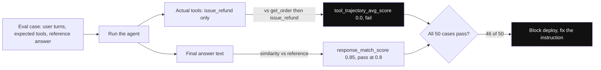

*Diagram:* Each case is scored twice: the path of tool calls and the final text; here the answer looks fine but skipping get_order fails the trajectory and blocks the deploy.

**How it works, step by step:**

1. Save good conversations as eval cases from `adk web`, or write `.test.json` / `.evalset.json` files by hand.
2. Each case has the user turns, the expected tool calls (name and args) and a reference answer.
3. Default criteria: `tool_trajectory_avg_score` (did it call the right tools in order; 1.0 = perfect) and `response_match_score` (text similarity to the reference, e.g. threshold 0.8).
4. Run `adk eval path/to/agent path/to/cases.evalset.json --config_file_path eval_config.json`, or `AgentEvaluator.evaluate(...)` inside pytest.
5. Add LLM-as-judge criteria where text similarity is too strict.

Worked example: 50 cases, trajectory threshold 1.0. After a prompt change, 46 pass and 4 fail because `refund_desk` skipped `get_order`. You block the deploy and fix the instruction.

**Interview tip:** "Why test the trajectory, not only the answer?" Say: "A right answer from a wrong path is luck. If the agent refunds without checking the order, the answer may look fine today and cost money tomorrow."

**Common mistake:**
- Using exact text match for free-form replies. It fails on harmless wording changes. Use similarity thresholds or a judge.

## Production concerns and deployment

**In one line:** Ship ADK as a container on Cloud Run or GKE, or on Vertex AI Agent Engine (managed), with a durable session service, tracing, evals in CI and A2A for cross-team agents.

**Why it exists:** A demo on a laptop has no persistence, no scaling, no auth and no traces.

**Picture it:** Moving from a home kitchen to a licensed restaurant: fridge logs, CCTV, fire exits.

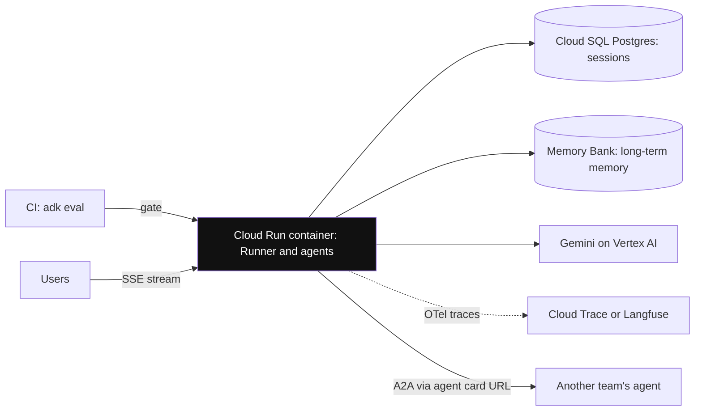

*Diagram:* A typical production layout: a stateless container with durable sessions and memory outside it, traces exported, evals gating deploys, and A2A only to other teams.

**How it works, step by step:**

1. **Deploy:** `adk deploy cloud_run --with_ui <folder>` builds a container on Cloud Run. `adk deploy agent_engine` targets Vertex AI Agent Engine (the README now calls it Agent Runtime on the Gemini Enterprise Agent Platform). GKE or any Docker host also works.
2. **Persistence:** `DatabaseSessionService` (Postgres or Cloud SQL) or `VertexAiSessionService`. Memory Bank for long-term memory.
3. **Observability:** ADK emits OpenTelemetry traces; send them to Cloud Trace or any OTel backend (Langfuse, Arize Phoenix and others integrate).
4. **Streaming:** `run_async` yields partial events; stream them over SSE. Bidirectional audio and video use `run_live` with Gemini Live models.
5. **A2A:** expose an agent as an A2A service (`to_a2a(agent)` or `adk api_server --a2a`) and call remote agents with `RemoteA2aAgent` using their agent card URL. Use it when another team owns the agent.
6. **Cost:** count LLM calls per turn. A coordinator plus a specialist is at least 2 calls per turn; every tool round trip adds one.
7. **Failure modes:** model 429 (rate limit) errors, tool timeouts, routing loops between agents. ADK 2.0 workflows add per-node retry config; do not swallow exceptions inside tools or retries cannot fire.

| Option | You manage | Good for |
|---|---|---|
| Cloud Run | container, scaling settings, DB | most teams, custom API around the agent |
| Vertex AI Agent Engine | little: managed sessions, memory, scaling | Google Cloud shops that want managed |
| GKE | everything | big platforms with existing Kubernetes |

**Interview tip:** "How do you make an ADK agent production-ready?" Say: "Durable sessions in Postgres or Vertex, OTel tracing, `adk eval` in CI with trajectory checks, callbacks for policy, step and cost limits, secrets in Secret Manager, deploy on Cloud Run or Agent Engine, and A2A only across team boundaries."

**Common mistake:**
- Broad `except Exception` inside tools in 2.0. It hides failures from the framework and disables automatic retries for that step.
- Upgrading to 2.0 with a strict DB schema for events. 2.0 adds `node_info` and `output` fields; update readers first.

## ⭐ When to use ADK, and how it compares

**In one line:** Pick ADK when you are on Google Cloud or Gemini and want a full kit (agents, workflows, sessions, eval, deploy); pick something else when you need provider-neutral graphs or a very small surface.

**Why it exists:** "Why ADK and not X?" is a standard senior question. You need reasons, not brand loyalty.

**Picture it:** Buying a phone in an ecosystem. An Android phone works best with Google services, but you can still install other apps.

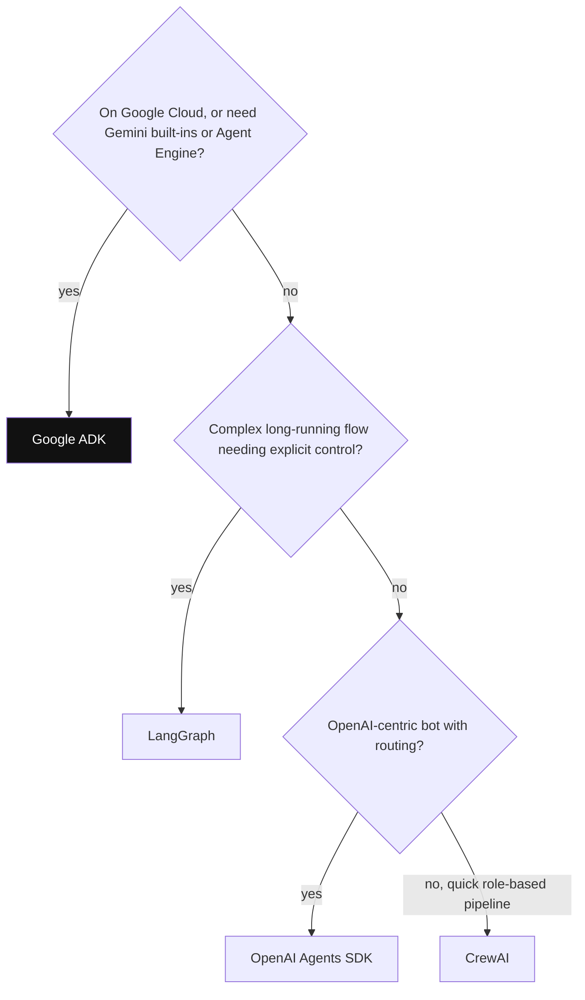

*Diagram:* Start from your platform and runtime needs, not the model brand; ADK is the first stop when Google Cloud features matter.

**How it works, step by step:**

1. Use ADK when: your stack is Google Cloud, you want Gemini built-ins (search grounding, Live audio), you want a managed runtime (Agent Engine), or you need A2A across teams.
2. Avoid or think twice when: the team is deep in LangChain tools, you need the most mature checkpoint-and-time-travel story, or you want the smallest dependency.
3. Compare on the axes below.

| | Google ADK | LangGraph | OpenAI Agents SDK | CrewAI |
|---|---|---|---|---|
| Control flow | LLM transfer, workflow agents, 2.0 graph | explicit graph, full control | handoffs between agents | role-based crews, Flows |
| State | session state with prefixes | typed state with reducers | sessions | crew memory |
| Durability | session services, 2.0 resume | checkpointer per step, time travel | session stores | limited |
| Human-in-the-loop | tool confirmation, 2.0 HITL nodes | `interrupt()` | approval via guardrails or tools | human input flag |
| Dev UI and eval | `adk web`, `adk eval` built in | LangGraph Studio, LangSmith (separate) | tracing dashboard | CLI, enterprise UI |
| Managed hosting | Vertex AI Agent Engine | LangGraph Platform | none of its own | CrewAI enterprise |
| Best fit | Gemini and Google Cloud teams | complex, long-running flows | OpenAI-centric bots | quick role-based pipelines |

**Interview tip:** "ADK vs LangGraph?" Say: "LangGraph gives the most explicit control and the most mature checkpointing; it is provider-neutral. ADK gives a fuller kit out of the box: Dev UI, eval, session and memory services, Google deploy targets and A2A. On Google Cloud with Gemini I lean ADK; for complex provider-neutral flows, LangGraph."

**Common mistake:**
- Choosing ADK only because "we use Gemini". LangGraph and others call Gemini fine too. Choose on runtime, ops and team skills.

## Common pitfalls in real ADK projects

**In one line:** Most ADK bugs come from routing by vague descriptions, state written the wrong way, built-in tool limits and 2.0 upgrade surprises.

**Why it exists:** These come up in real code reviews and in interview "what went wrong" questions.

**Picture it:** The same potholes on the same road. Once you know them, you slow down there.

**How it works, step by step:**

1. **Vague descriptions:** the coordinator transfers to the wrong agent. Fix: one crisp line per sub-agent, plus eval cases for routing.
2. **Ping-pong transfer:** two agents keep transferring to each other. Fix: limit who can transfer back (`disallow_transfer_to_parent`, `disallow_transfer_to_peers`) and add a turn cap.
3. **Lost state:** editing a fetched `session.state` directly. Fix: write via `output_key`, `tool_context.state` or callbacks.
4. **Built-in tool mixing:** `google_search` plus function tools in one agent fails on some models. Fix: wrap search in its own agent with `AgentTool`.
5. **`temp:` keys expected later:** they vanish after the invocation. Use a normal key if you need it next turn.
6. **Parallel overwrite:** same `output_key` in a `ParallelAgent`. Use unique keys.
7. **2.0 resume reruns nodes:** after a pause or failure, some nodes run again. Make tools like `issue_refund` idempotent (use an idempotency key such as the order ID).
8. **Event schema change:** strict validators on stored events break after 2.0. Update readers before writers.

**Interview tip:** "Your ADK bot refunded twice. How do you debug?" Say: "Open the trace or `adk web` events for that session. Check if the refund tool event appears twice (model retry, node rerun on resume, or two agents both having the tool). Fix with an idempotency key in the refund API and by giving the tool to one agent only."

**Common mistake:**
- Treating these as model problems and rewriting prompts, when the fix is in code or configuration.

## Interview questions

**Q: What is the difference between `LlmAgent` and a workflow agent?**
A: `LlmAgent` uses a model to decide what to do next, including tool calls and transfers. Workflow agents (`SequentialAgent`, `ParallelAgent`, `LoopAgent`) run sub-agents in a fixed pattern with no LLM deciding the order.

**Q: How does data pass between agents in a `SequentialAgent`?**
A: Through shared session state. An agent writes with `output_key` or `tool_context.state`, and the next agent reads it with `{key}` placeholders in its instruction.

**Q: Sub-agent transfer vs `AgentTool`?**
A: Transfer hands the conversation to the sub-agent; it replies to the user. `AgentTool` calls the agent like a function and returns its answer to the parent, which stays in control.

**Q: What does the `Runner` do?**
A: It loads the session, runs the root agent, receives each event, commits the event and its `state_delta` to the session service, handles transfers, and streams events to your app.

**Q: What changed in ADK 2.0?**
A: A graph-based Workflow Runtime: agents, tools and functions run as nodes with routing, retries, human-in-the-loop and resume. `BaseAgent` became a `BaseNode`, events gained `node_info` and `output`, and fixed workflow agents are superseded by graph and dynamic workflows. 2.0 sessions are readable by 1.28+ only.

**Q: How do you add a guardrail so refunds above ₹2,000 never run automatically?**
A: A `before_tool_callback` that checks `tool.name` and `args["amount"]` and returns a "blocked" dict, which skips the real tool. Also enforce the limit in the refund API itself.

**Q: How do you use Claude in ADK?**
A: Wrap it: `model=LiteLlm(model="anthropic/claude-...")` with the Anthropic key in env. Gemini-only built-in tools will not work for that agent.

**Q: Session state vs memory service?**
A: State is a key-value dict inside one session (with `user:` and `app:` prefixes for wider scope). The memory service stores and searches knowledge across sessions, e.g. Vertex AI Memory Bank, accessed with `load_memory`.

**Q: How do you evaluate an ADK agent?**
A: `adk eval` or `AgentEvaluator` in pytest with evalset files. Score the tool trajectory and the response (similarity or LLM judge). Run it in CI and block deploys on regression.

**Q: Cloud Run or Agent Engine?**
A: Cloud Run when you want your own API around the agent and full control of the container and database. Agent Engine when you want Google to manage sessions, memory and scaling and you accept tighter coupling to Vertex AI.

**Q: When would you use A2A in ADK instead of sub-agents?**
A: When the other agent is owned by another team, runs as a separate service, or is written in another framework. Inside one codebase, plain sub-agents are simpler and faster.

**Q: How would you debug wrong routing in a multi-agent ADK app?**
A: Reproduce in `adk web`, read the coordinator's `LlmRequest` and its transfer call, sharpen sub-agent descriptions, and add routing eval cases. If routing is rule-based, move it to a workflow route instead of the LLM.

**Q: ADK vs LangGraph for a long-running approval flow?**
A: LangGraph has the most mature checkpointing, `interrupt()` and time travel. ADK 2.0 now has workflow resume and human-in-the-loop nodes, and adds a Dev UI, eval and Google deploy targets. On Google Cloud I would try ADK 2.0; otherwise LangGraph.

**Q: What breaks if a 2.0 workflow node is resumed?**
A: Some nodes rerun on resume, so a non-idempotent tool such as a refund can run twice. Use idempotency keys and keep side effects in tools that check "already done".

**Q: How do you keep ADK costs down?**
A: Deterministic routing in workflows (zero LLM calls), a cheap model for triage, small tool outputs, `before_model_callback` caching for repeated questions, and loop caps.

## Read next

- [Agent Frameworks and Tooling](19-agent-frameworks.md)
- [LangGraph Core](02-langgraph-core.md)
- [OpenAI Agents SDK](27-openai-agents-sdk.md)
- [Tools, MCP & A2A](07-tools-mcp-a2a.md)

## Checklist

- [ ] I can explain ADK's mental model: agents, Runner, events and sessions.
- [ ] I can explain `LlmAgent` fields like `instruction`, `description` and `output_key`.
- [ ] I can explain Sequential, Parallel and Loop agents and the ADK 2.0 `Workflow` graph.
- [ ] I can explain sub-agent transfer vs `AgentTool` and when to use each.
- [ ] I can explain session state prefixes and the difference between session and memory services.
- [ ] I can write a `before_tool_callback` guardrail and explain what returning a value does.
- [ ] I can walk through one Runner run event by event, including `state_delta`.
- [ ] I can explain how to use non-Gemini models with `LiteLlm`.
- [ ] I can explain `adk web`, `adk eval` and deploying to Cloud Run or Agent Engine.
- [ ] I can compare ADK with LangGraph and the OpenAI Agents SDK and say when to pick each.
