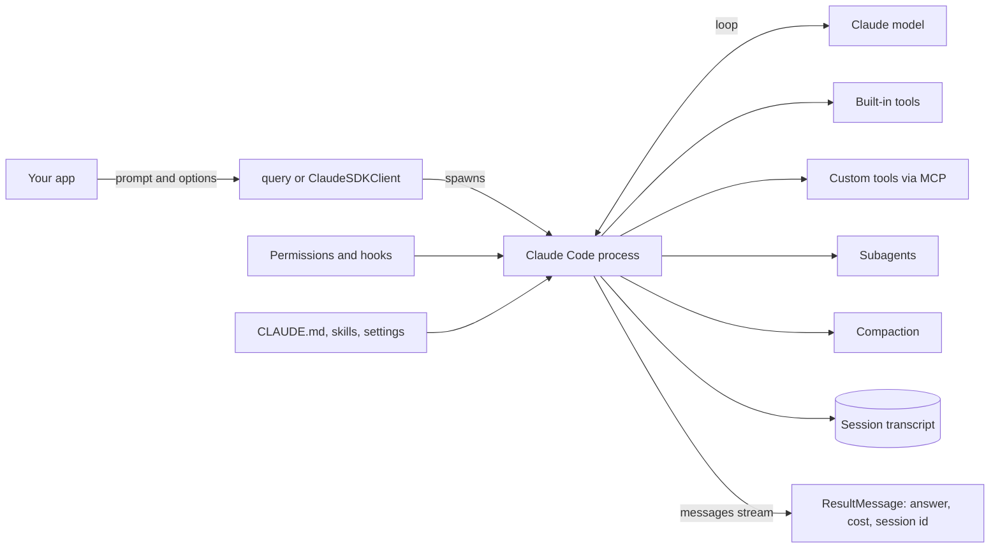
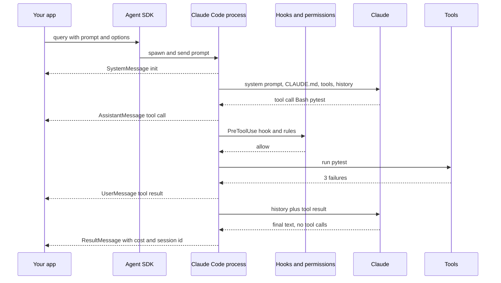

# Claude Agent SDK

The Claude Agent SDK is the harness that runs Claude Code, packaged as a Python and TypeScript library. You give it a prompt and options; it brings the agent loop, file and shell tools, permissions, hooks, subagents, sessions and automatic context compaction. Interviewers ask about it to check whether you know the difference between "calling a model with tools" and "running a full agent harness", and how you would host such a powerful agent safely.

Written against `claude-agent-sdk` 0.2.x for Python (November 2026). The TypeScript package is `@anthropic-ai/claude-agent-sdk`. It was called the **Claude Code SDK** until late 2025.

**After this page you can answer:**
- "What does the Claude Agent SDK give you that the plain Messages API with tool use does not?"
- "When do you use `query()` and when `ClaudeSDKClient`?"
- "Does `allowed_tools=["Read"]` stop Claude from using Bash?"
- "How would you block `rm -rf` or writes outside `src/`, even in `bypassPermissions` mode?"
- "How do subagents keep the main agent's context window small?"
- "What happens when the context window fills up in a long session?"
- "How would you host this agent for 1,000 tenants without one tenant reading another's files?"
- "Claude Agent SDK vs LangGraph vs OpenAI Agents SDK: which for a coding agent, and which for a refund workflow?"

## Words you need first

New to LLMs? Read [How LLMs Work](14-how-llms-work.md) first. For the general agent loop, read [Agent Foundations](01-agent-foundations.md).

| Word | Plain meaning |
|---|---|
| Harness | Everything around the model that makes it an agent: the loop, tools, permissions, memory, context handling. |
| Claude Code | Anthropic's coding agent for the terminal and IDE. The SDK is its engine as a library. |
| Messages API | Anthropic's basic API: you send messages and tool definitions, you get one reply back. |
| `query()` | SDK function for one task: send a prompt, stream messages until the result. |
| `ClaudeSDKClient` | SDK class for a live, multi-turn conversation that you can interrupt and continue. |
| Built-in tools | Tools that ship with the SDK: Read, Edit, Write, Bash, Glob, Grep, WebSearch, WebFetch and more. |
| MCP | Model Context Protocol: a standard way to plug external tools into any agent. |
| In-process MCP server | Your Python functions exposed as MCP tools inside your own app, with no separate process. |
| Permission mode | A setting for how much the agent may do without asking: default, acceptEdits, plan, dontAsk, auto, bypassPermissions. |
| Hook | Your callback that runs at a fixed point, like before every tool call, and can block it. |
| Subagent | A helper agent with its own fresh context window; only its final report comes back. |
| Session | One saved conversation transcript, with an id you can resume or fork later. |
| Compaction | Automatic summarising of older history when the context window is nearly full. |
| `CLAUDE.md` / skill | A project memory file loaded every turn / a folder of instructions loaded only when needed. |

## Big picture

Your app calls `query()` or `ClaudeSDKClient` with a prompt and `ClaudeAgentOptions`. The SDK starts a Claude Code process, which runs the loop with Claude: built-in tools for files, shell and web, your custom tools through MCP, **permissions** and **hooks** deciding what may run, **subagents** for side work, **compaction** when the window fills, and a **session** transcript on disk. Messages stream back to your code, ending with a `ResultMessage` that has the answer, cost and session id.



Each box is one section below. Then we build one on-call helper for a UPI payments service that uses all of them.

## ⭐ What it is and the mental model

**In one line:** Claude Code's agent harness as a library: you configure what the agent may touch, and the harness decides the steps.

**Why it exists:** A good general agent needs much more than a loop. It needs safe file editing (exact string replace, not "rewrite the whole file"), a shell, search, web access, permission prompts, context compaction for long tasks, subagents, and MCP. Anthropic built and tuned all of that for Claude Code. In 2025 they released it as the Claude Code SDK; it was renamed the **Claude Agent SDK** because teams used it for far more than coding: research, ops, data and support agents.

**Picture it:** Hiring an experienced site engineer who brings his own toolkit, versus hiring a fresher and buying every tool yourself. You still decide which rooms he may enter (permissions), you can stop him at the door of any room (hooks), and he can send a helper to measure the basement (subagent).

**How it works, step by step:**

1. `pip install claude-agent-sdk`. The package bundles a native Claude Code binary, so no separate install is usually needed.
2. Your code calls `query(prompt=..., options=ClaudeAgentOptions(...))`.
3. The SDK spawns a `claude` CLI subprocess and talks to it over stdio. That subprocess owns the shell, the working directory (`cwd`) and the session files.
4. The subprocess runs the loop with Claude: think, call tools, read results, repeat, until a reply has no tool calls.
5. You receive a stream of typed messages (`SystemMessage`, `AssistantMessage`, `UserMessage`, `ResultMessage`).
6. Auth: `ANTHROPIC_API_KEY`, or Claude on Amazon Bedrock or Google Cloud via environment variables such as `CLAUDE_CODE_USE_BEDROCK=1` or `CLAUDE_CODE_USE_VERTEX=1`.

**Where it sits among Anthropic's options:**

| Option | You write | Loop runs where | Built-in tools |
|---|---|---|---|
| Messages API, manual loop | the whole loop | your code | none, only tools you define |
| Messages API, Tool Runner (`client.beta.messages.tool_runner`) | tool functions | your code, SDK helper | none |
| **Claude Agent SDK** | prompt + options | Claude Code subprocess on your infra | Read, Edit, Write, Bash, Glob, Grep, WebSearch, WebFetch, Agent, Skill... |
| Managed Agents (API, beta) | agent config + events | Anthropic's servers, sandbox per session | bash, files, code execution, MCP, skills |

**What changed (good interview material):**
- Package rename: `claude-code-sdk` → `claude-agent-sdk`; `ClaudeCodeOptions` → `ClaudeAgentOptions`.
- Since v0.1.0 the default system prompt is **minimal**, not Claude Code's. Ask for `{"type": "preset", "preset": "claude_code"}` to get Claude Code behaviour.
- Settings loading was briefly turned off by default in v0.1.0, then reverted: today, omitting `setting_sources` loads user, project and local settings like the CLI. Pass `setting_sources=[]` to isolate.
- The subagent tool is now called `Agent` in tool calls (it was `Task`; the init tool list may still say `Task`).

**Interview tip:** "What is the Claude Agent SDK?" Say: "It is the harness behind Claude Code as a library. I give it a prompt, a working directory, allowed tools, permissions and hooks; it runs the loop with built-in file, shell and web tools, compaction, subagents and sessions. I configure the agent; I do not draw its control flow."

**Common mistake:**
- Confusing it with the Tool Runner in the `anthropic` package. The Tool Runner only loops over tools you define; it has no file, shell or compaction features.
- Thinking it is a thin HTTP client. It runs a real process with a shell; treat it like running untrusted code.

## ⭐ `query()` vs `ClaudeSDKClient`

**In one line:** `query()` is one task in, one stream out; `ClaudeSDKClient` keeps a session open for several turns, with interrupts and live controls.

**Why it exists:** A CI job "fix the failing test" is one shot. A chat UI or a Slack bot sends follow-ups, wants a Stop button, and may change the permission mode mid-session. One API for both would be clumsy.

**Picture it:** `query()` is giving a tailor one order and collecting the shirt. `ClaudeSDKClient` is standing next to the tailor: "make the sleeves shorter… stop… now the collar".

**How it works, step by step:**

| | `query()` | `ClaudeSDKClient` |
|---|---|---|
| Shape | `async for msg in query(prompt=..., options=...)` | `async with ClaudeSDKClient(options) as c: await c.query(...)` |
| Turns | one prompt (or a stream of input messages) | many `query()` calls in the same session |
| Memory between calls | new session each call unless you pass `resume=` | automatic, same session |
| Interrupt | no | `await client.interrupt()` |
| Live changes | no | `set_permission_mode()`, `set_model()`, `get_context_usage()`, `rewind_files()` |
| On an error result | yields the `ResultMessage`, then raises | session stays alive; you can send another message |
| Use for | scripts, CI, batch jobs, one-off tasks | chat UIs, bots, long interactive work |

```python
import asyncio
from claude_agent_sdk import ClaudeAgentOptions, ClaudeSDKClient, ResultMessage, query

opts = ClaudeAgentOptions(cwd="/srv/app", allowed_tools=["Read", "Glob", "Grep"], max_turns=10)

async def one_shot():
    try:
        async for msg in query(prompt="List the API routes in this repo", options=opts):
            if isinstance(msg, ResultMessage):
                print(msg.subtype, msg.result, msg.total_cost_usd)
    except Exception as e:                      # query() raises after an error result
        print("ended with error:", e)

async def chat():
    async with ClaudeSDKClient(options=opts) as client:
        await client.query("Which route handles refunds?")
        async for msg in client.receive_response():   # stops after the ResultMessage
            if isinstance(msg, ResultMessage):
                print(msg.result)
        await client.query("Who calls it?")             # remembers the previous turn
        async for msg in client.receive_response():
            if isinstance(msg, ResultMessage):
                print(msg.result)

asyncio.run(one_shot())
asyncio.run(chat())
```

**What the code does:**
- `allowed_tools` here pre-approves three read-only tools so the run does not stop for permission.
- `query()` streams until the `ResultMessage`; its `subtype` is `success` or an error like `error_max_turns`.
- `ClaudeSDKClient` keeps one session; the second question "Who calls it?" works because the first turn is in context.
- `receive_response()` yields messages up to and including the `ResultMessage` for that turn.

**Interview tip:** "Why does the SDK raise after an error result in `query()` but not in the client?" Say: "A one-shot query is finished either way, so it signals failure as an exception after yielding the result with cost and session id. A client session is interactive, so it stays alive and lets me send a corrected message."

**Common mistake:**
- `break` out of the message loop early. The docs warn it can cause asyncio cleanup issues; let the stream finish.
- Expecting two separate `query()` calls to share memory. They do not, unless you pass `resume=session_id`.

## ⭐ Built-in tools and tool access

**In one line:** The SDK ships Claude Code's tools; three options decide which tools exist (`tools`, bare names in `disallowed_tools`) and which run without asking (`allowed_tools`, permission mode).

**Why it exists:** Writing a good file-edit tool is hard: it must make exact replacements, handle big files, and not corrupt code. Claude was trained heavily with exactly these tools, so it uses them well. But giving every agent Bash is dangerous, so access must be narrow.

**Picture it:** A hospital store room. Some items are on the shelf for anyone (allowed), some need a doctor's signature (permission prompt), some are not stocked in this ward at all (removed).

**How it works, step by step:**

1. Main built-in tools:

| Category | Tools |
|---|---|
| Files | `Read`, `Edit`, `Write` |
| Search | `Glob`, `Grep` |
| Shell | `Bash` |
| Web | `WebSearch`, `WebFetch` |
| Orchestration | `Agent` (subagents), `Skill`, `AskUserQuestion`, `TaskCreate`, `TaskUpdate` |
| Discovery | `ToolSearch` (loads tool schemas on demand) |

2. **Availability:** `tools=["Read", "Grep"]` keeps only those built-ins in Claude's context. A bare name in `disallowed_tools`, like `"WebFetch"`, removes that tool.
3. **Permission:** `allowed_tools=[...]` **pre-approves** the listed tools. It does **not** restrict Claude to them. Unlisted tools still exist and fall through to the permission mode and your callback.
4. Scoped rules: `"Bash(npm test *)"` allows only matching commands; `"Bash(rm *)"` in `disallowed_tools` denies matching calls in every mode, even `bypassPermissions`.
5. Read-only tools (`Read`, `Glob`, `Grep`, MCP tools marked `readOnlyHint`) can run in parallel; `Edit`, `Write`, `Bash` run one at a time to avoid conflicts.

Example: a doc-review agent with `allowed_tools=["Read", "Grep"]` in `default` mode and no callback. It reads freely. If it tries `Edit`, the call needs approval, there is no callback, so it is denied and Claude gets a rejection message.

**Interview tip:** "Does `allowed_tools=["Read"]` stop Bash?" Say: "No. `allowed_tools` only auto-approves. To remove Bash I pass `tools` without it or put `"Bash"` in `disallowed_tools`. Deny rules win in every permission mode."

**Common mistake:**
- Treating `allowed_tools` as an allow-list for security. It is a pre-approval list.
- Giving `Bash` "just for tests" without a scoped rule or hook; `Bash` can run anything the OS user can.

## ⭐ Custom tools with in-process MCP servers

**In one line:** Your own functions become tools by decorating them with `@tool` and wrapping them in `create_sdk_mcp_server`; external MCP servers plug in the same way.

**Why it exists:** Real agents need your business data: "get payment status", "look up a PNR". The SDK speaks MCP natively, so it reuses one standard instead of a custom tool format. The in-process version avoids running and securing a separate server process.

**Picture it:** A universal charging port. Any MCP charger works; the in-process server is a charger built into your own wall socket.

**How it works, step by step:**

1. Decorate an async function: `@tool(name, description, input_schema)`. The schema can be a simple dict like `{"txn_id": str}` or full JSON Schema (needed for enums or optional fields).
2. The function returns `{"content": [{"type": "text", "text": ...}]}`. Add `"is_error": True` to tell Claude the call failed, with your own clear message.
3. `create_sdk_mcp_server(name="payments", version="1.0.0", tools=[...])` builds the server config.
4. Pass `mcp_servers={"payments": server}`. Tool names become `mcp__<server key>__<tool name>`, for example `mcp__payments__get_payment`.
5. Pre-approve with `allowed_tools=["mcp__payments__get_payment"]` or `"mcp__payments__*"`.
6. External servers: `mcp_servers={"github": {"command": "...", "args": [...]}}` (stdio) or HTTP configs. See [Tools, MCP & A2A](07-tools-mcp-a2a.md).
7. Tool search is on by default: MCP tool schemas are deferred and loaded on demand, so 50 tools do not fill the window on every turn.
8. `annotations=ToolAnnotations(readOnlyHint=True)` lets Claude run the tool in parallel with other read-only tools.

**Interview tip:** "Why MCP for custom tools instead of plain function calling?" Say: "One tool format across Claude Code, the SDK and other MCP clients. The in-process server keeps it in my Python process, so there is no extra service, and the same tool can later move to a standalone MCP server without changing the agent."

**Common mistake:**
- Raising raw exceptions. Claude then sees a bare error string; return `is_error` with a helpful message instead.
- Forgetting the `mcp__server__tool` naming in `allowed_tools`, so every call asks for permission.

## ⭐ Permissions: modes, rules and the approval callback

**In one line:** Every tool call passes through hooks, deny and allow rules, the permission mode and finally your `can_use_tool` callback, which decides allow or deny.

**Why it exists:** An agent with a shell can delete a database. Some calls should never run, some always, and some need a human. Permissions make that decision explicit and the same in every run.

**Picture it:** Office access. Some doors are sealed (deny rules), your badge opens some (allow rules), the floor's mode decides the rest (open day vs lockdown), and for anything else the guard calls your manager (callback).

**How it works, step by step:**

1. **Hooks** run first and can deny a call (next section).
2. **Deny rules** (`disallowed_tools`, settings) block matching calls in every mode.
3. **Permission mode** and **allow rules** auto-approve what they cover.
4. Anything left goes to **`can_use_tool`**, your async callback returning `PermissionResultAllow` (optionally with changed input) or `PermissionResultDeny`. In `default` mode with no callback, it is denied.

| Mode | What runs without asking | Use for |
|---|---|---|
| `default` | only what allow rules cover; rest goes to your callback | interactive apps with an approval UI |
| `acceptEdits` | file edits and simple filesystem commands inside the working dirs | trusted dev work |
| `plan` | exploring; edits go to your callback | "plan first, then I approve" |
| `dontAsk` | only pre-approved calls; everything else denied | headless agents with no human |
| `auto` | a model classifier reviews risky actions and allows or blocks | autonomous agents that still want a safety net |
| `bypassPermissions` | everything (deny rules still apply) | isolated CI containers only |

Example: a support-ops agent in `dontAsk` mode with `allowed_tools=["Read", "mcp__payments__get_payment"]`. It can read and look up payments. Any `Edit` or `Bash` is denied instantly, with no hanging approval prompt in a headless worker.

**Interview tip:** "Headless agent with nobody to approve. Which mode?" Say: "`dontAsk` with a tight allow list, or `bypassPermissions` only inside a throwaway sandbox container. In both I still add deny rules and a PreToolUse hook for anything destructive, because those apply in every mode."

**Common mistake:**
- Running `bypassPermissions` on a developer laptop or a shared server.
- Building approvals only in the prompt ("ask before deleting"). Prompts are advice; permissions are enforcement.

## ⭐ Hooks

**In one line:** Hooks are your Python callbacks at fixed points in the loop (before a tool, after a tool, on stop, before compaction...) that can log, change or block what happens.

**Why it exists:** Some rules are easier in code than in permission syntax: "Bash only for `pytest` and read-only git", "write an audit row for every tool call", "save the full transcript before compaction". Hooks run in your process, not in the model's context, so they cost no tokens.

**Picture it:** Toll booths on a highway. Every vehicle (tool call) passes the booth; the booth can log it, wave it through, or stop it.

**How it works, step by step:**

1. Python hook events: `PreToolUse`, `PostToolUse`, `PostToolUseFailure`, `UserPromptSubmit`, `Stop`, `SubagentStart`, `SubagentStop`, `PreCompact`, `Notification`, `PermissionRequest`. TypeScript has a few more.
2. Register: `hooks={"PreToolUse": [HookMatcher(matcher="Bash", hooks=[my_fn])]}`. `matcher` is a tool name or pattern like `"Write|Edit"`; no matcher means all tools.
3. Callback signature: `async def my_fn(input_data, tool_use_id, context) -> dict`. `input_data` has `tool_name` and `tool_input`.
4. Return `{}` to allow normal flow. To block a PreToolUse call, return `{"hookSpecificOutput": {"hookEventName": "PreToolUse", "permissionDecision": "deny", "permissionDecisionReason": "..."}}`. Claude sees the reason and tries another way.
5. `HookMatcher(timeout=..., on_failure="block")` makes a crashing hook block the action instead of letting it through.

| Need | Hook |
|---|---|
| Block dangerous commands | `PreToolUse` on `Bash` |
| Audit log of every action | `PostToolUse` with no matcher |
| Add company context to every prompt | `UserPromptSubmit` |
| Archive transcript before summarising | `PreCompact` |
| Check the final answer, save state | `Stop` |
| Track parallel helpers | `SubagentStart` / `SubagentStop` |

**Interview tip:** "Hooks vs `can_use_tool`?" Say: "Hooks run first on every matching call and are great for hard policy and logging. `can_use_tool` is only asked when nothing else decided, so it is the place for a human approval UI."

**Common mistake:**
- Trusting a hook that matches the string `rm -rf /` only. Attackers or the model can write `rm -r -f ~`. Prefer allow-listing commands over block-listing them.

## Subagents

**In one line:** The main agent can start helper agents through the `Agent` tool; each helper works in a fresh context window with its own prompt, tools and model, and returns only a final report.

**Why it exists:** Reading 40 log files fills the main agent's window with noise and makes later reasoning worse ("context rot"). A subagent reads them, and the main agent receives a 20-line summary. Subagents also run in parallel and can be locked to read-only tools. See [Agent & Multi-agent Patterns](04-agent-patterns.md).

**Picture it:** A senior doctor sends a junior to read the patient's 200-page history and come back with a one-page summary. The senior's desk stays clear.

**How it works, step by step:**

1. Define them: `agents={"log-analyst": AgentDefinition(description=..., prompt=..., tools=[...], model="haiku")}`. Or put markdown files in `.claude/agents/`.
2. Allow the `Agent` tool (for example in `allowed_tools`).
3. Claude picks a subagent by its `description`, or you name it in the prompt ("use the log-analyst agent").
4. The subagent starts fresh: its own prompt, the task string, project `CLAUDE.md` and its tools. It does not see the parent's history, so the task string must carry file paths and facts.
5. Only its final message returns to the parent. Messages from inside a subagent carry `parent_tool_use_id`, so you can show them separately in a UI.
6. Limits: depth (`CLAUDE_CODE_MAX_SUBAGENT_SPAWN_DEPTH`, default 3), concurrency (`CLAUDE_CODE_MAX_CONCURRENT_SUBAGENTS`, default 20) and `max_budget_usd` (counts subagent spend too). `AgentDefinition(maxTurns=...)` caps each helper.

Example numbers: 40 log files × ~8,000 tokens = ~320,000 tokens. Read in the main window, that is most of a long session's budget and gets compacted away later. Read by a subagent on a smaller, cheaper model, the parent gains maybe 1,500 tokens of summary.

**Interview tip:** "Subagent vs one big agent?" Say: "Subagents when a side task reads a lot but returns a little, when tasks can run in parallel, or when I want a helper with fewer tools. Each one costs extra calls, so not for small tasks."

**Common mistake:**
- A vague task string like "check the logs". The subagent has no parent history; give paths, ids and what to return.
- No depth or budget limits, so one prompt grows into a tree of agents.

## Sessions: resume, fork and storage

**In one line:** Every run writes a transcript under a session id; you can resume it later, fork it to try another path, or mirror it to your own storage.

**Why it exists:** Long tasks get paused: the user closes the tab, the turn cap is hit, the pod restarts. Resuming with the full context (files read, decisions made) avoids starting over.

**Picture it:** Saving a game. Resume continues the same save. Fork copies the save so you can try a risky move without losing the original.

**How it works, step by step:**

1. Read `session_id` from the `ResultMessage` (or the init `SystemMessage`).
2. Later: `ClaudeAgentOptions(resume=session_id)` continues it. `continue_conversation=True` continues the latest one.
3. `fork_session=True` with `resume` starts a new session id from that point.
4. Transcripts live on local disk (`~/.claude/projects/`) by default; a container restart loses them.
5. Pass `session_store=...` (a `SessionStore` adapter for an object store, key-value store or database) so another host can resume. It mirrors transcripts only, not working-directory files or `CLAUDE.md`.
6. `enable_file_checkpointing=True` plus `client.rewind_files(...)` can undo file changes back to an earlier user message.

**Interview tip:** "Your agent hit `error_max_turns` halfway. Now what?" Say: "The result still has the session id and cost. I resume that session with a higher limit or a narrower instruction instead of restarting, so the files already read are still in context."

**Common mistake:**
- Running on serverless or autoscaled pods without a session store, then wondering why resume fails on another node.

## System prompts, settings, `CLAUDE.md` and skills

**In one line:** You control the agent's base behaviour with `system_prompt`, and which project files shape it with `setting_sources`: settings, `CLAUDE.md` memory, skills, commands and filesystem agents.

**Why it exists:** The same harness should act like Claude Code in a repo, like a strict support bot in production, and like a clean, isolated worker in a multi-tenant service. That needs explicit control over what instructions get loaded.

**Picture it:** A new employee: the company handbook (system prompt), the team's wiki page (`CLAUDE.md`), and how-to binders on the shelf that they open only when needed (skills).

**How it works, step by step:**

1. `system_prompt="..."` replaces the default with your own text. The default is a **minimal** prompt.
2. `system_prompt={"type": "preset", "preset": "claude_code", "append": "..."}` uses Claude Code's full prompt (tool usage rules, coding style) plus your additions. Best for coding agents.
3. `setting_sources` decides which filesystem config loads: `"user"` (`~/.claude/`), `"project"` (`.claude/` and `CLAUDE.md` in the repo), `"local"` (`.claude/settings.local.json`). Omitted means all three. `[]` means none.
4. `CLAUDE.md` content is sent on every request (and prompt-cached), so put durable rules there, not in the first user message.
5. **Skills** are folders like `.claude/skills/refund-policy/SKILL.md`. At start Claude sees only each skill's short description; the full content loads when Claude invokes the `Skill` tool. `skills="all"` or a list of names enables them.
6. Plugins can bundle skills, agents, hooks and MCP servers and load from a local path.

**Interview tip:** "Why does my SDK agent behave differently from Claude Code in the same repo?" Say: "Probably the system prompt. Since v0.1.0 the SDK uses a minimal prompt by default; I need the `claude_code` preset. I also check `setting_sources`, because that controls whether `CLAUDE.md` and skills load."

**Common mistake:**
- In a multi-tenant service, leaving `setting_sources` at its default so the server's `~/.claude` settings and memory leak into every tenant.
- Putting a 3,000-word playbook into `CLAUDE.md`. It is paid for on every request; move rarely used parts into skills.

## Context and compaction

**In one line:** The context window holds the system prompt, tools, `CLAUDE.md` and the growing history; when it nears the limit, the harness summarises older history automatically.

**Why it exists:** A long fix-the-bug session can make 60 tool calls, each returning thousands of tokens. Without compaction the run would fail when the window fills. With it, the run continues with a summary of the old part. See [Memory & Context](05-memory-context.md).

**Picture it:** A long meeting where the minute-taker replaces the first two hours of notes with a one-page summary, and keeps the last 20 minutes word for word.

**How it works, step by step:**

1. Everything accumulates per session: prompt, tool definitions, every tool input and output.
2. Stable parts (system prompt, tool definitions, `CLAUDE.md`) are prompt-cached, so repeated turns are cheaper.
3. Near the limit, the harness compacts: older history becomes a summary. The stream emits a `SystemMessage` with subtype `compact_boundary`.
4. Early instructions in the chat can get lost in the summary. Durable rules belong in `CLAUDE.md`, which is re-sent every request. You can add "when summarising, keep file paths, test results and decisions" to `CLAUDE.md`.
5. `PreCompact` hook lets you archive the full transcript first. Sending `/compact` triggers it manually.
6. Keep context lean: subagents for heavy reading, fewer tools per agent, tool search for MCP schemas, lower `effort` for simple tasks.

**Interview tip:** "Compaction vs subagents?" Say: "Compaction is a safety net after the window is full; it loses detail. Subagents prevent the bloat in the first place by keeping heavy reading in another window. I design with subagents and let compaction handle the rest."

**Common mistake:**
- Giving important constraints only in the first prompt of a 2-hour session. After compaction they may be a vague line in a summary.

## ⭐ A complete small app: on-call helper for a UPI payments service

**In one line:** An agent that investigates a failed UPI payment: it looks up the payment through a custom tool, sends a cheap subagent through large logs, reads and fixes code, runs tests through a guarded shell, then writes an incident note in the same session.

**Why it exists:** This is the sweet spot of the SDK: files, shell, search, custom data and long context in one task. It also shows every safety control an interviewer will ask about.

**Picture it:** A night-shift engineer at a Razorpay-style company with a strict senior watching: "you may read anything, edit code in this repo, run tests and read-only git, nothing else".

**How it works, step by step:**

1. A read-only `get_payment` tool in an in-process MCP server.
2. A `PreToolUse` hook that only allows `pytest` and read-only `git` and `grep` commands in Bash.
3. A `log-analyst` subagent on a small model with read-only tools.
4. Options: Claude Code preset prompt, project settings only, deny rules, turn and budget caps.
5. A `ClaudeSDKClient` session: investigate and fix, then a follow-up turn for the incident note.

Worked numbers: `max_turns=30` and `max_budget_usd=2.0`. A typical run here is 10–20 turns. If the agent loops, it stops at 30 turns with `error_max_turns`, or at about $2 (it can pass the cap by one response, so leave headroom).

**Step 1: the custom tool.**

```python
import json
from claude_agent_sdk import ToolAnnotations, create_sdk_mcp_server, tool

PAYMENTS = {"TXN-881": {"status": "FAILED", "method": "UPI", "error": "BANK_TIMEOUT", "amount": 1299}}

@tool("get_payment", "Look up one payment by transaction id, like TXN-881",
      {"txn_id": str}, annotations=ToolAnnotations(readOnlyHint=True))
async def get_payment(args):
    p = PAYMENTS.get(args["txn_id"])            # in real life: call the payments API
    if p is None:
        return {"content": [{"type": "text", "text": f"No payment {args['txn_id']}"}], "is_error": True}
    return {"content": [{"type": "text", "text": json.dumps(p)}]}

payments = create_sdk_mcp_server(name="payments", version="1.0.0", tools=[get_payment])
```

**What the code does:**
- `@tool` builds the schema from `{"txn_id": str}`; the description tells Claude when to use it.
- `readOnlyHint=True` lets Claude run it in parallel with reads and greps.
- A missing payment returns `is_error` with a clear message, so Claude can ask for the right id.

**Step 2: hook, subagent and options.**

```python
from claude_agent_sdk import AgentDefinition, ClaudeAgentOptions, HookMatcher

SAFE = ("pytest", "git diff", "git log", "git status", "grep")

async def only_safe_bash(input_data, tool_use_id, context):
    cmd = input_data["tool_input"].get("command", "").strip()
    if cmd.startswith(SAFE) and not any(c in cmd for c in [";", "&&", "|", "`", "$("]):
        return {}                                            # allow
    return {"hookSpecificOutput": {"hookEventName": "PreToolUse", "permissionDecision": "deny",
            "permissionDecisionReason": f"Only tests and read-only git are allowed. Blocked: {cmd}"}}

options = ClaudeAgentOptions(
    model="claude-opus-5-5",
    cwd="/srv/payments-service",
    system_prompt={"type": "preset", "preset": "claude_code",
                   "append": "You are on-call for the UPI payments service. Never edit config/ or migrations/."},
    setting_sources=["project"],                             # this repo's CLAUDE.md and skills only
    mcp_servers={"payments": payments},
    allowed_tools=["Read", "Grep", "Glob", "Edit", "Bash", "Agent", "mcp__payments__get_payment"],
    disallowed_tools=["WebFetch", "WebSearch", "Edit(config/**)", "Edit(migrations/**)"],
    permission_mode="acceptEdits",
    hooks={"PreToolUse": [HookMatcher(matcher="Bash", hooks=[only_safe_bash], on_failure="block")]},
    agents={"log-analyst": AgentDefinition(
        description="Reads large log files and returns only relevant error lines with timestamps.",
        prompt="You analyse logs. Return at most 20 relevant lines and a 3-line summary.",
        tools=["Read", "Grep", "Glob"], model="haiku", maxTurns=10)},
    max_turns=30,
    max_budget_usd=2.0,
)
```

**What the code does:**
- The hook allow-lists command prefixes and rejects chaining characters, so `pytest; rm -rf .` is blocked. `on_failure="block"` means a crashing hook blocks instead of allowing.
- `Bash` is pre-approved, but every Bash call still passes the hook first.
- Web tools are removed; edits to `config/` and `migrations/` are denied by scoped rules in every mode.
- `setting_sources=["project"]` loads the repo's `CLAUDE.md` and skills but not the server user's personal settings.
- The `log-analyst` subagent runs on a small model with read-only tools and its own turn cap.

**Step 3: run the session and follow up.**

```python
import asyncio
from claude_agent_sdk import AssistantMessage, ClaudeSDKClient, ResultMessage, TextBlock, ToolUseBlock

async def main():
    async with ClaudeSDKClient(options=options) as client:
        await client.query("TXN-881 failed with BANK_TIMEOUT. Check the payment, use log-analyst on logs/, "
                           "find the bug in src/, fix it and run pytest.")
        async for msg in client.receive_response():
            if isinstance(msg, AssistantMessage):
                for block in msg.content:
                    if isinstance(block, ToolUseBlock):
                        print("tool:", block.name, str(block.input)[:80])
                    elif isinstance(block, TextBlock):
                        print("claude:", block.text[:200])
            elif isinstance(msg, ResultMessage):
                print(msg.subtype, msg.num_turns, "turns", f"${msg.total_cost_usd or 0:.3f}", msg.session_id)
        await client.query("Write a 5-line incident note for #payments-oncall.")   # same session
        async for msg in client.receive_response():
            if isinstance(msg, ResultMessage) and msg.subtype == "success":
                print(msg.result)

asyncio.run(main())
```

**What the code does:**
- Prints each tool call as it happens, which is how you would feed a live UI.
- The `ResultMessage` gives subtype, turn count, cost (including subagents) and the session id to store.
- The second `query` reuses the same session, so the incident note can cite the root cause and the fix.
- A likely run: `get_payment` → `Agent(log-analyst)` → `Grep` and `Read` in `src/` → `Edit` → `Bash(pytest)` → final summary.

**Interview tip:** "Which safety layers does this agent have?" Say: "Tool availability (no web), scoped deny rules for config and migrations, a PreToolUse hook that allow-lists shell commands, `acceptEdits` limited to the working directory, a read-only subagent, turn and dollar caps, and in production a sandboxed container with an egress proxy."

**Common mistake:**
- Pre-approving `Bash` without a hook or sandbox, and trusting the prompt to keep it safe.
- Pointing `cwd` at a directory that also contains secrets like `.env`; the agent can read anything there.

## ⭐ How it works inside

**In one line:** Your code talks to a Claude Code subprocess, which builds Messages API requests from the system prompt, settings, tools and history, executes tools under permission checks, and repeats until a reply has no tool calls.

**Why it exists:** When a run is slow, expensive or blocked, you need to know which layer did it: the model, a hook, a permission rule, a subagent or compaction.

**Picture it:** A restaurant: you (your app) talk to the head waiter (SDK); the kitchen (Claude Code process) runs the whole service with the chef (Claude), store room (tools) and the manager who approves special orders (permissions and hooks).

**How it works, step by step:**

1. `query()` spawns the `claude` subprocess with your options and streams JSON over stdio.
2. The subprocess yields `SystemMessage(subtype="init")` with session metadata, model and tool list.
3. It builds the request: system prompt (minimal, preset or yours), `CLAUDE.md` and skill descriptions from `setting_sources`, tool definitions (core tools upfront, MCP tools deferred behind tool search), and the history.
4. Claude replies. Each content block (text or tool call) arrives to you as an `AssistantMessage`.
5. For each tool call: hooks → deny rules → mode and allow rules → `can_use_tool`. Allowed calls run (read-only ones in parallel). Results come to you as `UserMessage`s and go back to Claude.
6. Repeat. Each model reply with tool calls is one turn; the final text-only reply is one more turn.
7. If the window nears its limit, compaction runs and a `compact_boundary` message appears.
8. The run ends with a `ResultMessage`: `subtype`, `result`, `total_cost_usd`, `usage`, `model_usage`, `num_turns`, `session_id`.



**Interview tip:** "Where does the time and money go in a run?" Say: "Mostly model turns: each turn resends the growing history, so cost grows with session length. Prompt caching cuts the stable prefix. Tool execution time is usually small except for tests or builds. The `ResultMessage` and OTel traces show turns, tokens and per-model cost."

**Common mistake:**
- Reading `usage` for billing. It covers only the main loop; use `model_usage` or `total_cost_usd` for the whole tree including subagents.

## ⭐ Agent SDK vs plain Messages API tool use

**In one line:** With the Messages API you own the loop and every tool; with the Agent SDK you configure a harness that already has the loop, the tools and the context handling.

**Why it exists:** This is the most common interview question about it. The right answer is not "the SDK is better"; it is knowing what you get and what you give up.

**Picture it:** Cooking at home with raw ingredients (Messages API) vs hiring a caterer with a full kitchen (Agent SDK). Home cooking gives total control over every spice; the caterer handles a 200-guest wedding.

**How it works, step by step:**

1. Plain tool use: you send `tools` (JSON schemas) with `messages`. If `stop_reason == "tool_use"`, you run the tools, append all `tool_result` blocks in one user message, and call again. You write the step cap, error handling, history trimming and every tool.
2. The Tool Runner in the `anthropic` SDK writes that loop for you, but still only for tools you define.
3. The Agent SDK adds: tested file, shell, search and web tools; permissions and hooks; subagents; automatic compaction; sessions; skills and `CLAUDE.md`; cost caps; OTel telemetry.
4. You give up: fine control of each request (exact prompt, exact history), a light stateless HTTP call (now you run a subprocess with a shell), and some latency per session start.

```python
import json
import anthropic

client = anthropic.Anthropic()
tools = [{"name": "get_payment", "description": "Look up one payment by transaction id",
          "input_schema": {"type": "object", "properties": {"txn_id": {"type": "string"}},
                           "required": ["txn_id"]}}]
messages = [{"role": "user", "content": "Why did TXN-881 fail?"}]

for _ in range(10):                                         # our own step cap
    resp = client.messages.create(model="claude-opus-5-5", max_tokens=16000,
                                  tools=tools, messages=messages)
    messages.append({"role": "assistant", "content": resp.content})
    if resp.stop_reason != "tool_use":                      # also handle "refusal" and "max_tokens" in real code
        break
    results = [{"type": "tool_result", "tool_use_id": b.id,
                "content": json.dumps({"status": "FAILED", "error": "BANK_TIMEOUT"})}
               for b in resp.content if b.type == "tool_use"]
    messages.append({"role": "user", "content": results})   # all results in ONE user message

print(next((b.text for b in resp.content if b.type == "text"), ""))
```

**What the code does:**
- This is the whole agent loop by hand: call, check `stop_reason`, run tools, append results, repeat.
- Every tool, its schema and its safety is our job; there is no file, shell or compaction support.
- It is a stateless HTTP call: easy to scale, easy to log, and cheap to start.

| | Messages API + your loop | Claude Agent SDK |
|---|---|---|
| Loop | you write it | built in |
| Tools | only yours | built-in files, shell, web + yours via MCP |
| Long context | you trim or use API compaction | automatic compaction, subagents |
| Safety | your code | permission modes, rules, hooks, sandbox settings |
| Runtime | stateless HTTP call | subprocess with a working directory |
| Best for | chat features, extraction, fixed workflows, high-volume calls | open-ended agents that work on files, code and shells |

**Interview tip:** "Why not just use the Messages API?" Say: "For a support bot with three API tools, I would: it is simpler and stateless. For an agent that must explore a repo, edit files, run tests and keep going for an hour, rebuilding Claude Code's tools, compaction and permissions would take months, so I use the SDK."

**Common mistake:**
- Using the Agent SDK for a single classification call; you pay subprocess startup and a big system prompt for nothing.

## Production concerns

**In one line:** Each session is a long-lived process with a shell and local files, so hosting is about isolation, persistence, cost caps and telemetry, not just scaling HTTP.

**Why it exists:** An agent that can run shell commands is a remote-code-execution feature you built on purpose. A bad prompt injection in a log file could tell it to send secrets out. See [LLM Security and Governance](20-llm-security-governance.md) and [Agents in Production](12-agents-in-production.md).

**Picture it:** Giving contractors keys to flats. Each gets one flat (container), a guard checks what leaves the building (egress proxy), and keys are collected after (ephemeral containers).

**How it works, step by step:**

| Concern | What to do |
|---|---|
| Isolation | one container or sandbox per session or tenant (Docker, gVisor, Firecracker, or a sandbox provider); `sandbox={"enabled": True, ...}` for command sandboxing inside |
| Network | egress proxy with a domain allow list; only `api.anthropic.com` (or your Bedrock/Vertex endpoint) and the MCP endpoints you need |
| Secrets | keep tool credentials out of the container; a proxy injects them. Do not mount `.env` files into `cwd` |
| Multi-tenant | `setting_sources=[]`, per-tenant `cwd`, per-tenant `CLAUDE_CONFIG_DIR`, `CLAUDE_CODE_DISABLE_AUTO_MEMORY=1` |
| Session patterns | ephemeral (one container per task), long-running (pool of containers, pin sessions by id), hybrid (spin down when idle, resume from a `SessionStore`) |
| Resources | start around 1 GiB RAM, 5 GiB disk, 1 CPU per agent; memory grows with session length |
| Cost | `max_turns`, `max_budget_usd`, `effort` per agent, small models for subagents; token cost usually dwarfs container cost (~$0.05/hour vs dollars per long session) |
| Observability | `CLAUDE_CODE_ENABLE_TELEMETRY=1` plus `OTEL_*` env vars export traces, metrics and logs; prompts are excluded by default |
| Evals | replay real tasks (for example 50 past incidents) in fresh containers and score outcome, turns and cost. See [Evals for Agents](09-agent-evals.md) |
| Upgrades | the bundled CLI is pinned to the SDK version; take patch releases, read the changelog before minor ones |

There is no total session timeout built in, so `max_turns` is your main stop. For huge fan-outs, split work into batches to avoid rate limits.

**Interview tip:** "How do you host this for many customers?" Say: "Ephemeral sandboxed containers per task, or a pinned pool for chat, with `setting_sources=[]`, per-tenant working and config directories, an egress proxy that injects credentials and allow-lists domains, a `SessionStore` for resume, turn and dollar caps, and OTel to our collector."

**Common mistake:**
- Running many tenants' sessions in one container with default settings, so `~/.claude` memory and files are shared.

## ⭐ When to use it, when not, and alternatives

**In one line:** Use it when the agent must work like a capable engineer on files, code, shells or documents; avoid it for simple chat features, strict business workflows or non-Claude models.

**Why it exists:** "Why this and not X?" is the senior question. The SDK is powerful but heavy and Claude-specific.

**Picture it:** A fully equipped workshop. Perfect for building furniture; overkill for tightening one screw.

**How it works, step by step:**

1. Use it for: coding agents (fix tests, review PRs, migrations), ops and SRE helpers, research over many documents, data-cleanup agents, internal tools that should behave like Claude Code.
2. Avoid it for: a single model call or short chat with a few API tools (use the Messages API); long approval-driven business workflows that need explicit, testable steps (LangGraph or a workflow engine around smaller agents); multi-provider model needs (it is built for Claude, including on Bedrock, Vertex and Foundry).
3. If you want Anthropic to host the loop and sandbox too, look at Managed Agents instead of self-hosting.

| | Claude Agent SDK | OpenAI Agents SDK | LangGraph | Messages API + own loop |
|---|---|---|---|---|
| Mental model | ready harness you configure | agents + handoffs + Runner | graph you design | you write everything |
| Built-in tools | files, shell, search, web, subagents | hosted web/file search, code interpreter | none | none |
| Control flow | model-driven inside harness | model-driven via handoffs | explicit edges | explicit code |
| Context handling | automatic compaction, subagents | sessions, compaction session | your nodes and reducers | your code |
| Safety controls | permission modes, rules, hooks, sandbox | guardrails, tool approval | `interrupt()`, your nodes | your code |
| Runtime weight | subprocess per session | library in your process | library in your process | HTTP calls |
| Models | Claude | OpenAI first, others via LiteLLM | any | Claude |
| Pick for | coding, file, ops, research agents | OpenAI support and routing bots | durable, branching workflows | simple features, full control |

**Interview tip:** "Claude Agent SDK vs LangGraph for a refund workflow with approvals?" Say: "LangGraph, because I want explicit steps, checkpoints and a pause for a human that survives restarts. I might still call a Claude Agent SDK agent inside one node if a step needs open-ended file or code work."

**Common mistake:**
- Choosing it for every agent because Claude Code is good. Match the harness to the job.

## Common pitfalls

**In one line:** Most real problems come from misunderstanding `allowed_tools`, loading the wrong settings, unsafe hosting and unbounded sessions.

**Why it exists:** These show up in code reviews and in "how would you debug" interview questions.

**Picture it:** The same few wrong turns every new driver takes in the same city.

**How it works, step by step:**

1. **`allowed_tools` used as security:** it only pre-approves. Use `tools`, `disallowed_tools`, deny rules and hooks.
2. **Unexpected behaviour vs Claude Code:** the default system prompt is minimal; use the `claude_code` preset.
3. **Settings leak:** default `setting_sources` loads user and project config. In services, pass `[]` or `["project"]` on purpose.
4. **No caps:** no `max_turns` or `max_budget_usd` means an open-ended prompt can run and spend for a long time.
5. **Lost sessions:** local transcripts vanish with the container. Add a `SessionStore`.
6. **Subagent explosion:** strong models delegate eagerly. Set depth, concurrency and budget limits.
7. **Block-list hooks:** blocking `rm -rf /` but not `rm -r -f ~`. Allow-list instead.
8. **Billing from `usage`:** misses subagents. Use `total_cost_usd` or `model_usage`.
9. **Breaking out of the stream early:** can cause cleanup issues; let it finish.
10. **Old names in code:** `claude_code_sdk`, `ClaudeCodeOptions`, and matching only `"Task"` for subagent calls. Match `"Agent"` too.

**Interview tip:** "Your agent works locally but behaves differently in production. How do you debug?" Say: "Compare the init message: model, tools, MCP servers and loaded settings. Locally it probably loaded my `~/.claude` settings and `CLAUDE.md`; in production `setting_sources` or `cwd` differ. Then I read the OTel trace or the message stream for denied tool calls and compaction events."

**Common mistake:**
- Debugging by changing the prompt before checking which tools, settings and permissions actually loaded.

## Interview questions

**Q: What is the Claude Agent SDK and how is it related to Claude Code?**
A: It is Claude Code's harness as a Python and TypeScript library: the agent loop, built-in tools, permissions, hooks, subagents, sessions and compaction. It was called the Claude Code SDK and was renamed because it is used for many non-coding agents.

**Q: What does it give you over the Messages API with tool use?**
A: Tested file, shell, search and web tools, automatic compaction, subagents, sessions with resume and fork, permission modes, hooks, skills and `CLAUDE.md`, cost caps and telemetry. With the Messages API you build all of that, but you keep full control and a stateless call.

**Q: `query()` vs `ClaudeSDKClient`?**
A: `query()` is one task per call, new session each time unless you resume, and it raises after an error result. `ClaudeSDKClient` holds one session across many turns and supports interrupt, changing the model or permission mode, and file rewind.

**Q: Does `allowed_tools=["Read"]` prevent Bash?**
A: No. It only pre-approves Read. Remove Bash with `tools` or a bare `"Bash"` in `disallowed_tools`; deny rules apply in every mode, including `bypassPermissions`.

**Q: Explain the permission modes.**
A: `default` asks your callback for anything not pre-approved; `acceptEdits` auto-approves file edits in the working dirs; `plan` explores and routes edits to approval; `dontAsk` denies anything not pre-approved; `auto` uses a classifier to allow or block risky actions; `bypassPermissions` runs everything and is only for isolated sandboxes.

**Q: Hooks vs `can_use_tool`?**
A: Hooks fire first at fixed events and are for policy, logging and context injection; a PreToolUse hook can deny a call. `can_use_tool` is asked only when no rule or mode decided, so it is where a human approval UI goes.

**Q: How do subagents help with context?**
A: Each runs in a fresh window with its own prompt and tools; only its final message returns. Heavy reading stays out of the main window, helpers can run in parallel, and they can be locked to read-only tools or cheaper models.

**Q: What happens when the context window fills?**
A: The harness compacts older history into a summary and emits a `compact_boundary` message. Durable rules should live in `CLAUDE.md`, which is re-sent every turn; a `PreCompact` hook can archive the full transcript.

**Q: How do sessions work across servers?**
A: Each run writes a transcript under a session id on local disk. Resume with `resume=`, branch with `fork_session=True`. To resume on another host, configure a `SessionStore` adapter; it mirrors transcripts but not working-directory files.

**Q: How would you host it for many tenants?** (what would you do)
A: Sandboxed container per task or per tenant, `setting_sources=[]`, per-tenant `cwd` and `CLAUDE_CONFIG_DIR`, auto memory off, an egress proxy that injects credentials and allow-lists domains, `SessionStore` for resume, turn and budget caps, OTel export.

**Q: What changed recently?**
A: Rename from Claude Code SDK (`claude-code-sdk`, `ClaudeCodeOptions`) to Claude Agent SDK (`claude-agent-sdk`, `ClaudeAgentOptions`); minimal default system prompt with an opt-in `claude_code` preset; settings loading defaults back to user, project and local; the subagent tool shows as `Agent` instead of `Task`; plus newer features like skills, session stores, budget caps and the `auto` permission mode.

**Q: How do you control cost?**
A: `max_turns` and `max_budget_usd` (which include subagents), lower `effort` for simple agents, small models for read-heavy subagents, fewer and deferred tools, stable prompts for caching, and tracking `total_cost_usd` per session.

**Q: An agent ran `rm -rf` in a test environment. What controls were missing?** (what would you do)
A: A PreToolUse hook allow-listing commands, scoped deny rules like `Bash(rm *)`, a non-bypass permission mode, and a sandbox with no access to important paths. I would add all four plus an audit `PostToolUse` hook.

**Q: Claude Agent SDK vs OpenAI Agents SDK?**
A: Claude Agent SDK is a heavy, ready harness for Claude with file, shell and subagent tools and strong safety controls. OpenAI Agents SDK is a light in-process loop with handoffs, guardrails and hosted tools, best with OpenAI models. Coding or file agents → Claude SDK; chat routing on OpenAI → Agents SDK.

**Q: Can it use non-Claude models?**
A: It is built for Claude: Anthropic's API, or Claude on Bedrock, Vertex AI and Foundry. If you must mix providers, use a framework like LangGraph or the OpenAI Agents SDK with LiteLLM, and maybe call the Claude Agent SDK as one step.

## Read next

- [Agent Frameworks and Tooling](19-agent-frameworks.md)
- [OpenAI Agents SDK](27-openai-agents-sdk.md)
- [LangChain](23-langchain.md)
- [Tools, MCP & A2A](07-tools-mcp-a2a.md)

## Checklist

- [ ] I can explain what the Claude Agent SDK is, how it relates to Claude Code, and what was renamed.
- [ ] I can choose between `query()` and `ClaudeSDKClient` and explain the error behaviour of each.
- [ ] I can explain why `allowed_tools` is not a security allow-list and how to really remove a tool.
- [ ] I can write a custom tool with `@tool` and `create_sdk_mcp_server` and name it in `allowed_tools`.
- [ ] I can explain the six permission modes and where hooks and `can_use_tool` fit.
- [ ] I can explain how subagents and compaction manage the context window.
- [ ] I can explain sessions, resume, fork and why production needs a session store.
- [ ] I can explain system prompt presets, `setting_sources`, `CLAUDE.md` and skills.
- [ ] I can compare the Agent SDK with plain Messages API tool use, LangGraph and the OpenAI Agents SDK.
- [ ] I can describe a safe multi-tenant hosting setup with sandboxing, egress control and cost caps.
