# DSPy and Pydantic AI

Two smaller Python frameworks that fix two different pains. DSPy (from Stanford NLP) lets you write an LLM program as typed modules and then **optimizes the prompts for you** against a metric. Pydantic AI (from the Pydantic team) builds agents the way FastAPI builds APIs: **typed inputs, injected dependencies, validated outputs**. Interviewers ask about them to see if you know that prompts can be learned, not hand-tuned, and that agent output can be type-checked like any API.

Written against DSPy 3.x (3.5 is current) and Pydantic AI 2.x (2.0 went stable in June 2026). Both change often, so check the changelog before you copy code.

**After this page you can answer:**
- "What does 'programming, not prompting' mean in DSPy?"
- "What is a DSPy signature, and how is it different from a prompt?"
- "BootstrapFewShot vs MIPROv2 vs GEPA: what does each optimizer change?"
- "When does DSPy optimization actually pay off, and when is it a waste?"
- "How does Pydantic AI guarantee the output shape, and what happens when the model gets it wrong?"
- "What is dependency injection in Pydantic AI, and why does it make agents testable?"
- "How do you unit-test an agent without calling a real LLM?"
- "DSPy vs Pydantic AI vs LangGraph: which would you pick for which job?"

## Words you need first

New to structured output and prompt tuning? Read [Structured Outputs and Prompt Optimization](17-structured-outputs-prompting.md) first. For the full framework tour, see [Agent Frameworks and Tooling](19-agent-frameworks.md).

| Word | Plain meaning |
|---|---|
| DSPy | A Python framework where you declare what an LLM step takes and returns, and it writes and tunes the prompt. |
| Signature | A DSPy declaration of input and output fields, like `ticket -> category`. It replaces a hand-written prompt. |
| Module | A DSPy building block that uses a signature in a fixed way, e.g. `Predict` or `ChainOfThought`. |
| Metric | Your Python function that scores one output, e.g. 1 if the category is right, else 0. |
| Optimizer | A DSPy algorithm that tries prompt variants and examples and keeps what scores best on your metric. |
| Few-shot demo | A worked input-output example placed in the prompt to show the model what to do. |
| Compile | Running an optimizer on your program and training examples to get a tuned program. |
| Pydantic | A Python library that validates data against type-hinted classes (models). |
| Pydantic AI | An agent framework from the Pydantic team with typed dependencies, tools and validated outputs. |
| Dependency injection | Passing things like a DB connection into tools at run time, instead of using global variables. |
| `RunContext` | The object a Pydantic AI tool receives; it carries the injected dependencies and run info. |
| `TestModel` | A fake model in Pydantic AI that returns schema-valid data, so tests run without an LLM. |
| Logfire | Pydantic's observability product built on OpenTelemetry (OTel), the open tracing standard. |
| ReAct | A loop where the model reasons, picks a tool, sees the result, and repeats until done. |

## Big picture

Both frameworks attack the same weak spot: the fragile, hand-written prompt. DSPy says: describe the task as typed fields, give examples and a metric, and let an optimizer search for the prompt. Pydantic AI says: keep your prompt, but wrap the agent in types so wrong shapes are caught and retried, and tools get clean injected dependencies. Part 1 covers DSPy, Part 2 covers Pydantic AI, then we compare both with neighbours and list other names you should recognise.

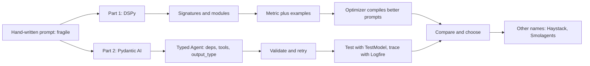

## ⭐ Part 1, DSPy: what it is and the mental model

**In one line:** DSPy treats an LLM pipeline like a small neural network: you write the structure (modules with typed signatures), and an optimizer "trains" the prompts and examples against a metric.

**Why it exists:** Hand-written prompts break when you change the model, the data or one step of the pipeline. Teams spend days tweaking wording with no measurement. DSPy, started at Stanford NLP by Omar Khattab and colleagues, replaces that guesswork with a loop: declare, measure, optimize.

**Picture it:** Coaching a new Swiggy support agent. Old way: you hand them a 3-page script and hope. DSPy way: you tell them the job ("read ticket, give category"), show them 50 solved tickets, mark their answers right or wrong, and they work out the best way to phrase things themselves.

**How it works, step by step:**

1. Configure a model: `dspy.configure(lm=dspy.LM("openai/gpt-5-mini"))`. DSPy uses LiteLLM underneath, so most providers work.
2. Write a signature: the inputs and outputs, with types and an optional docstring.
3. Pick a module that uses it: `Predict` (direct), `ChainOfThought` (adds a reasoning field), `ReAct` (tool loop).
4. Run it on one input. DSPy's adapter turns the signature into a real prompt and parses the reply back into fields.
5. Collect 20 to 200 labelled examples and write a metric.
6. Run an optimizer (`compile`). It tries instructions and few-shot demos and keeps what scores best.
7. Save the optimized program as JSON and load it in production.

Worked example: a ticket classifier scores 72% on 100 dev tickets with a zero-shot `ChainOfThought`. After `BootstrapFewShot` adds 4 good demos, it scores 84%. After `MIPROv2` also rewrites the instruction, it scores 88%. (Numbers are illustrative; your gain depends on task and data.)

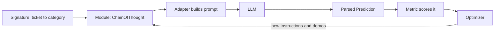

**"Programming, not prompting":** you change code (fields, modules, metric), not prose. When you switch from one model to a cheaper one, you re-run `compile` instead of rewriting prompts by hand.

**Interview tip:** "Explain DSPy in 30 seconds." Say: "You declare each LLM step as a typed signature inside modules, like layers in PyTorch. You give a metric and some examples. An optimizer searches instructions and few-shot demos to maximise the metric. The prompt becomes a learned artifact you can re-compile when the model changes."

**Common mistake:**
- Thinking DSPy is an agent runtime like LangGraph. It has no checkpointer, no human-in-the-loop and no server. It is a prompt-program compiler.
- Running an optimizer with no real metric. Garbage metric, garbage prompt.

## ⭐ Signatures

**In one line:** A signature declares what goes in and what comes out, with names and types; DSPy builds the prompt from it.

**Why it exists:** Field names and types carry meaning. `question -> answer` already tells the model a lot. Types let DSPy parse outputs into real Python values (a `bool`, a `Literal`, a Pydantic model) instead of strings.

**Picture it:** A government form with labelled boxes. "Name", "PIN code (6 digits)". You do not write instructions for each box; the labels do the job.

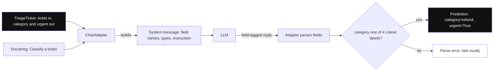

*Diagram:* You write only the typed signature; the adapter turns it into the real prompt and checks the reply against the 4 Literal labels.

**How it works, step by step:**

1. **Inline signature:** `"ticket -> category"` or `"question, context -> answer"`. Good for quick work.
2. **Class signature:** subclass `dspy.Signature`. The docstring becomes the task instruction. Each field is `dspy.InputField()` or `dspy.OutputField()`, optionally with `desc=...`.
3. **Types:** `str`, `int`, `bool`, `list[str]`, `Literal["a", "b"]`, or Pydantic models. DSPy validates the parsed output.
4. The adapter (default `ChatAdapter`, or `JSONAdapter`) formats fields into messages and parses the reply.

```python
from typing import Literal
import dspy

class TriageTicket(dspy.Signature):
    """Classify a food-delivery support ticket."""
    ticket: str = dspy.InputField()
    category: Literal["refund", "late_delivery", "wrong_item", "other"] = dspy.OutputField()
    urgent: bool = dspy.OutputField(desc="true if the customer is angry or food is unsafe")
```

**What the code does:**
- The docstring is the instruction; the optimizer may rewrite it later.
- `Literal[...]` limits `category` to four labels, so parsing fails loudly on anything else.
- `desc` adds a short hint to one field without writing a full prompt.

**Interview tip:** "Signature vs prompt?" Say: "A prompt is a string. A signature is a typed interface. DSPy generates and tunes the string from the interface, so the interface stays stable while the prompt can change per model."

**Common mistake:**
- Stuffing a whole prompt into the docstring. Keep it one or two lines and let the optimizer improve it.

## ⭐ Modules: Predict, ChainOfThought, ReAct

**In one line:** Modules are strategies for using a signature: answer directly, reason first, or loop with tools; you compose them in a `dspy.Module` like layers in PyTorch.

**Why it exists:** The same task can be solved in different ways. Swapping the strategy should be one line, not a new prompt.

**Picture it:** The same exam question answered three ways: say the answer (Predict), show working then answer (ChainOfThought), or look things up in the library between steps (ReAct).

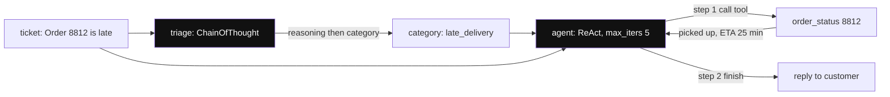

*Diagram:* SupportBot is two modules in a row: ChainOfThought picks the category, then ReAct loops with the tool until it calls finish; an optimizer tunes both highlighted modules together.

**How it works, step by step:**

1. **`dspy.Predict(sig)`:** one LLM call, fills output fields.
2. **`dspy.ChainOfThought(sig)`:** adds a `reasoning` output field before the real outputs. You can read `pred.reasoning`.
3. **`dspy.ReAct(sig, tools=[...], max_iters=20)`:** a tool loop. DSPy adds a `finish` tool so the model can stop.
4. **Your own module:** subclass `dspy.Module`, create sub-modules in `__init__`, and call them in `forward()`. Optimizers tune every sub-module inside.
5. Other useful modules: `dspy.Refine` and `dspy.BestOfN` (retry with a reward function). They replaced the older `dspy.Assert` / `dspy.Suggest` in 2.6.

| Module | LLM calls | Use when |
|---|---|---|
| `Predict` | 1 | simple extraction or labels |
| `ChainOfThought` | 1 (longer output) | reasoning helps accuracy |
| `ReAct` | 1 per step, up to `max_iters` | the task needs tools |
| custom `Module` | sum of parts | multi-step pipelines like RAG |

```python
def order_status(order_id: str) -> str:
    """Return delivery status for an order id."""
    return {"8812": "picked up, ETA 25 min"}.get(order_id, "not found")

class SupportBot(dspy.Module):
    def __init__(self):
        super().__init__()
        self.triage = dspy.ChainOfThought(TriageTicket)
        self.agent = dspy.ReAct("ticket, category -> reply", tools=[order_status], max_iters=5)

    def forward(self, ticket: str):
        t = self.triage(ticket=ticket)
        return self.agent(ticket=ticket, category=t.category)
```

**What the code does:**
- Builds a two-step program: classify the ticket, then a ReAct agent writes a reply using a tool.
- `order_status` becomes a tool from its name, type hints and docstring.
- `max_iters=5` caps the tool loop so a confused model cannot loop forever.
- An optimizer can tune both `triage` and `agent` together against one end-to-end metric.

**Interview tip:** "Why is `ChainOfThought` a module and not a prompt trick?" Say: "Because then it is swappable and optimizable. I can switch `Predict` to `ChainOfThought` in one line, re-compile and measure the gain against the extra output tokens."

**Common mistake:**
- Using `ChainOfThought` everywhere. Reasoning costs output tokens; for easy labels `Predict` is often as accurate and cheaper.

## ⭐ Metrics and optimizers: compile

**In one line:** A metric scores outputs; an optimizer runs your program on training examples, keeps what scores well, and returns a tuned copy with better instructions and few-shot demos.

**Why it exists:** Without a metric, "better prompt" is an opinion. With a metric and examples, prompt work becomes a search problem a computer can run overnight.

**Picture it:** A cricket coach with a bowling machine and a scoreboard. Try a grip, count good deliveries, keep the best grip.

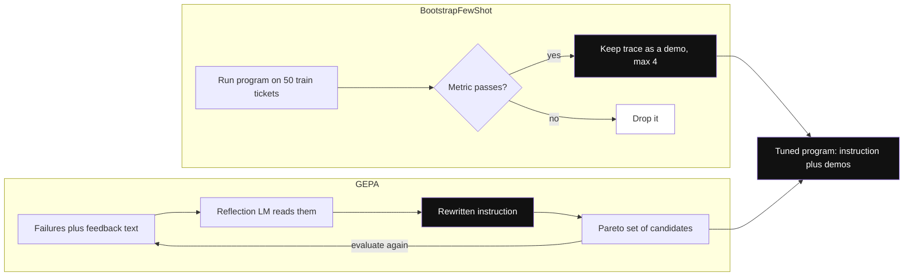

*Diagram:* Bootstrap only changes the demos (it keeps passing traces); GEPA changes the instruction by reading why examples failed. Both write into the same saved program state.

**How it works, step by step:**

1. **Data:** `dspy.Example(ticket=..., category=..., urgent=...).with_inputs("ticket")`. Split into train (e.g. 50) and dev (e.g. 100).
2. **Metric:** `def metric(example, pred, trace=None)` returns a bool or float. It can call an LLM judge for fuzzy outputs.
3. **Baseline:** `dspy.Evaluate(devset=dev, metric=metric)(program)` gives a starting score.
4. **Optimizer:** pick one and `compile`.
5. **Re-evaluate** on dev. Keep the optimized program only if it beats baseline.
6. **Save:** `optimized.save("triage.json")`; later `program.load("triage.json")`.

| Optimizer | What it changes | Data needed | Cost (roughly) |
|---|---|---|---|
| `LabeledFewShot` | adds labelled examples as demos | a few labels | no extra LLM calls |
| `BootstrapFewShot` | runs the program, keeps traces that pass the metric as demos | 10 to 50 examples | low: about one run per example |
| `MIPROv2` | proposes instructions and demo sets, then searches combos with Bayesian optimization | 50 to 300 examples | medium: tens to hundreds of calls (`auto="light"/"medium"/"heavy"`) |
| `GEPA` | reflects on failures using text feedback from the metric and evolves instructions | small sets work | medium to high; needs a strong `reflection_lm` |
| `BootstrapFinetune` | uses good traces to fine-tune model weights | hundreds of traces | training cost |

**GEPA in one paragraph:** GEPA (Genetic-Pareto, added in DSPy 3.0) asks your metric for a score **and a sentence of feedback**, e.g. "Wrong: this is late_delivery, the customer mentions ETA". A strong reflection model reads failures plus feedback and rewrites the instruction. It keeps a Pareto set of candidates (good on different examples), not just one best. It often needs fewer runs than search-based methods because feedback says *why* something failed.

```python
def metric_with_feedback(gold, pred, trace=None, pred_name=None, pred_trace=None):
    ok = gold.category == pred.category
    fb = "Correct." if ok else f"Expected {gold.category}, got {pred.category}."
    return dspy.Prediction(score=float(ok), feedback=fb)

gepa = dspy.GEPA(metric=metric_with_feedback, auto="light",
                 reflection_lm=dspy.LM("openai/gpt-5", temperature=1.0, max_tokens=16000))
tuned = gepa.compile(dspy.ChainOfThought(TriageTicket), trainset=train, valset=dev)
```

**What the code does:**
- The metric returns a score plus a feedback sentence; GEPA feeds that sentence to the reflection model.
- `auto="light"` sets a small budget; `"heavy"` searches longer for better results.
- `reflection_lm` is a stronger model used only during optimization, not at serving time.

**Interview tip:** "BootstrapFewShot vs MIPROv2 vs GEPA?" Say: "Bootstrap only picks good demos from your own successful runs: cheap, good first step. MIPROv2 also writes candidate instructions and searches combinations with Bayesian optimization. GEPA uses text feedback from failures and a reflection model to evolve instructions; it is strong when your metric can explain errors."

**Common mistake:**
- Evaluating on the same examples you optimized on. You will overfit and fool yourself. Keep a held-out dev set.
- Forgetting the optimization bill: a `heavy` run can be thousands of LLM calls. Set a budget.

## ⭐ A complete small DSPy app: Swiggy ticket triage

**In one line:** Classify support tickets into four categories, measure accuracy, optimize with `BootstrapFewShot`, save, and load in production.

**Why it exists:** Ticket routing is a classic DSPy win: a clear label, cheap to measure, and many examples in your helpdesk history.

**Picture it:** A new joinee who reads 50 old tickets with the right answers and gets much better at sorting.

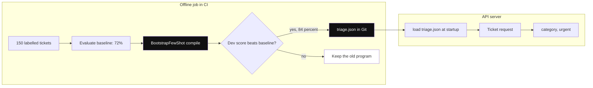

*Diagram:* Compile runs offline and triage.json is promoted only if the dev score improves; the server just loads that JSON and never optimizes in the request path.

**How it works, step by step:**

1. Configure a cheap model and define data (block 1).
2. Baseline, optimize, compare, save (block 2).
3. Load the saved program in the API server (end of block 2).

Block 1: setup and data.

```python
import dspy
dspy.configure(lm=dspy.LM("openai/gpt-5-mini"))      # any LiteLLM model string works

rows = [
    ("Paid ₹640 but food never came", "refund", True),
    ("Rider is 40 minutes late, where is he?", "late_delivery", False),
    ("Got paneer instead of chicken biryani", "wrong_item", False),
    ("How do I change my saved address?", "other", False),
    # ... in real life, 150+ rows exported from your helpdesk
]
data = [dspy.Example(ticket=t, category=c, urgent=u).with_inputs("ticket") for t, c, u in rows]
train, dev = data[:50], data[50:]

def metric(gold, pred, trace=None):
    return gold.category == pred.category and gold.urgent == pred.urgent
```

**What the code does:**
- Sets one model for the whole program through `dspy.configure`.
- Wraps each labelled row in `dspy.Example` and marks `ticket` as the only input.
- The metric needs both fields right; that is the bar the optimizer will chase.

Block 2: measure, optimize, save, load.

```python
program = dspy.ChainOfThought(TriageTicket)            # signature from the Signatures section
evaluate = dspy.Evaluate(devset=dev, metric=metric, num_threads=8, display_progress=True)
print("baseline:", evaluate(program))

optimizer = dspy.BootstrapFewShot(metric=metric, max_bootstrapped_demos=4, max_labeled_demos=4)
optimized = optimizer.compile(program, trainset=train)
print("optimized:", evaluate(optimized))

optimized.save("triage.json")                       # instructions + demos as JSON

# in the API server
serving = dspy.ChainOfThought(TriageTicket)
serving.load("triage.json")
pred = serving(ticket="Order 8812 has a cockroach in it!")
print(pred.category, pred.urgent)                   # e.g. refund True
dspy.inspect_history(n=1)                           # print the exact last prompt
```

**What the code does:**
- Scores the zero-shot program first, so you know whether optimization helped.
- `BootstrapFewShot` runs the program on training tickets, keeps passing traces as demos (up to 4), and returns a new program.
- `save` writes the learned prompt state to a JSON file you can version in Git.
- `inspect_history` shows the real prompt DSPy sent, which is your main debugging tool.

**Interview tip:** "How do you ship a DSPy program?" Say: "Compile offline, version the saved JSON next to the code, load it at startup, and re-compile in CI when the model or data changes, only promoting it if the dev score improves."

**Common mistake:**
- Compiling in the request path. Optimization is an offline job; serving only loads the saved state.

## How DSPy works inside

**In one line:** At run time an adapter turns signature plus learned instructions plus demos into chat messages and parses the reply; at compile time an optimizer runs the program many times, records traces and rewrites that learned state.

**Why it exists:** Knowing this lets you answer "where is the prompt?" and "what exactly did the optimizer change?".

**Picture it:** A recipe card (signature) plus a few photos of perfect plates (demos), handed to a cook (LLM) by a waiter (adapter) who also checks that the plate matches the order.

**How it works, step by step:**

1. Each `Predict` inside a module holds state: the signature's instruction and a list of demos.
2. On a call, the adapter writes a system message with field descriptions and the instruction, adds demos as example turns, then the real input.
3. The LLM replies in a field-tagged format (or JSON with `JSONAdapter`). The adapter parses and type-checks it into a `Prediction`.
4. During `compile`, the optimizer runs the program on train examples and records a **trace** (inputs and outputs of every predictor).
5. Traces that pass the metric become candidate demos; MIPROv2 and GEPA also propose new instruction text.
6. The optimizer writes the winners back into each predictor's state. That state is what `save` writes.

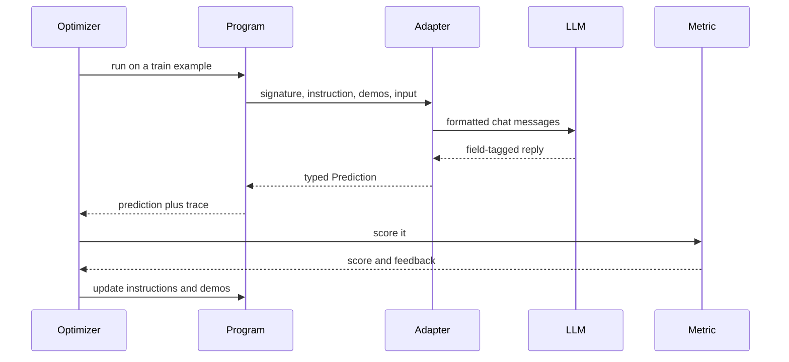

**Interview tip:** "What does the optimized artifact contain?" Say: "Per predictor: the instruction text and the chosen few-shot demos, saved as JSON. No weights change unless I use a fine-tuning optimizer."

**Common mistake:**
- Assuming an optimized program transfers perfectly to another model. Demos and wording are tuned for the model used at compile time; re-compile on a switch.

## When DSPy pays off, and when not

**In one line:** DSPy pays off when you have a measurable task, labelled examples and a pipeline you will run at volume or move across models; it is overkill for a one-off prompt or a task you cannot score.

**Why it exists:** Optimizer runs cost time and money. You need a rule for when that spend returns value.

**Picture it:** Buying a bowling machine makes sense for a cricket academy, not for one Sunday game.

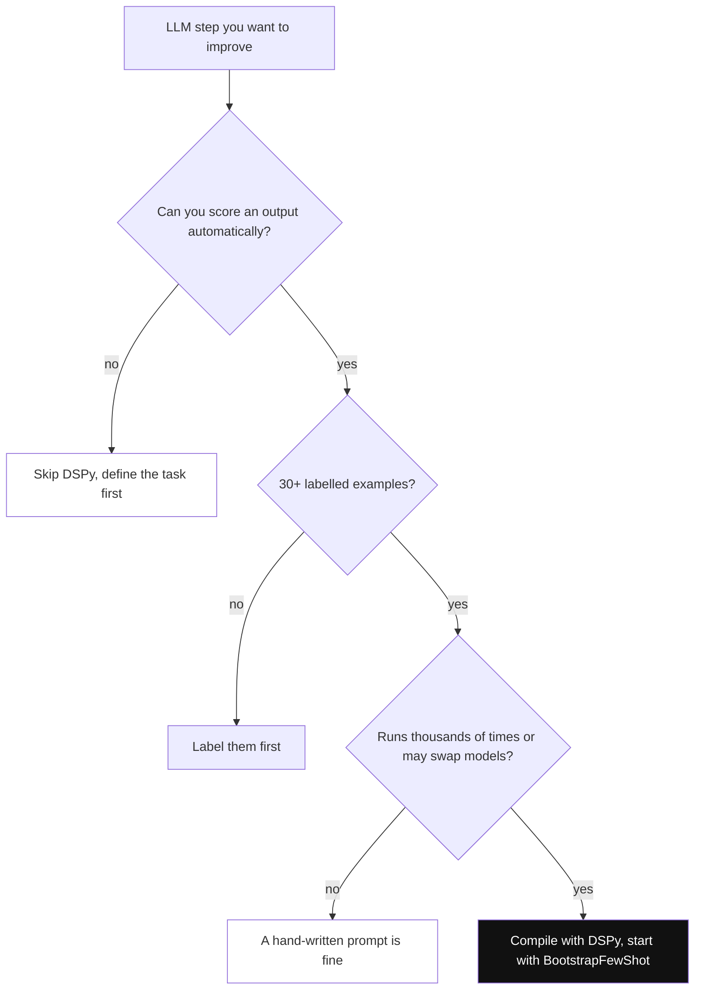

*Diagram:* Three yes answers in a row make the one-time compile cost worth it; any no sends you somewhere else first.

**How it works, step by step:**

1. Ask: can I score an output automatically (exact label, numeric check, or a reliable LLM judge)? If no, stop.
2. Ask: do I have 30+ examples, or can I label them in a day? If no, label first.
3. Ask: will this run thousands of times, or on a model I may swap? If yes, the one-time compile cost is small per call.
4. Estimate compile cost. Example: `MIPROv2 auto="light"` on 100 examples might take a few hundred LLM calls; at about ₹0.10 per call on a small model that is tens of rupees. A `heavy` GEPA run with a large reflection model can cost far more.

| Good fit | Poor fit |
|---|---|
| classification, extraction, routing | creative writing with no clear "right" |
| multi-step RAG where you can score answers | one-off scripts |
| moving a pipeline to a cheaper model | no labelled data and no judge |
| many similar prompts across teams | long-running agents needing durable state and approvals |

**Interview tip:** "Would you use DSPy for our support chatbot?" Say: "For the measurable parts, yes: intent routing and field extraction, where I can label tickets and score accuracy. For the conversational agent loop with approvals I would use an orchestration framework and maybe call DSPy modules inside it."

**Common mistake:**
- Expecting DSPy to fix a bad task definition. If humans disagree on labels, no optimizer helps.

## ⭐ Part 2, Pydantic AI: what it is and the mental model

**In one line:** Pydantic AI is "FastAPI for agents": an `Agent` is typed by its dependencies and its output, tools get dependencies injected through `RunContext`, and the final answer is validated (and retried) against a Pydantic model.

**Why it exists:** Most LLM app bugs happen at boundaries: a missing JSON field, a string where a number should be, a tool that grabs a global DB connection and cannot be tested. The Pydantic team (whose validation library already sits under most Python AI SDKs) built an agent framework that uses Python types to catch these early.

**Picture it:** A Swiggy order form with required, typed fields. You cannot submit without a valid PIN code. If the model fills it wrong, the form bounces back with the error and asks again.

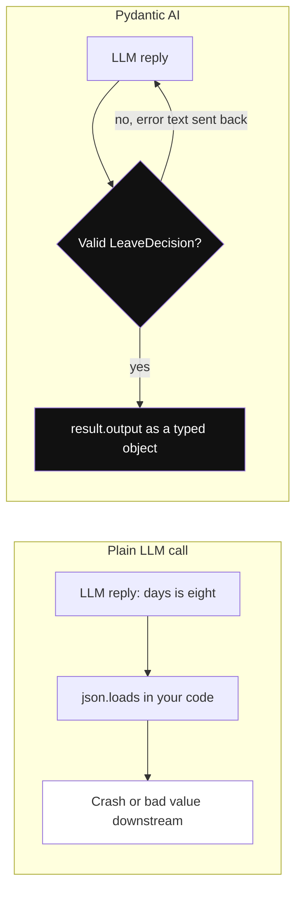

*Diagram:* Without types a wrong shape crashes later in your own code; with Pydantic AI it bounces back to the model with the error until it passes or hits the retry limit.

**How it works, step by step:**

1. Create `Agent("provider:model", deps_type=..., output_type=..., instructions=...)`.
2. Register tools with `@agent.tool` (gets `RunContext`) or `@agent.tool_plain` (no context).
3. Run with `agent.run(...)` (async), `run_sync`, `run_stream` or `run_stream_events`, passing `deps=`.
4. The model may call tools. Pydantic AI validates tool arguments against the function signature; bad args go back to the model as a retry prompt.
5. The final answer is validated against `output_type`. On failure, the error text is sent back and the model tries again (up to the retry limit).
6. You get `result.output` as a real typed object, plus `result.usage` and the full message history.

**What changed in 2.0:** capabilities (bundles of instructions, tools and hooks, attached with `Agent(capabilities=[...])`) and the separate Pydantic AI Harness package; `MCPServerStdio` and similar classes became `MCPToolset`; `mcp_servers=` became `toolsets=`; bare model names like `Agent("gpt-5")` now raise an error, so always write `provider:model`; `openai:` now uses OpenAI's Responses API (`openai-chat:` for Chat Completions); `result.usage` is a property; `pydantic_graph.beta` moved to top-level `pydantic_graph`. Upgrade path: move to the latest 1.x and clear deprecation warnings first.

**Interview tip:** "Pydantic AI in 30 seconds?" Say: "An agent framework where everything is typed. Dependencies come in through `RunContext`, so tools are testable. Output is a Pydantic model that is validated and retried on failure. It is model-agnostic, traces with OpenTelemetry through Logfire, and tests run on `TestModel` with no API calls."

**Common mistake:**
- Thinking validation means correctness. A valid `refund_amount=640` can still be the wrong order. Add business checks.

## ⭐ Building blocks: Agent, deps, output types, tools, models

**In one line:** Five pieces: the `Agent`, a `deps_type` for injected resources, an `output_type` for validated results, tools that read `ctx.deps`, and a model string that picks the provider.

**Why it exists:** Each piece removes one class of bug: globals (deps), shape errors (output types), untyped tool args (tools), and provider lock-in (model strings).

**Picture it:** A restaurant kitchen. The order slip format (output type), the ingredients and gas line delivered to each station (deps), stations with clear inputs (tools), and the head chef who can be swapped (model).

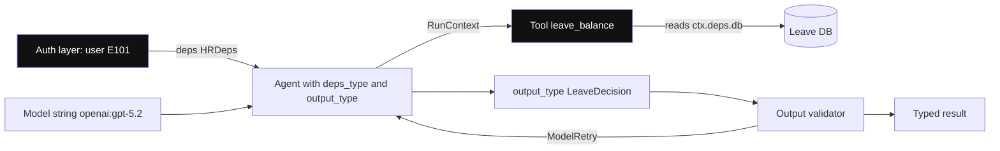

*Diagram:* Identity flows in from your auth layer through deps, never from the model; the tool reads it via RunContext, and the validator can send the model back with ModelRetry.

**How it works, step by step:**

1. **Deps:** usually a dataclass (`DB connection`, `http client`, `user_id`). `deps_type` is for type checking; the instance is passed at run time with `deps=`.
2. **Instructions:** `instructions="..."` static, or a function decorated with `@agent.instructions` that reads `ctx.deps` (e.g. inserts the user's name).
3. **Output types:** a Pydantic model, a primitive like `bool`, a list, or a union like `Approved | Rejected`. Output modes: tool output (default), native structured output, or prompted output.
4. **Tools:** `@agent.tool` functions take `ctx: RunContext[Deps]` first. Docstrings become descriptions. Raise `ModelRetry("message")` to ask the model to fix its call.
5. **Output validators:** `@agent.output_validator` runs your business check after schema validation and can raise `ModelRetry`.
6. **Models:** `"openai:gpt-5.2"`, `"anthropic:..."`, `"google:..."` and more; also `FallbackModel` to try a second provider on errors.
7. **Toolsets and MCP:** `toolsets=[MCPToolset(...)]` plugs in MCP servers; a `FunctionToolset` groups tools for reuse.

| Piece | Catches |
|---|---|
| `deps_type` + `RunContext` | hidden globals, untestable tools |
| `output_type` | missing fields, wrong types |
| `@agent.output_validator` | valid but wrong business values |
| `ModelRetry` | bad tool args the model can fix |
| model string or `FallbackModel` | provider outage, lock-in |

**Interview tip:** "Why dependency injection for an agent?" Say: "Tools need a DB, an HTTP client and the current user. With injection, the same agent runs with a real DB in production and a fake one in tests, and the user ID comes from my auth layer, not from the model."

**Common mistake:**
- Letting the model pass `user_id` as a tool argument. A prompt-injected model can ask for another user's data. Take identity from `ctx.deps`.

## ⭐ A complete small Pydantic AI app: HR leave bot

**In one line:** An HR bot that reads an employee's leave balance through an injected DB, returns a typed `LeaveDecision`, enforces a business rule, and is unit-tested with `TestModel`.

**Why it exists:** This is the core Pydantic AI pattern: typed deps in, typed decision out, rules in code, tests without an LLM.

**Picture it:** An HR executive who checks the leave register (deps), fills a fixed approval form (output type), and whose manager rejects any form approving more days than the balance (validator).

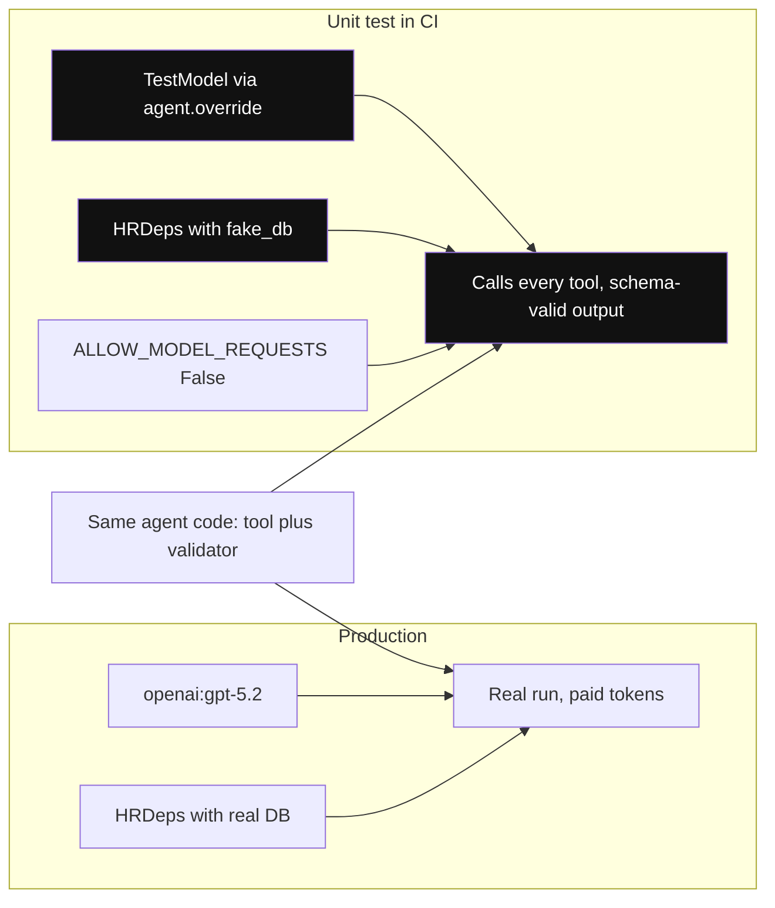

*Diagram:* The agent code never changes; only the injected model and deps do, which is why the test runs in milliseconds with no LLM call.

**How it works, step by step:**

1. Define deps and the output model (block 1).
2. Create the agent, a tool and a validator (block 1).
3. Run it with real deps (block 2).
4. Test it with `TestModel` and fake deps (block 3).

Block 1: agent, tool and validator.

```python
from dataclasses import dataclass
from pydantic import BaseModel, Field
from pydantic_ai import Agent, ModelRetry, RunContext

@dataclass
class HRDeps:
    employee_id: str          # comes from login, never from the model
    db: dict                  # stand-in for a real DB client

class LeaveDecision(BaseModel):
    approved: bool
    days: int = Field(ge=0, le=30)
    reason: str

agent = Agent("openai:gpt-5.2", deps_type=HRDeps, output_type=LeaveDecision,
              instructions="Decide leave requests using the employee's balance. Be brief.")

@agent.tool
async def leave_balance(ctx: RunContext[HRDeps]) -> int:
    """Remaining paid leave days for the current employee."""
    return ctx.deps.db[ctx.deps.employee_id]["balance"]

@agent.output_validator
async def within_balance(ctx: RunContext[HRDeps], out: LeaveDecision) -> LeaveDecision:
    if out.approved and out.days > ctx.deps.db[ctx.deps.employee_id]["balance"]:
        raise ModelRetry("Approved days exceed the balance. Re-check leave_balance.")
    return out
```

**What the code does:**
- `HRDeps` carries the employee ID and DB; the tool reads them from `ctx.deps`, so the model cannot pick another employee.
- `LeaveDecision` sets the output shape; `Field(ge=0, le=30)` rejects silly values at validation time.
- The validator enforces the real rule and sends the model back with a clear message if it breaks it.

Block 2: run it.

```python
db = {"E101": {"name": "Asha", "balance": 6}}
result = agent.run_sync("I need 8 days off for my sister's wedding in Jaipur.",
                        deps=HRDeps(employee_id="E101", db=db))
print(result.output)        # LeaveDecision(approved=False, days=6, reason='Only 6 days left...')
print(result.usage)         # tokens and request counts (a property in 2.x)
```

**What the code does:**
- Passes real deps at run time; the agent code itself has no globals.
- `result.output` is a validated `LeaveDecision`, ready to write to the HR system.
- `result.usage` gives tokens and requests for cost tracking.

Block 3: test without an LLM.

```python
from pydantic_ai import models
from pydantic_ai.models.test import TestModel

models.ALLOW_MODEL_REQUESTS = False          # any real LLM call in tests now fails

def test_leave_agent_calls_tool_and_returns_decision():
    fake_db = {"E1": {"name": "Test", "balance": 30}}
    with agent.override(model=TestModel()):
        result = agent.run_sync("5 days please", deps=HRDeps("E1", fake_db))
    assert isinstance(result.output, LeaveDecision)
```

**What the code does:**
- `ALLOW_MODEL_REQUESTS = False` makes accidental real calls fail loudly in CI.
- `TestModel` calls every tool and then builds schema-valid output, so you test wiring, tools and validation for free.
- `agent.override` swaps the model only inside the `with` block; for exact scripted replies, use `FunctionModel`.

**Interview tip:** "How do you unit-test an LLM agent?" Say: "Inject fake deps, swap the model with `TestModel` or a scripted `FunctionModel`, block real model requests, and assert on tool calls and typed output. Quality is tested separately with evals on real models."

**Common mistake:**
- Only testing with the real model. Tests become slow, flaky and expensive, and they hide wiring bugs behind model randomness.

## How Pydantic AI works inside

**In one line:** Each run is a small graph (built on pydantic-graph): build a request, call the model, run any tool calls, validate the final output, and loop back with error text on any validation failure.

**Why it exists:** Knowing the loop explains retries, token usage and why a run can take 3 model calls when you expected 1.

**Picture it:** A passport office counter. Hand in the form, the clerk checks it, sends you back to fix one field, checks again, then stamps it.

**How it works, step by step:**

1. Build the request: instructions, message history, user prompt, tool schemas, and the output tool (if output mode is tool output).
2. Call the model (`ModelRequestNode`).
3. Handle the response (`CallToolsNode`): run requested tools (in parallel where possible) and validate their args.
4. If the model called the output tool or returned final text, validate it against `output_type`, then run output validators.
5. Any `ValidationError` or `ModelRetry` becomes a retry message to the model. Retries are counted; above the limit, the run raises an error.
6. On success, the run ends with `result.output`.

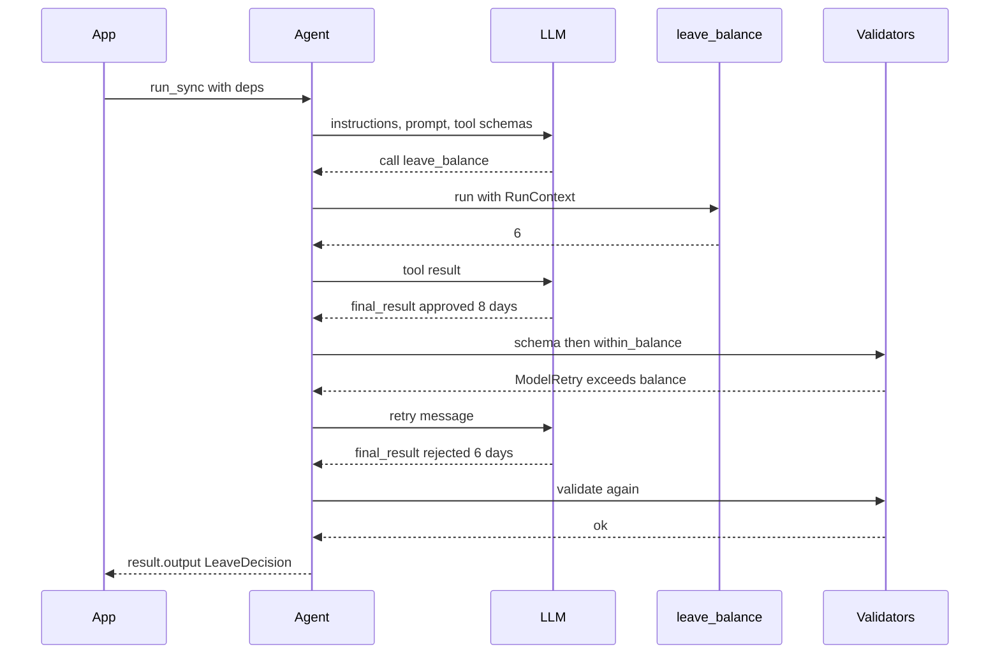

Worked example: the run above costs 3 model requests instead of 2 because of one validator retry. If 10% of runs retry once, average requests rise by about 0.1 per run; watch this number in traces.

**Interview tip:** "What happens when the model returns invalid JSON?" Say: "Pydantic AI catches the validation error, sends the error details back as a retry prompt, and the model tries again. After the retry limit it raises, so I log it and fall back."

**Common mistake:**
- Setting a high retry limit to "fix" a bad schema. Each retry is a paid call. Simplify the schema instead.

## Production with Pydantic AI: Logfire, pydantic-graph, evals

**In one line:** Trace with Logfire or any OTel backend, use pydantic-graph or durable execution for long multi-step flows, and measure quality with `pydantic_evals`.

**Why it exists:** Type safety is not enough in production. You need to see each run, survive restarts in long workflows and catch quality regressions.

**Picture it:** A delivery fleet with GPS on every bike (tracing), a fixed route plan (graph), and a monthly audit of deliveries (evals).

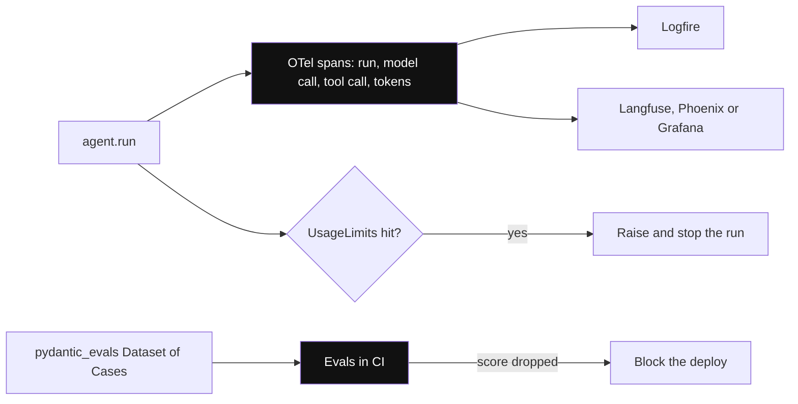

*Diagram:* Every run becomes OTel spans you can send to any backend; UsageLimits cap a single run, and evals in CI catch quality drops before deploy.

**How it works, step by step:**

1. **Tracing:** `logfire.configure()` then `logfire.instrument_pydantic_ai()`. Each run, model call and tool call becomes an OTel span with tokens. Because it is OTel, you can send it to Langfuse, Phoenix or Grafana instead.
2. **Multi-agent:** call one agent from another agent's tool (agent delegation, pass `usage=ctx.usage` to share limits), or hand off in app code.
3. **pydantic-graph:** a typed graph library from the same team. Nodes are dataclasses whose `run()` return type declares the next node, or you use `GraphBuilder` steps. Use it for explicit state machines.
4. **Durable execution:** integrations with Temporal, DBOS and Prefect let long runs survive crashes.
5. **Evals:** `pydantic_evals` has `Dataset` and `Case` objects with evaluators (exact match, LLM judge). Run in CI.
6. **Limits:** `UsageLimits(request_limit=..., total_tokens_limit=...)` caps a run.

**Interview tip:** "How do you make a Pydantic AI agent production-ready?" Say: "Typed deps from the auth layer, output validators for business rules, `UsageLimits`, `FallbackModel` across providers, Logfire or OTel tracing, `pydantic_evals` in CI, and durable execution if runs are long."

**Common mistake:**
- Building a big multi-agent graph in Pydantic AI when the flow needs heavy human approvals and time travel. LangGraph is more mature there.

## ⭐ When to use which, and how they compare

**In one line:** DSPy optimizes what you ask the model; Pydantic AI makes how you call it safe and typed; LangGraph orchestrates long, stateful flows. They can be combined.

**Why it exists:** "Why this and not X?" is the core senior question. These two tools are often confused because both touch "structured LLM calls".

**Picture it:** DSPy is the coach who improves technique. Pydantic AI is the referee who enforces rules on every ball. LangGraph is the match schedule and scoreboard.

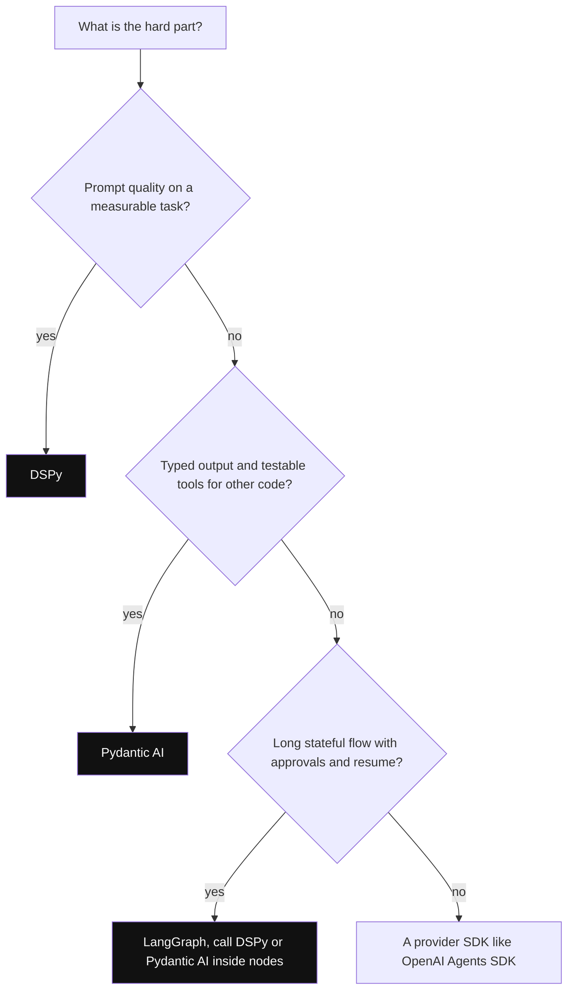

*Diagram:* Pick by the hardest problem; the three are not rivals, since a LangGraph node can run a typed Pydantic AI agent that uses a DSPy-compiled router.

**How it works, step by step:**

1. If the hard part is prompt quality on a measurable task, start with DSPy.
2. If the hard part is reliable typed output feeding other code, with testable tools, start with Pydantic AI.
3. If the hard part is long-running control flow with persistence and approvals, use LangGraph (and call either inside nodes).
4. If you need a plain, provider-specific agent quickly, an SDK like the OpenAI Agents SDK may be enough.

| | DSPy | Pydantic AI | LangGraph | Instructor-style libraries |
|---|---|---|---|---|
| Core idea | compile prompts from signatures and a metric | typed agent with DI and validated output | explicit state graph | structured output from one call |
| Optimizes prompts | yes, its main feature | no | no | no |
| Agent loop with tools | `ReAct` module | yes, core | yes, you build it | no |
| Persistence and HITL | no | via durable execution integrations | built-in checkpointer, `interrupt()` | no |
| Testing story | evaluate on dev set | `TestModel`, `FunctionModel`, DI | unit-test nodes | mock client |
| Tracing | MLflow and OTel integrations | Logfire / OTel | LangSmith / OTel | your own |
| Best fit | classification, extraction, RAG quality | APIs and services that consume agent output | long, branching production flows | quick extraction |

**Other names to recognise:**

| Name | Who | One line | Pick it when |
|---|---|---|---|
| Haystack (`haystack-ai`) | deepset | pipelines of typed components for search, RAG and agents | RAG-heavy apps that want explicit, serializable pipelines |
| Smolagents | Hugging Face | tiny agent library whose `CodeAgent` writes Python code as its actions | quick agents on open models; run code in a sandbox |
| Instructor | open source | patches LLM clients to return Pydantic models with retries | you only need typed extraction, not an agent |

**Interview tip:** "DSPy vs Pydantic AI?" Say: "Different problems. DSPy improves the prompt by optimization against a metric. Pydantic AI makes the call safe: typed deps, validated outputs, testable tools. I have used DSPy-compiled modules for routing inside a service whose agent layer was typed."

**Common mistake:**
- Picking one framework for everything. A good system often uses a typed agent layer, an orchestrator and an optimizer for the measurable steps.

## Common pitfalls

**In one line:** DSPy projects fail on weak metrics and data leaks; Pydantic AI projects fail on over-complex schemas and identity in tool args.

**Why it exists:** These show up in code reviews and "tell me about a failure" interview questions.

**Picture it:** Known speed bumps on your daily route.

**How it works, step by step:**

1. **DSPy, train-test leak:** optimizing and scoring on the same examples. Fix: separate dev set.
2. **DSPy, metric too loose:** an LLM judge that says "good" to everything. Fix: spot-check judge outputs against human labels.
3. **DSPy, model swap without re-compile:** demos tuned for model A hurt model B. Fix: re-compile and compare.
4. **DSPy, cost surprise:** `heavy` optimizer with a big reflection model. Fix: start with `light`, set `max_metric_calls`.
5. **Pydantic AI, giant schemas:** 40 nested fields cause retries. Fix: smaller models, split into steps.
6. **Pydantic AI, identity from the model:** `user_id` as a tool arg. Fix: take it from `ctx.deps`.
7. **Pydantic AI, 1.x code on 2.x:** `mcp_servers=`, `MCPServerStdio`, bare model names, `result.usage()` as a call. Fix: follow the upgrade guide; clear 1.x deprecation warnings first.
8. **Both, no tracing:** you cannot see the real prompt or retries. Fix: `dspy.inspect_history`, Logfire or MLflow tracing.

**Interview tip:** "Your DSPy program scored 92% offline but 70% in production. Why?" Say: "Likely the dev set does not match production traffic, or the train and dev sets overlapped. I would sample real tickets, label them, re-evaluate, and re-compile with production-like data."

**Common mistake:**
- Blaming the framework for data problems. Most failures here are about data and metrics, not code.

## Interview questions

**Q: What does "programming, not prompting" mean?**
A: You write the program structure as modules with typed signatures, plus a metric. The prompt text and demos are learned by an optimizer, not hand-written, and can be re-learned when the model changes.

**Q: What is a DSPy signature?**
A: A typed declaration of input and output fields, inline like `"ticket -> category"` or as a class with a docstring. DSPy's adapter turns it into a prompt and parses the reply into typed fields.

**Q: Predict vs ChainOfThought vs ReAct?**
A: `Predict` answers directly. `ChainOfThought` adds a reasoning field first, which costs more output tokens but helps on harder tasks. `ReAct` loops with tools until it calls `finish` or hits `max_iters`.

**Q: BootstrapFewShot vs MIPROv2 vs GEPA?**
A: Bootstrap keeps successful traces as demos. MIPROv2 also proposes instructions and searches combinations with Bayesian optimization. GEPA uses textual feedback from the metric and a reflection model to evolve instructions, keeping a Pareto set of candidates.

**Q: When is DSPy not worth it?**
A: When you cannot score outputs, have no examples, run the prompt rarely, or the hard problem is orchestration and state rather than prompt quality.

**Q: What does DSPy save after compile?**
A: Per predictor, the instruction and chosen demos, as JSON. Model weights do not change unless you use a fine-tuning optimizer.

**Q: How does Pydantic AI guarantee output shape?**
A: It validates the final answer against `output_type`. On failure it sends the validation error back to the model as a retry prompt, up to a limit, then raises.

**Q: Schema validation passed but the answer is wrong. What next?**
A: Add an `@agent.output_validator` with business rules that raises `ModelRetry`, and add evals with real cases. Validation checks shape, not truth.

**Q: Why dependency injection in Pydantic AI?**
A: Tools get DB clients, HTTP clients and user identity from `ctx.deps`. This keeps secrets and identity out of the model's hands and lets tests pass fakes.

**Q: How do you test a Pydantic AI agent without an LLM?**
A: `agent.override(model=TestModel())` or a scripted `FunctionModel`, fake deps, and `models.ALLOW_MODEL_REQUESTS = False` so real calls fail in CI.

**Q: What changed in Pydantic AI 2.0?**
A: Capabilities as composable units of instructions, tools and hooks; `MCPToolset` replaces per-transport MCP classes and `toolsets=` replaces `mcp_servers=`; bare model names error; `openai:` uses the Responses API; `result.usage` is a property; `pydantic_graph.beta` moved to the top level.

**Q: DSPy vs Pydantic AI vs LangGraph for a refund bot?**
A: LangGraph for the overall flow with approvals and persistence. Pydantic AI for typed tool calls and the validated refund decision. DSPy to optimize the intent classifier if I have labelled tickets.

**Q: How would you debug a DSPy program giving wrong labels?**
A: `dspy.inspect_history` to see the real prompt and demos, check whether demos are wrong or unrepresentative, check the metric on a few cases by hand, then re-compile with a better train set.

**Q: Haystack and Smolagents in one line each?**
A: Haystack is deepset's component-pipeline framework for search, RAG and agents. Smolagents is Hugging Face's small agent library where `CodeAgent` writes Python code as actions, so run it in a sandbox.

**Q: Your Pydantic AI agent's cost doubled after a schema change. Why?**
A: More validation retries. Each failed validation is another model call. Check retry counts in traces and simplify or split the schema.

## Read next

- [Agent Frameworks and Tooling](19-agent-frameworks.md)
- [Structured Outputs and Prompt Optimization](17-structured-outputs-prompting.md)
- [OpenAI Agents SDK](27-openai-agents-sdk.md)
- [LangChain](23-langchain.md)

## Checklist

- [ ] I can explain "programming, not prompting" and DSPy's compile loop.
- [ ] I can write a DSPy class signature with typed fields.
- [ ] I can explain when to use Predict, ChainOfThought and ReAct.
- [ ] I can compare BootstrapFewShot, MIPROv2 and GEPA and their costs.
- [ ] I can say when DSPy optimization pays off and when it does not.
- [ ] I can build a Pydantic AI agent with deps, a tool and a typed output.
- [ ] I can explain the validate-and-retry loop and output validators.
- [ ] I can unit-test an agent with TestModel and fake deps.
- [ ] I can compare DSPy, Pydantic AI and LangGraph and name Haystack and Smolagents.
