# Vector Databases in Practice

This page compares the dedicated vector databases that teams actually ship: Pinecone, Qdrant, Weaviate, Milvus (and Zilliz Cloud), Chroma, LanceDB and turbopuffer. It does not re-teach embeddings, HNSW or filtering basics. Those live in [Vector Databases](../05-db/11-vector.md). Interviewers ask about this to see if you can pick a product for a reason, size it, and run it in production without surprises.

Written against (November 2026): Pinecone Python SDK v10 (API version 2026-07), Qdrant 1.17, Weaviate 1.3x with the v4 Python client, Milvus 2.6 with `pymilvus`, Chroma 1.x, the `lancedb` Python package, and the turbopuffer Python client 1.x. These products ship every month. Check the docs before copying code.

**After this page you can answer:**
- "Pinecone vs Qdrant vs Milvus: which would you pick for a 50M-chunk multi-tenant RAG product, and why?"
- "How much RAM do 10 million 1024-dim vectors need, and how does quantization change that?"
- "What does 'serverless' or 'object-storage-first' mean for a vector DB, and what is the catch?"
- "How do you isolate 10,000 customers in one vector database?"
- "Your team switches embedding models. How do you re-embed 20 million chunks with zero downtime?"
- "You wrote a chunk and searched for it right away, but it was missing. Why?"
- "How would you migrate from Pinecone to Qdrant, and how do you avoid lock-in in the first place?"
- "When is a dedicated vector DB the wrong choice?"

## Words you need first

| Word | Plain meaning |
|---|---|
| Collection / index | One named set of vectors with the same size and distance metric. Like a table. |
| Record / point | One stored item: an id, one or more vectors, and metadata. |
| Metadata / payload | Extra fields on a record (tenant, language, date) used for filtering and display. |
| Namespace / tenant | A partition inside a collection that keeps one customer's data apart from others. |
| Segment | A chunk of a collection's data with its own small index. Databases merge segments in the background. |
| WAL | Write-ahead log: writes are appended here first so they survive crashes. |
| Object storage | Cheap, durable file storage like Amazon S3 or Google Cloud Storage. Slow per request, huge capacity. |
| Serverless | You pay per use (reads, writes, storage) and never size machines yourself. |
| Quantization | Storing each vector number in fewer bits (32 to 8 or 1) to save memory, losing a little accuracy. |
| Rescoring | Re-ranking the top candidates using the original full-precision vectors after a quantized search. |
| Sparse vector | A vector with mostly zeros, one slot per word. Captures keywords, like BM25 does. |
| Hybrid search | Running keyword (sparse/BM25) and meaning (dense) search together and fusing the results. |
| Recall@K | Of the true top K nearest items, the fraction the database actually returned. |
| Cold / warm query | Cold reads data from object storage (slow). Warm hits data already cached in RAM or SSD (fast). |

## Big picture

All seven products store the same thing: id + vector + metadata, grouped into collections and split by tenant. They differ in where the data lives (RAM, local SSD, or object storage), who runs the machines (you or the vendor), and what extras they bundle (embedding models, BM25, reranking). Picking one is mostly about scale, tenancy shape, ops appetite and cost model. The page walks through the shared anatomy, then each product, then the comparison, a sizing example and production concerns.

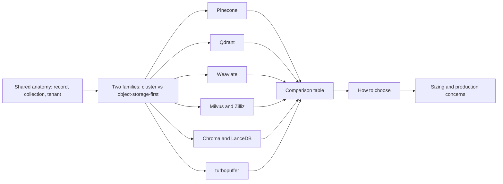

## ⭐ What a dedicated vector DB adds

**In one line:** a vector DB is an ANN index plus everything a database needs around it: durable writes, updates and deletes, metadata filters, tenancy, replication, backups and an API.

**Why it exists:** FAISS or a NumPy array gives you fast nearest-neighbour search, but only in one process. It has no durable writes, no "delete this customer", no filters on 20 fields, no replicas, no auth. Once a RAG product has many customers and changing documents, you need those. That is the gap these products fill.

**Picture it:** FAISS is a sharp knife. A vector DB is a full restaurant kitchen: the knife, plus fridges (storage), order tickets (WAL), sections for each table (tenants), and cleaning crews (compaction).

**How it works, step by step:**
1. **Write:** the client sends `id + vector + metadata`. The DB appends it to a WAL so it is durable, then puts it into a small "growing" segment.
2. **Freshly written data** is searchable by brute force inside that small segment, or only after a short delay (this is where "eventual consistency" comes from).
3. **Background indexing:** when a segment is big enough, the DB builds an ANN index for it (HNSW, IVF, DiskANN, or a centroid index) and seals it. Optimizers merge small segments and drop deleted records.
4. **Read:** a query vector plus filter fans out to every segment (and every shard), each returns its local top K, and the DB merges them into the global top K.
5. **Deletes** are tombstones first (marked dead, skipped at query time), and physically removed during merge (compaction).

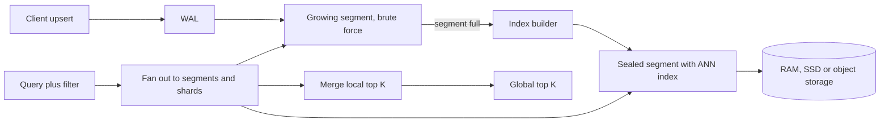

**The two architecture families.** This is the most useful lens for interviews.

| | Cluster, memory/SSD-first | Object-storage-first (serverless) |
|---|---|---|
| Examples | Qdrant, Weaviate, Milvus (classic), Chroma local | Pinecone serverless, turbopuffer, Chroma Cloud, LanceDB on S3, Milvus 2.6 tiered storage |
| Where data lives | RAM and local SSD of nodes you (or the vendor) size | Object storage is the source of truth; RAM/SSD is a cache |
| Latency | Low and steady (a few ms) | Low when warm, hundreds of ms when cold |
| Cost shape | Pay for nodes 24x7, even when idle | Pay per stored GB plus per read/write; idle data is cheap |
| Best for | Steady high QPS on one big corpus | Many tenants, most of them idle; spiky traffic; huge cold corpora |

**Interview tip:** "Why is turbopuffer cheaper than a RAM-based cluster?" Say: "Object storage costs a tiny fraction of RAM per GB. Most tenants are idle, so it keeps them on S3 and caches only hot namespaces on SSD. The trade-off is a slow first (cold) query."

**Common mistake:**
- Treating the vector DB as the source of truth. Keep the original chunks and metadata in your own store (Postgres, S3) so you can rebuild the index any time.

## ⭐ Pinecone

**In one line:** a fully managed, closed-source vector database; you create an index, write records into namespaces, and query, without ever seeing a server.

**Why it exists:** many teams want vector search without running a cluster. Pinecone was the first big managed option, and today it bundles embedding, reranking and full-text search so a small team can build RAG with one vendor.

**Picture it:** Pinecone is like Swiggy Instamart for vectors. You never see the dark store. You place orders (writes and queries), and pay per order and per shelf space.

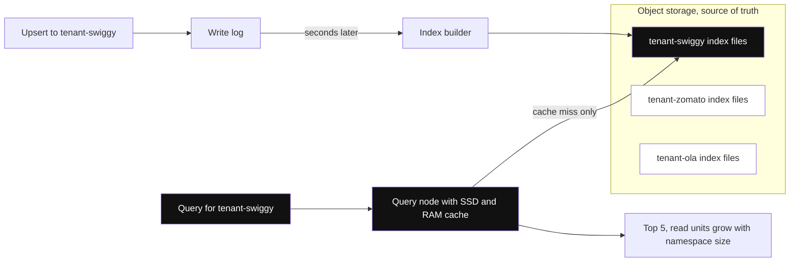

*Diagram:* Writes and reads are separate paths over object storage; a query touches only its own namespace, and the 'seconds later' gap before indexing is the eventual consistency.

**How it works, step by step:**
1. **History (interviewers ask "what changed"):** Pinecone started with **pod-based** indexes, fixed-size machines (p1, s1, p2) you picked and paid for by the hour. In 2024 it launched **serverless** indexes, which separate storage (object storage) from compute. In 2026 the SDKs stopped creating new pod indexes, and there is a migration path from pods to serverless.
2. **Data model:** index → namespaces → records. A record has an `_id`, a dense and/or sparse vector, and flat metadata. Python SDK v10 (API 2026-07) adds **schema-based document indexes**: you declare searchable fields (`dense_vector`, `sparse_vector`, or a `string` with full-text search) when you create the index. Fields you only filter on are not declared; they are indexed for filtering automatically.
3. **Serverless architecture:** writes go to a log, are built into immutable index files on object storage, and query nodes cache the hot files. Reads and writes scale separately. Freshly written records become searchable after a short delay (eventual consistency).
4. **Namespaces = tenants:** each namespace is stored and searched separately. A query reads only one namespace, so the cost of a query grows with the size of the namespace it hits. One namespace per customer gives isolation and lower cost.
5. **Indexes:** Pinecone does not expose index types. You choose dimension and metric (cosine, dotproduct, euclidean); it picks the internal index.
6. **Filtering and hybrid:** MongoDB-style metadata filters (`$eq`, `$in`, `$gt`, `$and`) applied during search. Hybrid search can be done with dense + sparse vectors (sparse indexes and the `pinecone-sparse-english-v0` model went GA in 2026), and full-text search on schema fields went GA in September 2026.
7. **Integrated inference:** Pinecone can host the embedding model. You send text, it embeds on write and on query. It also hosts rerankers (for example `bge-reranker-v2-m3`), callable inside `search()` or via `pc.inference.rerank`.
8. **Scaling options:** default on-demand serverless; **Dedicated Read Nodes** (GA April 2026) reserve read capacity for steady, high QPS; **BYOC** (GA August 2026) runs the data plane in your own cloud account.
9. **Pricing model:** plan tiers (a free Starter tier, paid tiers with monthly minimums or flat fees) plus usage: **read units** per query (grow with namespace size), **write units** per upsert, storage per GB-month, and inference per token. No exact prices here; they change often.

```python
from pinecone import DenseVectorQuery, Pinecone

pc = Pinecone()  # reads PINECONE_API_KEY

# One-time setup: a serverless index with one dense field
pc.indexes.create(
    name="support-docs",
    schema={"fields": {"embedding": {"type": "dense_vector", "dimension": 1024, "metric": "cosine"}}},
    deployment={"deployment_type": "managed", "cloud": "aws", "region": "us-east-1"},
)
index = pc.index("support-docs")

# Upsert: deterministic ids with a doc prefix, one namespace per tenant
index.documents.upsert(
    namespace="tenant-swiggy",
    documents=[
        {"_id": "doc7#c0", "embedding": emb0, "lang": "hi", "doc_id": 7, "text": "Refund 5-7 din me aata hai"},
        {"_id": "doc7#c1", "embedding": emb1, "lang": "en", "doc_id": 7, "text": "Refunds take 5-7 days"},
    ],
)

# Filtered top-5 search inside that tenant only
results = index.documents.search(
    namespace="tenant-swiggy",
    top_k=5,
    score_by=[DenseVectorQuery(field="embedding", values=query_emb)],
    filter={"lang": {"$eq": "en"}},
    include_fields=["text", "doc_id"],
)
for match in results.matches:
    print(match.id, match.score)
```

**What the code does:**
- Creates a managed (serverless) index with one 1024-dim cosine field named `embedding`, using the v10 `pc.indexes.create(schema=..., deployment=...)` form.
- Upserts two chunks into the `tenant-swiggy` namespace. `lang`, `doc_id` and `text` are not in the schema, so they are stored as filterable metadata.
- Uses ids like `doc7#c0`, so later you can list all ids with prefix `doc7#` and delete a whole document.
- Searches only that tenant's namespace with a metadata filter, returning selected fields.
- Older code (`pc.create_index(..., spec=ServerlessSpec(...))`, `index.upsert(vectors=...)`, `index.query(...)`) still works in v10 as deprecated sugar.

**When to pick it:** small or medium team, no appetite for running infra, needs per-tenant namespaces, wants embedding + rerank from the same vendor, and accepts a closed-source managed service.

**Interview tip:** "Why one namespace per tenant in Pinecone, not a `tenant_id` filter?" Say: "A query only scans its namespace, so it is faster and cheaper, and a bug in a filter cannot leak another tenant's data. Deleting a customer is one namespace delete."

**Common mistake:**
- Reading your own write immediately and assuming it is there. Serverless is eventually consistent; for "upload then ask", show a processing state or wait for freshness.
- Putting one giant shared namespace with a tenant filter. Every query then pays read units for the whole namespace.

## ⭐ Qdrant

**In one line:** an open-source vector database written in Rust, known for fast filtered search, rich payload indexing and good memory controls through quantization.

**Why it exists:** real queries almost always have filters ("only this tenant, only English, only last 30 days"). A plain HNSW graph breaks when a filter removes most nodes. Qdrant was built around making filtered vector search accurate and fast, in a single efficient binary you can self-host.

**Picture it:** Qdrant is an IRCTC search that first narrows by train class and date using a proper index, then finds the best seats among what is left, instead of searching all seats and throwing most away.

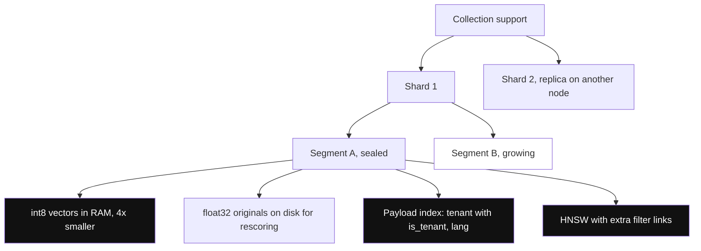

*Diagram:* Each sealed segment carries its own quantized vectors, originals on disk, payload indexes and HNSW; the growing segment is searched by brute force until the optimizer indexes it.

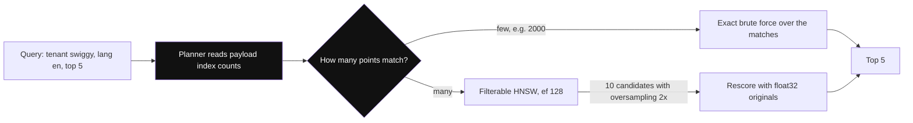

*Diagram:* The planner uses payload-index counts to pick exact brute force for tiny filtered sets, and filter-aware HNSW plus rescoring for broad ones.

**How it works, step by step:**
1. **Data model:** collection → points. A point has an id (an unsigned integer or a UUID only), one or more **named vectors** (dense, sparse, or multi-vector), and a JSON **payload**.
2. **Storage:** collection → shards → segments. Each segment has vector storage, payload storage and an HNSW index. An optimizer merges segments and builds indexes in the background. Writes go through a WAL first.
3. **Payload indexes:** you explicitly create an index on fields you filter on (`keyword`, `integer`, `float`, `datetime`, `geo`, `text`, `uuid`). Without them, filters are slow at scale.
4. **Filterable HNSW:** for indexed payload fields, Qdrant adds extra graph links so the graph stays connected under filters. A query planner uses payload-index cardinality: very selective filter means brute force over the small matching set; broad filter means filtered HNSW. Qdrant 1.16 added optional **ACORN** per query for hard multi-filter cases.
5. **Quantization:** scalar (int8, 4x smaller), binary (1-bit, 32x smaller; 1.5-bit and 2-bit variants too), and product quantization. Quantized vectors live in RAM; originals can stay on disk for **rescoring** with oversampling.
6. **Hybrid:** store a dense and a sparse vector per point, run both with `prefetch`, and fuse with RRF (weighted RRF since 1.17) or DBSF in one Query API call.
7. **Scaling:** sharding (automatic or custom shard keys), `replication_factor`, Raft consensus for cluster metadata. GPU-accelerated index building is available.
8. **Multi-tenancy:** usually one collection with a `tenant_id` payload index marked `is_tenant=True`, which co-locates each tenant's data. Qdrant 1.16 added **tiered multitenancy**: small tenants share shards, a big tenant can be promoted to its own dedicated shard.
9. **Hosting and pricing model:** open source (Apache 2.0) to self-host; Qdrant Cloud (managed, billed by the cluster's resources: RAM, CPU, disk per hour, with a small free cluster); Hybrid Cloud (your Kubernetes, their control plane); Private Cloud (fully on-prem).

```python
import uuid
from qdrant_client import QdrantClient, models

client = QdrantClient(url="http://localhost:6333")

client.create_collection(
    "support",
    vectors_config=models.VectorParams(size=1024, distance=models.Distance.COSINE),
    quantization_config=models.ScalarQuantization(
        scalar=models.ScalarQuantizationConfig(type=models.ScalarType.INT8)
    ),
)
# Index the fields you filter on; mark the tenant field for co-location
client.create_payload_index("support", field_name="tenant",
    field_schema=models.KeywordIndexParams(type=models.KeywordIndexType.KEYWORD, is_tenant=True))
client.create_payload_index("support", field_name="lang", field_schema=models.PayloadSchemaType.KEYWORD)

def pid(s: str) -> str:  # Qdrant ids must be int or UUID, so derive a stable UUID
    return str(uuid.uuid5(uuid.NAMESPACE_URL, s))

client.upsert("support", wait=True, points=[
    models.PointStruct(id=pid("doc7#c1"), vector=emb1,
                       payload={"tenant": "swiggy", "lang": "en", "doc_id": 7, "text": "Refunds take 5-7 days"}),
])

res = client.query_points(
    "support", query=query_emb, limit=5,
    query_filter=models.Filter(must=[
        models.FieldCondition(key="tenant", match=models.MatchValue(value="swiggy")),
        models.FieldCondition(key="lang", match=models.MatchValue(value="en")),
    ]),
    search_params=models.SearchParams(hnsw_ef=128,
        quantization=models.QuantizationSearchParams(rescore=True, oversampling=2.0)),
)
for p in res.points:
    print(p.id, p.score, p.payload["text"])
```

**What the code does:**
- Creates a 1024-dim cosine collection with int8 scalar quantization (4x less RAM for the search copy).
- Creates payload indexes on `tenant` (marked as the tenant field) and `lang`, so filters are fast and the planner can estimate selectivity.
- Turns the string id `doc7#c1` into a stable UUID, because Qdrant rejects arbitrary string ids.
- Upserts with `wait=True`, so the call returns only after the write is applied (read-your-writes).
- Searches with two filters, `hnsw_ef=128` for recall, and rescoring with 2x oversampling to recover accuracy lost to quantization.

**When to pick it:** you self-host or want a predictable managed cluster, filters are heavy and important, you care about RAM efficiency, and you want open source with no lock-in.

**Interview tip:** "How does Qdrant keep recall high with a strict filter?" Say: "Payload indexes tell the planner how many points match. If very few, it brute-forces them exactly. Otherwise it walks a filter-aware HNSW that has extra links per indexed field, so the graph does not fall apart."

**Common mistake:**
- Forgetting to create payload indexes, then wondering why filtered queries are slow on 10M points.
- Using string ids like `"doc7#c1"` directly. Qdrant only accepts unsigned ints or UUIDs.

## ⭐ Weaviate

**In one line:** an open-source vector database written in Go with a schema of collections and properties, built-in "vectorizer" modules that call embedding models for you, and first-class BM25 + vector hybrid search.

**Why it exists:** many teams want one system that stores objects, embeds them, keyword-searches them and vector-searches them. Weaviate bundles all of that with a typed schema and strong native multi-tenancy.

**Picture it:** Weaviate is a library with a librarian. You hand in books (objects); the librarian writes the catalogue cards (vectors) using a chosen embedding model, and can search by title words (BM25) and by topic (vectors) at once.

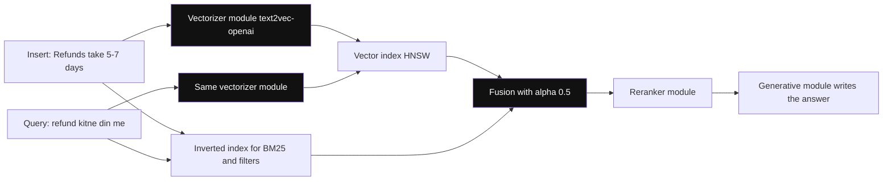

*Diagram:* The same vectorizer module embeds objects on insert and query text at search time; BM25 and vector results are fused by alpha, then optional reranker and generative modules run in the same query.

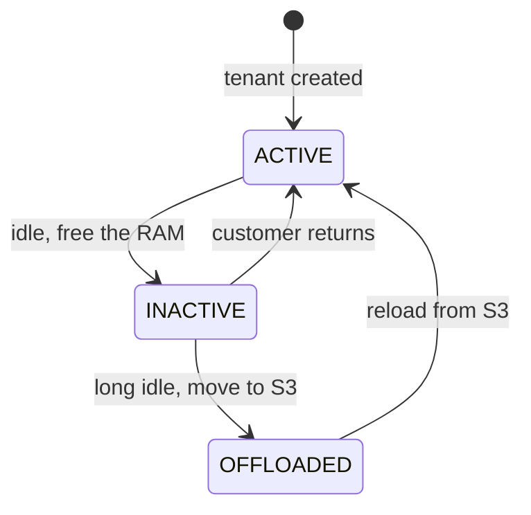

*Diagram:* Each tenant is its own shard that moves between RAM, local disk and S3, which is how one cluster holds a huge long tail of idle customers cheaply.

**How it works, step by step:**
1. **Data model:** collection (older name: class) → objects. Each object has typed **properties** (text, int, date, geo...), a UUID, and one or more **named vectors**. Cross-references link objects.
2. **Modules:** a **vectorizer** module (for example `text2vec-openai`, `text2vec-cohere`, `text2vec-ollama`, `multi2vec-clip`) embeds objects on insert and query text at search time. You can also bring your own vectors (`self_provided`). Generative and reranker modules add RAG answers and reranking in the same query.
3. **Indexes:** each vector has a vector index: `hnsw` (default), `flat` (brute force, good for small tenants), `dynamic` (starts flat, switches to HNSW when it grows), and `hfresh` (disk-friendly centroid index, GA in 1.38). Properties get an inverted index used for filters and BM25.
4. **Compression:** PQ, BQ (binary), SQ and RQ (rotational quantization). Since 1.33, 8-bit RQ is on by default for new collections.
5. **Hybrid:** `hybrid(query, alpha=...)` runs BM25 and vector search and fuses them. `alpha=1` is pure vector, `alpha=0` is pure BM25. Fusion is relative-score by default, ranked fusion (RRF style) optional.
6. **Multi-tenancy:** each tenant is its own shard with its own vector and inverted index, so isolation is physical. Tenants can be ACTIVE (in memory), INACTIVE (on local disk), or OFFLOADED (to object storage). This lets one cluster hold a very large number of tenants cheaply.
7. **Scaling:** horizontal sharding plus leaderless replication with tunable consistency (ONE, QUORUM, ALL).
8. **Hosting and pricing model:** open source (BSD-3) to self-host on Docker or Kubernetes; Weaviate Cloud (shared and dedicated tiers) priced by plan plus usage such as stored vector dimensions, storage and backups; BYOC / enterprise options.

```python
import weaviate
from weaviate.classes.config import Configure, Property, DataType
from weaviate.classes.data import DataObject
from weaviate.classes.query import Filter, MetadataQuery
from weaviate.classes.tenants import Tenant
from weaviate.util import generate_uuid5

client = weaviate.connect_to_local()  # or weaviate.connect_to_weaviate_cloud(...)

chunks = client.collections.create(
    "SupportChunk",
    properties=[Property(name="text", data_type=DataType.TEXT),
                Property(name="lang", data_type=DataType.TEXT)],
    vector_config=Configure.Vectors.self_provided(),  # we bring our own embeddings
    multi_tenancy_config=Configure.multi_tenancy(enabled=True),
)
chunks.tenants.create([Tenant(name="swiggy")])
swiggy = chunks.with_tenant("swiggy")           # every call below is scoped to this tenant

swiggy.data.insert_many([
    DataObject(properties={"text": "Refunds take 5-7 days", "lang": "en"},
               vector=emb1, uuid=generate_uuid5("doc7#c1")),
])

res = swiggy.query.hybrid(
    query="refund kitne din me", vector=query_emb, alpha=0.5, limit=5,
    filters=Filter.by_property("lang").equal("en"),
    return_metadata=MetadataQuery(score=True),
)
for o in res.objects:
    print(o.uuid, o.metadata.score, o.properties["text"])
client.close()
```

**What the code does:**
- Creates a collection with two text properties, self-provided vectors, and native multi-tenancy turned on.
- Creates the tenant `swiggy`; `with_tenant` returns a handle scoped to that tenant's own shard.
- Inserts an object with a deterministic UUID derived from `doc7#c1`, so re-ingestion overwrites instead of duplicating.
- Runs a hybrid query: BM25 on the text plus vector search on our query embedding, weighted 50/50, filtered to English.
- Closes the client, which matters because the v4 client keeps a gRPC connection open.

**When to pick it:** you want hybrid search and embedding built in, a typed schema, and many tenants with physical isolation and cheap offloading of idle ones.

**Interview tip:** "How would you serve 100,000 small customers on Weaviate?" Say: "Native multi-tenancy: one shard per tenant, flat or dynamic index for small tenants, and inactive or offloaded tenants for the long tail so they cost disk or S3, not RAM."

**Common mistake:**
- Letting a vectorizer module embed data while the app embeds queries with a different model. Both sides must use the same model.
- Leaving the v3 client patterns (`client.query.get(...)`) in new code. The v4 client is collection-based; v3 is removed.

## ⭐ Milvus and Zilliz Cloud

**In one line:** an open-source, distributed vector database (Go + C++) with storage and compute fully separated, the widest choice of index types including GPU and DiskANN, built for billions of vectors; Zilliz Cloud is its managed version.

**Why it exists:** at a billion vectors, one machine's RAM is not enough, and you want to scale ingest, indexing and querying separately. Milvus splits these into separate node types on top of object storage, so each part scales on its own.

**Picture it:** Milvus is a big Flipkart warehouse operation. Receiving docks (streaming nodes) take in goods, a packing team (data nodes) builds boxes (indexes), pickers (query nodes) serve orders, and the actual stock sits in a huge cheap godown (object storage).

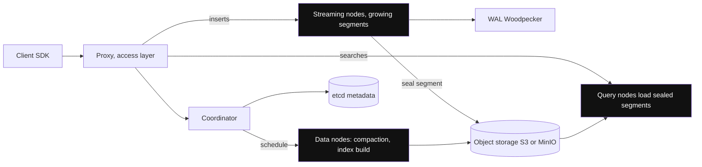

*Diagram:* Ingest, index building and search are three separate node types sharing object storage, so you add query nodes for QPS without touching ingest.

**How it works, step by step:**
1. **Data model:** database → collection → partitions → segments. A collection has a **schema**: a primary key, one or more vector fields (float, float16, bfloat16, binary, int8, sparse), scalar fields, and optional dynamic JSON fields.
2. **Architecture (2.6):** an access layer (proxies), a coordinator, worker nodes (streaming nodes for fresh writes, query nodes for search, data nodes for compaction and index building), and storage: etcd for metadata, object storage (S3/MinIO) for data, and a WAL (Woodpecker in 2.6, or Kafka/Pulsar earlier).
3. **Segments:** fresh data sits in growing segments; sealed segments get indexes built and are loaded by query nodes. Milvus 2.6 adds tiered storage, so cold data can stay in object storage with hot data cached locally.
4. **Index types:** FLAT, IVF_FLAT, IVF_SQ8, IVF_PQ, IVF_RABITQ (1-bit), HNSW (plus SQ/PQ variants), SCANN, **DISKANN** (graph on SSD, for data larger than RAM), and **GPU indexes** (GPU_CAGRA, GPU_IVF_FLAT, GPU_IVF_PQ, GPU_BRUTE_FORCE). Sparse vectors use an inverted index.
5. **Filtering and hybrid:** boolean filter expressions (`lang == "en" and doc_id in [7, 9]`) with scalar indexes. Built-in BM25 full-text search turns a text field into a sparse vector; `hybrid_search` runs several vector searches and fuses with RRF or weighted rankers.
6. **Consistency levels** per request: Strong, Bounded (default, slightly stale), Session, Eventually.
7. **Multi-tenancy:** database per tenant, collection per tenant, partition per tenant, or a **partition key** field (tenants hashed into partitions, and filters on the key only search those partitions). Partition key scales to the most tenants.
8. **Hosting and pricing model:** Milvus Lite (a pip install, local file, for prototypes), Standalone (one Docker container), Distributed (Kubernetes via Helm or Operator). Zilliz Cloud offers serverless (pay per usage), dedicated clusters (pay per compute-unit hour) and BYOC.

```python
from pymilvus import MilvusClient, DataType

client = MilvusClient(uri="http://localhost:19530")  # Milvus Lite: MilvusClient("demo.db")

schema = MilvusClient.create_schema(auto_id=False)
schema.add_field("id", DataType.VARCHAR, is_primary=True, max_length=64)
schema.add_field("embedding", DataType.FLOAT_VECTOR, dim=1024)
schema.add_field("tenant", DataType.VARCHAR, max_length=64, is_partition_key=True)
schema.add_field("lang", DataType.VARCHAR, max_length=8)
schema.add_field("text", DataType.VARCHAR, max_length=4096)

index_params = client.prepare_index_params()
index_params.add_index(field_name="embedding", index_type="HNSW", metric_type="COSINE",
                       params={"M": 16, "efConstruction": 200})
client.create_collection("support", schema=schema, index_params=index_params)

client.upsert("support", data=[
    {"id": "doc7#c1", "embedding": emb1, "tenant": "swiggy", "lang": "en", "text": "Refunds take 5-7 days"},
])

hits = client.search(
    "support", data=[query_emb], limit=5,
    filter='tenant == "swiggy" and lang == "en"',
    output_fields=["text"],
    search_params={"params": {"ef": 128}},
)
for h in hits[0]:
    print(h["id"], h["distance"], h["entity"]["text"])
```

**What the code does:**
- Defines a schema with a string primary key, a 1024-dim vector, and `tenant` as the **partition key**, so each tenant's rows land in a subset of partitions.
- Builds an HNSW index with cosine metric. Creating the collection with `index_params` also loads it, so it is searchable.
- Upserts one chunk by its deterministic id.
- Searches with a boolean filter; because `tenant` is the partition key, Milvus only scans that tenant's partitions.
- Returns a list per query vector; `distance` holds the similarity score for cosine.

**When to pick it:** hundreds of millions to billions of vectors, a platform team that can run Kubernetes, or a need for GPU or DiskANN indexes. Pick Zilliz Cloud if you want that engine without the ops.

**Interview tip:** "Why does Milvus separate streaming, query and data nodes?" Say: "Ingest, index building and search have different load patterns. Separating them over shared object storage lets you scale query nodes for QPS without touching ingest, and rebuild indexes without hurting search."

**Common mistake:**
- Self-hosting distributed Milvus for 2M vectors. It brings etcd, object storage, a WAL and many pods. Use Lite, Standalone, or another product at that size.
- Assuming the default Bounded consistency shows a write instantly. Use `Strong` or `Session` when the user must see their own write.

## Chroma

**In one line:** a developer-first, open-source vector database that runs inside your Python process with zero setup, and scales to Chroma Cloud, a serverless version on object storage.

**Why it exists:** most RAG projects start in a notebook. Chroma makes the first hour easy: `pip install chromadb`, add documents, query. Its API is small and readable, and many tutorials and frameworks use it as the default store.

**Picture it:** Chroma is the Maggi of vector DBs: two minutes from packet to plate. Great for a hostel night; for a 500-person canteen you move to a bigger kitchen (Chroma Cloud or another DB).

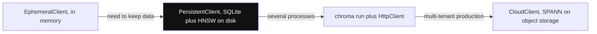

*Diagram:* Same small API at every step; you move right only when the next limit hits: notebook, one disk, a server, then the serverless cloud.

**How it works, step by step:**
1. **Modes:** in-memory (`EphemeralClient`), embedded on disk (`PersistentClient`, SQLite plus a local HNSW index), client-server (`chroma run` with `HttpClient`), and **Chroma Cloud** (`CloudClient`).
2. **Data model:** tenant → database → collection → records with `ids`, `embeddings`, `documents` (the text), and `metadatas`.
3. **Core:** the core was rewritten in Rust in the 1.x line, which made the local engine much faster.
4. **Indexes:** HNSW locally (configure `space`, `ef_construction`, `ef_search`). Chroma Cloud uses a SPANN/SPFresh-style index on object storage with a WAL for strong consistency.
5. **Filtering:** `where` on metadata (`$eq`, `$ne`, `$gt`, `$in`, `$and`, `$or`) and `where_document` on the text (`$contains`, `$regex`). Chroma Cloud adds a Search API with sparse vectors and rank fusion for hybrid.
6. **Embeddings:** if you pass `documents` without `embeddings`, Chroma embeds them with the collection's embedding function. The default is a small local model (all-MiniLM-L6-v2, 384 dims).
7. **Multi-tenancy:** a collection per tenant or user is common; tenants and databases add another level.
8. **Hosting and pricing model:** open source (Apache 2.0) self-host; Chroma Cloud is usage-based: pay per GB written, per query/read, and per GB stored, with a free starter credit.

```python
import chromadb

client = chromadb.PersistentClient(path="./chroma")  # chromadb.CloudClient(...) for Chroma Cloud

col = client.get_or_create_collection(
    name="support-swiggy",                   # one collection per tenant
    configuration={"hnsw": {"space": "cosine"}},
)
col.upsert(
    ids=["doc7#c1"],
    embeddings=[emb1],                       # pass your own vectors, skip the default model
    documents=["Refunds take 5-7 days"],
    metadatas=[{"lang": "en", "doc_id": 7}],
)
res = col.query(
    query_embeddings=[query_emb],
    n_results=5,
    where={"$and": [{"lang": "en"}, {"doc_id": {"$in": [7, 9]}}]},
)
print(res["ids"][0], res["distances"][0])
```

**What the code does:**
- Opens an on-disk embedded database in `./chroma`; no server is running.
- Creates one collection per tenant with cosine distance.
- Upserts a chunk with our own embedding, the raw text and metadata.
- Queries with two metadata conditions joined by `$and` (Chroma needs an explicit `$and` for more than one condition).
- Returns lists per query; `distances` are distances, so smaller is closer.

**When to pick it:** prototypes, notebooks, demos, tests, small single-node apps, and teams that want the same API from laptop to a managed serverless cloud.

**Interview tip:** "Would you run Chroma in production?" Say: "Embedded Chroma is fine for small single-process apps and tests. For multi-tenant production I would use Chroma Cloud or a clustered DB, because local mode is one process on one machine."

**Common mistake:**
- Passing only `documents` and silently getting the default 384-dim model, then querying with OpenAI embeddings. Dimension errors or garbage results follow.
- Pointing several processes at one `PersistentClient` directory. Use client-server mode for multiple writers.

## LanceDB

**In one line:** an embedded vector database, like SQLite for AI data, built on the Lance columnar file format, which can live on local disk or directly on object storage like S3.

**Why it exists:** AI data is more than vectors: text, images, video frames, features. Teams want one table for all of it, versioned, stored cheaply on S3, and searchable without running a server. LanceDB gives a library you import, with tables in an open format.

**Picture it:** LanceDB is like keeping your data in a well-indexed Excel file on Google Drive. No server to run; anyone with access opens the file and searches it.

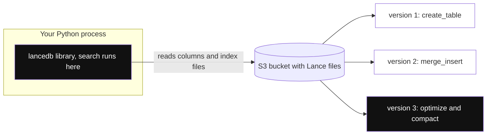

*Diagram:* There is no database server: the library inside your process reads Lance files straight from S3, and every write adds a version you can time-travel to until cleanup.

**How it works, step by step:**
1. **Lance format:** a columnar format (Arrow-compatible, like Parquet) designed for fast random row access and vectors. Every write creates a new **version**, so you get time travel and easy rollback.
2. **Embedded:** `lancedb.connect("./data")` or `lancedb.connect("s3://bucket/path")`. The search runs inside your process; storage can be remote.
3. **Indexes:** vector indexes `IVF_PQ` (the default), `IVF_FLAT`, `IVF_SQ`, `IVF_RQ`, `IVF_HNSW_SQ`, `IVF_HNSW_PQ`; scalar indexes (BTREE, BITMAP, LABEL_LIST) for filters; a full-text (BM25) index.
4. **Filtering:** SQL-like `where("tenant = 'swiggy'")`, prefilter by default (filter first, then search).
5. **Hybrid:** `query_type="hybrid"` runs vector + full-text and merges with a reranker (RRF by default).
6. **Index freshness:** rows added after an index build are still searched, but by brute force, until you run `optimize()` or rebuild.
7. **Hosting and pricing model:** open source (Apache 2.0) embedded; LanceDB Cloud (serverless, usage-based) and LanceDB Enterprise (in your cloud).

```python
import lancedb

db = lancedb.connect("./lancedb")            # or "s3://my-bucket/lancedb"
tbl = db.create_table("support", data=[
    {"id": "doc7#c1", "vector": emb1, "tenant": "swiggy", "lang": "en", "text": "Refunds take 5-7 days"},
], mode="overwrite")

# Upsert more rows by id (merge on the "id" column)
(tbl.merge_insert("id")
    .when_matched_update_all()
    .when_not_matched_insert_all()
    .execute(new_rows))

tbl.create_scalar_index("tenant")            # fast filter on tenant
tbl.create_index(metric="cosine", index_type="IVF_HNSW_SQ")  # needs enough rows to train

res = (tbl.search(query_emb)
          .where("tenant = 'swiggy' AND lang = 'en'", prefilter=True)
          .limit(5)
          .to_list())
print([(r["id"], r["_distance"]) for r in res])
```

**What the code does:**
- Connects to a local folder (the same code works with an `s3://` path).
- Creates a table from Python dicts; the `vector` column is detected as the embedding column.
- Upserts with `merge_insert` keyed on `id`, so re-ingesting a document updates rows instead of duplicating them.
- Adds a scalar index on `tenant` and an IVF-HNSW vector index with scalar quantization.
- Runs a prefiltered vector search and reads the `_distance` column LanceDB adds.

**When to pick it:** you want no server, data on S3 in an open format, multimodal tables, versioning, or vector search inside a data pipeline or on a device.

**Interview tip:** "What is the catch with an embedded DB on S3?" Say: "Each query pays object-storage latency unless cached, and many writers need a commit coordinator. It shines for batch, analytics and moderate QPS, not as a shared high-QPS service without LanceDB Cloud."

**Common mistake:**
- Many tiny writes. Each creates a version and small files; batch writes and run `optimize()` to compact and clean old versions.
- Assuming deleted rows are gone. Old versions still hold them until cleanup, which matters for GDPR.

## turbopuffer

**In one line:** a closed-source, serverless vector and full-text search engine built object-storage-first, so storing many (mostly idle) namespaces costs very little.

**Why it exists:** AI apps like code assistants keep a separate index per user or per repo: millions of namespaces, most idle at any moment. Keeping all of them in RAM is very expensive. turbopuffer keeps everything on object storage and caches only what is being queried.

**Picture it:** a cloud kitchen that stores raw stock in a cheap far-away godown and keeps only today's popular items in the kitchen fridge. The first order of a rare dish is slow; repeat orders are fast.

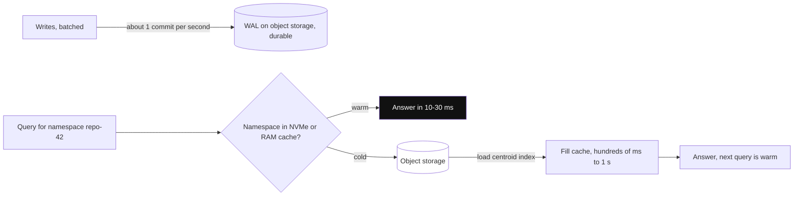

*Diagram:* Only the first (cold) query of a namespace pays the object-storage trip; after that it is cached and answers in tens of ms.

**How it works, step by step:**
1. **Storage:** object storage is the source of truth. Each namespace has its own path. Writes go to a WAL on object storage; a successful write is durable.
2. **Cache:** after the first query, a namespace is cached on NVMe SSD and in memory. Docs show cold queries around hundreds of ms to over a second, warm queries around 10-30 ms for millions of documents.
3. **Index:** a centroid-based ANN index (built on SPFresh), chosen because it needs fewer object-storage round trips than graph indexes like HNSW. Recall is tuned automatically (90-100%) and monitored.
4. **Filters and full-text:** exact attribute indexes for filters, and an inverted BM25 index. For hybrid, run a vector query and a BM25 query (they can go in one multi-query request) and fuse in your code with RRF.
5. **Consistency:** strong by default (a write is visible to the next query). You can opt into eventual reads for lower latency.
6. **Writes:** batched; each namespace commits about one WAL entry per second, so many small writes get grouped.
7. **Multi-tenancy:** namespaces are cheap, so one namespace per tenant (or per user, per repo) is the normal pattern.
8. **Hosting and pricing model:** managed only (multi-tenant cloud, with single-tenant and BYOC for enterprise). Usage-based: storage, data written, and data queried, with a monthly minimum per plan.

```python
import os
import turbopuffer

tpuf = turbopuffer.Turbopuffer(api_key=os.getenv("TURBOPUFFER_API_KEY"), region="gcp-us-central1")
ns = tpuf.namespace("support-swiggy")        # one namespace per tenant

ns.write(
    upsert_rows=[
        {"id": "doc7#c1", "vector": emb1, "lang": "en", "doc_id": 7, "text": "Refunds take 5-7 days"},
    ],
    distance_metric="cosine_distance",
)

res = ns.query(
    rank_by=("vector", "ANN", query_emb),
    limit=5,
    filters=("And", (("lang", "Eq", "en"), ("doc_id", "In", [7, 9]))),
    include_attributes=["text"],
)
print(res.rows)
```

**What the code does:**
- Creates a client for one region and a handle to the `support-swiggy` namespace (created on first write).
- Upserts a row with our vector and attributes, setting cosine distance for the namespace.
- Queries with ANN ranking on the `vector` attribute plus two exact filters combined with `And`.
- Returns only the `text` attribute to keep the response small.

**When to pick it:** very many namespaces with mostly idle data, large corpora where RAM-resident clusters are too costly, and workloads that tolerate a slower first query.

**Interview tip:** "How would you hide cold-start latency on turbopuffer?" Say: "Warm the namespace when the user opens the app or the repo (there is a cache-warm API), keep active tenants hot, and show the first answer streaming so the extra few hundred ms is not felt."

**Common mistake:**
- Benchmarking only warm queries and promising p99 under 50 ms, then the first query of each tenant takes a second.
- Many tiny writes per second to one namespace. Batch them; commits are about once per second per namespace.

## ⭐ The big comparison table

Products from the sibling page ([Vector Search in Existing Databases](32-vector-search-in-databases.md)) are one line each for context.

| Product | Open source | Hosting | Architecture | Main ANN indexes | Filtering | Hybrid / BM25 | Multi-tenancy | Pricing model |
|---|---|---|---|---|---|---|---|---|
| Pinecone | No | Managed serverless, dedicated read nodes, BYOC | Object storage + cache, separate read/write | Hidden (you pick metric) | Metadata filters in search | Sparse + dense; full-text fields (2026) | Namespaces | Plan + read units, write units, storage |
| Qdrant | Yes (Apache 2.0) | Self-host, Cloud, Hybrid, Private | Rust cluster, segments, RAM/SSD | HNSW (filterable), quantized | Payload indexes, planner, ACORN | Sparse vectors + RRF/DBSF | Tenant payload index, tiered shards | Cluster resources per hour |
| Weaviate | Yes (BSD-3) | Self-host, Cloud, BYOC | Go cluster, shard per tenant | HNSW, flat, dynamic, HFresh | Inverted index | Native BM25 hybrid with alpha | Native, tenant offload to S3 | Plan + vector dims, storage, backups |
| Milvus / Zilliz | Yes (Apache 2.0) | Lite, Standalone, K8s; Zilliz serverless, dedicated, BYOC | Distributed, storage/compute split | HNSW, IVF, DiskANN, GPU, RaBitQ, SCANN | Boolean expressions + scalar indexes | Built-in BM25, multi-vector rerankers | Partition key, partitions, DBs | Free OSS; Zilliz per usage or compute units |
| Chroma | Yes (Apache 2.0) | Embedded, server, Chroma Cloud | Local SQLite + HNSW; cloud on object storage | HNSW; SPANN in cloud | `where`, `where_document` | Cloud Search API | Tenant, database, collection | Free OSS; cloud per GB written, query, storage |
| LanceDB | Yes (Apache 2.0) | Embedded, LanceDB Cloud, Enterprise | Lance files on disk or S3 | IVF_PQ, IVF_HNSW_SQ, others | SQL-like `where`, scalar indexes | FTS + vector with reranker | Table or filter per tenant | Free OSS; cloud usage-based |
| turbopuffer | No | Managed, single-tenant, BYOC | Object storage first, SSD cache | Centroid (SPFresh) | Exact attribute indexes | BM25 + vector, fuse in client | Namespaces (millions) | Storage, writes, queries + minimum |
| pgvector | Yes | Inside Postgres | Postgres tables | HNSW, IVFFlat | SQL `WHERE` | `tsvector` + vector | Rows, schemas, RLS | Your Postgres cost |
| Elasticsearch / OpenSearch | Mixed | Self-host or cloud | Lucene shards | HNSW (plus quantized) | Full query DSL | Strong BM25 + kNN | Index or filter | Cluster or serverless |
| Redis | Mixed | Self-host or cloud | In-memory | HNSW, flat | Tag/numeric filters | Text + vector | Key prefixes | Memory-sized |
| MongoDB Atlas | No (Atlas) | Managed | Search nodes beside the DB | HNSW | Pre-filter fields | `$rankFusion` style hybrid | Filter field | Atlas cluster |
| FAISS | Yes | Library only | In-process | Flat, IVF, PQ, HNSW, GPU | You build it | None | None | Free |

**Rule of thumb for the interview:** most of these can store 50M vectors and filter by tenant. The real differences are ops burden, cost shape at your tenancy pattern, cold-start latency, and how much (embedding, BM25, rerank) you want bundled.

## ⭐ How to choose

**In one line:** answer five questions in order: prototype or production, do you already have Postgres or Elasticsearch, will you run infra, how big and how many tenants, and do you need special indexes.

**Why it exists:** "Which vector DB is best?" has no answer. The interviewer wants to hear the questions you would ask and how each answer moves the choice.

**Picture it:** choosing a vehicle. For a 2 km office trip you take a scooter (pgvector), for a family trip a car (managed DB), for moving a whole godown a truck fleet (Milvus).

**How it works, step by step:**

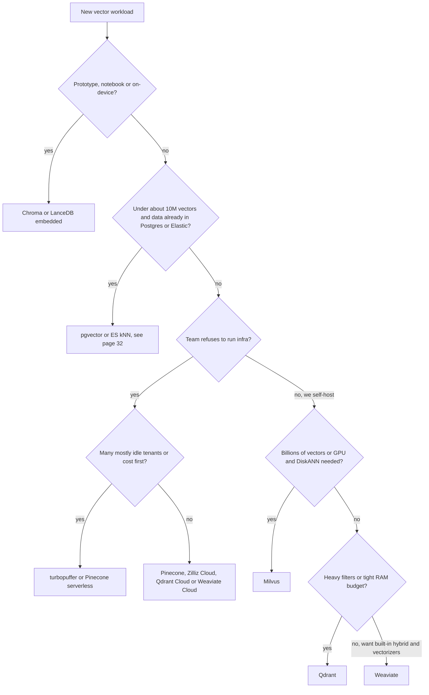

1. **Prototype?** Chroma or LanceDB embedded. No server, five lines of code.
2. **Data already in Postgres or Elasticsearch and under roughly 10M vectors?** Use what you have. One less system to sync, back up and secure.
3. **No infra team?** A managed service. If you have very many idle tenants or cost is the first concern, the object-storage-first products win. Otherwise Pinecone or a managed Qdrant/Weaviate/Zilliz.
4. **Self-hosting at very large scale** (hundreds of millions to billions, GPU or SSD-resident indexes)? Milvus.
5. **Self-hosting at medium scale?** Qdrant for filter-heavy or RAM-tight work, Weaviate for built-in hybrid, modules and native multi-tenancy.
6. Then **prove it**: load a realistic sample (say 1M of your real chunks), measure recall@10 against exact search, p99 latency with your real filters, and the monthly bill.

**Interview tip:** start with "I'd ask about scale, QPS, tenant count, filters, ops team and budget" before naming any product. Then name one default and one fallback.

**Common mistake:**
- Choosing by a public benchmark. Benchmarks rarely use your filters, your dimension, or your tenant pattern.

## ⭐ A realistic sizing example

**In one line:** vector memory is `count × dims × bytes per number`; the index adds a bit, quantization divides it, replicas multiply it.

**Why it exists:** "How much RAM do we need?" is one of the most common follow-ups. A quick, correct calculation shows seniority and decides between a RAM cluster and an object-storage design.

**Picture it:** packing for a trip. Clothes (raw vectors) take most of the bag, the bag itself (index) adds a little, vacuum bags (quantization) shrink clothes, and taking two bags (replicas) doubles everything.

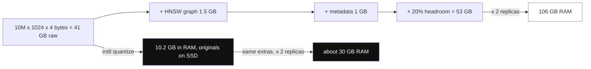

*Diagram:* Raw vectors dominate the bill; int8 quantization with originals on disk cuts the 2-replica RAM from about 106 GB to about 30 GB.

**How it works, step by step.** Scenario: a support RAG product with 10M chunks, a 1024-dim embedding model, 2 replicas for availability.

| Item | Math | Size |
|---|---|---|
| Raw float32 vectors | 10M × 1024 × 4 bytes | ~41 GB |
| HNSW graph (M = 16) | 10M × ~32 links × 4 bytes on layer 0, plus a little for upper layers | ~1.5 GB |
| Payload / metadata (ids, tenant, lang, doc_id) | 10M × ~100 bytes | ~1 GB |
| Chunk text if stored in the DB | 10M × ~1.5 KB | ~15 GB (often kept on disk or elsewhere) |
| **RAM per replica, float32 in RAM** | 41 + 1.5 + 1 + headroom ~20% | **~53 GB** |
| **Total with 2 replicas** | 53 × 2 | **~106 GB RAM** |

How quantization changes the RAM you need for the search copy (originals stay on disk for rescoring):

| Format | Bytes per vector | 10M vectors | Saving | Notes |
|---|---|---|---|---|
| float32 | 4096 | ~41 GB | 1x | baseline |
| float16 | 2048 | ~20.5 GB | 2x | almost no recall loss |
| int8 scalar | 1024 | ~10.2 GB | 4x | small loss, fixed by rescoring |
| PQ (128 sub-vectors × 1 byte) | 128 | ~1.3 GB | 32x | needs training, rescoring |
| binary (1-bit) | 128 | ~1.3 GB | 32x | works best with high-dim models; oversample 3-4x and rescore |
| 512-dim (Matryoshka cut) + int8 | 512 | ~5.1 GB | 8x | only if the model supports shorter dims |

Other numbers to say out loud:
- **Rescoring reads:** with int8 in RAM and float32 on SSD, a query that rescores 2 × 10 = 20 candidates does ~20 small SSD reads. Fast on NVMe.
- **Re-embedding cost:** 10M chunks × ~400 tokens = 4 billion tokens through the embedding model. At ~2,000 chunks per second upsert, loading takes ~1.5 hours, but embedding throughput and rate limits usually take longer.
- **Object-storage design:** the same 41 GB sits on S3 for very little per month; you pay mostly per query and for the cache of hot namespaces. That is why 10,000 mostly idle tenants are far cheaper there than in a 106 GB RAM cluster.

**Interview tip:** say the formula first, then: "With int8 quantization and rescoring we need about 11 GB of RAM per replica for vectors instead of 41, with recall within about 1 point after rescoring. I would confirm that on our own eval set."

**Common mistake:**
- Forgetting replicas and headroom. The DB also needs RAM for segment merges, index builds and the OS page cache.
- Quoting binary quantization savings for a 384-dim model. Very low-dim vectors lose too much at 1 bit.

## Migration and lock-in

**In one line:** vectors, ids and metadata are portable; filter syntax, hybrid scoring, tenancy model and hosted embedding models are not.

**Why it exists:** teams outgrow their first choice (Chroma to Qdrant, Pinecone to self-hosted, pgvector to a dedicated DB). A planned migration is boring; an unplanned one is a weekend outage.

**Picture it:** shifting house. Your furniture (data) moves fine if it is packed and labelled. The fitted wardrobes (vendor-specific features) stay behind.

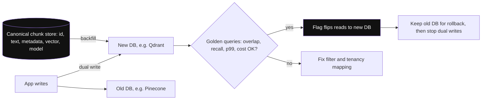

*Diagram:* The canonical chunk store is the escape hatch: it backfills the new DB while dual writes keep both fresh, and reads flip only after the golden-query comparison passes.

**How it works, step by step:**
1. **Keep a canonical copy** of every chunk outside the vector DB: `id, doc_id, tenant, text, metadata, embedding_model, vector` as Parquet on S3 or rows in Postgres. This is your escape hatch and your backup.
2. **Wrap the DB in a thin interface** in your code: `upsert(chunks)`, `delete(doc_id)`, `search(vector, tenant, filters, k)`. Framework adapters (LangChain, LlamaIndex vector stores) help, but tenancy and filters still leak through them.
3. **Translate filters and tenancy:** Pinecone namespaces may become Qdrant tenant payloads or Milvus partition keys. Write the mapping down.
4. **Dual-write** new data to old and new stores, and **backfill** history from the canonical copy (or export: Qdrant `scroll`, Milvus `query_iterator`, Pinecone list ids by prefix then fetch).
5. **Compare** on a golden query set: top-10 overlap with the old store, recall against exact search, p99 latency, cost.
6. **Cut over** reads behind a flag, keep the old store for rollback for a few weeks, then stop dual writes.

**Lock-in hot spots:**
- **Hosted embedding** (Pinecone integrated inference, Weaviate vectorizer modules): if you never stored the vectors yourself, leaving means re-embedding everything.
- **Hybrid scoring:** Weaviate relative-score fusion, Qdrant DBSF and Pinecone sparse scaling all rank differently, so results shift.
- **Closed-source managed only** (Pinecone, turbopuffer): no self-host fallback; BYOC helps with data residency, not with exit.

**Interview tip:** "How do you avoid vector DB lock-in?" Say: "The vector DB is a derived index. The source of truth is our chunk store with vectors and the model version. Any DB can be rebuilt from it in hours, and code talks to a small repository interface."

**Common mistake:**
- Migrating and switching the embedding model in the same step. Change one thing at a time, or you cannot tell what caused a quality drop.

## ⭐ Production concerns

**In one line:** in production the hard parts are not search speed; they are re-embedding, freshness, deletes, tenant isolation, backups and cost.

**Why it exists:** a demo writes once and reads forever. A product has documents changing every minute, customers leaving, models upgrading and a finance team asking about the bill.

**Picture it:** opening a restaurant is easy. Running it daily means stock rotation (re-embedding), throwing out expired food (deletes), separate tables (tenancy), CCTV backups and a monthly P&L.

**How it works, step by step:**

**1. Re-embedding when the model changes (blue-green index).**

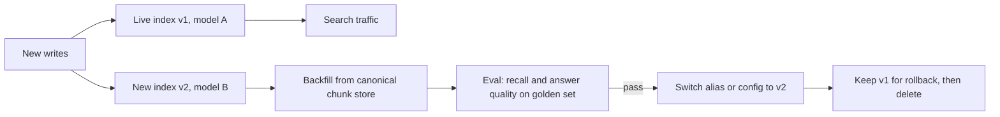

- Vectors from model A and model B cannot be mixed. Build a new collection, namespace or index named with the model version (`support_v2_bge-m3`).
- Dual-write new chunks to both, backfill old ones, evaluate, then switch. Qdrant, Milvus and Weaviate have **collection aliases** for an atomic switch; with Pinecone, switch the index name in config.
- Store `embedding_model` and `embedding_version` on every record.

**2. Consistency and freshness.**
- Pinecone serverless and Milvus "Bounded" are eventually consistent (seconds). Qdrant `wait=True`, Milvus `Strong`/`Session`, and turbopuffer's default give read-your-writes.
- For "user uploads a PDF and asks about it right away", either use a strong read for that request, or show "indexing..." until the write is confirmed.

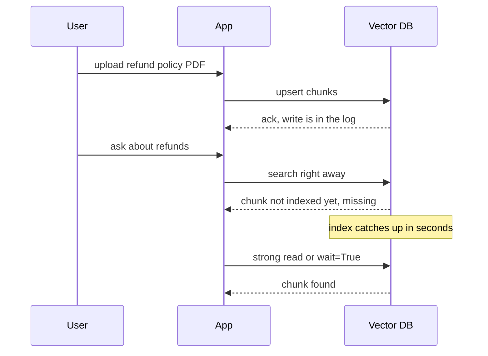

*Diagram:* An ack means durable, not searchable; with eventual consistency the first search can miss the chunk, so use a strong read for that request or show an indexing state.

**3. Deletes.**
- Most indexes delete with tombstones, and space comes back after compaction. Heavy delete churn hurts recall and latency until the optimizer runs.
- Use deterministic ids (`doc7#c3`) or a `doc_id` field so "delete this document" is one call (delete by id prefix, or delete by filter).
- GDPR erasure: also handle snapshots, backups and LanceDB old versions, which still contain the data.

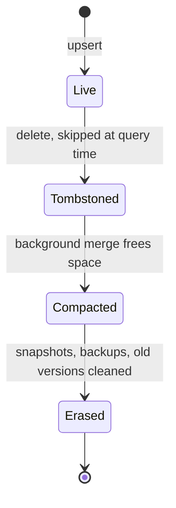

*Diagram:* A delete is only a tombstone at first; space comes back after compaction, and GDPR erasure is complete only when backups and old versions are cleaned too.

**4. Tenant isolation.**

| Pattern | Isolation | Cost at 10k tenants | Example |
|---|---|---|---|
| Collection or index per tenant | Strongest | High overhead per collection | Chroma collections, small counts only |
| Namespace / native tenant / partition key | Strong, physical | Good | Pinecone namespaces, Weaviate tenants, Milvus partition key, turbopuffer namespaces |
| Shared collection + tenant filter | Logical only | Best | Qdrant `is_tenant` payload, pgvector `WHERE` |

- Always set the tenant from the authenticated session on the server, never from the request body.
- Watch noisy neighbours: one huge tenant can slow everyone. Promote it to its own shard (Qdrant tiered multitenancy) or its own namespace.

**5. Backups and disaster recovery.** Qdrant snapshots, Weaviate backup modules to S3/GCS, the `milvus-backup` tool, Pinecone backups and restore, object-storage versioning for LanceDB and turbopuffer data. Test a restore, and remember: the canonical chunk store lets you rebuild even if backups fail.

**6. Cost controls.** Quantize, cut dimensions if the model allows, keep idle tenants on disk or object storage, TTL old data (old tickets), avoid oversized `top_k`, and reserve capacity (dedicated read nodes, reserved clusters) only for steady high QPS.

**7. Observability.** Track p50/p99 latency per tenant, recall@10 on a nightly golden set versus exact search, unindexed or growing segment counts, memory usage, write lag, and cost per 1,000 queries.

**Interview tip:** "How do you know your vector DB is silently getting worse?" Say: "A nightly job runs 200 golden queries, compares ANN results to exact search for recall@10, and alerts if it drops by more than 2 points. Recall drifts with deletes, filters and new data, not just with config changes."

**Common mistake:**
- Updating the embedding model in place, record by record. For hours the index holds a mix of two vector spaces and search quality collapses.
- Monitoring only latency. A misconfigured filter or quantization can halve recall while latency looks perfect.

## Common pitfalls

- **Wrong metric for the model:** building with euclidean for a model trained with cosine or dot product. Most products cannot change the metric after creation; you must rebuild.
- **Dimension fixed at creation:** you cannot store 3072-dim vectors in a 1024-dim index. Plan the model choice first.
- **Random ids:** UUID4 per chunk means re-ingestion creates duplicates. Use deterministic ids from `doc_id + chunk_no`.
- **Huge metadata:** storing whole pages in metadata. Pinecone caps metadata per record (about 40 KB), and big payloads slow every product. Keep text in your own store or keep chunks small.
- **No payload or scalar index on filter fields** (Qdrant, Milvus, LanceDB). Filters fall back to full scans.
- **Benchmarking warm only** on object-storage-first products, or **benchmarking without filters** on any product.
- **One shared collection, tenant from the client:** a single bug leaks one customer's data to another.
- **Ignoring write batching:** one upsert per chunk. Batch 100 to 1,000 records per call for every product.

## Interview questions

**Q: Pinecone vs Qdrant for a new RAG product?**
Pinecone if the team wants zero ops, namespaces per tenant and bundled embedding and rerank, and is fine with closed source and usage billing. Qdrant if you want open source, self-host or a predictable cluster bill, and heavy filtering with tight RAM control.

**Q: What does "object-storage-first" mean and what is the trade-off?**
S3-like storage is the source of truth and RAM/SSD is only a cache. Storage is very cheap and idle tenants cost almost nothing, but the first (cold) query on a namespace can take hundreds of ms to over a second.

**Q: How much RAM for 10M vectors at 1024 dims?**
10M × 1024 × 4 bytes ≈ 41 GB raw, plus ~1-2 GB HNSW graph and some metadata, so ~50 GB per replica with headroom. int8 quantization brings the vector part to ~10 GB, binary to ~1.3 GB, with rescoring on originals kept on disk.

**Q: How do you isolate 10,000 tenants?**
Use the product's physical partition: Pinecone or turbopuffer namespaces, Weaviate native tenants, Milvus partition key, or Qdrant's tenant payload index with tiered shards for big tenants. Set the tenant from auth on the server, never from client input.

**Q: You switch embedding models. How do you re-embed 20M chunks without downtime?**
Blue-green: create a new index named with the model version, dual-write new data, backfill from the canonical chunk store, evaluate on a golden set, then switch an alias or config. Keep the old index for rollback.

**Q: A user uploads a document and immediately asks about it, but retrieval misses it. Why?**
Eventual consistency: the write was accepted but not yet searchable (Pinecone serverless, Milvus Bounded). Use a strong or session read for that request, `wait=True` in Qdrant, or show an indexing state until confirmed.

**Q: Why does Milvus separate storage and compute?**
So ingest, index building and querying scale independently over shared object storage. You can add query nodes for QPS without touching ingest, and build indexes without slowing search. The cost is many moving parts to operate.

**Q: When would you pick Weaviate?**
When you want BM25 + vector hybrid and embedding modules built in, a typed schema, and native multi-tenancy where each tenant is its own shard and idle tenants can be offloaded to object storage.

**Q: What are DiskANN and GPU indexes for?**
DiskANN keeps the graph on SSD, so you can search data much larger than RAM with good recall. GPU indexes (like CAGRA in Milvus) speed up index building and very high-throughput batch search. Both matter at hundreds of millions to billions of vectors.

**Q: Is Chroma production-ready?**
Embedded Chroma is fine for prototypes, tests and small single-process apps. For multi-tenant production you use Chroma Cloud (serverless, object storage) or a clustered database.

**Q: What would you do if recall dropped after enabling binary quantization?**
Turn on rescoring with original vectors, raise oversampling (3-4x), check the model's dimension (low-dim models suffer at 1 bit), or switch to int8. Measure recall@10 against exact search before and after.

**Q: How do you avoid lock-in?**
Keep a canonical store of chunks, vectors and model version outside the DB, talk to the DB through a small interface, and avoid depending on hosted embedding without storing the vectors yourself.

**Q: What changed in Pinecone recently?**
Pod-based indexes are legacy and new SDKs cannot create them. Serverless is the default, with dedicated read nodes and BYOC now GA, and Python SDK v10 (API 2026-07) adds schema-based document indexes with full-text search.

**Q: When is a dedicated vector DB the wrong choice?**
When the corpus is small (under a few million), QPS is low, and the data already lives in Postgres or Elasticsearch. pgvector or ES kNN avoids a second system to sync, secure and back up.

**Q: How do you delete a document's chunks reliably?**
Deterministic ids with a doc prefix or a `doc_id` field, then delete by prefix or filter. Remember tombstones need compaction, and backups or old versions may still hold the data.

## Read next

- [Vector Databases](../05-db/11-vector.md): embeddings, metrics, HNSW, IVF/PQ, pre/post filtering basics.
- [Vector Search in Existing Databases](32-vector-search-in-databases.md): pgvector, Elasticsearch/OpenSearch, Redis, MongoDB Atlas and FAISS.
- [Hybrid Search](../09-rag/04-hybrid-search.md): BM25 + dense fusion and RRF in depth.
- [LlamaIndex](24-llamaindex.md): plugging these vector stores into a RAG pipeline.

## Checklist

- [ ] I can explain the shared anatomy of a vector DB: WAL, segments, background indexing, tombstones
- [ ] I can explain cluster vs object-storage-first designs and their latency and cost trade-offs
- [ ] I can describe Pinecone, Qdrant, Weaviate and Milvus: architecture, indexes, filtering, hybrid, tenancy and pricing model
- [ ] I can say when Chroma, LanceDB or turbopuffer is the right choice and their main gotchas
- [ ] I can write create, upsert-with-metadata and filtered-query code for at least two of these products
- [ ] I can walk through the decision flow and name a default and a fallback for a given scenario
- [ ] I can size 10M × 1024-dim vectors and explain the savings from int8, PQ and binary quantization
- [ ] I can plan a zero-downtime re-embedding and a migration between vector DBs
- [ ] I can explain freshness, deletes, tenant isolation, backups and recall monitoring in production
