# Vector Search in Postgres and Other Databases

Most teams do not need a new database to start vector search. Postgres, Elasticsearch, OpenSearch, Redis and MongoDB can now store embeddings and run nearest-neighbour search next to the data they already hold. Interviewers ask about this because "which vector DB?" is really "do you need a separate one at all?", and a good answer needs real numbers, the right index knobs and the failure modes.

Written against pgvector 0.8.x, pgvectorscale 0.x, Elasticsearch 9.x, OpenSearch 3.x, Redis 8.x, MongoDB Atlas Vector Search and FAISS 1.x (November 2026). The basics (embeddings, cosine vs L2, HNSW, IVF, PQ, recall) are on [Vector Databases](../05-db/11-vector.md). This page assumes them.

**After this page you can answer:**
- "We already run Postgres. Would you add Pinecone or use pgvector? At what scale would you change your mind?"
- "Your filtered pgvector query asks for 10 rows and returns 3. Why, and how do you fix it?"
- "HNSW or IVFFlat in pgvector? What do `m`, `ef_construction`, `ef_search`, `lists` and `probes` do?"
- "How would you do hybrid search (keywords plus vectors) in plain SQL?"
- "Your vectors take 60 GB of RAM. How do you cut that without losing much recall?"
- "We are switching embedding models. How do you migrate 20 million vectors with zero downtime?"
- "Is FAISS a database? What do you have to build around it?"
- "We already run Elasticsearch for product search. How do we add semantic search?"

## Words you need first

| Word | Plain meaning |
|---|---|
| Extension | An add-on package that gives Postgres new column types, functions and index types. |
| pgvector | The most used Postgres extension for storing vectors and finding the nearest ones. |
| ANN index | Approximate nearest neighbour index: finds "close enough" neighbours fast instead of checking every row. |
| Recall | Out of the true top 10 neighbours, how many the index actually returned. 9 of 10 = 0.9. |
| Operator class | Tells a Postgres index which distance (L2, cosine, inner product) it is built for. |
| Quantization | Storing each number with fewer bits (32 to 16, 8 or 1) to save memory, losing a little accuracy. |
| Re-rank (rescore) | Fetch extra candidates with a cheap rough distance, then sort them again with the exact vectors. |
| `tsvector` | Postgres's built-in full-text search column: a document turned into searchable word stems. |
| BM25 | The standard keyword relevance score used by Elasticsearch and OpenSearch. |
| RRF | Reciprocal Rank Fusion: merge two ranked lists by adding `1 / (60 + rank)` from each. |
| MVCC and VACUUM | Postgres keeps old row versions on update or delete; VACUUM cleans them up later. |
| `maintenance_work_mem` | Memory Postgres may use for building indexes. Too small makes HNSW builds very slow. |
| FAISS | Meta's C++/Python library for vector search inside your own process. Not a database. |

## Big picture

You can put vector search in three places. As an **extension inside a database you already run** (pgvector, Elasticsearch, Redis, MongoDB). As a **library inside your app process** (FAISS, hnswlib). Or as a **dedicated vector database** (Pinecone, Qdrant, Milvus, covered on [Vector Databases in Practice](31-vector-databases.md)). This page goes deep on the first two and ends with a decision guide.

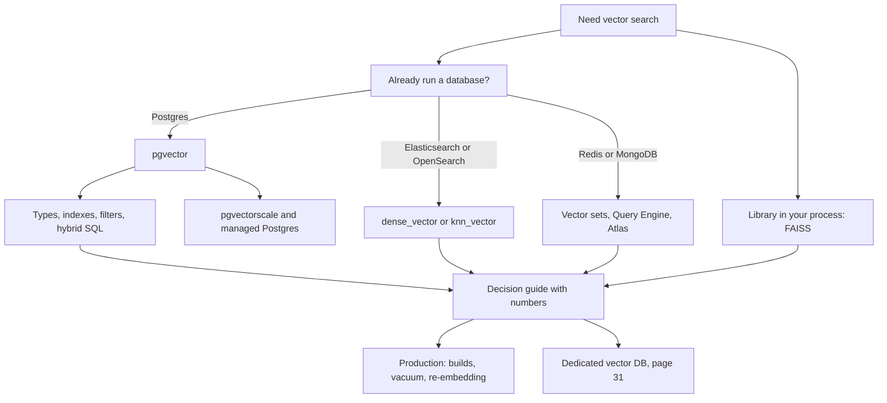

## ⭐ Vector search as a feature, not a product

**In one line:** a vector index is just another index type; if your database already has it, you get vector search with the same backups, permissions, transactions and joins you already trust.

**Why it exists:** a separate vector DB means a second copy of your data. You need a sync pipeline, a second backup plan, a second access-control model and a way to handle the two copies drifting apart. For many products, the vectors are small compared with the rest of the data, and that extra system costs more than it gives.

**Picture it:** a kirana shop adds a UPI QR code on the counter. It does not open a second shop for digital payments. Only when the volume gets huge does it make sense to get a separate billing setup.

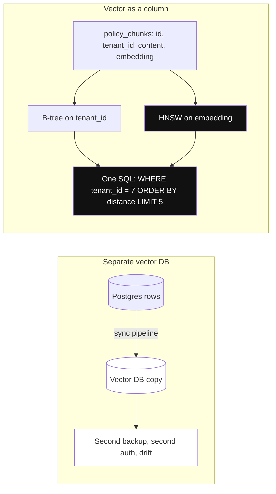

*Diagram:* Left: a second copy of the data to sync, back up and secure. Right: the vector is just another column with its own index, used in the same SQL as the tenant filter.

**How it works, step by step:**
1. You add a vector column (or field) next to your normal columns, for example `embedding vector(1536)` on a `policy_chunks` table.
2. You build an ANN index on that column, the same way you build a B-tree index on `email`.
3. A query mixes normal conditions and vector order: `WHERE tenant_id = 7 ORDER BY embedding <=> $1 LIMIT 5`.
4. The database's planner decides how to run it, just like any other query.
5. Size check: 2 million chunks × 1536 dims × 4 bytes ≈ 12 GB of raw vectors. A normal Postgres box with 32–64 GB RAM handles that.

| Where vector search lives | Examples | You get for free | You give up |
|---|---|---|---|
| Inside your existing DB | pgvector, Elasticsearch, OpenSearch, Redis, MongoDB Atlas | one copy of data, transactions or same consistency, joins, existing ops | peak scale, some vector-specific features |
| Library in your process | FAISS, hnswlib, ScaNN | fastest raw speed, full control | persistence, filtering, updates, replication: you build them |
| Dedicated vector DB | Pinecone, Qdrant, Milvus, Weaviate | scale, tuned filtered ANN, multi-tenancy | a second system to sync and run |

**Interview tip:** "Which vector DB would you use?" Say: "First, how many vectors, how many queries per second, and what do we already run? If it is Postgres and under roughly 10 million vectors, I start with pgvector."

**Common mistake:**
- Picking a dedicated vector DB before computing the corpus size. 50,000 FAQ chunks is about 300 MB of vectors.

## ⭐ pgvector types: vector, halfvec, sparsevec, bit

**In one line:** pgvector gives four column types: full-precision floats, half-precision floats, sparse vectors and bit vectors, each trading memory for accuracy differently.

**Why it exists:** one size does not fit all. A 3072-dim model in `vector` is too big to index (limit 2000 dims). Learned sparse models like SPLADE produce vectors that are mostly zeros. Binary vectors are 32 times smaller. Each type matches one of these needs.

**Picture it:** storing photos. RAW files (`vector`), high-quality JPEG (`halfvec`), a list of only the non-empty pixels (`sparsevec`), and a black-and-white thumbnail (`bit`).

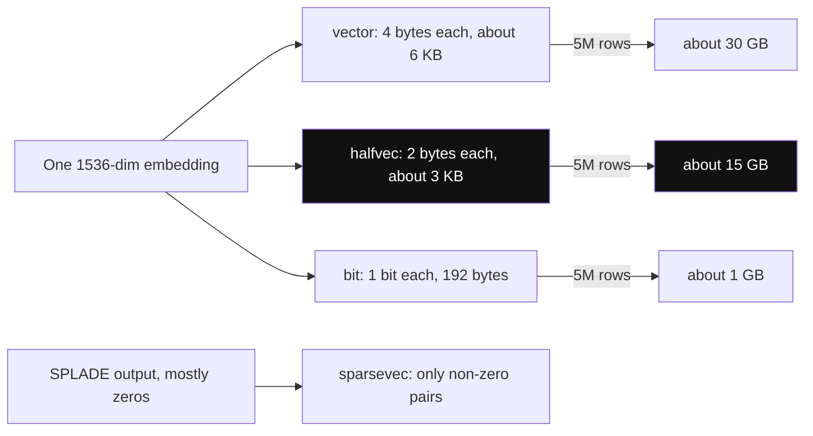

*Diagram:* The same embedding costs 6 KB, 3 KB or 192 bytes depending on the type; at 5 million rows that is 30 GB vs 15 GB vs 1 GB.

**How it works, step by step:**

| Type | Each value | Max dims to index | Bytes for 1536 dims | Use it for |
|---|---|---|---|---|
| `vector(n)` | 4-byte float | 2,000 (store up to 16,000) | ~6 KB | default, most models |
| `halfvec(n)` | 2-byte float | 4,000 | ~3 KB | big models (3072 dims), save 50% memory |
| `sparsevec(n)` | index + value pairs | 1,000 non-zero values (HNSW only) | depends on non-zeros | SPLADE / learned sparse, keyword-like vectors |
| `bit(n)` | 1 bit | 64,000 | 192 bytes | binary quantization, then re-rank |

1. Memory for 5 million chunks at 1536 dims: `vector` ≈ 30 GB, `halfvec` ≈ 15 GB, `bit` ≈ 1 GB.
2. A sparse vector is written as `'{1:0.5,42:1.2,907:0.3}/30000'`: position:value pairs, then total dimensions.
3. A bit vector is written as `'101101...'` and compared with Hamming distance (count of differing bits).
4. You can keep the column as `vector` and only index a cast to `halfvec` or `bit`. This is called an expression index (next sections).

**Interview tip:** "Our model has 3072 dims and pgvector refuses the index." Answer: "Index it as `halfvec(3072)`, which allows up to 4000 dims, or shorten the embedding with the model's `dimensions` option if it supports Matryoshka-style truncation."

**Common mistake:**
- Storing 3072-dim `vector` and finding out at index time that HNSW and IVFFlat stop at 2000 dims.

## ⭐ pgvector indexes: HNSW vs IVFFlat

**In one line:** HNSW is a layered graph with better speed and recall but slower builds and more memory; IVFFlat is clusters plus lists, faster to build and smaller, but needs data before building and gives lower recall at the same speed.

**Why it exists:** without an index, `ORDER BY embedding <=> $1 LIMIT 5` compares the query with every row. That is exact but takes seconds at 10 million rows. An index looks at a small part of the data.

**Picture it:** HNSW is like asking for directions in a new city: first a highway sign, then the area, then the lane. IVFFlat is like a library: go to the 3 shelves whose label is closest to your topic and scan only those shelves.

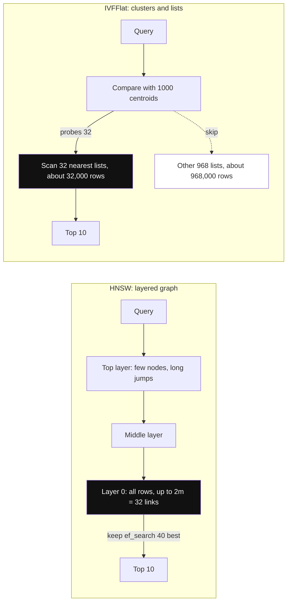

*Diagram:* HNSW narrows down layer by layer and keeps ef_search candidates; IVFFlat jumps to the probes nearest clusters and skips the rest of the 1 million rows.

**How it works, step by step:**
1. **HNSW build:** each row becomes a graph node linked to about `m` neighbours per layer (`m` default 16; layer 0 keeps up to `2 × m`). `ef_construction` (default 64) is how many candidates the builder looks at to choose those links.
2. **HNSW query:** walk the graph from the top layer down. `hnsw.ef_search` (default 40) is how many candidates the search keeps. Higher = better recall, slower.
3. **IVFFlat build:** k-means makes `lists` clusters from the rows that exist now. Rule of thumb from the pgvector docs: `lists = rows / 1000` up to 1 million rows, `sqrt(rows)` above that. So 500k rows → 500 lists; 4 million rows → 2000 lists.
4. **IVFFlat query:** scan only the `ivfflat.probes` closest lists (default 1, start near `sqrt(lists)`). Probes = lists means exact search.
5. Worked example for 1 million rows: IVFFlat with 1000 lists and 32 probes scans about 32,000 rows instead of 1,000,000.

| | HNSW | IVFFlat |
|---|---|---|
| Build knobs | `m` (16), `ef_construction` (64) | `lists` |
| Query knob | `hnsw.ef_search` (40) | `ivfflat.probes` (1) |
| Build on an empty table | yes, no training step | no, build after loading data |
| Build speed and memory | slow, needs `maintenance_work_mem` to fit the graph | fast, small |
| Recall at the same latency | higher | lower |
| New data after build | fits in naturally | clusters go stale as data drifts, rebuild sometimes |
| Default choice | yes, for most apps | very large bulk loads, tight memory, rare rebuilds |

```sql
-- HNSW for cosine distance; raise build memory first so the graph fits
SET maintenance_work_mem = '8GB';
SET max_parallel_maintenance_workers = 7;   -- plus the leader process
CREATE INDEX CONCURRENTLY policy_chunks_hnsw
    ON policy_chunks USING hnsw (embedding vector_cosine_ops)
    WITH (m = 16, ef_construction = 64);

-- IVFFlat alternative: load data first, then build
-- CREATE INDEX ON policy_chunks USING ivfflat (embedding vector_cosine_ops) WITH (lists = 1000);

-- Query-time knobs, per transaction
BEGIN;
SET LOCAL hnsw.ef_search = 100;      -- or: SET LOCAL ivfflat.probes = 32;
SELECT id FROM policy_chunks ORDER BY embedding <=> $1 LIMIT 10;
COMMIT;
```

**What the code does:**
- Gives the index build up to 8 GB and 8 processes, so the HNSW graph is built in memory and in parallel. Postgres prints a NOTICE if the graph no longer fits.
- `CONCURRENTLY` builds without blocking writes to the table, which matters on a live system.
- `vector_cosine_ops` ties the index to the `<=>` operator. A query using another operator will not use it.
- `SET LOCAL` changes `ef_search` only inside this transaction, which is safe behind a connection pooler.

**Interview tip:** "How do you tune recall in pgvector?" Answer: "Build HNSW with defaults, take 200 real queries, compute exact top-10 with the index disabled, then raise `ef_search` (40, 80, 120, 200) until recall@10 reaches the target, checking p95 latency at each step."

**Common mistake:**
- Building IVFFlat on an empty or tiny table. The clusters come from the rows present at build time, so recall is poor once real data arrives.
- Leaving `maintenance_work_mem` at its small default, so a 5-million-row HNSW build takes many hours instead of tens of minutes.

## ⭐ Distance operators and operator classes

**In one line:** each operator is one distance function, each index is built for one operator class, and the query must use the matching operator with `ORDER BY ... LIMIT` for the index to be used.

**Why it exists:** Postgres indexes are tied to operators. The planner only uses an index when the query's operator matches what the index was built for.

**Picture it:** a shop that sorts its shelves by price cannot quickly answer "sort by weight". The shelf order and the question must match.

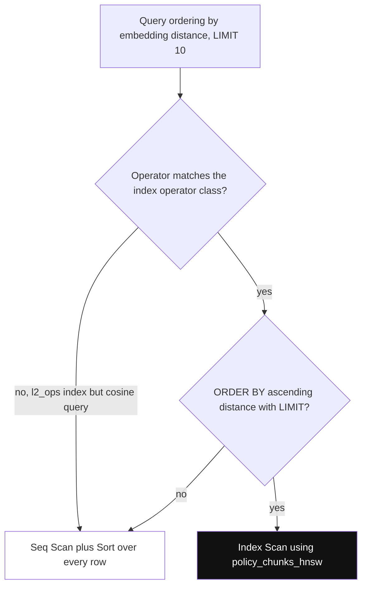

*Diagram:* Both checks must pass for the planner to use the ANN index; failing either one silently falls back to a full scan.

**How it works, step by step:**

| Operator | Distance | Index operator class (vector) | Smaller means |
|---|---|---|---|
| `<->` | L2 (Euclidean) | `vector_l2_ops` | closer |
| `<=>` | cosine distance = 1 − cosine similarity | `vector_cosine_ops` | closer |
| `<#>` | negative inner product | `vector_ip_ops` | closer (more similar) |
| `<+>` | L1 (taxicab) | `vector_l1_ops` (HNSW only) | closer |
| `<~>` | Hamming, for `bit` | `bit_hamming_ops` | fewer differing bits |
| `<%>` | Jaccard, for `bit` | `bit_jaccard_ops` | closer |

1. `halfvec` and `sparsevec` have the same classes with their own prefix: `halfvec_cosine_ops`, `sparsevec_l2_ops`, and so on.
2. `<#>` returns the **negative** inner product so that ascending order puts the best match first. Show similarity as `(embedding <#> $1) * -1`.
3. Cosine similarity for display: `1 - (embedding <=> $1)`. If the vectors are normalized (OpenAI's are), inner product is the fastest choice and ranks the same as cosine.
4. The index is used only for `ORDER BY <distance> ASC LIMIT k`. `WHERE embedding <=> $1 < 0.3` without `ORDER BY ... LIMIT` does not use it.
5. Check with `EXPLAIN`: you want `Index Scan using policy_chunks_hnsw`, not `Seq Scan` plus `Sort`.

**Interview tip:** "The query is slow even though there is an HNSW index. What do you check?" Answer: "Run `EXPLAIN`. Usually the operator does not match the operator class, the `ORDER BY` is descending or on an expression, or there is no `LIMIT`."

**Common mistake:**
- Building with `vector_l2_ops` and querying with `<=>`. You silently get a full sequential scan.

## ⭐ Filtered queries and iterative index scans

**In one line:** an HNSW scan gives back only about `ef_search` candidates, so a `WHERE` filter applied after it can leave fewer than `LIMIT` rows; iterative index scans (pgvector 0.8+) keep scanning until enough rows pass the filter.

**Why it exists:** real queries always have filters: tenant, language, country, "only active documents". Before 0.8, `WHERE country = 'IN' ... LIMIT 10` with `ef_search = 40` looked at 40 candidates. If only 10% were Indian, you got about 4 rows and no error. This is the most common pgvector bug in RAG systems.

**Picture it:** you ask a shopkeeper for 10 red shirts. He brings 40 random shirts from the shelf, finds 4 red ones and says "that's all". Iterative scan means he goes back to the shelf until he has 10 red ones or hits a limit.

**How it works, step by step:**
1. The planner picks the HNSW index, fetches `ef_search` = 40 nearest candidates, then applies `WHERE country = 'IN'`.
2. With 10% matching rows, about 4 survive. `LIMIT 10` returns 4.
3. With `SET hnsw.iterative_scan = strict_order` (exact distance order) or `relaxed_order` (faster, may be slightly out of order), the index scan resumes and fetches more candidates until 10 rows pass.
4. It stops at `hnsw.max_scan_tuples` (default 20,000 visited tuples) or `hnsw.scan_mem_multiplier` × `work_mem`, so very selective filters can still return fewer rows.
5. For IVFFlat: `SET ivfflat.iterative_scan = relaxed_order` and cap it with `ivfflat.max_probes`.
6. Other tools for filters:
   - **B-tree index on the filter column.** For a very selective filter (say 2,000 matching rows), the planner may skip HNSW and do an exact scan of those rows. That is fast and 100% recall.
   - **Partial index** per hot value: `CREATE INDEX ... USING hnsw (embedding vector_cosine_ops) WHERE country = 'IN'`.
   - **Partitioning** by tenant or region, so each partition has its own smaller index.

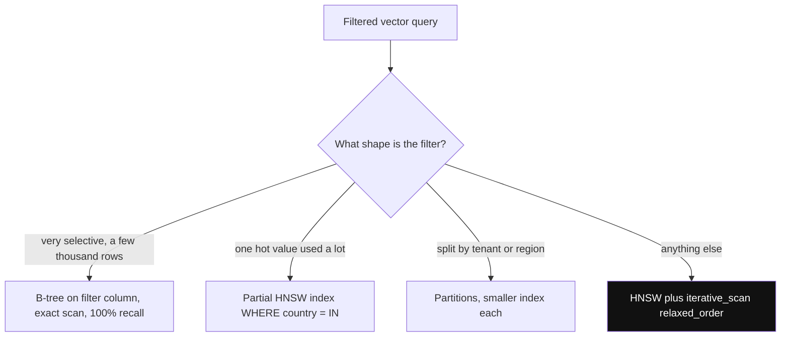

*Diagram:* Pick the filter tool by the filter's shape; iterative scan is the general default and the other three cover special cases.

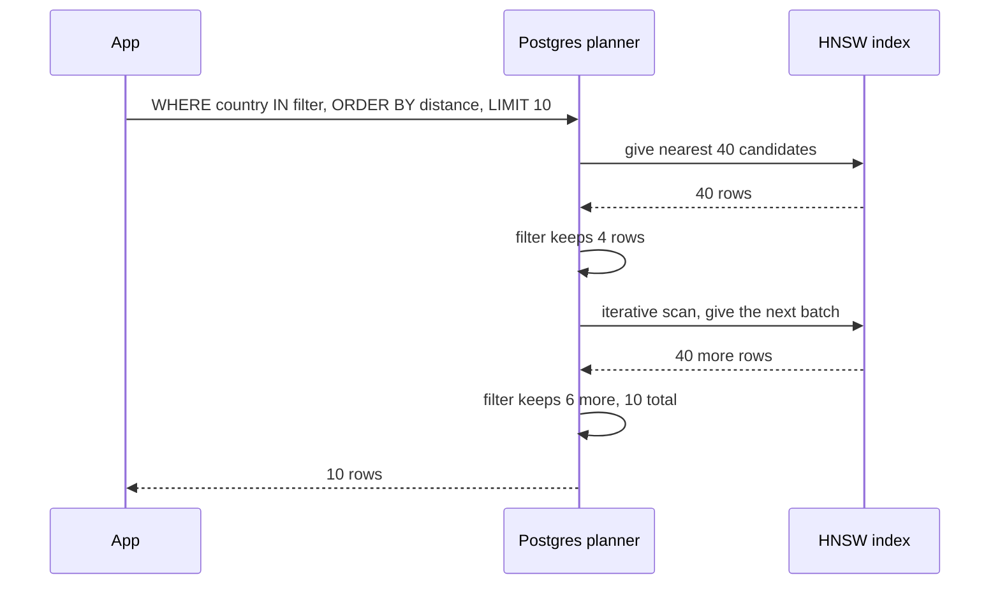

```sql
BEGIN;
SET LOCAL hnsw.iterative_scan = relaxed_order;
SET LOCAL hnsw.ef_search = 100;
-- relaxed_order can be slightly out of order, so re-sort the small result
WITH hits AS MATERIALIZED (
    SELECT id, content, embedding <=> $1 AS distance
    FROM policy_chunks
    WHERE country = 'IN' AND is_active
    ORDER BY embedding <=> $1
    LIMIT 10
)
SELECT * FROM hits ORDER BY distance;
COMMIT;
```

**What the code does:**
- Turns on iterative scan for this transaction only, so other queries keep default behaviour.
- `MATERIALIZED` stops Postgres from merging the CTE into the outer query, so the outer `ORDER BY distance` fixes the small ordering errors of `relaxed_order`.
- The filter and the vector order stay in one SQL statement. There is no post-filter code in the app.

**Interview tip:** "How do you test this?" Answer: "For each filter value, compare the row count and recall@10 with an exact scan. Track 'returned fewer than k rows' as a metric in production."

**Common mistake:**
- Fixing short results by raising `ef_search` to 1000 for every query. Latency goes up for everyone; iterative scan or a partial index is the real fix.

## Quantization in pgvector: halfvec and binary

**In one line:** keep the full vectors in the table, but index a smaller copy (`halfvec` = half the size, `bit` = 1/32 the size), then re-rank the top candidates with the full vectors.

**Why it exists:** HNSW is fast only when the index is in RAM. 20 million × 1536 floats = 123 GB. Quantization can bring the hot index down to 61 GB (`halfvec`) or about 4 GB (`bit`).

**Picture it:** first sort exam papers by the total on the cover page (quick, rough). Then carefully re-check only the top 50 papers.


*Diagram:* The rough pass searches tiny 192-byte codes; the exact pass reads full vectors for only 40 rows, which brings the recall back.

**How it works, step by step:**
1. **Half precision:** index `embedding::halfvec(1536)`. Recall barely changes for most text models, and memory halves.
2. **Binary quantization:** `binary_quantize(embedding)` turns each positive number into 1 and each other number into 0. 1536 dims → 192 bytes.
3. Binary alone loses a lot of recall. So fetch about 4–10 times more candidates (say 40 for a final 5) with Hamming distance, then re-sort them with the exact `<=>` on the real column.
4. Binary works best for models with many dims (1024+). With 384 dims, 1 bit per dim is often too rough.
5. Always measure recall@10 against exact search on your own data before you ship.

```sql
-- Half-precision expression index; the query must use the same cast
CREATE INDEX ON policy_chunks USING hnsw ((embedding::halfvec(1536)) halfvec_cosine_ops);
SELECT id FROM policy_chunks ORDER BY embedding::halfvec(1536) <=> $1::halfvec(1536) LIMIT 5;

-- Binary quantization index plus exact re-rank
CREATE INDEX ON policy_chunks USING hnsw ((binary_quantize(embedding)::bit(1536)) bit_hamming_ops);
SELECT id, content FROM (
    SELECT id, content, embedding FROM policy_chunks
    ORDER BY binary_quantize(embedding)::bit(1536) <~> binary_quantize($1)
    LIMIT 40                                 -- over-fetch with the rough distance
) candidates
ORDER BY embedding <=> $1                    -- exact distance on 40 rows only
LIMIT 5;
```

**What the code does:**
- The table keeps full `vector(1536)` values; only the index stores the smaller version.
- The query's expression must match the index expression exactly, or the index is not used.
- The inner query is the fast rough pass; the outer `ORDER BY` is the exact re-rank on 40 rows, which costs almost nothing.

**Interview tip:** "Binary quantization with re-ranking keeps most of the recall at about 3% of the memory. The trade is more candidates per query and a read of the full vectors for the re-rank."

**Common mistake:**
- Shipping binary quantization without the re-rank step and blaming the model for bad results.

## ⭐ Hybrid search in Postgres: tsvector plus vectors with RRF

**In one line:** run a full-text search and a vector search in the same SQL statement and merge them with Reciprocal Rank Fusion, so exact words (policy codes, names) and meaning both count.

**Why it exists:** vectors miss exact tokens like `LTA-2024`, `Form 16` or an employee ID. Keyword search misses paraphrases like "time off after a baby" versus "maternity leave". [Hybrid Search](../09-rag/04-hybrid-search.md) explains the theory; here it is in pure Postgres.

**Picture it:** two shop assistants search the store, one by product label, one by "what you meant". You trust items that both bring back.

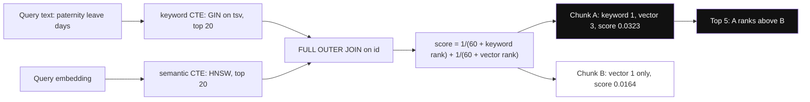

*Diagram:* Two indexes rank independently and only the ranks are fused, so a chunk both sides agree on (A) beats one that tops a single list (B).

**How it works, step by step:**
1. Add a generated `tsvector` column and a GIN index on it. Postgres keeps it updated on every insert and update.
2. Semantic CTE: top 20 by `embedding <=> $1`, with `RANK()` as its rank.
3. Keyword CTE: top 20 by `ts_rank_cd(tsv, query)` where `tsv @@ query`.
4. `FULL OUTER JOIN` the two lists on `id` and score each row `1/(60 + rank)` from each list where it appears.
5. Worked example: a chunk ranked 1st in keyword and 3rd in vector scores 1/61 + 1/63 ≈ 0.0323. A chunk only 1st in vector scores 1/61 ≈ 0.0164. Agreement wins.
6. Note: `ts_rank_cd` is not true BM25. If keyword quality matters a lot, extensions such as ParadeDB's `pg_search` add a BM25 index to Postgres.

```sql
ALTER TABLE policy_chunks
    ADD COLUMN tsv tsvector GENERATED ALWAYS AS (to_tsvector('english', content)) STORED;
CREATE INDEX ON policy_chunks USING gin (tsv);

-- $1 = query embedding, $2 = query text
WITH semantic AS (
    SELECT id, RANK() OVER (ORDER BY embedding <=> $1) AS rank
    FROM policy_chunks
    ORDER BY embedding <=> $1
    LIMIT 20
),
keyword AS (
    SELECT id, RANK() OVER (ORDER BY ts_rank_cd(tsv, q) DESC) AS rank
    FROM policy_chunks, plainto_tsquery('english', $2) AS q
    WHERE tsv @@ q
    ORDER BY ts_rank_cd(tsv, q) DESC
    LIMIT 20
)
SELECT COALESCE(s.id, k.id) AS id,
       COALESCE(1.0 / (60 + s.rank), 0) + COALESCE(1.0 / (60 + k.rank), 0) AS rrf_score
FROM semantic s
FULL OUTER JOIN keyword k ON s.id = k.id
ORDER BY rrf_score DESC
LIMIT 5;
```

**What the code does:**
- The generated column means the app never has to remember to update the text index.
- Each CTE uses its own index: HNSW for the vector part, GIN for the keyword part.
- `FULL OUTER JOIN` keeps rows found by only one side; `COALESCE(..., 0)` gives the missing side zero score.
- Only ranks are used, so the different scales of cosine distance and `ts_rank_cd` never get mixed.

**Interview tip:** "Hybrid in Postgres is one SQL statement with two CTEs and RRF. One round trip, one transaction snapshot, and both sides see the same filters and permissions."

**Common mistake:**
- Adding `ts_rank_cd` and cosine similarity directly. Their scales differ; use ranks (RRF).
- Using the `'english'` config for Hinglish or Hindi text and wondering why stemming is odd. Use `'simple'` for mixed-language text.

## ⭐ A complete small app: HR policy search with psycopg

**In one line:** an HR policy bot for a Bengaluru company that stores policy chunks in Postgres and answers "how many days of paternity leave?" with filtered vector search.

**Why it exists:** this ties the sections together: schema, bulk insert, index, a filtered query with iterative scan, and safe per-transaction settings.

**Picture it:** the HR team's handbook, cut into paragraphs, each paragraph tagged with country and with its "meaning numbers" stored next to it.

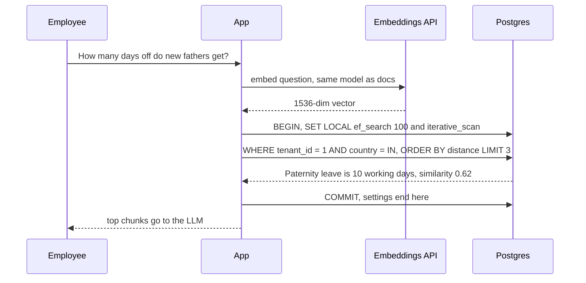

*Diagram:* One request: embed with the same model, then a filtered query inside a transaction so the SET LOCAL tuning ends at COMMIT.

**How it works, step by step:**
1. Create the table once, with tenant and country columns for filters.
2. Embed chunks in batches and insert them.
3. Build the HNSW index after the first bulk load (faster than growing it row by row).
4. At query time, embed the question, run the filtered query, return the top chunks to the LLM.

```python
# pip install "psycopg[binary]" pgvector numpy openai
import numpy as np
import psycopg
from pgvector.psycopg import register_vector
from openai import OpenAI

client = OpenAI()
conn = psycopg.connect("postgresql://app@localhost/hr", autocommit=True)
conn.execute("CREATE EXTENSION IF NOT EXISTS vector")
register_vector(conn)                      # lets psycopg send numpy arrays as vector

conn.execute("""
CREATE TABLE IF NOT EXISTS policy_chunks (
    id         bigserial PRIMARY KEY,
    tenant_id  int  NOT NULL,
    country    text NOT NULL,
    content    text NOT NULL,
    embedding  vector(1536) NOT NULL,
    model      text NOT NULL DEFAULT 'text-embedding-3-small'
)""")

def embed(texts: list[str]) -> list[np.ndarray]:
    resp = client.embeddings.create(model="text-embedding-3-small", input=texts)
    return [np.array(d.embedding, dtype=np.float32) for d in resp.data]
```

**What the code does:**
- `register_vector(conn)` teaches psycopg 3 how to send and read the `vector` type; it must run after the extension exists.
- The `model` column records which embedding model made each vector, which you need later for migrations.
- `embed` takes a batch of texts in one API call, which is much cheaper than one call per chunk.

```python
chunks = [
    (1, "IN", "Paternity leave is 10 working days, to be taken within 6 months of birth."),
    (1, "IN", "Maternity leave is 26 weeks as per the Maternity Benefit Act."),
    (1, "SG", "Childcare leave in Singapore is 6 days per year."),
]
vectors = embed([c[2] for c in chunks])
with conn.cursor() as cur:
    cur.executemany(
        "INSERT INTO policy_chunks (tenant_id, country, content, embedding) VALUES (%s, %s, %s, %s)",
        [(t, c, text, v) for (t, c, text), v in zip(chunks, vectors)],
    )
conn.execute("SET maintenance_work_mem = '2GB'")
conn.execute("CREATE INDEX IF NOT EXISTS policy_hnsw ON policy_chunks "
              "USING hnsw (embedding vector_cosine_ops)")
conn.execute("CREATE INDEX IF NOT EXISTS policy_filter ON policy_chunks (tenant_id, country)")
```

**What the code does:**
- Inserts all chunks in one batch with `executemany`; for millions of rows use `COPY ... WITH (FORMAT BINARY)`, which pgvector-python also supports.
- Builds HNSW after the bulk load, and a B-tree on the filter columns so the planner can choose an exact scan when the filter is very selective.

```python
def search(question: str, tenant_id: int, country: str, k: int = 3):
    qvec = embed([question])[0]
    with conn.transaction():               # SET LOCAL lasts only for this transaction
        conn.execute("SET LOCAL hnsw.ef_search = 100")
        conn.execute("SET LOCAL hnsw.iterative_scan = relaxed_order")
        rows = conn.execute("""
            WITH hits AS MATERIALIZED (
                SELECT content, embedding <=> %(q)s AS dist
                FROM policy_chunks
                WHERE tenant_id = %(t)s AND country = %(c)s
                ORDER BY embedding <=> %(q)s
                LIMIT %(k)s)
            SELECT content, 1 - dist AS similarity FROM hits ORDER BY dist
        """, {"q": qvec, "t": tenant_id, "c": country, "k": k}).fetchall()
    return rows

for content, sim in search("How many days off do new fathers get?", 1, "IN"):
    print(f"{sim:.3f}  {content}")
```

**What the code does:**
- Embeds the question with the same model used for the documents. Mixing models breaks the distances.
- `conn.transaction()` with `SET LOCAL` keeps the tuning settings from leaking to other requests on the same pooled connection.
- The tenant filter is in SQL, so one tenant can never see another tenant's chunks, even by bug in the app's post-processing.
- Returns similarity (1 − cosine distance) so the app can drop weak matches, say below 0.3, before calling the LLM.

**Interview tip:** "Why `SET LOCAL` and not `SET`?" Answer: "Behind PgBouncer in transaction mode, a plain `SET` sticks to a server connection and leaks into other users' queries. `SET LOCAL` ends with the transaction."

**Common mistake:**
- Calling `register_vector` before `CREATE EXTENSION`. It fails because the `vector` type does not exist yet.

## pgvectorscale: StreamingDiskANN for bigger data

**In one line:** pgvectorscale is an extra Postgres extension (from Timescale, now Tiger Data) that adds a `diskann` index built for SSDs with compressed vectors, so pgvector-typed data can scale past what fits in RAM.

**Why it exists:** HNSW needs its graph in RAM for good latency. At 50 million vectors that can mean hundreds of GB of memory. DiskANN-style graphs are designed so most reads go to SSD, with a small compressed copy in memory.

**Picture it:** instead of keeping every file on your desk (RAM), you keep a one-line summary of each file on the desk and fetch the full file from the cupboard (SSD) only for the final shortlist.

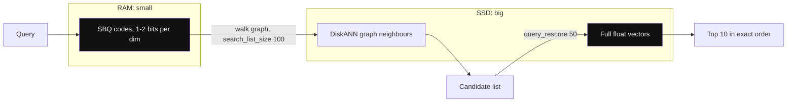

*Diagram:* Compressed codes guide the graph walk cheaply; only the final rescore candidates read full vectors from SSD.

**How it works, step by step:**
1. Install both `vector` and `vectorscale` extensions. The column type stays `vector`.
2. Build with `USING diskann (embedding vector_cosine_ops)`. The default `storage_layout = memory_optimized` uses Statistical Binary Quantization (SBQ), about 1–2 bits per dimension.
3. Build knobs: `num_neighbors` (default 50), `search_list_size` (default 100).
4. Query knobs: `diskann.query_search_list_size` (default 100) and `diskann.query_rescore` (default 50, how many candidates get re-scored with full vectors). Raise `query_rescore` first for more accuracy.
5. Label filtering: add a `smallint[]` labels column to the index and filter with `labels && ARRAY[1, 3]`; the filter is applied inside the graph search.
6. Its own benchmark (50 million 768-dim Cohere vectors) claims much lower p95 latency than Pinecone's storage-optimized index at 99% recall. Treat vendor benchmarks as a hint, and test on your data.

```sql
CREATE EXTENSION IF NOT EXISTS vectorscale CASCADE;
CREATE INDEX policy_diskann ON policy_chunks USING diskann (embedding vector_cosine_ops);
SET diskann.query_rescore = 200;
SELECT id FROM policy_chunks ORDER BY embedding <=> $1 LIMIT 10;
```

**Interview tip:** "Postgres can go past 10 million vectors: halfvec or binary indexes, pgvectorscale's DiskANN, partitioning, and read replicas for query load. It needs tuning work, but it is not a hard wall."

**Common mistake:**
- Assuming pgvectorscale is available on every managed Postgres. Check the provider's extension list first; many support pgvector but not pgvectorscale.

## Managed Postgres options

**In one line:** almost every managed Postgres ships pgvector; they differ in version, extra extensions and how much RAM you can buy per node.

**Why it exists:** most teams do not run Postgres by hand. The provider decides which pgvector version (and so which features, like iterative scans) you get.

**Picture it:** same recipe, different restaurant kitchens. The dish is the same, but one kitchen has a bigger oven.

**How it works, step by step:**

| Provider | Vector support | Notes |
|---|---|---|
| Amazon RDS / Aurora PostgreSQL | pgvector | Aurora Optimized Reads can use local NVMe as a cache for bigger-than-RAM indexes |
| Google Cloud SQL for PostgreSQL | pgvector | plain managed Postgres |
| Google AlloyDB | pgvector plus the ScaNN index (`alloydb_scann` extension) | Google's own ANN index inside Postgres |
| Azure Database for PostgreSQL | pgvector, DiskANN index (`pg_diskann`) | Microsoft's DiskANN inside Postgres |
| Supabase | pgvector | popular with app developers, vector helpers in its client libraries |
| Neon | pgvector | serverless Postgres with branching, scale to zero |
| Timescale / Tiger Cloud | pgvector plus pgvectorscale | the home of pgvectorscale |

1. Check `SELECT extversion FROM pg_extension WHERE extname = 'vector';`. Iterative scans need 0.8.0 or newer.
2. Check the max RAM per instance. The HNSW index should fit in shared buffers plus the OS page cache.
3. Check whether `maintenance_work_mem` and parallel workers can be raised on that plan.

**Interview tip:** "On managed Postgres, my first questions are: pgvector version, RAM per node, and whether custom index extensions like pgvectorscale or ScaNN are allowed."

**Common mistake:**
- Designing around iterative scans while the provider still runs pgvector 0.7.

## ⭐ Elasticsearch and OpenSearch: dense_vector and knn_vector

**In one line:** if you already run Elasticsearch or OpenSearch for keyword search, add a vector field to the same index and get BM25 plus kNN hybrid search with filters in one query.

**Why it exists:** search teams already have the cluster, the sync pipeline from the main DB, analyzers and dashboards. Adding a vector field avoids a second retrieval system, and BM25 there is the real thing (better than Postgres `ts_rank`). See [Search with Elasticsearch](../05-db/08-search.md) for the basics.

**Picture it:** a big library with a great catalogue (BM25) adds a "find similar books" desk in the same building.

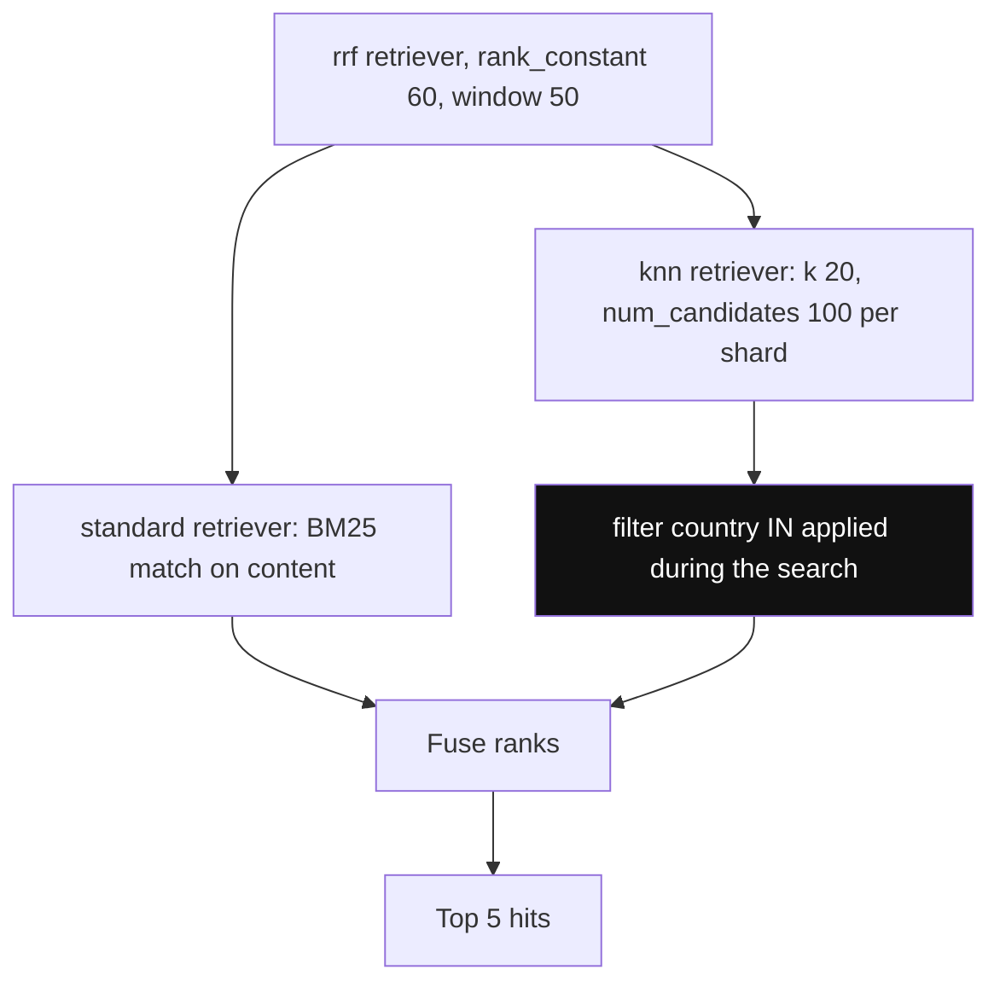

*Diagram:* One request runs BM25 and kNN side by side on the same index and fuses their ranks; the filter sits inside knn, so it is a pre-filter.

**How it works, step by step:**
1. **Elasticsearch:** map a `dense_vector` field with `dims`, `similarity` and `index_options`. In 9.x vectors are quantized by default: `int8_hnsw` for smaller dims and `bbq_hnsw` (Better Binary Quantization, 1 bit per dim plus re-scoring) for 384+ dims since 9.1. Newer releases add disk-friendly `bbq_disk` on higher licence tiers.
2. Query with a `knn` retriever: `k` (results) and `num_candidates` (candidates per shard; the recall knob, like `ef_search`). Filters go inside `knn.filter` so they are applied during the search, not after.
3. Hybrid: an `rrf` retriever wraps a `standard` (BM25) retriever and a `knn` retriever. A `linear` retriever does weighted score fusion instead. Check your licence tier for RRF.
4. **OpenSearch:** set `index.knn: true` and map a `knn_vector` with `dimension`, `space_type` and a `method` (HNSW or IVF) on the `faiss` or `lucene` engine. `nmslib` is deprecated.
5. OpenSearch memory saving: `mode: on_disk` with `compression_level` (up to `32x`), which keeps compressed vectors in memory and re-scores from disk.
6. OpenSearch hybrid: a `hybrid` query plus a search pipeline that normalizes and combines scores (`normalization-processor`), or RRF via the `score-ranker-processor`.
7. Cost note: HNSW graphs live per Lucene segment, so heavy updates cause segment merges that rebuild graphs and use a lot of CPU.

```json
PUT hr-policies
{
  "mappings": {
    "properties": {
      "content":   { "type": "text" },
      "country":   { "type": "keyword" },
      "embedding": { "type": "dense_vector", "dims": 1536, "similarity": "cosine",
                     "index_options": { "type": "bbq_hnsw" } }
    }
  }
}

GET hr-policies/_search
{
  "size": 5,
  "retriever": {
    "rrf": {
      "retrievers": [
        { "standard": { "query": { "match": { "content": "paternity leave days" } } } },
        { "knn": { "field": "embedding", "query_vector": [0.012, -0.044, 0.031],
                   "k": 20, "num_candidates": 100,
                   "filter": { "term": { "country": "IN" } } } }
      ],
      "rank_window_size": 50,
      "rank_constant": 60
    }
  }
}
```

**What the code does:**
- One index holds text, a keyword filter field and the vector; `bbq_hnsw` keeps a 1-bit copy for the graph and re-scores with the full floats.
- The `rrf` retriever runs BM25 and kNN, then fuses ranks with `rank_constant` 60, the same RRF formula as the SQL version.
- The `filter` inside `knn` is a pre-filter, so you still get `k` results for a selective filter.
- The query vector is shortened here; in real use it has 1536 numbers.

**Interview tip:** "We already run Elasticsearch for catalogue search. I would add a `dense_vector` field, backfill embeddings through the existing indexing pipeline, and use the RRF retriever. No new datastore."

**Common mistake:**
- Setting `num_candidates` equal to `k`. Recall drops; start with `num_candidates` around 5–10 × `k`.
- Changing `index_options` on a live index and expecting old segments to change. Only new segments change; reindex to convert everything.

## Redis, MongoDB Atlas and others

**In one line:** Redis gives in-memory vector search for very low latency (semantic caching, session memory); MongoDB Atlas adds `$vectorSearch` next to your documents; many other databases now have a vector type too.

**Why it exists:** teams want vectors where their app data already lives. A Mongo-first app does not want to sync to Postgres just for vectors.

**Picture it:** every big app store now has a "UPI" option. You use the one already in your phone.

**How it works, step by step:**

**Redis.**
1. **Redis Query Engine** (the former RediSearch, built into Redis 8): `FT.CREATE` an index on hashes or JSON with a `VECTOR` field using `FLAT`, `HNSW` or (Redis 8.2+) `SVS-VAMANA` with compression. Query with `KNN` plus tag or numeric filters in `FT.SEARCH`.
2. **Vector sets** (new native type in Redis 8): `VADD` adds an element with its vector, `VSIM` finds similar ones. Vectors are stored with 8-bit quantization by default. Attributes set with `SETATTR` can be filtered with `FILTER`.
3. Everything lives in RAM: great for a semantic cache of LLM answers (thousands to a few million entries), costly for 100 million vectors.

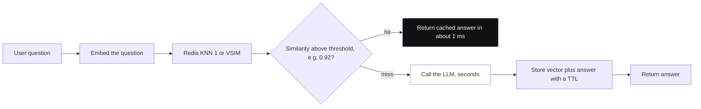

*Diagram:* As a semantic cache Redis sits in front of the LLM: a close-enough old question returns its stored answer in about a millisecond, and only misses pay for the LLM.

```bash
# Redis Query Engine: index hashes with prefix faq:
FT.CREATE faq_idx ON HASH PREFIX 1 faq: SCHEMA lang TAG embedding VECTOR HNSW 6 TYPE FLOAT32 DIM 1536 DISTANCE_METRIC COSINE
FT.SEARCH faq_idx "(@lang:{hi})=>[KNN 5 @embedding $vec AS score]" PARAMS 2 vec "<1536 float32 bytes>" SORTBY score DIALECT 2

# Vector sets: 3-dim toy vectors to show the commands
VADD faq:vs VALUES 3 0.12 0.80 0.31 faq:17 SETATTR '{"lang":"hi"}'
VSIM faq:vs VALUES 3 0.10 0.79 0.30 COUNT 5 WITHSCORES FILTER '.lang == "hi"'
```

**MongoDB Atlas Vector Search.**
1. Create a search index of `type: "vectorSearch"` with a `vector` field (`numDimensions`, `similarity`, optional `quantization: "scalar"` or `"binary"`) and `filter` fields.
2. Query with the `$vectorSearch` aggregation stage: `queryVector`, `numCandidates` (the recall knob), `limit`, and a `filter` on pre-declared filter fields.
3. It runs on separate search nodes in Atlas, so vector load does not hurt the main database. Self-managed Community and Enterprise editions have been getting search and vector search too (preview since 2025).

```javascript
db.policies.createSearchIndex({
  name: "policy_vec", type: "vectorSearch",
  definition: { fields: [
    { type: "vector", path: "embedding", numDimensions: 1536, similarity: "cosine", quantization: "scalar" },
    { type: "filter", path: "country" }
  ] }
});
db.policies.aggregate([
  { $vectorSearch: { index: "policy_vec", path: "embedding", queryVector: qvec,
                     numCandidates: 150, limit: 5, filter: { country: "IN" } } },
  { $project: { content: 1, score: { $meta: "vectorSearchScore" } } }
]);
```

**What the code does:**
- Redis: the index watches every hash under `faq:`; the query mixes a tag filter with KNN 5 and sorts by distance.
- Vector sets: one key holds the whole set; `VSIM` returns the 5 closest elements whose attribute `lang` is `hi`.
- Mongo: `country` must be declared as a `filter` field in the index before it can be used in `$vectorSearch.filter`.

**Other databases, briefly:**

| Database | Vector support | Good fit |
|---|---|---|
| SQLite + `sqlite-vec` | `vec0` virtual table, mostly brute-force search | mobile, desktop, edge, local agents |
| ClickHouse | vector similarity index (HNSW), GA in 25.8, with bf16/int8/binary quantization | vector search over analytics and log tables |
| Oracle Database 23ai / 26ai | `VECTOR` type with in-memory and partition-based indexes | Oracle shops |
| SQL Server 2025 / Azure SQL | `VECTOR` type, DiskANN index | Microsoft shops |
| Cassandra / DataStax Astra | vector type with SAI (storage-attached index) | already on Cassandra |
| DuckDB `vss` | HNSW extension | notebooks and local analysis |

**Interview tip:** "For an LLM semantic cache I'd pick Redis: sub-millisecond lookups, TTLs built in, and the data is small. For the main RAG corpus I'd use the primary database or a vector DB."

**Common mistake:**
- Putting 50 million vectors in Redis and then paying for 300+ GB of RAM.
- Filtering in Mongo on a field not declared as `filter` in the vector index; the query errors out.

## FAISS and other libraries: not a database

**In one line:** FAISS is a fast C++ library (with Python bindings) for building ANN indexes in your own process; it gives you search, and you build persistence, filtering, updates and serving yourself.

**Why it exists:** sometimes you want raw speed with no network hop: offline batch jobs, deduplication of 100 million images, research, or the engine inside a bigger system (several vector DBs use FAISS or similar code inside).

**Picture it:** FAISS is a car engine. A vector DB is the whole car with seats, brakes and insurance.

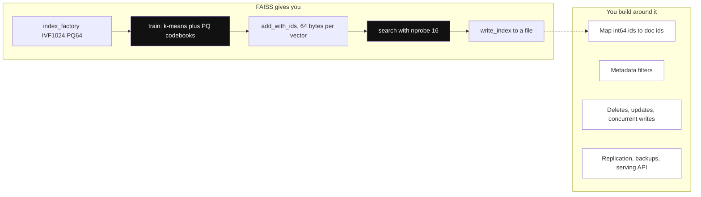

*Diagram:* FAISS covers the index pipeline from train to search; everything that makes it a database is the dimmed box you must build yourself.

**How it works, step by step:**

| FAISS index | Idea | Memory per 768-dim vector | Use it for |
|---|---|---|---|
| `IndexFlatL2` / `IndexFlatIP` | exact, compare with all | 3 KB | < 1 million, ground truth for recall |
| `IndexHNSWFlat` | HNSW graph | 3 KB + links | fast, high recall, fits in RAM |
| `IndexIVFFlat` | clusters, scan `nprobe` lists | 3 KB | fast build, needs `train()` |
| `IndexIVFPQ` | clusters plus product quantization | e.g. 64 bytes | 100 million to billions |

1. Build from a factory string like `"IVF1024,PQ64"`: 1024 clusters, each vector compressed to 64 bytes.
2. IVF and PQ indexes need `train()` on a sample (at least ~40 × number of clusters vectors).
3. GPU: the `faiss-gpu` build (now with NVIDIA cuVS support) builds and searches 10–100 × faster for large batches.
4. What you must build yourself: saving and loading (`write_index` / `read_index`), mapping FAISS integer IDs to your document IDs, metadata filtering (FAISS has only basic ID selectors), deletes (`remove_ids` is costly or not supported on some index types, HNSW included), concurrent writes, replication and backups.
5. Cousins: **hnswlib** (a small, fast HNSW-only library) and Google's **ScaNN** (anisotropic quantization, very fast on CPU, also inside AlloyDB).

```python
import faiss, numpy as np

d = 768
xb = np.random.rand(100_000, d).astype("float32")   # stand-in for real embeddings
faiss.normalize_L2(xb)                              # cosine = inner product on unit vectors
index = faiss.index_factory(d, "IVF1024,PQ64", faiss.METRIC_INNER_PRODUCT)
index.train(xb)                                     # learn clusters and PQ codebooks
index.add_with_ids(xb, np.arange(len(xb)))          # your own int64 IDs
index.nprobe = 16                                   # lists to scan per query

xq = xb[:5]
scores, ids = index.search(xq, 10)                  # top 10 per query
faiss.write_index(index, "policies.faiss")          # persistence is on you
```

**What the code does:**
- Normalizes vectors so inner product equals cosine similarity.
- Trains 1024 clusters and PQ codebooks, then adds 100k vectors at about 64 bytes each (about 6 MB instead of 300 MB).
- `nprobe` is the recall knob, like `ivfflat.probes`.
- Writes the index to a file. Reloading, syncing new docs and filtering are your code.

**Interview tip:** "FAISS is the right answer for offline or batch similarity, or as an engine. For an online, multi-tenant, filtered, frequently updated workload I would not hand-build a database around it."

**Common mistake:**
- Running FAISS inside each web server and rebuilding on deploy. Every pod holds its own copy, updates are lost on restart, and pods disagree.

## ⭐ Do I need a dedicated vector DB? A decision guide

**In one line:** start with what you already run; move to a dedicated vector DB only when scale, query load, filtering or multi-tenancy measurably outgrow it.

**Why it exists:** this is the real interview question behind "which vector DB". Senior answers use numbers, not brand names.

**Picture it:** you do not buy a truck to move one sofa. You rent a tempo when the move gets big enough, and you know roughly where that point is.

**How it works, step by step:**
1. **Count vectors.** Chunks × versions × tenants. Example: 200k documents × 15 chunks = 3 million vectors.
2. **Compute memory.** 3 million × 1536 × 4 bytes ≈ 18 GB raw; HNSW index roughly the same again. `halfvec` halves both.
3. **Estimate QPS and p95 target.** 50 QPS at p95 < 100 ms is easy for one Postgres; 5,000 QPS at p95 < 20 ms is not.
4. **Check filters.** Few, broad filters are fine everywhere. Many tenants with tiny slices or very selective filters favour engines with filter-aware graphs.
5. **Check write churn.** Re-embedding millions of rows daily hurts Postgres (MVCC bloat, vacuum) and Lucene (merges).
6. Pick with the table below, then benchmark recall and latency on your own data.

| Situation (rough numbers) | Good default |
|---|---|
| Under ~100k vectors, read-mostly | in-memory NumPy or FAISS flat, or pgvector without an index |
| Under ~5–10 million vectors, Postgres already in the stack | ⭐ pgvector with HNSW |
| ~10–50 million, Postgres team, moderate QPS | pgvector with `halfvec`/binary indexes, pgvectorscale, partitioning, replicas |
| Already on Elasticsearch / OpenSearch for search | their kNN field plus RRF hybrid |
| Mongo-first app | Atlas Vector Search |
| Semantic cache or session memory, small and hot | Redis |
| Offline batch, dedup, research | FAISS (GPU if large) |
| 50–100 million+ vectors, thousands of QPS, heavy filtering, thousands of tenants, or no DB team | dedicated vector DB ([page 31](31-vector-databases.md)) |

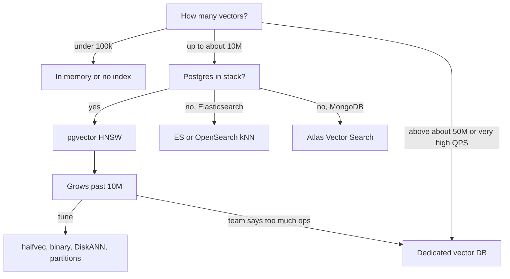

| | pgvector | Elasticsearch / OpenSearch | Redis | MongoDB Atlas | Dedicated (Qdrant, Pinecone, Milvus) | FAISS |
|---|---|---|---|---|---|---|
| Consistency with app data | same transaction | near real time (refresh ~1 s) | immediate, in RAM | eventually consistent search nodes | separate copy | your code |
| Hybrid keyword + vector | `tsvector` + RRF in SQL | best BM25, built-in RRF | text + vector in Query Engine | `$rankFusion` / combine stages | built-in in most | no |
| Filtered ANN | iterative scan, partial indexes | pre-filter in kNN | tag/numeric pre-filter | declared filter fields | strong, filter-aware graphs | ID selectors only |
| Comfortable scale per node | ~10–50M | tens to hundreds of millions per cluster | RAM-bound | cluster tiers | billions (distributed) | billions (single process, PQ) |
| Ops cost if already running | almost zero | low | low | low | new system | you build the system |

**Interview tip:** "At 3 million chunks with Postgres already in the stack, pgvector HNSW: 18 GB of vectors fits on a 64 GB instance, and we keep joins, ACID and one backup. I'd revisit at roughly 50 million vectors, or if p95 at peak QPS breaks the SLO even after replicas."

**Common mistake:**
- Saying "Postgres can't do vector search at scale" without numbers. Many products run tens of millions of vectors on pgvector.
- The opposite: forcing billions of vectors into one Postgres node because "we only use Postgres".

## ⭐ Production concerns

**In one line:** the hard part is not the first query; it is index build time and memory, updates and vacuum, re-embedding migrations, and filter-plus-ANN recall that quietly drops.

**Why it exists:** demos have 10,000 rows and no updates. Production has 20 million rows, daily document edits, a new embedding model every year, and tenants with very different sizes.

**Picture it:** opening a restaurant is easy. Running it daily with deliveries, cleaning and menu changes is the real work.

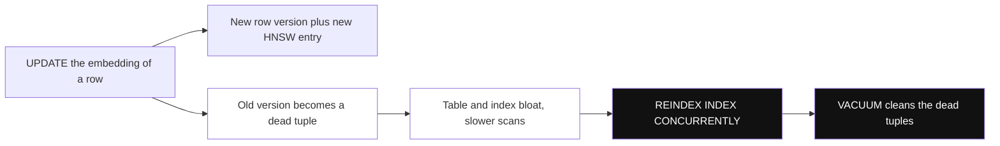

*Diagram:* Every update leaves a dead version behind in Postgres; with many changed rows, reindex first and then vacuum, as step 3 below explains.

**How it works, step by step:**
1. **Index build time and memory.** HNSW build on 10 million × 1536 can take hours. Give `maintenance_work_mem` enough RAM for the graph, use parallel workers, build after bulk loads, and use `CREATE INDEX CONCURRENTLY` on live tables. Building on a replica-sized test box first tells you the time.
2. **RAM sizing.** Keep the HNSW index in memory: check its size with `pg_relation_size('policy_hnsw')`. If index + hot data > RAM, latency jumps from ms to tens of ms.
3. **Updates and vacuum.** An `UPDATE` in Postgres writes a new row version and a new index entry; the old one stays until VACUUM. HNSW vacuum is slow. pgvector's docs suggest `REINDEX INDEX CONCURRENTLY` first, then `VACUUM`, when many rows changed. Avoid touching the embedding column on unrelated updates (keep fast-changing fields like `view_count` in another table).
4. **Big vectors and TOAST.** A 1536-dim `vector` (~6 KB) is larger than Postgres's ~2 KB in-line limit, so it is stored out of line (TOAST). Exact scans read more pages; that is another reason to keep the ANN index in RAM.
5. **Re-embedding migration** (zero downtime):
   - add `embedding_v2 vector(1024)` and its index, built `CONCURRENTLY`;
   - backfill in batches of 1,000–10,000 rows, throttled to respect the embedding API rate limit;
   - new writes fill both columns (dual write);
   - shadow-read: run old and new queries side by side and compare recall on a labelled set;
   - switch reads with a feature flag, then drop the old column and index.
6. **Filter + ANN recall pitfalls.** Track the "returned fewer than k" rate and recall per filter value. Tenants with 0.1% of the data behave differently from the biggest tenant. Use iterative scans, partial indexes or partitions per big tenant.
7. **Connection poolers.** Use `SET LOCAL` inside transactions for `ef_search` and iterative scan settings.
8. **Monitoring.** p50/p95 latency, recall on a fixed eval set (weekly), index size vs RAM, dead tuples (`pg_stat_user_tables.n_dead_tup`), and embedding API errors in the ingest pipeline.

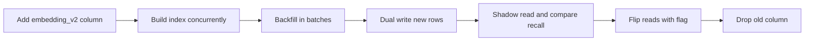

**Interview tip:** "How do you switch embedding models?" Answer: "Never in place. New column or new index, backfill in throttled batches, dual write, compare recall on a labelled set, flip reads behind a flag, then drop the old one. Old and new vectors are not comparable."

**Common mistake:**
- Running `UPDATE policy_chunks SET embedding = ...` on 20 million rows in one transaction. It doubles the table size, bloats the index and blocks vacuum for hours.

## Common pitfalls

**In one line:** most pgvector and in-database vector incidents come from a short list of repeatable mistakes.

**Why it exists:** these are the questions interviewers use to see if you have run this in production.

**Picture it:** the same five potholes on your daily route. Once you know them, you steer around them.

**How it works, step by step:**

| Pitfall | Symptom | Fix |
|---|---|---|
| Operator does not match operator class | seq scan, slow queries | same distance in index and `ORDER BY`, check `EXPLAIN` |
| Filter after HNSW scan | fewer than k rows | iterative scan, partial index, partition |
| IVFFlat built on little data | low recall later | build after loading, rebuild when data grows a lot |
| Small `maintenance_work_mem` | HNSW build takes hours | raise it for the build session |
| `SET` behind a pooler | settings leak between requests | `SET LOCAL` in a transaction |
| Different models for query and docs | random-looking results | store `model` per row, one model per index |
| Binary quantization without re-rank | sharp recall drop | over-fetch 4–10×, re-rank with full vectors |
| ES `num_candidates` too low | recall drops quietly | 5–10 × `k`, measure |
| FAISS inside every web pod | pods disagree, data lost on restart | central service or a real database |

**Interview tip:** "What would you check first if RAG answers got worse after a data load?" Answer: "Recall on the eval set, the 'fewer than k' rate, whether the index is still used (`EXPLAIN`), and whether new rows used the same embedding model."

**Common mistake:**
- Benchmarking only latency. Without recall numbers you cannot tell a fast index from a broken one.

## Interview questions

**Q: We run Postgres with 4 million chunks. Pinecone or pgvector?**
pgvector. 4 million × 1536 × 4 bytes ≈ 25 GB, which fits on one large instance with HNSW. We keep joins, transactions and one backup. I would revisit near 50 million vectors or if p95 at peak QPS misses the SLO.

**Q: HNSW vs IVFFlat in pgvector?**
HNSW gives better recall at the same latency, can be built on an empty table and handles new rows well, but builds slower and uses more memory. IVFFlat builds fast and small but needs data before building and its clusters go stale. Default to HNSW.

**Q: What do `m`, `ef_construction` and `ef_search` change?**
`m` is links per node (memory and recall), `ef_construction` is build-time search width (graph quality and build time), `ef_search` is query-time search width (recall vs latency). Only `ef_search` can change per query.

**Q: A filtered query with `LIMIT 10` returns 3 rows. Why?**
The HNSW scan returns about `ef_search` candidates and the `WHERE` removes most of them. Turn on `hnsw.iterative_scan`, add a partial index or partition for the hot filter, or let the planner do an exact scan for very selective filters.

**Q: Strict vs relaxed iterative scan?**
`strict_order` keeps exact distance order but is slower; `relaxed_order` is faster and can be slightly out of order. With relaxed, wrap the query in a `MATERIALIZED` CTE and re-sort by distance.

**Q: How do you cut vector memory by 30 times without wrecking recall?**
Index `binary_quantize(embedding)::bit(n)` with Hamming distance, over-fetch 4–10 times the candidates, and re-rank with the full vectors. Measure recall@10; it works best with 1024+ dims.

**Q: How do you do hybrid search in Postgres?**
A generated `tsvector` column with a GIN index, a semantic CTE and a keyword CTE, each with `RANK()`, then `FULL OUTER JOIN` and RRF `1/(60 + rank)`. For true BM25, use an extension like ParadeDB's `pg_search`, or Elasticsearch.

**Q: When does Postgres stop being enough?**
Roughly beyond 50–100 million vectors per node, thousands of QPS at tight p95, very high write churn, thousands of tenants with tiny filtered slices, or when the team cannot spend time on tuning. Then use a dedicated vector DB, or shard with something like Citus.

**Q: We already use Elasticsearch for product search. Add a vector DB?**
No. Add a `dense_vector` field (quantized by default in 9.x), backfill through the existing pipeline, and use the `rrf` retriever to combine BM25 and kNN, with filters inside the `knn` section.

**Q: Is FAISS a vector database?**
No, it is a library. You get index types (Flat, IVF, HNSW, PQ) and GPU support, but you build persistence, ID mapping, filtering, deletes, replication and serving yourself.

**Q: How do you migrate 20 million vectors to a new embedding model with zero downtime?**
Add a new column and index concurrently, backfill in throttled batches, dual write, shadow-compare recall, flip reads with a flag, then drop the old column. Never mix vectors from two models in one index.

**Q: Why is my pgvector query not using the index?**
Usually the operator does not match the operator class, there is no `ORDER BY distance ASC LIMIT k`, or the expression differs from an expression index (for example a missing `::halfvec` cast). `EXPLAIN` shows it.

**Q: Where would you use Redis vector search?**
A semantic cache for LLM answers or short-lived session memory: small, hot data with TTLs and sub-millisecond lookups. Not for a 100-million-vector corpus, because everything sits in RAM.

**Q: What changed recently that interviewers like to ask about?**
pgvector 0.8 added iterative index scans for filtered queries; `halfvec`, `sparsevec` and `bit` types arrived in 0.7. Elasticsearch 9.x quantizes vectors by default (BBQ). Redis 8 added native vector sets. OpenSearch deprecated the `nmslib` engine. ClickHouse made its vector index GA in 25.8.

**Q: What would you monitor for in-database vector search?**
p95 latency, recall@k on a fixed eval set, the "fewer than k rows" rate per filter, index size vs RAM, dead tuples and vacuum time, and the embedding model version of new rows.

## Read next

- [Vector Databases](../05-db/11-vector.md): embeddings, distance metrics, HNSW, IVF and PQ from scratch.
- [Vector Databases in Practice](31-vector-databases.md): Pinecone, Qdrant, Weaviate, Milvus and friends, for when you outgrow this page.
- [Hybrid Search](../09-rag/04-hybrid-search.md): BM25, sparse vectors and RRF in depth.
- [Search with Elasticsearch](../05-db/08-search.md): inverted index, analyzers and BM25 behind the ES section.

## Checklist

- [ ] I can explain when vector search inside an existing database beats a separate vector DB, with memory math
- [ ] I can choose between `vector`, `halfvec`, `sparsevec` and `bit` and state their index limits
- [ ] I can compare HNSW and IVFFlat in pgvector and tune `m`, `ef_construction`, `ef_search`, `lists` and `probes`
- [ ] I can match distance operators to operator classes and check index use with `EXPLAIN`
- [ ] I can explain why filtered queries return fewer than k rows and fix it with iterative scans, partial indexes or partitions
- [ ] I can write hybrid search in SQL with `tsvector`, two CTEs and RRF
- [ ] I can build the psycopg example: schema, batch insert, HNSW index and a filtered query with `SET LOCAL`
- [ ] I can explain Elasticsearch / OpenSearch, Redis and MongoDB vector options and FAISS as a library
- [ ] I can use the decision guide to say when to stay on Postgres and when to move to a dedicated vector DB
- [ ] I can plan a zero-downtime re-embedding migration and list the production pitfalls
