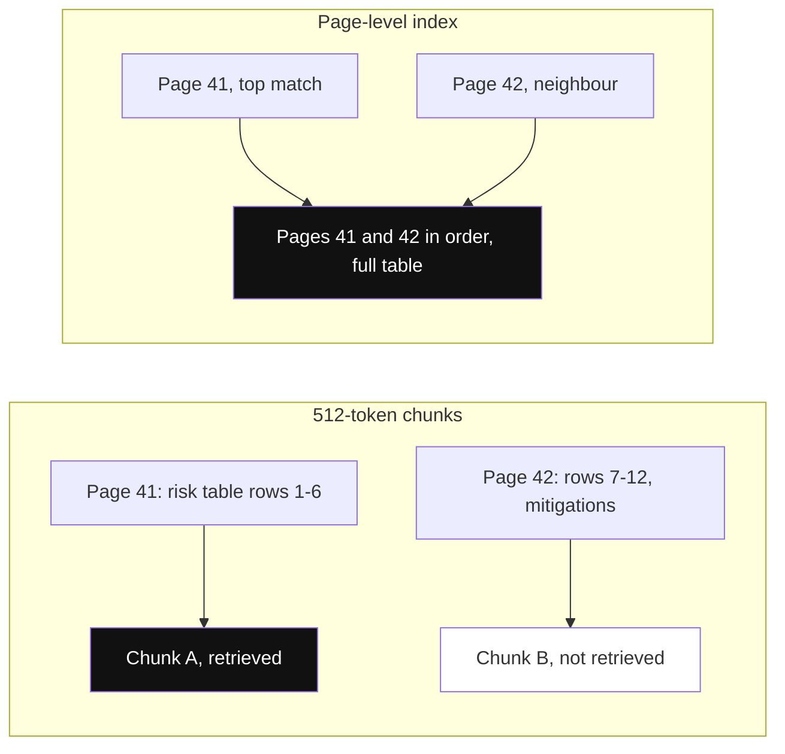
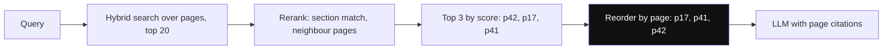
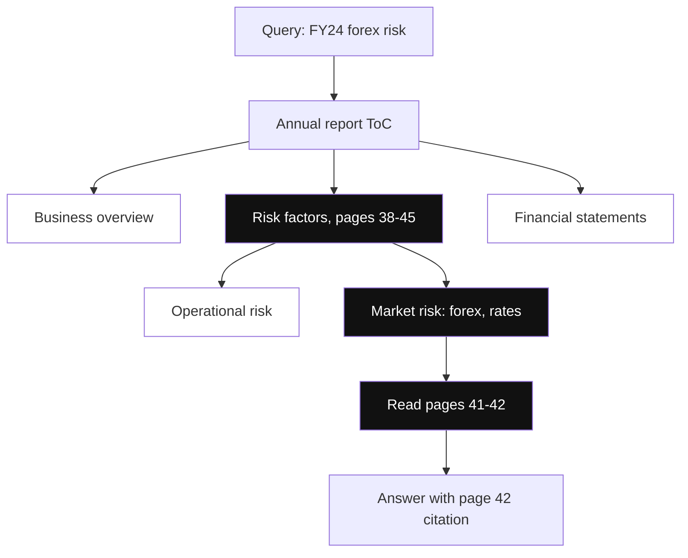
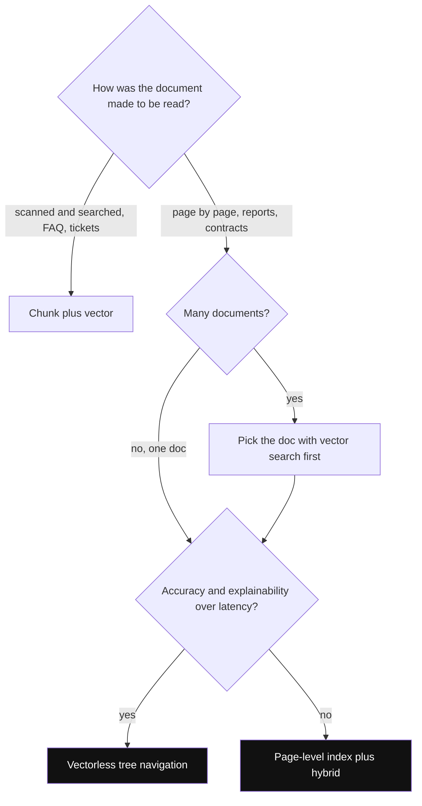

# PageIndex

PageIndex ek retrieval idea hai: document ko random chunks me kaatne ke bajaye uske **natural structure** (pages, sections, table of contents) ko index karo, aur zarurat ho to LLM ko ek **tree index pe reasoning** karke sahi section tak navigate karne do, bina vector similarity ke ("vectorless"). Interviewer poochta hai: "lambe structured PDF (annual report, contract) pe chunk + vector RAG kyun fail hota hai aur alternative kya hai?"

## ⭐ Chunking kahan toot-ta hai

**Ek line me:** fixed-size chunks (e.g. 512 tokens, 50 overlap) document ke structure ko ignore karte hain, isliye multi-page sawaalon pe incomplete ya confidently-wrong answers aate hain.

> **Example:** Infosys ki 200-page annual report pe bot. "Main risk factors kya hain aur unka mitigation kya hai?" Risk table page 41–42 pe phaili hai; chunking usko do tukdon me tod deta hai. LLM ko aadhi table milti hai aur wo confidently aadha answer deta hai.

*Diagram:* Chunking table ko page break pe tod deta hai aur sirf aadha wapas aata hai; page index dono pages order me laata hai, to LLM ko poori table dikhti hai.

- **Context bleed:** chunk beech table ya beech argument me khatam → LLM ko adhoora thought, embedding bhi weak.
- **Cross-page references toot-te hain:** "pichle page ki table dekho", "Section 3 ke hisaab se" ka koi matlab nahi bachta. Chunk retrieval ko page proximity ka pata nahi.
- **Tables/figures mangle:** do pages pe phaili table = do disconnected chunks.
- **Noisy scores:** shared vocabulary ki wajah se ek dense methodology chunk zyada relevant page ko outscore kar deta hai.
- Analogy: chunking = kitaab ko random 3-inch strips me kaatna. PageIndex = binding pe kaatna, jahan author ne khud boundaries rakhi.

**Interview tip:** "Retrieval sirf vector space me keyword matching nahi, ek **document structure problem** hai. Jo document page-by-page padhne ke liye bana hai, use page/section level pe index karo."

**Common galti:** har problem ka hal chunk size tweak karna samajhna.

## ⭐ Do flavours: page-level index aur vectorless tree index

**Ek line me:** (1) **page-level index** = page hi retrieval unit, embedding + rich metadata ke saath; (2) **vectorless tree index** = document ka ToC-jaisa tree, jisme LLM reasoning karke node choose karta hai, koi embedding nahi.

**1. Page-level index (article ka main approach)**
- Har page ek node: text + table data + figure captions → ek embedding, saath me metadata: `doc_id`, `page_number`, `section_title`, `content_type` (text/table/figure), optional `sparse_vector` (BM25/SPLADE for hybrid).
- Query → dense/hybrid search top-N pages → rerank (page position, section, adjacent high-scoring pages ko boost) → top-K pages **page order me** assemble, score order me nahi (narrative structure matter karta hai).
- Bahut lambe pages (~1,500+ words): page ke andar store ke liye chhote tukde, par retrieve page level pe; ya serve time pe sirf relevant paragraph slice karo.
- Author ke financial-report test me precision@3 roughly 18–25% better (512-token chunking ke comparison me), aur hallucination kam, kyunki poora page apne caveats saath laata hai.

*Diagram:* Pages score se chune jaate hain par LLM ko page order me diye jaate hain, taaki report ka flow aur cross-page tables sahi rahein.

**2. Vectorless, reasoning-based tree index (PageIndex-style)**
- Indexing: document se ek **hierarchical tree** banao, jaise smart table of contents: document → sections → sub-sections → pages. Har node pe title, short LLM-generated summary, page range.
- Retrieval: LLM ko query + tree ka top level do. Wo **reason** karta hai "answer kis section me hoga?", us node me neeche jaata hai, zarurat ho to backtrack karta hai. Jaise ek human analyst ToC dekh ke report padhta hai.
- Koi embedding, vector DB ya chunking nahi. Retrieval **explainable** hai: "Risk Factors → Market Risk → page 42 dekha, kyunki...".
- Similarity ≠ relevance: vector search "jo similar dikhta hai" laata hai; tree reasoning "jahan answer hona chahiye" wahan jaata hai.

*Diagram:* LLM sirf node titles aur summaries padhta hai, Risk factors phir Market risk chunta hai, aur sirf pages 41-42 kholta hai; dim branches kabhi padhi hi nahi jaati.

| | Chunk + vector | Page-level index | Vectorless tree |
|---|---|---|---|
| Unit | 512-token chunk | full page | section/page node |
| Retrieval | ANN similarity | ANN/hybrid + rerank | LLM reasoning over tree |
| Explainability | low | medium (page cite) | high (path dikhta) |
| Latency/cost | lowest | low | high (multiple LLM calls) |
| Best for | FAQs, short docs | reports, manuals | long structured docs, few |

**Interview tip:** "Page-level index ek cheap upgrade hai jo vector stack ke andar fit hota hai. Vectorless tree retrieval tab jab document lambe aur structured hon aur accuracy + explainability latency se zyada important ho."

**Common galti:** PageIndex ko sirf "bade chunks" samajhna. Asli idea **structure-aware** indexing aur page-order context hai.

## ⭐ Kab ye chunk + vector ko beat karta hai, kab nahi

**Ek line me:** document **print karke page-by-page padhne** ke liye bana hai to PageIndex; **scan aur search** ke liye bana hai to chunking theek hai.

- **PageIndex jeet-ta hai:** annual reports, 10-K/financial filings, legal contracts, compliance docs, technical manuals, research papers; multi-page questions; tables jo pages pe phaili hon; jab page citations chahiye (audit, legal).
- **Chunking better:** chhote uniform docs (FAQs, product descriptions, support tickets, chat snippets), jahan "page" ka concept hi nahi.
- **Vectorless tree ke trade-offs:**
  - Har query pe kai LLM calls → latency seconds me, cost zyada.
  - Bahut saare documents ke across search me scale nahi karta; pehle doc select karna padta (metadata ya vector search se), phir tree navigate.
  - Tree ki quality (ToC, summaries) pe sab depend; bina headings wale docs pe tree banana mushkil.
- **Hybrid combo:** page-level BM25 ko zyada context milta hai (better IDF), dense ko page theme. "Connection handling ke baare me hai AUR exact error code bhi hai" dono pakad lo. Dekho [Hybrid Search](04-hybrid-search.md).

*Diagram:* Chhote searchable docs ke liye chunking theek hai; lambe page-wise docs page index ya tree pe jaate hain, pehle sahi document chun ke.

**Interview tip:** "Pehle collection level pe vector/hybrid search se sahi document dhoondhunga, phir us document ke andar tree navigation ya page-level retrieval. Dono ka best."

**Common galti:** FAQ bot pe PageIndex lagana; overkill hai, memory overhead bhi.

## Practical pitfalls

- **Lambe pages aur token limit:** careless truncation embedding bigaad deta hai. Fix: pehle ~800 tokens + aakhri ~200 tokens embed karo ("semantic bookends").
- **Multi-column PDFs:** default extraction columns mix kar deta hai; layout-aware parser lo (`pdfplumber` bounding boxes, `marker`, `nougat`).
- **Scanned PDFs:** pehle OCR (`pytesseract`, `surya`, AWS Textract). Chupke se khaali pages index hona, index na hone se bhi bura.
- **Boilerplate pages:** title, blank, ToC, disclaimers; ~100 characters se kam wale pages skip karo, reranking me penalize karo.
- **Neighbour pages:** answer page ke saath ±1 page bhi do, cross-page tables ke liye.
- Final precision ke liye page candidates pe cross-encoder: [Reranking](05-reranking.md). Pages coherent hote hain, isliye reranker ko score karne ke liye accha text milta hai.

## Kahan aur padho

- [Vector databases](../05-db/11-vector.md): chunking + embedding pipeline aur metadata filtering. Detail yahan padho.
- [Hybrid Search](04-hybrid-search.md): page-level BM25 + dense.
- [Reranking](05-reranking.md): page candidates ko precisely order karna.
- [RAG lab](/viewinter/agents/labs/rag): PDF-chat RAG browser me chala ke dekho.

## Checklist

- [ ] Fixed-size chunking ke 4 failure modes bata sakta hoon
- [ ] Page-level index ka pipeline aur metadata samjha sakta hoon
- [ ] Vectorless tree index me LLM reasoning se retrieval kaise hota hai, samjha sakta hoon
- [ ] Bata sakta hoon kab PageIndex chunk + vector ko beat karta hai aur kab overkill hai
- [ ] Tree retrieval ke latency, cost aur scale trade-offs bata sakta hoon
