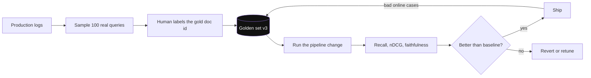
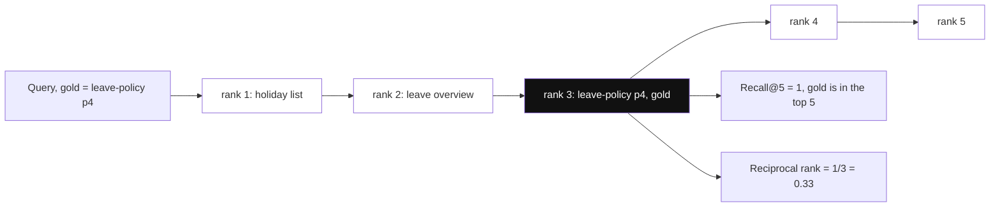
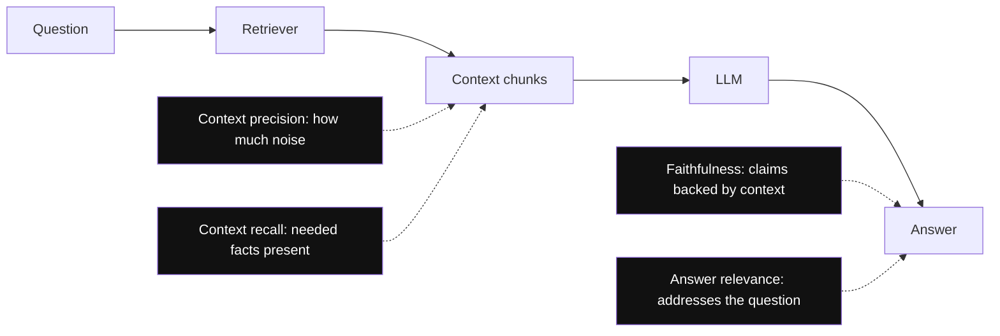
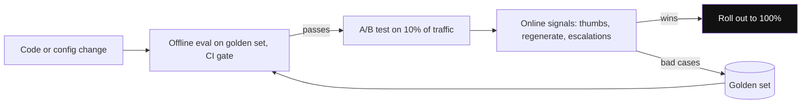

# RAG Evaluation

RAG me do cheezein fail ho sakti hain: retrieval (sahi chunk aaya hi nahi) aur generation (chunk aaya par LLM ne galat ya bana ke bola). Evaluation dono ko alag-alag naapta hai. Interviewer poochta hai: "Kaise pata chalega ki tumhara change (chunk size, reranker) better hai?" Jawab "vibes" nahi, numbers hone chahiye.

## ⭐ Golden set: sab kuch iske upar khada hai

**Ek line me:** 50–200 real questions ka set, har ek ke saath expected chunk/doc id aur (optional) ideal answer.

> **Example:** HR policy bot ke liye logs se 100 asli questions uthao ("maternity leave kitne din?"), har ek ke saath sahi doc id `leave-policy.pdf#p4` likho.

- Real logged queries se banao, manually annotate karo. Notes ke hisaab se **50–100 pairs per domain** bhi meaningful signal deta hai.
- Mix rakho: easy lookups, multi-hop, "answer docs me nahi hai" wale, typo/Hinglish queries.
- LLM se synthetic questions generate kar sakte ho (chunk do, question banwao), par kuch human review zaroori.
- Golden set ko version karo; har pipeline change pe same set pe run karo (regression test jaisa).



*Diagram:* Har change same versioned set pe chalta hai, regression test ki tarah, aur production me dikhe failures wapas usi set me jud jaate hain.

**Interview tip:** "Pehla kaam: logs se 100 queries ka golden set. Bina iske koi tuning blind hai."
**Common galti:** sirf 5–10 handpicked demo questions pe test karke "kaam kar raha hai" bolna.

## ⭐ Retrieval metrics

**Ek line me:** kya sahi chunk top-k me aaya, aur kitna upar aaya?

| Metric | Kya naapta hai | Kab dekho |
|---|---|---|
| Hit rate / Recall@k | Relevant chunk top-k me hai ya nahi | Basic retrieval health |
| Precision@k | Top-k me kitne relevant | Noise kitna ja raha hai |
| MRR | 1/rank of first relevant, averaged | Ek sahi answer kaafi ho |
| nDCG@k | Graded relevance + position discount | Ranking quality, reranker eval |

- **Recall@k** = relevant mile / total relevant. Agar recall@50 kam hai, to reranker bhi nahi bacha sakta (jo aaya hi nahi use rerank kya karoge).
- **MRR:** gold chunk rank 1 pe → 1.0, rank 3 pe → 0.33. Position ke liye sensitive.
- **nDCG:** "highly relevant" aur "thoda relevant" me fark karta hai, upar wale ranks ko zyada weight. [Reranking](05-reranking.md) ka impact isi se naapo.
- Notes se: reranking on top of hybrid search ne **nDCG@5 roughly 12–18 points** improve kiya; kahin sirf 2 points for 200ms latency. Isliye measure karo.



*Diagram:* Recall@5 sirf poochta hai ki gold chunk list me hai ya nahi (hai); MRR ye bhi dekhta hai ki kahan hai, isliye rank 3 pe score 1.0 ki jagah 0.33.

```python
def mrr(results, gold):  # results: list of ranked id lists
    total = 0
    for ranked, g in zip(results, gold):
        for i, doc in enumerate(ranked, 1):
            if doc == g:
                total += 1 / i
                break
    return total / len(gold)
```

**Interview tip:** "Retrieval ke liye recall@k candidate stage pe, nDCG@5 final ranking pe."

## ⭐ Generation metrics aur RAGAS

**Ek line me:** answer context se aaya (faithful) hai ya nahi, aur question ka jawab deta hai ya nahi.

- **Faithfulness / groundedness:** answer ke har claim ka support context me hai? Low = hallucination.
- **Answer relevance:** answer question pe hai ya idhar-udhar?
- **Context precision:** jo chunks diye unme se kitne useful the (noise check).
- **Context recall:** ideal answer ke liye zaroori info context me thi ya nahi (ground truth chahiye).
- **RAGAS:** open-source framework jo ye 4 metrics LLM-as-judge se compute karta hai. Alternatives: TruLens, DeepEval, Arize Phoenix.
- **LLM-as-judge:** ek strong LLM ko rubric do ("1–5 score, kya har claim context se supported hai?"). Sasta aur scale hota hai.
- Judge ki kamiyan: position bias, lambe answer pasand karna, apne hi model ko favour. Fix: clear rubric, kuch samples pe human se agreement check, temperature 0.



*Diagram:* Context precision aur recall retriever ke output ko grade karte hain; faithfulness aur answer relevance LLM ke likhe answer ko, isliye low score batata hai kaunsa stage fix karna hai.

| Problem dikha | Kaunsa metric | Fix kahan |
|---|---|---|
| Sahi chunk nahi aaya | Recall@k low | Chunking, hybrid, query rewrite |
| Chunk aaya, neeche raha | nDCG/MRR low | Reranker |
| Context sahi, answer galat | Faithfulness low | Prompt, model, kam chunks |

**Common galti:** sirf final answer ko judge karna. Retrieval aur generation alag naapo, warna pata nahi chalega galti kahan hai.

## Offline vs online evaluation

- **Offline:** golden set pe har change se pehle (CI me bhi). Fast, repeatable, cheap.
- **Online:** production me real signals: thumbs up/down, "regenerate" click rate, follow-up "nahi, mera matlab tha...", support ticket escalation.
- **A/B test:** naya reranker 10% traffic pe, thumbs-up rate aur latency compare karo.
- Production logs se sample karke LLM-judge se faithfulness monitor karo (har request pe nahi, cost).
- Bure online cases ko golden set me add karo; set time ke saath strong hota hai.



*Diagram:* Offline eval decide karta hai ki change ship ho sakta hai ya nahi; online signals batate hain ki fayda hua ya nahi, aur unke bad cases agla offline run aur strong banate hain.

**Interview tip:** "Offline eval change ko ship karne deta hai, online eval batata hai ki users ko sach me fayda hua."

## Kahan aur padho

- [Reranking](05-reranking.md): nDCG@5 pe reranker ka impact.
- [Hybrid Search](04-hybrid-search.md): tuning ko eval se validate karo.
- [Vector databases](../05-db/11-vector.md): ANN recall@k vs latency. Detail yahan padho.
- [Reliability and observability](../01-topics/20-reliability-observability.md): online metrics aur alerting.

## Checklist

- [ ] Golden set kaise banate hain aur kitna bada, bata sakta hoon
- [ ] Recall@k, MRR aur nDCG ka fark example ke saath samjha sakta hoon
- [ ] Faithfulness, answer relevance, context precision/recall samjha sakta hoon
- [ ] LLM-as-judge aur RAGAS ka role aur unki kamiyan bata sakta hoon
- [ ] Bad answer ko retrieval vs generation problem me diagnose kar sakta hoon
- [ ] Offline vs online eval aur A/B test samjha sakta hoon
