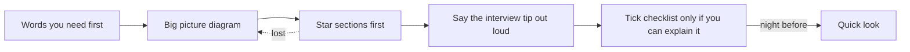
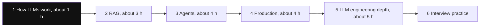

# Start Here

Ye section LLM engineer aur AI engineer interviews ke liye hai. Isme 22 concept pages, 10 RAG pages aur hands-on labs hain. Inhe neeche wale order me padho. Har page pichle pages pe khada hai. Aage kood ke padhoge to page mushkil lagega, yahi sabse badi wajah hai.

**Is page ke baad tum jaanoge:**

- AI pages kis order me padhne hain, aur kyun.
- Kis tarah ke interview sawal ka jawab kis page pe hai.
- Ek page kaise padho taaki yaad rahe.

## Ek page kaise padho

Har page ka shape same hai. Aise use karo:

1. **Pehle ye shabd samjho.** Sabse pehle ye table padho. Koi shabd phir bhi samajh na aaye to [How LLMs Work](14-how-llms-work.md) kholo.
2. **Big picture.** Poore page ka ek diagram. Kahin kho jao to wapas yahan aao.
3. **Pehle ⭐ wale sections.** Interviewer inhi ke baare me sabse zyada poochte hain. Pehli baar me bina star wale sections sirf skim karo.
4. **Interview tip aur Common galti.** Tip ek baar bol ke dekho. Interview me wahi yaad aata hai.
5. **Checklist.** Item tabhi tick karo jab bina dekhe samjha sako. Site inhi ticks se tumhara progress dikhati hai.
6. **Quick look.** Page ka ek minute ka summary. Interview se pehle wali raat padho.

*Diagram:* Ek page ko padhne ka poora raasta; koi section mushkil lage to dotted arrow ki tarah wapas Big picture pe jao, phir aage badho.

## Padhne ka order

*Diagram:* Highlighted stage 1 se shuru karo; aage ke saare stages isi ke words use karte hain. Interview practice se pehle lagbhag 17 ghante ki padhai.

### Stage 1: model kaise kaam karta hai (lagbhag 1 ghanta)

| Page | Pehle kyun |
|---|---|
| [How LLMs Work](14-how-llms-work.md) | Tokens, attention, sampling, context window. Baaki har page ye shabd use karta hai. |

### Stage 2: model ko knowledge dena, RAG (lagbhag 3 ghante)

| Page | Kya milega |
|---|---|
| [What is RAG](../09-rag/01-what-is-rag.md) | Model ko retrieval kyun chahiye, aur RAG vs fine-tuning vs long context |
| [Semantic Search](../09-rag/02-semantic-search.md), [Chunking](../09-rag/03-chunking.md) | Embeddings aur documents ko tukdon me kaise kaatte hain |
| [Hybrid Search](../09-rag/04-hybrid-search.md), [Reranking](../09-rag/05-reranking.md) | Achhe retrieval systems results ko asal me kaise rank karte hain |
| [Advanced Retrieval](../09-rag/07-advanced-retrieval.md), [RAG Evaluation](../09-rag/08-rag-evaluation.md) | Query rewriting, lost-in-the-middle, recall@k, faithfulness |
| [Vector Databases](../05-db/11-vector.md) | HNSW, IVF, pgvector, Qdrant, Pinecone |

### Stage 3: agents (lagbhag 4 ghante)

| Page | Kya milega |
|---|---|
| [Agent Foundations](01-agent-foundations.md) | Agent loop, tool calling, workflow vs agent |
| [Workflow Patterns](03-workflow-patterns.md) | Chaining, routing, parallel, orchestrator-worker |
| [Agent & Multi-agent Patterns](04-agent-patterns.md) | ReAct, plan-and-execute, reflection, multi-agent |
| [Tools, MCP & A2A](07-tools-mcp-a2a.md) | Tool design, MCP servers aur clients, sandboxing |
| [Memory & Context](05-memory-context.md) | Context engineering, short aur long-term memory |
| [Data & Retrieval for Agents](06-agentic-data-rag.md) | Agentic RAG, GraphRAG, text-to-SQL |
| [LangGraph Core](02-langgraph-core.md) | Ek framework gehraai se: state, checkpoints, human-in-the-loop |

### Stage 4: production-grade banana (lagbhag 4 ghante)

| Page | Kya milega |
|---|---|
| [Evals for Agents](09-agent-evals.md) | LLM-as-judge, trajectory evals, datasets |
| [AI Observability](10-agent-observability.md) | Traces, spans, OpenTelemetry GenAI |
| [Guardrails & Safety](08-guardrails.md) | Prompt injection, output checks, OWASP Top 10 for LLMs |
| [LLM Security and Governance](20-llm-security-governance.md) | Red teaming, permissions, secrets, EU AI Act, bias |
| [Cost & Latency](11-cost-latency.md) | Token economics, caching, routing |
| [LLMOps](21-llmops.md) | Prompt CI, A/B tests, canaries, provider fallbacks |
| [Agents in Production](12-agents-in-production.md) | Agents serve karna, durable execution, case studies |

### Stage 5: LLM engineering depth (lagbhag 5 ghante)

| Page | Kya milega |
|---|---|
| [Inference and Serving](15-inference-serving.md) | KV cache, vLLM, batching, quantization, GPU sizing |
| [Fine-tuning and Post-training](16-fine-tuning.md) | SFT, LoRA, QLoRA, RLHF, DPO, GRPO, distillation |
| [Structured Outputs and Prompt Optimization](17-structured-outputs-prompting.md) | JSON schema, constrained decoding, DSPy |
| [Multimodal and Voice Agents](18-multimodal-voice.md) | Vision-language models, voice pipelines, turn detection |
| [Agent Frameworks and Tooling](19-agent-frameworks.md) | LangGraph, Claude Agent SDK, OpenAI Agents SDK, Pydantic AI, CrewAI, LlamaIndex |

### Stage 6: interview practice

| Page | Kya milega |
|---|---|
| [Agentic AI Interview Prep](13-agentic-interview-qa.md) | Agent rapid-fire aur agent system designs |
| [LLM Engineer Interview Prep](22-llm-engineer-interview.md) | Fundamentals, serving aur training rapid-fire, chaar design rounds, coding round |
| [RAG Interview Q&A](../09-rag/10-rag-interview-qa.md) | RAG chatbot design aur rapid-fire |

Sidebar me **Labs** bhi chalao. Interviewer pakad leta hai ki tumne khud kuch banaya hai ya nahi.

## Kaunsa interview topic kahan hai

| Interview area | Pages |
|---|---|
| LLM fundamentals: transformer, attention, RoPE, BPE, MoE, sampling, reasoning models | [How LLMs Work](14-how-llms-work.md) |
| RAG, chunking, hybrid search, reranking, retrieval evals | [RAG pages](../09-rag/01-what-is-rag.md), [Data & Retrieval for Agents](06-agentic-data-rag.md) |
| Vector databases aur index types | [Vector Databases](../05-db/11-vector.md) |
| Context engineering, lost in the middle, compaction | [Memory & Context](05-memory-context.md) |
| Tool calling, MCP, A2A | [Agent Foundations](01-agent-foundations.md), [Tools, MCP & A2A](07-tools-mcp-a2a.md) |
| Structured outputs, constrained decoding, DSPy | [Structured Outputs and Prompt Optimization](17-structured-outputs-prompting.md) |
| Serving: vLLM, KV cache, batching, speculative decoding, quantization, multi-LoRA | [Inference and Serving](15-inference-serving.md) |
| Model routing aur cascades | [Cost & Latency](11-cost-latency.md), [Inference and Serving](15-inference-serving.md) |
| SFT, LoRA, RLHF, DPO, GRPO, distillation, synthetic data | [Fine-tuning and Post-training](16-fine-tuning.md) |
| ReAct, plan-and-execute, reflection, human-in-the-loop | [Agent & Multi-agent Patterns](04-agent-patterns.md), [LangGraph Core](02-langgraph-core.md) |
| Durable execution, sandboxing, computer-use agents | [Agents in Production](12-agents-in-production.md), [Tools, MCP & A2A](07-tools-mcp-a2a.md) |
| Prompt injection, jailbreaks, red teaming, least privilege, PII | [Guardrails & Safety](08-guardrails.md), [LLM Security and Governance](20-llm-security-governance.md) |
| Prompt CI, A/B tests, retries, fallbacks, cost per task, streaming | [LLMOps](21-llmops.md), [Cost & Latency](11-cost-latency.md) |
| Evals aur observability tools | [Evals for Agents](09-agent-evals.md), [AI Observability](10-agent-observability.md) |
| Vision-language models, voice agents | [Multimodal and Voice Agents](18-multimodal-voice.md) |
| Agent frameworks | [Agent Frameworks and Tooling](19-agent-frameworks.md) |
| Responsible AI, EU AI Act, audit logging | [LLM Security and Governance](20-llm-security-governance.md) |

## Checklist

- [ ] Main chhe stages aur har stage ke pages jaanta hoon.
- [ ] Maine agent pages se pehle How LLMs Work padha hai.
- [ ] Har page se pehle "Pehle ye shabd samjho" table padhta hoon.
- [ ] Upar wali table se kisi bhi interview topic ka page dhoondh sakta hoon.
- [ ] Maine kam se kam ek lab shuru se end tak chalayi hai.
- [ ] Interview se ek din pehle har page ka Quick look padhta hoon.
