# Agent Foundations

Agentic AI interview ka pehla 15 minute isi page pe hota hai: "agent vs workflow", "loop khud likh ke dikhao", "tool fail ho to kya". Yahan hum ek hi real request ko shuru se end tak follow karenge, taaki dikhe ki agent ke andar data kaise move karta hai.

**Is page ke baad tum ye samjha paoge:**

- Agent ke andar ek request ka poora safar: system prompt aur tools jaate hain, LLM `tool_use` JSON lautata hai, tumhara code function chalata hai, result wapas jaata hai, aur final answer aata hai.
- Messages list har turn pe kaise badhti hai, aur isliye agent mehenga kyun padta hai.
- Tokens, context window aur temperature, chhote numbers ke saath.
- Same task ko workflow aur agent dono tareeke se kaise karte hain, aur kab kaunsa chuno.
- Agent kahan fail hota hai aur har failure ka fix kya hai.

## Pehle ye shabd samjho

LLM naye ho? Pehle [How LLMs Work](14-how-llms-work.md) padho. Usme tokens, context window aur model text kaise banata hai, ye sab hai.

| Shabd | Simple matlab |
|---|---|
| System prompt | Har call ke saath jaane wale fixed instructions. Model ko role, rules aur limits batate hain. |
| Tool | Tumhare code ka normal function ya API, jise chalane ko model bol sakta hai. |
| LLM | Large language model. Text padh ke agla text ka tukda predict karta hai, ek-ek karke. |
| `tool_use` | Model ka lautaya JSON block jo bolta hai "ye tool in arguments ke saath chalao". |
| Temperature | Randomness ki setting. 0 pe lagbhag har baar same jawab, zyada pe variety. |
| ReAct | Reason + Act. Model sochta hai, tool maangta hai, result padhta hai, phir repeat. |
| `tool_result` | Tool ka output leke tumhare code ka wapas bheja message, matching call id ke saath. |
| Vector DB | Database jo exact words se nahi, milte-julte matlab se text dhoondhta hai. |
| `stop_reason` | Model ke reply ka field jo batata hai wo kyun ruka, jaise kaam khatam ya tool chahiye. |
| Guardrail | Model ke aas-paas laga check jo unsafe ya rule todne wala input ya output rokta hai. |
| HITL | Human in the loop. Agent aage badhe usse pehle ek insaan step approve ya edit karta hai. |
| Structured output | Model se fixed JSON shape me jawab lena, taaki tumhara code safely parse kar sake. |
| Hallucinated args | Model ke khud se bana diye args, jaise aisa order id jo exist hi nahi karta. |
| Trajectory | Ek run ka poora raasta: har model call, tool call aur result, order me. |

## Big picture: agent ke andar kya hota hai

Agent koi jaadu nahi hai. Ek `for` loop hai. Loop me tum LLM ko teen cheezein bhejte ho: instructions (system prompt), tools ki list, aur ab tak ki baatcheet (messages). LLM ya to final answer deta hai, ya bolta hai "ye tool in arguments ke saath chalao". Tool tumhara code chalata hai, LLM nahi. Result messages me jud jaata hai aur loop phir chalta hai. Is page ke saare sections isi loop ke ek-ek hisse ko samjhate hain.

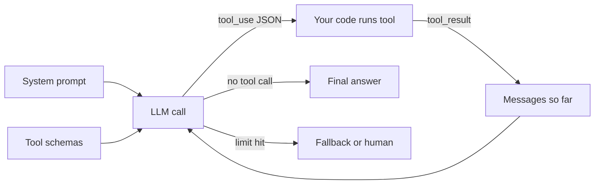

Poora loop "Agent loop aur ReAct" me hai, `tool_use`/`tool_result` "Tool calling" me, messages aur tokens ka kharcha "LLM basics" me, system prompt "Prompt engineering" me, loop chahiye bhi ya nahi "Workflows vs agents" aur "Levels" me, aur limit hit / galat tool "Failure modes" me.

## Agent kya hai

**Ye kyun chahiye?** Ek normal chatbot sirf text likhta hai. Tum pucho "mera Swiggy order kahan hai?", wo order dekh hi nahi sakta. Wo ya to bolega "app me check karo" ya kuch bana dega. Asli kaam karne ke liye usse data padhna aur action lena padega. Wahi agent karta hai.

**Analogy: Swiggy call center ka naya support executive.** Uska dimaag = LLM. Screen pe khule order panel, refund panel = tools. Notepad jisme customer ki baat likhi hai = memory. Issue solve hone tak baar baar check karna = loop. Manager ka rulebook = system prompt. Executive khud database nahi chhoota. Wo panel me order id daalta hai, panel result dikhata hai. Isi tarah LLM tool ko sirf *request* karta hai, tumhara code use *execute* karta hai.

**Ek example step by step:** user bolta hai "Mera order late hai, refund do."

1. Agent `get_order_status` maangta hai. Result: delay 40 min.
2. 40 > 30, to wo `check_refund_policy` maangta hai. Policy: full refund.
3. Wo `issue_refund` maangta hai, phir reply likhta hai: "Refund ho gaya."

Kaunsa step pehle, kaunsa baad me, kab rukna: ye sab LLM ne khud decide kiya. Yahi agent ki pehchaan hai.

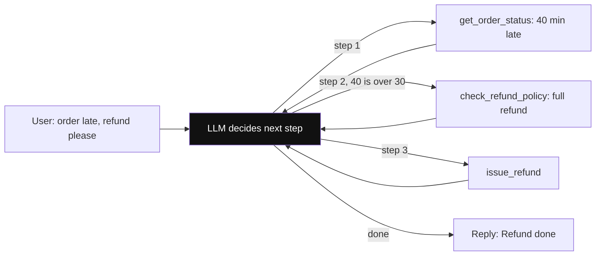

*Diagram:* Highlighted LLM node se nikalne wala har arrow model ka apna faisla hai; tumhara code sirf maanga hua tool chalata hai aur result wapas deta hai.

**Ab terms:**

- **LLM (brain):** sochta hai aur agla action chunta hai.
- **Tools (hands):** APIs, DB queries, search, code execution. LLM sirf maangta hai, tumhara code chalata hai.
- **Memory:** short-term = is conversation ke messages; long-term = sessions ke across store ya vector DB (detail: [Memory & Context](05-memory-context.md)).
- **Loop:** LLM → tool → result wapas LLM → ... jab tak final answer ya stop condition na aaye.

| | Chatbot | Workflow | Agent |
|---|---|---|---|
| Control flow kaun decide karta | koi nahi, ek call | tumhara code (fixed path) | LLM (dynamic) |
| Tools | nahi | haan, fixed order | haan, LLM choose karta |
| Steps | 1 | fixed N | unknown, loop |
| Predictability | high | high | low |
| Cost/latency | low | predictable | variable, zyada |

- **Anthropic framing ("Building effective agents"):** dono "agentic systems" hain.
  - **Workflows:** LLMs aur tools **predefined code paths** se orchestrate hote hain.
  - **Agents:** LLM **dynamically apna process aur tool usage direct** karta hai.
  - Advice: sabse simple solution se shuru karo; complexity tabhi badhao jab measurable gain ho.

**Ek line me:** agent = **LLM + tools + memory + loop**, jahan LLM khud decide karta hai ki agla step kya hoga aur kab rukna hai.

**Interview tip:** "Agent ki defining property autonomy over control flow hai. Agar next step mera code decide karta hai to wo workflow hai, chahe usme LLM ho."

**Common galti:** har LLM + tool wale system ko "agent" bolna. Fixed chain with one tool call workflow hai.

## ⭐ Agent loop aur ReAct

**Ye kyun chahiye?** Ek LLM call me model sirf ek baar bol sakta hai. Par "order kahan hai?" ke liye pehle order dekhna padta hai, phir rider ki location. Doosra step pehle step ke result pe depend karta hai. Isliye LLM ko baar baar bulana padta hai, har baar naye result ke saath. Yahi loop hai.

**Analogy: IRCTC enquiry counter.** Tum pucho "12951 kahan hai?". Babu computer me train number daalta hai (act). Screen pe aata hai "Kota cross kiya" (observation). Wo sochta hai "Kota se Delhi ka time dekhna padega" (reason). Phir dobara computer me dekhta hai. Jab poora jawab mil jaata hai, tab tumhe batata hai. Babu = LLM, computer = tool, screen ka result = observation.

### Ek poora run, turn by turn

User: **"Mera order ORD-5521 kahan hai? 40 min ho gaye."**

Humare paas do tools hain: `get_order_status(order_id)` aur `get_rider_eta(rider_id)`.

**Step 1: tumhara code pehli API call bhejta hai.** Isme teen cheezein jaati hain:

```json
{
  "system": "Tum Swiggy support agent ho. Pehle data check karo, phir jawab do.",
  "tools": [
    {"name": "get_order_status", "description": "Order ka status, rider_id aur delay deta hai.",
     "input_schema": {"type": "object", "properties": {"order_id": {"type": "string"}}}},
    {"name": "get_rider_eta", "...": "same shape"}
  ],
  "messages": [
    {"role": "user", "content": "Mera order ORD-5521 kahan hai? 40 min ho gaye."}
  ]
}
```

**Step 2: LLM jawab nahi deta, tool maangta hai.** Response me `stop_reason` = `"tool_use"` hai aur content me ek `tool_use` block:

```json
{
  "stop_reason": "tool_use",
  "content": [
    {"type": "text", "text": "Main order status check karta hoon."},
    {"type": "tool_use", "id": "toolu_01", "name": "get_order_status", "input": {"order_id": "ORD-5521"}}
  ]
}
```

**Step 3: tumhara code function chalata hai.** `get_order_status("ORD-5521")` lautata hai `{"status": "out_for_delivery", "rider_id": "R-88", "delay_min": 12}`.

**Step 4: do messages append hote hain.** Pehle LLM ka apna jawab (assistant), phir tool ka result (user role me, same id `toolu_01` ke saath):

```json
[
  {"role": "user", "content": "Mera order ORD-5521 kahan hai? 40 min ho gaye."},
  {"role": "assistant", "content": [{"type": "tool_use", "id": "toolu_01", "name": "get_order_status", "input": {"order_id": "ORD-5521"}}]},
  {"role": "user", "content": [{"type": "tool_result", "tool_use_id": "toolu_01",
    "content": "{\"status\": \"out_for_delivery\", \"rider_id\": \"R-88\", \"delay_min\": 12}"}]}
]
```

**Step 5: doosri API call, poori list ke saath.** LLM ab `rider_id: R-88` dekh sakta hai. Wo phir tool maangta hai: `get_rider_eta` with `{"rider_id": "R-88"}`, id `toolu_02`. Dhyan do: `R-88` LLM ne khud nahi banaya, pichhle tool result se uthaya.

**Step 6: code chalata hai, result aata hai** `{"eta_min": 8, "distance_km": 1.9}`. Do aur messages append.

**Step 7: teesri API call.** Ab LLM ke paas sab hai. `stop_reason` = `"end_turn"`, koi `tool_use` nahi. Text: "Aapka order rider ke paas hai, 1.9 km door, lagbhag 8 min me pahunchega. 12 min delay ke liye sorry." Loop khatam.

Messages list har turn pe kaise badhi:

| API call | Bhejte waqt messages | LLM ne kya lautaya | Uske baad messages |
|---|---|---|---|
| 1 | 1 (user) | `tool_use` get_order_status | 3 |
| 2 | 3 | `tool_use` get_rider_eta | 5 |
| 3 | 5 | final text (`end_turn`) | 6 |

Har call me **poori list dobara** jaati hai. LLM ki koi memory nahi hoti; jo list me hai wahi uski memory hai.

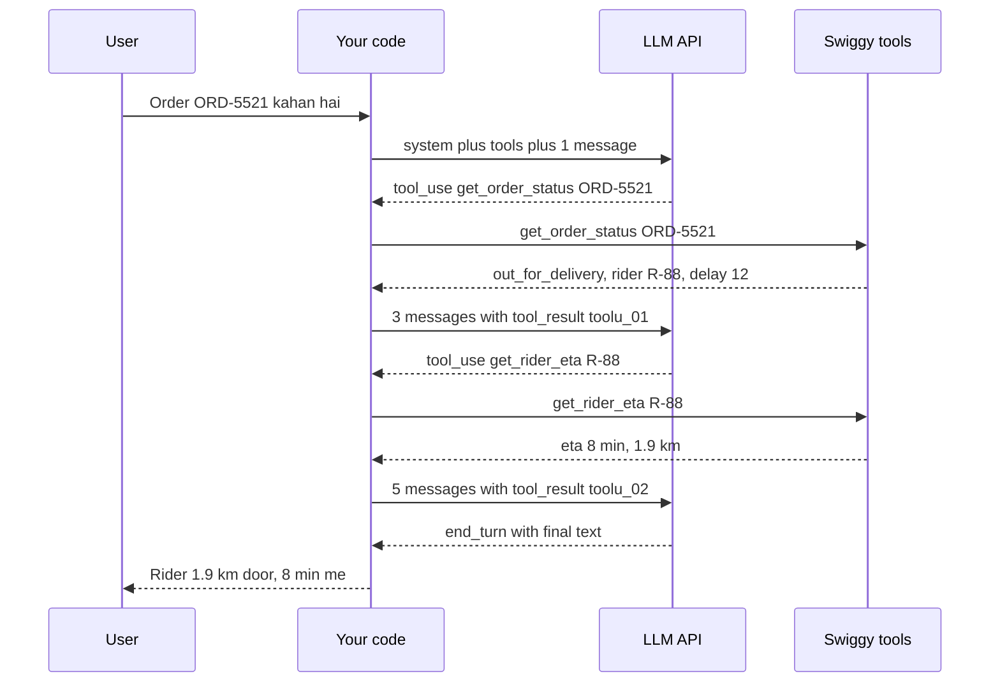

### Ab terms

ReAct = **Re**ason + **Act**. Upar ke run me ye chaar kaam baar baar hue:

- **Perceive:** user input + pichhle observations context me (messages list).
- **Reason:** model decide karta hai: tool chahiye ya answer ready hai.
- **Act:** tool call emit karta hai (name + JSON args).
- **Observe:** tool result message ban ke wapas context me jaata hai.
- Original ReAct paper (Yao et al., 2022) me text format tha: `Thought: ... Action: ... Observation: ...`. Aaj **native tool calling** use hota hai; "thought" model ke andar (ya reasoning tokens me) hota hai, action structured JSON hota hai.
- **Stop conditions:** model tool call ke bina reply kare (`stop_reason="end_turn"` / `finish_reason="stop"`), `max_steps` hit ho, budget/time limit khatam ho, ya guardrail trigger ho.

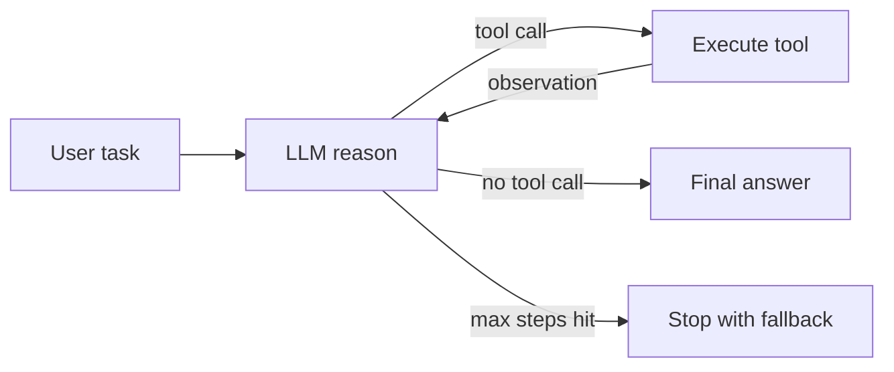

Ek aur example, same pattern. Zerodha Kite assistant: "Meri portfolio me sabse zyada loss wala stock kaunsa hai aur uska aaj ka price?"

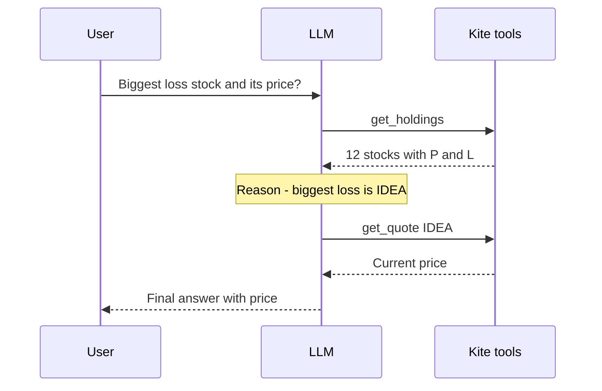

Yahan bhi doosra tool call (`get_quote IDEA`) pehle result pe depend karta hai. Ye cheez fixed code pehle se nahi likh sakta, isliye loop chahiye.

### Code: framework ke bina loop

Neeche ka code upar wala Swiggy run hi chalata hai, Anthropic Messages API ke saath. Framework ke bina agent bas itna hi hai.

```python
import json
import anthropic

client = anthropic.Anthropic()

# Tools ka "menu" jo LLM ko dikhega: naam, kaam, aur args ka schema
TOOLS = [
    {"name": "get_order_status",
     "description": "Order ka status, rider_id aur delay minutes deta hai.",
     "input_schema": {"type": "object",
                      "properties": {"order_id": {"type": "string"}},
                      "required": ["order_id"]}},
    {"name": "get_rider_eta",
     "description": "Rider kitni door hai aur kitne min me pahunchega.",
     "input_schema": {"type": "object",
                      "properties": {"rider_id": {"type": "string"}},
                      "required": ["rider_id"]}},
]

# Asli Python functions. LLM inhe kabhi khud nahi chalata.
REGISTRY = {
    "get_order_status": lambda order_id: {"status": "out_for_delivery", "rider_id": "R-88", "delay_min": 12},
    "get_rider_eta": lambda rider_id: {"eta_min": 8, "distance_km": 1.9},
}

def run_agent(user_msg: str, max_steps: int = 8) -> str:
    messages = [{"role": "user", "content": user_msg}]          # memory = ye list
    for _ in range(max_steps):                                   # hard limit
        resp = client.messages.create(
            model="claude-sonnet-5-5", max_tokens=1024,
            system="Tum Swiggy support agent ho. Pehle data check karo, phir jawab do.",
            tools=TOOLS, messages=messages)
        messages.append({"role": "assistant", "content": resp.content})  # LLM ka turn save
        if resp.stop_reason != "tool_use":                       # koi tool nahi = final answer
            return "".join(b.text for b in resp.content if b.type == "text")

        results = []
        for block in resp.content:
            if block.type != "tool_use":
                continue
            try:
                out = REGISTRY[block.name](**block.input)        # tumhara code chalata hai
                results.append({"type": "tool_result", "tool_use_id": block.id,
                                "content": json.dumps(out)})
            except Exception as e:                               # error bhi observation hai
                results.append({"type": "tool_result", "tool_use_id": block.id,
                                "content": f"Error: {e}", "is_error": True})
        messages.append({"role": "user", "content": results})    # saare results ek message me
    return "Step limit reach ho gaya, human ko escalate kar raha hoon."
```

**Code me kya ho raha hai:**

- `messages` list hi agent ki memory hai. Har turn pe isme assistant ka jawab aur tool results jud-te hain.
- `stop_reason != "tool_use"` matlab LLM ne koi tool nahi maanga, to wahi final answer hai.
- `REGISTRY[block.name](**block.input)` asli function chalata hai. LLM ne sirf naam aur args diye the.
- Har result pe same `tool_use_id` lagta hai, taaki LLM jaane kaunsa result kis call ka hai.
- `max_steps` loop ko hamesha ke liye chalne se rokta hai; limit pe human ko escalate.

- OpenAI shape me same cheez: `resp.choices[0].message.tool_calls`, har call ka result `{"role": "tool", "tool_call_id": ..., "content": ...}`, aur `finish_reason == "tool_calls"`.
- Framework (LangGraph) yahi loop deta hai + persistence, streaming, HITL. Detail: [LangGraph Core](02-langgraph-core.md).

**Ek line me:** ReAct = model sochta hai, tool call karta hai, result (observation) dekhta hai, phir dobara sochta hai, jab tak task done na ho.

**Interview tip:** whiteboard pe yeh loop 2 minute me likh pao: messages list, model call, `stop_reason` check, tools execute, results append, `max_steps`. Interviewer ko framework se zyada ye dikhna chahiye ki tum loop samajhte ho.

**Common galti:** `tool_use_id`/`tool_call_id` match na karna, ya assistant ka tool-call message history me append karna bhool jaana. Dono se API 400 error deta hai.

## ⭐ Tool / function calling

**Ye kyun chahiye?** LLM sirf text bana sakta hai. Agar tum use bolo "DB se order nikalo", wo SQL likh dega par chalayega nahi. Aur agar tum uske free text ko parse karke action lo ("haan, main refund kar deta hoon"), to har baar format alag hoga. Tool calling ek fixed contract deta hai: model structured JSON me bolta hai "ye function, ye args".

**Analogy: restaurant.** Menu card (dish ka naam + description) = tool name + description. Order slip ka format (dish, quantity) = JSON schema. Customer ki likhi slip "Paneer Tikka, 2 plate" = `tool_use` block. Kitchen = tumhara function. Table number ke saath aayi plate = same id wala `tool_result`.

Customer khud kitchen me nahi jaata. Isi tarah **model execute nahi karta.** Wo sirf intent + args deta hai. Auth, validation, rate limit tumhare code me hote hain.

**Ek example step by step:** Flipkart seller assistant. Tools: `search_orders(status, date_from)`, `get_inventory(sku)`, `update_price(sku, new_price)`. Seller bolta hai "Kal ke cancelled orders dikhao" (aaj 2 Nov 2026).

1. App messages + teeno tools ke schema bhejta hai. Model description padh ke lautata hai: `{"name": "search_orders", "input": {"status": "cancelled", "date_from": "2026-11-01"}, "id": "toolu_7"}`.
2. App check karta hai: `status` enum me hai? date valid hai? seller logged in hai? Phir function chalata hai, 4 order rows milti hain.
3. App `tool_result` bhejta hai (`tool_use_id: "toolu_7"`). Model rows padh ke text answer likhta hai.

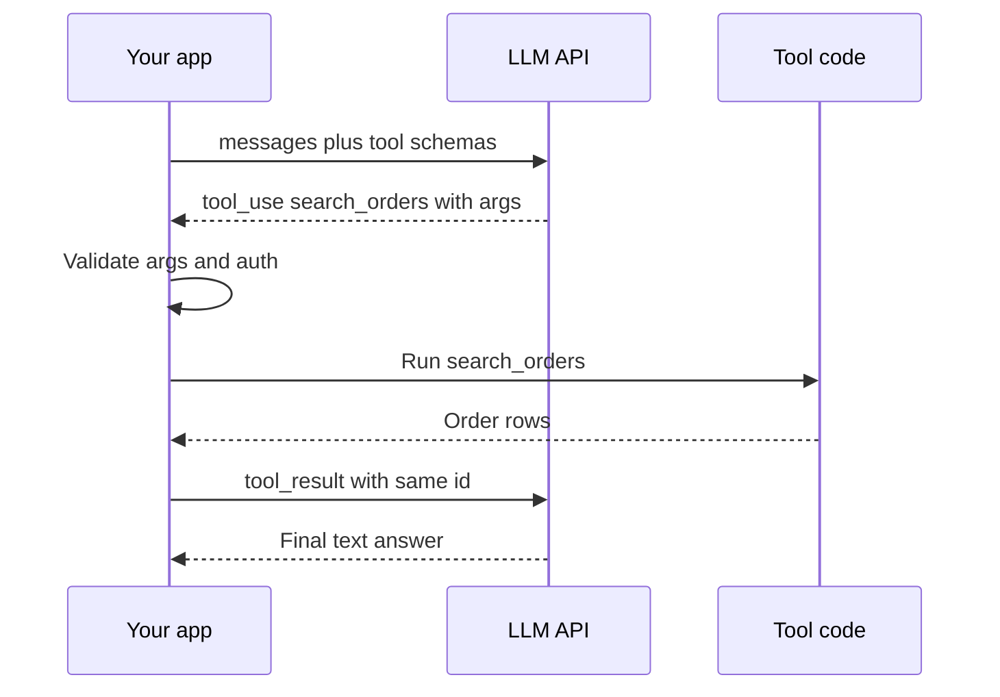

**Ab terms:**

- **Tool schema:** naam + description + JSON schema of args. Model ko yahi "menu" dikhta hai.
- **Description = prompt.** Model tool isi se choose karta hai. Kab use karo, kab nahi, args ka format, examples likho.
- **Schema tight rakho:** `enum`, `required`, formats. Kam aur clear params better.
- **`tool_choice`:** model ko tool use karne pe kitni azaadi hai.

| Setting | OpenAI | Anthropic | Kab |
|---|---|---|---|
| Model decide kare | `tool_choice="auto"` | `{"type": "auto"}` | default |
| Koi tool zaroor | `"required"` | `{"type": "any"}` | extraction, forced action |
| Specific tool | `{"type": "function", "function": {"name": "x"}}` | `{"type": "tool", "name": "x"}` | structured output |
| Tool mat use karo | `"none"` | `{"type": "none"}` | final summary step |
| Parallel off | `parallel_tool_calls=False` | `disable_parallel_tool_use: true` | order-dependent tools |

### Parallel tool calls

**Ye kyun chahiye?** User pucha "Delhi, Mumbai aur Bengaluru ka weather?". Teen alag turns me ek-ek call karo to 3 LLM round trips lagenge. Model ek hi turn me teen `tool_use` blocks de sakta hai.

1. Model ek response me 3 blocks deta hai: `get_weather("Delhi")` id `t1`, `Mumbai` id `t2`, `Bengaluru` id `t3`.
2. Teeno independent hain, to app unhe saath me chalata hai (`asyncio.gather`): `t1 → 31°C`, `t2 → 29°C`, `t3 → 24°C`.
3. App **ek hi** user message bhejta hai jisme teen `tool_result` blocks hain, har ek apne id ke saath. Model agle turn me jawab jodta hai.

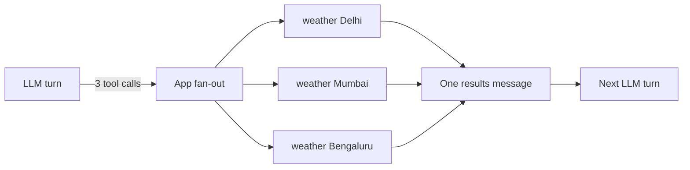

### Tool errors bhi observation hain

Tool fail ho to program crash mat karo. Clear error message wapas do, taaki model khud sudhar sake.

1. Model bhejta hai `get_inventory("102938")`. Tool lautata hai `Error: SKU 'FK-' se start hona chahiye, e.g. FK-102938` with `is_error: true`.
2. Model ye padh ke dobara bhejta hai `get_inventory("FK-102938")`. Kaam ho gaya. Retry count limit karo (2–3).

Neeche LangChain (LLM apps banane ki popular Python library) me wahi tool. `@tool` decorator docstring ko description aur type hints ko schema bana deta hai.

```python
from langchain_core.tools import tool
from langchain.chat_models import init_chat_model

@tool
def get_inventory(sku: str) -> dict:
    """Ek SKU ka live stock deta hai. SKU format: 'FK-' + 6 digits. Price ke liye use mat karo."""
    if not sku.startswith("FK-"):                       # galat format pe clear error
        raise ValueError("SKU 'FK-' se start hona chahiye, e.g. FK-102938")
    return {"sku": sku, "stock": 42, "warehouse": "BLR-2"}

llm = init_chat_model("anthropic:claude-sonnet-5-5", temperature=0)
llm_with_tools = llm.bind_tools([get_inventory], tool_choice="auto", parallel_tool_calls=True)
msg = llm_with_tools.invoke("FK-102938 aur FK-554411 ka stock batao")
for call in msg.tool_calls:          # [{'name': 'get_inventory', 'args': {...}, 'id': ...}, ...]
    print(call["name"], call["args"])
```

**Code me kya ho raha hai:**

- `@tool` function ko tool schema me badal deta hai. Docstring hi model ke liye description hai.
- `bind_tools` har LLM call ke saath ye schema bhejne ka intezaam karta hai.
- Do SKU maange the, to `msg.tool_calls` me do calls aayengi (parallel), har ek ka apna `id`.
- Is code ne tool chalaya nahi, sirf model ki request print ki. Chalana agla step hai (loop ya `ToolNode`, LangGraph ka ready-made node jo maange gaye tools chalata hai).

**Ek line me:** tum model ko tools ka **naam + description + JSON schema** dete ho; model structured call lautata hai; tumhara code chalata hai aur result wapas deta hai.

**Interview tip:** "Tool ka description main prompt jaisa likhta hoon aur tool errors ko structured observation bana ke lautata hoon. Hallucinated args ko schema validation pe pakad ke model ko sahi format batata hoon."

**Common galti:** 30–50 tools ek saath de dena. Selection accuracy girti hai. Tools ko group karo, router se subset do, ya dynamic tool loading.

## LLM basics jo agents me matter karte hain

**Ye kyun chahiye?** Upar dekha ki har turn pe poori messages list dobara jaati hai. To agent ka bill, uski speed, aur wo kab "bhoolne" lagta hai, ye sab tokens aur context window pe tika hai. Ye na samjho to agent demo me chalega, production me bill dekh ke ruk jaayega.

**Analogy: STD booth ka meter.** Har token ka paisa lagta hai, aur har turn pe tum poori purani baat dobara "bolte" ho. Jitni lambi baat, utna lamba meter.

### Tokens, chhote numbers ke saath

- **Token** = text ka chhota tukda. English me ~4 characters ≈ 1 token. "Where is my order?" ≈ 5 tokens. Hinglish/Hindi me usually zyada tokens lagte hain.
- **Cost = input tokens + output tokens** (output mehenga hota hai).

Swiggy run ka hisaab (system prompt + tool schemas = 800 tokens maan lo):

| API call | Input tokens | Kyun |
|---|---|---|
| 1 | 830 | 800 setup + 30 user message |
| 2 | 940 | + 60 assistant tool_use + 50 tool_result |
| 3 | 1,030 | + 50 tool_use + 40 tool_result |
| **Total** | **2,800** | ek single call hoti to sirf 830 |

3 turns me input 3.4x ho gaya. 20 steps wala agent ho to har step pichhli saari history dobara bhejta hai, isliye cost steps ke saath roughly **quadratic** badhti hai.

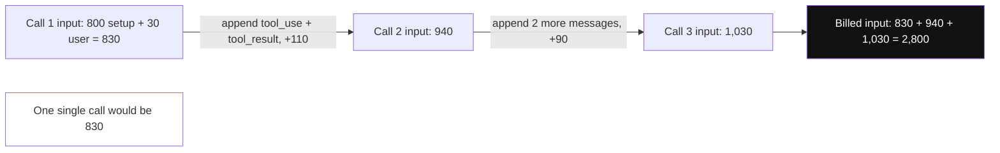

*Diagram:* Har call pichla sab kuch dobara bhejti hai, isliye bill hone wala input (highlighted) teeno calls ka jod hai, single call ka 3.4x.

### Context window

- **Context window** = model ek call me maximum kitne tokens dekh sakta hai (aaj kal 128k–1M).
- Example: Razorpay dispute agent ek 300 KB settlement report tool se padhta hai. 300 KB / 4 ≈ **75k tokens**. 200k window me aisi 2 reports ke baad teesri fit hi nahi hogi, API 400 error degi. Fix: tool poora JSON na lautaye, summary + top 20 rows lautaye (≈ 3k tokens).
- Bada window ≠ accha recall. Beech ka content aksar miss hota hai ("lost in the middle"). Context budget plan karo.

### Temperature

LLM har agla token probabilities se chunta hai. Maan lo agent ko agla tool chunna hai: `get_order_status` 0.90, `issue_refund` 0.07, `get_menu` 0.03.

- **Temperature 0:** lagbhag hamesha top option (`get_order_status`). Predictable.
- **Temperature 1:** distribution se sample. 100 me se ~7 baar `issue_refund` chun lega bina status dekhe. Paisa gaya.
- Isliye agents ke tool selection ke liye low (0–0.3) rakho; creative writing ke liye zyada. Reasoning models me aksar temperature fixed/ignored hota hai.

### Max tokens aur stop reasons

- **Max tokens:** output ki limit. Maan lo `max_tokens=50` aur model ko 80 tokens ka tool JSON likhna tha. JSON beech me kat jaayega, `stop_reason="max_tokens"` aayega, aur parse fail.
- **Stop reason** batata hai model kyun ruka. Loop isi ko dekh ke agla kaam chunta hai:

| Stop reason (Anthropic) | OpenAI `finish_reason` | Agent loop me kya karo |
|---|---|---|
| `end_turn` | `stop` | final answer, loop khatam |
| `tool_use` | `tool_calls` | tools chalao, results wapas bhejo |
| `max_tokens` | `length` | truncated: retry with zyada limit ya "continue" |
| `stop_sequence` | `stop` | custom stop string mila |
| `refusal` | `content_filter` | safe fallback / human |

### Structured output

**Problem:** tum chahte ho LLM refund ka decision de, aur tumhara code `if eligible:` chalaye. Free text me model kabhi "Yes", kabhi "eligible hai", kabhi "Haan bilkul" likhega. Parse karna fragile hai.

Options: **JSON mode** (valid JSON, par schema ki guarantee nahi), **JSON schema / strict mode** (schema guaranteed), ya **tool-calling trick** (schema ko tool bana do aur wahi tool force karo).

Neeche code ek Pydantic class deta hai; LangChain andar se schema bhejta hai aur jawab ko typed object me badal deta hai.

```python
from pydantic import BaseModel, Field
from langchain.chat_models import init_chat_model

class RefundDecision(BaseModel):            # jawab ka exact shape
    eligible: bool
    amount_inr: int = Field(ge=0, description="Refund amount in rupees")
    reason: str

llm = init_chat_model("openai:gpt-4.1-mini", temperature=0)
judge = llm.with_structured_output(RefundDecision)   # andar tool-calling / JSON schema use hota hai
d = judge.invoke("Order 40 min late, value 450 INR, policy: >30 min late = full refund")
print(d.eligible, d.amount_inr)                       # True 450  (typed Pydantic object)
```

**Code me kya ho raha hai:**

- `RefundDecision` batata hai jawab me teen fields chahiye, unke types ke saath.
- `with_structured_output` schema model ko bhejta hai aur output ko validate karta hai.
- `d` ek Python object hai, string nahi. `d.eligible` seedha `True`/`False` hai.
- `Field(ge=0)` negative amount ko reject kar dega.

**Ek line me:** tokens, context window, temperature, stop reasons aur structured output: yahi paanch cheezein agent ki cost, reliability aur parsing decide karti hain.

**Interview tip:** "Agent ki cost per step nahi, per **trajectory** socho: har step poora context dobara bhejta hai. Isliye tool outputs trim karta hoon aur prompt caching use karta hoon."

**Common galti:** `max_tokens` chhota rakh ke truncated tool-call JSON ko parse karne ki koshish; `stop_reason` check hi nahi karna.

## Prompt engineering for agents

**Ye kyun chahiye?** Agent ke paas tools aur loop hai, par use kaise pata ki refund kab dena hai, PAN number dikhana hai ya nahi, kab human ko bulana hai? Ye sab system prompt batata hai. Prompt kamzor hua to agent tools ka galat use karega.

**Analogy: naye joinee ka onboarding document.** Pehle din HR deta hai: tumhara role, team ka goal, kaunsa software kab use karna, kya kabhi nahi karna, aur problem aaye to kisko bolna. Agent ka system prompt bilkul yahi hai.

**Ek example:** PhonePe KYC agent. Neeche ek real-jaisa system prompt hai, sections ke saath.

```text
[1. Role + goal]   Tum PhonePe KYC support agent ho. Goal: user ka KYC verify karwana.
[2. Context]       User tier: gold | Date: 2026-11-03 | Language: Hinglish   (har request pe inject)
[3. Tool usage]    Pehle get_kyc_status. verify_pan sirf tab jab user ne PAN diya ho.
[4. Constraints]   PAN aur Aadhaar kabhi full mat likho, sirf last 4 digits.
[5. Output]        3 lines se zyada nahi. Last line me agla step.
[6. Escalation]    2 failed verifications ke baad escalate_to_human call karo aur ruk jao.
```

Section 3 tools ka order fix karta hai, section 4 policy hai jo kabhi nahi tootni chahiye, aur section 6 batata hai kab rukna hai. Iske bina agent loop me ghoomta rehta hai.

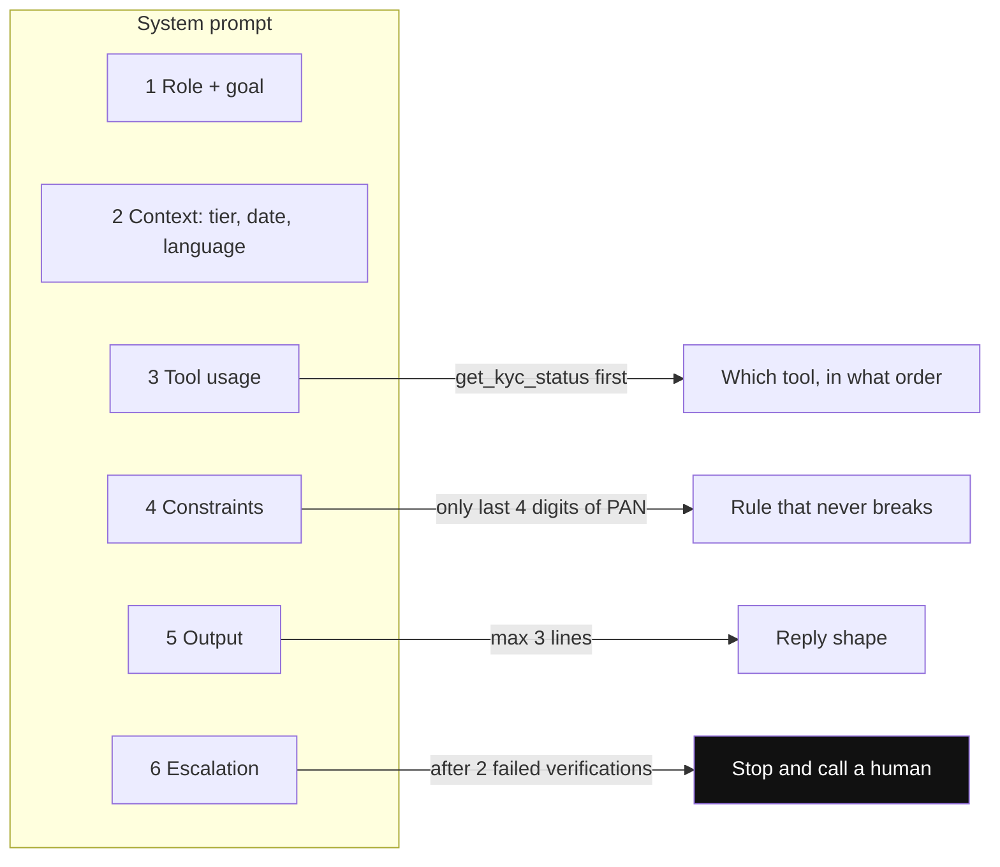

*Diagram:* Prompt ka har section loop ka ek behaviour control karta hai; escalation section (highlighted) hi agent ko hamesha ghoomne se rokta hai.

**Ab terms:**

- **System prompt anatomy:** upar ke 6 sections.
- **Few-shot:** 2–5 examples of good trajectories (sirf final answers nahi). Diverse rakho, warna model ek pattern copy karta hai.
- **CoT / reasoning models:** non-reasoning model pe "step by step socho" helps. Reasoning models (jo jawab se pehle hidden thinking steps likhte hain, e.g. OpenAI o-series, Claude extended thinking) khud sochte hain; unhe micro-manage mat karo, goal aur constraints do. Thinking tokens bhi bill hote hain.
- **Templates:** `ChatPromptTemplate` / f-strings with variables; static part pehle, dynamic last (prompt caching ke liye prefix stable rakho: provider pehle se process hua same shuruaati prompt reuse karta hai aur sasta bill karta hai).
- **Versioning:** prompt = code. Git ya prompt registry (versioned prompts store karne wala tool, e.g. LangSmith/Langfuse) me version, har change eval suite se gate. Trace (ek run ka recorded log) me prompt version log karo. Detail: [Evals for Agents](09-agent-evals.md).

**Ek line me:** agent ka system prompt ek **job description + operating manual** hai: role, goal, tools kab use karne, constraints, aur kab rukna/escalate karna.

**Interview tip:** "Prompt change ko main deploy jaisa treat karta hoon: version, eval run, phir rollout. Kisi bhi trace se pata hona chahiye kaunsa prompt version tha."

**Common galti:** sab kuch ek giant prompt me, contradictory rules ke saath; aur prompt edit production me bina eval ke.

## ⭐ Workflows vs agents

**Ye kyun chahiye?** Agent flexible hai par mehenga, slow aur kabhi kabhi unpredictable. Bahut saare kaam jinhe log "agent" bolte hain, asal me fixed steps hain. Unhe agent banaoge to 5x cost aur random behaviour milega.

**Analogy: Rajdhani vs Ola.** Rajdhani ka route fixed hai: stations pehle se pata hain, time table hai, har baar same. Ola driver har ride pe khud route chunta hai, traffic dekh ke. Rajdhani = workflow (code decide karta hai), Ola driver = agent (LLM decide karta hai). Jahan route pata hai wahan Rajdhani sasti aur reliable hai.

### Same task, dono tareeke se

Task: **"Order late hai, refund do."** Policy: 30 min se zyada late = full refund.

**Workflow version.** Steps tumhare code me likhe hain. LLM sirf last me reply ki language likhta hai.

```python
def handle_late_order(order_id: str) -> str:
    order = get_order_status(order_id)             # step 1: hamesha chalega
    if order["delay_min"] > 30:                    # step 2: decision code me
        issue_refund(order_id, order["value_inr"])
        situation = "order late tha, full refund diya"
    else:
        situation = "order thoda late hai, refund policy me nahi aata"
    return llm_write_reply(situation)              # step 3: LLM sirf polite reply likhta
```

**Code me kya ho raha hai:**

- Har request pe exactly yahi 3 steps, isi order me. Sirf 1 LLM call, to cost fixed.
- Refund ka decision `if` me hai, LLM ke haath me nahi. Unit test likhna aasaan.
- Naya case ("khana thanda tha") aaye to code badalna padega.

**Agent version.** Wahi loop jo upar likha. LLM ko tools milte hain: `get_order_status`, `check_refund_policy`, `issue_refund`, `escalate_to_human`. Ek run me wo 2 steps le sakta hai, doosre me 5.

Is task ke liye workflow kaafi hai. Agent tab chahiye jab complaint open-ended ho: kabhi refund, kabhi re-delivery, kabhi fraud check.

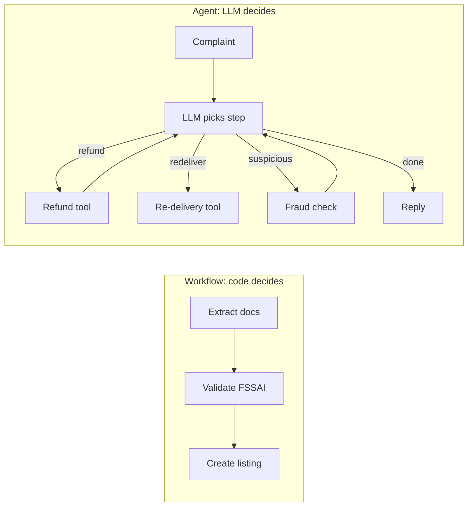

Zomato restaurant onboarding (documents → FSSAI check → listing) me path fixed hai, workflow. Customer complaint me path har baar alag hai, agent loop karke agla tool chunta hai.

**Decision table:**

| Sawal | Haan → | Nahi → |
|---|---|---|
| Steps pehle se likh sakte ho? | Workflow | Agent socho |
| Galat action costly / irreversible? | Workflow + HITL | Agent ok |
| Latency/cost strict SLA? | Workflow | Agent ok |
| Input variety bahut zyada, open-ended? | Agent | Workflow |
| Auditable, repeatable output chahiye? | Workflow | Agent |
| Steps ki count unknown (research, debugging)? | Agent | Workflow |

- **Hybrid sabse common:** workflow skeleton, ek-do nodes ke andar chhota agent (e.g. "investigate" step).
- Workflow patterns (chaining, routing, parallelization, orchestrator-workers, evaluator-optimizer): [Workflows](03-workflow-patterns.md).

**Ek line me:** jab steps pehle se pata hon to **workflow** (deterministic, sasta, testable); jab path input pe depend kare aur pehle se enumerate na ho sake, tab **agent**.

**Interview tip:** "Main default workflow se start karta hoon aur agent tabhi banata hoon jab eval dikhaye ki fixed path kaafi nahi. Agent flexibility ke badle cost, latency aur predictability deta hai."

**Common galti:** fixed 3-step process ke liye ReAct agent bana dena; phir random tool order aur 5x cost.

## Levels of autonomy

**Ye kyun chahiye?** "Agent" ek on/off switch nahi hai. Beech me kai levels hain. Level samjhoge to interview me bata paoge ki is problem ko kitni azaadi chahiye, aur kitne guardrails lagane honge.

**Analogy: car driving.** Manual car (tum sab karte ho) → cruise control (speed car sambhalti hai) → lane assist → highway autopilot → poori self-driving. Har level pe car zyada karti hai, aur galti hone pe nuksaan bhi bada.

**Ek example:** Paytm support evolution: L0 FAQ answer (single call) → L1 intent router → L2 tool agent (order lookup, refund) → L3 multi-agent (payments + KYC + disputes specialists) → L4 background agent jo khud fraud patterns monitor karke tickets kholta hai.

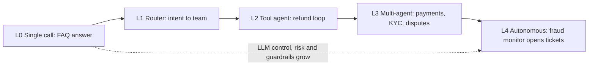

*Diagram:* Right ki taraf har step pe control flow ka zyada hissa LLM ke paas jaata hai, isliye galti ki keemat aur zaroori guardrails bhi badhte hain.

| Level | Kya | Kaun decide karta | Example | Risk |
|---|---|---|---|---|
| L0 Single call | prompt → answer | koi nahi | summarize ticket | low |
| L1 Router | LLM category choose karta, code chalata | LLM ek branch | intent → team | low |
| L2 Tool agent | loop with tools | LLM steps + tools | refund agent | medium |
| L3 Multi-agent | supervisor + specialists | LLMs coordinate | research + writer | high |
| L4 Autonomous | long-running, self-triggered goals | agent end-to-end | coding agent PR khole | highest |

- Level badhao to saath me badhao: guardrails, HITL, observability, evals. Detail: [Agent Patterns](04-agent-patterns.md), [Guardrails](08-guardrails.md).

**Ek line me:** autonomy ek spectrum hai: single LLM call se fully autonomous agent tak; har level pe control kam aur capability zyada.

**Interview tip:** "Problem ko sabse neeche wale level pe solve karo jo kaam kare. L3/L4 tab, jab single agent ki tool list ya context sambhal na paaye."

**Common galti:** multi-agent ko default maan lena. Har extra agent = extra tokens, handoff errors, debugging pain.

## Common failure modes

**Ye kyun chahiye?** Demo me agent 10 me se 10 baar chalta hai. Production me 10,000 requests aati hain aur 3% me agent ajeeb harkat karta hai: loop me fas jaata hai, galat tool chalata hai, ya ID bana deta hai. Failure ka pattern pehchanoge to fix pehle se laga paoge.

**Analogy: naya delivery boy.** Address na mile to galli me ghoomta rehta hai (loop), galat building me de aata hai (galat tool), phone number khud bana leta hai (hallucinated args).

**Ek example step by step: loop me fasna.** Swiggy agent ke prompt me likha hai "status final hone tak check karo".

1. `get_order_status("ORD-9")` → `"pending"`. Model: "abhi final nahi", phir wahi call → `"pending"`.
2. 9 baar same call, same result. 9 LLM calls ka bill, user ko jawab nahi.
3. **Fix:** `max_steps=6` (fallback reply), repeat detection (same name + args + result → observation "status nahi badla, abhi ka status batao"), aur prompt: "pending ho to ETA batao, dobara check mat karo".

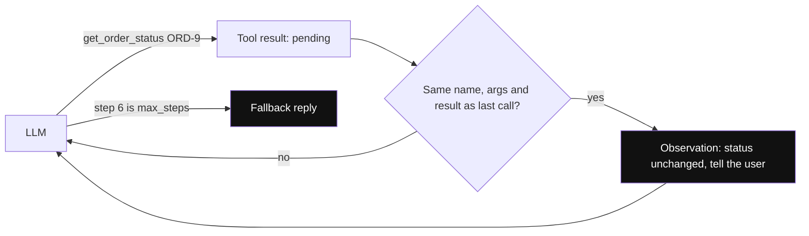

*Diagram:* Repeat check ke bina loop 9 baar ghoomta hai; dono highlighted guards atke hue loop ko user ke liye jawab me badal dete hain.

| Failure | Symptom | Fix |
|---|---|---|
| Infinite / repetitive loop | same tool + same args baar baar | `max_steps`/recursion limit, repeat detection, "no progress" check |
| Tool misuse | galat tool choose, ya zaroorat na ho phir bhi call | better descriptions, kam tools, few-shot trajectories |
| Hallucinated args | non-existent IDs, wrong format | schema + enum, validation error as observation, IDs sirf tool output se |
| Context overflow | purane steps bhool jaana, 400 error | tool output trim, summarization, sub-agent with fresh context |
| Premature stop | adha kaam karke "done" | completion criteria prompt me, evaluator step |
| Prompt injection via tool output | web page agent ko instructions de de | tool output ko data treat karo, guardrails |
| Error swallowing | tool fail, agent confidently galat answer | `is_error` flag, explicit "tool failed" handling |

- Measure karo: trajectory evals (right tool, right order, steps count). Detail: [Evals](09-agent-evals.md), [Observability](10-agent-observability.md).

**Ek line me:** agents chaar tarah se zyada fail hote hain: loop me fasna, galat tool, hallucinated args, aur context overflow; har ek ka specific fix hai.

**Interview tip:** "Har agent me teen hard limits hoti hain: max steps, max tokens/cost, aur wall-clock timeout. Limit hit ho to graceful fallback, crash nahi."

**Common galti:** sirf final answer check karna. Agent sahi answer galat raste se (10 extra calls) bhi de sakta hai; trajectory dekho.

## Aage padho

- [LangGraph Core Concepts](02-langgraph-core.md): yahi loop graph + state + checkpointing ke saath.
- [Agentic Patterns: Workflows](03-workflow-patterns.md) aur [Agents & Multi-agent](04-agent-patterns.md).
- [Tools, MCP & A2A](07-tools-mcp-a2a.md): tools ko standard tareeke se expose karna.
- [ReAct lab](/viewinter/agents/lab/react): browser me ReAct loop step-by-step chala ke dekho.

## Checklist

- [ ] Agent, workflow aur chatbot ka fark control flow ke basis pe samjha sakta hoon
- [ ] Ek agent run ko turn by turn trace kar sakta hoon (tool_use, tool_result, messages badhna) aur ReAct ki stop conditions bata sakta hoon
- [ ] Plain Python me tool-calling agent loop bina framework ke likh sakta hoon
- [ ] Tokens, context window, temperature, stop reasons aur structured output (`with_structured_output`) numbers ke saath samjha sakta hoon
- [ ] Tool schema, `tool_choice`, parallel tool calls aur tool errors ka handling bata sakta hoon
- [ ] Agent ke system prompt ka anatomy aur prompt versioning samjha sakta hoon
- [ ] Same task ko workflow aur agent dono tareeke se dikha ke decision table se justify kar sakta hoon
- [ ] Autonomy levels L0–L4 aur har level ka risk bata sakta hoon
- [ ] Common failure modes aur unke fixes bata sakta hoon
