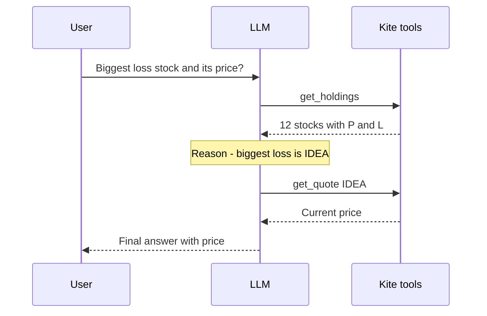
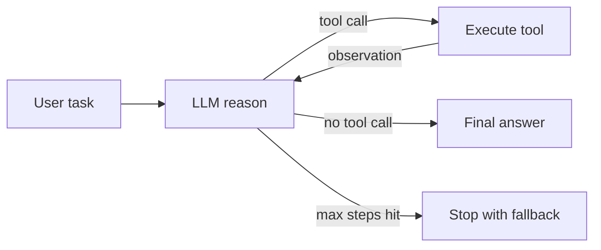
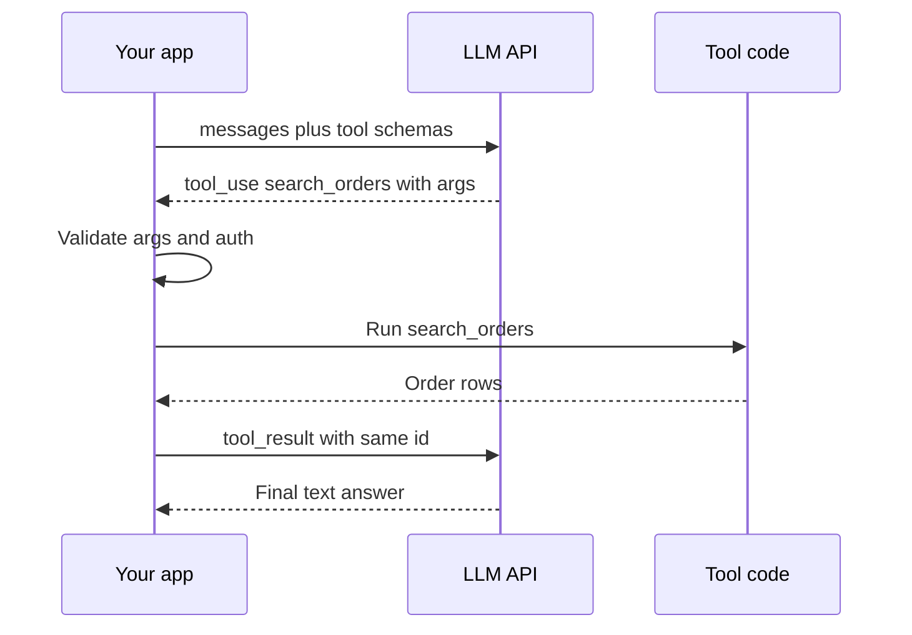
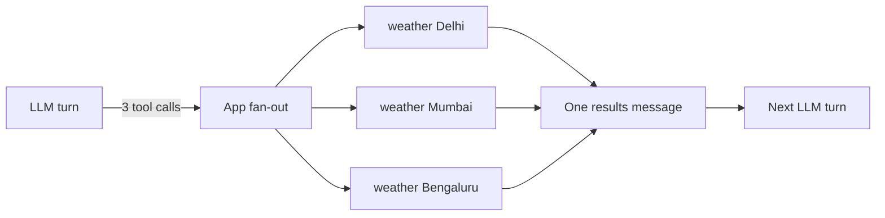
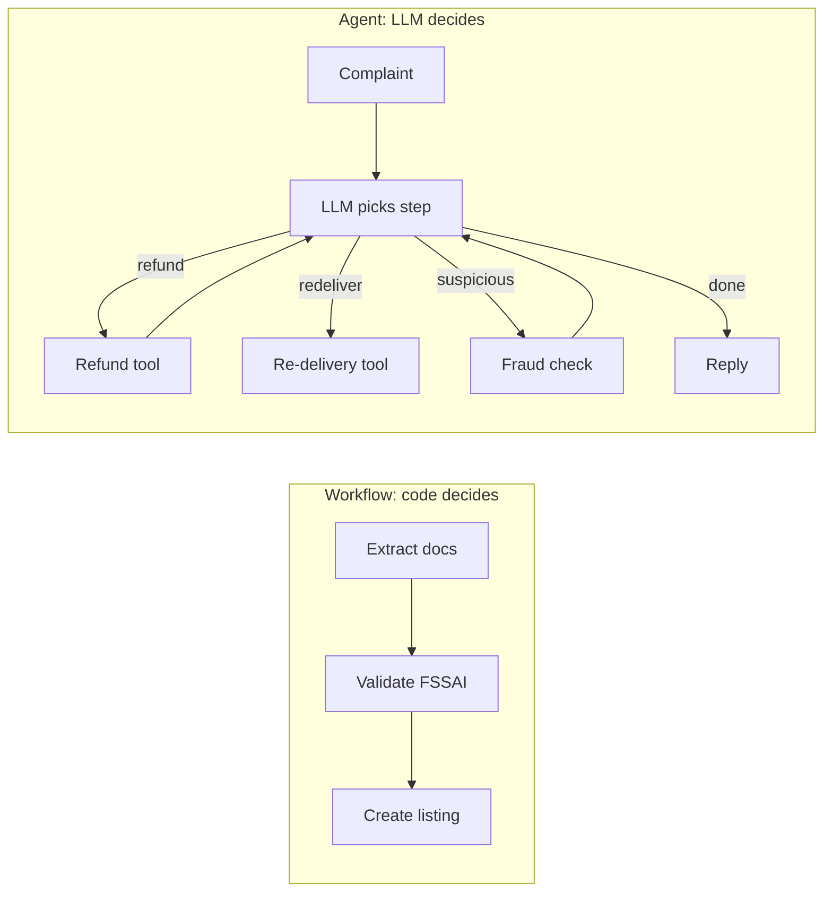

# Agent Foundations

Agent kya hai, agent loop (ReAct) kaise chalta hai, tool calling ka exact message shape, aur kab agent banana hi nahi chahiye. Agentic AI interview ka pehla 15 minute yahi hota hai: "agent vs workflow", "loop khud likh ke dikhao", "tool fail ho to kya". Yahan galti hui to aage ka round bhi kamzor lagta hai.

## Agent kya hai

**Ek line me:** agent = **LLM + tools + memory + loop**, jahan LLM khud decide karta hai ki agla step kya hoga aur kab ruk-na hai.

> **Example:** Swiggy support bot. "Mera order late hai, refund do." Chatbot sirf jawab likhta hai. Workflow fixed steps chalata hai (order fetch → policy check → reply). Agent khud decide karta hai: pehle `get_order_status`, phir delay 40 min dekh ke `check_refund_policy`, phir `issue_refund` ya human ko escalate.

- **LLM (brain):** reasoning aur next action choose karta hai.
- **Tools (hands):** APIs, DB queries, search, code execution. LLM sirf *request* karta hai, tumhara code *execute* karta hai.
- **Memory:** short-term = conversation/messages in context; long-term = store/vector DB across sessions (detail: [Memory & Context](05-memory-context.md)).
- **Loop:** LLM → tool → result wapas LLM → ... jab tak final answer ya stop condition.

| | Chatbot | Workflow | Agent |
|---|---|---|---|
| Control flow kaun decide karta | koi nahi, ek call | tumhara code (fixed path) | LLM (dynamic) |
| Tools | nahi | haan, fixed order | haan, LLM choose karta |
| Steps | 1 | fixed N | unknown, loop |
| Predictability | high | high | low |
| Cost/latency | low | predictable | variable, zyada |

- **Anthropic framing ("Building effective agents"):** dono "agentic systems" hain.
  - **Workflows:** LLMs aur tools **predefined code paths** se orchestrate hote hain.
  - **Agents:** LLM **dynamically apna process aur tool usage direct** karta hai.
  - Advice: sabse simple solution se shuru karo; complexity tabhi badhao jab measurable gain ho.

**Interview tip:** "Agent ki defining property autonomy over control flow hai. Agar next step mera code decide karta hai to wo workflow hai, chahe usme LLM ho."

**Common galti:** har LLM + tool wale system ko "agent" bolna. Fixed chain with one tool call workflow hai.

## ⭐ Agent loop aur ReAct

**Ek line me:** ReAct = **Re**ason + **Act**: model sochta hai, tool call karta hai, result (observation) dekhta hai, phir dobara sochta hai, jab tak task done na ho.

> **Example:** Zerodha Kite assistant: "Meri portfolio me sabse zyada loss wala stock kaunsa hai aur uska aaj ka price?" Step 1: `get_holdings()`. Observe: 12 stocks with P&L. Reason: sabse bada loss IDEA. Step 2: `get_quote("IDEA")`. Observe: price. Step 3: final answer.



Zerodha example ka trace: har tool result observation banke LLM ke paas wapas jaata hai, aur agla step LLM khud chunta hai.

- **Perceive:** user input + pichhle observations context me.
- **Reason:** model decide karta hai: tool chahiye ya answer ready.
- **Act:** tool call emit (name + JSON args).
- **Observe:** tool result message ke roop me wapas context me jaata hai.
- Original ReAct paper (Yao et al., 2022) me text format tha: `Thought: ... Action: ... Observation: ...`. Aaj **native tool calling** use hota hai; "thought" model ke andar (ya reasoning tokens me) hota hai, action structured JSON hota hai.
- **Stop conditions:** model tool call ke bina reply kare (`stop_reason="end_turn"` / `finish_reason="stop"`), `max_steps` hit, budget/time limit, ya guardrail trigger.



From-scratch loop (Anthropic Messages API shape). Framework ke bina yahi sab kuch hai:

```python
import json
import anthropic

client = anthropic.Anthropic()
TOOLS = [{
    "name": "get_order_status",
    "description": "Order ka current status aur delay minutes deta hai.",
    "input_schema": {"type": "object",
                     "properties": {"order_id": {"type": "string"}},
                     "required": ["order_id"]},
}]
REGISTRY = {"get_order_status": lambda order_id: {"status": "out_for_delivery", "delay_min": 40}}

def run_agent(user_msg: str, max_steps: int = 8) -> str:
    messages = [{"role": "user", "content": user_msg}]
    for _ in range(max_steps):
        resp = client.messages.create(model="claude-sonnet-4-5", max_tokens=1024,
                                      system="Tum Swiggy support agent ho.",
                                      tools=TOOLS, messages=messages)
        messages.append({"role": "assistant", "content": resp.content})
        if resp.stop_reason != "tool_use":          # koi tool call nahi = final answer
            return "".join(b.text for b in resp.content if b.type == "text")
        results = []
        for block in resp.content:
            if block.type != "tool_use":
                continue
            try:
                out = REGISTRY[block.name](**block.input)
                results.append({"type": "tool_result", "tool_use_id": block.id,
                                "content": json.dumps(out)})
            except Exception as e:                    # error bhi observation hai
                results.append({"type": "tool_result", "tool_use_id": block.id,
                                "content": f"Error: {e}", "is_error": True})
        messages.append({"role": "user", "content": results})  # saare results ek message me
    return "Step limit reach ho gaya, human ko escalate kar raha hoon."
```

- OpenAI shape me same cheez: `resp.choices[0].message.tool_calls`, har call ka result `{"role": "tool", "tool_call_id": ..., "content": ...}`, aur `finish_reason == "tool_calls"`.
- Framework (LangGraph) yahi loop deta hai + persistence, streaming, HITL. Detail: [LangGraph Core](02-langgraph-core.md).

**Interview tip:** whiteboard pe yeh loop 2 minute me likh pao: messages list, model call, `stop_reason` check, tools execute, results append, `max_steps`. Interviewer ko framework se zyada ye dikhna chahiye ki tum loop samajhte ho.

**Common galti:** `tool_use_id`/`tool_call_id` match na karna, ya assistant ka tool-call message history me append karna bhool jaana. Dono se API 400 error deta hai.

## LLM basics jo agents me matter karte hain

**Ek line me:** tokens, context window, temperature, stop reasons aur structured output: yahi paanch cheezein agent ki cost, reliability aur parsing decide karti hain.

> **Example:** Razorpay dispute agent ek 300 KB settlement report tool se padhta hai. Raw JSON context me daala to 80k tokens, har loop step pe dobara bill. Tool ne summary + top 20 rows lautaye to 3k tokens.

- **Tokens:** ~4 characters ≈ 1 token (English). Hinglish/Hindi me zyada tokens. Cost = input + output tokens; agent me har step pe **poori history dobara input** hoti hai, isliye cost roughly steps ke saath quadratic badhti hai.
- **Context window:** model ek call me kitna dekh sakta (128k–1M). Bada window ≠ accha recall: beech ka content miss hota hai ("lost in the middle"). Context budget plan karo.
- **Temperature:** agents ke tool selection ke liye low (0–0.3) rakho; creative writing ke liye zyada. Reasoning models me aksar temperature fixed/ignored hota hai.
- **Max tokens:** output limit. Hit hua to answer ya tool JSON beech me kat jaata hai.

| Stop reason (Anthropic) | OpenAI `finish_reason` | Agent loop me kya karo |
|---|---|---|
| `end_turn` | `stop` | final answer, loop khatam |
| `tool_use` | `tool_calls` | tools chalao, results wapas bhejo |
| `max_tokens` | `length` | truncated: retry with zyada limit ya "continue" |
| `stop_sequence` | `stop` | custom stop string mila |
| `refusal` | `content_filter` | safe fallback / human |

- **Structured output:** free text parse karna fragile. Options: JSON mode (valid JSON, schema guarantee nahi), **JSON schema / strict mode** (schema guaranteed), ya tool-calling trick (schema ko tool bana do).

```python
from pydantic import BaseModel, Field
from langchain.chat_models import init_chat_model

class RefundDecision(BaseModel):
    eligible: bool
    amount_inr: int = Field(ge=0, description="Refund amount in rupees")
    reason: str

llm = init_chat_model("openai:gpt-4.1-mini", temperature=0)
judge = llm.with_structured_output(RefundDecision)   # andar tool-calling / JSON schema use hota hai
d = judge.invoke("Order 40 min late, value 450 INR, policy: >30 min late = full refund")
print(d.eligible, d.amount_inr)                       # typed Pydantic object
```

**Interview tip:** "Agent ki cost per step nahi, per **trajectory** socho: har step poora context dobara bhejta hai. Isliye tool outputs trim karta hoon aur prompt caching use karta hoon."

**Common galti:** `max_tokens` chhota rakh ke truncated tool-call JSON ko parse karne ki koshish; `stop_reason` check hi nahi karna.

## ⭐ Tool / function calling

**Ek line me:** tum model ko tools ka **naam + description + JSON schema** dete ho; model structured call lautata hai; tumhara code chalata hai aur result wapas deta hai.

> **Example:** Flipkart seller assistant ke tools: `search_orders(status, date_from)`, `get_inventory(sku)`, `update_price(sku, new_price)`. "Kal ke cancelled orders dikhao" → model `search_orders(status="cancelled", date_from="2026-11-01")` emit karta hai.

- **Model execute nahi karta.** Wo sirf intent + args deta hai. Auth, validation, rate limit tumhare code me.



Model sirf `tool_use` block deta hai; args validate karna, tool chalana aur same id ke saath `tool_result` wapas bhejna tumhare app ka kaam hai.

- **Description = prompt.** Model tool isi se choose karta hai. Kab use karo, kab nahi, args ka format, examples likho.
- **Schema tight rakho:** `enum`, `required`, formats. Kam aur clear params better.

| Setting | OpenAI | Anthropic | Kab |
|---|---|---|---|
| Model decide kare | `tool_choice="auto"` | `{"type": "auto"}` | default |
| Koi tool zaroor | `"required"` | `{"type": "any"}` | extraction, forced action |
| Specific tool | `{"type": "function", "function": {"name": "x"}}` | `{"type": "tool", "name": "x"}` | structured output |
| Tool mat use karo | `"none"` | `{"type": "none"}` | final summary step |
| Parallel off | `parallel_tool_calls=False` | `disable_parallel_tool_use: true` | order-dependent tools |

- **Parallel tool calls:** ek turn me multiple calls (e.g. 3 cities ka weather). Independent ho to concurrently chalao (`asyncio.gather`), saare results **ek hi** next message me bhejo.



Ek turn me aaye independent calls concurrently chalao, aur saare results ek hi next message me wapas bhejo.

- **Tool errors = observations:** exception crash mat karo. Clear error message wapas do ("order_id format ORD-XXXX hona chahiye") taaki model self-correct kare. Retry count limit karo.

```python
from langchain_core.tools import tool
from langchain.chat_models import init_chat_model

@tool
def get_inventory(sku: str) -> dict:
    """Ek SKU ka live stock deta hai. SKU format: 'FK-' + 6 digits. Price ke liye use mat karo."""
    if not sku.startswith("FK-"):
        raise ValueError("SKU 'FK-' se start hona chahiye, e.g. FK-102938")
    return {"sku": sku, "stock": 42, "warehouse": "BLR-2"}

llm = init_chat_model("anthropic:claude-sonnet-4-5", temperature=0)
llm_with_tools = llm.bind_tools([get_inventory], tool_choice="auto", parallel_tool_calls=True)
msg = llm_with_tools.invoke("FK-102938 aur FK-554411 ka stock batao")
for call in msg.tool_calls:          # [{'name': 'get_inventory', 'args': {...}, 'id': ...}, ...]
    print(call["name"], call["args"])
```

**Interview tip:** "Tool ka description main prompt jaisa likhta hoon aur tool errors ko structured observation bana ke lautata hoon. Hallucinated args ko schema validation pe pakad ke model ko sahi format batata hoon."

**Common galti:** 30–50 tools ek saath de dena. Selection accuracy girti hai. Tools ko group karo, router se subset do, ya dynamic tool loading.

## Prompt engineering for agents

**Ek line me:** agent ka system prompt ek **job description + operating manual** hai: role, goal, tools kab use karne, constraints, aur kab rukna/escalate karna.

> **Example:** PhonePe KYC agent ke prompt me likha: "PAN aur Aadhaar number kabhi full output me mat likho, last 4 digits dikhao. 2 failed verifications ke baad `escalate_to_human` call karo."

- **System prompt anatomy:**
  1. Role + goal ("Tum PhonePe KYC support agent ho...")
  2. Context (user tier, date, locale) dynamically inject
  3. Tool usage guidelines (kab kaunsa, order, kya nahi)
  4. Constraints/policies (PII, refunds limit, tone)
  5. Output format (JSON schema ya markdown rules)
  6. Stop/escalation rules
- **Few-shot:** 2–5 examples of good trajectories (sirf final answers nahi). Diverse rakho, warna model ek pattern copy karta hai.
- **CoT / reasoning models:** non-reasoning model pe "step by step socho" helps. Reasoning models (o-series, Claude extended thinking) khud sochte hain; unhe micro-manage mat karo, goal aur constraints do. Thinking tokens bhi bill hote hain.
- **Templates:** `ChatPromptTemplate` / f-strings with variables; static part pehle, dynamic last (prompt caching ke liye prefix stable rakho).
- **Versioning:** prompt = code. Git ya prompt registry (LangSmith/Langfuse) me version, har change eval suite se gate. Trace me prompt version log karo. Detail: [Evals for Agents](09-agent-evals.md).

**Interview tip:** "Prompt change ko main deploy jaisa treat karta hoon: version, eval run, phir rollout. Kisi bhi trace se pata hona chahiye kaunsa prompt version tha."

**Common galti:** sab kuch ek giant prompt me, contradictory rules ke saath; aur prompt edit production me bina eval ke.

## ⭐ Workflows vs agents

**Ek line me:** jab steps pehle se pata hon to **workflow** (deterministic, sasta, testable); jab path input pe depend kare aur pehle se enumerate na ho sake, tab **agent**.

> **Example:** Zomato restaurant onboarding: document extract → validate FSSAI → create listing. Steps fixed, workflow. Vs "customer ki complaint resolve karo": kabhi refund, kabhi re-delivery, kabhi fraud check. Path unknown, agent.



Workflow me path code me fixed hai; agent me LLM har step pe agla tool chunta hai aur result dekh ke loop karta hai.

| Sawal | Haan → | Nahi → |
|---|---|---|
| Steps pehle se likh sakte ho? | Workflow | Agent socho |
| Galat action costly / irreversible? | Workflow + HITL | Agent ok |
| Latency/cost strict SLA? | Workflow | Agent ok |
| Input variety bahut zyada, open-ended? | Agent | Workflow |
| Auditable, repeatable output chahiye? | Workflow | Agent |
| Steps ki count unknown (research, debugging)? | Agent | Workflow |

- **Hybrid sabse common:** workflow skeleton, ek-do nodes ke andar chhota agent (e.g. "investigate" step).
- Workflow patterns (chaining, routing, parallelization, orchestrator-workers, evaluator-optimizer): [Workflows](03-workflow-patterns.md).

**Interview tip:** "Main default workflow se start karta hoon aur agent tabhi banata hoon jab eval dikhaye ki fixed path kaafi nahi. Agent flexibility ke badle cost, latency aur predictability deta hai."

**Common galti:** fixed 3-step process ke liye ReAct agent bana dena; phir random tool order aur 5x cost.

## Levels of autonomy

**Ek line me:** autonomy ek spectrum hai: single LLM call se fully autonomous agent tak; har level pe control kam aur capability zyada.

> **Example:** Paytm support evolution: L0 FAQ answer (single call) → L1 intent router → L2 tool agent (order lookup, refund) → L3 multi-agent (payments + KYC + disputes specialists) → L4 background agent jo khud fraud patterns monitor karke tickets kholta hai.

| Level | Kya | Kaun decide karta | Example | Risk |
|---|---|---|---|---|
| L0 Single call | prompt → answer | koi nahi | summarize ticket | low |
| L1 Router | LLM category choose karta, code chalata | LLM ek branch | intent → team | low |
| L2 Tool agent | loop with tools | LLM steps + tools | refund agent | medium |
| L3 Multi-agent | supervisor + specialists | LLMs coordinate | research + writer | high |
| L4 Autonomous | long-running, self-triggered goals | agent end-to-end | coding agent PR khole | highest |

- Level badhao to saath me badhao: guardrails, HITL, observability, evals. Detail: [Agent Patterns](04-agent-patterns.md), [Guardrails](08-guardrails.md).

**Interview tip:** "Problem ko sabse neeche wale level pe solve karo jo kaam kare. L3/L4 tab, jab single agent ki tool list ya context sambhal na paaye."

**Common galti:** multi-agent ko default maan lena. Har extra agent = extra tokens, handoff errors, debugging pain.

## Common failure modes

**Ek line me:** agents chaar tarah se zyada fail hote hain: loop me fasna, galat tool, hallucinated args, aur context overflow; har ek ka specific fix hai.

> **Example:** Swiggy agent `get_order_status` ko 9 baar same args se call karta hai kyunki tool "pending" lautata hai aur prompt me "status final hone tak check karo" likha hai.

| Failure | Symptom | Fix |
|---|---|---|
| Infinite / repetitive loop | same tool + same args baar baar | `max_steps`/recursion limit, repeat detection, "no progress" check |
| Tool misuse | galat tool choose, ya zaroorat na ho phir bhi call | better descriptions, kam tools, few-shot trajectories |
| Hallucinated args | non-existent IDs, wrong format | schema + enum, validation error as observation, IDs sirf tool output se |
| Context overflow | purane steps bhool jaana, 400 error | tool output trim, summarization, sub-agent with fresh context |
| Premature stop | adha kaam karke "done" | completion criteria prompt me, evaluator step |
| Prompt injection via tool output | web page agent ko instructions de de | tool output ko data treat karo, guardrails |
| Error swallowing | tool fail, agent confidently galat answer | `is_error` flag, explicit "tool failed" handling |

- Measure karo: trajectory evals (right tool, right order, steps count). Detail: [Evals](09-agent-evals.md), [Observability](10-agent-observability.md).

**Interview tip:** "Har agent me teen hard limits hoti hain: max steps, max tokens/cost, aur wall-clock timeout. Limit hit ho to graceful fallback, crash nahi."

**Common galti:** sirf final answer check karna. Agent sahi answer galat raste se (10 extra calls) bhi de sakta hai; trajectory dekho.

## Aage padho

- [LangGraph Core Concepts](02-langgraph-core.md): yahi loop graph + state + checkpointing ke saath.
- [Agentic Patterns: Workflows](03-workflow-patterns.md) aur [Agents & Multi-agent](04-agent-patterns.md).
- [Tools, MCP & A2A](07-tools-mcp-a2a.md): tools ko standard tareeke se expose karna.
- [ReAct lab](/viewinter/agents/lab/react): browser me ReAct loop step-by-step chala ke dekho.

## Checklist

- [ ] Agent, workflow aur chatbot ka fark control flow ke basis pe samjha sakta hoon
- [ ] ReAct loop (reason, act, observe) aur uski stop conditions bata sakta hoon
- [ ] Plain Python me tool-calling agent loop bina framework ke likh sakta hoon
- [ ] Stop reasons aur structured output (`with_structured_output`) ka use samjha sakta hoon
- [ ] Tool schema, `tool_choice`, parallel tool calls aur tool errors ka handling bata sakta hoon
- [ ] Agent ke system prompt ka anatomy aur prompt versioning samjha sakta hoon
- [ ] Workflow vs agent ka decision table ke saath justify kar sakta hoon
- [ ] Autonomy levels L0–L4 aur har level ka risk bata sakta hoon
- [ ] Common failure modes aur unke fixes bata sakta hoon
