# LangGraph Core

[Agent Foundations](01-agent-foundations.md) me humne agent ko ek plain `for` loop me likha tha. LangGraph wahi loop ek **graph** ke roop me likhta hai: kaam ke dibbe (nodes), unke beech raaste (edges), ek shared data dict (state), aur har step ke baad auto-save (checkpoint). Is page pe ek hi Swiggy refund example chalega, aur har node ke baad state print karke dekhenge.

**Is page ke baad tum ye samjha paoge:**

- Graph kyun chahiye, jab plain `while` loop bhi agent chala leta hai.
- State, nodes, edges aur reducers: har node ke baad state dict kaise badalti hai.
- Checkpointing ek "save game" ki tarah: kya save hota hai, crash ke baad resume kaise hota hai.
- `interrupt()` ka exact timeline: pause → human → resume, aur node dobara kyun chalta hai.
- Haath se ek tool-calling agent graph banana, `ToolNode` aur `tools_condition` ke saath.

## Pehle ye shabd samjho

LLM naye ho? Pehle [How LLMs Work](14-how-llms-work.md) padho. Usme tokens, context window aur model text kaise banata hai, ye sab hai.

| Shabd | Simple matlab |
|---|---|
| LangGraph | Python library jo agent ko steps ke graph ki tarah chalati hai, save aur pause built-in ke saath. |
| State | Ek shared dict jise har step padhta hai aur usme apne changes jodta hai. |
| Checkpoint | Ek step ke baad state ki saved copy, taaki run baad me wahin se aage chal sake. |
| Reducer | Chhota function jo decide karta hai naya value purane se kaise mile: append, overwrite ya max. |
| `interrupt()` | Step ke andar ki call jo poora run rok deti hai jab tak human jawab na bheje. |
| `ToolNode` | LangGraph ka ready-made step jo model ke maange tools chalata hai aur results save karta hai. |
| Checkpointer | Wo component jo checkpoints ko memory, SQLite ya Postgres me likhta hai. |
| `thread_id` | Ek conversation ya run ki id. Uske saare checkpoints isi id ke neeche save hote hain. |
| Conditional edge | Function jo state padh ke agle step ka naam lautata hai. |
| `Command` | Step ka lautaya object jo state update karke agla step chunta hai, ya ruka hua run resume karta hai. |
| Superstep | Graph ka ek round: saare ready steps chalte hain, changes merge hote hain, phir ek checkpoint save. |
| Subgraph | Poora compiled graph jo bade graph ke andar ek single step ki tarah use hota hai. |
| Store | Saare threads ke across shared long-term key-value memory, jaise user ki khane ki preference. |
| Embedding | Numbers ki list jo text ka matlab dikhati hai; milte-julte texts ke numbers bhi milte-julte hote hain. |

## Big picture: LangGraph ke pieces kaise jude hain

Pehle tum ek **state schema** likhte ho: kaunsi keys hongi aur har key kaise merge hogi. Phir **nodes** jodte ho (har node ek Python function jo state padhta hai aur chhota update lautata hai). Phir **edges** se batate ho ki kis node ke baad kaun chalega. `compile()` in sabko ek runnable graph bana deta hai, aur yahin **checkpointer** lagta hai jo har step ke baad state save karta hai. Phir tum graph ko `invoke` ya `stream` karte ho. Beech me `interrupt()` graph ko pause kar sakta hai, aur same `thread_id` se resume hota hai.

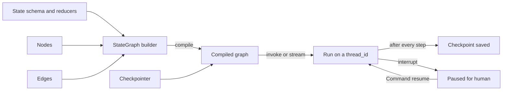

## Why LangGraph

**Ye kyun chahiye?** Page 1 ka `for` loop demo me chalta hai. Production me ye problems aati hain:

1. Step 4 pe pod restart hua. Messages list RAM me thi, sab gaya. User ko shuru se poochna padega.
2. ₹10,000 ke refund ke liye ops approval chahiye, jo 3 ghante baad aayega. Loop 3 ghante memory me baitha nahi reh sakta.
3. Naya step jodna hai, jaise tools se pehle guardrail. Loop ke andar `if-else` ka jungle ban jaata hai.
4. UI ko batana hai "abhi kaunsa step chal raha hai". Loop me iska koi standard tareeka nahi.

**Analogy: Indian Railways network.** Stations jahan kaam hota hai = nodes. Tracks = normal edges. Junction ka signal jo track chunta hai = conditional edges. Train ka chart jo saath chalta hai aur har station pe update hota hai = state. Har station ka register entry = checkpoint. Laal signal pe platform pe khadi train = `interrupt()`. Train ruk jaaye to register se pata hai wo kahan thi aur kya load tha. Wahi se aage badh sakti hai.

**Plain loop vs graph:**

| | Plain `while` loop | LangGraph |
|---|---|---|
| Crash ke baad | sab gaya | last checkpoint se resume |
| Ghanton ka pause | process blocked | state DB me, process free |
| Naya step jodna | loop ke andar if-else | naya node + edge |
| Progress dikhana | khud print karo | `stream` built-in |
| Parallel steps | khud threads | ek node se multiple edges |

**LangChain chain vs LangGraph:**

LangChain, LangGraph ki sister library hai jo LLM call karne ke kaam aati hai. LangChain ki "chain" (LCEL yaani LangChain Expression Language me likhi) fixed steps ek ke baad ek chalati hai.

| | LangChain chain (LCEL) | LangGraph |
|---|---|---|
| Shape | DAG, linear/branch | graph with cycles |
| State | inputs aage pass hote | typed shared state + reducers |
| Persistence | nahi | checkpointer per step |
| Pause / resume | nahi | `interrupt()` + `Command(resume=...)` |
| Debugging | logs | state history, time-travel |
| Use | simple pipelines | agents, long-running workflows |

### Graph andar se kaise chalta hai: supersteps

LangGraph graph ko **supersteps** me chalata hai (Pregel style, Google ke graph-processing system ke naam pe, jo bhi rounds me chalta hai). Ek superstep me:

1. Jo nodes is round me active hain, wo saath me (parallel) chalte hain. Maan lo `fetch_price` aur `fetch_stock` dono.
2. Dono apne updates lautate hain: `{"skus": ["FK-1"]}` aur `{"skus": ["FK-2"]}`.
3. Reducers dono updates ko state me merge karte hain: `skus = ["FK-1", "FK-2"]`.
4. Checkpoint save hota hai. Phir agla superstep.

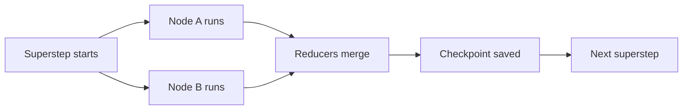

- **Levels:** low-level `StateGraph` (full control) vs high-level `create_agent` (`langchain.agents`, LangChain 1.0) jo andar LangGraph hi hai. Purana `langgraph.prebuilt.create_react_agent` ab deprecated path hai, `create_agent` use karo.

**Ek line me:** plain LangChain chains ek DAG hain (input → output, no loop, no saved state); LangGraph me **cycles, explicit state, checkpointing aur human-in-the-loop** first-class hain.

**Interview tip:** "LangGraph ek orchestration runtime hai, LLM wrapper nahi. Main isse durable execution, HITL aur cycles ke liye choose karta hoon; LLM calls kisi bhi SDK se ho sakti hain."

**Common galti:** sochna ki LangGraph ke liye LangChain models zaroori hain. Node sirf Python function hai, andar kuch bhi call karo.

## ⭐ State

**Ye kyun chahiye?** Nodes ko aapas me data share karna hai: classify node ne `order_id` nikala, refund node ko wo chahiye. Global variables se karo to do parallel nodes ek doosre ka data overwrite kar denge, aur crash pe kuch save nahi hoga. Isliye ek typed dict hai jo graph ke saath chalti hai.

**Analogy: hospital ki patient file.** File patient ke saath har department jaati hai. Har department sirf apna hissa likhta hai, poori file dobara nahi likhta. Aur rules hain: "doctor notes" me nayi line **jodo** (purani mat mitao), par "current ward" ko **overwrite** karo. Ye rules hi reducers hain.

### Ek example: state har node ke baad

Flipkart catalog graph. Do worker parallel me SKU add karte hain, phir `summarize` node.

**Shuru me:**

```python
{"messages": [HumanMessage("FK-1 aur FK-2 list karo")], "skus": [], "retries": 0, "status": "new"}
```

**Superstep 1: `worker_a` aur `worker_b` saath me chalte hain.**

- `worker_a` lautata hai `{"skus": ["FK-1"], "retries": 1}`
- `worker_b` lautata hai `{"skus": ["FK-2"], "retries": 2}`
- `skus` ka reducer `operator.add` hai → `[] + ["FK-1"] + ["FK-2"]` = `["FK-1", "FK-2"]`
- `retries` ka reducer `keep_max` hai → `max(0, 1, 2)` = `2`

```python
{"messages": [HumanMessage(...)], "skus": ["FK-1", "FK-2"], "retries": 2, "status": "new"}
```

**Superstep 2: `summarize` chalta hai** aur lautata hai `{"messages": [AIMessage("2 SKUs list ho gaye")], "status": "done"}`.

- `messages` ka reducer `add_messages` hai → naya message **append**.
- `status` pe koi reducer nahi → **overwrite**: `"new"` → `"done"`.

```python
{"messages": [HumanMessage(...), AIMessage("2 SKUs list ho gaye")],
 "skus": ["FK-1", "FK-2"], "retries": 2, "status": "done"}
```

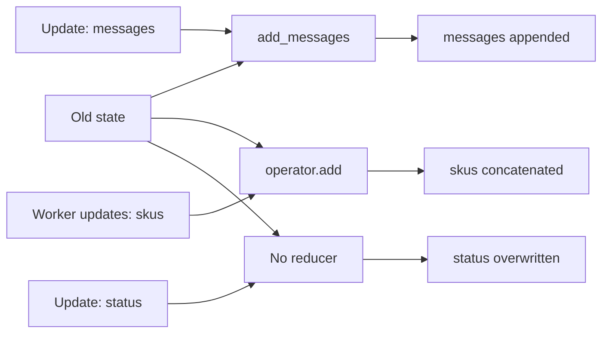

**`add_messages` ka ek special trick:** agar naye message ka `id` kisi purane message jaisa ho, to wo append nahi hota, **replace** hota hai. Maan lo state me `AIMessage("draft", id="m2")` hai, aur node lautata hai `AIMessage("final", id="m2")`. Result: list me sirf `"final"` rahega, duplicate nahi.

**Ab terms:**

- **State schema:** `TypedDict` (fast, common), `dataclass` (defaults), ya Pydantic `BaseModel` (Pydantic ek Python data-validation library hai; runtime validation, thoda slow).
- **Partial update:** node **poora state nahi lautata**, sirf jo keys badli: `return {"status": "done"}`.
- **Reducer:** function `(old, new) -> merged`. Key pe `Annotated[type, reducer]` se lagta hai.
- **No reducer:** naya value overwrite karta hai.
- **`operator.add`:** lists concatenate. Parallel branches (fan-out) ke liye zaroori.
- **`add_messages`:** messages append karta hai, **same `id` wale message ko replace** karta hai, `RemoveMessage(id=...)` se delete, aur dicts/tuples ko Message objects me convert karta hai.
- **`MessagesState`:** ready-made `{"messages": Annotated[list[AnyMessage], add_messages]}`. Extend karke keys add karo.

Neeche code wahi do schemas define karta hai: upar wala catalog state, aur Swiggy support state jo aage poore page pe chalega.

```python
import operator
from typing import Annotated, TypedDict
from langchain_core.messages import AnyMessage
from langgraph.graph import MessagesState
from langgraph.graph.message import add_messages

def keep_max(old: int, new: int) -> int:        # custom reducer: bada wala rakho
    return max(old, new)

class CatalogState(TypedDict):
    messages: Annotated[list[AnyMessage], add_messages]   # append / id se replace
    skus: Annotated[list[str], operator.add]               # parallel writes jud jaate
    retries: Annotated[int, keep_max]
    status: str                                            # no reducer: overwrite

class SupportState(MessagesState):                         # messages already hai
    order_id: str | None
    refund_approved: bool
```

**Code me kya ho raha hai:**

- `Annotated[list[str], operator.add]` ka matlab: is key pe updates list concat se merge honge.
- `keep_max` ek normal function hai jo reducer ki tarah kaam karta hai.
- `status: str` pe koi reducer nahi, to aakhri update jeetega.
- `SupportState` `MessagesState` se `messages` key le leta hai, aur `order_id`, `refund_approved` jodta hai.

- Advanced: alag `input_schema` / `output_schema` (public API chhota rakho), private state keys jo sirf kuch nodes ke beech hon.

**Ek line me:** state ek typed dict hai jo har node padhta hai aur partial update lautata hai; **reducer** decide karta hai update purane value me kaise merge ho.

**Interview tip:** "Do parallel nodes same key likhein aur reducer na ho to LangGraph `InvalidUpdateError` deta hai. Fan-out keys pe hamesha reducer lagata hoon."

**Common galti:** node me `state["messages"].append(x)` karke state mutate karna. Hamesha naya partial dict return karo, reducer ko merge karne do.

## ⭐ Nodes and edges

**Ye kyun chahiye?** Har request ka raasta alag hota hai. "Refund chahiye" wali request refund flow me jaani chahiye, "khana kharab tha" wali quality team ko, aur baaki seedha khatam. Ye decision kahin likhna padega. Edges wahi jagah hain.

**Analogy: railway junction.** Station (node) pe kaam hota hai. Seedha track (normal edge) hamesha agle station jaata hai. Junction pe signal (conditional edge) train ka chart dekh ke track chunta hai. Aur kabhi station master khud register me entry bhi karta hai aur driver ko bolta hai "platform 3 pe jao" (`Command`: update + goto ek saath).

### Ek example: Swiggy refund graph, state har node ke baad

User: **"ORD-1 ka refund chahiye"**. Graph: `classify` → (route) → `refund_flow` → (Command) → `auto_refund` → END.

1. **Input:** `{"messages": [HumanMessage("ORD-1 ka refund chahiye")]}`
2. **`classify` chalta hai.** Text me "refund" hai, to lautata hai `{"order_id": "ORD-1"}`. State ab: `{"messages": [Human], "order_id": "ORD-1"}`
3. **Conditional edge `route` chalta hai.** `order_id` hai, to `"refund_flow"` lautata hai.
4. **`refund_flow` chalta hai.** Amount 450 hai, 450 ≤ 500, to lautata hai `Command(update={"refund_approved": True}, goto="auto_refund")`. State ab: `{..., "order_id": "ORD-1", "refund_approved": True}`
5. **`auto_refund` chalta hai.** Lautata hai `{"messages": [("ai", "Refund ho gaya")]}`. `add_messages` append karta hai. State ab: `{"messages": [Human, AI("Refund ho gaya")], "order_id": "ORD-1", "refund_approved": True}`
6. **Normal edge `auto_refund → END`.** Run khatam.

Agar amount 7200 hota, to step 4 me `goto="ops_review"` jaata. Agar message me "refund" na hota, to step 3 me `route` seedha `END` lautata.

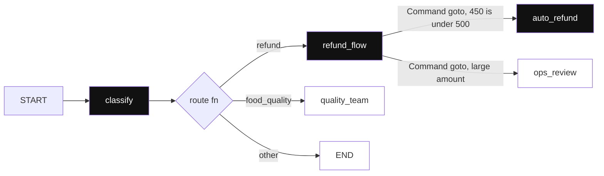

*Diagram:* Highlighted raasta ORD-1 ka run hai: 450, 500 ki limit se kam hai, isliye `Command` seedha auto_refund pe jaata hai; dim branches hain par is baar nahi chali.

**Ab terms:**

- **Node:** ek Python function `state -> partial update`.
- `START` aur `END` special nodes hain. `add_edge(START, "classify")` entry point.
- **Normal edge:** `add_edge("a", "b")`, hamesha a ke baad b.
- **Conditional edge:** `add_conditional_edges("a", router_fn, path_map)`. Router state padh ke node ka naam (ya list, ya `Send`) lautata hai.
- **`Command(goto=..., update=...)`:** routing logic node ke andar, edge function alag nahi. Return type `Command[Literal[...]]` likho taaki graph render/validate ho sake. `Command(graph=Command.PARENT)` se subgraph se parent me handoff (multi-agent).
- Ek node se multiple outgoing normal edges = parallel fan-out; `Send("worker", payload)` dynamic map-reduce ke liye (detail: [Workflows](03-workflow-patterns.md)).

Neeche code upar wala graph banata hai.

```python
from typing import Literal
from langgraph.graph import StateGraph, START, END
from langgraph.types import Command

def classify(state: SupportState) -> dict:
    text = state["messages"][-1].content.lower()
    return {"order_id": "ORD-1"} if "refund" in text else {"order_id": None}

def route(state: SupportState) -> str:                       # conditional edge
    return "refund_flow" if state["order_id"] else END

def refund_flow(state: SupportState) -> Command[Literal["auto_refund", "ops_review"]]:
    amount = 450                                             # tool se aayega
    nxt = "auto_refund" if amount <= 500 else "ops_review"
    return Command(update={"refund_approved": amount <= 500}, goto=nxt)  # update + goto ek saath

builder = StateGraph(SupportState)
builder.add_node("classify", classify)
builder.add_node("refund_flow", refund_flow)
builder.add_node("auto_refund", lambda s: {"messages": [("ai", "Refund ho gaya")]})
builder.add_node("ops_review", lambda s: {"messages": [("ai", "Ops review me bheja")]})
builder.add_edge(START, "classify")
builder.add_conditional_edges("classify", route, ["refund_flow", END])
builder.add_edge("auto_refund", END)
builder.add_edge("ops_review", END)
graph = builder.compile()
```

**Code me kya ho raha hai:**

- `classify` sirf `order_id` key lautata hai; baaki state waisi hi rehti hai.
- `route` kuch update nahi karta, sirf agla node ka naam lautata hai. Isliye wo edge hai, node nahi.
- `refund_flow` `Command` lautata hai, isliye uske liye `add_edge` nahi likha. `Literal[...]` batata hai wo kahan ja sakta hai.
- `auto_refund` aur `ops_review` se `END` tak normal edges hain.

**Ek line me:** nodes = kaam (functions), edges = agla kaun; **conditional edges** runtime pe route chunte hain, aur **`Command`** ek node ke andar se update + goto dono kar deta hai.

**Interview tip:** "Conditional edge tab jab routing ek pure function of state ho; `Command` tab jab node ko decide karte waqt state bhi update karni ho, jaise multi-agent handoff."

**Common galti:** `Command` return karne wale node se static edge bhi lagana. Dono chalenge aur double routing hogi.

## Compile, invoke, stream, ainvoke

**Ye kyun chahiye?** Builder sirf naksha hai. Use chalane layak banana padta hai, aur phir chalane ke kai tareeke chahiye: API ke liye ek jawab, chat UI ke liye live progress.

**Analogy: ghar ka naksha aur ghar.** `StateGraph` builder = naksha. `compile()` = ghar ban ke ready, bijli-paani (checkpointer, store) yahin connect hote hain. `invoke` = match ka final score dekhna. `stream` = ball-by-ball commentary.

**Ek example:** upar wala refund graph, `stream_mode="updates"` ke saath. Har node ke baad us node ka update print hota hai:

```python
for chunk in graph.stream({"messages": [("user", "ORD-1 ka refund chahiye")]},
                          stream_mode="updates"):
    print(chunk)
# {'classify': {'order_id': 'ORD-1'}}
# {'refund_flow': {'refund_approved': True}}
# {'auto_refund': {'messages': [AIMessage('Refund ho gaya')]}}
```

**Code me kya ho raha hai:**

- Har `chunk` ek dict hai: `{node_name: us node ka update}`.
- Teen chunks = teen nodes chale, usi order me jisme state badli.
- `stream_mode="values"` doge to har step ke baad **poora** state milega, sirf diff nahi.
- `graph.invoke(...)` yahi sab chalata hai par sirf aakhri state lautata hai.

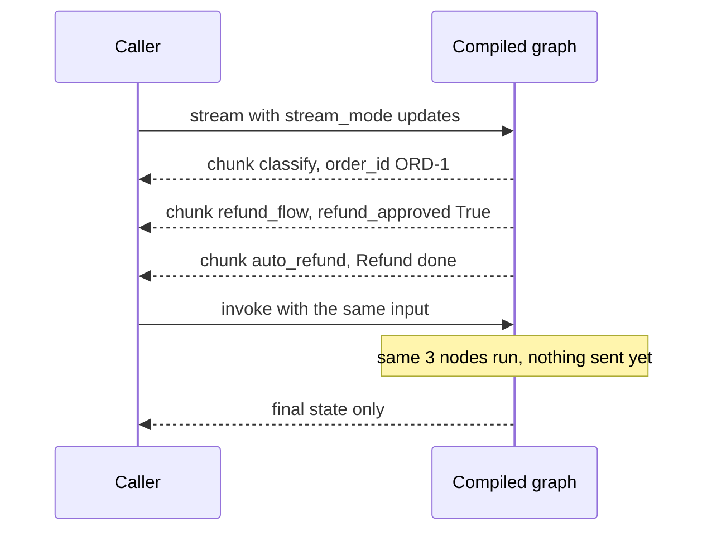

*Diagram:* Dono baar wahi teen nodes chalte hain: `stream` har node ke baad ek chunk deta hai, `invoke` intezaar karke sirf final state lautata hai.

| Method | Kya karta hai |
|---|---|
| `compile(checkpointer=, store=, interrupt_before=, interrupt_after=)` | structure validate karke `CompiledStateGraph` banata hai |
| `invoke(input, config)` | end tak chalata, final state lautata |
| `ainvoke` | async version, FastAPI jaise servers me |
| `stream` / `astream` | har step pe chunks yield karta |
| `batch` / `abatch` | multiple inputs ek saath |
| `get_graph().draw_mermaid()` | graph ka diagram |

- `config = {"configurable": {"thread_id": "u42"}, "recursion_limit": 30}`: config second positional arg hai.
- Async nodes (`async def`) ke saath `ainvoke`/`astream` hi use karo.
- Zerodha research bot jaisa API endpoint `await graph.ainvoke(...)` use karta hai; chat UI `astream(..., stream_mode="messages")` se tokens dikhata hai.

**Ek line me:** `compile()` builder ko runnable graph banata hai (checkpointer, store, interrupts yahin attach); phir `invoke`/`stream` aur unke async versions se chalao.

**Interview tip:** "Production API me main `astream` use karta hoon: user ko progress dikhti hai aur time-to-first-token kam lagta hai."

**Common galti:** compile ke baad builder me nodes add karke expect karna ki compiled graph badlega. Dobara compile karna padta hai.

## ⭐ Checkpointing and persistence

**Ye kyun chahiye?** User ne 2 ghante pehle baat ki thi, ab wapas aaya: "aur mera ORD-2?". Agent ko pichhli baat yaad honi chahiye. Ya pod refund ke beech crash ho gaya: kaam shuru se nahi, wahi se chalna chahiye. Dono ke liye state kahin save honi chahiye.

**Analogy: video game ka save game.** GTA me har mission checkpoint pe game auto-save hota hai. Bijli gayi to game wahi se khulta hai, shuru se nahi. Har player ka apna save slot hota hai. LangGraph me:

| Game | LangGraph |
|---|---|
| Save slot (player ka) | `thread_id` |
| Har checkpoint pe auto-save | har superstep ke baad checkpoint |
| Save file me kya hai (health, location, next mission) | `values`, `next` |
| "Continue" button | `invoke(None, cfg)` |
| Purana save load karke alag choice | time-travel (replay / fork) |

### Ek example: har step ke baad kya save hua

Refund graph, checkpointer ke saath, `thread_id = "user-42"`. Simplified view:

| Checkpoint | Kab | `values` me kya | `next` |
|---|---|---|---|
| 1 | input aaya | messages: [Human] | `("classify",)` |
| 2 | classify ke baad | + order_id: ORD-1 | `("refund_flow",)` |
| 3 | refund_flow ke baad | + refund_approved: True | `("auto_refund",)` |
| 4 | auto_refund ke baad | + AI "Refund ho gaya" | `()` (khatam) |

**Crash aur resume, step by step:**

1. Checkpoint 3 save hua. `auto_refund` chal raha tha, tabhi pod crash.
2. Naya pod uthta hai. Tum `graph.invoke(None, {"configurable": {"thread_id": "user-42"}})` bulate ho. `None` ka matlab: naya input nahi, bas aage chalo.
3. Checkpointer latest checkpoint (3) load karta hai. `next = ("auto_refund",)` hai.
4. Sirf `auto_refund` chalta hai. `classify` aur `refund_flow` dobara nahi chalte.

**Agli baat, same thread:** 2 ghante baad user likhta hai "aur ORD-2?". Tum `invoke({"messages": [("user", "aur ORD-2?")]}, cfg)` bulate ho. Checkpointer purane messages load karta hai, `add_messages` naya message append karta hai, aur graph poori history ke saath chalta hai.

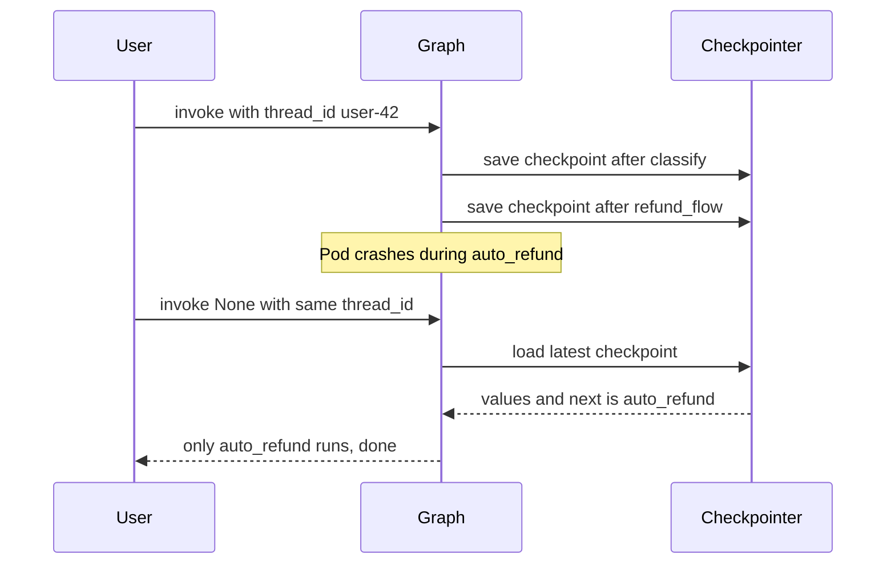

**Ab terms:**

- **Thread:** ek conversation/run ka id (`thread_id`). Har thread ki apni checkpoint history.
- **Checkpoint = `StateSnapshot`:** `values`, `next` (agla kaun chalega), `config` (with `checkpoint_id`), `metadata`, `parent_config`, `tasks`, `interrupts`.
- **Backends:**

| Saver | Package | Kab |
|---|---|---|
| `InMemorySaver` | `langgraph.checkpoint.memory` | tests, demos (process restart = sab gaya) |
| `SqliteSaver` / `AsyncSqliteSaver` | `langgraph-checkpoint-sqlite` | local, single machine |
| `PostgresSaver` / `AsyncPostgresSaver` | `langgraph-checkpoint-postgres` | production, multiple workers |

- Postgres pe pehli baar `checkpointer.setup()` chalao (tables banata hai).
- **Time-travel:** `get_state_history` se purana checkpoint lo, uske config se `invoke(None, config)` = **replay** (us point ke baad dobara execute). `update_state(old_config, values)` naya checkpoint (branch) banata hai = **fork**. Example: checkpoint 2 pe jao, `order_id` ko `ORD-2` karo, aur wahi se chalao; purani history safe rehti hai.

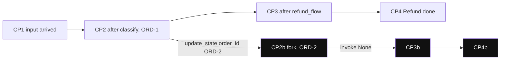

*Diagram:* Checkpoint 2 se fork ek nayi branch (highlighted) banata hai, CP3 aur CP4 history me waise hi rehte hain; replay CP2 se bina badle dobara chalata hai.

Neeche code checkpointer lagata hai, run karta hai, latest state padhta hai, phir replay aur fork karta hai.

```python
from langchain_core.messages import HumanMessage
from langgraph.checkpoint.memory import InMemorySaver
# from langgraph.checkpoint.postgres import PostgresSaver
# with PostgresSaver.from_conn_string(DB_URI) as cp: cp.setup(); graph = builder.compile(checkpointer=cp)

graph = builder.compile(checkpointer=InMemorySaver())     # save game ON
cfg = {"configurable": {"thread_id": "user-42"}}          # save slot
graph.invoke({"messages": [HumanMessage("Order ORD-1 ka refund chahiye")]}, cfg)

snap = graph.get_state(cfg)
print(snap.values["refund_approved"], snap.next)         # True ()  -> latest state, agla node

history = list(graph.get_state_history(cfg))             # newest first
before_refund = next(s for s in history if s.next == ("refund_flow",))
graph.invoke(None, before_refund.config)                 # replay us point se

forked = graph.update_state(before_refund.config, {"order_id": "ORD-2"})
graph.invoke(None, forked)                               # naya branch, purana history safe
```

**Code me kya ho raha hai:**

- `compile(checkpointer=...)` ke baad har superstep auto-save hota hai.
- `get_state(cfg)` latest save padhta hai; `next == ()` matlab run khatam.
- `get_state_history` saare saves deta hai, naye se purane. Humne wo save uthaya jahan agla node `refund_flow` tha (checkpoint 2).
- `invoke(None, old_config)` us save se dobara chalata hai. `update_state` pehle state badal ke naya branch banata hai.

**Ek line me:** checkpointer har superstep ke baad state ka snapshot **thread** ke against save karta hai; isi se memory across turns, pause/resume, fault tolerance aur time-travel milta hai.

**Interview tip:** "Checkpointer short-term (thread-scoped) memory hai. Cross-thread memory, jaise user preferences, ke liye Store use hota hai. Ye distinction interviewers zaroor poochte hain."

**Common galti:** production me `InMemorySaver`, ya har request pe naya random `thread_id` bana dena. Dono me conversation memory gayab.

## ⭐ Human-in-the-loop

**Ye kyun chahiye?** Kuch actions irreversible hain: paise bhejna, account delete, customer ko email. Inhe LLM ke bharose nahi chhod sakte. Kisi insaan ka "haan" chahiye. Par insaan 3 ghante baad jawab dega, aur tab tak server ka process khada nahi reh sakta.

**Analogy: bank me bada cheque.** ₹5 lakh se upar ka cheque clerk khud pass nahi karta. Wo file pe slip lagata hai "manager sign chahiye" aur file pending tray me rakh deta hai. Clerk doosre customers dekhne lagta hai. Agle din manager sign karta hai. Clerk file uthata hai aur us counter ka kaam **shuru se** dobara karta hai, is baar sign ke saath. Clerk = graph, pending tray = checkpointer, slip = interrupt payload, manager ka sign = resume value.

### Ek example: exact timeline

PhonePe refund agent. ₹7,200 ka refund, limit ₹5,000, to ops approval chahiye. `thread_id = "refund-ORD-9"`.

| Time | Kya hua | State |
|---|---|---|
| 10:00:00 | `invoke("ORD-9 ka refund do")` | thread shuru |
| 10:00:01 | `approval_gate` node chalta hai, `interrupt({...amount 7200})` pe pause | checkpoint save, `next = ("approval_gate",)` |
| 10:00:01 | `invoke` lautata hai `{"__interrupt__": [Interrupt(value={...})]}` | API request khatam, process free |
| 10:00:02 | Tumhara app Slack pe ops ko approval card bhejta hai | graph kuch nahi kar raha |
| 13:15:00 | Ops "Approve" dabata hai | |
| 13:15:01 | `invoke(Command(resume={"approved": True, ...}), cfg)` | checkpoint load |
| 13:15:01 | `approval_gate` **shuru se** chalta hai; is baar `interrupt()` turant `{"approved": True, ...}` lautata hai | |
| 13:15:02 | Node `Command(goto="issue_refund")` lautata hai, refund jaata hai | final checkpoint |

**Re-run wala gotcha:** maan lo `approval_gate` me `interrupt()` se **pehle** `send_sms("approval pending")` likha hai. 10:00 pe SMS gaya. 13:15 pe node shuru se chala, to SMS **dobara** gaya. Isliye interrupt se pehle ka code idempotent rakho, ya interrupt node ke start me rakho.

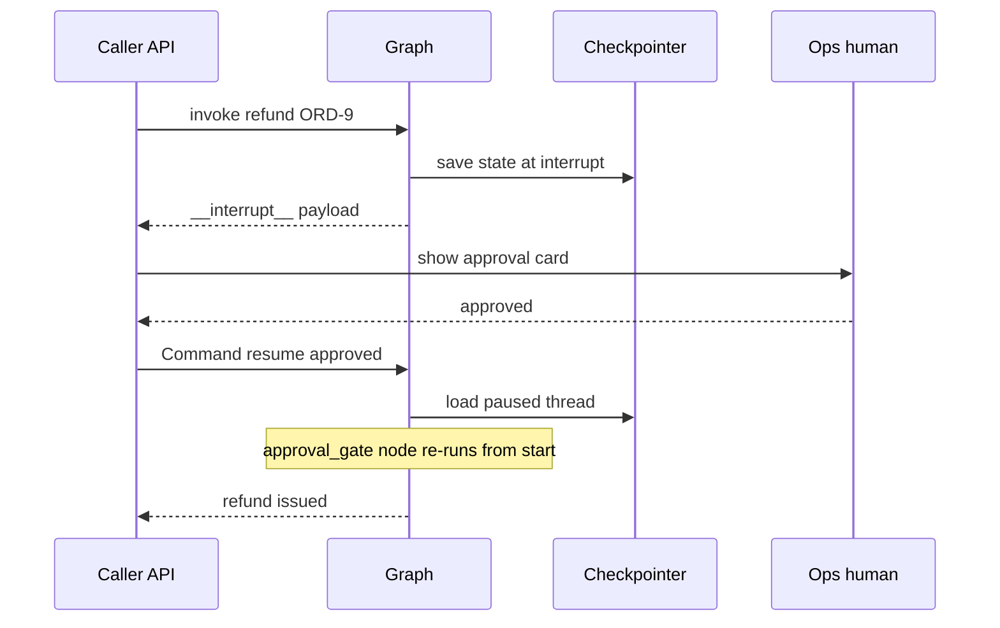

**Ab terms:**

- **`interrupt(payload)`:** node ke andar graph ko pause karta hai aur payload caller ko deta hai.
- **`Command(resume=value)`:** pause hua thread aage badhata hai; node re-run me `interrupt()` ab `value` lautata hai.
- **Checkpointer zaroori** hai (state save karni hai) aur `thread_id` bhi.
- Interrupt hone par `invoke` result me `__interrupt__` key aati hai with payload.
- **Resume pe node shuru se re-run hota hai**, `interrupt()` wali line se nahi.
- Ek node me multiple `interrupt()` calls order (index) se match hote hain; unhe conditionally skip/reorder mat karo.
- **Static breakpoints:** `compile(interrupt_before=["tools"])`, debugging ya "har tool se pehle ruko" ke liye.
- **State edit:** `graph.update_state(cfg, {...}, as_node="agent")`: human galat tool args theek kar de, phir `invoke(None, cfg)`.

Neeche code upar wala approval gate hai, aur do calls: pehli pause karti hai, doosri resume.

```python
from typing import Literal
from langgraph.types import Command, interrupt

def approval_gate(state: SupportState) -> Command[Literal["issue_refund", "reject"]]:
    decision = interrupt({                         # pehli baar: yahan graph pause
        "question": "Refund approve karein?",      # resume pe: yahi line value lautati hai
        "order_id": state["order_id"], "amount_inr": 7200,
    })
    if decision["approved"]:
        return Command(goto="issue_refund", update={"refund_approved": True})
    return Command(goto="reject", update={"refund_approved": False})

cfg = {"configurable": {"thread_id": "refund-ORD-9"}}
out = graph.invoke({"messages": [("user", "ORD-9 ka refund do")]}, cfg)
print(out["__interrupt__"][0].value)               # ops UI ko yahi payload dikhao

# ... ghanton baad, ops ne approve kiya:
graph.invoke(Command(resume={"approved": True, "by": "ops@phonepe"}), cfg)
```

**Code me kya ho raha hai:**

- Pehli `invoke` me `interrupt(...)` graph rok deta hai; `out["__interrupt__"]` me payload milta hai.
- Process ab free hai. State checkpointer me `refund-ORD-9` thread ke against padi hai.
- Doosri `invoke` me `Command(resume=...)` jaata hai. `approval_gate` shuru se chalta hai aur `decision` = `{"approved": True, ...}`.
- Phir `Command(goto="issue_refund")` refund wale node pe le jaata hai.

**Ek line me:** node ke andar `interrupt(payload)` graph ko pause karke payload caller ko deta hai; `Command(resume=value)` se wahi node dobara chalta hai aur `interrupt()` ab `value` lautata hai.

**Interview tip:** "Irreversible actions (paise, delete, email bhejna) ke saath main approval gate tool call ke just pehle rakhta hoon, aur resume path ko idempotent banata hoon kyunki node re-run hota hai."

**Common galti:** `interrupt()` ko `try/except Exception` me wrap karna. Interrupt andar se special exception raise karta hai; pakad liya to pause hi nahi hoga.

## Streaming modes

**Ye kyun chahiye?** Agent 20 second le sakta hai. User ko 20 second khaali screen dikhegi to wo app band kar dega. Usse typing dikhni chahiye, ya "3 sellers compare kar raha hoon...". Aur backend logs ko alag data chahiye.

**Analogy: cricket broadcast.** `values` = har over ke baad poora scorecard. `updates` = sirf is over me kya hua. `messages` = commentator ke shabd, ek ek karke. `custom` = screen pe tumhara apna graphic ("required run rate 9.2"). `debug` = third umpire ka technical log.

**Ek example:** Flipkart shopping assistant. Same run, alag modes me pehla chunk:

- `updates`: `{"compare_sellers": {"messages": [AIMessage("Seller B sabse sasta hai")]}}`
- `values`: `{"messages": [Human(...), AIMessage("Seller B sabse sasta hai")]}` (poora state)
- `messages`: `(AIMessageChunk("Seller"), {"langgraph_node": "compare_sellers", ...})`, phir `" B"`, phir `" sabse"`...
- `custom`: `{"progress": "3 sellers compare kar raha hoon"}`

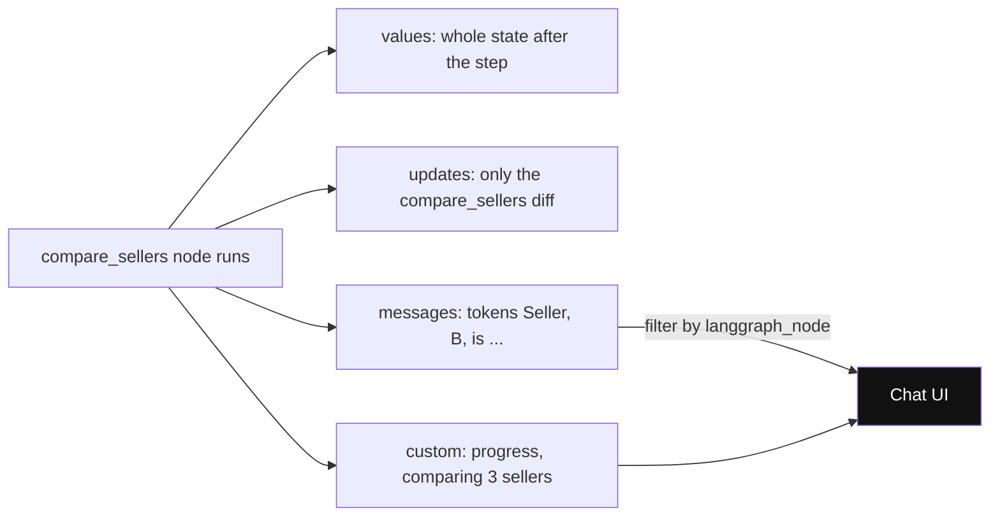

*Diagram:* Ek node run, uske chaar view; chat UI (highlighted) aam taur pe `messages` aur `custom` sunta hai.

| Mode | Har chunk me | Use |
|---|---|---|
| `values` | har step ke baad poora state | simple UIs, debugging |
| `updates` | sirf node ka diff `{node: update}` | logs, progress |
| `messages` | `(token_chunk, metadata)` LLM tokens | chat UI typing effect |
| `custom` | `get_stream_writer()` se bheja data | tool progress |
| `debug` | detailed task/checkpoint events | deep debugging |

Neeche code node ke andar se progress bhejta hai aur UI pe tokens + progress dono dikhata hai.

```python
from langgraph.config import get_stream_writer

def compare_sellers(state):
    writer = get_stream_writer()
    writer({"progress": "3 sellers compare kar raha hoon"})     # custom chunk
    return {"messages": [("ai", "Seller B sabse sasta hai")]}

for mode, chunk in graph.stream(inputs, cfg, stream_mode=["messages", "custom"]):
    if mode == "messages":
        token, meta = chunk
        if meta["langgraph_node"] == "agent":      # sirf agent node ke tokens
            print(token.content, end="")
    else:
        print("\n[progress]", chunk["progress"])
```

**Code me kya ho raha hai:**

- `get_stream_writer()` node ke andar se `custom` mode me koi bhi dict bhej sakta hai.
- Do modes list me diye, to har chunk `(mode, data)` tuple hai.
- `meta["langgraph_node"]` se pata chalta hai token kis node se aaya; sirf `agent` ke tokens user ko dikhaye.

- `subgraphs=True` se subgraph ke andar ke events bhi milte hain (namespace ke saath).

**Ek line me:** `stream_mode` decide karta hai har chunk me kya aaye: poora state, sirf diff, LLM tokens, tumhara custom data, ya debug events.

**Interview tip:** "Multiple modes ek saath list me de sakte ho; tab chunk `(mode, data)` tuple hota hai."

**Common galti:** `messages` mode me har node ke tokens UI pe dikha dena, including internal classifier ke. `langgraph_node` metadata se filter karo.

## Subgraphs and composition

**Ye kyun chahiye?** Paytm onboarding graph me KYC ka hissa (PAN verify, Aadhaar OTP, face match) alag team maintain karti hai, apne state schema ke saath. Sab ek hi graph me thoonsoge to do teams ek hi file pe ladengi.

**Analogy: company ke departments.** Sales team ko customer ka KYC chahiye. Wo KYC department ko sirf PAN aur phone deti hai, poori customer file nahi. KYC department andar apna kaam karta hai aur sirf "verified: haan" lautata hai. Department = subgraph, form jo dono ke beech jaata hai = wrapper node.

**Ek example step by step (different schema):**

1. Parent state: `{"pan": "ABCDE1234F", "phone": "98xxxxxx10", "kyc_verified": None, ...}`
2. Wrapper node `run_kyc` sirf do keys nikal ke subgraph ko deta hai: `{"pan": "ABCDE1234F", "phone": "98xxxxxx10"}`
3. Subgraph andar apne nodes chalata hai (PAN verify → OTP → face match) aur lautata hai `{"verified": True, ...}`
4. Wrapper parent ki key me map karta hai: `{"kyc_verified": True}`. Parent state me sirf ye ek key badli.

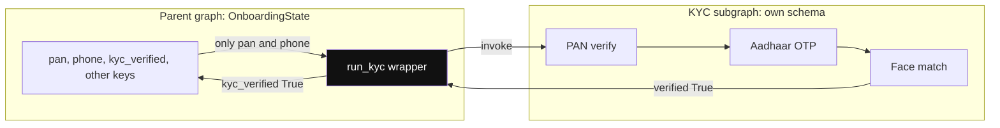

*Diagram:* Andar sirf do keys jaati hain aur ek key wapas aati hai; parent ki baaki keys KYC team ke graph tak kabhi nahi pahunchti.

**Ab terms:**

- **Shared keys** (e.g. dono me `messages`): `builder.add_node("kyc", kyc_graph)`, seedha compiled graph ko node bana do.
- **Different schema:** wrapper function, jaise neeche:

```python
def run_kyc(state: OnboardingState) -> dict:
    out = kyc_graph.invoke({"pan": state["pan"], "phone": state["phone"]})  # sirf zaroori keys andar
    return {"kyc_verified": out["verified"]}           # parent ki keys me map

builder.add_node("kyc", run_kyc)
```

**Code me kya ho raha hai:**

- `run_kyc` ek normal node hai jo andar doosra graph `invoke` karta hai.
- Subgraph ko sirf `pan` aur `phone` milte hain; parent ki private keys andar nahi jaati.
- Subgraph ka output `verified` parent ki `kyc_verified` key me badal jaata hai.

- Subgraph parent ka checkpointer inherit karta hai; subgraph ke andar `interrupt()` bhi kaam karta hai.
- Use: team ownership, reuse, multi-agent (har agent ek subgraph). Detail: [Agent Patterns](04-agent-patterns.md).

**Ek line me:** ek compiled graph doosre graph ka node ban sakta hai; state keys share hon to seedha add karo, alag hon to wrapper node me transform karo.

**Interview tip:** "Subgraph boundary = contract. Wrapper node se main explicitly decide karta hoon kaunsa data andar jaata hai, taaki private keys leak na hon."

**Common galti:** subgraph ko apna alag checkpointer de dena bina zaroorat; state do jagah bikhar jaata hai.

## Error handling

**Ye kyun chahiye?** Zerodha ka quote API kabhi kabhi 503 deta hai. LLM provider 2 minute down ho sakta hai. Aur agent loop me fas sakta hai. Bina handling ke user ko stack trace milega, ya bill badhta rahega.

**Analogy: delivery boy ki doorbell.** Ek baar bell bajao, jawab nahi aaya. Thoda ruko, dobara bajao. Phir thoda zyada ruko, teesri baar. Teeno baar fail to customer care ko call (fallback). Aur ek din me 15 se zyada chakkar nahi lagane (recursion limit).

**Ek example: retry timeline.** `RetryPolicy(max_attempts=3, initial_interval=0.5, backoff_factor=2.0)`:

1. Attempt 1: `fetch_quote` → 503. Wait 0.5s.
2. Attempt 2: → 503. Wait 0.5 × 2 = 1.0s.
3. Attempt 3: → 200 OK. Node ka update state me jaata hai, graph aage badhta hai.
4. Agar attempt 3 bhi fail hota, to error graph se bahar aata.

**Ek example: recursion limit.** `recursion_limit=15`. ReAct agent ka ek round = 2 supersteps (agent + tools). To lagbhag 7 rounds ke baad `GraphRecursionError`. Tum use pakad ke user ko "abhi nahi ho paaya, ticket bana diya" bolte ho.

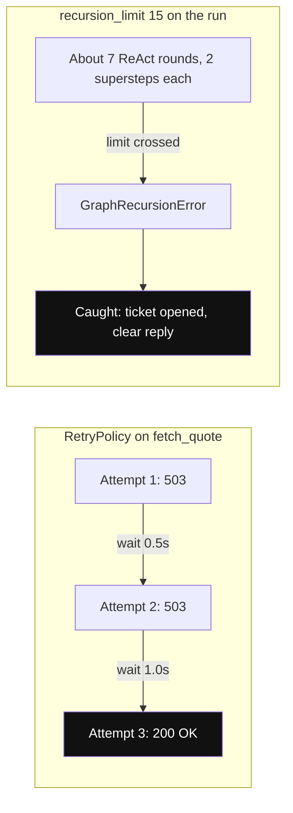

*Diagram:* Left: transient error ko double hote wait ke saath retry kiya jaata hai jab tak success na mile. Right: recursion limit ek safety net hai jise pakad ke graceful reply diya jaata hai.

**Ab terms:**

- **`recursion_limit`:** max supersteps per run (config me). Default version pe depend karta hai (purane versions me 25), isliye explicitly set karo. Hit hone pe `GraphRecursionError`. Note: ek ReAct round = 2 supersteps (agent + tools).
- **`RemainingSteps`** (`langgraph.managed`) state me rakh ke node limit se pehle hi graceful answer de sakta hai.
- **`RetryPolicy`** (`langgraph.types`): `max_attempts`, `initial_interval`, `backoff_factor`, `jitter`, `retry_on`. langgraph 1.x me `add_node(..., retry_policy=...)` (purana naam `retry=`).
- **Fallbacks:** `llm.with_fallbacks([backup_llm])`, ya `Command(goto="fallback_node")`.
- **Timeouts:** model client pe `timeout=`, async node me `asyncio.wait_for`, poore run pe server-level deadline.

Neeche code ek node pe retry lagata hai aur run pe recursion limit.

```python
import httpx
from langgraph.errors import GraphRecursionError
from langgraph.types import RetryPolicy

builder.add_node(
    "fetch_quote", fetch_quote,
    retry_policy=RetryPolicy(max_attempts=3, initial_interval=0.5,
                             backoff_factor=2.0, retry_on=httpx.HTTPError),  # sirf network errors pe
)
graph = builder.compile(checkpointer=InMemorySaver())

try:
    graph.invoke(inputs, {"configurable": {"thread_id": "t1"}, "recursion_limit": 15})
except GraphRecursionError:                          # loop limit cross
    reply = "Abhi answer nahi mil paaya, support ticket bana diya hai."
```

**Code me kya ho raha hai:**

- `retry_policy` sirf `fetch_quote` node pe laga hai; baaki nodes pe nahi.
- `retry_on=httpx.HTTPError`: sirf HTTP/network errors retry honge, code ke bugs nahi.
- `recursion_limit` config me har run ke liye diya jaata hai.
- `GraphRecursionError` pakad ke user ko saaf message dete hain, crash nahi.

**Ek line me:** loops ko `recursion_limit` se rokte hain, flaky calls ko `RetryPolicy` se retry karte hain, aur model/tool fail hone par fallback ya graceful exit dete hain.

**Interview tip:** "Retry sirf transient errors pe (timeouts, 5xx, 429). Validation errors retry karne se nahi sudhrte; unhe observation bana ke LLM ko wapas do."

**Common galti:** `recursion_limit` ko 1000 kar dena taaki error na aaye. Root cause loop hai; limit sirf safety net hai.

## Store for long-term memory

**Ye kyun chahiye?** Swiggy user ne Monday ko bola "main veg hoon". Friday ko nayi chat khuli, naya `thread_id`. Checkpointer sirf us thread ka data deta hai, to agent bhool gaya aur chicken biryani suggest kar di.

**Analogy: WhatsApp chats vs contact info.** Har chat ki apni history hoti hai (checkpointer, per thread). Par contact ka naam aur notes har chat se dikhte hain (Store, saare threads ke across).

**Ek example step by step:**

1. Monday, `thread_id = "chat-mon"`: user bola "main veg hoon". Node `store.put(("users", "u42", "prefs"), "diet", {"value": "veg"})` likhta hai.
2. Friday, `thread_id = "chat-fri"`: messages khaali hain, nayi chat.
3. Node `store.get(("users", "u42", "prefs"), "diet")` padhta hai → `{"value": "veg"}`.
4. Agent sirf veg restaurants suggest karta hai.

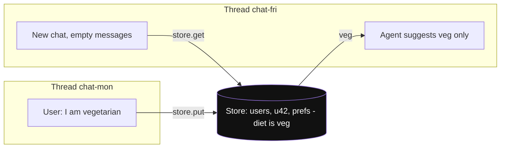

*Diagram:* Har thread ki apni checkpointer history hai, par dono ek hi Store namespace (highlighted) tak pahunchte hain, isliye Friday ki chat ko Monday ki baat pata hai.

**Ab terms:**

- **Namespace:** tuple jaise `("users", "u42", "prefs")`, folder path ki tarah.
- **Key:** namespace ke andar naam, jaise `"diet"`. Value ek dict.

```python
from langgraph.store.memory import InMemoryStore   # prod: PostgresStore

store = InMemoryStore()
graph = builder.compile(checkpointer=InMemorySaver(), store=store)   # dono saath
store.put(("users", "u42", "prefs"), "diet", {"value": "veg"})       # likho
print(store.get(("users", "u42", "prefs"), "diet").value)            # {'value': 'veg'}
# node ke andar: runtime.store.search(("users", "u42", "prefs"), query="food", limit=3)
```

**Code me kya ho raha hai:**

- `compile` me checkpointer (thread memory) aur store (user memory) dono lage.
- `put(namespace, key, value)` likhta hai, `get(namespace, key)` padhta hai.
- Node ke andar store `runtime.store` se milta hai; `search` se query karte hain.

- Embeddings ke saath `index={"embed": ..., "dims": ...}` dene se `search(query=...)` semantic ho jaata hai (exact words nahi, matlab se match karta hai).
- Kya yaad rakhna, kab likhna, kaise bhoolna: [Memory & Context](05-memory-context.md).

**Ek line me:** Store cross-thread key-value (+ optional semantic search) memory hai, `namespace` tuples me organized; checkpointer ek thread ke andar, Store saare threads ke across.

**Interview tip:** "Thread memory = checkpointer, user memory = Store. Dono alag lifetimes aur alag privacy rules."

**Common galti:** user preferences ko messages history me hi chhod dena; naye thread me sab bhool jaata hai.

## ⭐ Worked example: tool-calling agent by hand

**Ye kyun chahiye?** Page 1 ka `for` loop ab graph me likhenge. Isse saare pieces ek jagah dikhte hain: `MessagesState`, LLM node, `ToolNode`, `tools_condition`, aur checkpointer.

**Analogy:** do counter wala office. Counter A (agent) pe officer form padh ke decide karta hai "isko verification bhejo" ya "kaam ho gaya". Counter B (tools) pe clerk verification karta hai aur file wapas A ko deta hai. File (messages) har baar moti hoti jaati hai.

### Ek example: messages har node ke baad

User: **"ORD-77 late hai, refund milega? Value 380"**. Tools: `get_order_status`, `issue_refund`.

| Step | Node | `messages` me kya juda | Total |
|---|---|---|---|
| 0 | input | Human "ORD-77 late hai..." | 1 |
| 1 | agent | AI with `tool_calls`: get_order_status(ORD-77) | 2 |
| 2 | tools | ToolMessage `{"status": "out_for_delivery", "delay_min": 42}` | 3 |
| 3 | agent | AI with `tool_calls`: issue_refund(ORD-77, 380) | 4 |
| 4 | tools | ToolMessage "Refund of Rs 380 issued for ORD-77" | 5 |
| 5 | agent | AI "42 min delay tha, Rs 380 refund ho gaya" (no tool_calls) | 6 |

Step 5 ke baad `tools_condition` dekhta hai ki last AI message me `tool_calls` nahi hain, to `END`. Kul 6 supersteps, `recursion_limit=12` ke andar.

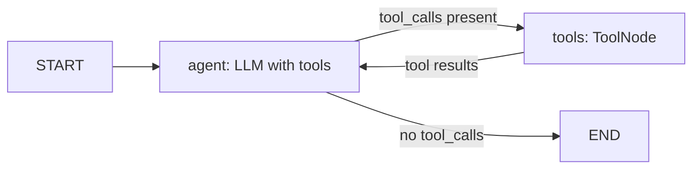

**Ab terms:**

- **`ToolNode(tools)`:** last AI message ke saare `tool_calls` chalata hai (parallel bhi), aur har result ko `ToolMessage` bana ke state me daalta hai. Tool error ko bhi `ToolMessage` banata hai.
- **`tools_condition`:** ready-made router. `tool_calls` hain to `"tools"`, warna `END`.

Neeche poora agent, upar wali table ko chalane wala.

```python
from langchain_core.messages import SystemMessage
from langchain_core.tools import tool
from langchain.chat_models import init_chat_model
from langgraph.graph import StateGraph, START, MessagesState
from langgraph.prebuilt import ToolNode, tools_condition
from langgraph.checkpoint.memory import InMemorySaver

@tool
def get_order_status(order_id: str) -> dict:
    """Order ka status aur delay minutes."""
    return {"order_id": order_id, "status": "out_for_delivery", "delay_min": 42}

@tool
def issue_refund(order_id: str, amount_inr: int) -> str:
    """Refund issue karta hai. Sirf tab jab delay 30 min se zyada ho."""
    return f"Refund of Rs {amount_inr} issued for {order_id}"

tools = [get_order_status, issue_refund]
llm = init_chat_model("openai:gpt-4.1-mini", temperature=0).bind_tools(tools)
SYSTEM = SystemMessage("Tum Swiggy support agent ho. Refund se pehle status check karo.")

def agent(state: MessagesState) -> dict:                  # counter A
    return {"messages": [llm.invoke([SYSTEM] + state["messages"])]}

builder = StateGraph(MessagesState)
builder.add_node("agent", agent)
builder.add_node("tools", ToolNode(tools))      # counter B: parallel calls chalata, errors ko ToolMessage banata
builder.add_edge(START, "agent")
builder.add_conditional_edges("agent", tools_condition)   # "tools" ya END
builder.add_edge("tools", "agent")                        # loop-back: result wapas LLM ko
graph = builder.compile(checkpointer=InMemorySaver())

cfg = {"configurable": {"thread_id": "u42"}, "recursion_limit": 12}
out = graph.invoke({"messages": [("user", "ORD-77 late hai, refund milega? Value 380")]}, cfg)
print(out["messages"][-1].content)
```

**Code me kya ho raha hai:**

- `agent` node system prompt + poori history LLM ko deta hai aur jawab ko `messages` me append karwata hai.
- `tools_condition` har `agent` run ke baad decide karta hai: tools ya END.
- `add_edge("tools", "agent")` loop banata hai; iske bina tool result LLM tak kabhi nahi pahunchta.
- Checkpointer ki wajah se same `thread_id` pe agla sawal poori history ke saath chalega.

- Same cheez one-liner me: `create_agent(model="openai:gpt-4.1-mini", tools=tools, system_prompt="...", checkpointer=InMemorySaver())` (`from langchain.agents import create_agent`). Purane code me `create_react_agent(model, tools)` milega.
- `refund` se pehle approval chahiye to `compile(interrupt_before=["tools"])` ya `issue_refund` ke andar `interrupt()`.

**Ek line me:** `MessagesState` + LLM node + `ToolNode` + `tools_condition` + checkpointer = wahi ReAct loop jo `create_agent` deta hai, par har piece tumhare control me.

**Interview tip:** "Hand-built version tab likhta hoon jab custom nodes chahiye: guardrail node, approval gate, summarization node. Warna `create_agent` + middleware kaafi hai."

**Common galti:** `tools` node se wapas `agent` ka edge bhool jaana; tool result LLM tak pahunchta hi nahi aur graph tool ke baad khatam.

## Aage padho

- [AI Agents: Foundations](01-agent-foundations.md): framework ke bina agent loop.
- [Agentic Patterns: Workflows](03-workflow-patterns.md): routing, parallelization, `Send` map-reduce.
- [Memory & Context Engineering](05-memory-context.md): Store, summarization, context trimming.
- [Agents in Production](12-agents-in-production.md): Postgres checkpointer, scaling, deploys.
- [ReAct lab](/viewinter/agents/lab/react) aur [Multi-agent lab](/viewinter/agents/labs/multi).

## Checklist

- [ ] LangGraph plain loop aur chains se kyun better hai (cycles, state, persistence, HITL) samjha sakta hoon
- [ ] State schema, reducers, `add_messages` aur `operator.add` ka fark state ke before/after ke saath bata sakta hoon
- [ ] Normal edge, conditional edge aur `Command(goto, update)` kab use karna, bata sakta hoon
- [ ] Checkpointer, `thread_id`, crash ke baad resume, `get_state_history`, replay aur fork samjha sakta hoon
- [ ] `interrupt()` + `Command(resume=...)` se approval gate likh sakta hoon aur pause → resume timeline aur re-run behaviour bata sakta hoon
- [ ] Streaming modes (`values`, `updates`, `messages`, `custom`, `debug`) ka use bata sakta hoon
- [ ] Subgraph shared vs different state ke saath compose karna samjha sakta hoon
- [ ] `recursion_limit`, `RetryPolicy`, fallbacks aur timeouts se error handling bata sakta hoon
- [ ] `ToolNode` + `tools_condition` + checkpointer se tool-calling agent haath se bana sakta hoon
