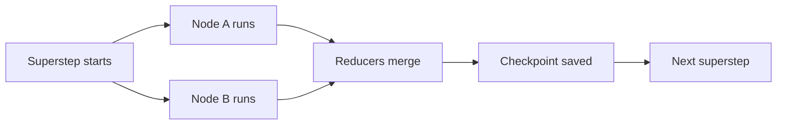
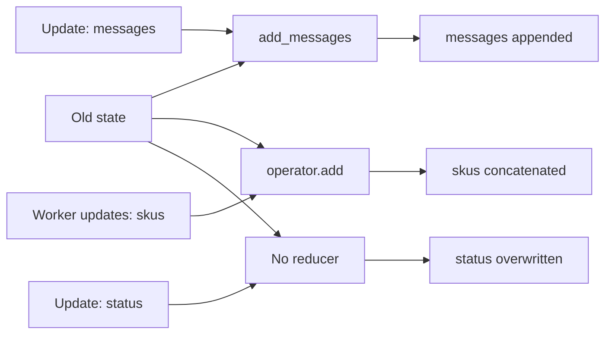
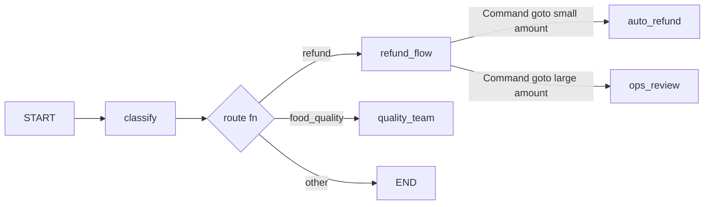
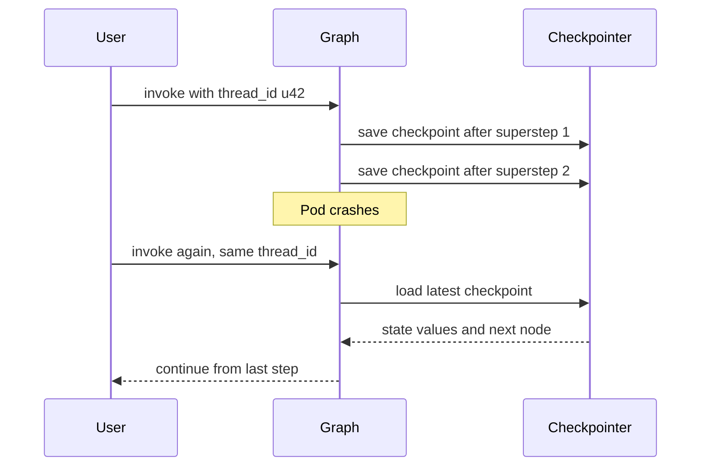
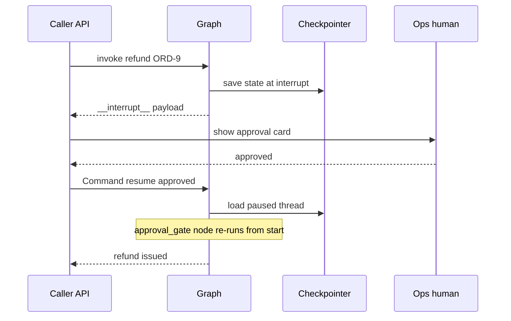
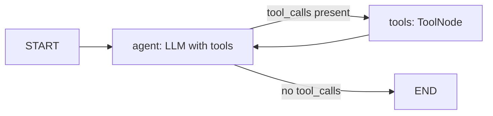

# LangGraph Core

LangGraph agents ko **graph + shared state + cycles + persistence** ke roop me banata hai. Interviewer yahan poochta hai: reducer kya hai, checkpointer kyun, `interrupt()` resume pe kya hota hai, aur `recursion_limit` hit ho to kya. Is page ke baad tum hand-built tool-calling agent explain aur likh paoge.

## Why LangGraph

**Ek line me:** plain LangChain chains ek DAG hain (input → output, no loop, no saved state); LangGraph me **cycles, explicit state, checkpointing aur human-in-the-loop** first-class hain.

> **Example:** Razorpay dispute agent: evidence fetch → LLM decide → aur evidence chahiye to wapas fetch (cycle) → ₹10k se upar refund pe ops approval (pause, kal resume) → server restart ho jaaye to bhi wahi se continue. Chain ye nahi kar sakti.

| | LangChain chain (LCEL) | LangGraph |
|---|---|---|
| Shape | DAG, linear/branch | graph with cycles |
| State | inputs aage pass hote | typed shared state + reducers |
| Persistence | nahi | checkpointer per step |
| Pause / resume | nahi | `interrupt()` + `Command(resume=...)` |
| Debugging | logs | state history, time-travel |
| Use | simple pipelines | agents, long-running workflows |

- **Execution model (Pregel style):** graph **supersteps** me chalta hai. Ek superstep me jo nodes active hain wo parallel chalte hain, unke updates reducers se merge hote hain, phir checkpoint save hota hai.



Ek superstep: active nodes parallel chalte hain, reducers unke updates merge karte hain, phir checkpoint save hota hai.

- **Levels:** low-level `StateGraph` (full control) vs high-level `create_agent` (`langchain.agents`, LangChain 1.0) jo andar LangGraph hi hai. Purana `langgraph.prebuilt.create_react_agent` ab deprecated path hai, `create_agent` use karo.

**Interview tip:** "LangGraph ek orchestration runtime hai, LLM wrapper nahi. Main isse durable execution, HITL aur cycles ke liye choose karta hoon; LLM calls kisi bhi SDK se ho sakti hain."

**Common galti:** sochna ki LangGraph ke liye LangChain models zaroori hain. Node sirf Python function hai, andar kuch bhi call karo.

## ⭐ State

**Ek line me:** state ek typed dict hai jo har node padhta hai aur partial update lautata hai; **reducer** decide karta hai update purane value me kaise merge ho.

> **Example:** Flipkart catalog agent: `messages` me chat append hoti hai, `skus` me parallel workers ke results jud-te hain, `status` har baar overwrite hota hai.

- Schema: `TypedDict` (fast, common), `dataclass` (defaults), ya Pydantic `BaseModel` (runtime validation, thoda slow).
- Node **poora state nahi lautata**, sirf jo keys badli: `return {"status": "done"}`.
- **No reducer:** naya value overwrite karta hai.
- **`operator.add`:** lists concatenate. Parallel branches (fan-out) ke liye zaroori.
- **`add_messages`:** messages append karta hai, **same `id` wale message ko replace** karta hai, `RemoveMessage(id=...)` se delete, aur dicts/tuples ko Message objects me convert karta hai.



Har key ka reducer merge decide karta hai: `messages` append, `skus` concat, aur bina reducer wali `status` overwrite.

- **`MessagesState`:** ready-made `{"messages": Annotated[list[AnyMessage], add_messages]}`. Extend karke keys add karo.

```python
import operator
from typing import Annotated, TypedDict
from langchain_core.messages import AnyMessage
from langgraph.graph import MessagesState
from langgraph.graph.message import add_messages

def keep_max(old: int, new: int) -> int:        # custom reducer
    return max(old, new)

class CatalogState(TypedDict):
    messages: Annotated[list[AnyMessage], add_messages]   # append / id se replace
    skus: Annotated[list[str], operator.add]               # parallel writes jud jaate
    retries: Annotated[int, keep_max]
    status: str                                            # no reducer: overwrite

class SupportState(MessagesState):                         # messages already hai
    order_id: str | None
    refund_approved: bool
```

- Advanced: alag `input_schema` / `output_schema` (public API chhota rakho), private state keys jo sirf kuch nodes ke beech hon.

**Interview tip:** "Do parallel nodes same key likhein aur reducer na ho to LangGraph `InvalidUpdateError` deta hai. Fan-out keys pe hamesha reducer lagata hoon."

**Common galti:** node me `state["messages"].append(x)` karke state mutate karna. Hamesha naya partial dict return karo, reducer ko merge karne do.

## ⭐ Nodes and edges

**Ek line me:** nodes = kaam (functions), edges = agla kaun; **conditional edges** runtime pe route chunte hain, aur **`Command`** ek node ke andar se update + goto dono kar deta hai.

> **Example:** Zomato complaint triage: `classify` node ke baad agar "refund" to `refund_flow`, "food_quality" to `quality_team`, warna `END`.

- `START` aur `END` special nodes hain. `add_edge(START, "classify")` entry point.
- **Normal edge:** `add_edge("a", "b")`, hamesha a ke baad b.
- **Conditional edge:** `add_conditional_edges("a", router_fn, path_map)`. Router state padh ke node ka naam (ya list, ya `Send`) lautata hai.
- **`Command(goto=..., update=...)`:** routing logic node ke andar, edge function alag nahi. Return type `Command[Literal[...]]` likho taaki graph render/validate ho sake. `Command(graph=Command.PARENT)` se subgraph se parent me handoff (multi-agent).



Conditional edge ek pure function se route chunta hai; `refund_flow` node `Command` return karke state update + goto khud karta hai.

- Ek node se multiple outgoing normal edges = parallel fan-out; `Send("worker", payload)` dynamic map-reduce ke liye (detail: [Workflows](03-workflow-patterns.md)).

```python
from typing import Literal
from langgraph.graph import StateGraph, START, END
from langgraph.types import Command

def classify(state: SupportState) -> dict:
    text = state["messages"][-1].content.lower()
    return {"order_id": "ORD-1"} if "refund" in text else {"order_id": None}

def route(state: SupportState) -> str:                       # conditional edge
    return "refund_flow" if state["order_id"] else END

def refund_flow(state: SupportState) -> Command[Literal["auto_refund", "ops_review"]]:
    amount = 450                                             # tool se aayega
    nxt = "auto_refund" if amount <= 500 else "ops_review"
    return Command(update={"refund_approved": amount <= 500}, goto=nxt)

builder = StateGraph(SupportState)
builder.add_node("classify", classify)
builder.add_node("refund_flow", refund_flow)
builder.add_node("auto_refund", lambda s: {"messages": [("ai", "Refund ho gaya")]})
builder.add_node("ops_review", lambda s: {"messages": [("ai", "Ops review me bheja")]})
builder.add_edge(START, "classify")
builder.add_conditional_edges("classify", route, ["refund_flow", END])
builder.add_edge("auto_refund", END)
builder.add_edge("ops_review", END)
graph = builder.compile()
```

**Interview tip:** "Conditional edge tab jab routing ek pure function of state ho; `Command` tab jab node ko decide karte waqt state bhi update karni ho, jaise multi-agent handoff."

**Common galti:** `Command` return karne wale node se static edge bhi lagana. Dono chalenge aur double routing hogi.

## Compile, invoke, stream, ainvoke

**Ek line me:** `compile()` builder ko runnable graph banata hai (checkpointer, store, interrupts yahin attach); phir `invoke`/`stream` aur unke async versions se chalao.

> **Example:** Zerodha research bot: API endpoint `await graph.ainvoke(...)` use karta hai, chat UI `astream(..., stream_mode="messages")` se tokens dikhata hai.

| Method | Kya karta hai |
|---|---|
| `compile(checkpointer=, store=, interrupt_before=, interrupt_after=)` | structure validate karke `CompiledStateGraph` banata hai |
| `invoke(input, config)` | end tak chalata, final state lautata |
| `ainvoke` | async version, FastAPI jaise servers me |
| `stream` / `astream` | har step pe chunks yield karta |
| `batch` / `abatch` | multiple inputs ek saath |
| `get_graph().draw_mermaid()` | graph ka diagram |

- `config = {"configurable": {"thread_id": "u42"}, "recursion_limit": 30}`: config second positional arg hai.
- Async nodes (`async def`) ke saath `ainvoke`/`astream` hi use karo.

**Interview tip:** "Production API me main `astream` use karta hoon: user ko progress dikhti hai aur time-to-first-token kam lagta hai."

**Common galti:** compile ke baad builder me nodes add karke expect karna ki compiled graph badlega. Dobara compile karna padta hai.

## ⭐ Checkpointing and persistence

**Ek line me:** checkpointer har superstep ke baad state ka snapshot **thread** ke against save karta hai; isi se memory across turns, pause/resume, fault tolerance aur time-travel milta hai.

> **Example:** Swiggy support chat: user 2 ghante baad wapas aata hai, same `thread_id` se poori conversation aur `order_id` state me hai. Pod crash ho gaya tha to last successful checkpoint se resume.

- **Thread:** ek conversation/run ka id (`thread_id`). Har thread ki apni checkpoint history.
- **Checkpoint = `StateSnapshot`:** `values`, `next` (agla kaun chalega), `config` (with `checkpoint_id`), `metadata`, `parent_config`, `tasks`, `interrupts`.



Har superstep ke baad checkpoint save hota hai; same `thread_id` se dobara invoke karo to graph last checkpoint se aage chalta hai.

- **Backends:**

| Saver | Package | Kab |
|---|---|---|
| `InMemorySaver` | `langgraph.checkpoint.memory` | tests, demos (process restart = sab gaya) |
| `SqliteSaver` / `AsyncSqliteSaver` | `langgraph-checkpoint-sqlite` | local, single machine |
| `PostgresSaver` / `AsyncPostgresSaver` | `langgraph-checkpoint-postgres` | production, multiple workers |

- Postgres pe pehli baar `checkpointer.setup()` chalao (tables banata hai).
- **Time-travel:** `get_state_history` se purana checkpoint lo, uske config se `invoke(None, config)` = **replay** (us point ke baad dobara execute). `update_state(old_config, values)` naya checkpoint (branch) banata hai = **fork**.

```python
from langchain_core.messages import HumanMessage
from langgraph.checkpoint.memory import InMemorySaver
# from langgraph.checkpoint.postgres import PostgresSaver
# with PostgresSaver.from_conn_string(DB_URI) as cp: cp.setup(); graph = builder.compile(checkpointer=cp)

graph = builder.compile(checkpointer=InMemorySaver())
cfg = {"configurable": {"thread_id": "user-42"}}
graph.invoke({"messages": [HumanMessage("Order ORD-1 ka refund chahiye")]}, cfg)

snap = graph.get_state(cfg)
print(snap.values["refund_approved"], snap.next)         # latest state, agla node

history = list(graph.get_state_history(cfg))             # newest first
before_refund = next(s for s in history if s.next == ("refund_flow",))
graph.invoke(None, before_refund.config)                 # replay us point se

forked = graph.update_state(before_refund.config, {"order_id": "ORD-2"})
graph.invoke(None, forked)                               # naya branch, purana history safe
```

**Interview tip:** "Checkpointer short-term (thread-scoped) memory hai. Cross-thread memory, jaise user preferences, ke liye Store use hota hai. Ye distinction interviewers zaroor poochte hain."

**Common galti:** production me `InMemorySaver`, ya har request pe naya random `thread_id` bana dena. Dono me conversation memory gayab.

## ⭐ Human-in-the-loop

**Ek line me:** node ke andar `interrupt(payload)` graph ko pause karke payload caller ko deta hai; `Command(resume=value)` se wahi node dobara chalta hai aur `interrupt()` ab `value` lautata hai.

> **Example:** PhonePe refund agent: ₹5,000 se upar refund pe ops ko Slack pe approval card. Approve/reject aane tak thread checkpoint me paused rehta hai (minutes ya din).

- **Checkpointer zaroori** hai (state save karni hai) aur `thread_id` bhi.
- Interrupt hone par `invoke` result me `__interrupt__` key aati hai with payload.
- **Resume pe node shuru se re-run hota hai**, `interrupt()` wali line se nahi. Isliye interrupt se **pehle** ke side effects idempotent rakho ya interrupt ko node ke start me rakho.



Interrupt pe state checkpoint me park ho jaata hai; `Command(resume=...)` aane pe wahi node shuru se dobara chalta hai.

- Ek node me multiple `interrupt()` calls order (index) se match hote hain; unhe conditionally skip/reorder mat karo.
- **Static breakpoints:** `compile(interrupt_before=["tools"])`, debugging ya "har tool se pehle ruko" ke liye.
- **State edit:** `graph.update_state(cfg, {...}, as_node="agent")`: human galat tool args theek kar de, phir `invoke(None, cfg)`.

```python
from typing import Literal
from langgraph.types import Command, interrupt

def approval_gate(state: SupportState) -> Command[Literal["issue_refund", "reject"]]:
    decision = interrupt({                         # yahan graph pause
        "question": "Refund approve karein?",
        "order_id": state["order_id"], "amount_inr": 7200,
    })
    if decision["approved"]:
        return Command(goto="issue_refund", update={"refund_approved": True})
    return Command(goto="reject", update={"refund_approved": False})

cfg = {"configurable": {"thread_id": "refund-ORD-9"}}
out = graph.invoke({"messages": [("user", "ORD-9 ka refund do")]}, cfg)
print(out["__interrupt__"][0].value)               # ops UI ko yahi payload dikhao

# ... ghanton baad, ops ne approve kiya:
graph.invoke(Command(resume={"approved": True, "by": "ops@phonepe"}), cfg)
```

**Interview tip:** "Irreversible actions (paise, delete, email bhejna) ke saath main approval gate tool call ke just pehle rakhta hoon, aur resume path ko idempotent banata hoon kyunki node re-run hota hai."

**Common galti:** `interrupt()` ko `try/except Exception` me wrap karna. Interrupt andar se special exception raise karta hai; pakad liya to pause hi nahi hoga.

## Streaming modes

**Ek line me:** `stream_mode` decide karta hai har chunk me kya aaye: poora state, sirf diff, LLM tokens, tumhara custom data, ya debug events.

> **Example:** Flipkart shopping assistant UI: `messages` se tokens type hote dikhte hain, `custom` se "3 sellers compare kar raha hoon..." progress bar, `updates` se backend logs.

| Mode | Har chunk me | Use |
|---|---|---|
| `values` | har step ke baad poora state | simple UIs, debugging |
| `updates` | sirf node ka diff `{node: update}` | logs, progress |
| `messages` | `(token_chunk, metadata)` LLM tokens | chat UI typing effect |
| `custom` | `get_stream_writer()` se bheja data | tool progress |
| `debug` | detailed task/checkpoint events | deep debugging |

```python
from langgraph.config import get_stream_writer

def compare_sellers(state):
    writer = get_stream_writer()
    writer({"progress": "3 sellers compare kar raha hoon"})
    return {"messages": [("ai", "Seller B sabse sasta hai")]}

for mode, chunk in graph.stream(inputs, cfg, stream_mode=["messages", "custom"]):
    if mode == "messages":
        token, meta = chunk
        if meta["langgraph_node"] == "agent":      # sirf agent node ke tokens
            print(token.content, end="")
    else:
        print("\n[progress]", chunk["progress"])
```

- `subgraphs=True` se subgraph ke andar ke events bhi milte hain (namespace ke saath).

**Interview tip:** "Multiple modes ek saath list me de sakte ho; tab chunk `(mode, data)` tuple hota hai."

**Common galti:** `messages` mode me har node ke tokens UI pe dikha dena, including internal classifier ke. `langgraph_node` metadata se filter karo.

## Subgraphs and composition

**Ek line me:** ek compiled graph doosre graph ka node ban sakta hai; state keys share hon to seedha add karo, alag hon to wrapper node me transform karo.

> **Example:** Paytm onboarding graph me `kyc` subgraph (PAN verify, Aadhaar OTP, face match) alag team maintain karti hai, apne state schema ke saath.

- **Shared keys** (e.g. dono me `messages`): `builder.add_node("kyc", kyc_graph)`.
- **Different schema:** wrapper function:

```python
def run_kyc(state: OnboardingState) -> dict:
    out = kyc_graph.invoke({"pan": state["pan"], "phone": state["phone"]})
    return {"kyc_verified": out["verified"]}           # parent ki keys me map

builder.add_node("kyc", run_kyc)
```

- Subgraph parent ka checkpointer inherit karta hai; subgraph ke andar `interrupt()` bhi kaam karta hai.
- Use: team ownership, reuse, multi-agent (har agent ek subgraph). Detail: [Agent Patterns](04-agent-patterns.md).

**Interview tip:** "Subgraph boundary = contract. Wrapper node se main explicitly decide karta hoon kaunsa data andar jaata hai, taaki private keys leak na hon."

**Common galti:** subgraph ko apna alag checkpointer de dena bina zaroorat; state do jagah bikhar jaata hai.

## Error handling

**Ek line me:** loops ko `recursion_limit` se rokte hain, flaky calls ko `RetryPolicy` se retry karte hain, aur model/tool fail hone par fallback ya graceful exit dete hain.

> **Example:** Zerodha quote tool kabhi-kabhi 503 deta hai: 3 retries with backoff; LLM provider down ho to backup model; agent 15 steps tak answer na de to "abhi nahi ho paaya, ticket bana diya".

- **`recursion_limit`:** max supersteps per run (config me). Default version pe depend karta hai (purane versions me 25), isliye explicitly set karo. Hit hone pe `GraphRecursionError`. Note: ek ReAct round = 2 supersteps (agent + tools).
- **`RemainingSteps`** (`langgraph.managed`) state me rakh ke node limit se pehle hi graceful answer de sakta hai.
- **`RetryPolicy`** (`langgraph.types`): `max_attempts`, `initial_interval`, `backoff_factor`, `jitter`, `retry_on`. langgraph 1.x me `add_node(..., retry_policy=...)` (purana naam `retry=`).
- **Fallbacks:** `llm.with_fallbacks([backup_llm])`, ya `Command(goto="fallback_node")`.
- **Timeouts:** model client pe `timeout=`, async node me `asyncio.wait_for`, poore run pe server-level deadline.

```python
import httpx
from langgraph.errors import GraphRecursionError
from langgraph.types import RetryPolicy

builder.add_node(
    "fetch_quote", fetch_quote,
    retry_policy=RetryPolicy(max_attempts=3, initial_interval=0.5,
                             backoff_factor=2.0, retry_on=httpx.HTTPError),
)
graph = builder.compile(checkpointer=InMemorySaver())

try:
    graph.invoke(inputs, {"configurable": {"thread_id": "t1"}, "recursion_limit": 15})
except GraphRecursionError:
    reply = "Abhi answer nahi mil paaya, support ticket bana diya hai."
```

**Interview tip:** "Retry sirf transient errors pe (timeouts, 5xx, 429). Validation errors retry karne se nahi sudhrte; unhe observation bana ke LLM ko wapas do."

**Common galti:** `recursion_limit` ko 1000 kar dena taaki error na aaye. Root cause loop hai; limit sirf safety net hai.

## Store for long-term memory

**Ek line me:** Store cross-thread key-value (+ optional semantic search) memory hai, `namespace` tuples me organized; checkpointer ek thread ke andar, Store saare threads ke across.

> **Example:** Swiggy: user ne ek baar bola "main veg hoon". Har nayi chat (naya thread) me agent `("users", "u42", "prefs")` se ye padh leta hai.

```python
from langgraph.store.memory import InMemoryStore   # prod: PostgresStore

store = InMemoryStore()
graph = builder.compile(checkpointer=InMemorySaver(), store=store)
store.put(("users", "u42", "prefs"), "diet", {"value": "veg"})
print(store.get(("users", "u42", "prefs"), "diet").value)
# node ke andar: runtime.store.search(("users", "u42", "prefs"), query="food", limit=3)
```

- Embeddings ke saath `index={"embed": ..., "dims": ...}` dene se `search(query=...)` semantic ho jaata hai.
- Kya yaad rakhna, kab likhna, kaise bhoolna: [Memory & Context](05-memory-context.md).

**Interview tip:** "Thread memory = checkpointer, user memory = Store. Dono alag lifetimes aur alag privacy rules."

**Common galti:** user preferences ko messages history me hi chhod dena; naye thread me sab bhool jaata hai.

## ⭐ Worked example: tool-calling agent by hand

**Ek line me:** `MessagesState` + LLM node + `ToolNode` + `tools_condition` + checkpointer = wahi ReAct loop jo `create_agent` deta hai, par har piece tumhare control me.

> **Example:** Swiggy order support agent: order status check karo, delay > 30 min ho to refund do.



```python
from langchain_core.messages import SystemMessage
from langchain_core.tools import tool
from langchain.chat_models import init_chat_model
from langgraph.graph import StateGraph, START, MessagesState
from langgraph.prebuilt import ToolNode, tools_condition
from langgraph.checkpoint.memory import InMemorySaver

@tool
def get_order_status(order_id: str) -> dict:
    """Order ka status aur delay minutes."""
    return {"order_id": order_id, "status": "out_for_delivery", "delay_min": 42}

@tool
def issue_refund(order_id: str, amount_inr: int) -> str:
    """Refund issue karta hai. Sirf tab jab delay 30 min se zyada ho."""
    return f"Refund of Rs {amount_inr} issued for {order_id}"

tools = [get_order_status, issue_refund]
llm = init_chat_model("openai:gpt-4.1-mini", temperature=0).bind_tools(tools)
SYSTEM = SystemMessage("Tum Swiggy support agent ho. Refund se pehle status check karo.")

def agent(state: MessagesState) -> dict:
    return {"messages": [llm.invoke([SYSTEM] + state["messages"])]}

builder = StateGraph(MessagesState)
builder.add_node("agent", agent)
builder.add_node("tools", ToolNode(tools))      # parallel calls chalata, errors ko ToolMessage banata
builder.add_edge(START, "agent")
builder.add_conditional_edges("agent", tools_condition)   # "tools" ya END
builder.add_edge("tools", "agent")
graph = builder.compile(checkpointer=InMemorySaver())

cfg = {"configurable": {"thread_id": "u42"}, "recursion_limit": 12}
out = graph.invoke({"messages": [("user", "ORD-77 late hai, refund milega? Value 380")]}, cfg)
print(out["messages"][-1].content)
```

- Same cheez one-liner me: `create_agent(model="openai:gpt-4.1-mini", tools=tools, system_prompt="...", checkpointer=InMemorySaver())` (`from langchain.agents import create_agent`). Purane code me `create_react_agent(model, tools)` milega.
- `refund` se pehle approval chahiye to `compile(interrupt_before=["tools"])` ya `issue_refund` ke andar `interrupt()`.

**Interview tip:** "Hand-built version tab likhta hoon jab custom nodes chahiye: guardrail node, approval gate, summarization node. Warna `create_agent` + middleware kaafi hai."

**Common galti:** `tools` node se wapas `agent` ka edge bhool jaana; tool result LLM tak pahunchta hi nahi aur graph tool ke baad khatam.

## Aage padho

- [AI Agents: Foundations](01-agent-foundations.md): framework ke bina agent loop.
- [Agentic Patterns: Workflows](03-workflow-patterns.md): routing, parallelization, `Send` map-reduce.
- [Memory & Context Engineering](05-memory-context.md): Store, summarization, context trimming.
- [Agents in Production](12-agents-in-production.md): Postgres checkpointer, scaling, deploys.
- [ReAct lab](/viewinter/agents/lab/react) aur [Multi-agent lab](/viewinter/agents/labs/multi).

## Checklist

- [ ] LangGraph plain chains se kyun better hai (cycles, state, persistence, HITL) samjha sakta hoon
- [ ] State schema, reducers, `add_messages` aur `operator.add` ka fark bata sakta hoon
- [ ] Normal edge, conditional edge aur `Command(goto, update)` kab use karna, bata sakta hoon
- [ ] Checkpointer, `thread_id`, `get_state_history`, replay aur fork samjha sakta hoon
- [ ] `interrupt()` + `Command(resume=...)` se approval gate likh sakta hoon aur re-run behaviour bata sakta hoon
- [ ] Streaming modes (`values`, `updates`, `messages`, `custom`, `debug`) ka use bata sakta hoon
- [ ] Subgraph shared vs different state ke saath compose karna samjha sakta hoon
- [ ] `recursion_limit`, `RetryPolicy`, fallbacks aur timeouts se error handling bata sakta hoon
- [ ] `ToolNode` + `tools_condition` + checkpointer se tool-calling agent haath se bana sakta hoon
