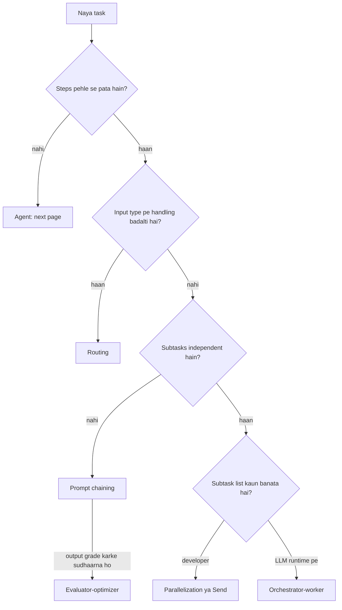
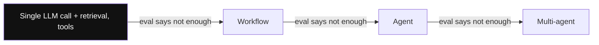
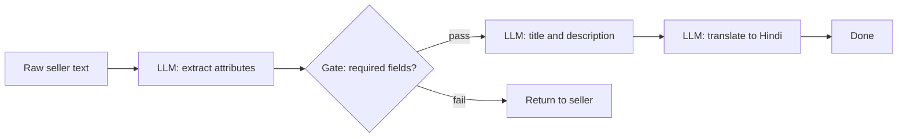
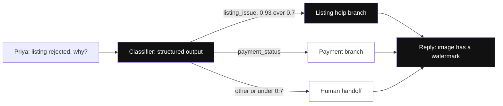
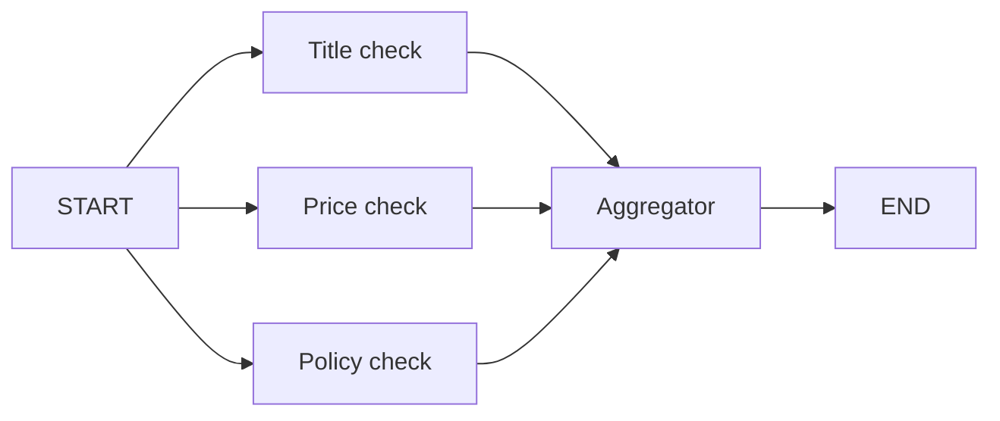
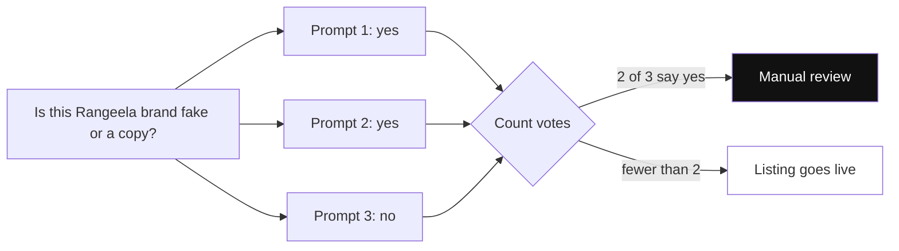
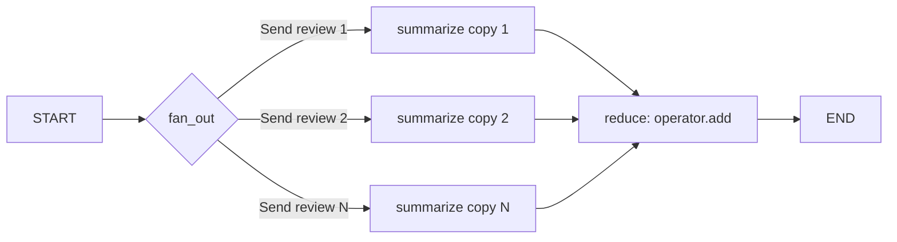
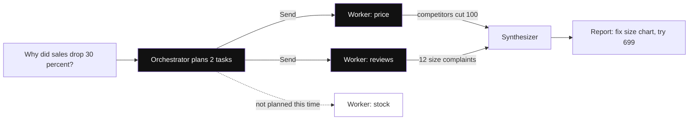
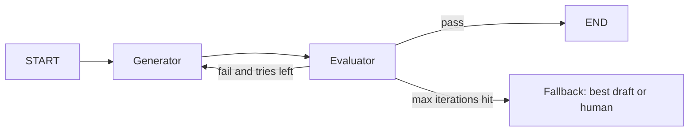
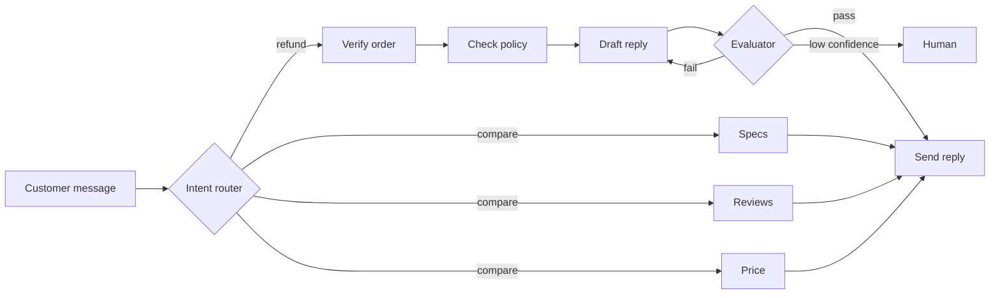

# Workflow Patterns

Workflow matlab **code ka raasta pehle se fixed hai**. LLM sirf har step ke andar kaam karta hai, agla step kaunsa hoga ye developer ne pehle hi likh diya hai.

Is page pe Anthropic ke "Building effective agents" wale 5 patterns hain: prompt chaining, routing, parallelization, orchestrator-worker, evaluator-optimizer. Interviewer ye isliye poochta hai kyunki senior engineer ki pehchaan hai: "full agent mat banao jab workflow kaafi hai".

State, reducers, conditional edges aur checkpointing ke basics ke liye pehle [LangGraph Core Concepts](02-langgraph-core.md) padho. Yahan sirf patterns.

**Is page ke baad tum ye samjha paoge:**
- Workflow aur agent me farak, aur kab kaunsa lena hai.
- Paanchon patterns, har ek ka data step by step kaise chalta hai.
- `Send` aur reducer kya karte hain (fan-out aur fan-in).
- Ek hi task ko alag patterns se banane pe cost aur latency kaise badalti hai.
- Kisi bhi product problem ke liye sahi pattern kaise justify karein.

## Pehle ye shabd samjho

LLM naye ho? Pehle [How LLMs Work](14-how-llms-work.md) padho. Usme tokens, context window aur model text kaise banata hai, ye sab hai.

| Shabd | Simple matlab |
|---|---|
| Reducer | Ek hi shared data field pe aaye kai updates ko merge karne ka rule, jaise overwrite ki jagah lists jodna. |
| Conditional edge | Function jo graph ka shared data padh ke agle step ka naam lautata hai. |
| `Send` | LangGraph object jiska matlab "ye step is input ke saath ek baar chalao". List do to kai copies chalti hain. |
| Fan-out / fan-in | Fan-out kaam ko ek saath kai branches me baantta hai; fan-in sabka wait karke results ikattha karta hai. |
| ReAct agent | Agent jo loop me chalta hai: model sochta hai, tool call karta hai, result padhta hai, kaam hone tak repeat. |
| Retrieval | Apne data se relevant documents nikal ke, model ke jawab se pehle prompt me jodna. |
| Eval | LLM output ka automated test suite, jo fixed examples pe jawabon ko score karta hai. |
| LLM judge | Ek doosri model call jo output ko likhe hue criteria pe grade karke pass ya fail deti hai. |
| Structured output | Model se fixed JSON shape me jawab lena, taaki tumhara code safely parse kar sake. |
| `Command` | Step ka lautaya object jo batata hai agla step kaunsa, saath me shared data ke changes bhi de sakta hai. |
| Confusion matrix | Predicted vs actual categories ki table, jo dikhati hai classifier kaunsi categories me confuse hota hai. |
| Superstep | Graph ka ek round. Saare ready steps saath chalte hain, phir unke updates merge hote hain. |
| Guardrail | Model ke aas-paas laga check jo unsafe ya rule todne wala input ya output rokta hai. |
| Trace | Ek run ka recorded log, jisme har step ka input, output aur laga hua time dikhta hai. |

## Big picture: paanch patterns ek naksha

Poore page pe ek hi product chalega: **SellerSaathi**, Flipkart sellers ke liye ek AI assistant. Hamari seller hai **Priya**, Jaipur se cotton kurte bechti hai. Har pattern me hum Priya ka ek kaam lenge aur dekhenge data kaise move hota hai.

Paanchon patterns me ek cheez common hai: **raasta code decide karta hai**. Farak sirf raaste ki shape me hai. Chaining ek seedhi line hai. Routing ek fork hai jahan ek hi raasta chuna jaata hai. Parallelization me saare raaste ek saath chalte hain. Orchestrator-worker me kitne raaste, ye LLM runtime pe batata hai. Evaluator-optimizer ek loop hai jo tab tak ghoomta hai jab tak quality pass na ho.

| Pattern | Raaste ki shape | SellerSaathi me kaam |
|---|---|---|
| Prompt chaining | Seedhi line | Nayi listing banana |
| Routing | Fork, ek raasta chuno | Seller ka sawal sahi team ko |
| Parallelization | Saare raaste ek saath | Listing ke 3 quality checks |
| Map-reduce with `Send` | N copies, N runtime pe | 40 reviews summarize karna |
| Orchestrator-worker | LLM decide kare kitne raaste | "Sales kyun gira?" ki jaanch |
| Evaluator-optimizer | Loop | Push notification copy |

Neeche ka diagram dikhata hai ki naye task pe kaunsa pattern lena hai. Page ke sections isi order me chalte hain.



## ⭐ Workflow vs agent, aur pattern picker

**Ye kyun chahiye?** Maan lo tumne Priya ki listing banane ke liye ek ReAct agent bana diya. Kabhi wo pehle translate karta hai, kabhi title bhool jaata hai, kabhi 9 tool calls kar deta hai. Bug reproduce nahi hota aur bill 10x aata hai. Jab steps pehle se pata hain, to LLM ko raasta chunne dene ki zaroorat hi nahi thi.

**Analogy:** workflow = **IRCTC counter ka fixed process**: form lo, ID check karo, seat dekho, ticket print karo. Clerk har step me dimaag lagata hai, par steps ka order fixed hai. Agent = **wedding planner**: tum bolte ho "shaadi karwa do", aur wo khud decide karta hai pehle venue, phir caterer, ya pehle pandit.

| | Workflow | Agent |
|---|---|---|
| Agla step kaun decide karta hai | Developer ka code | LLM |
| Predictable | Haan, same input = same path | Nahi, path badal sakta hai |
| Test aur debug | Aasaan, har node alag test | Mushkil |
| Cost aur latency | Bounded, pehle se pata | Upar neeche hoti hai |
| Kab | Steps pehle se pata | Steps ki ginti aur order unknown |

**Simplest-first ladder:** single LLM call (+ retrieval, tools) → workflow → agent → multi-agent. Har seedhi chadhne ka justification ek eval number hona chahiye, "cool lagta hai" nahi.



*Diagram:* Highlighted left wale sire se shuru karo aur ek step right tabhi jao jab eval number dikhaye ki current step fail ho raha hai; har step pe cost aur unpredictability badhti hai.

| Problem ka shape | Pattern | Control kis ke paas |
|---|---|---|
| Fixed sequence, har step pichhle pe depend | Prompt chaining | Code |
| Input types alag, alag handling chahiye | Routing | LLM classify, code dispatch |
| Independent subtasks ya multiple opinions | Parallelization | Code |
| Subtasks pehle se pata nahi, input pe depend | Orchestrator-worker | LLM plan, code execute |
| Clear quality criteria, iteration se sudhaar | Evaluator-optimizer | Code loop, LLM judge |
| Steps aur tools ka order hi unknown | Agent (next page) | LLM |

**Interview tip:** "Main pehle poochta hoon: kya steps pehle se pata hain? Haan to workflow. Workflow debug, eval aur cost-cap karna kaafi aasaan hai."

**Common galti:** har problem pe ReAct agent laga dena, phir non-deterministic bugs aur 10x token bill debug karna.

## ⭐ Prompt chaining

**Ye kyun chahiye?** Priya ek line paste karti hai aur chahti hai ki usse poori listing ban jaaye: attributes, SEO title, Hindi version. Agar ye sab ek giant prompt me karwao, to output me MRP gayab ho sakti hai aur pata nahi chalta kaunsa hissa fail hua.

**Analogy:** **restaurant kitchen ki line**. Pehla cook sabzi kaatta hai, doosra tadka lagata hai, teesra plating karta hai. Beech me head chef check karta hai ki sabzi sahi kati hai ya nahi; kharab hai to wahin rok deta hai. Har cook = ek LLM call. Head chef ka check = **gate**.

**Ek line me:** task ko fixed sequential steps me todo, har LLM call pichhle ka output leta hai, aur beech me ek **programmatic gate** check karta hai ki aage jaana hai ya nahi.

> **Example:** Priya ki nayi listing. Input: `"Rangeela cotton kurta, Jaipur print, sizes M L XL, MRP 799"`.

**Step by step (state kaise badalta hai):**
1. **START:** state = `{raw: "Rangeela cotton kurta, Jaipur print, sizes M L XL, MRP 799"}`.
2. **extract (LLM):** structured output deta hai. State me add hota hai `attrs = {brand: "Rangeela", category: "Kurta", mrp: 799}`.
3. **gate (Python, LLM nahi):** brand, category, mrp teeno present hain? Haan, to `"write"` return. Agar Priya ne MRP nahi likha hota, to `mrp = None`, gate `END` return karta aur Priya ko message jaata "MRP daalo".
4. **write (LLM):** `copy = "Rangeela Jaipur Print Cotton Kurta for Women, Sizes M-XL"` + 2 line description.
5. **translate (LLM):** `hindi = "रंगीला जयपुरी प्रिंट कॉटन कुर्ता..."`.
6. **END:** final state me `raw`, `attrs`, `copy`, `hindi` chaaron hain. Original `raw` bhi bacha hai, kisi bhi step ko chahiye to mil jaayega.



**Ab terms:**
- **Chain:** LLM calls ki fixed line, ek ka output agle ka input.
- **Gate:** do steps ke beech ka sasta check (schema, regex, length, ya chhota LLM). Fail = early exit ya retry.
- **Error compounding:** step 1 ki 5% galti aage har step me multiply hoti hai. Gate isi ko rokta hai.

**Kab use:** steps fixed hain aur har step ka output verify ho sakta hai. **Kab nahi:** steps independent hain (parallelize karo) ya order input pe depend karta hai (routing ya agent). Trade-off: har step chhota aur focused hone se accuracy badhti hai, par latency bhi badhti hai.

Neeche ka code upar wala hi flow LangGraph me banata hai: 3 LLM nodes aur ek Python gate.

```python
from typing import TypedDict
from pydantic import BaseModel
from langgraph.graph import StateGraph, START, END
from langchain.chat_models import init_chat_model

llm = init_chat_model("openai:gpt-4.1-mini")

class Attrs(BaseModel):            # LLM ko isi shape me jawab dena hai
    brand: str | None
    category: str | None
    mrp: float | None

class S(TypedDict):                # shared state, har node isme likhta hai
    raw: str
    attrs: dict
    copy: str
    hindi: str

def extract(s: S):                 # Step 1: raw text se structured attrs
    a = llm.with_structured_output(Attrs).invoke(f"Extract attributes:\n{s['raw']}")
    return {"attrs": a.model_dump()}   # sirf "attrs" key update hoti hai

def gate(s: S):                    # deterministic check, LLM nahi
    ok = all(s["attrs"].get(k) for k in ("brand", "category", "mrp"))
    return "write" if ok else END      # fail = yahin ruk jao

def write(s: S):                   # Step 2
    return {"copy": llm.invoke(f"SEO title + description for {s['attrs']}").content}

def translate(s: S):               # Step 3
    return {"hindi": llm.invoke(f"Translate to Hindi:\n{s['copy']}").content}

g = StateGraph(S)
g.add_node(extract)
g.add_node(write)
g.add_node(translate)
g.add_edge(START, "extract")
g.add_conditional_edges("extract", gate, ["write", END])   # gate agla node chunta hai
g.add_edge("write", "translate")
g.add_edge("translate", END)
app = g.compile()
out = app.invoke({"raw": "Rangeela cotton kurta, Jaipur print, sizes M L XL, MRP 799"})
```

**Code me kya ho raha hai:**
- `Attrs` Pydantic model LLM ko JSON me jawab dene pe majboor karta hai, isliye gate seedha `attrs["mrp"]` check kar pata hai.
- Har node poora state padhta hai par sirf apni key return karta hai; LangGraph use state me merge kar deta hai.
- `gate` ek normal Python function hai jo conditional edge pe lagta hai. Wo `"write"` ya `END` return karta hai.
- `add_conditional_edges(..., ["write", END])` me possible destinations ki list graph ko batati hai ki gate kahan kahan bhej sakta hai.

**Failure modes:** error compounding, gate bahut loose, beech me state lose hona (sirf last output pass karna, original input nahi).

**Interview tip:** "Har step ke beech ek cheap deterministic gate rakhta hoon; isse failures early pakde jaate hain aur har step alag se eval ho sakta hai."

**Common galti:** ek giant prompt me 5 kaam ek saath karwana, phir pata nahi chalta kaunsa sub-task fail hua.

## ⭐ Routing

**Ye kyun chahiye?** SellerSaathi pe roz hazaaron sawal aate hain: "listing reject kyun hui", "payment kab aayega", "courier ne parcel tod diya". Agar ek hi prompt sab handle kare, to payment wale case ko sudhaarte hi listing wala case toot jaata hai. Har type ko apna prompt, tools aur model chahiye.

**Analogy:** **hospital ka reception**. Receptionist khud ilaaj nahi karta. Wo sirf sunta hai aur bhejta hai: "haddi toot gayi, ortho me jao", "bukhaar hai, general physician". Samajh na aaye to senior ko bulata hai. Receptionist = **classifier**, departments = **branches**, senior = **human fallback**.

**Ek line me:** ek classifier (LLM structured output ya chhota ML model) input ko category deta hai, aur graph usse **specialized branch** pe bhejta hai, jiska apna prompt, model aur tools hain.

> **Example:** Priya likhti hai: "Meri kurta listing 2 din se 'rejected' dikha rahi hai, kyun?"

**Step by step:**
1. **START:** `messages = [Human: "Meri kurta listing 2 din se 'rejected' dikha rahi hai, kyun?"]`.
2. **classify (LLM, structured output):** jawab aata hai `{intent: "listing_issue", confidence: 0.93}`.
3. **Decision (code):** confidence 0.93 ≥ 0.7 aur intent `other` nahi, to `Command(goto="listing_issue")`.
4. **listing_issue branch:** iske paas listing API tool hai. Wo reason nikalta hai: "image me watermark hai" aur reply likhta hai.
5. **END:** Priya ko jawab milta hai. Payment wala branch chala hi nahi, uska prompt aur tools touch hi nahi hue.
6. **Doosra case:** "Bhai kuch samajh nahi aa raha" → `{intent: "other", confidence: 0.41}` → `human` branch, ticket ban jaata hai.



*Diagram:* Priya ke sawaal pe sirf highlighted branch chalti hai; payment branch ka prompt aur tools chhue bhi nahi jaate.

**Ab terms:**
- **Classifier / router:** wo step jo sirf category batata hai, kaam nahi karta.
- **Structured output:** LLM se fixed format me jawab (`Literal` enum + confidence), free text nahi.
- **`Command(goto=...)`:** node se hi bata do ki agla node kaunsa; chahe to `update={...}` se state bhi badal do. Routing + state update ek saath.
- **Cost routing:** easy queries chhote model pe, hard bade pe. Ye bhi routing hai.

LangGraph me routing ke do tareeke hain: `add_conditional_edges` (router function edge pe), ya node se `Command(goto=...)` return karna. Neeche wala code `Command` use karta hai.

```python
from typing import Literal
from pydantic import BaseModel, Field
from langgraph.graph import StateGraph, START, END, MessagesState
from langgraph.types import Command

class Route(BaseModel):                       # router ka fixed jawab format
    intent: Literal["listing_issue", "payment_status", "other"]
    confidence: float = Field(ge=0, le=1)

router_llm = llm.with_structured_output(Route)

def classify(state: MessagesState) -> Command[Literal["listing_issue", "payment_status", "human"]]:
    r = router_llm.invoke([("system", "Classify the seller query.")] + state["messages"])
    sure = r.confidence >= 0.7 and r.intent != "other"
    return Command(goto=r.intent if sure else "human")   # update={...} bhi de sakte ho

def listing_issue(state: MessagesState): ...   # listing API tools wala branch
def payment_status(state: MessagesState): ...  # payment API wala branch
def human(state: MessagesState): ...           # ticket bana ke human ko

g = StateGraph(MessagesState)
for fn in (classify, listing_issue, payment_status, human):
    g.add_node(fn)
g.add_edge(START, "classify")
for n in ("listing_issue", "payment_status", "human"):
    g.add_edge(n, END)
app = g.compile()
```

**Code me kya ho raha hai:**
- `Route` me `Literal[...]` hai, to LLM sirf in teen me se ek word de sakta hai. String matching ki zaroorat nahi.
- `classify` khud decide karta hai `goto` kahan; isliye `classify` se koi `add_edge` nahi likha.
- Return type `Command[Literal[...]]` zaroori hai, taaki graph render aur validation ko possible destinations pata hon.
- Low confidence ya `other` pe `human` jaata hai. Ye fallback hi misroute ka safety net hai.

**Kab nahi:** categories overlap karti hain, ya ek message me do intents hain ("payment kab aayega aur listing kyun reject hui"). Tab parallel ya orchestrator socho.

**Failure modes:** misroute (galat branch confidently), class imbalance (ek category baaki sab se bahut zyada common ho), naye intents jo kisi bucket me fit nahi, multi-intent messages. Fix: router ka alag eval set (confusion matrix), confidence threshold, `other` bucket, aur logs se naye intents nikalna.

**Interview tip:** "Router ek classifier hai, to main use classifier ki tarah eval karta hoon: per-class precision/recall aur confusion matrix, end-to-end eval se alag."

**Common galti:** router se free-text output lena aur string `in` check karna. Structured output + enum use karo.

## ⭐ Parallelization: sectioning aur voting

**Ye kyun chahiye?** Listing live hone se pehle teen checks chahiye: title theek hai, price competitive hai, koi policy violation nahi. Teeno ek doosre pe depend nahi karte. Ek ke baad ek chalao to 3 × 2s = 6s. Ek saath chalao to ≈ 2s.

**Analogy:** **cricket team ki fielding**. Captain ek saath slip, point aur long-on pe fielders lagata hai; sab apni jagah ek saath kaam karte hain. Over ke end pe captain sab se report leta hai. Fielders = **parallel branches**, captain ka report lena = **fan-in**.

**Ek line me:** independent kaam ek saath chalao (**sectioning**), ya same kaam N baar chala ke aggregate karo (**voting**), phir **fan-in** pe reducer se results jodo.

> **Example (sectioning):** Priya ki listing ka QC: title check, price check, policy check ek saath. **Example (voting):** "Kya ye 'Rangeela' brand fake ya copy hai?" teen alag prompts se poocho; 2 me se 3 "haan" bolein to manual review.

**Step by step (sectioning):**
1. **START:** `{listing: "Rangeela Jaipur Print Cotton Kurta, ₹799", findings: []}`.
2. **Fan-out:** START se teen edges hain, to `title_check`, `price_check`, `policy_check` **same superstep** me ek saath chalte hain.
3. Teeno apna result `findings` key me likhte hain:
   - title_check → `["Title: OK, length theek hai"]`
   - price_check → `["Price: similar kurte ₹649-₹899, theek hai"]`
   - policy_check → `["Policy: 'best quality guaranteed' claim hatao"]`
4. **Reducer** (`operator.add`) teeno lists ko jodta hai: `findings` me ab 3 items hain. Reducer ke bina LangGraph `InvalidUpdateError` deta, kyunki teen nodes ne same key ek saath likhi.
5. **Fan-in:** `aggregate` node tabhi chalta hai jab teeno khatam ho jaayein. Wo ek report banata hai.
6. **END:** `report = "1 fix chahiye: policy wala claim hatao. Baaki OK."`





*Diagram:* Voting: ek hi sawaal teen alag tareeke se ek saath poocha jaata hai; 3 me se 2 ki majority listing ko manual review me bhejti hai.

**Ab terms:**
- **Sectioning:** alag alag kaam ek saath. Fayda: latency kam, har branch focused. Guardrail ek branch me aur answer doosre me chalana bhi sectioning hai.
- **Voting:** same kaam N baar, phir majority ya any-yes. Fayda: confidence. Cost N guna. Safety ke liye any-yes, balance ke liye majority.
- **Superstep:** graph ka ek "tick". Jo nodes ek tick me ready hain, wo saath chalte hain.
- **Fan-out:** ek node se kai edges. **Fan-in:** `add_edge(["a","b","c"], "join")`, jo sab ka wait karta hai.
- **Reducer:** wo rule jo batata hai ki ek key pe aaye kai updates kaise jodne hain. `Annotated[list, operator.add]` = lists ko jod do.

Ye code upar wale teen checks ko parallel chala ke ek report banata hai.

```python
import operator
from typing import Annotated, TypedDict

class QC(TypedDict):
    listing: str
    findings: Annotated[list[str], operator.add]  # reducer: parallel writes jud jaate hain
    report: str

def check(kind: str, listing: str) -> list[str]:
    return [f"{kind}: " + llm.invoke(f"{kind} check for this listing:\n{listing}").content]

def title_check(s): return {"findings": check("Title", s["listing"])}
def price_check(s): return {"findings": check("Price", s["listing"])}
def policy_check(s): return {"findings": check("Policy", s["listing"])}

def aggregate(s):
    return {"report": llm.invoke("Make one QC report:\n" + "\n".join(s["findings"])).content}

g = StateGraph(QC)
for fn in (title_check, price_check, policy_check, aggregate):
    g.add_node(fn)
for n in ("title_check", "price_check", "policy_check"):
    g.add_edge(START, n)                       # fan-out: teeno ek superstep me
g.add_edge(["title_check", "price_check", "policy_check"], "aggregate")  # fan-in: sab ka wait
g.add_edge("aggregate", END)
app = g.compile()
```

**Code me kya ho raha hai:**
- `findings` pe `operator.add` reducer hai, isliye teen nodes ki lists overwrite nahi hoti, jud jaati hain.
- Teen `add_edge(START, n)` = static fan-out. Branches ki ginti code me fixed hai (3).
- `add_edge([...], "aggregate")` me list di hai, matlab aggregate teeno ka wait karega.
- Har branch sirf apna chhota prompt dekhta hai, isliye focused rehta hai.

**Failure modes:** reducer bhool jana, ek branch slow ya fail hone se poora superstep atakna (timeouts + `RetryPolicy`), rate limit hit (`max_concurrency` config se cap karo; ye limit karta hai ki ek saath kitni branches chalein), voting me correlated errors (same prompt N baar = same galti; prompts ya models badlo).

**Interview tip:** "Sectioning latency ke liye, voting confidence ke liye. Shared key pe `operator.add` reducer, warna parallel writes clash karte hain."

**Common galti:** order pe depend karna. Parallel reducer me results ka order guaranteed mat maano; zaroorat ho to id saath bhejo aur sort karo.

## ⭐ Map-reduce with `Send`: fan-out aur fan-in

**Ye kyun chahiye?** Priya ke kurte pe aaj 40 reviews hain, kal 70 honge. Upar wale code me branches ki ginti fixed thi (3 edges). Yahan ginti runtime pe pata chalti hai. 70 edges haath se nahi likh sakte.

**Analogy:** **dabbawala system**. Station pe dabbon ka dher aata hai. Har dabbawala ko **ek dabba aur ek address** milta hai, wo sirf wahi deliver karta hai. Shaam ko saare khaali dabbe ek jagah wapas jama hote hain. Ek dabba + address = **`Send` payload**. Dabbawala = **worker node ki copy**. Wapas jama hona = **reducer**.

**Plain words me:**
- **Fan-out = ek hi job ki N copies N workers ko bhejna**, har copy ke saath uska apna data.
- **Fan-in = sab workers ke jawab ek list me collect karna.**

**Step by step (3 reviews ke saath, taaki dikhe):**
1. **START:** `{reviews: ["Kapda soft hai", "Size chhota nikla", "Colour photo jaisa nahi"], summaries: []}`.
2. **fan_out** 3 `Send` objects return karta hai:
   - `Send("summarize", {"review": "Kapda soft hai"})`
   - `Send("summarize", {"review": "Size chhota nikla"})`
   - `Send("summarize", {"review": "Colour photo jaisa nahi"})`
3. LangGraph `summarize` node ki **3 copies** ek saath chalata hai. Har copy ko sirf apna payload milta hai, poora state nahi.
4. Har copy ek item ki list return karti hai: `["Fabric: positive"]`, `["Size: runs small"]`, `["Colour: mismatch"]`.
5. **Reducer** (`operator.add`) teeno ko jodta hai: `summaries = ["Fabric: positive", "Size: runs small", "Colour: mismatch"]`. Order alag ho sakta hai.
6. **reduce** node ek baar chalta hai: `final = "Top themes: size chhota, colour mismatch, fabric achha"`.
7. 70 reviews aayein to step 2 me 70 `Send` banenge. Code ek line bhi nahi badlega.



**Ab terms:**
- **`Send(node, payload)`:** "is node ko ye private input de ke ek baar chalao". Conditional edge se `Send` ki list return karo = utni copies.
- **Payload vs state:** payload sirf us copy ka data hai (ek review). State poore graph ka shared data hai. Worker payload padhta hai, aur jo return karta hai wo state me reducer se merge hota hai.
- **Map:** har item pe same kaam. **Reduce:** sab results ko jod ke ek jawab.

Ye code har review ke liye ek `Send` banata hai, phir saari summaries se top themes nikaalta hai.

```python
from langgraph.types import Send

class MR(TypedDict):
    reviews: list[str]
    summaries: Annotated[list[str], operator.add]   # fan-in: sab yahan jud-te hain
    final: str

def fan_out(s: MR):                     # map: har review ki ek copy
    return [Send("summarize", {"review": r}) for r in s["reviews"]]

def summarize(p: dict):                 # input = sirf payload, poora state nahi
    return {"summaries": [llm.invoke(f"One line summary: {p['review']}").content]}

def reduce_(s: MR):                     # reduce: saari summaries ek saath
    return {"final": llm.invoke("Top 3 themes:\n" + "\n".join(s["summaries"])).content}

g = StateGraph(MR)
g.add_node("summarize", summarize)
g.add_node("reduce", reduce_)
g.add_conditional_edges(START, fan_out, ["summarize"])  # Send list = N copies
g.add_edge("summarize", "reduce")
g.add_edge("reduce", END)
app = g.compile()
```

**Code me kya ho raha hai:**
- `fan_out` normal routing function jaisa hai, bas node ka naam return karne ki jagah `Send` objects ki list deta hai.
- `summarize(p)` ka argument state nahi, payload dict hai. Isliye `p["review"]` padha.
- Har copy `{"summaries": [ek_item]}` return karti hai; reducer in sab ko ek list bana deta hai.
- `reduce` tab chalta hai jab saari copies khatam ho jaati hain.

**Failure modes:** reducer bhool jana, 500 reviews pe 500 parallel calls se rate limit (`max_concurrency` se cap), ek copy fail to superstep atakna (`RetryPolicy`).

**Interview tip:** "Dynamic N ho to `Send` se map-reduce. Worker ko sirf payload milta hai, aur results shared key pe `operator.add` reducer se jud-te hain."

**Common galti:** worker ke andar `s["reviews"]` padhne ki koshish karna. Worker ko poora state nahi milta, sirf payload.

## ⭐ Orchestrator-worker

**Ye kyun chahiye?** Priya poochti hai: "Is mahine meri sales 30% kyun giri?" Jawab ke liye kya kya check karna hai, ye pehle se nahi pata. Kabhi price ki problem hai, kabhi reviews ki, kabhi stock ki. Developer har case ke liye fixed branches nahi likh sakta.

**Analogy:** **wedding planner (orchestrator) aur vendors (workers)**. Planner shaadi dekh ke decide karta hai: "is baar caterer, decorator aur DJ chahiye, mehendi wala nahi". Har vendor ko sirf apna kaam aur zaroori details milti hain. End me planner sab ko jod ke ek event banata hai (synthesizer).

**Ek line me:** ek orchestrator LLM input dekh ke **runtime pe subtasks plan** karta hai, unhe workers ko `Send` se bhejta hai, aur synthesizer results jodta hai.

> **Example:** question = "Sales 30% kyun giri?", seller_data = pichhle 2 mahine ke orders, price, reviews, stock ka summary.

**Step by step:**
1. **START:** `{question: "Sales 30% kyun giri?", seller_data: "...", findings: []}`.
2. **orchestrator (LLM, structured output)** plan banata hai. Is case me sirf 2 tasks:
   - `{area: "price", instructions: "Competitors ke price se compare karo"}`
   - `{area: "reviews", instructions: "Pichhle 30 din ke negative reviews dekho"}`
   Stock theek tha, isliye LLM ne stock task banaya hi nahi.
3. **assign** har task ke liye ek `Send("worker", {task, data})` banata hai: 2 copies.
4. **worker copies** ek saath chalte hain:
   - price → `"[price] Competitors ne ₹100 kam kiya, tum ₹799 pe ho"`
   - reviews → `"[reviews] 12 reviews me 'size chhota' complaint"`
5. **Reducer** dono ko `findings` me jodta hai.
6. **synthesize:** `report = "Do wajah: price ₹100 zyada, aur size complaints. Size chart update karo, ₹699 try karo."`
7. Kisi aur seller ke liye orchestrator 4 tasks bana sakta hai. Workers ki ginti input pe depend karti hai.



*Diagram:* Orchestrator ne runtime pe decide kiya ki sirf 2 workers chahiye; stock worker (dim) bheja hi nahi gaya, aur kisi doosre seller ke liye 4 ban sakte hain.

**Ab terms aur farak:**

| | Parallelization | Orchestrator-worker | Agent |
|---|---|---|---|
| Subtasks kaun define karta hai | Developer (code me) | LLM, runtime pe | LLM, har step pe |
| Plan kitni baar banta hai | Plan hi nahi | Ek baar | Har step ke baad |
| Loop | Nahi | Nahi | Haan |

- **Orchestrator:** wo LLM jo sirf plan banata hai, khud kaam nahi karta.
- **Worker:** ek task ka kaam karne wala node. Tools ke saath mini-agent bhi ho sakta hai.
- **Synthesizer:** saare findings ko ek jawab me jodne wala node.
- Doosra classic example: **PR review bot**. Diff dekh ke orchestrator decide karta hai kaunsi files review karni hain (payments module, migration, config), har ek pe ek worker.

**Kab use:** subtasks input pe depend karte hain, par ek plan + execute kaafi hai. **Kab nahi:** plan beech me badalna pade. Tab plan-and-execute with replanner lo (LLM plan banata hai, ek step chalata hai, phir result dekh ke plan badalta hai), [next page](04-agent-patterns.md).

Ye code orchestrator se capped plan banwata hai, har task ko `Send` se worker ko deta hai, aur findings jodta hai.

```python
class Task(BaseModel):
    area: str              # e.g. "price", "reviews"
    instructions: str

class Plan(BaseModel):
    tasks: list[Task] = Field(max_length=6)   # fan-out cap: 6 se zyada tasks nahi

class OS(TypedDict):
    question: str
    seller_data: str
    plan: list[Task]
    findings: Annotated[list[str], operator.add]
    report: str

def orchestrator(s: OS):           # LLM decide karta hai kya kya check karna hai
    p = llm.with_structured_output(Plan).invoke(
        f"Question: {s['question']}\nData: {s['seller_data']}\nWhich areas to investigate?")
    return {"plan": p.tasks}

def assign(s: OS):                 # har task ki ek copy worker ko
    return [Send("worker", {"task": t, "data": s["seller_data"]}) for t in s["plan"]]

def worker(p: dict):               # worker ko sirf apna task + data
    t = p["task"]
    out = llm.invoke(f"Investigate {t.area}: {t.instructions}\n{p['data']}").content
    return {"findings": [f"[{t.area}] {out}"]}

def synthesize(s: OS):
    return {"report": llm.invoke("Write one report:\n" + "\n".join(s["findings"])).content}

g = StateGraph(OS)
g.add_node(orchestrator)
g.add_node(worker)
g.add_node(synthesize)
g.add_edge(START, "orchestrator")
g.add_conditional_edges("orchestrator", assign, ["worker"])
g.add_edge("worker", "synthesize")
g.add_edge("synthesize", END)
app = g.compile()
```

**Code me kya ho raha hai:**
- `Plan` me `max_length=6` hai: LLM 20 tasks bana ke bill nahi badha sakta.
- `assign` wahi `Send` trick hai jo map-reduce me thi. Farak sirf itna hai ki list LLM ne banayi, developer ne nahi.
- Worker ko `{task, data}` milta hai, poori history nahi. Ye context isolation ka sasta version hai (har worker ko sirf utna data dikhta hai jitna use chahiye).
- Har worker `[area]` tag ke saath likhta hai, taaki synthesizer ko pata ho kaunsa finding kahan se aaya.

**Failure modes:** over-decomposition (5 line diff ke liye 20 tasks), overlapping tasks (duplicate findings), worker ko kam context dena, synthesizer ka context overflow. Fix: plan pe `max_length` cap, task descriptions me clear boundaries, workers se short structured output, synthesizer se pehle dedupe.

**Interview tip:** "Orchestrator ka plan structured output hai jiska size capped hai; har worker ko sirf apna slice milta hai. Ye context isolation ka sasta version hai."

**Common galti:** workers ko poora state/history bhej dena. Token cost N guna ho jaata hai aur focus khatam.

## ⭐ Evaluator-optimizer (reflection loop)

**Ye kyun chahiye?** Diwali sale ke liye Priya ke kurte ki push notification chahiye: max 40 characters, brand tone, aur koi jhootha claim nahi. LLM ka pehla draft aksar 55 chars ka hota hai ya "100% free delivery" likh deta hai jab free nahi hai. Ek baar likh ke chhod diya to galat notification lakhon logon tak jaayegi.

**Analogy:** **exam me student aur teacher**. Student answer likhta hai, teacher red pen se marks aur comment deta hai: "conclusion missing". Student wahi comment padh ke dobara likhta hai. Teacher teen baar se zyada check nahi karega; uske baad jo best hai wahi submit. Student = **generator**, teacher = **evaluator**, teen baar ka rule = **max iterations guard**.

**Ek line me:** generator output banata hai, evaluator criteria pe grade + feedback deta hai, fail hua to feedback ke saath generator dobara chalta hai; **max iterations guard** zaroori hai.

> **Example:** brief = "Rangeela kurta, Diwali sale, 20% off".

**Step by step:**
1. **START:** `{brief: "Rangeela kurta, Diwali sale, 20% off", tries: 0}`.
2. **generate (try 1):** `draft = "Diwali dhamaka! Rangeela kurte pe 20% off, abhi kharido"` (55 chars), `tries = 1`.
3. **evaluate:** pehle Python length check: 55 > 40, fail. `grade = {passed: false, feedback: "Over 40 chars, shorten."}`. LLM judge ko call hi nahi kiya, paisa bacha.
4. **next_step:** fail aur `tries (1) < 3`, to wapas `generate`.
5. **generate (try 2):** feedback prompt me jaata hai. `draft = "Rangeela kurta pe 20% off, Diwali special"` (41 chars), `tries = 2`. Length fail again.
6. **generate (try 3):** `draft = "Diwali pe Rangeela kurta 20% off"` (32 chars), `tries = 3`.
7. **evaluate:** length pass. Ab LLM judge tone aur claims check karta hai: `{passed: true, feedback: ""}`.
8. **END** with the final draft. Agar try 3 bhi fail hota, to `tries = 3` hone ki wajah se `fallback` chalta (best draft ya human).



**Ab terms:**
- **Generator:** draft banane wala node.
- **Evaluator / judge:** draft ko criteria pe check karne wala. Jahan ho sake **deterministic** (tests, linter, schema, length); LLM judge sirf subjective parts ke liye, structured output (`passed: bool`, `feedback: str`) ke saath.
- **Self-grading bias:** same model same prompt se apne output ko zyada pass karta hai. Alag prompt, alag model ya rubric use karo.
- **Max iterations guard:** apna counter (`tries`) jo loop ko rokta hai.

**Kab use:** criteria clear hain aur feedback se output measurably better hota hai (copywriting, code jo tests pass kare, translation nuance). **Kab nahi:** criteria vague hain, ya pehla draft hi kaafi achha hai (bas latency aur cost badhegi).

Ye code upar wala loop banata hai: pehle length check, phir LLM judge, aur 3 tries ke baad fallback.

```python
class Grade(BaseModel):
    passed: bool
    feedback: str

class RS(TypedDict):
    brief: str
    draft: str
    grade: dict
    tries: int

MAX_TRIES = 3
judge_llm = init_chat_model("anthropic:claude-sonnet-5-5")  # alag model = kam self-bias

def generate(s: RS):
    fb = s.get("grade", {}).get("feedback", "")             # pichhla feedback, pehli baar khaali
    d = llm.invoke(f"Push copy, max 40 chars, Hinglish.\nBrief: {s['brief']}\nFix: {fb}").content
    return {"draft": d, "tries": s.get("tries", 0) + 1}

def evaluate(s: RS):
    if len(s["draft"]) > 40:                                 # pehle sasta deterministic check
        return {"grade": {"passed": False, "feedback": "Over 40 chars, shorten."}}
    g = judge_llm.with_structured_output(Grade).invoke(f"Rubric: tone, no false claims.\n{s['draft']}")
    return {"grade": g.model_dump()}

def next_step(s: RS):
    if s["grade"]["passed"]:
        return END
    return "generate" if s["tries"] < MAX_TRIES else "fallback"   # guard

g = StateGraph(RS)
g.add_node(generate)
g.add_node(evaluate)
g.add_node("fallback", lambda s: {})        # yahan best draft chuno ya human ko bhejo
g.add_edge(START, "generate")
g.add_edge("generate", "evaluate")
g.add_conditional_edges("evaluate", next_step, ["generate", "fallback", END])
g.add_edge("fallback", END)
app = g.compile()
```

**Code me kya ho raha hai:**
- `generate` har baar pichhla `feedback` prompt me daalta hai, isliye har draft pichhle se behtar hone ki koshish karta hai.
- `evaluate` me length check pehle hai. Sasta check fail ho to mehenga LLM judge chalta hi nahi.
- `tries` counter `next_step` me loop ko 3 pe rokta hai.
- Judge alag model hai, taaki generator apne hi kaam ko aankh band karke pass na kare.

**Failure modes:** infinite loop (guard nahi), oscillation (fix A todta hai B), judge leniency ya strictness drift, har round me cost + latency add. Safety net: apna counter + LangGraph ka `recursion_limit` (default 25 supersteps) dono. Limit hit pe `GraphRecursionError` aata hai, use catch karke graceful fallback do.

**Interview tip:** "Loop me teen cheezein: deterministic checks pehle, LLM judge structured output ke saath, aur explicit max-iterations ke baad best-so-far ya human fallback."

**Common galti:** sirf `recursion_limit` pe bharosa karna. Wo crash karta hai, graceful exit nahi deta.

## Same task, alag pattern: farak kahan hai

**Ye kyun chahiye?** Interview me patterns ke naam yaad hona kaafi nahi. Interviewer poochta hai "yahan chaining kyun, parallel kyun nahi?" Isliye ek hi task ko paanchon patterns se bana ke dekho.

**Task:** "Priya ki kurta listing ko better banao." Maan lo ek LLM call ≈ 2 second.

| Pattern | Kaise chalega | LLM calls | Latency (approx) | Kab sahi |
|---|---|---|---|---|
| Prompt chaining | Attributes nikalo → title likho → Hindi, ek ke baad ek | 3 | ~6s | Har step pichhle ke output pe depend |
| Routing | Pehle classify: problem title ki hai, photo ki ya price ki? Phir sirf wahi specialist | 2 | ~4s | Ek listing me ek hi problem hoti hai |
| Parallelization | Title, price, policy teeno ek saath, phir merge | 4 | ~4s (3 parallel + 1) | Saare checks hamesha chahiye aur independent hain |
| Orchestrator-worker | LLM decide kare is listing pe kaunse checks chahiye (maan lo 2), workers, synthesize | 4 | ~6s | Har listing ko alag checks chahiye |
| Evaluator-optimizer | Naya title likho, grade karo, fail ho to dobara | 2 se 6 | 4s se 12s | Quality bar clear hai (length, tone) |

Kya dikha:
- **Chaining** sabse simple hai par sabse slow; har step wait karta hai.
- **Routing** sasta hai, par maan leta hai ki ek hi problem hai.
- **Parallelization** fast hai, par har baar saare checks chalata hai, chahe zaroorat ho ya nahi.
- **Orchestrator-worker** wahi checks chalata hai jo zaroori hain, par plan ke liye ek extra LLM call lagti hai.
- **Evaluator-optimizer** ki cost pehle se fixed nahi; iteration cap hi budget hai.

**Interview tip:** "Main ek hi task pe 2 patterns compare karke bolta hoon: calls kitni, latency kitni, aur kya assume ho raha hai. Isse dikhta hai ki choice soch ke ki hai."

**Common galti:** sabse fancy pattern (orchestrator) chun lena jab fixed 3 checks parallel me kaafi the.

## Patterns ko combine karna

**Ye kyun chahiye?** Real product me ek hi pattern kaafi nahi hota. SellerSaathi ka support flow sochiye: pehle sawal ki type pata karni hai, phir refund me fixed steps hain, phir draft ko check karna hai.

**Analogy:** **railway network**. Junction pe train track badalti hai (routing), ek track pe stations ek ke baad ek aate hain (chaining), aur bade station pe ek saath kai platforms pe trains chalti hain (parallel). Poora network in sab ka combination hai.

**Ek line me:** real systems me patterns nest hote hain: router ke ek branch ke andar chain, chain ke ek step me parallel, end pe evaluator loop.

> **Example:** Flipkart customer support: **routing** (intent) → refund branch me **prompt chaining** (verify order → check policy → draft reply) → draft pe **evaluator** (policy compliance) → low-confidence pe human. Product-compare branch me **parallelization** (specs, reviews, price ek saath).

**Step by step (refund wala message):**
1. Customer: "Kurta size chhota hai, refund chahiye." Router → `refund`.
2. **Verify order:** order #A17 mila, 5 din purana, return window 7 din.
3. **Check policy:** size issue pe refund allowed.
4. **Draft reply:** "Aapka refund approve hai, pickup kal."
5. **Evaluator:** policy compliance check. Pass → reply bhejo. Fail → draft dobara. Low confidence → human.



Upar routing, refund branch me chain + evaluator loop, compare branch me parallel fan-out.

**Ab terms:**
- **Subgraph:** ek compiled graph jo doosre graph me node ki tarah lagta hai. Har sub-pattern ko subgraph banao: alag test, alag eval, alag owner.
- Rule: combination tabhi jab har layer ka eval number justify kare. Har layer latency aur cost add karti hai.
- Debugging: LangSmith ya Langfuse (dono hosted tools hain jo LLM app ke runs record karke dikhate hain) trace me har node ka input/output dikhna chahiye; dekho [AI Observability](10-agent-observability.md).

**Interview tip:** "Main design ko patterns ke naam se explain karta hoon: 'top pe routing, refund branch chained hai with a gate, final pe evaluator.' Interviewer ko turant structure samajh aata hai."

**Common galti:** sab ek flat graph me 25 nodes; subgraphs ke bina test aur reuse mushkil.

## ⭐ Kaunsa pattern kis problem ke liye

Pattern chunne ke liye do sawal kaafi hain: (1) steps pehle se pata hain? (2) output ko check kaise karunga? Neeche ki table real Indian products pe ye apply karti hai.

| Problem | Pattern | Kyun |
|---|---|---|
| Meesho seller catalog: extract → enrich → translate | Prompt chaining + gate | Fixed steps, har step verifiable |
| Swiggy support: order, refund, complaint | Routing | Alag prompts/tools/guardrails per intent |
| Zerodha stock brief: news, fundamentals, technicals | Parallelization (sectioning) | Independent, latency ghatao |
| Razorpay fraud check on merchant website | Parallelization (voting) | Confidence, false negatives mehenge |
| 50 app reviews summarize karna | Map-reduce with `Send` | N runtime pe pata |
| PR review bot, multi-file diff | Orchestrator-worker | Subtasks input pe depend |
| Zomato push copy with tone and length rules | Evaluator-optimizer | Clear criteria, iteration se gain |
| CRED "mera spend analyse karo aur plan banao", steps unknown | Agent / plan-and-execute | Path pehle se nahi pata |

**Interview tip:** "Pattern choose karne ke do sawal: steps pehle se pata hain? aur output ko check kaise karunga? In dono se 80% decision ho jaata hai."

**Common galti:** pattern ka naam yaad hona par uska failure mode aur cost impact na bata paana.

## Aage padho

- [LangGraph Core Concepts](02-langgraph-core.md): state, reducers, `Command`, checkpointing.
- [Agentic Patterns: Agents & Multi-agent](04-agent-patterns.md): jab workflow kaafi nahi.
- [Evals for Agents](09-agent-evals.md): router aur evaluator ko kaise measure karein.
- [Cost & Latency](11-cost-latency.md): parallelization aur model routing ka cost angle.
- [Multi-agent lab](/viewinter/agents/labs/multi): browser me patterns chala ke dekho.

## Checklist

- [ ] Workflow vs agent ka farak aur "simplest first" ladder samjha sakta hoon
- [ ] Prompt chaining me gate kyun aur kaisa ho, LangGraph code ke saath bata sakta hoon
- [ ] Routing ko structured output + conditional edge ya `Command` se implement kar sakta hoon
- [ ] Sectioning vs voting aur fan-in pe reducer kyun chahiye, samjha sakta hoon
- [ ] `Send` API se map-reduce likh sakta hoon aur payload vs state ka farak bata sakta hoon
- [ ] Orchestrator-worker ko parallelization aur agent se alag kar ke samjha sakta hoon
- [ ] Evaluator-optimizer loop max-iterations guard aur fallback ke saath design kar sakta hoon
- [ ] Har pattern ke failure modes aur fixes bata sakta hoon
- [ ] Kisi product problem ke liye sahi pattern (ya combination) justify kar sakta hoon
