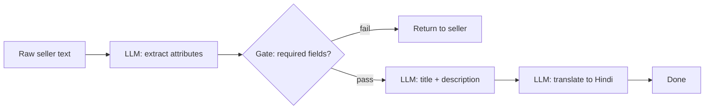
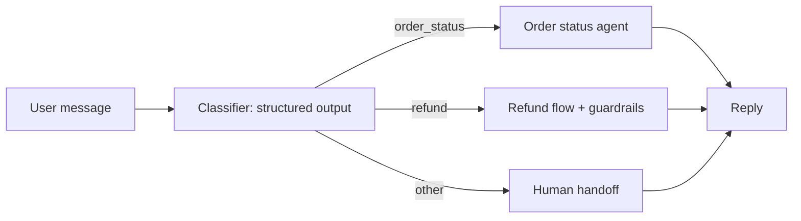
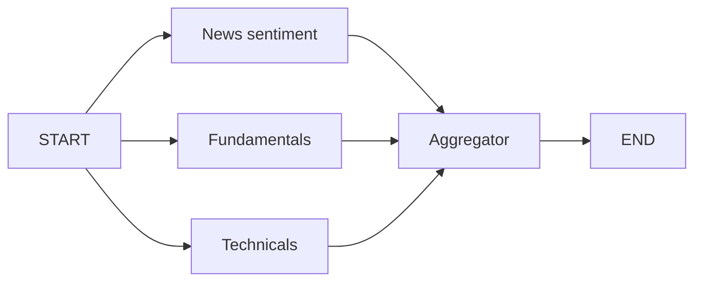
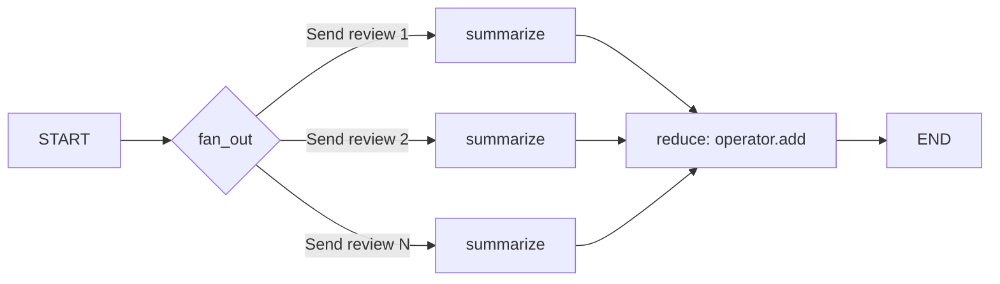
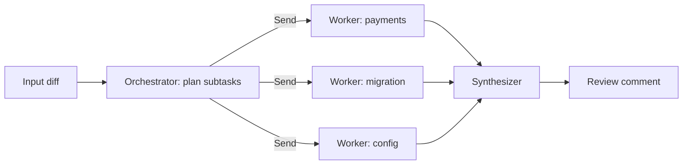
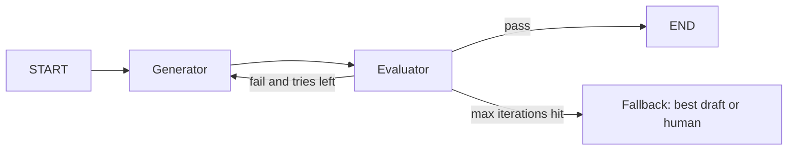
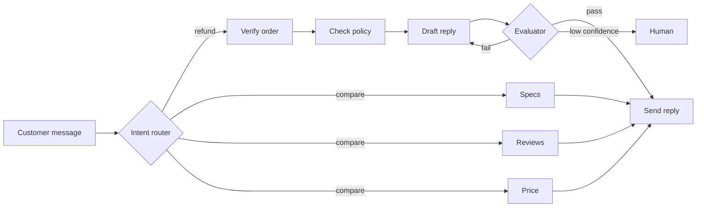

# Workflow Patterns

Workflow matlab **code path pehle se fixed hai**, LLM sirf steps ke andar kaam karta hai. Anthropic ke "Building effective agents" taxonomy ke 5 patterns yahan hain: prompt chaining, routing, parallelization, orchestrator-worker, evaluator-optimizer. Interviewer ye isliye poochta hai kyunki senior engineer ki pehchaan hai "full agent mat banao jab workflow kaafi hai", aur har pattern ko LangGraph me implement karna aana chahiye.

State, reducers, conditional edges, checkpointing basics ke liye [LangGraph Core Concepts](02-langgraph-core.md) padho. Yahan sirf patterns.

## ⭐ Workflow vs agent, aur pattern picker

**Ek line me:** workflow = developer control flow decide karta hai; agent = LLM khud decide karta hai ki agla step kya. Pehle sabse simple cheez try karo, autonomy tabhi badhao jab eval dikhaye ki zaroorat hai.

- **Workflow:** predictable, testable, sasta, latency bounded. Jab task ke steps pehle se pata hon.
- **Agent:** open-ended, steps ki ginti pehle se nahi pata, tool choice dynamic. Cost aur failure surface zyada.
- Ladder: single LLM call (+ retrieval, tools) → workflow → agent → multi-agent. Har step up ka justification eval number hona chahiye, "cool lagta hai" nahi.

| Problem ka shape | Pattern | Control kis ke paas |
|---|---|---|
| Fixed sequence, har step pichhle pe depend | Prompt chaining | Code |
| Input types alag, alag handling chahiye | Routing | LLM classify, code dispatch |
| Independent subtasks ya multiple opinions | Parallelization | Code |
| Subtasks pehle se pata nahi, input pe depend | Orchestrator-worker | LLM plan, code execute |
| Clear quality criteria, iteration se sudhaar | Evaluator-optimizer | Code loop, LLM judge |
| Steps aur tools ka order hi unknown | Agent (next page) | LLM |

**Interview tip:** "Main pehle poochta hoon: kya steps pehle se pata hain? Haan to workflow. Workflow debug, eval aur cost-cap karna kaafi aasaan hai."

**Common galti:** har problem pe ReAct agent laga dena, phir non-deterministic bugs aur 10x token bill debug karna.

## ⭐ Prompt chaining

**Ek line me:** task ko fixed sequential steps me todo, har LLM call pichhle ka output leta hai, aur beech me **programmatic gate** check karta hai ki aage jaana hai ya nahi.

> **Example:** Flipkart seller onboarding. Step 1: seller ke raw product text se structured attributes nikalo. **Gate:** required fields (brand, category, MRP) present hain? Nahi to seller ko wapas bhejo. Step 2: SEO title + description generate karo. Step 3: Hindi me translate karo.

- Har step chhota aur focused → accuracy badhti hai, latency badhti hai. Trade-off accept karo.
- **Gate** deterministic ho (schema validation, regex, length check) ya sasta LLM check. Gate fail = early exit ya retry, galat output aage propagate nahi hota.
- **Kab use:** steps fixed, har step ka output verify ho sakta hai. **Kab nahi:** steps independent hain (parallelize karo) ya order input pe depend karta hai (routing/agent).



```python
from typing import TypedDict
from pydantic import BaseModel
from langgraph.graph import StateGraph, START, END
from langchain.chat_models import init_chat_model

llm = init_chat_model("openai:gpt-4.1-mini")

class Attrs(BaseModel):
    brand: str | None
    category: str | None
    mrp: float | None

class S(TypedDict):
    raw: str
    attrs: dict
    copy: str
    hindi: str

def extract(s: S):
    a = llm.with_structured_output(Attrs).invoke(f"Extract attributes:\n{s['raw']}")
    return {"attrs": a.model_dump()}

def gate(s: S):  # deterministic check, LLM nahi
    ok = all(s["attrs"].get(k) for k in ("brand", "category", "mrp"))
    return "write" if ok else END

def write(s: S):
    return {"copy": llm.invoke(f"SEO title + description for {s['attrs']}").content}

def translate(s: S):
    return {"hindi": llm.invoke(f"Translate to Hindi:\n{s['copy']}").content}

g = StateGraph(S)
g.add_node(extract); g.add_node(write); g.add_node(translate)
g.add_edge(START, "extract")
g.add_conditional_edges("extract", gate, ["write", END])
g.add_edge("write", "translate"); g.add_edge("translate", END)
app = g.compile()
```

- **Failure modes:** error compounding (step 1 ka 5% error aage multiply), gate bahut loose, beech ka state lose hona (sirf last output pass karna, original input nahi).

**Interview tip:** "Har step ke beech ek cheap deterministic gate rakhta hoon; isse failures early pakde jaate hain aur har step alag se eval ho sakta hai."

**Common galti:** ek giant prompt me 5 kaam ek saath karwana, phir pata nahi chalta kaunsa sub-task fail hua.

## ⭐ Routing

**Ek line me:** ek classifier (LLM structured output ya chhota ML model) input ko category deta hai, aur graph usse **specialized branch** pe bhejta hai, jiska apna prompt, model aur tools hain.

> **Example:** Swiggy support. "Order late hai" → order-status branch (tracking tool). "Refund chahiye" → refund branch (stricter guardrails, payment tool). "Restaurant pe complaint" → escalation. Simple FAQ sasta model, refund wala bada model.

- **Separation of concerns:** ek prompt ko sab cases ke liye optimize karna mushkil hai; ek case improve karo to doosra toot-ta hai. Routing ise alag karta hai.
- **Cost routing:** easy queries chhote model pe, hard bade pe. Ye bhi routing hai.
- Classifier ko **structured output** do (`Literal` enum), free text nahi. Low confidence ya `other` → fallback/human.
- LangGraph me do tareeke: `add_conditional_edges` (router function edge pe) ya node se `Command(goto=...)` return karna (routing + state update ek saath).
- **Kab nahi:** categories overlap karti hain ya ek query me multiple intents hain (tab parallel ya orchestrator).



```python
from typing import Literal
from pydantic import BaseModel, Field
from langgraph.graph import StateGraph, START, END, MessagesState
from langgraph.types import Command

class Route(BaseModel):
    intent: Literal["order_status", "refund", "other"]
    confidence: float = Field(ge=0, le=1)

router_llm = llm.with_structured_output(Route)

def classify(state: MessagesState) -> Command[Literal["order_status", "refund", "human"]]:
    r = router_llm.invoke([("system", "Classify the support query.")] + state["messages"])
    target = r.intent if r.confidence >= 0.7 and r.intent != "other" else "human"
    return Command(goto=target)  # state update bhi yahin de sakte ho: update={...}

def order_status(state: MessagesState): ...
def refund(state: MessagesState): ...
def human(state: MessagesState): ...

g = StateGraph(MessagesState)
g.add_node(classify); g.add_node(order_status); g.add_node(refund); g.add_node(human)
g.add_edge(START, "classify")
for n in ("order_status", "refund", "human"):
    g.add_edge(n, END)
app = g.compile()
```

- `Command[Literal[...]]` return type annotation zaroori hai, taaki graph render aur validation ko possible destinations pata hon.
- **Failure modes:** misroute (galat branch confidently), class imbalance, naye intents jo kisi bucket me fit nahi, multi-intent messages.
- Fix: router ka alag eval set (confusion matrix), confidence threshold, `other` bucket, aur logs se naye intents mine karna.

**Interview tip:** "Router ek classifier hai, to main use classifier ki tarah eval karta hoon: per-class precision/recall aur confusion matrix, end-to-end eval se alag."

**Common galti:** router se free-text output lena aur string `in` check karna. Structured output + enum use karo.

## ⭐ Parallelization: sectioning aur voting

**Ek line me:** independent kaam ek saath chalao (**sectioning**), ya same kaam N baar chala ke aggregate karo (**voting**), phir **fan-in** pe reducer se results jodo.

> **Example (sectioning):** Zerodha stock summary: news sentiment, fundamentals, technicals teen parallel branches, phir aggregator ek report banata hai. **Example (voting):** Razorpay merchant onboarding me fraud check: 3 alag prompts "kya ye website suspicious hai?", 2/3 yes pe manual review.

- **Sectioning:** latency ghatti hai (sequential 3×2s = 6s → parallel ≈ 2s), aur har branch focused rehta hai. Guardrail ek branch me, answer doosre me, ye bhi sectioning hai.
- **Voting:** confidence badhta hai, cost N guna. Threshold tune karo (any-yes for safety, majority for balance).
- LangGraph me **static fan-out:** ek node se multiple edges = same superstep me parallel. **Fan-in:** `add_edge(["a","b","c"], "join")` sab ka wait karta hai.
- Parallel nodes same key likhein to **reducer** chahiye (`Annotated[list, operator.add]`), warna `InvalidUpdateError`.



```python
import operator
from typing import Annotated, TypedDict

class S(TypedDict):
    ticker: str
    sections: Annotated[list[str], operator.add]  # parallel writes merge hote hain
    report: str

def ask(kind: str, ticker: str) -> list[str]:
    return [f"{kind}: " + llm.invoke(f"{kind} analysis for {ticker}").content]

def news(s): return {"sections": ask("News sentiment", s["ticker"])}
def fundamentals(s): return {"sections": ask("Fundamentals", s["ticker"])}
def technicals(s): return {"sections": ask("Technicals", s["ticker"])}

def aggregate(s):
    return {"report": llm.invoke("Combine into one report:\n" + "\n".join(s["sections"])).content}

g = StateGraph(S)
for fn in (news, fundamentals, technicals, aggregate):
    g.add_node(fn)
for n in ("news", "fundamentals", "technicals"):
    g.add_edge(START, n)
g.add_edge(["news", "fundamentals", "technicals"], "aggregate")  # fan-in: sab ka wait
g.add_edge("aggregate", END)
app = g.compile()
```

### Map-reduce with `Send`

- Static edges tab, jab branches ki ginti fixed ho. Jab N runtime pe pata chale (e.g. 7 PDFs, 40 reviews), **`Send`** use karo.
- Conditional edge `Send` objects ki list return karta hai; har `Send(node, payload)` us node ko **apne private input** ke saath chalata hai. Results reducer se collect hote hain.



`Send` runtime pe N worker instances banata hai, har ek ka apna payload; reducer sab results ek key me jodta hai.

```python
from langgraph.types import Send

class MR(TypedDict):
    reviews: list[str]
    summaries: Annotated[list[str], operator.add]
    final: str

def fan_out(s: MR):
    return [Send("summarize", {"review": r}) for r in s["reviews"]]  # map

def summarize(p: dict):  # input sirf payload hai, poora state nahi
    return {"summaries": [llm.invoke(f"One line summary: {p['review']}").content]}

def reduce_(s: MR):
    return {"final": llm.invoke("Top 3 themes:\n" + "\n".join(s["summaries"])).content}

g = StateGraph(MR)
g.add_node("summarize", summarize); g.add_node("reduce", reduce_)
g.add_conditional_edges(START, fan_out, ["summarize"])
g.add_edge("summarize", "reduce")
g.add_edge("reduce", END)
```

- **Failure modes:** reducer bhool jana, ek branch slow/fail to poora superstep atka (timeouts + `RetryPolicy`), rate limit hit (`max_concurrency` config me cap karo), voting me correlated errors (same prompt N baar = same galti; prompts ya models vary karo).

**Interview tip:** "Sectioning latency ke liye, voting confidence ke liye. Dynamic N ho to `Send` se map-reduce, aur shared key pe `operator.add` reducer."

**Common galti:** order pe depend karna. Parallel reducer me results ka order guaranteed mat maano; zaroorat ho to id saath bhejo aur sort karo.

## ⭐ Orchestrator-worker

**Ek line me:** ek orchestrator LLM input dekh ke **runtime pe subtasks plan** karta hai, unhe workers ko `Send` se bhejta hai, aur synthesizer results jodta hai.

> **Example:** Razorpay ka "PR review bot": diff dekh ke orchestrator decide karta hai kaunsi files/areas review karni hain (payments module, migration, config), har ek pe worker chalta hai, synthesizer ek review comment banata hai. Kitne workers, ye diff pe depend karta hai.

- Parallelization se farak: wahan subtasks **developer define** karta hai; yahan **LLM define** karta hai.
- Agent se farak: plan ek baar banta hai, loop nahi; workers tools ke saath mini-agents bhi ho sakte hain.
- **Kab use:** subtasks input pe depend, par ek plan + execute kaafi hai. **Kab nahi:** plan beech me badalna pade (tab plan-and-execute with replanner, [next page](04-agent-patterns.md)).



```python
class Task(BaseModel):
    area: str
    instructions: str

class Plan(BaseModel):
    tasks: list[Task] = Field(max_length=6)  # fan-out cap

class OS(TypedDict):
    diff: str
    plan: list[Task]
    findings: Annotated[list[str], operator.add]
    review: str

def orchestrator(s: OS):
    p = llm.with_structured_output(Plan).invoke(f"Split review of this diff:\n{s['diff']}")
    return {"plan": p.tasks}

def assign(s: OS):
    return [Send("worker", {"task": t, "diff": s["diff"]}) for t in s["plan"]]

def worker(p: dict):
    t = p["task"]
    out = llm.invoke(f"Review {t.area}: {t.instructions}\n{p['diff']}").content
    return {"findings": [f"[{t.area}] {out}"]}

def synthesize(s: OS):
    return {"review": llm.invoke("Merge findings:\n" + "\n".join(s["findings"])).content}

g = StateGraph(OS)
g.add_node(orchestrator); g.add_node(worker); g.add_node(synthesize)
g.add_edge(START, "orchestrator")
g.add_conditional_edges("orchestrator", assign, ["worker"])
g.add_edge("worker", "synthesize"); g.add_edge("synthesize", END)
```

- **Failure modes:** over-decomposition (20 tasks for a 5-line diff), overlapping tasks (duplicate findings), worker ko kam context dena, synthesizer ka context overflow.
- Fix: plan pe `max_length` cap, task descriptions me clear boundaries, workers se short structured output, synthesizer se pehle dedupe.

**Interview tip:** "Orchestrator ka plan structured output hai jiska size capped hai; har worker ko sirf apna slice milta hai. Ye context isolation ka sasta version hai."

**Common galti:** workers ko poora state/history bhej dena. Token cost N guna ho jaata hai aur focus khatam.

## ⭐ Evaluator-optimizer (reflection loop)

**Ek line me:** generator output banata hai, evaluator criteria pe grade + feedback deta hai, fail hua to feedback ke saath generator dobara; **max iterations guard** zaroori.

> **Example:** Zomato push notification copy. Generator 40-char Hinglish copy likhta hai; evaluator check karta hai: length ≤ 40, brand tone, koi false claim nahi ("free" tabhi jab offer free ho). Fail → feedback ke saath rewrite, max 3 rounds.

- **Kab use:** clear, articulable criteria hain aur feedback se output measurably better hota hai (copywriting, code jo tests pass kare, translation nuance). **Kab nahi:** criteria vague, ya pehla draft hi kaafi achha (bas latency/cost badhega).
- Best evaluator = **deterministic** jahan ho sake (tests, linters, schema, length). LLM judge sirf subjective parts ke liye, structured output (`pass: bool`, `feedback: str`) ke saath.
- Self-grading bias: same model same prompt se apne output ko zyada pass karta hai. Alag prompt/model ya rubric use karo.



```python
class Grade(BaseModel):
    passed: bool
    feedback: str

class RS(TypedDict):
    brief: str
    draft: str
    grade: dict
    tries: int

MAX_TRIES = 3
judge_llm = init_chat_model("anthropic:claude-sonnet-4-5")  # alag model = kam self-bias

def generate(s: RS):
    fb = s.get("grade", {}).get("feedback", "")
    d = llm.invoke(f"Push copy, max 40 chars, Hinglish.\nBrief: {s['brief']}\nFix: {fb}").content
    return {"draft": d, "tries": s.get("tries", 0) + 1}

def evaluate(s: RS):
    if len(s["draft"]) > 40:  # pehle deterministic check
        return {"grade": {"passed": False, "feedback": "Over 40 chars, shorten."}}
    g = judge_llm.with_structured_output(Grade).invoke(f"Rubric: tone, no false claims.\n{s['draft']}")
    return {"grade": g.model_dump()}

def next_step(s: RS):
    if s["grade"]["passed"]:
        return END
    return "generate" if s["tries"] < MAX_TRIES else "fallback"

g = StateGraph(RS)
g.add_node(generate); g.add_node(evaluate); g.add_node("fallback", lambda s: {})
g.add_edge(START, "generate"); g.add_edge("generate", "evaluate")
g.add_conditional_edges("evaluate", next_step, ["generate", "fallback", END])
g.add_edge("fallback", END)
```

- **Failure modes:** infinite loop (guard nahi), oscillation (fix A todta hai B), judge leniency/strictness drift, har round me cost + latency add.
- Safety net: apna counter + LangGraph ka `recursion_limit` (default 25 supersteps) dono. Limit hit pe `GraphRecursionError` aata hai, use catch karke graceful fallback do.

**Interview tip:** "Loop me teen cheezein: deterministic checks pehle, LLM judge structured output ke saath, aur explicit max-iterations ke baad best-so-far ya human fallback."

**Common galti:** sirf `recursion_limit` pe bharosa karna. Wo crash karta hai, graceful exit nahi deta.

## Patterns ko combine karna

**Ek line me:** real systems me patterns nest hote hain: router ke ek branch ke andar chain, chain ke ek step me parallel, end pe evaluator loop.

> **Example:** Flipkart customer support: **routing** (intent) → refund branch me **prompt chaining** (verify order → check policy → draft reply) → draft pe **evaluator** (policy compliance) → low-confidence pe human. Product-compare branch me **parallelization** (spec, reviews, price ek saath).



Flipkart support: upar routing, refund branch me chain + evaluator loop, compare branch me parallel fan-out.

- Har sub-pattern ko **subgraph** banao (compiled graph as node). Alag test, alag eval, alag owner.
- Rule: combination tabhi jab har layer ka eval number justify kare. Har layer latency aur cost add karti hai.
- Debugging: LangSmith/Langfuse trace me har node ka input/output dikhna chahiye; dekho [AI Observability](10-agent-observability.md).

**Interview tip:** "Main design ko patterns ke naam se explain karta hoon: 'top pe routing, refund branch chained hai with a gate, final pe evaluator.' Interviewer ko turant structure samajh aata hai."

**Common galti:** sab ek flat graph me 25 nodes; subgraphs ke bina test aur reuse mushkil.

## ⭐ Kaunsa pattern kis problem ke liye

| Problem | Pattern | Kyun |
|---|---|---|
| Meesho seller catalog: extract → enrich → translate | Prompt chaining + gate | Fixed steps, har step verifiable |
| Swiggy support: order, refund, complaint | Routing | Alag prompts/tools/guardrails per intent |
| Zerodha stock brief: news, fundamentals, technicals | Parallelization (sectioning) | Independent, latency ghatao |
| Razorpay fraud check on merchant website | Parallelization (voting) | Confidence, false negatives mehenge |
| 50 app reviews summarize karna | Map-reduce with `Send` | N runtime pe pata |
| PR review bot, multi-file diff | Orchestrator-worker | Subtasks input pe depend |
| Zomato push copy with tone and length rules | Evaluator-optimizer | Clear criteria, iteration se gain |
| CRED "mera spend analyse karo aur plan banao", steps unknown | Agent / plan-and-execute | Path pehle se nahi pata |

**Interview tip:** "Pattern choose karne ke do sawal: steps pehle se pata hain? aur output ko check kaise karunga? In dono se 80% decision ho jaata hai."

**Common galti:** pattern ka naam yaad hona par uska failure mode aur cost impact na bata paana.

## Aage padho

- [LangGraph Core Concepts](02-langgraph-core.md): state, reducers, `Command`, checkpointing.
- [Agentic Patterns: Agents & Multi-agent](04-agent-patterns.md): jab workflow kaafi nahi.
- [Evals for Agents](09-agent-evals.md): router aur evaluator ko kaise measure karein.
- [Cost & Latency](11-cost-latency.md): parallelization aur model routing ka cost angle.
- [Multi-agent lab](/viewinter/agents/labs/multi): browser me patterns chala ke dekho.

## Checklist

- [ ] Workflow vs agent ka farak aur "simplest first" ladder samjha sakta hoon
- [ ] Prompt chaining me gate kyun aur kaisa ho, LangGraph code ke saath bata sakta hoon
- [ ] Routing ko structured output + conditional edge ya `Command` se implement kar sakta hoon
- [ ] Sectioning vs voting aur fan-in pe reducer kyun chahiye, samjha sakta hoon
- [ ] `Send` API se map-reduce likh sakta hoon aur payload vs state ka farak bata sakta hoon
- [ ] Orchestrator-worker ko parallelization aur agent se alag kar ke samjha sakta hoon
- [ ] Evaluator-optimizer loop max-iterations guard aur fallback ke saath design kar sakta hoon
- [ ] Har pattern ke failure modes aur fixes bata sakta hoon
- [ ] Kisi product problem ke liye sahi pattern (ya combination) justify kar sakta hoon
