# Agent & Multi-agent Patterns

Pichhle page pe raasta code decide karta tha. Is page pe **raasta LLM decide karta hai**, kyunki steps pehle se pata nahi hote. Patterns hain: ReAct, plan-and-execute, ReWOO, Reflexion, aur phir multi-agent (supervisor, hierarchical, swarm, network).

Interviewer yahan do cheezein check karta hai: kya tum in architectures ko LangGraph me bana sakte ho, aur kya tum bata sakte ho ki **multi-agent kab bekaar hai**.

Fixed-path patterns ke liye [Agentic Patterns: Workflows](03-workflow-patterns.md), aur `Command`, subgraphs, checkpointing ke liye [LangGraph Core Concepts](02-langgraph-core.md).

**Is page ke baad tum ye samjha paoge:**
- ReAct loop me thought → action → observation kaise chalta hai, asli messages ke saath.
- Plan-and-execute me plan list kaise execute aur replan hoti hai.
- Supervisor, hierarchical, swarm aur network me har step pe control kiske paas hai.
- Multi-agent kab worth hai, tokens aur rupees ke numbers ke saath.
- Agents ke beech state kaise share karein aur kya kya toot-ta hai.

## Pehle ye shabd samjho

LLM naye ho? Pehle [How LLMs Work](14-how-llms-work.md) padho. Usme tokens, context window aur model text kaise banata hai, ye sab hai.

| Shabd | Simple matlab |
|---|---|
| LangGraph | LLM apps ko graph ki tarah banane ki Python library. Functions nodes hain, arrows batate hain aage kaun chalega. |
| `Command` | LangGraph ki return value jo ek saath data update karti hai aur batati hai agla node kaun. |
| Subgraph | Ek poora compiled graph jo bade graph ke andar ek node ki tarah use hota hai. |
| Checkpointer | Har step ke baad graph ka data memory ya DB me save karta hai, taaki baat baad me resume ho. |
| `messages` | Chat messages ki list (user, model, tool results) jo har call pe model ko jaati hai. |
| `tool_calls` | Model ke reply ka field jo batata hai kaunsa function kin args ke saath chalana hai. Chalata tumhara code hai. |
| `ToolMessage` | Wo message jo tool ka result `messages` me wapas laata hai, us call se juda hua. |
| Superstep | Graph ka ek tick: us tick ke saare nodes chalte hain, phir unke updates apply hote hain. |
| Middleware | Har model ya tool call ke aas-paas chalne wale hooks, jaise history summarize karna ya human se poochna. |
| State | Shared dict jisse graph ka har node data padhta hai aur usme updates likhta hai. |
| Hallucination | Model ka poore confidence se galat ya banaya hua jawab dena, jaise bina dekhe numbers bata dena. |
| Reducer | Node ka update state field me merge karne ka rule, jaise overwrite ki jagah list me append. |
| Structured output | Model ko free text ki jagah fixed shape (jaise Pydantic class) me jawab dene pe majboor karna. |
| Span | Ek operation (model call, tool run) ka timed record, jo ek request ke trace ke andar hota hai. |

## Big picture: agent patterns ki seedhi

Agent ka matlab hai: LLM ek loop me khud decide karta hai ki agla kaam kya. Is page pe hum ek seedhi chadhte hain. Neeche ek agent loop me tools chalata hai (**ReAct**). Lambe tasks me wo raasta bhoolta hai, to pehle plan banwate hain (**plan-and-execute**). Plan wale tareeke ko sasta ya fast karna ho to **ReWOO** aur **LLMCompiler**. Agent galti se seekhe, iske liye **Reflexion**. Aur jab ek agent pe bahut tools ya domains ho jaayein, tab kaam kai agents me baant-te hain (**multi-agent**).

Multi-agent ke baad teen sawal bachte hain: ye kab worth hai, agents aapas me state kaise share karein, aur kya kya toot-ta hai. Page ke last teen sections yahi hain.

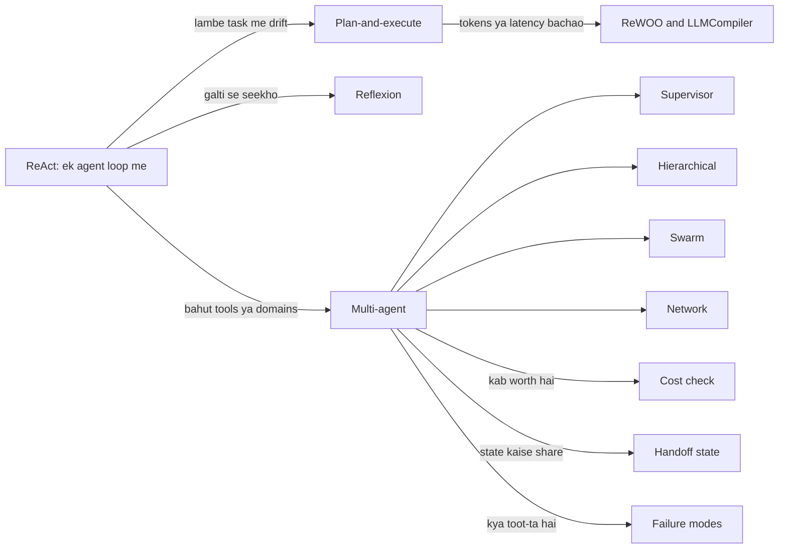

## ⭐ ReAct / tool-calling agent

**Ye kyun chahiye?** Zerodha Kite user poochta hai: "Mera kal ka order reject kyun hua?" Kabhi jawab ek tool call me milta hai, kabhi order ke baad margin bhi dekhna padta hai, kabhi holdings bhi. Workflow me fixed steps likhne padte; yahan kitne steps lagenge pehle se pata hi nahi.

**Analogy:** **doctor ka diagnosis**. Doctor sochta hai "bukhaar hai, shayad infection" (thought), blood test likhta hai (action), report dekhta hai (observation). Report ke hisaab se phir sochta hai: ek aur test, ya dawai likh do (final answer). Kitne test honge, ye pehle se fixed nahi.

**Ek line me:** LLM ek loop me chalta hai: socho → tool call karo → result (observation) dekho → phir socho, jab tak final answer na de de ya step limit hit na ho.

> **Example:** user: "Kal ka order reject kyun hua?" Agent ke paas do tools hain: `get_orders(date)` aur `get_margin()`.

**Step by step (asli messages):**

| Turn | Kaun | Kya hua | `messages` me kitne items |
|---|---|---|---|
| 1 | User | "Kal ka order reject kyun hua?" | 1 |
| 2 | Model (thought + action) | Soch: "pehle order dekhna padega". `tool_calls = [get_orders(date="2026-11-02")]` | 2 |
| 3 | Tool (observation) | `[{"id": "A1", "status": "REJECTED", "reason": "insufficient margin"}]` | 3 |
| 4 | Model (thought + action) | Soch: "margin kitna tha, ye numbers chahiye". `tool_calls = [get_margin()]` | 4 |
| 5 | Tool (observation) | `{"available": 1200.0, "used": 48800.0}` | 5 |
| 6 | Model (final) | "Order A1 reject hua kyunki margin kam tha. Available sirf ₹1,200 tha, ₹48,800 pehle se use ho chuka tha." Koi `tool_calls` nahi | 6 |

Turn 6 pe model ne koi tool call nahi kiya, isliye loop khatam. Dhyan do: har model call pe **poori `messages` list dobara jaati hai**. Turn 2 pe model ne 1 message padha, turn 4 pe 3, turn 6 pe 5. Isi wajah se ReAct ki cost steps ke saath badhti hai.

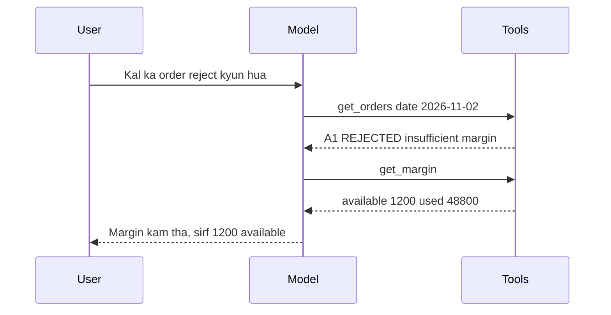

Graph ke roop me yahi loop aisa dikhta hai:

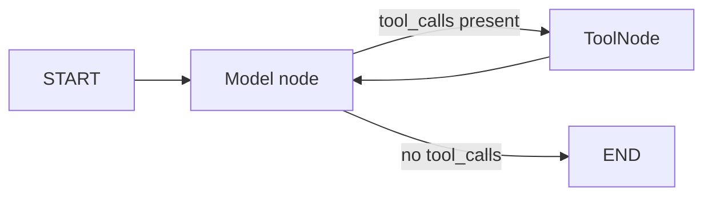

**Ab terms:**
- **Thought:** model ki soch ki agla kya karna hai. Modern models me ye aksar hidden hoti hai ya chhota text.
- **Action:** `tool_calls` field, jisme tool ka naam aur args hote hain. Ye native **tool calling** hai, purana text parsing wala "Thought/Action" format nahi.
- **Observation:** tool ka result, jo `ToolMessage` ban ke `messages` me judta hai.
- **Loop rule:** `model` node → `tool_calls` hain? → `tools` node → wapas `model`. Koi tool call nahi = END.
- **`recursion_limit`:** kitne supersteps ke baad graph ruk jaaye. Infinite loop ka safety net.

**Kab use:** open-ended tasks, 3–15 tools, path input pe depend. **Kab nahi:** steps fixed (workflow sasta), ya 30+ tools (tool selection accuracy girti hai; routing ya multi-agent socho).

Prebuilt tareeka: LangChain 1.0 ka `langchain.agents.create_agent` (middleware support, recommended). Purana `langgraph.prebuilt.create_react_agent` abhi bhi chalta hai par deprecated hai. Neeche wala code upar wala poora trace 10 lines me bana deta hai.

```python
from langchain.agents import create_agent
from langchain_core.tools import tool

@tool
def get_orders(date: str) -> list[dict]:
    """Return the user's orders for a date (YYYY-MM-DD)."""   # docstring = model ke liye tool description
    return [{"id": "A1", "status": "REJECTED", "reason": "insufficient margin"}]

@tool
def get_margin() -> dict:
    """Return available and used margin in INR."""
    return {"available": 1200.0, "used": 48800.0}

agent = create_agent(
    model="openai:gpt-4.1",
    tools=[get_orders, get_margin],
    system_prompt="You are Kite support. Use tools, never guess numbers.",
)
out = agent.invoke({"messages": [{"role": "user", "content": "Kal ka order reject kyun hua?"}]},
                   {"recursion_limit": 12})  # step cap: isse zyada steps = error
# Purana tareeka: from langgraph.prebuilt import create_react_agent
# agent = create_react_agent(model, tools, prompt="...")
```

**Code me kya ho raha hai:**
- `@tool` function ko tool bana deta hai; docstring aur type hints se model ko pata chalta hai tool kab aur kaise use karna hai.
- `create_agent` andar wahi model ↔ tools loop banata hai jo diagram me hai.
- `out["messages"]` me upar wali table ke 6 messages honge; last wala final answer hai.
- `recursion_limit: 12` agent ko 12 supersteps ke baad rok deta hai, chahe wo loop me fasa ho.

Jab custom state, extra nodes ya approval step chahiye, tab yahi loop haath se banao:

```python
from langgraph.graph import StateGraph, START, MessagesState
from langgraph.prebuilt import ToolNode, tools_condition
from langchain.chat_models import init_chat_model

tools = [get_orders, get_margin]
llm = init_chat_model("openai:gpt-4.1").bind_tools(tools)   # model ko tools ki list dikhao

def call_model(state: MessagesState):
    return {"messages": [llm.invoke(state["messages"])]}     # poori history har baar jaati hai

g = StateGraph(MessagesState)
g.add_node("model", call_model)
g.add_node("tools", ToolNode(tools))                         # tool_calls chala ke ToolMessage banata hai
g.add_edge(START, "model")
g.add_conditional_edges("model", tools_condition)  # "tools" ya END
g.add_edge("tools", "model")                                 # observation ke baad wapas model
app = g.compile()
```

**Code me kya ho raha hai:**
- `bind_tools` model ko tools ke schema batata hai, taaki wo `tool_calls` return kar sake.
- `ToolNode` last AI message ke `tool_calls` padhta hai, tools chalata hai, aur `ToolMessage` add karta hai.
- `tools_condition` dekhta hai: last message me `tool_calls` hain to `"tools"`, warna END.
- `tools → model` edge hi loop hai. Approval chahiye to `tools` se pehle ek naya node daal sakte ho.

**Failure modes:** tool loop (same call baar baar), galat tool args, bina tool ke hallucinated final answer, context bloat (bade tool outputs har turn me wapas). Fix: `recursion_limit`, tool descriptions me clear "kab use karo", tool output truncate/summarize, args pe Pydantic (Python ki data-validation library) validation, aur tool error ko `ToolMessage` bana ke model ko wapas dena taaki wo self-correct kare.

**Interview tip:** "ReAct ki cost har step pe poora context resend karna hai. Isliye main tool outputs chhote rakhta hoon aur step limit lagata hoon."

**Common galti:** `create_react_agent` ko current API batana. 1.0 me `create_agent` hai, middleware ke saath (summarization, HITL = human-in-the-loop approval, model fallback).

## ⭐ Plan-and-execute

**Ye kyun chahiye?** CRED user bolta hai: "Pichhle 3 mahine ka mera credit card spend analyse karo aur ₹10k bachane ka plan do." Isme 6–8 steps hain. ReAct agent step 6 tak aate aate goal bhool jaata hai ya ek hi data baar baar fetch karta hai, kyunki uske paas koi "list" nahi hai.

**Analogy:** **family ki Goa trip planning**. Pehle ek list banti hai: tickets, hotel, cab, sightseeing. Phir ek ek kaam hota hai. Har kaam ke baad list dekhte hain: hotel full mila to list me "doosra hotel dhoondo" add hota hai. List banane wala = **planner**, kaam karne wala = **executor**, har kaam ke baad list update karne wala = **replanner**.

**Ek line me:** planner pehle poora multi-step plan banata hai, executor ek-ek step chalata hai (aksar ReAct sub-agent), replanner har step ke baad decide karta hai: plan update karo ya final answer do.

> **Example:** input = "Pichhle 3 mahine ka mera credit card spend analyse karo aur ₹10k bachane ka plan do."

**Step by step (plan list kaise badalti hai):**

| Round | Executor ne kaunsa step chalaya | Result | Replanner ke baad `plan` |
|---|---|---|---|
| 0 (planner) | – | – | 1) HDFC card statements fetch, 2) categorize, 3) top 3 categories, 4) savings plan |
| 1 | HDFC statements fetch | "3 statements, ₹1.42 lakh spend" | 2) categorize, 3) top 3, 4) savings plan |
| 2 | categorize | "Shopping ₹52k, Food ₹38k... profile me ek ICICI card bhi hai, uska data nahi" | **ICICI statements fetch**, categorize ICICI, top 3, savings plan |
| 3 | ICICI statements fetch | "₹46k spend" | categorize ICICI, top 3, savings plan |
| 4 | categorize ICICI | "Food ₹12k, Travel ₹28k..." | top 3, savings plan |
| 5 | top 3 categories | "Shopping ₹70k, Food ₹50k, Travel ₹28k" | savings plan |
| 6 | savings plan | "Food delivery ₹4k/month kam, ..." | khaali, aur `response` set |

Round 2 pe replanner ne naya step **add** kiya. Yahi cheez isse orchestrator-worker se alag karti hai: wahan plan ek baar banta hai aur badalta nahi. `past_steps` har round ek (step, result) pair se badhta hai, isliye round 6 tak usme 6 pairs hain.

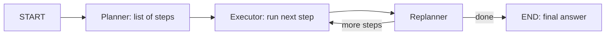

**Ab terms:**
- **Planner:** ek baar chalta hai, steps ki list deta hai. Aksar bada model.
- **Executor:** list ka pehla step chalata hai. Aksar chhota model ya ReAct sub-agent (cost bachat).
- **Replanner:** goal, ho chuke steps, aur baaki list dekh ke bolta hai: naya plan ya final `response`.
- **`past_steps`:** (step, result) pairs ki list, append reducer ke saath.
- ReAct se farak: **upfront thinking** milta hai, to lambe tasks me drift kam.

**Kab use:** 5+ steps wale long-horizon tasks, research, data analysis. **Kab nahi:** 1–3 tool calls ka task (overhead), ya highly interactive chat.

Ye code teen nodes (planner, execute, replan) aur ek decision function se upar wala loop banata hai.

```python
import operator
from typing import Annotated, TypedDict
from pydantic import BaseModel
from langgraph.graph import StateGraph, START, END

class PlanState(TypedDict):
    input: str                                                   # user ka goal
    plan: list[str]                                              # baaki steps
    past_steps: Annotated[list[tuple[str, str]], operator.add]  # (step, result), append hota hai
    response: str                                                # set hua = kaam khatam

class Plan(BaseModel):
    steps: list[str]

class Act(BaseModel):
    response: str | None = None      # set = finish
    new_plan: list[str] | None = None

def plan_step(s: PlanState):
    return {"plan": big_llm.with_structured_output(Plan).invoke(s["input"]).steps}

def execute_step(s: PlanState):
    step = s["plan"][0]                                          # sirf pehla step
    res = executor_agent.invoke({"messages": [("user", f"Do: {step}")]})  # ReAct sub-agent
    return {"past_steps": [(step, res["messages"][-1].content)]}

def replan_step(s: PlanState):
    a = big_llm.with_structured_output(Act).invoke(
        f"Goal: {s['input']}\nDone: {s['past_steps']}\nRemaining: {s['plan'][1:]}")
    if a.response:
        return {"response": a.response}
    return {"plan": a.new_plan or s["plan"][1:]}                 # naya plan, ya bas pehla step hatao

def should_end(s: PlanState):
    return END if s.get("response") or not s["plan"] else "execute"

g = StateGraph(PlanState)
g.add_node("planner", plan_step)
g.add_node("execute", execute_step)
g.add_node("replan", replan_step)
g.add_edge(START, "planner")
g.add_edge("planner", "execute")
g.add_edge("execute", "replan")
g.add_conditional_edges("replan", should_end, ["execute", END])
app = g.compile()
```

**Code me kya ho raha hai:**
- `plan_step` ek baar chalta hai aur `plan` me table ka round 0 wali list daalta hai.
- `execute_step` sirf `plan[0]` chalata hai aur `(step, result)` ko `past_steps` me append karta hai.
- `replan_step` ko teen cheezein dikhti hain: goal, jo ho chuka, jo baaki hai. Wo ya `response` deta hai ya `new_plan` (round 2 jaisa).
- `should_end` loop rokta hai jab `response` set ho ya plan khaali ho.

**Failure modes:** over-planning (20 steps), plan bahut abstract ("data analyse karo"), replanner kabhi "done" nahi bolta, `past_steps` se context phoolta hai. Fix: plan length cap, steps ko tool-level concrete rakho, replanner ke saath max-iterations, purane results ko summarize.

**Interview tip:** "Plan-and-execute me state ka shape bolo: `input`, `plan`, `past_steps` with append reducer, `response`. Replanner hi isse orchestrator-worker se alag karta hai."

**Common galti:** replanner skip kar dena; tab pehle step ki galti poora plan bigaad deti hai.

## ReWOO aur LLMCompiler, short me

**Ye kyun chahiye?** Plan-and-execute me har step ke baad replanner LLM call hoti hai. 6 steps = 1 plan + 6 replan + executor calls. Agar steps predictable hain, to ye extra calls sirf tokens aur time kha rahi hain.

**Analogy:** **ReWOO = mummy ki shopping list with placeholders**: "doodh lo, jitne ka mile usse double paise ka paneer lo". List ek baar banti hai, dukaan pe dobara phone nahi karna. **LLMCompiler = kitchen me ek saath kai chulhe**: chawal aur dal ek doosre pe depend nahi, dono saath pakte hain; raita dahi aane ka wait karta hai.

**Ek line me:** dono plan-and-execute ke speed/cost-optimized variants hain: **ReWOO** observations ke bina plan me variables use karta hai, **LLMCompiler** tasks ka DAG bana ke parallel chalata hai.

**ReWOO step by step** (sawal: "Nifty ka PE 10% badhe to kitna hoga?"):
1. **Planner (LLM call 1)** ek baar poora plan likhta hai: `#E1 = search("Nifty PE")`, `#E2 = calc("#E1 * 1.1")`.
2. **Worker (koi LLM nahi):** `#E1` chalata hai → `22.4`. Phir `#E2` me `#E1` ki jagah 22.4 rakh ke → `24.64`.
3. **Solver (LLM call 2):** "Abhi PE 22.4 hai, 10% badhne pe 24.64 hoga."
4. ReAct me yahi kaam 3 LLM calls leta, aur har call me poori history jaati.

**LLMCompiler:** planner tasks ko dependencies ke saath **DAG** me stream karta hai. Task fetching unit dependencies ready hote hi tasks parallel chalata hai. Joiner decide karta hai: answer do ya replan. Paper ne ReAct ke comparison me latency me kaafi speedup report kiya.

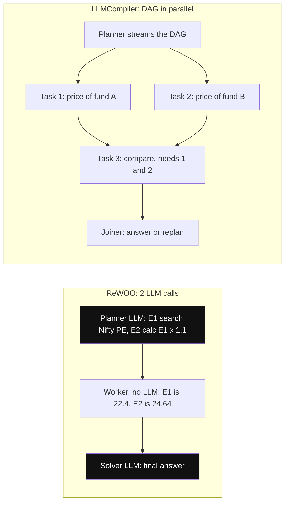

*Diagram:* ReWOO LLM ko sirf do baar (highlighted) bulata hai kyunki worker model se pooche bina E1 ko E2 me bhar deta hai; LLMCompiler task 1 aur 2 ek saath chalata hai aur task 3 dono ka intezaar karta hai.

| | ReAct | Plan-and-execute | ReWOO | LLMCompiler |
|---|---|---|---|---|
| LLM calls | har step | plan + replan har step | ~2 (plan, solve) | plan + join |
| Adaptivity | high | high | low | medium |
| Parallel tools | limited | nahi (default) | haan | haan, DAG |
| Best for | interactive, short | long tasks | predictable tool chains | many independent lookups |

**Ab terms:**
- **Placeholder / variable (`#E1`):** kisi tool ke future result ka naam, plan me pehle se likha.
- **DAG:** tasks ka graph jisme arrows dependency batate hain aur koi loop nahi.
- **Joiner:** LLMCompiler ka last step jo results dekh ke answer ya replan chunta hai.

**Interview tip:** "ReWOO tokens bachata hai, LLMCompiler latency. Dono ka trade-off adaptivity hai."

**Common galti:** ReWOO ko tab use karna jab beech ke results agle steps ko badal dete hain.

## Reflexion / self-critique agents

**Ye kyun chahiye?** Coding agent ne patch likha, tests fail hue. Agar wo bas "dobara try" kare, to aksar wahi galti dohrata hai. Use yaad rakhna hai ki **kya** galat hua tha.

**Analogy:** **cricketer ka video review**. Out hone ke baad wo video dekhta hai aur diary me likhta hai: "off-stump ke bahar wali ball chhodni hai". Agle match se pehle diary padhta hai. Video = **external signal**, diary note = **reflection**, diary = **memory**.

**Ek line me:** agent attempt karta hai, external signal (tests, eval, error) pe **verbal self-reflection** likhta hai, aur wo reflection memory me rakh ke agla attempt karta hai.

> **Example:** internal coding agent jo Razorpay SDK ka bug fix karta hai.

**Step by step:**
1. **Attempt 1:** agent retry logic me patch likhta hai.
2. **Evaluate (tests):** `test_retry_is_idempotent` fail: "2 payments ban gaye".
3. **Reflect:** agent likhta hai: "Maine retry pe naya idempotency key banaya. Retry pe purani key reuse karni thi."
4. **Store:** ye reflection memory me save hoti hai.
5. **Attempt 2:** prompt me reflection jaati hai. Agent key reuse karta hai. Tests pass → Done.
6. Agar 3 attempts ke baad bhi fail, to fallback (human ko PR).

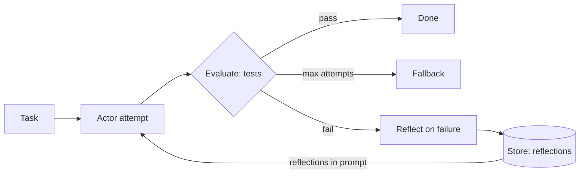

Grounded signal (tests) fail hone pe reflection Store me jaati hai aur agle attempt ke prompt me wapas aati hai.

**Ab terms:**
- **Grounded signal:** bahar se aaya sach (test result, compiler error, retrieval check). Sirf "khud se socho kya galat hua" = model apni galti dobara confirm karta hai.
- **Episode:** ek poora attempt. Reflexion me reflections **episodes ke across** yaad rehti hain.
- Evaluator-optimizer (workflow) se farak: yahan actor ek **agent** hai, aur reflections long-term memory (`Store`) me jaati hain; dekho [Memory & Context Engineering](05-memory-context.md).
- Graph shape: `actor` → `evaluate` → fail pe `reflect` → `actor`, max attempts guard ke saath.

**Failure modes:** ungrounded critique, reflection loops jo kuch nahi badalte, purani irrelevant reflections context bharti hain.

**Interview tip:** "Reflection tabhi value deta hai jab feedback external aur verifiable ho. Code agents me test results best signal hain."

**Common galti:** self-critique ko free accuracy boost samajhna; bina grounded signal ke gain aksar zero ya negative hota hai.

## ⭐ Multi-agent architectures

**Ye kyun chahiye?** Flipkart seller assistant ko listing, pricing aur ads teeno sambhalne hain. Ek agent ko 40 tools do to wo galat tool chunta hai aur system prompt 5 pages ka ho jaata hai. Har specialist ko 8–10 tools aur chhota prompt do to har ek behtar kaam karta hai.

**Analogy: cricket team.** Ye ek analogy chaaron architectures pe chalti hai:

| Architecture | Cricket me | Control kiske paas |
|---|---|---|
| Supervisor | Captain har over ke liye bowler chunta hai; over ke baad ball wapas captain ke paas | Hamesha captain (central LLM) |
| Hierarchical | Head coach → batting coach, bowling coach → players | Har level ka supervisor apni team ka |
| Swarm / handoffs | Relay race: baton jiske haath me, wahi daud raha hai, aur wahi agle ko deta hai | Jo agent abhi active hai |
| Network | Gully cricket: koi bhi kisi ko bhi chilla ke ball de deta hai | Koi fixed nahi |

**Ek line me:** kaam ko multiple specialized agents me baanto (har ek ka apna prompt, tools, context), aur define karo control kaise transfer hota hai: central supervisor, hierarchy, swarm handoffs, ya network.

| Architecture | Control | Kab |
|---|---|---|
| Supervisor | central LLM agents choose karta hai | 3–6 specialists, clear routing |
| Hierarchical | supervisor of supervisors (subgraphs) | bahut saare agents, team-wise grouping |
| Swarm / handoffs | active agent khud handoff karta hai | conversational, user ek specialist se baat kare |
| Network (peer-to-peer) | koi bhi agent kisi ko bhi | rare; hard to debug |

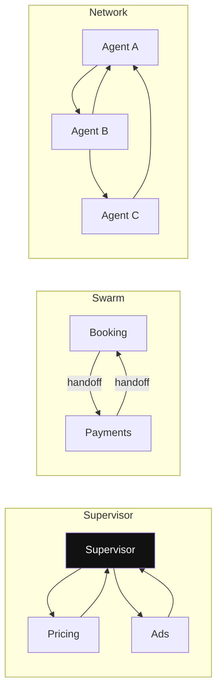

*Diagram:* Supervisor: control hamesha centre (highlighted) pe lautta hai. Swarm: active agent baton aage deta hai. Network: koi bhi kisi ko bhi bulata hai, isliye debug mushkil hai. Hierarchical version neeche hai.

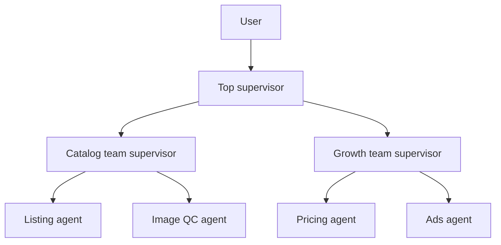

### Supervisor with handoff tools

Seller bolta hai: "SKU (product code) K-101 ka price ₹50 kam karo aur ads boost karo." Har step pe control kiske paas hai, ye dekho:

| Step | Kya hua | Control kiske paas |
|---|---|---|
| 1 | Seller ka message supervisor ko | Supervisor |
| 2 | Supervisor `transfer_to_pricing_agent` tool call karta hai | Supervisor → Pricing |
| 3 | Pricing agent price ₹799 se ₹749 karta hai, reply likhta hai | Pricing |
| 4 | Edge `pricing_agent → supervisor`, control wapas | Supervisor |
| 5 | Supervisor dekhta hai ads baaki hai, `transfer_to_ads_agent` | Supervisor → Ads |
| 6 | Ads agent campaign budget badhata hai | Ads |
| 7 | Control wapas, supervisor dekhta hai dono ho gaye, summary deta hai | Supervisor → END |

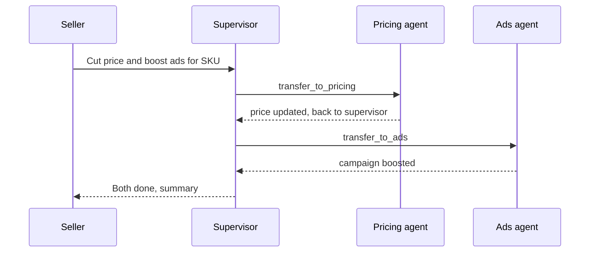

Supervisor `transfer_to_<agent>` tool se kaam deta hai; har worker kaam karke control supervisor ko wapas deta hai.

**Ab terms:**
- **Handoff tool:** ek tool jiska kaam sirf control transfer karna hai, jaise `transfer_to_pricing_agent`.
- **`Command(goto=..., graph=Command.PARENT)`:** "parent graph me is node pe jao". Agent khud ek subgraph hai, isliye `PARENT` batana padta hai.
- Prebuilt: `langgraph-supervisor` package ka `create_supervisor`.

Ye code har specialist ke liye ek handoff tool banata hai aur supervisor graph wire karta hai.

```python
from typing import Annotated
from langchain_core.messages import ToolMessage
from langchain_core.tools import tool, InjectedToolCallId
from langgraph.prebuilt import InjectedState
from langgraph.types import Command

def make_handoff(agent_name: str):
    @tool(f"transfer_to_{agent_name}", description=f"Hand the task to {agent_name}.")
    def handoff(state: Annotated[dict, InjectedState],               # graph state, model nahi bharta
                tool_call_id: Annotated[str, InjectedToolCallId]) -> Command:
        msg = ToolMessage(f"Transferred to {agent_name}", tool_call_id=tool_call_id)
        return Command(goto=agent_name, graph=Command.PARENT,        # parent graph me jump
                       update={"messages": state["messages"] + [msg]})
    return handoff

supervisor = create_agent("openai:gpt-4.1", name="supervisor",
    tools=[make_handoff("pricing_agent"), make_handoff("ads_agent")],  # sirf handoff tools
    system_prompt="Route work to one specialist at a time. Do no work yourself.")

g = StateGraph(MessagesState)
g.add_node(supervisor, destinations=("pricing_agent", "ads_agent", END))
g.add_node(pricing_agent); g.add_node(ads_agent)   # create_agent(..., name=...)
g.add_edge(START, "supervisor")
g.add_edge("pricing_agent", "supervisor"); g.add_edge("ads_agent", "supervisor")  # kaam ke baad wapas
app = g.compile()
# Prebuilt: from langgraph_supervisor import create_supervisor
# app = create_supervisor([pricing_agent, ads_agent], model=llm, prompt="...").compile()
```

**Code me kya ho raha hai:**
- `make_handoff` ek factory hai: har agent ke liye `transfer_to_<naam>` tool banata hai.
- Tool ek `ToolMessage` add karta hai (har tool call ka jawab chahiye) aur `Command` se parent graph me us agent pe jump karta hai.
- Supervisor ke paas sirf handoff tools hain, domain tools nahi. Isliye wo khud kaam nahi kar sakta.
- `pricing_agent → supervisor` aur `ads_agent → supervisor` edges table ke step 4 aur 7 hain: control hamesha wapas aata hai.

### Hierarchical teams

- Har team = ek compiled supervisor graph. Top supervisor un teams ko **subgraph nodes** ki tarah call karta hai. Har level pe agents ki ginti 3–6 rakho.
- Trace: seller → top supervisor → Growth team supervisor → Pricing agent → wapas Growth supervisor → wapas top supervisor. Control 2 level upar neeche hota hai.
- Fayda: har supervisor ka routing decision chhota. Nuksaan: har level ek extra LLM hop (latency + tokens).

### Swarm / handoffs

Koi central router nahi. Active agent khud `transfer_to_X` call karta hai, aur checkpointer yaad rakhta hai **kaunsa agent active hai**, to user ka agla message seedha usi ke paas jaata hai.

| Step | Message | Active agent (control) |
|---|---|---|
| 1 | User: "Goa hotel 2 raat ke liye book karo" | Booking (default) |
| 2 | Booking: "Room hold hai, abhi pay karoge?" | Booking |
| 3 | User: "UPI se pay karo" | Booking |
| 4 | Booking `transfer_to_payments` call karta hai | Booking → Payments |
| 5 | Checkpointer me save: active = payments | Payments |
| 6 | Payments: "UPI request bheji" | Payments |
| 7 | User: "Paid, invoice bhejo" (seedha payments ko, booking se pooche bina) | Payments |
| 8 | Payments: "Invoice bhej diya" | Payments |

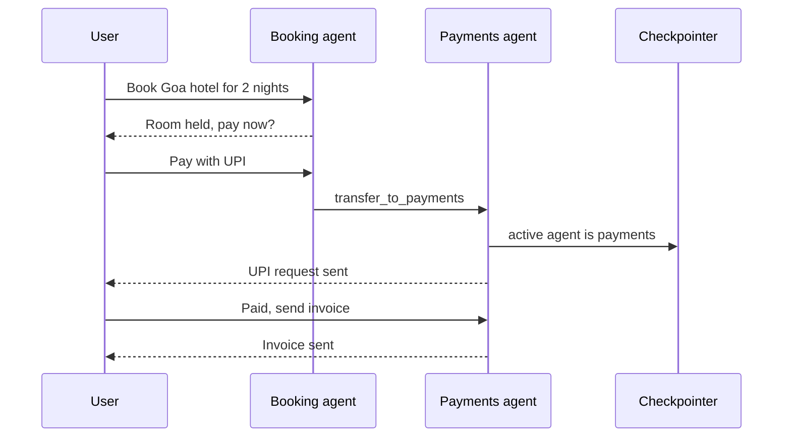

Swarm me central router nahi hota; checkpointer active agent yaad rakhta hai, isliye agla user message seedha payments agent ko jaata hai.

Ye code do agents banata hai jinke paas ek doosre ko handoff karne ke tools hain.

```python
from langgraph_swarm import create_handoff_tool, create_swarm
from langgraph.checkpoint.memory import InMemorySaver

booking = create_agent("openai:gpt-4.1", name="booking",
    tools=[search_hotels, create_handoff_tool(agent_name="payments",
           description="Transfer when user is ready to pay")])      # booking → payments
payments = create_agent("openai:gpt-4.1", name="payments",
    tools=[create_upi_intent, create_handoff_tool(agent_name="booking")])  # wapas bhi ja sakta hai

app = create_swarm([booking, payments], default_active_agent="booking").compile(
    checkpointer=InMemorySaver())   # active agent yaad rakhne ke liye zaroori
```

**Code me kya ho raha hai:**
- Har agent ke tools me ek `create_handoff_tool` hai; yahi relay race ka baton pass hai.
- `default_active_agent="booking"`: pehla message booking ko jaata hai (table step 1).
- Checkpointer ke bina swarm har message pe active agent bhool jaayega aur booking se shuru karega.
- Koi supervisor node nahi, isliye har turn pe ek LLM hop kam.

### Network (peer-to-peer)

- Har agent kisi bhi agent ko `Command(goto=...)` de sakta hai. Flexible, par ping-pong aur debugging nightmare. Production me rare; zyada-tar supervisor ya swarm me collapse kar do.

**Interview tip:** "Default supervisor rakhta hoon kyunki control flow ek jagah observable hai. Swarm tab jab user lambi conversation ek specialist ke saath kare aur supervisor hop latency waste lage."

**Common galti:** handoff me `graph=Command.PARENT` bhoolna; tab `goto` subgraph ke andar node dhoondhta hai aur error aata hai.

## ⭐ Multi-agent kab worth hai, kab nahi

**Ye kyun chahiye?** Multi-agent demo me shaandaar lagta hai, par har agent apna context, apni LLM calls aur apne tokens laata hai. Bill aur latency dono badhte hain. Isliye pehle numbers dekho.

**Analogy:** **shaadi ka khana**. 20 mehmaanon ke liye ek achha cook kaafi hai. 2,000 mehmaanon ke liye caterer ki poori team chahiye: head cook, tandoor wala, mithai wala. Par team ka kharcha 20 logon pe lagao to paisa barbaad.

**Ek line me:** multi-agent **context isolation aur parallelism** deta hai, par tokens aur coordination failures multiply karta hai; tabhi lo jab task breadth-heavy ho aur value cost justify kare.

**Step by step: ek task, do designs ka hisaab.** Task: "Priya ke kurte ke 5 competitor brands ki research karo." Assumption: input ≈ $2 per 1M tokens, output ≈ $8 per 1M tokens, $1 ≈ ₹84. Numbers illustrative hain, structure samajhne ke liye.

| | Single agent | Supervisor + 5 subagents |
|---|---|---|
| LLM calls | 8 (ek loop) | Supervisor 3 + har subagent 5 (×5) + synthesis 1 = 29 |
| Input tokens | ~48k (context har call pe badhta hai) | ~164k (har subagent apna context, supervisor bhi) |
| Output tokens | ~3k | ~10k |
| Cost per query | ~$0.12 (≈ ₹10) | ~$0.41 (≈ ₹34) |
| 10,000 queries/day | ~$1,200/day | ~$4,100/day |
| Result | Har brand pe shallow research | Har brand pe deep research, parallel |

Matlab ~3.4x cost. Ye tab worth hai jab deep research se seller ka bada faisla (pricing) better hota hai. FAQ jaise sawal pe nahi: agar ek workflow ₹0.35 me FAQ ka jawab de raha hai aur multi-agent 15x tokens le, to 1 lakh queries/day pe ~₹35k/day ka kharcha ~₹5 lakh/day ho jaata hai, aur jawab utna hi achha.

**Real data points:**
- **Anthropic:** unke multi-agent research system ne single-agent se internal research eval (answers ko score karne wala fixed test set) pe ~90% better kiya, par roughly **~15x tokens** chat ke comparison me liye (single agent ~4x). Unke analysis me token usage hi performance variance ka bada hissa explain karta tha. Matlab gain aksar "zyada tokens kharch karna" hai.
- **Counterpoint (Cognition, "Don't build multi-agents"):** parallel subagents ek doosre ke decisions nahi dekhte → conflicting assumptions. Write-heavy tasks (coding) me single-threaded agent with good context engineering better.

**Pro:** har agent ka chhota context aur kam tools → better tool selection; breadth tasks me parallel search; alag teams alag agents own kar sakti hain.
**Con:** har hop pe LLM call (latency), duplicate context (cost), handoff pe info loss, eval aur debugging mushkil.

| Situation | Choice |
|---|---|
| < 10–15 tools, ek domain | Single agent |
| Breadth research, independent sub-questions | Orchestrator + parallel subagents |
| 30+ tools across distinct domains | Supervisor + specialists |
| Ek file/codebase pe tightly coupled edits | Single agent, multi-agent nahi |
| Long chat jahan specialist badalta hai (booking → payment) | Swarm handoffs |
| Low-value, high-volume query (FAQ) | Single agent ya workflow; 15x cost justify nahi |

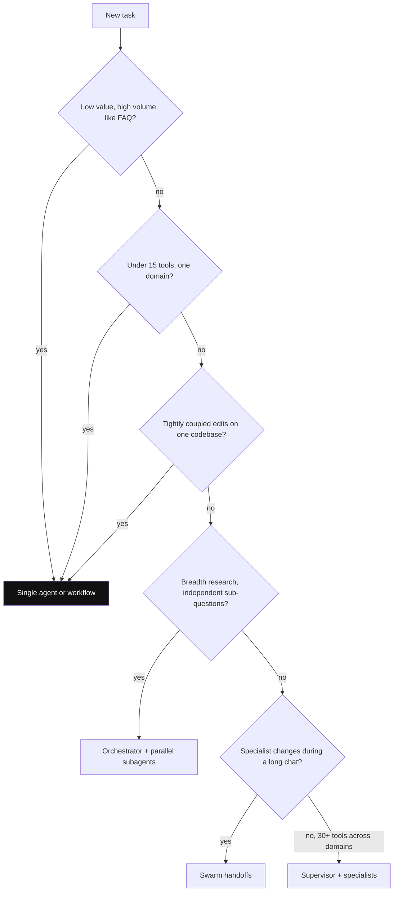

*Diagram:* Zyaadatar raaste single agent (highlighted) pe khatam hote hain; multi-agent ka ~3.4x bill sirf breadth, kai domains ya badalte specialist wali branches pe dena padta hai.

**Interview tip:** "Multi-agent ka case token budget se shuru karta hoon: agar single agent ka context tools aur history se overflow ho raha hai, ya parallel breadth chahiye, tab split. Warna nahi."

**Common galti:** org chart ko agent chart bana dena ("PM agent, dev agent, QA agent") bina ye dikhaye ki single agent fail ho raha tha.

## Agent handoff state design

**Ye kyun chahiye?** Research subagent ne 30k tokens ka kaam kiya: 12 web searches, 40 pages. Agar ye poora transcript supervisor ki history me chala jaaye, to supervisor ka context bhar jaata hai aur agla har call mehenga ho jaata hai. Par agar sirf "done" bheja, to zaroori info kho jaati hai.

**Analogy:** **hospital me shift change**. Raat wali nurse subah wali ko poori raat ki kahaani nahi sunati, aur sirf "sab theek" bhi nahi bolti. Wo ek handover sheet deti hai: patient, dawai, kya ho chuka, kya dekhna hai. Wo sheet = **structured handoff brief**.

**Ek line me:** decide karo ki agents **ek shared message history** dekhte hain ya **private scratchpad** rakhte hain aur sirf final result share karte hain.

**Step by step (private scratchpad):**
1. Supervisor research subagent ko brief bhejta hai (neeche JSON).
2. Subagent apne private state me 12 searches karta hai: ~30k tokens, parent ko dikhte nahi.
3. Subagent wapas ~300 tokens ka structured result deta hai.
4. Parent ki `messages` me sirf ye 300 tokens judte hain. Agli supervisor call 30k ki jagah 300 tokens zyada padhti hai.

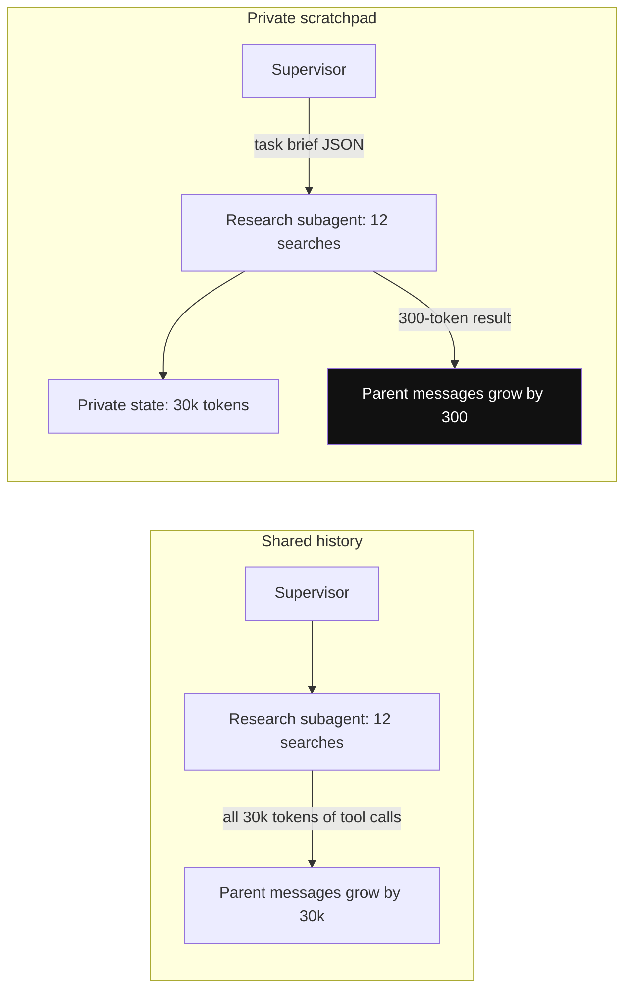

*Diagram:* Dono tareeke me wahi 12 searches; private scratchpad me sirf highlighted 300-token result parent tak pahunchta hai, isliye supervisor ki aage ki har call chhoti rehti hai.

Handoff brief aisa dikhta hai:

```json
{
  "task": "Find current prices of 5 competitor cotton kurta brands",
  "constraints": ["Only Flipkart and Myntra", "Sizes M to XL", "Last 7 days"],
  "done_so_far": "Priya's price is 799 INR, brand Rangeela",
  "expected_output": {"brand": "str", "price_inr": "int", "source_url": "str"}
}
```

| | Shared history | Private scratchpad |
|---|---|---|
| Kaise | sab agents same `messages` me likhte | har agent ka subgraph apna state; parent ko sirf summary |
| Pro | poora context, handoff me kuch lose nahi | context chhota, focused, sasta |
| Con | context phoolta, doosre agents ke tool calls confuse karte | info loss, summary quality pe depend |
| Kab | 2–3 agents, short tasks, swarm chat | research subagents, bade tool outputs |

**Ab terms:**
- **Hybrid** common hai: shared `messages` me sirf user-facing turns + har agent ka **final answer**; tool calls aur intermediate reasoning private.
- **Different state schema wala subgraph:** parent ka wrapper node input transform karta hai aur output ka sirf `summary` wapas likhta hai.
- **Handoff payload** explicit rakho: `task`, `constraints`, `what is done`, `expected output format`. "Ye dekh lo" type vague handoff = lost context.

**Interview tip:** "Main handoff ko ek API contract ki tarah design karta hoon: structured task brief, aur subagent se structured result."

**Common galti:** subagent ka poora 30k-token transcript parent history me merge karna.

## Common multi-agent failure modes aur fixes

**Ye kyun chahiye?** Multi-agent me zyada-tar bugs model ki galti nahi, coordination ki galti hote hain. Ek example: seller bolta hai "price aur ads dekh lo". Supervisor → pricing → supervisor → pricing → supervisor... har baar pricing bolta hai "ads mera kaam nahi" aur supervisor phir pricing ko bhejta hai. 25 steps baad `GraphRecursionError` (jo error LangGraph `recursion_limit` hit hone pe deta hai), aur seller ko kuch nahi mila.

**Fix ka trace:** state me `handoff_count` rakho. Har handoff pe +1. Same agent ko lagatar 2 baar bheja ya count 4 se zyada hua, to supervisor ko force karo ki summary de ya human ko bheje.

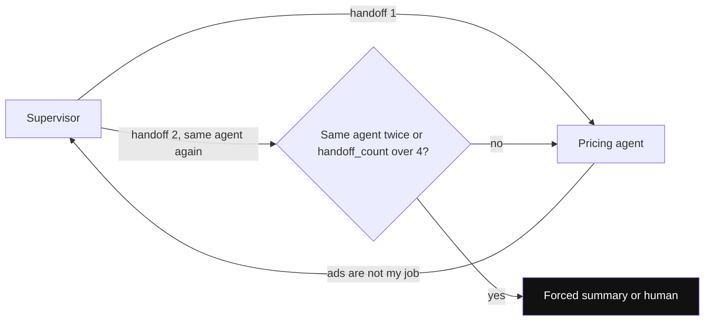

*Diagram:* Guard ke bina ye cycle step 25 pe `GraphRecursionError` tak chalta hai; state me rakha counter pehle repeat pe hi ise tod deta hai.

| Failure | Symptom | Fix |
|---|---|---|
| Infinite ping-pong | A → B → A → B, kaam nahi hota | `recursion_limit`, handoff counter in state, supervisor prompt "same agent ko 2 baar repeat mat karo" |
| Role confusion | pricing agent ads bana raha | tight system prompts, har agent ko sirf apne tools, handoff tool descriptions clear |
| Lost context | specialist user ka constraint bhool gaya | structured handoff brief, key constraints state fields me (messages me nahi) |
| Conflicting outputs | parallel subagents alag assumptions | shared plan/spec upfront, synthesizer conflict resolve kare |
| Supervisor does the work | supervisor khud answer de deta | supervisor ko domain tools mat do |
| Cost blow-up | har hop full history resend | private scratchpads, summaries, chhote model workers pe |
| Silent failure | worker fail, supervisor "done" bolta | worker se structured status (`ok/failed/reason`), eval per agent |

- **Observability:** har agent ka span alag tag karo taaki trace me handoff chain dikhe; dekho [AI Observability](10-agent-observability.md).
- **Eval:** end-to-end ke saath **per-agent** aur **routing accuracy** eval; dekho [Evals for Agents](09-agent-evals.md).

**Interview tip:** "Multi-agent bugs zyada-tar coordination bugs hain, model bugs nahi. Main handoff counter, structured briefs, aur per-agent traces se inhe pakadta hoon."

**Common galti:** sirf final answer pe eval karna; pata hi nahi chalta kaunsa agent ya kaunsa handoff fail hua.

## Aage padho

- [Agentic Patterns: Workflows](03-workflow-patterns.md): agent se pehle workflow try karo.
- [Memory & Context Engineering](05-memory-context.md): scratchpads, summaries, long-term memory.
- [Tools, MCP & A2A](07-tools-mcp-a2a.md): tool design aur agent-to-agent protocol.
- [Cost & Latency](11-cost-latency.md): multi-agent ka token multiplication.
- [ReAct lab](/viewinter/agents/lab/react) aur [Multi-agent lab](/viewinter/agents/labs/multi): browser me chala ke dekho.

## Checklist

- [ ] ReAct loop ko `create_agent` aur hand-built `ToolNode` + `tools_condition` dono se bana sakta hoon
- [ ] Plan-and-execute ka state shape aur replanner ka role samjha sakta hoon
- [ ] ReWOO aur LLMCompiler ka ReAct se trade-off bata sakta hoon
- [ ] Reflexion ko evaluator-optimizer se alag kar ke samjha sakta hoon, aur grounded signal kyun chahiye
- [ ] Supervisor, hierarchical, swarm, network architectures compare kar sakta hoon
- [ ] Handoff tool `Command(graph=Command.PARENT)` ke saath likh sakta hoon
- [ ] Multi-agent kab worth hai, token cost data ke saath justify kar sakta hoon
- [ ] Shared history vs private scratchpad handoff design choose kar sakta hoon
- [ ] Ping-pong, role confusion, lost context jaise failures aur unke fixes bata sakta hoon
