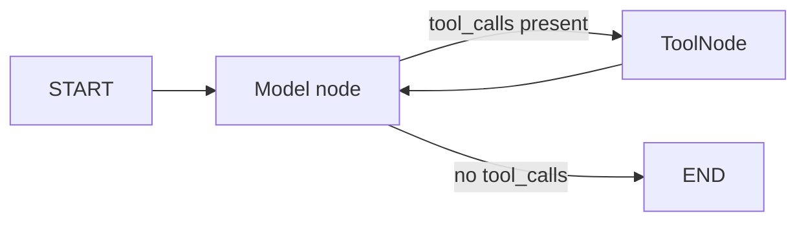
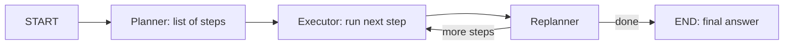
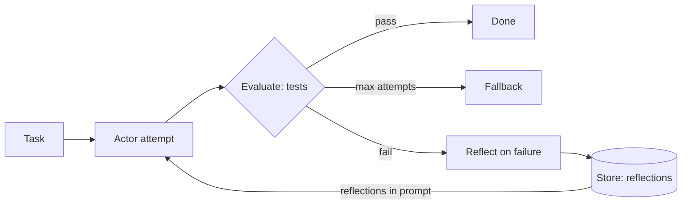
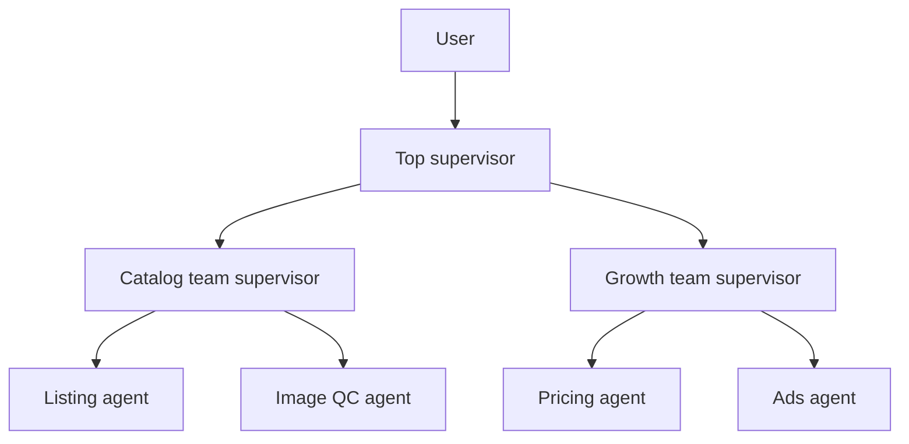
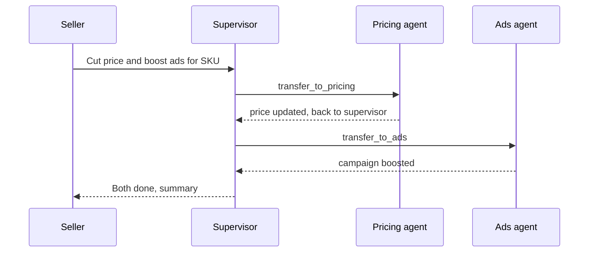
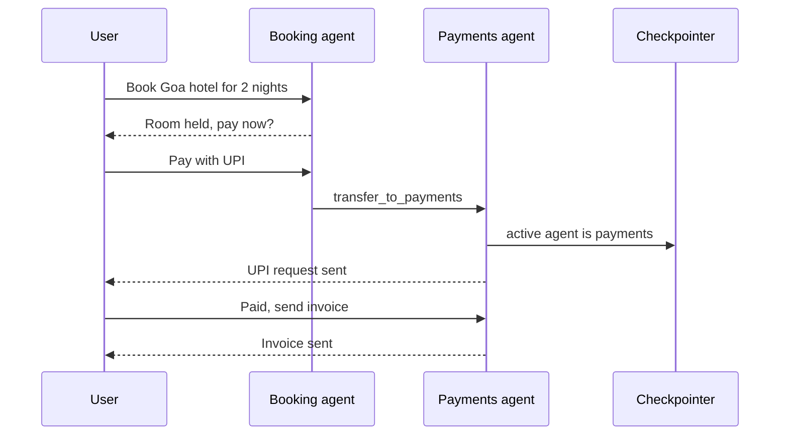

# Agent & Multi-agent Patterns

Jab steps pehle se pata nahi hote, tab LLM ko control flow dena padta hai: ReAct, plan-and-execute, ReWOO, Reflexion, aur phir multi-agent (supervisor, hierarchical, swarm, network). Interviewer yahan do cheezein check karta hai: kya tum in architectures ko LangGraph me bana sakte ho, aur kya tum bata sakte ho ki **multi-agent kab bekaar hai**.

Fixed-path patterns ke liye [Agentic Patterns: Workflows](03-workflow-patterns.md), aur `Command`, subgraphs, checkpointing ke liye [LangGraph Core Concepts](02-langgraph-core.md).

## ⭐ ReAct / tool-calling agent

**Ek line me:** LLM ek loop me chalta hai: socho → tool call karo → result (observation) dekho → phir socho, jab tak final answer na de de ya step limit hit na ho.

> **Example:** Zerodha Kite support agent. "Mera kal ka order reject kyun hua?" → `get_orders(date)` → reason "insufficient margin" → `get_margin()` → answer with numbers. Kitne tool calls lagenge, pehle se pata nahi.

- Modern ReAct = native **tool calling** (model `tool_calls` return karta hai), text parsing wala "Thought/Action" format nahi.
- Loop: `model` node → `tool_calls` hain? → `tools` node → wapas `model`. Koi tool call nahi = END.
- **Kab use:** open-ended tasks, tools 3–15, path input pe depend. **Kab nahi:** steps fixed (workflow sasta), ya 30+ tools (tool selection accuracy girti hai; routing ya multi-agent socho).
- Prebuilt: LangChain 1.0 me `langchain.agents.create_agent` (middleware support, recommended). Purana `langgraph.prebuilt.create_react_agent` abhi bhi chalta hai par deprecated hai.



```python
from langchain.agents import create_agent
from langchain_core.tools import tool

@tool
def get_orders(date: str) -> list[dict]:
    """Return the user's orders for a date (YYYY-MM-DD)."""
    return [{"id": "A1", "status": "REJECTED", "reason": "insufficient margin"}]

@tool
def get_margin() -> dict:
    """Return available and used margin in INR."""
    return {"available": 1200.0, "used": 48800.0}

agent = create_agent(
    model="openai:gpt-4.1",
    tools=[get_orders, get_margin],
    system_prompt="You are Kite support. Use tools, never guess numbers.",
)
out = agent.invoke({"messages": [{"role": "user", "content": "Kal ka order reject kyun hua?"}]},
                   {"recursion_limit": 12})  # step cap
# Purana tareeka: from langgraph.prebuilt import create_react_agent
# agent = create_react_agent(model, tools, prompt="...")
```

- **Hand-built equivalent** (jab custom state, extra nodes ya approval step chahiye):

```python
from langgraph.graph import StateGraph, START, MessagesState
from langgraph.prebuilt import ToolNode, tools_condition
from langchain.chat_models import init_chat_model

tools = [get_orders, get_margin]
llm = init_chat_model("openai:gpt-4.1").bind_tools(tools)

def call_model(state: MessagesState):
    return {"messages": [llm.invoke(state["messages"])]}

g = StateGraph(MessagesState)
g.add_node("model", call_model)
g.add_node("tools", ToolNode(tools))
g.add_edge(START, "model")
g.add_conditional_edges("model", tools_condition)  # "tools" ya END
g.add_edge("tools", "model")
app = g.compile()
```

- **Failure modes:** tool loop (same call baar baar), galat tool args, hallucinated final answer bina tool ke, context bloat (bade tool outputs har turn me wapas).
- Fix: `recursion_limit`, tool descriptions me clear "kab use karo", tool output truncate/summarize, args pe Pydantic validation, aur tool error ko `ToolMessage` bana ke model ko wapas dena taaki wo self-correct kare.

**Interview tip:** "ReAct ki cost har step pe poora context resend karna hai. Isliye main tool outputs chhote rakhta hoon aur step limit lagata hoon."

**Common galti:** `create_react_agent` ko current API batana. 1.0 me `create_agent` hai, middleware ke saath (summarization, HITL, model fallback).

## ⭐ Plan-and-execute

**Ek line me:** planner pehle poora multi-step plan banata hai, executor ek-ek step chalata hai (aksar ReAct sub-agent), replanner har step ke baad decide karta hai: plan update karo ya final answer do.

> **Example:** CRED: "Pichhle 3 mahine ka mera credit card spend analyse karo aur ₹10k bachane ka plan do." Plan: 1) statements fetch, 2) categorize, 3) top categories, 4) recommendations. Step 2 ke baad pata chala ek card missing hai → replanner step add karta hai.

- ReAct se farak: **upfront thinking** milta hai (long tasks me drift kam), planner bada model aur executor chhota model ho sakta hai (cost bachat).
- Replanner ke bina ye orchestrator-worker jaisa hai; replanner hi isse adaptive banata hai.
- **Kab use:** 5+ steps wale long-horizon tasks, research, data analysis. **Kab nahi:** 1–3 tool calls ka task (overhead), ya highly interactive chat.



```python
import operator
from typing import Annotated, TypedDict
from pydantic import BaseModel
from langgraph.graph import StateGraph, START, END

class PlanState(TypedDict):
    input: str
    plan: list[str]
    past_steps: Annotated[list[tuple[str, str]], operator.add]  # (step, result)
    response: str

class Plan(BaseModel):
    steps: list[str]

class Act(BaseModel):
    response: str | None = None      # set = finish
    new_plan: list[str] | None = None

def plan_step(s: PlanState):
    return {"plan": big_llm.with_structured_output(Plan).invoke(s["input"]).steps}

def execute_step(s: PlanState):
    step = s["plan"][0]
    res = executor_agent.invoke({"messages": [("user", f"Do: {step}")]})  # ReAct sub-agent
    return {"past_steps": [(step, res["messages"][-1].content)]}

def replan_step(s: PlanState):
    a = big_llm.with_structured_output(Act).invoke(
        f"Goal: {s['input']}\nDone: {s['past_steps']}\nRemaining: {s['plan'][1:]}")
    if a.response:
        return {"response": a.response}
    return {"plan": a.new_plan or s["plan"][1:]}

def should_end(s: PlanState):
    return END if s.get("response") or not s["plan"] else "execute"

g = StateGraph(PlanState)
g.add_node("planner", plan_step); g.add_node("execute", execute_step); g.add_node("replan", replan_step)
g.add_edge(START, "planner"); g.add_edge("planner", "execute"); g.add_edge("execute", "replan")
g.add_conditional_edges("replan", should_end, ["execute", END])
```

- **Failure modes:** over-planning (20 steps), plan bahut abstract ("data analyse karo"), replanner kabhi "done" nahi bolta, past_steps se context phoolta hai.
- Fix: plan length cap, steps ko tool-level concrete rakho, replanner ke saath max-iterations, past results ko summarize.

**Interview tip:** "Plan-and-execute me state ka shape bolo: `input`, `plan`, `past_steps` with append reducer, `response`. Replanner hi isse orchestrator-worker se alag karta hai."

**Common galti:** replanner skip kar dena; tab pehle step ki galti poora plan bigaad deti hai.

## ReWOO aur LLMCompiler, short me

**Ek line me:** dono plan-and-execute ke speed/cost-optimized variants hain: **ReWOO** observations ke bina plan me variables use karta hai, **LLMCompiler** tasks ka DAG bana ke parallel chalata hai.

- **ReWOO (Reasoning WithOut Observation):** planner ek baar plan likhta hai with placeholders: `#E1 = search("Nifty PE")`, `#E2 = calc("#E1 * 1.1")`. Worker variables substitute karke tools chalata hai, solver final answer. Har tool ke baad LLM call nahi → kam tokens. Downside: beech me replan nahi.
- **LLMCompiler:** planner tasks ko dependencies ke saath **DAG** me stream karta hai; task fetching unit dependencies ready hote hi tasks parallel chalata hai; joiner decide karta hai answer ya replan. Paper ne ReAct se latency me kaafi speedup report kiya.

| | ReAct | Plan-and-execute | ReWOO | LLMCompiler |
|---|---|---|---|---|
| LLM calls | har step | plan + replan har step | ~2 (plan, solve) | plan + join |
| Adaptivity | high | high | low | medium |
| Parallel tools | limited | nahi (default) | haan | haan, DAG |
| Best for | interactive, short | long tasks | predictable tool chains | many independent lookups |

**Interview tip:** "ReWOO tokens bachata hai, LLMCompiler latency. Dono ka trade-off adaptivity hai."

**Common galti:** ReWOO ko tab use karna jab beech ke results agle steps ko badal dete hain.

## Reflexion / self-critique agents

**Ek line me:** agent attempt karta hai, external signal (tests, eval, error) pe **verbal self-reflection** likhta hai, aur wo reflection memory me rakh ke agla attempt karta hai.

> **Example:** Internal coding agent jo Razorpay SDK ka bug fix karta hai: patch → unit tests fail → reflection "maine idempotency key retry pe reuse nahi ki" → memory me save → next attempt pass.

- Evaluator-optimizer (workflow) se farak: yahan actor ek **agent** hai, aur reflections **episodes ke across** memory me jaati hain.
- Signal grounded ho to hi kaam karta hai (tests, compiler, retrieval check). Sirf "khud se socho kya galat hua" = model apni galti dobara confirm karta hai.
- Graph shape: `actor` → `evaluate` → fail pe `reflect` → `actor`, max attempts guard ke saath. Reflections `Store` me (long-term memory, dekho [Memory & Context Engineering](05-memory-context.md)).



Grounded signal (tests) fail hone pe reflection Store me jaati hai aur agle attempt ke prompt me wapas aati hai.

- **Failure modes:** ungrounded critique, reflection loops jo kuch nahi badalte, purani irrelevant reflections context bharti hain.

**Interview tip:** "Reflection tabhi value deta hai jab feedback external aur verifiable ho. Code agents me test results best signal hain."

**Common galti:** self-critique ko free accuracy boost samajhna; bina grounded signal ke gain aksar zero ya negative hota hai.

## ⭐ Multi-agent architectures

**Ek line me:** kaam ko multiple specialized agents me baanto (har ek ka apna prompt, tools, context), aur define karo control kaise transfer hota hai: central supervisor, hierarchy, swarm handoffs, ya network.

> **Example:** Flipkart seller assistant: catalog agent (listing tools), pricing agent (competitor price tools), ads agent (campaign APIs). Ek agent ko 40 tools dene se better har ek ko 8–10.

| Architecture | Control | Kab |
|---|---|---|
| Supervisor | central LLM agents choose karta hai | 3–6 specialists, clear routing |
| Hierarchical | supervisor of supervisors (subgraphs) | bahut saare agents, team-wise grouping |
| Swarm / handoffs | active agent khud handoff karta hai | conversational, user ek specialist se baat kare |
| Network (peer-to-peer) | koi bhi agent kisi ko bhi | rare; hard to debug |



### Supervisor with handoff tools

- Supervisor ek agent hai jiske tools = `transfer_to_<agent>`. Tool `Command(goto=..., graph=Command.PARENT)` return karta hai, jo parent graph me us agent node pe le jaata hai.
- Workers kaam karke **wapas supervisor** ke paas aate hain (edge `worker → supervisor`). Prebuilt: `langgraph-supervisor` ka `create_supervisor`.



Supervisor `transfer_to_<agent>` tool se kaam deta hai; har worker kaam karke control supervisor ko wapas deta hai.

```python
from typing import Annotated
from langchain_core.messages import ToolMessage
from langchain_core.tools import tool, InjectedToolCallId
from langgraph.prebuilt import InjectedState
from langgraph.types import Command

def make_handoff(agent_name: str):
    @tool(f"transfer_to_{agent_name}", description=f"Hand the task to {agent_name}.")
    def handoff(state: Annotated[dict, InjectedState],
                tool_call_id: Annotated[str, InjectedToolCallId]) -> Command:
        msg = ToolMessage(f"Transferred to {agent_name}", tool_call_id=tool_call_id)
        return Command(goto=agent_name, graph=Command.PARENT,
                       update={"messages": state["messages"] + [msg]})
    return handoff

supervisor = create_agent("openai:gpt-4.1", name="supervisor",
    tools=[make_handoff("pricing_agent"), make_handoff("ads_agent")],
    system_prompt="Route work to one specialist at a time. Do no work yourself.")

g = StateGraph(MessagesState)
g.add_node(supervisor, destinations=("pricing_agent", "ads_agent", END))
g.add_node(pricing_agent); g.add_node(ads_agent)   # create_agent(..., name=...)
g.add_edge(START, "supervisor")
g.add_edge("pricing_agent", "supervisor"); g.add_edge("ads_agent", "supervisor")
app = g.compile()
# Prebuilt: from langgraph_supervisor import create_supervisor
# app = create_supervisor([pricing_agent, ads_agent], model=llm, prompt="...").compile()
```

### Hierarchical teams

- Har team = ek compiled supervisor graph; top supervisor un teams ko **subgraph nodes** ki tarah call karta hai. Har level pe agents ki ginti 3–6 rakho.
- Fayda: har supervisor ka routing decision chhota. Nuksaan: har level ek extra LLM hop (latency + tokens).

### Swarm / handoffs

- Koi central router nahi. Active agent khud `transfer_to_X` call karta hai; checkpointer yaad rakhta hai **kaunsa agent active hai**, to user ka agla message seedha usi ke paas jaata hai.



Swarm me central router nahi hota; checkpointer active agent yaad rakhta hai, isliye agla user message seedha payments agent ko jaata hai.

```python
from langgraph_swarm import create_handoff_tool, create_swarm
from langgraph.checkpoint.memory import InMemorySaver

booking = create_agent("openai:gpt-4.1", name="booking",
    tools=[search_flights, create_handoff_tool(agent_name="payments",
           description="Transfer when user is ready to pay")])
payments = create_agent("openai:gpt-4.1", name="payments",
    tools=[create_upi_intent, create_handoff_tool(agent_name="booking")])

app = create_swarm([booking, payments], default_active_agent="booking").compile(
    checkpointer=InMemorySaver())
```

### Network (peer-to-peer)

- Har agent kisi bhi agent ko `Command(goto=...)` de sakta hai. Flexible, par ping-pong aur debugging nightmare. Production me rare; zyada-tar supervisor ya swarm me collapse kar do.

**Interview tip:** "Default supervisor rakhta hoon kyunki control flow ek jagah observable hai. Swarm tab jab user lambi conversation ek specialist ke saath kare aur supervisor hop latency waste lage."

**Common galti:** handoff me `graph=Command.PARENT` bhoolna; tab `goto` subgraph ke andar node dhoondhta hai aur error aata hai.

## ⭐ Multi-agent kab worth hai, kab nahi

**Ek line me:** multi-agent **context isolation aur parallelism** deta hai, par tokens aur coordination failures multiply karta hai; tabhi lo jab task breadth-heavy ho aur value cost justify kare.

- **Data point:** Anthropic ke multi-agent research system ne single-agent se internal research eval pe ~90% better kiya, par roughly **~15x tokens** chat ke comparison me (single agent ~4x). Unke analysis me token usage hi performance variance ka bada hissa explain karta tha. Matlab gain aksar "zyada tokens kharch karna" hai.
- **Counterpoint (Cognition, "Don't build multi-agents"):** parallel subagents ek doosre ke decisions nahi dekhte → conflicting assumptions. Write-heavy tasks (coding) me single-threaded agent with good context engineering better.
- **Pro:** har agent ka chhota context aur kam tools → better tool selection; breadth tasks me parallel search; alag teams alag agents own kar sakti hain.
- **Con:** har hop pe LLM call (latency), duplicate context (cost), handoff pe info loss, eval aur debugging mushkil.

| Situation | Choice |
|---|---|
| < 10–15 tools, ek domain | Single agent |
| Breadth research, independent sub-questions | Orchestrator + parallel subagents |
| 30+ tools across distinct domains | Supervisor + specialists |
| Ek file/codebase pe tightly coupled edits | Single agent, multi-agent nahi |
| Long chat jahan specialist badalta hai (booking → payment) | Swarm handoffs |
| Low-value, high-volume query (FAQ) | Single agent ya workflow; 15x cost justify nahi |

**Interview tip:** "Multi-agent ka case token budget se shuru karta hoon: agar single agent ka context tools aur history se overflow ho raha hai, ya parallel breadth chahiye, tab split. Warna nahi."

**Common galti:** org chart ko agent chart bana dena ("PM agent, dev agent, QA agent") bina ye dikhaye ki single agent fail ho raha tha.

## Agent handoff state design

**Ek line me:** decide karo ki agents **ek shared message history** dekhte hain ya **private scratchpad** rakhte hain aur sirf final result share karte hain.

| | Shared history | Private scratchpad |
|---|---|---|
| Kaise | sab agents same `messages` me likhte | har agent ka subgraph apna state; parent ko sirf summary |
| Pro | poora context, handoff me kuch lose nahi | context chhota, focused, sasta |
| Con | context phoolta, doosre agents ke tool calls confuse karte | info loss, summary quality pe depend |
| Kab | 2–3 agents, short tasks, swarm chat | research subagents, bade tool outputs |

- Hybrid common hai: shared `messages` me sirf user-facing turns + har agent ka **final answer**; tool calls aur intermediate reasoning private.
- Subgraph with different state schema: parent node wrapper input transform karta hai aur output ka sirf `summary` wapas likhta hai.
- Handoff payload explicit rakho: `task`, `constraints`, `what is done`, `expected output format`. "Ye dekh lo" type vague handoff = lost context.

**Interview tip:** "Main handoff ko ek API contract ki tarah design karta hoon: structured task brief, aur subagent se structured result."

**Common galti:** subagent ka poora 30k-token transcript parent history me merge karna.

## Common multi-agent failure modes aur fixes

| Failure | Symptom | Fix |
|---|---|---|
| Infinite ping-pong | A → B → A → B, kaam nahi hota | `recursion_limit`, handoff counter in state, supervisor prompt "same agent ko 2 baar repeat mat karo" |
| Role confusion | pricing agent ads bana raha | tight system prompts, har agent ko sirf apne tools, handoff tool descriptions clear |
| Lost context | specialist user ka constraint bhool gaya | structured handoff brief, key constraints state fields me (messages me nahi) |
| Conflicting outputs | parallel subagents alag assumptions | shared plan/spec upfront, synthesizer conflict resolve kare |
| Supervisor does the work | supervisor khud answer de deta | supervisor ko domain tools mat do |
| Cost blow-up | har hop full history resend | private scratchpads, summaries, chhote model workers pe |
| Silent failure | worker fail, supervisor "done" bolta | worker se structured status (`ok/failed/reason`), eval per agent |

- Observability: har agent ka span alag tag karo taaki trace me handoff chain dikhe; dekho [AI Observability](10-agent-observability.md).
- Eval: end-to-end ke saath **per-agent** aur **routing accuracy** eval; dekho [Evals for Agents](09-agent-evals.md).

**Interview tip:** "Multi-agent bugs zyada-tar coordination bugs hain, model bugs nahi. Main handoff counter, structured briefs, aur per-agent traces se inhe pakadta hoon."

**Common galti:** sirf final answer pe eval karna; pata hi nahi chalta kaunsa agent ya kaunsa handoff fail hua.

## Aage padho

- [Agentic Patterns: Workflows](03-workflow-patterns.md): agent se pehle workflow try karo.
- [Memory & Context Engineering](05-memory-context.md): scratchpads, summaries, long-term memory.
- [Tools, MCP & A2A](07-tools-mcp-a2a.md): tool design aur agent-to-agent protocol.
- [Cost & Latency](11-cost-latency.md): multi-agent ka token multiplication.
- [ReAct lab](/viewinter/agents/lab/react) aur [Multi-agent lab](/viewinter/agents/labs/multi): browser me chala ke dekho.

## Checklist

- [ ] ReAct loop ko `create_agent` aur hand-built `ToolNode` + `tools_condition` dono se bana sakta hoon
- [ ] Plan-and-execute ka state shape aur replanner ka role samjha sakta hoon
- [ ] ReWOO aur LLMCompiler ka ReAct se trade-off bata sakta hoon
- [ ] Reflexion ko evaluator-optimizer se alag kar ke samjha sakta hoon, aur grounded signal kyun chahiye
- [ ] Supervisor, hierarchical, swarm, network architectures compare kar sakta hoon
- [ ] Handoff tool `Command(graph=Command.PARENT)` ke saath likh sakta hoon
- [ ] Multi-agent kab worth hai, token cost data ke saath justify kar sakta hoon
- [ ] Shared history vs private scratchpad handoff design choose kar sakta hoon
- [ ] Ping-pong, role confusion, lost context jaise failures aur unke fixes bata sakta hoon
