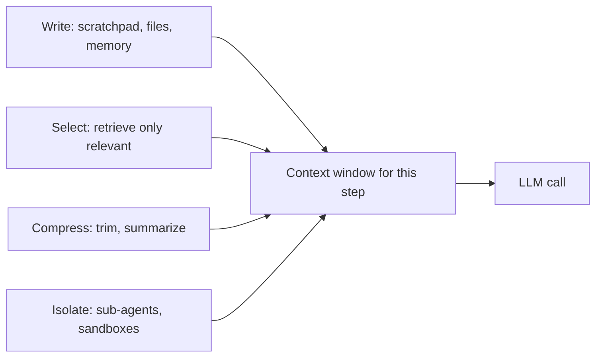

# Memory & Context

Is page pe: agent ki **short-term memory** (ek thread ke andar), **long-term memory** (threads aur sessions ke paar), aur **context engineering**, yaani har LLM call me context window me kya jaaye aur kya nahi. Interviewer poochta hai kyunki production agents ka sabse common failure model nahi, **galat ya bhara hua context** hota hai: lambi conversations, bade tool outputs, purani memories, aur badhta hua bill.

## ⭐ Memory ke types: ek map

**Ek line me:** short-term = ek conversation (thread) ki state, long-term = user/org ke baare me facts, experiences aur rules jo sessions ke paar zinda rehte hain.

| | Short-term | Long-term |
|---|---|---|
| Scope | ek thread / session | threads ke paar, user ya org level |
| LangGraph me | state + **checkpointer** | **Store** (namespaced key-value + search) |
| Kya rakhta | messages, tool results, scratch fields | preferences, facts, past episodes, instructions |
| Lifetime | thread khatam to irrelevant | TTL ya delete tak |
| Problem | context window bhar jaata hai | stale, conflicting, privacy |

- LLM khud **stateless** hai. "Memory" hamesha hamara code hai jo har call me context me sahi cheez daalta hai.
- Memory ka asli sawal: **kya save karein, kab save karein, kab wapas laayein, kab bhool jaayein.**

## ⭐ Short-term memory: checkpointer aur thread state

**Ek line me:** checkpointer har super-step ke baad graph state ko `thread_id` ke against save karta hai, isliye agla message usi thread me continue hota hai.

> **Example:** Swiggy support bot. User: "Mera order late hai." Agent order ID poochta hai, user deta hai, agent refund policy check karta hai. Teesre message tak agent ko pehle do yaad hone chahiye. Ye `thread_id = "order-chat-8812"` ke checkpoint se aata hai.

- `InMemorySaver` sirf dev/test ke liye. Production me `PostgresSaver` / `RedisSaver` (durable, multi-instance).
- Checkpoint ka bonus: **resume after crash**, **human-in-the-loop** (`interrupt`), **time travel** (purane checkpoint se fork).
- Thread state = poori `messages` list + custom fields. Ye **badhti hi rehti hai**, isliye trimming/summarization zaroori.

```python
from langchain.chat_models import init_chat_model
from langchain_core.messages import trim_messages
from langchain_core.messages.utils import count_tokens_approximately
from langgraph.graph import StateGraph, START, END, MessagesState
from langgraph.checkpoint.memory import InMemorySaver

llm = init_chat_model("openai:gpt-4.1-mini")

def chat(state: MessagesState):
    # State me poori history rehti hai; LLM ko sirf last ~3k tokens bhejo
    window = trim_messages(
        state["messages"],
        strategy="last",
        token_counter=count_tokens_approximately,
        max_tokens=3000,
        start_on="human",          # window human message se shuru ho
        end_on=("human", "tool"),  # dangling AI tool_call na chhoote
        include_system=True,
    )
    return {"messages": [llm.invoke(window)]}

builder = StateGraph(MessagesState)
builder.add_node("chat", chat)
builder.add_edge(START, "chat")
builder.add_edge("chat", END)
graph = builder.compile(checkpointer=InMemorySaver())

cfg = {"configurable": {"thread_id": "order-chat-8812"}}
graph.invoke({"messages": [("user", "Mera order late hai")]}, cfg)
```

- `trim_messages` **state ko nahi badalta**, sirf LLM ko jaane wala view chhota karta hai. Audit ke liye full history safe rehti hai.
- `start_on="human"` aur `end_on` isliye ki trimming ke baad `AIMessage(tool_calls)` bina matching `ToolMessage` ke na bache, warna provider API error deta hai.

**Interview tip:** "Short-term memory = checkpointer + thread_id. Main state me full history rakhta hoon par LLM ko token-budgeted window bhejta hoon, aur tool_call / tool_result pairs ko kabhi split nahi karta."

**Common galti:** production me `InMemorySaver` ship kar dena; pod restart pe saari conversations gayab.

## ⭐ Summarization node

**Ek line me:** jab history lambi ho jaaye, purane messages ka running summary banao aur unhe state se hata do; latest kuch turns verbatim rakho.

```python
from langchain_core.messages import RemoveMessage, SystemMessage

class State(MessagesState):
    summary: str

def summarize(state: State):
    msgs = state["messages"]
    if len(msgs) <= 20:
        return {}
    old, keep = msgs[:-6], msgs[-6:]
    prompt = (f"Purana summary: {state.get('summary', '')}\n"
              "Neeche ke messages ko jod ke summary update karo. "
              "Order IDs, amounts, user ke decisions zaroor rakho.")
    new_summary = llm.invoke(old + [("user", prompt)]).content
    # add_messages reducer RemoveMessage dekh ke un IDs ko state se hata deta hai
    return {"summary": new_summary,
            "messages": [RemoveMessage(id=m.id) for m in old]}

def chat(state: State):
    sys = SystemMessage(f"Conversation summary: {state.get('summary', '')}")
    return {"messages": [llm.invoke([sys] + state["messages"])]}
```

- Trimming vs summarization: trimming sasta hai par info seedha khoti hai; summarization info compress karta hai par ek extra LLM call aur **summary drift** (har round thoda detail girta hai).
- Summary prompt me batao kya **kabhi nahi** girana: IDs, amounts, commitments, user ki explicit preferences.
- Split point pe dhyaan: `keep` ka pehla message `ToolMessage` na ho.
- Background me summarize karo (response ke baad) taaki user latency na badhe.

**Common galti:** summary ko har baar scratch se banana (purana summary input me na dena), ya summary ko `messages` me human message ki tarah daal dena.

## ⭐ Long-term memory: semantic, episodic, procedural

**Ek line me:** CoALA paper (Cognitive Architectures for Language Agents) ke hisaab se teen tarah ki long-term memory: **facts** (semantic), **experiences** (episodic), **how-to rules** (procedural).

| Type | Kya store | Example (Zerodha assistant) | Kaise use hota |
|---|---|---|---|
| Semantic | user/world ke facts | "User F&O trade nahi karta, sirf long-term equity" | profile ya collection, search karke prompt me |
| Episodic | past interactions, successful runs | "Pichhli baar tax P&L report ke liye ye 3 steps kaam aaye" | few-shot examples ki tarah |
| Procedural | agent ke rules/instructions | "Is user ko hamesha Hindi me jawab do" | system prompt ka hissa, agent khud update kar sakta |

- **Semantic** ke do shapes:
  - **Profile:** ek JSON document jo update hota rehta hai (`{"language": "hi", "risk": "low"}`). Simple, par concurrent updates me conflict.
  - **Collection:** bahut saare chhote memory items, search se laaye jaate. Recall better, par duplicates aur contradictions manage karne padte.
- **Episodic** = "pichli baar kya hua aur kya kaam kiya". Successful trajectories ko few-shot examples ki tarah dynamically select karo.
- **Procedural** = prompt itself. Feedback se agent apna system prompt refine kar sakta hai (LangMem ka prompt optimizer). Risky: review ke bina prod me mat lagao.

**Interview tip:** "Main pehle decide karta hoon kaunsi memory chahiye. 80% B2C assistants ko sirf semantic profile chahiye. Episodic tab jab task repeatable ho, procedural tab jab behaviour per-user customize karna ho."

## ⭐ LangGraph Store: namespaces, put, search

**Ek line me:** Store ek cross-thread key-value + optional semantic index hai; data `namespace` tuple (jaise `("memories", user_id)`) aur `key` se organize hota hai.

```python
from dataclasses import dataclass
from langchain.embeddings import init_embeddings
from langgraph.store.memory import InMemoryStore
from langgraph.runtime import Runtime

store = InMemoryStore(index={
    "embed": init_embeddings("openai:text-embedding-3-small"),
    "dims": 1536,
    "fields": ["text"],      # sirf ye field embed hoga
})

@dataclass
class Ctx:
    user_id: str

def chat(state: MessagesState, runtime: Runtime[Ctx]):
    ns = ("memories", runtime.context.user_id)   # per-user isolation
    query = state["messages"][-1].content
    hits = runtime.store.search(ns, query=query, limit=3)
    facts = "\n".join(h.value["text"] for h in hits)
    sys = f"User ke baare me known facts:\n{facts}"
    return {"messages": [llm.invoke([("system", sys)] + state["messages"])]}

builder = StateGraph(MessagesState, context_schema=Ctx)
builder.add_node("chat", chat)
builder.add_edge(START, "chat")
graph = builder.compile(checkpointer=InMemorySaver(), store=store)

store.put(("memories", "u42"), "pref-lang", {"text": "User Hindi me baat karna pasand karta hai"})
graph.invoke({"messages": [("user", "Mera portfolio summary do")]},
             {"configurable": {"thread_id": "t1"}}, context=Ctx(user_id="u42"))
```

- `put(namespace, key, value)` upsert hai; same key pe overwrite. `get` exact key, `search` filter + semantic query.
- **Namespace hi access boundary hai.** `user_id` hamesha trusted runtime context se lo, LLM ke output se kabhi nahi.
- Production: `PostgresStore` (pgvector) ya `RedisStore`. `InMemoryStore` restart pe khaali.

**Common galti:** sab users ki memories ek namespace me daal ke sirf query se filter karna; ek bug aur ek user ka data doosre ke prompt me.

## ⭐ Memory likhna: hot path vs background

**Ek line me:** memory ya to agent conversation ke **beech me** tool call se likhta hai (hot path), ya ek alag process conversation ke **baad** extract karta hai (background).

| | Hot path | Background |
|---|---|---|
| Kaise | agent ke paas `save_memory` tool | conversation idle hone pe extractor job |
| Freshness | turant available | thodi der baad |
| Latency | response slow, extra tokens | user pe zero asar |
| Quality | agent ka dhyaan bat-ta hai, kam/zyada save | poori conversation dekh ke behtar dedupe |
| Transparency | user ko dikha sakte "yaad rakh liya" | hidden |

- Background ke liye debounce karo: conversation 5–10 min idle ho tab extract, har message pe nahi.
- Extractor ko **existing memories** bhi do taaki wo insert/update/delete decide kare, sirf append nahi.
- Common hybrid: explicit "yaad rakhna" requests hot path me, baaki implicit facts background me.

**LangMem in brief:** LangChain ki library jo ye kaam deta hai: `create_manage_memory_tool` / `create_search_memory_tool` (hot path tools jo Store use karte), `create_memory_store_manager` (background extraction + consolidation), aur prompt optimizer (procedural memory). Mem0, Zep jaise managed options bhi hain.

**Interview tip:** "Default background extraction, debounced, kyunki latency aur quality dono better. Hot path sirf jab user explicitly bole ya next turn me hi memory chahiye."

## ⭐ Context engineering: write, select, compress, isolate

**Ek line me:** context engineering = har step pe window me **sirf zaroori, sahi aur fresh tokens** rakhna. Chaar strategies: write, select, compress, isolate.

> **Example:** Flipkart seller-ops agent ek CSV analyze karta hai jisme 40,000 rows hain, 6 tools call karta hai, aur 30 steps chalta hai. Agar har tool output seedha messages me jaaye to step 12 tak 150k tokens, cost upar aur reasoning kharab.



- **Write (context ke bahar save):**
  - **Scratchpad:** plan, todo list, intermediate findings ek state field ya file me. Agent baad me padhta hai, window me hamesha nahi.
  - **Offloading big tool outputs:** 2 MB JSON ko file/state/object store me likho, LLM ko sirf `{"path": "...", "rows": 40000, "preview": first 5 rows}` do. Agent zarurat pe grep/slice tool se padhe.
- **Select (sahi cheez wapas laao):** memories, tools (100+ tools me se relevant 5–10), docs, few-shot examples, sab retrieval se.
- **Compress:** trimming, summarization, tool outputs ko pruning (purane tool results ko placeholder se replace karna, jaise "[result cleared, see file X]").
- **Isolate:** **sub-agent** ko apni fresh window do; wo 50k tokens explore kare aur parent ko sirf 1–2k ka condensed result lautaaye. State schema me heavy fields alag rakho jo LLM ko nahi jaate.

**Context rot aur lost-in-the-middle:**
- **Lost in the middle** (Liu et al. 2023): models context ke **start aur end** ki info better use karte hain, beech ki miss karte hain.
- **Context rot:** jaise-jaise input tokens badhte hain, accuracy girti hai, chahe window 1M ho. Bada window ≠ achha recall.
- Doosre failure modes: **context poisoning** (hallucination state me save ho ke baar-baar reuse), **distraction**, **confusion** (irrelevant tools), **clash** (contradicting info).
- Isliye: important instructions start me, current task/question end me, beech me minimum.

**Interview tip:** "Mere liye context ek budget hai. Har tool output ko token cap ke saath return karta hoon, bade outputs file me offload karta hoon, aur deep research sub-agents ko deta hoon jo sirf summary lautaate hain."

**Common galti:** "1M context window hai, sab daal do". Cost, latency aur accuracy teeno kharab hote hain.

## Prompt caching

**Ek line me:** provider prompt ke **same prefix** ka processed state cache karta hai; agle call me wo prefix sasta (roughly 10% price tak) aur fast hota hai, par sirf tab jab prefix **byte-for-byte same** ho.

| | Anthropic | OpenAI |
|---|---|---|
| Kaise on | explicit `cache_control` breakpoints (max 4) | automatic, prompts ≥ 1024 tokens |
| TTL | 5 min default (har hit pe refresh), 1h option | idle pe kuch minute, extended retention option |
| Pricing | cache write ~1.25x, read ~0.1x | cached input pe discount, write ka extra charge nahi |
| Order | tools → system → messages | prefix match, `prompt_cache_key` routing me madad |

- Exact numbers model ke hisaab se badalte hain; interview me concept bolo, numbers "approx".
- **Cache-friendly layout:** stable cheezein pehle, badalne wali baad me:
  1. Tool definitions (fixed order, deterministic JSON)
  2. System prompt (static instructions)
  3. Static docs / few-shot examples
  4. Conversation history (append-only)
  5. Latest user message + dynamic bits
- **Cache tod-ne wale bugs:** system prompt me timestamp (`Aaj 14:32:07 hai`), tools ka random order, per-request user name sabse upar, history ko beech me edit karna (trimming bhi prefix badalta hai).
- Agent loops me caching sabse zyada faayda deta hai: har step pe same lamba prefix + thoda naya.

**Interview tip:** "Main dynamic cheezein (date, user memory) system prompt ke end me ya latest message me daalta hoon taaki tools + static instructions ka prefix cached rahe. Cache hit rate ko metric ki tarah track karta hoon."

**Common galti:** summarization/trimming se har turn prefix badal dena, phir sochna caching kaam kyun nahi kar rahi.

## Memory privacy aur staleness

**Ek line me:** long-term memory = user ka personal data, isliye isko DB jaisa treat karo: isolation, TTL, deletion, audit, aur conflict resolution.

> **Example:** Razorpay merchant assistant ne yaad rakha "settlement account HDFC hai". Merchant ne 2 mahine baad ICICI kar diya. Purani memory ki wajah se agent galat account bata raha hai.

- **Privacy:**
  - Per-user namespace, trusted `user_id`, cross-tenant search test karo.
  - PII (card, Aadhaar, OTP, passwords) memory me **save hi mat karo**; extractor ke prompt + regex filter dono se roko.
  - User ko "meri memories dikhao / delete karo" ka control do. DPDP/GDPR "right to erasure" me memory store, vector index, backups, aur summaries sab cover hone chahiye.
- **Staleness:**
  - **TTL:** volatile facts (current city, open ticket) pe short TTL; stable preferences pe lamba. LangGraph store backends TTL support karte hain (config me default TTL, read pe refresh).
  - Har memory pe `created_at`, `updated_at`, `source` rakho; prompt me "as of" date ke saath dikhao.
- **Conflicting memories:**
  - Write time pe consolidate: naya fact aaye to similar purani memory dhoondo, LLM se decide karao `UPDATE / DELETE / NOOP / ADD`.
  - Read time pe: latest wins, aur explicit user statement > inferred fact.
  - Critical data (bank account, address) memory se nahi, **source-of-truth API** se lo. Memory sirf hint.

**Interview tip:** "Memory ek cache hai, source of truth nahi. Transactional facts hamesha API se, memory sirf personalization ke liye."

**Common galti:** sirf append karna; 6 mahine baad ek user ki 300 memories jinme aadhi ek doosre ko contradict karti hain.

## Aage padho

- [LangGraph Core Concepts](02-langgraph-core.md): state, reducers, checkpointer detail me.
- [Agentic Patterns: Agents & Multi-agent](04-agent-patterns.md): sub-agent context isolation.
- [Data & Retrieval for Agents](06-agentic-data-rag.md): memory search ke peeche retrieval.
- [Cost & Latency](11-cost-latency.md): caching aur token budgets ka cost side.
- [Vector databases](../05-db/11-vector.md): semantic memory index ke neeche kya hai.
- [Multi-agent lab](/viewinter/agents/labs/multi): sub-agents browser me chala ke dekho.

## Checklist

- [ ] Short-term vs long-term memory aur LangGraph me checkpointer vs Store ka role samjha sakta hoon
- [ ] `trim_messages` aur summarization node likh sakta hoon, aur tool_call pairs split na hone ka reason bata sakta hoon
- [ ] Semantic, episodic aur procedural memory ko examples ke saath samjha sakta hoon
- [ ] Store namespaces, `put`/`search` aur per-user isolation explain kar sakta hoon
- [ ] Hot path vs background memory writing ka trade-off bata sakta hoon
- [ ] Context engineering ki write, select, compress, isolate strategies examples ke saath bata sakta hoon
- [ ] Context rot aur lost-in-the-middle samjha ke unke mitigations bata sakta hoon
- [ ] Cache-friendly prompt layout design kar sakta hoon aur cache todne wale bugs gina sakta hoon
- [ ] Memory ke liye TTL, deletion aur conflict resolution plan bata sakta hoon
